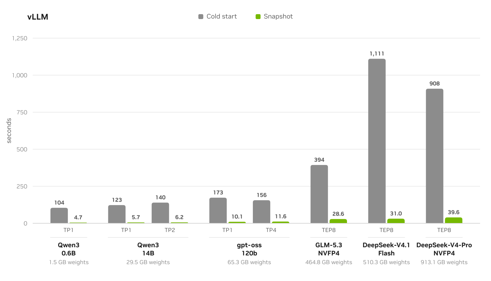

# Snapshot

[](https://github.com/ai-dynamo/snapshot/actions/workflows/ci.yml)
[](https://github.com/ai-dynamo/snapshot/releases)
[](LICENSE)
[](https://github.com/ai-dynamo/snapshot/graphs/contributors)

Snapshot is a Kubernetes-native checkpoint and restore system for NVIDIA GPU
workloads. It checkpoints a fully initialized GPU pod (its running process, with
CPU and GPU memory) and restores that state on any compatible node, so a pod
becomes ready in seconds instead of minutes.

Snapshot provides the checkpoint and restore primitives for GPU pods.
Orchestration (which pods to checkpoint, when, and how the checkpoints are
restored) is left to the systems that integrate it.

> [!NOTE]
> Snapshot's APIs may still change, so it is not yet recommended for
> production-critical workloads.

## The Problem

In inference serving, a replica cannot answer a single request until it is fully
initialized: model weights loaded into GPU memory, CUDA and runtime libraries
initialized, execution kernels warmed up, and computation graphs compiled. For
large models, this **cold start** takes minutes.

That cost is paid over and over. Every replica added to meet demand, every
scale-up from zero, every restart or reschedule pays the full cold start again
before it can serve traffic:

- New replicas take minutes to become ready, so autoscaling lags behind demand.
- Teams over-provision idle GPUs just to absorb demand spikes.
- Restarts and reschedules stall serving capacity exactly when it is needed.

## The Solution

Snapshot checkpoints a fully initialized pod once and restores it on demand, so a
new replica comes online in seconds instead of minutes.

- **Checkpoint** - Pause a running pod and save its complete execution state (CPU
  and GPU memory) as a portable artifact.
- **Restore** - Start a new pod from that artifact on any node with matching GPU
  hardware and driver versions, skipping model loading and warm-up; the process
  resumes from where it was checkpointed.

## Benchmarks

<div align="center">
  <picture>
    <source media="(prefers-color-scheme: dark)" srcset="docs/overview/img/vllm-cold-start-vs-snapshot-dark.png">
    
  </picture>
</div>

<p align="center"><i><b>Figure 1.</b> Cold start and Snapshot restore for vLLM on a single B200 node, using one to eight GPUs.</i></p>

For the experiment setup, the per stage breakdown, and the full results, see [Performance](docs/overview/performance.md).

## When to Use It

- **Autoscaling inference** - Scale out from an existing snapshot: bring the N+1
  replica and beyond online in seconds to keep pace with demand.
- **Scale-to-zero** - Park idle models at zero replicas and restore them quickly
  when capacity is needed again.
- **Faster restarts and reschedules** - Recover a pod's initialized state after a
  restart or a move to another node.

Snapshot currently focuses on inference cold-start; further use cases are on the
roadmap.

## Who It Is For

Snapshot is a building block for the teams that build and operate inference
infrastructure:

- **Developers** building Kubernetes controllers, operators, or serving platforms.
- **MLOps and platform engineers** who assemble deployment pipelines declaratively
  with GitOps or workflow tools.

## Installation

Snapshot installs as a single per-cluster Helm release: a control-plane operator
plus a privileged node agent (DaemonSet) on GPU nodes. Install it in its own
namespace, and run GPU workloads in separate namespaces.

Snapshot can be installed:

- **From a release** (recommended)
- **From source** (build the images and install locally)

### Prerequisites

Before installing Snapshot, make sure the following are in place:

- A Kubernetes cluster with NVIDIA GPU nodes running Linux kernel 5.13 or newer
- containerd or CRI-O as the container runtime
- [NVIDIA GPU Operator](https://github.com/NVIDIA/gpu-operator) 26.3 or newer, with MIG disabled
- NVIDIA kernel-mode driver 580 or newer
- A shared snapshot store: an RWX storage class or an S3 bucket — see [Configure Storage](docs/operate/configure-storage.md)
- The [Helm](https://helm.sh/docs/intro/install) CLI
- A cluster that permits privileged pods for the node agent (see [Allow the Privileged Node Agent](docs/get-started/installation.md#allow-the-privileged-node-agent))

Some features raise this floor. See [Prerequisites by Feature](docs/get-started/prerequisites.md#prerequisites-by-feature).

### From a Release

Install the published chart. Replace `<version>` with the release you want from
the [releases page](https://github.com/ai-dynamo/snapshot/releases):

```bash
helm install snapshot oci://ghcr.io/ai-dynamo/snapshot/snapshot \
  --version <version> \
  --namespace snapshot --create-namespace
```

By default the chart provisions its own RWX snapshot volume, shared by every
checkpoint. For the volume model and options, including reusing an existing
claim, see [Configure Storage](docs/operate/configure-storage.md). For install
and uninstall, see [Installation](docs/get-started/installation.md).

### From Source

Follow the instructions in [Building from Source](docs/development/build-from-source.md).

### Quickstart

Once Snapshot is installed, the
[Quickstart: Checkpoint and Restore One Pod](docs/get-started/quickstart.md)
checkpoints a vLLM replica that serves Qwen3 0.6B on one GPU, then starts a new
replica from the snapshot.

## How to Use It

Snapshot is driven entirely through Kubernetes resources, with standard tooling.
Create a `PodSnapshot` to checkpoint a running pod, and annotate a new pod with
`nvidia.com/restore-from` to restore it. Higher-level systems wire these
primitives into their own control loop.

| Resource | Scope | Role |
|----------|-------|------|
| `PodSnapshot` | Namespaced | Created by callers to request a checkpoint, or to reference an artifact for restore. |
| `PodSnapshotContent` | Cluster-scoped | System-managed record of the physical artifact, bound to a `PodSnapshot`. Created by the operator, never by the caller. |
| `SnapshotJob` | Namespaced | Runs a pod from a template and checkpoints it into a `PodSnapshot` once ready (a self-contained checkpoint job). |
| `nvidia.com/restore-from` | Namespaced | Pod annotation that triggers a restore from a named `PodSnapshot` in the same namespace. |

Under the hood, a control-plane operator and a per-node agent perform the CRIU
and `cuda-checkpoint` work; see [Architecture](docs/overview/architecture-overview.md).
The [API Reference](docs/reference/api.md) covers the resources and the
checkpoint/restore lifecycle.

Once Snapshot is installed, follow **[Using Snapshot](docs/using-snapshot/README.md)**
to go from a workload to a restored replica: pick an inference framework and model on
one or eight GPUs, make the workload snapshot-ready, checkpoint it, and restore it.

## Limitations

Current limitations:

- Linux nodes on x86_64 or arm64.
- Workloads, including multi-GPU workloads, must run on a single node. Multi-node is on the roadmap.
- vGPU is not supported.
- Runs only on NVIDIA GPUs supported by the required CUDA driver.

## Repository Tour

| Path | What lives there |
| --- | --- |
| [`operator/`](operator) | The cluster controller that reconciles `PodSnapshot`, `PodSnapshotContent`, and `SnapshotJob`. |
| [`agent/`](agent) | The node agent that drives CRIU and CUDA checkpointing on each GPU node. Linux only. |
| [`api/`](api) | The CRD types and the generated CRD YAML. |
| [`charts/`](charts) | The Helm chart. |
| [`docs/`](docs) | The user and developer documentation. |
| [`e2e/`](e2e) | End-to-end tests that run against a Kubernetes cluster. |
| [`benchmarks/`](benchmarks) | The tool that measures cold start, checkpoint, and restore times. |

## Documentation

The full documentation set lives in [`docs/`](docs/README.md), in these sections:

- [Overview](docs/README.md#overview) - What Snapshot is, core concepts, architecture, performance, and limitations.
- [Get Started](docs/README.md#get-started) - Prerequisites, installation, and a first checkpoint and restore.
- [Using Snapshot](docs/README.md#using-snapshot) - The checkpoint and restore flow for each inference framework.
- [Operate](docs/README.md#operate) - Configure and tune storage, and upgrade Snapshot.
- [Reference](docs/README.md#reference) - API, Helm values, CLI, and the workload and restore pod contracts.
- [Troubleshooting](docs/README.md#troubleshooting) - Find and fix checkpoint, restore, and agent failures.
- [Development](docs/README.md#development) - Build from source, benchmarks, and the writing and naming guides.

## Adopters

[NVIDIA Dynamo](https://github.com/ai-dynamo/dynamo), the open-source
inference-serving stack, integrates Snapshot for GPU cold-start. On Dynamo, Snapshot is available through it directly. See
[Snapshotting GPU Workers](https://docs.nvidia.com/dynamo/latest/kubernetes/operations/cold-start-optimizations/dynamo-snapshot)
in the Dynamo docs.

## Contributing

Contributions are welcome under the project's [Apache 2.0 license](LICENSE). See
[CONTRIBUTING.md](CONTRIBUTING.md). All commits must be signed off (DCO).

Participation in this project is governed by our
[Code of Conduct](CODE_OF_CONDUCT.md). [MAINTAINERS.md](MAINTAINERS.md) lists
who reviews and merges changes, [GOVERNANCE.md](GOVERNANCE.md) describes how
decisions are made, and [RELEASE.md](RELEASE.md) covers versioning and how
releases are cut. AI coding agents should also read [AGENTS.md](AGENTS.md).

## Security

To report a security vulnerability, follow the process in [SECURITY.md](SECURITY.md).

## Community

- **[Discussions](https://github.com/ai-dynamo/snapshot/discussions)** - Questions, ideas, and open-ended design conversations.
- **[Slack](https://ai-dynamo.org/slack)** - Chat with the team and the community in the ai-dynamo workspace. Once you have joined, find us in [#snapshot-dev](https://ai-dynamo.slack.com/archives/C0CELRPP6D7).
- **[Issues](https://github.com/ai-dynamo/snapshot/issues)** - Bugs and feature requests. Every change starts as an issue; see [CONTRIBUTING.md](CONTRIBUTING.md).
- **[Changelog](CHANGELOG.md)** - What changed in each release.
- **Security** - Never in a public issue; follow [SECURITY.md](SECURITY.md).

Questions and design discussions belong in Discussions rather than an issue.
Issues are for work the project intends to do.

## Feedback

Feedback and issues are welcome. [Open an issue](https://github.com/ai-dynamo/snapshot/issues).

## License

Snapshot is licensed under the [Apache License 2.0](LICENSE).
