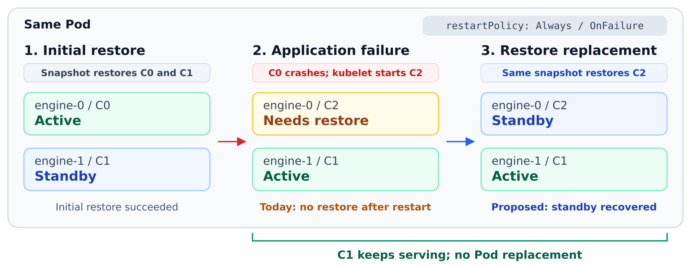
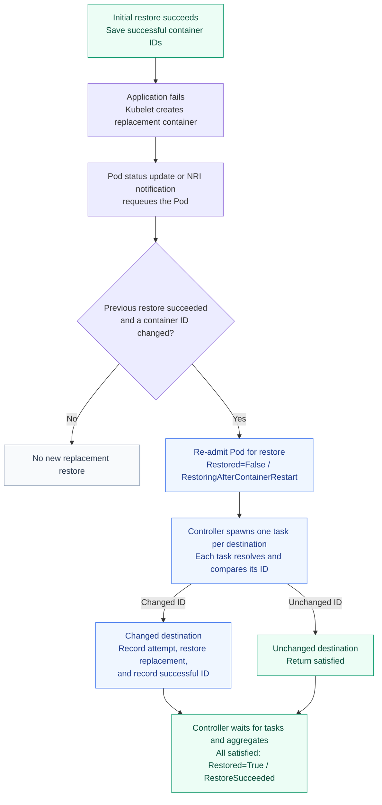

<!--
SPDX-FileCopyrightText: Copyright (c) 2026 NVIDIA CORPORATION & AFFILIATES. All rights reserved.
SPDX-License-Identifier: Apache-2.0
-->

# Restore replacement containers after application failure

## Summary

After a successful Pod restore, a workload should be able to recover from an
application failure through an in-place container restart. With a
`restartPolicy` other than `Never` (`Always` or `OnFailure`), kubelet can
create a replacement container in the existing Pod. Snapshot should restore
that replacement from the same snapshot, preserving the Pod's placement and
leaving unchanged destination containers running.

## Motivation

An application can crash after its restore succeeds while the saved snapshot
remains usable. When restart policy permits, kubelet creates a **replacement
container** with the same name in the same Pod and a new runtime container ID.
Snapshot currently does not support restoring that replacement:

- With `restartPolicy: Never`, the failed destination container stays stopped.
- With `Always` or `OnFailure`, kubelet can create a replacement container,
  but the node agent still treats the Pod's `RestoreSucceeded` outcome as
  terminal and skips further restore work.

For inference services, recovering by replacing the Pod can add scheduling
and GPU allocation delays and repeat startup for otherwise healthy
containers. Restoring only the replacement container would retain the Pod's
placement and avoid restarting its healthy siblings.

### Shadow engine failover

Dynamo's shadow engine failover needs this recovery path to replenish standby
capacity while preserving service. The active engine and standby share a Pod.
After both restore successfully, an application crash in the active engine
lets the standby take over. Snapshot should restore the replacement container
created by kubelet so it can become the new standby while the surviving
engine continues serving.



### Goals

- Restore replacement containers after application failures in a successfully
  restored Pod, supporting in-place restarts when `restartPolicy` is not
  `Never` (`Always` or `OnFailure`).
- Leave unchanged destination containers running without repeating their
  completed restores.
- Support successive container restarts after each replacement container is
  successfully restored.
- Extend existing recovery behavior to replenishment when the node agent
  restarts.
- Report progress and outcomes for replacement restores through the Pod's
  restore status.
- Preserve initial-restore behavior, keep legacy Pods without identity
  history one-shot, and retain terminal handling for failed or partially
  successful restore cycles.

### Non-goals

- Retry failed restore attempts ([SNEP-247](https://github.com/ai-dynamo/snapshot/pull/836))
  or fall back to cold start ([SNEP-322](https://github.com/ai-dynamo/snapshot/pull/800)).
- Change kubelet restart policy, recreate Pods, or recover from node loss.
- Coordinate application failover.

## Proposal

A Pod opts in before its initial restore with
`nvidia.com/restore-on-container-restart: "true"` (proposed default: `false`).
The default and condition reason `RestoringAfterContainerRestart` remain
provisional.

With `restartPolicy: Always` or `OnFailure`, the lifecycle becomes:

1. The **initial restore succeeds**. The node agent persists each destination's
   successful container ID and sets `Restored=True / RestoreSucceeded`.
2. An application fails. The **kubelet** creates a replacement container in the
   same Pod; the NRI plugin prepares it to wait for restore.
3. Container status updates, or the NRI post-start notification, **requeue the
   Pod** for restore processing.
4. On dequeue, the **node agent re-admits the Pod for restore**: the previous
   restore succeeded, but a current container ID differs from its persisted
   successful ID. It sets `Restored=False / RestoringAfterContainerRestart`.
   Matching IDs do not trigger another restore.
5. The agent spawns a task for each destination. Tasks for unchanged containers
   return satisfied; a replacement's task restores it from the same snapshot,
   releases the application, and finishes any configured post-restore action.
6. The agent records success for the new container ID. Once all destinations
   are satisfied, it sets `Restored=True / RestoreSucceeded` again.

The diagram shows the successful path, including tasks for unchanged
containers:



After success, later policy-permitted container restarts can follow the same
flow. If a replacement restore fails, existing terminal failure handling
still applies.

### Limitations, risks, and mitigations

- **Control files from previous containers (stale markers).** Old completion
  and failure markers can block a replacement's startup or affect its restore.
  Isolate control files by container ID across all readers and writers. The
  agent must explicitly reject ineligible replacements; rejection can wait
  during an agent outage.
- **Repeated application failures (crash loops).** A workload can restore
  successfully and then crash on every start, repeatedly consuming snapshot
  bandwidth and GPU restore resources. Kubelet backoff paces restarts but does
  not bound the number of successful restore cycles. This proposal adds no
  Snapshot attempt or bandwidth budget for that loop.
- **Snapshot and control storage lifetime.** The referenced snapshot must
  remain available while automatic restoration is enabled. Remove retired
  control directories only after their containers and restore tasks no longer
  need them. Retention and cleanup ownership remain open.
- **Legacy Pods and rollback.** Successful Pods without container identity
  history retain one-shot behavior. Enable the feature before initial restore
  so that history is recorded; the proposed default is off. Older agents may
  not understand an active replacement restore, so the supported rollback
  boundary still needs qualification.

## Design details

A **destination container** is a named Pod container selected for restore.
Its **container ID** identifies one runtime instance and changes when kubelet
replaces it. The **`nvidia.com/Restored` condition** summarizes restore results
across the Pod's destinations.

### API

Enable the feature on the restore Pod before its initial restore. In a
workload controller, set these fields on the Pod template:

```yaml
metadata:
  annotations:
    nvidia.com/restore-on-container-restart: "true"
spec:
  restartPolicy: OnFailure # Always also permits container restarts.
```

- **Annotation.** Proposed default: `false`, including when absent. An invalid
  value produces a warning and leaves the feature disabled. Enabling it on an
  already successful Pod without recorded container history is unsupported.
- **Restart policy.** Kubelet decides whether to restart a container; Snapshot
  does not change that policy. `Never` still permits the initial restore but
  cannot provide this recovery path. Report that mismatch as a warning.

Extend the existing `nvidia.com/Restored` condition with one reason; add no
condition type or CRD:

| Status / reason | Meaning |
| --- | --- |
| `True / RestoreSucceeded` | All destinations are satisfied for the completed cycle. |
| `False / RestoringAfterContainerRestart` | An eligible replacement cycle is waiting, restoring, or recovering interrupted work. |
| `False /` existing failure reason | The cycle ended with the existing failed, partial-success, or refusal outcome. |

The condition describes restore progress, not application readiness.

**Persisted restore state (provisional).** The node agent maintains one
Pod-wide JSON record in `nvidia.com/restore-container-state`, keyed by container
name, with `lastSuccess` and `attempt` for each destination. The condition above
records the Pod's current lifecycle phase; the annotation identifies the
containers and progress behind that phase. Users configure the opt-in, not
this bookkeeping record. Changing the Pod's restore source is outside this
proposal.

*Example: initial restore succeeded for a destination named `worker`.* The
annotation's logical content is shown as YAML for readability:

```yaml
destinations:
  worker: # Container name in the Pod.
    lastSuccess: C0
    attempt: {containerID: C0, phase: Succeeded}
  # Additional destination containers have their own entries here.
```

`lastSuccess` identifies the last successfully restored container; `attempt`
identifies the current or most recent attempt and its phase. The name and
encoding remain provisional. Missing history preserves legacy one-shot
behavior; malformed history must not authorize another restore.

### Restore lifecycle and failure handling

#### Eligibility

> **Restore a replacement only if the Pod's previous restore succeeded.**
> The Pod must be opted in, and the destination's new runtime container ID
> must differ from its recorded successful ID. Reuse the same snapshot in
> the same Pod.

*Example:* the Pod restored successfully with `worker` running as `C0`.
After its application fails, kubelet creates `C1`; restore that replacement.
Another application failure is eligible only after this cycle succeeds.

The boundaries are:

- A matching, successfully restored ID is already satisfied; skip it.
- A missing replacement ID permits waiting, not executing a restore.
- Partial or complete failure of a restore cycle suspends subsequent automatic
  restoration for the Pod. Refusal remains terminal. An older `lastSuccess`
  cannot override a newer failed attempt.
- An agent restart resumes the recorded cycle; it does not authorize a new
  one. Legacy Pods without container history retain one-shot behavior.

Eligibility uses restore history and container identity. It requires no
application-specific failure detector. Initial restore behavior is unchanged.

#### Common outcomes

| Case | Behavior and Pod condition |
| --- | --- |
| **Golden path: application fails after successful restore.** | Restore the replacement in place: `True / RestoreSucceeded` → `False / RestoringAfterContainerRestart` → `True / RestoreSucceeded`. |
| **Replacement container is unavailable.** | Remain `False / RestoringAfterContainerRestart` while waiting for a running container. Continue when available. |
| **Replacement restore fails.** | Set `False / RestoreFailed`, or `False / RestorePartiallySucceeded` with a successful sibling. Further automatic restores stop; healthy siblings stay running. |
| **A sibling restarts during restoration.** | Restore both replacements: `False / RestoringAfterContainerRestart` → `True / RestoreSucceeded`. A late-observed sibling restart can begin another cycle after the first reports success. |
| **Agent restarts during restoration.** | Resume the existing cycle, keeping `False / RestoringAfterContainerRestart` during recovery, then report its outcome. Skip already successful destinations. |

### Implementation surface

| Concern | Required change |
| --- | --- |
| **1. Preserve additional restore state** | Add successful container IDs and attempt progress alongside the existing Pod condition. |
| **2. Reconsider the Pod after application failure** | Requeue on container status changes and compare current IDs with the saved success records. |
| **3. Resolve and restore the replacement** | Within existing destination tasks, resolve a running ID, skip completed work, or record and restore a new instance. |
| **4. Isolate control files** | Mount `/snapshot-control` from a directory specific to the destination name and container ID. |
| **5. Finish and record success again** | Record the successful ID after release and post-restore actions, then aggregate destination results. |

#### 1. Preserve additional restore state

Today, `Restored=True / RestoreSucceeded` contains no container IDs. It cannot
tell whether a destination's current runtime instance received a restore or
replaced one that did.

Maintain one Pod-wide JSON record in `nvidia.com/restore-container-state`, with
an entry for each destination container name. Populate it during the initial
restore, then update `attempt` as a replacement progresses. Only a successful
workflow advances `lastSuccess`.

*Example: kubelet replaces `worker` container `C0` with `C1`.* While restoring
`C1`, the annotation's logical content is:

```yaml
destinations:
  worker: # Container name in the Pod.
    lastSuccess: C0
    attempt: {containerID: C1, phase: Restoring}
  # Additional destination containers have their own entries here.
```

Success advances both IDs to `C1` and sets the attempt phase to `Succeeded`.
Failure leaves `lastSuccess=C0` and records `attempt=C1/Failed`; the older
success cannot authorize another attempt.

#### 2. Reconsider the Pod after application failure

Container exits and restarts change Pod status. The existing Pod informer
queues the Pod on those updates; the NRI post-start notification also reports
the new container ID and queues it. On dequeue, compare current IDs with
persisted history before the terminal-success shortcut or in-memory handled
cache can stop processing.

For an eligible replacement, persist
`Restored=False / RestoringAfterContainerRestart` before launching tasks.
Later passes continue that cycle even though the condition is no longer
`RestoreSucceeded`. Failed and partially successful
restore cycles retain terminal handling.

*Example: a Pod with `RestoreSucceeded` and `worker.lastSuccess=C0`.* The
controller's decision depends on the current Pod status:

| Current ID for `worker` | Controller decision |
| --- | --- |
| `C0` | Matches the recorded success; do nothing. |
| No ID yet | Enter replenishment; the task waits for a running container. |
| `C1` | Enter replenishment; the task evaluates `C1` for restore. |

If a pass returns Pending while waiting for `C1`, the next pass resumes
`RestoringAfterContainerRestart` rather than requiring the old success
condition again.

#### 3. Resolve and restore the replacement

The controller still launches one task per destination and waits for their
results. During replenishment, skip destinations with no recorded success
before resolving runtime state. For the remaining destinations:

- No running container: use the existing bounded wait; return Pending if it
  expires, leaving the Pod in `RestoringAfterContainerRestart` for another pass.
- Already successful ID: return satisfied without repeating restore or its
  application notification.
- ID matching an interrupted attempt: use existing restore recovery.
- Eligible new ID: persist the attempt before calling the executor, keeping
  the previous `lastSuccess` until completion.

Each attempt targets a fixed Pod UID, snapshot content UID, destination name,
and container ID. A task must not switch to a later replacement. A sibling
that changes after its task returned waits for the next Pod pass, as in the
current scheduling model.

*Example: two destinations, only one replaced.* Their concurrent tasks make
independent decisions:

```text
worker-a: current=C2, lastSuccess=C0 -> record C2/Restoring -> restore C2
worker-b: current=C1, lastSuccess=C1 -> return satisfied
```

The `worker-a` task retains `lastSuccess=C0` and restores into `C2`.
`worker-b` remains running without another restore or notification.

#### 4. Isolate control files

Today, runtime instances of a destination share a control directory. Its
`restore-complete` file survives a container restart, so a replacement proxy
finds the old result and refuses to start.

Change the NRI container-create hook to mount a directory for the current
container ID, from the initial restore onward. The proxy, application,
startup probe, restore helper, and marker writers must all use that view.
Host-side writes of restore markers must also include the ID, rather than
addressing only the destination name.

*Example: successive instances of `worker`.* Their mounts become:

```text
Today:  /snapshot-control -> snapshot-control/worker/

C0:     /snapshot-control -> snapshot-control/worker/C0/
C1:     /snapshot-control -> snapshot-control/worker/C1/
```

Creating `C1` leaves `C0`'s files intact. An agent restart while `C1` exists
reuses `worker/C1/` and its completion evidence. If policy rejects `C1`, write
its failure signal in `worker/C1/`; a failure marker in `worker/C0/` no longer
ends the replacement's proxy.

#### 5. Finish and record success again

Record destination success only after physical restore, application release,
and any configured `postRestore` action complete. Synchronize record updates,
preserve sibling entries, and apply results only to the matching attempt.
Publish local success state only after the persistent write succeeds.

After all tasks return, record the Pod outcome:

- Any Pending replacement: retain `False / RestoringAfterContainerRestart`
  and requeue.
- All destinations satisfied: persist `True / RestoreSucceeded`.
- Otherwise: use existing failed, partial-success, or compatibility-refusal
  handling.

Node agent restarts retain existing recovery behavior for the same container
ID.

*Example: completing an attempt for `C1`.* The required ordering is:

```text
Restore C1
    -> write C1/restore-complete with the restored process PID
    -> finish configured postRestore action
    -> persist attempt=C1/Succeeded and lastSuccess=C1
    -> return satisfied
```

If that record write fails, `C1` is physically restored but its success is not
yet recorded. The next pass uses `C1`'s completion evidence to finish the
remaining notification or bookkeeping; it must not run physical restore
again.

### Security

TBD.

### Monitoring

**Condition:** expose `False / RestoringAfterContainerRestart` on
`nvidia.com/Restored` while waiting or restoring. Finish with
`True / RestoreSucceeded` or an existing failure reason.

**Logs:** identify the Pod, destination container, and relevant IDs. Examples:

```text
Replacement detected pod=demo/serve-1 container=worker oldID=C0 newID=C1
Waiting for replacement container pod=demo/serve-1 container=worker
Replacement restore succeeded pod=demo/serve-1 container=worker containerID=C1
Replacement restore failed; automatic restoration suspended pod=demo/serve-1 container=worker containerID=C1
```

**Metrics:** TBD. Consider a counter of replacement restores by outcome.

### Test plan

- **Policy:** changed ID after success is eligible; matching IDs, failed
  cycles, and disabled or legacy Pods do not start another restore cycle.
- **Recovery:** pending IDs, agent exits before/after completion, failed state
  writes, isolated control files, and concurrent sibling-state updates.
- **GPU end to end:** repeated application failures with one and two
  destinations under `Always` and `OnFailure`. Verify the Pod UID and survivor
  ID stay unchanged, and a replacement restore failure stays terminal.

### Graduation criteria

- **Alpha:** opt-in recovery and transition tests pass, including the GPU
  survivor case; document configuration and conditions.
- **Beta:** qualify runtimes and finalize pacing, retry/fallback composition,
  retention, cleanup, and rollback behavior.
- **GA:** stable API and production evidence that repeated recovery preserves
  healthy siblings.

## Open questions

### How should this compose with retry and fallback?

The following is a **recommended composition to finalize** with
[restore retry](https://github.com/ai-dynamo/snapshot/pull/836) and
[cold-start fallback](https://github.com/ai-dynamo/snapshot/pull/800):

1. **Only recorded success enables another application-restart cycle.** The
   Pod must reach `RestoreSucceeded` before a later application failure can
   authorize a new cycle. Failed or partially successful cycles stay terminal
   for this feature; a successful cold start does not count as restore success.
2. **Retry handles failures within a cycle.** Apply its configured attempt
   limit and deadline before declaring final failure. Agent restarts and
   retry-driven container restarts retain that budget. A later, authorized
   application-restart cycle gets a fresh budget; unchanged destinations spend
   no attempts.
3. **Fallback follows final failure or refusal.** If enabled, start the failing
   destination's original command according to its fallback policy. Preserve
   the Pod and healthy siblings. Persist the fallback decision across container
   IDs so that the cold-started destination is not selected for another restore.

Two integration details need agreement: retry budgets and fallback decisions
must survive the per-container control directory changing; probes must work
for cold start as well as restore. A probe requiring `restore-complete` cannot
gate a cold start. Neither feature is required for this proposal to ship.

### Should Kubernetes or Snapshot pace repeated application failures?

The initial recommendation is to use kubelet restart backoff, with no new
Snapshot budget. It limits frequency, not total restore count or storage
traffic, and can reset after a sustained run. Should Snapshot also impose a
cooldown or budget across successful cycles? That would require additional
state and could delay recovery. It is separate from retry backoff within a
failed cycle.
