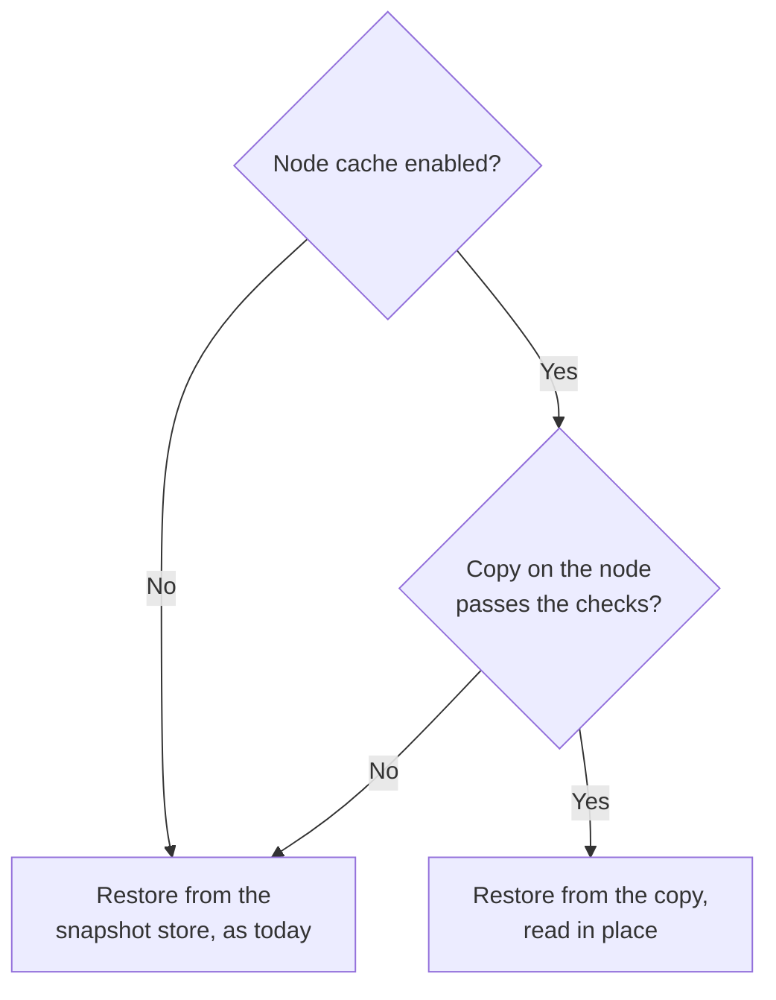

<!--
SPDX-FileCopyrightText: Copyright (c) 2026 NVIDIA CORPORATION & AFFILIATES. All rights reserved.
SPDX-License-Identifier: Apache-2.0
-->

# SNEP-1001: Restore from a Local Checkpoint Copy

<!-- toc -->
- [Summary](#summary)
- [Motivation](#motivation)
  - [Goals](#goals)
  - [Non-Goals](#non-goals)
- [Proposal](#proposal)
  - [Limitations, Risks, and Mitigations](#limitations-risks-and-mitigations)
- [Design Details](#design-details)
  - [Changes by Component](#changes-by-component)
  - [Copy Layout and Checks](#copy-layout-and-checks)
  - [Restore Source](#restore-source)
  - [Administrator Guide](#administrator-guide)
  - [API](#api)
  - [Security](#security)
  - [Monitoring](#monitoring)
  - [Test Plan](#test-plan)
  - [Graduation Criteria](#graduation-criteria)
<!-- /toc -->

## Summary

A restore can read a checkpoint from the node cache: a directory on the
node's local disk that holds copies of checkpoints. When the node cache holds
a copy of the checkpoint, the restore reads it. When it does not, the restore
reads the snapshot store, as today. Snapshot never writes to the node cache.
An administrator places and removes the copies with their own tools. The node
cache is optional. With it disabled, nothing changes.

## Motivation

Many clusters have fast local disks, such as NVMe, and administrators already
have tools that copy files to nodes. Today a restore always reads from the
snapshot store, even when the same checkpoint is on the node's own disk.
Reading a local copy avoids that traffic and can shorten restore time.

### Goals

This proposal has four goals:

- **Local restore:** restore from a copy in the node cache when the node holds
  one.
- **Fallback:** restore from the snapshot store, as today, when the node holds
  no usable copy.
- **Administrator copies:** use copies that an administrator placed, with a
  documented layout and procedure.
- **No change when disabled:** keep the restore path and the rendered
  manifests unchanged while the node cache is disabled.

### Non-Goals

This proposal excludes these features, which
[#644](https://github.com/ai-dynamo/snapshot/issues/644) tracks:

- Saving a copy automatically on checkpoint or on restore.
- Removing copies, when a snapshot is deleted or on request.
- A size limit for the node cache.
- Showing which nodes hold a copy.
- Preferring nodes that hold a copy when scheduling restore Pods.
- Automatic copying of snapshots to nodes ahead of restores.

It also excludes content checksums and importing a snapshot from another
cluster.

## Proposal

A **node cache** is a directory on a node's local disk that holds copies of
checkpoints. The same directory path is used on every node that runs the
agent. Any local filesystem that supports direct I/O works, as for the
snapshot store. Snapshot does not check the disk type.

A node takes part by holding copies. A node without the directory gets an
empty one, and restores there read the snapshot store.

A restore first looks in the node cache for a copy of its checkpoint. A copy
that passes the checks in [Copy Layout and Checks](#copy-layout-and-checks) is
read in place. In every other case the restore reads the snapshot store. A
missing copy, or a copy that fails a check, never fails the restore.

The administrator is responsible for the node cache: its disk, its size, and
the copies in it. Snapshot reads a copy when one is there and reports the
source that it used. It keeps no record of copies. The
[Administrator Guide](#administrator-guide) documents each task.

### Limitations, Risks, and Mitigations

Snapshot only reads the node cache. The administrator handles these cases:

- **Directory on the wrong disk:** By default, Snapshot creates the directory
  on a node that does not have it. The path can point to a separate disk,
  such as an NVMe. If that disk is not mounted, the directory is created on
  the node's root disk instead. Copies placed there fill the root disk.
  Before placing copies, check that the directory is on the right disk.
- **Disk mounted later:** The agent Pod does not see a disk that is mounted
  at the path after the Pod started. Restart the agent Pod on that node.
- **Directory not created:** When creation is turned off, the agent Pod does
  not start on a node without the directory. The Pod stays in
  `ContainerCreating` with a `FailedMount` event, and the node runs no
  checkpoints or restores. Create the directory on that node.
- **Partial copy:** The agent treats an existing copy as complete. A copy
  that is still being written can fail a restore. Build the copy elsewhere
  and rename it into place.
- **Removal during a restore:** A restore that selected a copy can fail when
  the copy is renamed or removed before the restore finishes. Remove a copy
  in the two steps of the [Administrator Guide](#administrator-guide).
- **Damaged copy:** Snapshot does not verify file contents. A damaged copy
  can fail a restore. A restore that started from a copy does not fall back
  to the snapshot store.
- **Leftover copies:** A copy stays on the node after its snapshot is
  deleted. It is never used again. Remove it.
- **Full disk:** Snapshot does not limit the size of the node cache. Remove
  copies that are no longer needed.

## Design Details

Each node runs the agent and PageBroker in one Pod. A copy serves restore
Pods on its own node only.

### Changes by Component

Four components change:

- **Node agent:** looks for a copy before it resolves the checkpoint in the
  snapshot store, and reports the source that the restore used.
- **PageBroker:** accepts a copy in the node cache as a restore source, with
  a PVC and with an S3 store.
- **Mount helper:** accepts a copy in the node cache as the source that it
  mounts into a restore Pod.
- **Helm chart:** adds the settings and the mount in [API](#api).

The operator, the Snapshot API, the checkpoint path, and restores from the
snapshot store do not change.

### Copy Layout and Checks

A copy uses the layout that the snapshot store uses on a PVC:

```text
artifacts/<snapshot-uid>/containers/<container>/
```

`<snapshot-uid>` is the UID of the `PodSnapshotContent`. The directory holds
the files of the checkpoint, including `manifest.yaml`.

The agent uses a copy only when all of these hold:

- The path is a directory, and no part of it is a symbolic link.
- Its `manifest.yaml` is readable.
- The manifest names the requested snapshot UID and container.

The existing compatibility checks then run on the copy's manifest, as they do
for a checkpoint in the snapshot store. A copy that fails one refuses the
restore, as a checkpoint in the snapshot store does. These checks are not
part of the choice of source.

### Restore Source

Every restore still requires a Ready `PodSnapshotContent`, as today. The
following diagram shows how the agent then chooses the source.



A restore from a copy always uses the existing direct restore path, whatever
`pageBroker.restoreMode` is set to. PageBroker copies nothing and uses no
tmpfs staging. CRIU reads the CPU files from the copy. PageBroker loads the
GPU data from it.

### Administrator Guide

The storage guide, `docs/operate/configure-storage.md`, gains a node cache
section. It is part of this proposal, and it covers these tasks:

- **Prepare the nodes:** set the path, and verify on each node that the
  directory is on the intended disk.
- **Place a copy:** find the snapshot UID and container, build the copy
  outside `artifacts/` on the same filesystem, and rename it into place.
- **Fill nodes ahead of restores:** copy a checkpoint from the snapshot store
  to chosen nodes, with commands for a PVC store and for an S3 store.
- **Remove a copy:** rename its directory out of `artifacts/`, so that new
  restores read the snapshot store. Wait for restores on the node to finish,
  then remove the directory. This includes copies of deleted snapshots.
- **Check the result:** read the event in [Monitoring](#monitoring).

For an S3 store, objects hold no file permissions and no empty directories.
The checkpoint's `index.json` records both. The guide's S3 steps must produce
a copy with those permissions and directories.

### API

The public additions are Helm values and one Pod event. The proposal adds no
kind, field, annotation, or permission.

**Helm values.** Both store types use these values:

- `storage.nodeCache.enabled`: `false` by default.
- `storage.nodeCache.path`: the directory on the node,
  `/var/lib/snapshot/cache` by default. It must be an absolute path. The
  chart rejects any other value.
- `storage.nodeCache.createIfMissing`: `true` by default. A node without the
  directory gets an empty one. With `false`, the directory must exist.

**Mount.** The chart mounts the directory read-only at `/node-cache` in the
agent and PageBroker, as a `hostPath` volume. A restore Pod receives only its
own copy, read-only.

**PageBroker.** The `--node-cache-root` argument names the mounted directory.
The request format between the agent and PageBroker does not change.

### Security

These security rules apply:

- **Write access:** A copy determines the state of the restored process.
  Treat write access to the directory as administrator access, and restrict
  it as for the snapshot store.
- **Read access:** Checkpoints contain process memory and can contain
  secrets. Restrict read access to the directory as for the snapshot store.
- **Read-only use:** The agent and PageBroker mount the directory read-only.
- **Restore mounts:** The agent mounts only the copy that passed the checks
  into a restore Pod. The agent and the privileged mount helper each refuse
  a source outside `artifacts/`.

### Monitoring

With the node cache enabled, the agent emits a `RestoreSourceSelected` event
on the restore Pod, as it emits `RestoreRequested` and `RestoreSucceeded`
today, and logs the same message.
The event says that the restore reads the node cache, or that it reads the
snapshot store for one of these reasons:

- The node holds no copy.
- The copy could not be read.
- The copy has no readable manifest.
- The copy belongs to another checkpoint.

### Test Plan

**Unit.** Agent tests cover the source choice, for each outcome and each
reason in [Monitoring](#monitoring). PageBroker tests cover a restore source
inside and outside the node cache, for both store types. Chart tests cover
the manifests with the node cache disabled and enabled.

**End to end.** The existing suite gains these scenarios on a GPU cluster:

- With the node cache disabled, checkpoints and restores behave as before.
- A CPU and a GPU restore read a copy that was placed with the guide's
  steps, for a PVC store and for an S3 store. The event reports the node
  cache as the source.
- A restore on a node without a copy reads the snapshot store.
- A restore with a copy of another snapshot at its path reads the snapshot
  store.

### Graduation Criteria

The proposal has three maturity stages:

- **Alpha:** The node cache is available and disabled by default. The
  administrator guide covers a PVC store and an S3 store.
- **Beta:** GPU restores from a copy in the node cache are qualified for
  both store types.
- **GA:** Field evidence shows that the documented procedures and limits
  hold. The value names are settled with the node cache in
  [#644](https://github.com/ai-dynamo/snapshot/issues/644).
