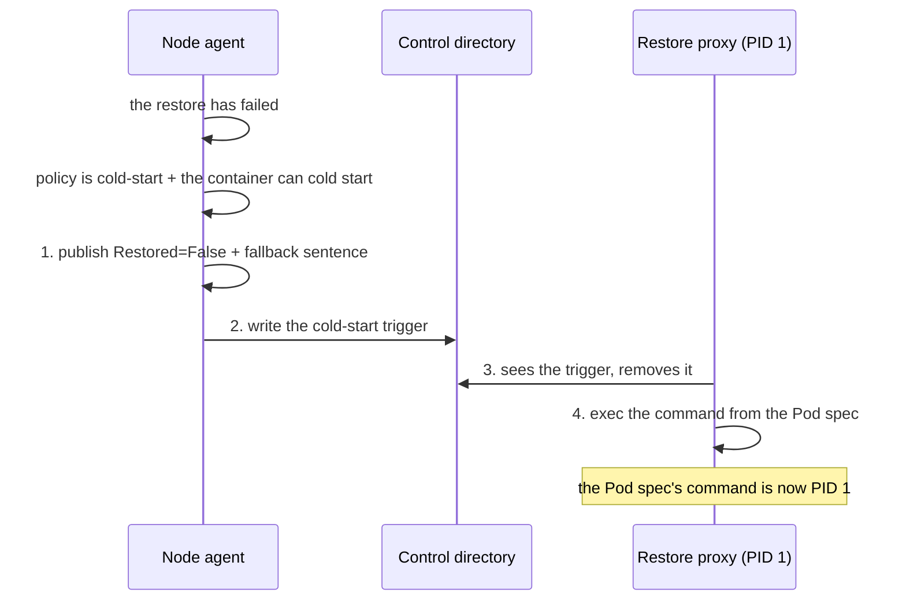

<!--
SPDX-FileCopyrightText: Copyright (c) 2026 NVIDIA CORPORATION & AFFILIATES. All rights reserved.
SPDX-License-Identifier: Apache-2.0
-->

# SNEP-322: Cold-start fallback when a restore fails

<!-- toc -->
- [Summary](#summary)
- [Motivation](#motivation)
  - [Goals](#goals)
  - [Non-Goals](#non-goals)
- [Proposal](#proposal)
  - [User Stories](#user-stories)
    - [Story 1: the checkpoint on this node is damaged or gone](#story-1-the-checkpoint-on-this-node-is-damaged-or-gone)
    - [Story 2: the Pod lands on a node the checkpoint does not fit](#story-2-the-pod-lands-on-a-node-the-checkpoint-does-not-fit)
    - [Story 3: the cold-started workload crashes](#story-3-the-cold-started-workload-crashes)
    - [Story 4: a team wants a failed restore to stay failed](#story-4-a-team-wants-a-failed-restore-to-stay-failed)
  - [Limitations, Risks, and Mitigations](#limitations-risks-and-mitigations)
- [Design Details](#design-details)
  - [When the agent starts a cold start](#when-the-agent-starts-a-cold-start)
  - [Which failures can cold start](#which-failures-can-cold-start)
  - [How the proxy starts the command](#how-the-proxy-starts-the-command)
  - [Several destination containers](#several-destination-containers)
  - [If the agent restarts midway](#if-the-agent-restarts-midway)
  - [Probes](#probes)
  - [API](#api)
  - [Security](#security)
  - [Monitoring](#monitoring)
  - [Dependencies](#dependencies)
  - [Test Plan](#test-plan)
  - [Graduation Criteria](#graduation-criteria)
- [Alternatives](#alternatives)
- [Appendix](#appendix)
  - [Restore steps and cold start](#restore-steps-and-cold-start)
<!-- /toc -->

## Summary

When a restore fails and cannot succeed, the Pod starts its workload from
scratch (a cold start) in the same container, running as its Pod spec describes,
instead of staying failed. A cold start is slower than a restore, but the Pod
ends up serving rather than waiting for someone to replace it. The Pod still
reports that its restore failed. The feature is opt-in with an annotation, and
is off otherwise.

## Motivation

A restore is an optimization: the Pod's own command could start the same
workload, only slower. Today, when a restore fails, nothing takes over. The
node agent publishes `nvidia.com/Restored=False`, the container ends, and a Pod
that should have been serving in seconds is not serving at all. A restore can
fail for reasons nobody in the request path controls: the checkpoint is damaged
or gone, the node refuses it as incompatible, or CRIU, the CUDA restore, or
PageBroker fails on this node only. The caller must notice and recreate the Pod
while the GPU sits idle. A cold start does not depend on the checkpoint, so it
can work when the restore cannot.

This proposal is about what happens after a restore has failed. It is separate
from restore retry (#247), which makes transient failures succeed on another
attempt. Fallback acts when the restore has failed, whatever the cause: for
example a damaged checkpoint, or a node that refuses it.

### Goals

1. A restore that has failed, on a Pod whose restore failure policy is
   `cold-start` and whose container is not
   [tainted](#which-failures-can-cold-start), ends with the Pod
   running exactly as its Pod spec describes (image, command, arguments,
   environment, mounts, probes), with no action from the caller.
2. The cold start happens in place: the same container.
3. The Pod behaves as if started without Snapshot, except for the record of the
   failed restore: the `Restored=False` condition and an event.
4. A restore that succeeds, or is still in progress, behaves as it does today.
5. Fallback never runs the command in a tainted container (see
   [which failures can cold start](#which-failures-can-cold-start)). Those
   failures end as they do today.
6. The behavior is chosen per Pod by an annotation, and the default is not to
   cold start. There is no new CRD field or controller.

### Non-Goals

1. **Retrying a failed restore** (#247). Fallback acts once the restore has
   failed.
2. **Nodes without the restore proxy.** On those, a Pod cannot fall back.
3. **What a restarted container does.** The first cold start happens in place
   and needs no restart. What a restarted container does, including restoring
   again into it, is not part of this proposal (see #247 and PR #174).
4. **A restore Pod whose `PodSnapshot` does not exist or is not `Ready` yet.**
   It keeps waiting, as it does today. That wait is not a failed restore, so it
   never reaches fallback.

## Proposal

A Pod opts in with the annotation
`nvidia.com/restore-failure-policy: cold-start`. The restore proxy
(`snapshot-restore-proxy`) is already PID 1 of every destination container,
waiting for the restore result. When the restore fails, the node agent decides
whether a cold start is allowed. If it is, the agent tells the proxy, and the
proxy replaces itself with the container's own command.

The moment that matters is when the restore has failed: the point where the
agent today writes `restore-failed` and publishes the `Restored=False`
condition. Just before the agent writes `restore-failed`, it starts a cold start
instead, if both hold:

1. **The policy is cold-start.** The Pod's `nvidia.com/restore-failure-policy`
   is `cold-start`.
2. **The container is clean.** The failure came from a step that has not changed
   the container. The agent decides by the step the failure came from (see
   [Which failures can cold start](#which-failures-can-cold-start)). Otherwise the
   failure ends as it does today.



The agent makes no further restore attempt on this container. From here on it is
an ordinary container running the Pod spec's command.

### User Stories

#### Story 1: the checkpoint on this node is damaged or gone

After a node is replaced, a `PodSnapshot` still reads `Ready` but the files
behind it are gone. Without fallback, every replica scheduled onto the broken
storage stays failed until a person finds out. With fallback, each replica loads
the model from scratch and joins the service late, but joins it. The failure is
found while the agent reads the checkpoint, before the container is touched, so
the container is still [clean](#which-failures-can-cold-start).

#### Story 2: the Pod lands on a node the checkpoint does not fit

A checkpoint taken on one GPU generation is scheduled onto a node of another. The
compatibility check refuses the restore (`RestoreIncompatible`) before anything
is changed. The Pod falls back to a cold start on the GPU it was given, which is
correct on any node.

#### Story 3: the cold-started workload crashes

A replica falls back, starts cold, and later crashes (an out-of-memory kill, for
example). The kubelet restarts it by the Pod's `restartPolicy`, with the usual
back-off. What the new container does is outside this proposal (see
[Non-Goals](#non-goals)).

#### Story 4: a team wants a failed restore to stay failed

A team suspects a bad capture and wants the failure to be visible, not hidden by
a Pod that serves anyway. It leaves the annotation unset.

### Limitations, Risks, and Mitigations

- **Not every failure can cold start.** After a restore has started changing the
  container, the container may not be clean. Those failures end as they do today
  (see [which failures can cold start](#which-failures-can-cold-start)). Only the
  failures from a step that has not changed the container cold start.
- **The restore flow and the table must change together.** The agent cannot tell
  that a new write was added inside a step the table says can cold start. Anyone who
  changes the restore flow updates the table in the same change, and a reviewer
  checks it. Tests cover the steps they inject failures into, so they catch a
  wrong row, but not a change that nobody classified.
- **Probes must suit both starts.** See [Probes](#probes).
- **A workload that crashes on every start loops**, bounded by the kubelet's
  restart back-off and the restart policy.
- **The Pod needs the restore proxy.** A node without it keeps today's behavior.

## Design Details

### When the agent starts a cold start

One function in the node agent, `requestColdStart`, is the only place that tells
a proxy to cold start. The controller calls it at the point where a restore
has failed, just before it would write `restore-failed`, and only when both
conditions of the [Proposal](#proposal) hold:

| Condition | Where it comes from |
| --- | --- |
| Policy is cold-start | `nvidia.com/restore-failure-policy` is `cold-start` on the Pod. |
| Container is clean | The failure came from a step that has not changed the container (see below). |

That the restore has failed is the trigger, not a condition, whatever the
cause: a damaged checkpoint, a node that refuses it, a CRIU or CUDA error, or
retries used up (#247).

```text
when the restore of destination D has failed:
  if policy(pod) != cold-start:     fail as today
  elif tainted(D):                  fail as today
  else:                             requestColdStart(D)
```

`requestColdStart` does two steps, in this order:

1. **Publish the terminal condition.** It sets `nvidia.com/Restored` to `False`
   with the original reason (`RestoreFailed`, or `RestoreIncompatible` when the
   node refused the checkpoint), and ends the message with `Falling back to the
   container command.` This is a server-side apply on the status subresource, so
   conditions owned by the kubelet are untouched.
2. **Write the trigger, then record it.** It writes `cold-start` into the
   destination container's control directory and emits the "cold start
   requested" event. If it still cannot write the trigger after a few attempts,
   the agent replaces the condition's message with the failure text and `Fallback
   could not be prepared: <cause>.` (same reason, still terminal), emits the
   "cold start not possible" event, and ends the restore as it does today
   (`restore-failed`, then the kill), so the condition never promises a cold
   start that does not happen.

The condition comes first because it is the record of what is owed: it is what
the agent finds again after a restart (see
[If the agent restarts midway](#if-the-agent-restarts-midway)).

**What changes from today.** Today the agent writes `restore-failed`, kills PID 1
(the proxy), and then publishes the condition. The proxy also exits 112 on its
own when it sees `restore-failed`. For a cold start the agent does neither,
because it must not end the container.

**When a cold start is not possible**, because a condition does not hold or the
node runs no restore proxy (see "Nodes without the restore proxy" in
`docs/reference/restore-pod-contract.md`), the
current failure behavior stays: the agent writes `restore-failed` and kills
PID 1. The container ends, and the kubelet restarts it or lets the Pod end, by the
Pod's `restartPolicy`, which also frees the Pod's resources.

### Which failures can cold start

An in-place cold start is possible only if the container still looks as it did
before the restore. A restore changes the container step by step, so the agent
decides by the step the failure came from (the `Step` names in
`agent/internal/executor/step.go`):

- **Clean:** the failure came from a step that has not changed the container,
  for example reading the checkpoint or checking that it fits the node. The agent
  can cold start.
- **Tainted:** the failure came from a step that changed the container, or from
  one the agent cannot show has not. The restore ends as it does today. The agent
  never cold starts a tainted container.

Only a failure at a clean step cold starts, which covers Stories 1 and 2. A step
with no row in the [table of steps](#restore-steps-and-cold-start) counts as
tainted, so a new step fails safe, and a test checks that every restore step has
a row. Inside `nsrestore`, a failure from `executeRestore` on is tainted whatever
the step. The table, in the appendix, lists every restore step and whether a
failure there can cold start.

### How the proxy starts the command

The command travels as the proxy's own arguments, after a `--`. When the kubelet
creates a destination container, the NRI plugin sets its command to the proxy,
then `--`, then the container's original command and arguments:

```text
/snapshot-control/snapshot-restore-proxy -- <original command> <original args...>
```

The proxy ignores them unless it cold starts. Everything after the first `--` is
the command, passed on as it is, with no parsing or escaping. They are set again
at every container creation, and nothing in the Pod can change them. The agent's
check that PID 1 is the proxy compares only the program, not the arguments.

The agent asks for a cold start with one file in the container's control
directory (`/snapshot-control`, one subdirectory per destination, see
`docs/reference/restore-pod-contract.md`): **`cold-start`**, the trigger. It is
empty; its presence is the signal.

The proxy checks for the trigger in every check of the control directory, before
`restore-complete` and `restore-failed`, so a cold start wins. When it finds it:

1. It **removes the trigger**. The control directory is a Pod volume that outlives
   a container, so a trigger left behind would cold start the next container
   without a restore attempt. If it cannot remove the trigger, it runs nothing
   and exits 113.
2. It calls `exec` on the command from its arguments, looking the program up in
   the container's `PATH`. The command is PID 1, with the environment and user
   the Pod spec gives.

If the proxy has no `--`, or nothing after it, it exits 113 (the existing
proxy-error code). If the program is not found, it exits 127; if `exec` fails for
another reason, 126, as a shell does.

**Variables in the command.** The kubelet expands `$(VAR)` references in the Pod
spec's `command` and `args`, from the container's environment, before it creates
the container. The plugin therefore receives the expanded values and the proxy
passes them on as they are, so `$(VAR)` needs nothing from Snapshot. A plain
`$VAR` is not expanded by the kubelet; it stays as written, as in a Pod without
Snapshot. A command that is a shell (`sh -c '... $VAR'`) expands it when it
runs, from the environment the proxy passes on unchanged: the proxy does not
alter its environment.

The proxy runs as the container's own user, so it needs no more rights than it
has now: removing a file in its own volume, and `exec` of what the Pod spec
already allows.

### Several destination containers

A restore Pod can have several destination containers (the container map). The
restore outcome is one condition per Pod, so fallback is per Pod too:

- A Pod falls back only if **every** destination that failed or was refused is
  cold-startable, and none succeeded. A `RestorePartiallySucceeded` Pod does not
  fall back and ends as it does today.
- The agent holds back the kill and `restore-failed` for a destination that could
  cold start until all destinations are done, then either cold starts every one
  of them, or releases them the way it does today.
- Each destination has its own trigger and its own proxy.

Sidecars that are not destinations are left alone.

### If the agent restarts midway

The agent can restart after it has published the condition and before the proxy
has started the command. The condition's message ends with the fallback sentence,
which is the record that a cold start was chosen. After a restart, the agent
finds a Pod with that sentence and checks each destination container, in this
order:

1. **The trigger exists.** The proxy has not taken it yet, and will. Nothing to do.
2. **No trigger, and PID 1 is not the proxy.** The command is already running.
   Nothing to do. The agent publishes the fallback sentence only on a node that
   runs the proxy, so this is not a node without it: there, PID 1 was never the
   proxy, no sentence is written, and a failed restore ends as it does today.
3. **No trigger, and PID 1 is still the proxy.** The agent cannot tell whether it
   never wrote the trigger or the proxy is taking it right now. When in doubt,
   the container counts as tainted: the agent replaces the condition's message
   with the failure text and `Fallback could not be prepared: the agent restarted
   before the cold start was requested.`, then ends the restore as it does today
   (`restore-failed`, then the kill).

### Probes

Fallback changes no probe. The Pod's probes apply to a restore and to a cold
start alike, so any probe the user provides must suit both. The one to watch is
the startup probe, whose failure limit must cover the longer of the two (normally
the cold start).

The probe added by `Options.EnableStartupGate` (`cat
/snapshot-control/restore-complete`) must not be used with fallback: a
cold-started container never produces that file, so the kubelet would kill it.

### API

No CRD, status field, or condition type is added. One annotation is new:
**`nvidia.com/restore-failure-policy`**, on the restore Pod:

- `fail`, or absent (the default): a failed restore ends as today.
- `cold-start`: a failed restore that can cold start does.

An unrecognized value is logged and treated as `fail`, because the agent cannot
reject the Pod. The `cold-start` file and the proxy's arguments are
internal to the agent, the NRI plugin and the proxy; the restore Pod contract
documents the file next to `restore-complete`.

### Security

No security impact is expected.

### Monitoring

- **Condition.** `Restored=False` with the original reason and a message ending
  `Falling back to the container command.`, or saying why fallback cannot happen.
- **Events.** On the Pod, like the other restore events (reasons follow
  `docs/development/naming.md`):
  - **Cold start requested.** A Warning, emitted by the agent when it writes the
    trigger, naming the failure that caused it. The proxy emits no event, because
    it cannot call the API; it logs.
  - **Cold start not possible.** A Warning with the reason: the container is
    tainted (with the step), the proxy is missing, or the trigger could not be
    written.
- **Logs.** The agent logs each step and the cold start decision. The proxy logs that
  it runs the command.
- **Metrics.** A counter of cold starts by reason and a counter of refusals by
  step, following #665.

### Dependencies

- The restore proxy, which needs containerd 2.2 or newer with NRI v0.10 or newer
  (see `docs/reference/restore-pod-contract.md`), and the NRI socket mounted in
  the agent DaemonSet (charts newer than 0.2.0 do).

### Test Plan

Tracking: #322 (design), #689 (implementation), #244 (feature).

**Unit.**

- The annotation: `cold-start`, `fail`, absent, and an unrecognized value.
- The NRI plugin sets the proxy's arguments to `--` followed by the original
  command and args at every creation, and a container with no args still
  restores.
- The agent's PID 1 check accepts the proxy with arguments and refuses another
  program.
- The proxy: with the trigger it removes the trigger and
  `exec`s the command from its arguments (a stub `exec` in the test); the trigger wins over
  `restore-complete` and `restore-failed`; no `--`, or no command after it,
  exits 113; a command whose own arguments start with `--` is passed on whole; program not found exits 127; `exec` failure exits 126; and without a
  trigger it behaves as today.
- `requestColdStart`: the condition is published before the trigger; a trigger
  write failure ends the restore as today with the "could not be prepared"
  message; and after an agent restart a Pod with the fallback sentence is left
  alone when the trigger exists or PID 1 is not the proxy, and ends as today,
  with the message replaced, when neither holds.
- The gate: each of the two conditions false on its own gives today's result.
- Classification: each row of the step table, with a failure injected into that
  step; and every restore `Step` has a row, so a new step without one fails the
  test.
- Several destinations: all cold-startable and none succeeded cold starts all;
  one tainted destination releases all; a partial success does not fall back.

**End to end, on a GPU node.**

- A `Ready` checkpoint whose artifact is missing or unreadable, and an
  incompatible checkpoint, end with the Pod serving the container command, with
  `Restored=False` and the fallback sentence, also with `restartPolicy: Never`.
- A truncated rootfs diff (tainted) fails as today.
- With the policy `fail`, or no annotation, a failed restore stays failed.
- A healthy restore is unaffected.
- The cold command is PID 1 and gets signals as in a Pod without Snapshot.
- The container is not restarted by the cold start (restart count unchanged).

### Graduation Criteria

* Cold start from the clean steps, with unit and end-to-end tests.

## Alternatives

**Restart the container and start it without the proxy.** The agent sets a
trigger, kills the container, and the NRI plugin lets the kubelet's new container
run as the Pod spec defines. This was the first design of this SNEP. It cannot
be dirty: a new container has a fresh writable layer. It was replaced because it
needs `restartPolicy` `OnFailure` or `Always`, a kubelet restart with its
back-off, and an NRI trigger on the container-creation path that must work when
the `PodSnapshot` is gone. In-place needs none of these, and deciding by the failed step answers its one
weakness, a container the restore has changed.

## Appendix

- #244: the feature request. #247: restore retry (PR #836). #665: metrics.
- SNEP-394: the capture-side retry. PR #174 and PR #906: restore of restarted
  containers.
- `docs/reference/restore-pod-contract.md`: the restore Pod contract, including
  the restore proxy and its exit codes (112, 113).

### Restore steps and cold start

The steps follow the restore in execution order. "Host" steps run in the agent;
"in the container" steps run in `nsrestore`, inside the container's namespaces
(`agent/internal/executor/nsrestore.go`). "Cold start" says whether a failure at
the step can cold start.

| # | Step | Cold start | Why |
| --- | --- | --- | --- |
| 1 | Host: resolve the checkpoint, read the manifest, check compatibility | Yes | Read-only. A refusal (`RestoreIncompatible`) is here. |
| 2 | Host: find the container, check that PID 1 is the proxy | Yes | Read-only. No proxy means no fallback. |
| 3 | Host: mount the bundle, `cuinterpose`, the checkpoint source into the container | No | Changes the container's mounts. |
| 4 | Host: PageBroker stage | No | Changes PageBroker state. |
| 5 | In the container: read the manifest, check the CUDA job file, check LSM labels, build the CRIU options | Yes | Read-only. |
| 6 | In the container: write the inet remap file (`snapshot-inet-remap-*.map`) | No | Writes a file that is never deleted. |
| 7 | In the container: stage the rootfs diff to a temporary file | No | Writes a temporary file. |
| 8 | In the container: apply the rootfs diff (`tar -x` into `/`) | No | Starts writing files and leaves no record of which. With `--skip-old-files` a half-written file is never fixed. |
| 9 | In the container: apply the deleted-files list (`RemoveAll`) | No | Deletes files, and errors are only logged. |
| 10 | In the container: write `/snapshot-control/cuda-job` | No | Writes a file. |
| 11 | In the container: bind-mount GPU device aliases | No | Changes the container's mounts. |
| 12 | In the container: unmount `/dev/shm` | No | Never remounted. |
| 13 | In the container: remount `/proc/sys` read-write | No | Changes a mount. |
| 14 | In the container: mount `securityfs` | No | Changes the container's mounts. |
| 15 | In the container: delete the `restore-*` sentinels and the CRIU `kdat` cache | No | After `executeRestore` starts, every failure is tainted. |
| 16 | In the container: CRIU scratch directory, replacement `files.img` | No | Writes files. |
| 17 | In the container: CRIU, before it calls `PreRestore` | No | After `executeRestore` starts, every failure is tainted. |
| 18 | In the container: CRIU, from `PreRestore` on | No | Processes and mounts are created. |
| 19 | In the container: CUDA restore, unlock, `cuinterpose` | No | Same as CRIU. |
| 20 | Host: PageBroker CustomStorage, GPU restore failed | No | The container is already terminated. |
