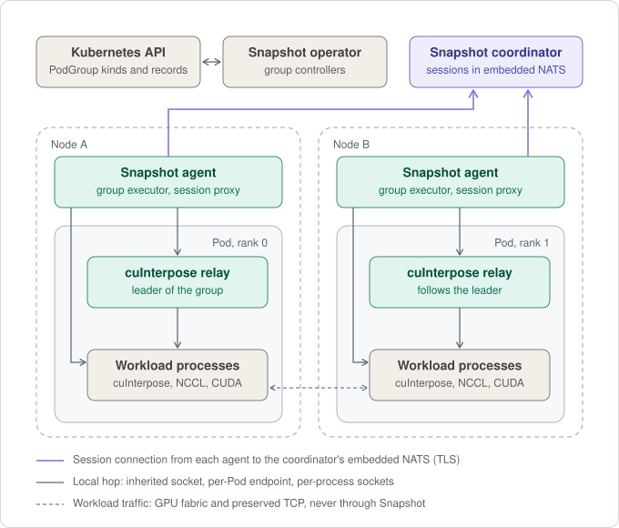
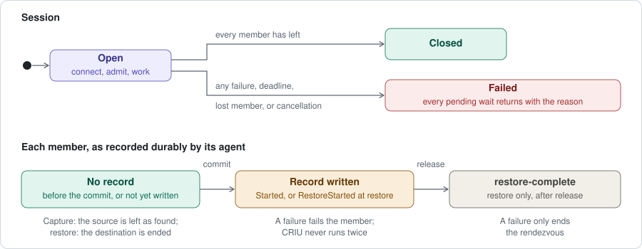
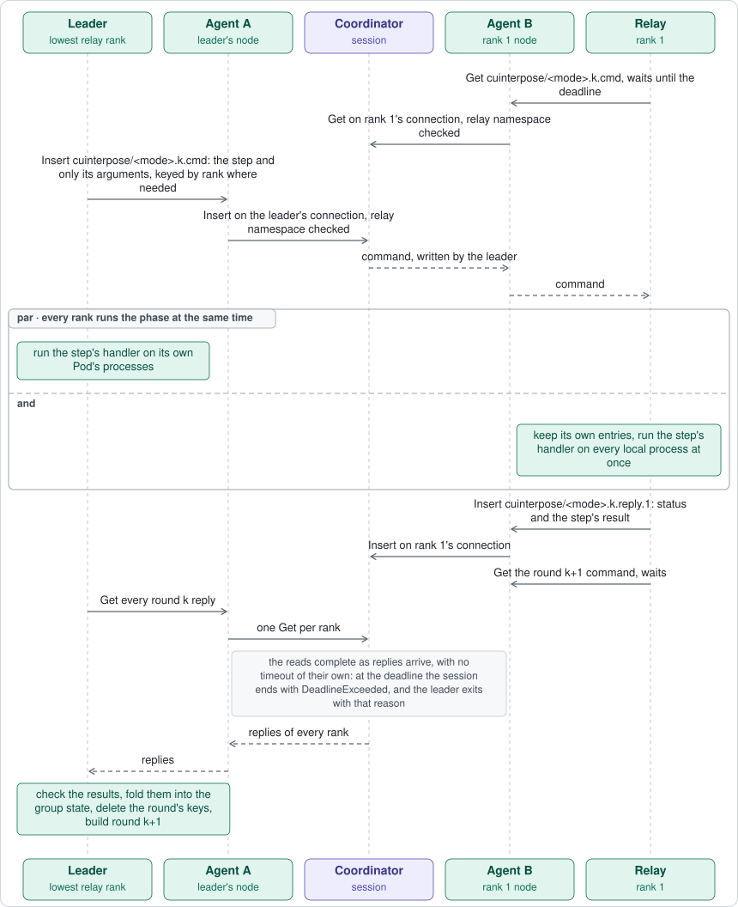
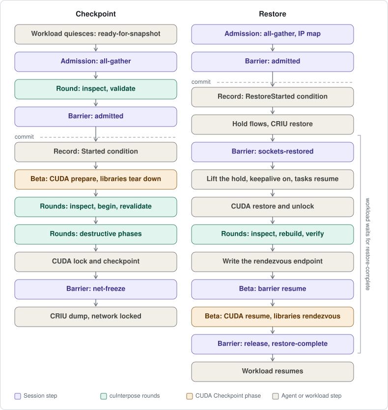
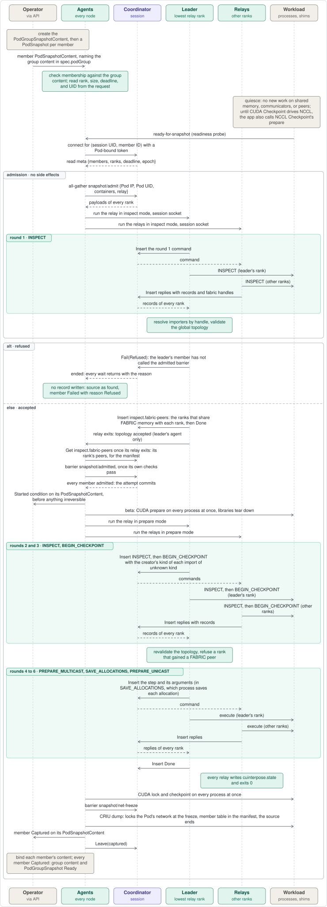
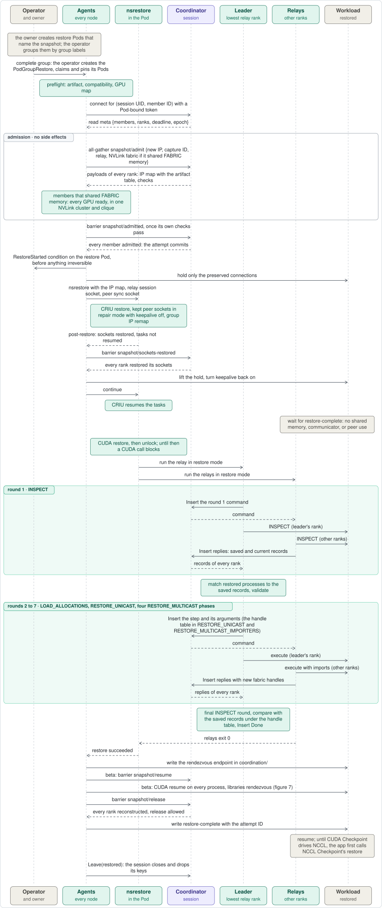
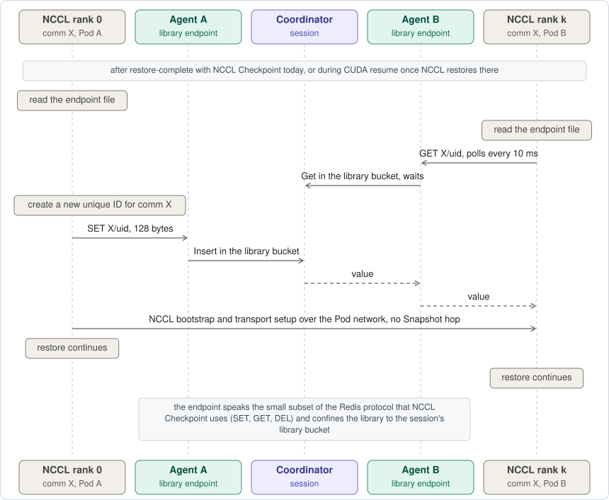
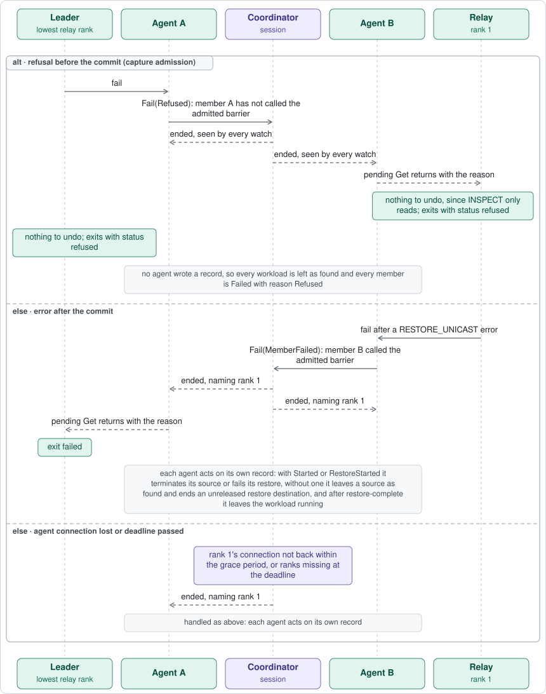

<!--
SPDX-FileCopyrightText: Copyright (c) 2026 NVIDIA CORPORATION & AFFILIATES. All rights reserved.
SPDX-License-Identifier: Apache-2.0
-->

# SNEP-324: Coordinated multi-Pod snapshot and restore

<!-- toc -->
- [Summary](#summary)
- [Motivation](#motivation)
  - [Goals](#goals)
  - [Non-Goals](#non-goals)
- [Proposal](#proposal)
  - [User Stories](#user-stories)
    - [Story 1: Scaling out a multi-node inference worker](#story-1-scaling-out-a-multi-node-inference-worker)
    - [Story 2: A communication library that restores itself](#story-2-a-communication-library-that-restores-itself)
  - [Limitations, Risks, and Mitigations](#limitations-risks-and-mitigations)
- [Design Details](#design-details)
  - [Architecture](#architecture)
  - [The coordination session](#the-coordination-session)
  - [Communication paths](#communication-paths)
  - [Phases at a glance](#phases-at-a-glance)
  - [Workload contract](#workload-contract)
  - [Group checkpoint](#group-checkpoint)
  - [Group restore](#group-restore)
  - [cuInterpose across nodes](#cuinterpose-across-nodes)
  - [Communication libraries](#communication-libraries)
  - [Cross-Pod TCP connections](#cross-pod-tcp-connections)
  - [Failure handling and recovery](#failure-handling-and-recovery)
  - [Session semantics](#session-semantics)
  - [Deadlines](#deadlines)
  - [API](#api)
  - [Security](#security)
  - [Configuration](#configuration)
  - [Performance and Scalability](#performance-and-scalability)
  - [Monitoring](#monitoring)
  - [Dependencies](#dependencies)
  - [Test Plan](#test-plan)
  - [Graduation Criteria](#graduation-criteria)
- [Implementation History](#implementation-history)
- [Alternatives](#alternatives)
- [Appendix](#appendix)
  - [A. Open questions](#a-open-questions)
  - [B. Changes from the prototype](#b-changes-from-the-prototype)
  - [C. Diagram sources](#c-diagram-sources)
  - [D. API definitions](#d-api-definitions)
<!-- /toc -->

## Summary

Distributed inference and training workloads often run as a group of Pods whose
processes depend on one another: they hold communicators that span the Pods,
keep long-lived control-plane connections between them, and, on GPU fabrics
that span nodes, may even share GPU memory across nodes. Because Snapshot
checkpoints and restores each Pod in isolation, none of this cross-Pod state
survives today. This SNEP introduces `PodGroupSnapshot`, which lets a user
checkpoint such a group as one unit, recorded in a cluster-scoped
`PodGroupSnapshotContent`, and restores the group on the same or different
nodes from restore Pods that name it: Snapshot groups those Pods by the labels
their workload controller already sets and runs each group's restore as one
`PodGroupRestore` attempt. Members keep their identity and rank, an admission
step refuses unsafe attempts before anything irreversible happens, and the
whole group has a single outcome. A short-lived coordination session, hosted by
a new Snapshot coordinator and reachable only through each node's agent,
synchronizes the members of every attempt and serves as the restore-time
rendezvous for cuInterpose and for communication libraries such as NCCL, so that
workloads neither deploy a rendezvous server nor handle secrets, while a single
Pod continues to behave exactly as it does today.

## Motivation

Snapshot's pipeline is per Pod by design: an agent quiesces one container,
checkpoints its CUDA state, dumps it with CRIU, and later restores it into a
placeholder Pod without knowing that any other Pod exists. Workloads that span
several Pods, such as tensor- or pipeline-parallel inference engines,
disaggregated serving with multi-node workers, and distributed training jobs,
break that assumption because part of their state lives between the Pods rather
than inside any one of them. Their communicators, NCCL being the common case,
are bound to peer addresses that change when Pods move; their control planes,
typically MPI or a custom RPC layer launched across Pods, depend on TCP
connections that Snapshot restores as closed; and, where the GPU fabric lets
processes on different nodes import one another's memory, the shared
allocations and multicast teams escape
[SNEP-295](https://github.com/ai-dynamo/snapshot/issues/295)'s cuInterpose,
whose coordinator only sees the processes of one Pod. Even where each Pod could
be handled on its own, a snapshot in which one member succeeded and another
failed cannot be restored, so the group also needs a single outcome.

All of these gaps reduce to one missing capability, namely a place where the
members of a checkpoint or restore attempt can find each other, exchange small
amounts of metadata, and move through phases together, and that capability is
currently being built twice. The multi-node cuInterpose prototype embedded a
coordination "brain" in rank 0's coordinator, and NCCL Checkpoint expects an
operator to start Redis and publish its address in a file before restore.
Snapshot already decides when every Pod is quiesced, dumped, restored, and
released, which makes it the natural host for that rendezvous on Kubernetes;
providing it once replaces two servers, with two lifecycles and two security
models, by a single session that follows the attempt it serves.

### Goals

- Capture a group of Pods and restore it on the same or different nodes as one
  unit, with members that keep their identity and rank from checkpoint to
  restore and one outcome per attempt.
- Refuse an attempt before any irreversible step whenever the group cannot be
  captured or restored safely, so that a refusal leaves every workload as
  Snapshot found it.
- Provide one coordination session per attempt that Snapshot's agents,
  cuInterpose, and communication libraries such as NCCL Checkpoint all share,
  without a coordination listener on the Pod network and without secrets inside
  Pods.
- Preserve GPU memory that processes share across Pods, through cuInterpose,
  wherever the platform supports cross-node sharing, without moving allocation
  bytes between nodes, while letting members that share no GPU memory, such as
  CPU-only control-plane Pods, take part in the same group.
- Preserve TCP connections between members of the group across relocation.
- Tolerate agent restarts without ever replaying CRIU into a restored container.
- Configure each member as a standalone `PodSnapshot` is configured, so that
  members with different parts in the workload keep their own signals.
- Keep single-Pod checkpoint and restore unchanged, apart from classifying a
  restore's wait as `Pending`, and extend the existing resources only with
  optional fields.

### Non-Goals

- Creating, scheduling, or placing Pods. Snapshot provides primitives rather
  than orchestration, so the workload owner, typically the workload's own
  operator together with a gang scheduler, creates and places the Pods, and
  no group `SnapshotJob` creates them. Since a member's Pod UID is optional, a
  person can also write a `PodGroupSnapshot` by hand for Pods with stable
  names, such as a StatefulSet's or a LeaderWorkerSet's.
- Rolling back after the point of no return, retrying a failed member in place,
  or changing the size of a group between checkpoint and restore.
- Keeping an attempt alive across a coordinator restart in alpha, which this
  SNEP treats as a failure of that attempt, although its protocol lets a later
  version do so without changing any client.
- Assigning ranks or identities to library processes, which remains the
  libraries' concern, and judging application health, which remains the owner's.
- Moving shared GPU memory between fabric domains, and preserving connections
  to peers outside the group, which are reset as they are today.

## Proposal

A workload owner checkpoints a multi-Pod workload by listing its Pods in a
`PodGroupSnapshot`, giving each one a member ID and, if it needs them, the
settings of its `PodSnapshot`. Snapshot records the captured set in a
cluster-scoped `PodGroupSnapshotContent`, as it records a single capture in a
`PodSnapshotContent`. The owner restores the group by creating restore Pods that
declare their source, as it already does for a single Pod: each names the
`PodGroupSnapshot` and the labels, set by its workload controller, that identify
its replica and its member. Snapshot does the rest: the operator expands a
capture into per-member work that reuses the existing per-Pod pipeline, tracks
each replica's group in one `PodGroupRestore` attempt from its first restore Pod
until the group forms and restores, the agents carry the work out in lockstep,
and the group resources report progress per member and one outcome for the
attempt.

Every attempt moves through the same stages, and those stages define what a user
can rely on. During admission, Snapshot only observes and validates: it waits
until every member is ready, checks that the members can be captured or restored
together, and, if anything is wrong, ends the attempt with a `Refused` or
`DeadlineExceeded` reason while leaving every workload as it found it; at
restore, the attempt's destinations, which hold no workload yet, are ended so
that their owner can replace them. The
attempt commits when the last member passes admission; from then on the
members proceed in lockstep, each member records durably that it has crossed
its point of no return before its first irreversible step, and a failure in any
member fails every member that has crossed it, because shared state cannot be
left half-prepared. A
capture ends when every member's artifacts are stored, whereas a restore ends
with a release in which every workload resumes at about the same time, with
shared GPU memory back at its original addresses, communicators rebuilt by their
libraries, and connections between members intact on their new IP addresses.
Release means that Snapshot handed the workload back, not that the application
is healthy, so owners keep gating traffic on their own readiness checks.

The boundaries are equally explicit. Snapshot's workload contract does not
change, since a workload still reports `ready-for-snapshot` once quiescent and
stays parked until `restore-complete`, although for a group that second rule
becomes load-bearing: it is what keeps a restored member from acting before its
peers are reconstructed, so a workload that cannot honor it is not supported,
and [Workload contract](#workload-contract) defines which threads it covers.
The owner must not delete or replace a source until the group's capture has
ended, Ready or Failed, and group restore Pods must carry the group restore
startup probe, which never expires in practice. Placement stays with the owner,
which keeps a group whose members share GPU memory across nodes within one
fabric domain. Restore admission refuses members that shared GPU memory unless
each set of members linked by that memory is on GPUs ready in one NVLink clique.
A restore Pod replaced before its group forms simply joins the group, and
Snapshot bounds formation once the group holds a node. Once the group has
formed, its members are fixed and each serves only that attempt; if it fails,
the owner retires the whole replica, released members included, before
creating it again. Finally, a plain `PodSnapshot` or a single restore Pod never contacts the
coordinator, so existing users are unaffected, apart from the new version of
cuInterpose's protocol and a restore's wait now classified as `Pending`
([API](#api)).

### User Stories

#### Story 1: Scaling out a multi-node inference worker

A platform team serves a model with an inference engine at tensor parallelism 8
across two Pods with four GPUs each, on nodes connected by a multi-node NVLink
fabric. To scale out without repeating model loading and warm-up, the serving
platform's operator checkpoints a warmed-up pair of workers once with a
`PodGroupSnapshot` and marks the Pod template that every replica shares to
restore from it. For every new replica, its workload manager creates two restore
Pods from that template on other nodes of the same fabric, and Snapshot restores
the pair once both are scheduled, with no request from the operator. The
restored workers resume with their shared
GPU buffers at the same virtual addresses, their NCCL communicators continue
over the restored NVLink memory, and the MPI connections between the two Pods continue on
the new IPs, so the replica serves its first request without initialization.

#### Story 2: A communication library that restores itself

A communication-library maintainer adds checkpoint support by publishing new
connection identifiers during restore through a key-value store that speaks a
small subset of the Redis protocol, as NCCL Checkpoint does. On Kubernetes the
library needs no deployment change and no knowledge of Snapshot, because the
agent serves that store inside each Pod and the coordinator holds it for each
restore, whereas on other platforms the same code runs against any
Redis-compatible server.

### Limitations, Risks, and Mitigations

| Risk or limitation | Mitigation or decision |
| --- | --- |
| Every restore keeps the original group size and GPU count per member, and a group whose members share GPU memory across nodes must restore within one fabric domain. | Admission checks the group size and each member's compatibility before CRIU. It also refuses members that shared GPU memory at capture unless each set of members linked by that memory is on GPUs ready in one NVLink clique of one cluster. This catches placement mistakes, but it does not promise that every later import succeeds, for example in a restore Pod without the fabric access that [Dependencies](#dependencies) lists. |
| Capture is not atomic: each source ends at its own dump, and a failure after the commit terminates every member that has started. Release is not atomic either, since a member can fail before its release while its peers are already released. | Admission catches every condition that can be checked without side effects, every member records when it started, and member results report partial outcomes truthfully, so the owner can retire the group and retry with a new attempt. |
| Snapshot does not freeze restored processes until release, because CUDA, cuInterpose, and library threads do the reconstruction inside them, so an application thread that runs early could observe a half-rebuilt state. | Release relies on the existing workload contract, which this SNEP extends to every thread that could touch shared memory, communicators, or preserved connections; an integration satisfies it only by holding every such thread until release, which a wrapper that gates only the main loop does not, and an enforced hold is left to future work. |
| Between CRIU restore and CUDA unlock, a thread that calls CUDA blocks on the lock, which is not a recommended use of CUDA Checkpoint, and a failure in that window could leave such a thread stuck. | The locked window involves no coordination and lasts as long as for a single Pod, failing a restore terminates every restored process, and qualification measures both restore windows and injects failures into each. |
| CRIU's network lock at capture and the agent's hold at restore pause the traffic of preserved connections while retransmission and user timeouts keep running, and keepalive too at capture, so a long dump or a slow peer can break them ([snapshot#577](https://github.com/ai-dynamo/snapshot/issues/577)). | Holds are taken as late and lifted as early as possible, a restore turns keepalive back on only once every member has restored its sockets, and qualification measures the whole interruption, including staggered dumps, to document the supported limits. |
| At capture, CRIU's network lock covers a member's IP traffic only from the moment CRIU freezes it, and never covers RDMA, shared volumes, or external services, while dumps finish at different times. | Members must stop such traffic before reporting `ready-for-snapshot`, as the workload contract requires, and libraries tear down RDMA transports before the dump, which for NCCL means the application calling NCCL Checkpoint's prepare until CUDA's prepare phase does it. |
| Sessions live only as long as the coordinator that holds them, so an attempt in flight ends if the coordinator that hosts its session restarts. | Each session lives in the coordinator on the node of the attempt's rank-0 member, which the attempt depends on anyway, since a restarted agent fails its own member; losing it is fail-stop and reported as `CoordinatorLost`, sessions on other nodes are unaffected, and a broken connection that reconnects does not fail an attempt. Every session pattern is safe to repeat, so replicating sessions later changes only the coordinator. |
| Sessions hosted on the same node share the coordinator's memory, so a session's reservation caps how many attempts a node hosts at once. Every client the coordinator admits is an agent, and agents are one trust domain: in the coordinator's shared NATS account, a compromised agent can reach another attempt's buckets, for example through the reply subject of a request, which its permissions don't cover. | Each attempt reserves its data when its session is created and can't write past it, so records forged through a workload's relay fail only that workload's attempt, and an attempt that doesn't fit waits in admission. Control keys live outside the data reservations, so every session can still end, and each bucket bounds how many watches its members open. A compromised agent gains nothing it lacks already, since the agent's ServiceAccount can patch any Pod, and the token review keeps everything that isn't an agent out. Beta revisits one NATS account per attempt to isolate agents from each other, while a ValidatingAdmissionPolicy that lets the agent change only Pods' metadata and status narrows what a compromised agent can do. |
| The agent sits on every coordination path, and an agent can restart in the middle of a restore. | The agent records its intent before CRIU starts and treats `restore-complete` as proof of release, so a restarted agent never replays CRIU and never kills a released workload. |
| Importing GPU memory through a FABRIC handle after a native CUDA restore, from another node or within one Pod, depends on a driver fix, and CUDA does not report whether an imported FABRIC handle names memory or a multicast object. | FABRIC sharing in alpha requires a user-mode driver with the fix in every process that imports a FABRIC handle ([Dependencies](#dependencies)). cuInterpose reads nothing from the handle's private layout. An import takes its kind from the first call that only one kind accepts, or else from its creator's record when the checkpoint begins. An import whose kind differs from its creator's is refused at inspection. A supported CUDA query would let the shim classify an import when it is made. |
| CUDA Checkpoint's prepare and resume phases are not released yet. | Until they are, an application whose communicators use a transport that Snapshot cannot preserve, such as RDMA, calls NCCL Checkpoint's prepare and restore itself, and NCCL restores after release through the library endpoint. Over NVLink, an existing communicator continues without either call, since cuInterpose restores its memory and Snapshot preserves its connections. |
| A group restore Pod's container starts when the Pod is created, so its startup probe runs through the group's formation and then through the restore. | The group restore startup probe uses the largest failure threshold the API accepts, `math.MaxInt32` one-second checks, so it never expires in practice and only the attempt's two bounds and the owner bound a restore. Pod membership is fixed when the group forms, and container identity when it is pinned: a lost Pod, evicted or not, is replaced and joins its group before formation, and fails the attempt after it. A destination container that exits, for example when it is killed for memory, fails its Pod under `restartPolicy: Never`, which is a loss as above; under `Always`, it restarts and its proxy waits again, since no restore has used the Pod, so it stays usable until pinning, which records its new ID, and after pinning a changed container fails the member. |
| Pods of a group that hasn't formed, such as a replacement waiting for its peers, take their nodes and GPUs while they wait. | Once any of the group's Pods is on a node, the attempt's formation timeout bounds the wait and fails the attempt with `FormationTimeout`, and its `Formed` condition names what blocks it meanwhile; the nodes are freed when the owner retires the Pods. Queueing before any Pod is scheduled is placement, which belongs to the gang scheduler and the owner. |
| A member lost after its group has formed and before its attempt ends fails it, one lost after it succeeds leaves it successful, and released members keep running either way, so replacing only the lost or failed Pods would leave a replica that cannot form a new group. | Membership is fixed for simplicity. A failed attempt ends its unreleased destinations, and the workload controller retires the whole replica, released members included, before retrying; it does the same when a restored replica loses a member. This is its recovery policy, distinct from the Pod's `restartPolicy`, which only decides whether a container restarts. [GREP-1020](https://github.com/ai-dynamo/grove/pull/1021) proposes it for Grove, and LeaderWorkerSet's default `RecreateGroupOnPodRestart` recreates the whole group when a container restarts. |
| A group key built from reusable names and indexes can identify two generations of a replica at once. | A group key must not identify two overlapping replica generations: an owner that recreates a workload under the same name waits until the previous Pods are deleted, as Grove does when it replaces its capture replica, and Snapshot creates a group key's next attempt only once the previous one is deleted. |
| A restore Pod identifies its member by a label value, which must equal the captured member ID, and Snapshot cannot tell whether that ID still names the same role, for example when IDs are positions and the positions were reordered. | Integrations capture with IDs taken from the same label, as Grove's Pod index and LeaderWorkerSet's worker index do, and a value the capture doesn't declare is reported by the attempt's `Formed` condition as `MemberNotCaptured`. Snapshot enforces the IDs and ranks it is given, and the integration preserves what each ID means: a member ID must name the same workload role at capture and at restore, so an integration that derives IDs from positions treats a change in what a position means as a configuration change, which needs a new capture; [GREP-1020](https://github.com/ai-dynamo/grove/pull/1021) does so by comparing Grove's ordered cliques before it reuses a capture. An owner-supplied role fingerprint, opaque to Snapshot, could be added later if that proves insufficient. An integration that reuses a capture with other IDs writes them into a label of its own and names that label, and an import can rename members ([Appendix A](#a-open-questions)), so Snapshot needs no mapping of its own. |
| A restored process keeps its captured hostname namespace, so `gethostname()` returns its source's hostname, while the target Pod's hostname and `/etc/hosts` name the target. A workload that resolves its own hostname after release reaches loopback or nothing, and one that reports `gethostname()` as its identity names its source. | Preserved connections don't depend on names, and eager vLLM restored under new target hostnames. Workloads take their current identity from the Pod's metadata, refreshed at restore, select their network interfaces explicitly rather than through their hostname, and don't resolve their own hostname after release. |

## Design Details

### Architecture



*Figure 1. Components and communication paths.*

The architecture separates three kinds of state because their lifetimes and
failure modes differ. Durable intent and outcome live in the Kubernetes API,
where the operator owns the group resources and each agent reports on the members
it hosts, so status survives any process restart. Coordination state lives only
for one attempt and only in the coordinator's memory: a session is a small group
of in-memory key-value buckets in a NATS server that the coordinator embeds,
through which members synchronize, and it disappears with the attempt, which
keeps fabric handles and bootstrap identifiers out of etcd and gives every
restore a fresh rendezvous store. Node-local mechanics remain with
the agent, which already sequences CUDA checkpointing and CRIU and now also
relays every exchange between a Pod and its session.

That relaying is the decision with the widest consequences. The cuInterpose
relay receives its session on a socket inherited from the agent, and libraries
inside the workload reach the session through a per-Pod endpoint served by the
agent, so no process in a Pod opens a coordination connection across the Pod
network. As a result, no secret is delivered to a Pod or captured in a CRIU
image, no NetworkPolicy must admit coordination traffic in workload namespaces,
and the hold that protects preserved TCP connections during restore cannot block
coordination; moreover, because the agent authenticates to the coordinator with
the identity of its node and of the Pod it acts for, the coordinator scopes each
connection to one member of one attempt rather than trusting a shared token.

Within a session, the coordinator offers only a handful of generic patterns, and
it leaves domain logic with the clients that understand it: cuInterpose's global
validation and handle table run in the leader's relay, NCCL publishes
communicator identifiers under its own keys, and the agents build their phase
barriers on the same patterns. The coordinator does not implement a storage or
wire protocol of its own: it embeds a NATS server with JetStream, keeps each
session in key-value buckets there, and adds only what a store lacks, namely
authentication, membership, the deadline, and failure. Consequently, the
coordinator stays small, and new participants integrate without changing it.

| Component | Runs as | Responsibility |
| --- | --- | --- |
| Group controllers | Snapshot operator | Validate groups, create the group content and bind its members, create member `PodSnapshot`s, create each restore group's attempt at its first Pod, record and claim its Pods and form the group, pin identities, enforce the formation timeout and the deadline, and aggregate member results into one outcome. |
| Snapshot coordinator | A Pod of its own on every node; the coordinator on the node of an attempt's rank-0 member serves its session | Embed a NATS server with JetStream, create three buckets per attempt, authenticate every connection and scope it to its attempt, enforce the deadline and the grace period, and fail every member when one fails. |
| Group executor | Snapshot agent | Run each member's capture or restore as session phases around the existing CUDA and CRIU steps, and record its intent before destructive work. |
| Session proxy | Snapshot agent | Hold one NATS connection per hosted member, serve the relay's socket and the Pod's endpoint, and confine each to its namespace. |
| cuInterpose relay | Short-lived process in each Pod that uses cuInterpose | Fan commands out to the Pod's processes as in SNEP-295 and, in the lowest rank that runs one, also lead the group. |
| Communication libraries | Inside workload processes | Tear down and rebuild their own connections, using the session for rendezvous. |

### The coordination session

A session corresponds to exactly one attempt, that is, one capture of a
`PodGroupSnapshot` or one `PodGroupRestore`, and it is identified by that resource's
UID, because each resource is exactly one attempt. Snapshot runs a coordinator
on every node, in a Pod of its own: an attempt's session lives in the
coordinator on the node of its rank-0 member, which the group's status records,
so every member finds it there and no election is needed. That coordinator follows the
group resources through a read-only watch and creates the session of every
unfinished attempt whose rank-0 member runs on its node, a restore's only once
its group has formed, so sessions need no creation API and the resource remains
the single source of truth. A restore's members and their ranks come from the
attempt's status and the group content it recorded at formation, never from
the `PodGroupSnapshot`. The coordinator removes a session and all of its
keys once its resource is deleted, or once the resource is final and the
session has ended or its deadline has passed, so a session whose end cannot be
recorded is still removed. Once it exists, a restore's session depends on the
restore alone: deleting the `PodGroupSnapshot` after the restore's release leaves its session
open for the members' post-release rendezvous. Before the commit, the
coordinator also ends a session early. Once a resource's deletion has started,
it fails the session with `Cancelled`, and once the resource's status shows a
`Failed` member, it fails it with that member's reason when it is
`DeadlineExceeded`, `Cancelled` or `CoordinatorLost`, and otherwise with
`Refused`, the reason a member's agent uses
before the commit, so a member that fails before it joins, or a failure that
only the operator sees, ends the attempt at once instead of at its deadline.
It does neither once every member has arrived at the `admitted` barrier, which
it hosts. Members decide on their own that a barrier is complete, so a member
that saw it complete just before can still start, which its `startedAt`
records.

A session is three key-value buckets in the coordinator's embedded NATS
server. A small control bucket holds the session's own keys: a `meta` key with
the members, their ranks, the deadline, and an epoch, which every agent reads
when it connects, how the session ended, and every barrier arrival and
departure. Two data buckets hold what the session carries: one serves
Snapshot's own components, the agents and relays, and the other holds library
keys, such as NCCL Checkpoint's communicator identifiers. Each bucket limits the
size of a value, and the library bucket also limits its number of keys, so
libraries cannot exhaust what Snapshot's own keys need. The data buckets live
in memory, and each one has a byte limit that the session reserves when the
coordinator creates it: the Snapshot bucket a budget per member, never less
than its largest value, and the library bucket the bound its key and value
limits already set. One cap, `maxMemoryBytes`, bounds the reservations of all
sessions, so an attempt that writes past its own limit fails only itself, and
every attempt that starts has its space. The control bucket lives instead in a small file store,
bounded per session by its number of members, because NATS limits memory and
file storage separately, so a session whose peers fill the memory cap can still
end, fail, and release every wait. That store sits in a directory the
coordinator owns, which it empties when it starts, so like the rest of a session
it never outlives the coordinator. Every control bucket reserves its worst case
for its number of members from that one store, which `maxMemoryBytes` sizes. A
session that does not fit is not created: the coordinator retries it, its
members wait to join, and the attempt ends at its deadline unless room frees.
A session that could never fit, even on an idle coordinator, fails at once with
`Refused`. If every group's rank-0 member runs on one node, that node's
coordinator holds every session, so the cluster runs at most as many attempts
at once as its reservations fit in `maxMemoryBytes`, and the others wait. Members coordinate through six patterns, each built from standard NATS key-value
operations, which [Session semantics](#session-semantics) defines precisely.

| Pattern | Purpose | Used by |
| --- | --- | --- |
| `Insert` | Publish a value once under a key | Agents, relays, libraries |
| `Get` | Read a value, optionally waiting until it is published | Agents, relays, libraries |
| `Delete` | Remove a key | Agents, relays, libraries |
| `Barrier` | Wait until every member has reached the same step | Agents |
| `Leave` | Report that a member's agent is done | Agents |
| `Fail` | End the attempt with a reason, which ends every wait | Agents, relays |

Three properties of these patterns shape the rest of the design. Waits are
pushed rather than polled, so a waiting `Get` completes the moment its key is
inserted and a barrier the moment the last member arrives, and when the session
fails, every pending wait returns with the reason, which means no member waits
out its own timeout after a peer has already failed. Every pattern is safe to
repeat, so a client whose connection breaks simply sends again what it had not
seen answered, with no request identifiers and nothing recorded on the server.
And the agent can coalesce reads: it serves identical reads of keys that are
written once, such as NCCL's identifiers, from the processes of one Pod through
a single upstream read.

Keys live in per-client namespaces: agents use the `snapshot` namespace, relays
the `cuinterpose` namespace, and libraries the library bucket, so workload processes can
never read or write Snapshot's or cuInterpose's keys. The agent enforces these
namespaces for the relay and the libraries whose traffic it carries, since it is
the only component that knows which local client sent a request, while the
coordinator confines every connection to its own attempt's buckets
([Security](#security)). Every member takes part in the agents' barriers,
including members that run no relay, and an agent that hosts several members of
the same group connects once per member and drives them concurrently, because
handling them one after the other would deadlock the first barrier.



*Figure 2. The session's two outcomes, and the member records that decide what a failure does.*

The commit is the hinge of an attempt, although it is neither an operation nor
a session state. An attempt commits when its `admitted` barrier completes, that
is, when the last member passes admission, so capture and restore commit at the
same point and the coordinator never needs to know which steps are
destructive. Before its member's first irreversible step, each agent records
durably that the member has crossed its point of no return, as a `Started`
condition on the member's `PodSnapshotContent` at capture and as the
`nvidia.com/RestoreStarted` condition on the restore Pod at restore, both written
once and never removed, and an agent that cannot write it fails
the attempt instead of proceeding. That record, never the session, decides
what a failure does to the member: a capture source without it is left as
Snapshot found it, a restore destination without it holds no workload yet and
is ended when its attempt fails, a member with it fails, and a member already
released keeps running. The session itself therefore has only two outcomes, closing once every
member has left, or failing, in which case every pending read and barrier
returns with the reason.

### Communication paths

Every path in the system is either local to a node or runs between an agent and
the coordinator; members never address one another through the coordinator,
and no participant ever needs to send a message to one specific rank.

| Path | Transport | Identity |
| --- | --- | --- |
| Operator, agents, and coordinator to the API server | Kubernetes API, read-only for the coordinator | RBAC |
| Agent to coordinator | One NATS connection per session and hosted member, over TLS, to the server that the coordinator on the session's node embeds, at its Pod's IP | Pod-bound ServiceAccount token checked with TokenReview when the connection opens; the member's Pod must run on the agent's node, and the connection may reach only its attempt's buckets |
| Agent to cuInterpose relay | Socket pair inherited through `nsenter` or `nsrestore` | Implicit, because the agent created it |
| Workload processes to agent | Per-Pod endpoint: a Unix socket in the control volume, or a loopback listener inside the Pod's network namespace | Implicit, because the endpoint belongs to one Pod |
| Relay to shims | Per-process Unix sockets from SNEP-295 | File permissions |
| Workload to workload | GPU fabric, preserved TCP connections, and new library connections | Not involved |

Every exchange that crosses Pods is one of six kinds, each built from the
session's patterns rather than added to them:

| Exchange | Used by | Built from |
| --- | --- | --- |
| Broadcast | The cuInterpose leader sends each round's command to every relay | One `Insert`, read with a waiting `Get` by every relay |
| Gather to one rank | Relays return records, results, and new fabric handles to the leader | One key per rank, read by the leader |
| All-gather | At admission, agents exchange their Pod IPs and identities, capture IDs, whether each member runs a relay, and at restore the NVLink fabric of members that shared GPU memory | One key per rank, read by every agent with a waiting `Get` |
| Phase synchronization | Agents synchronize `admitted`, `net-freeze`, `sockets-restored`, and `release`, and `resume` once CUDA Checkpoint's resume phase is released | One `Barrier` per phase |
| Publish by key | The owner of a communicator or listening endpoint gives its peers a new identifier | `Insert` by the owner, waiting `Get` by each peer |
| Failure | Any agent or relay, or the coordinator, ends the attempt | `Fail`, which ends every member's pending wait |

A cuInterpose round combines the first two exchanges, and because every phase of
cuInterpose is one such round, Figure 3 is the unit from which the checkpoint
and restore flows below are assembled. The leader inserts one command, naming a
step and its arguments, that every relay reads; every rank executes it at the
same time; and each relay inserts one reply that the leader collects. The leader
therefore never addresses a single rank, because any value meant for one rank
travels inside the shared arguments, keyed by rank, and each relay keeps its
own.



*Figure 3. One cuInterpose round: a broadcast followed by a gather.*

The loopback listener exists for clients that can only speak TCP, which today
means NCCL Checkpoint's Redis client. The agent creates it by moving one thread
into the Pod's network namespace, binding `127.0.0.1` on a port that the kernel
chooses, and moving the thread back; the socket then belongs to the Pod's
namespace while its file descriptor stays in the agent, so it is reachable only
from inside that Pod. The agent opens the listener after CRIU restore, when it
can no longer take a port that a restored process needs, and closes it, together
with every connection it accepted, when the session closes.

### Phases at a glance



*Figure 4. Phases of a group checkpoint and a group restore.*

Figure 4 shows how the session steps, the cuInterpose rounds, and CUDA
Checkpoint's phases interleave with the steps Snapshot already performs, where
each attempt commits, and where a restore waits at the `sockets-restored`
barrier before its tasks resume, CUDA restores, and the cuInterpose rounds run.
Figures 5 and 6 expand
both columns into complete sequences, in which every shaded band labeled "round"
is one instance of Figure 3, drawn with the same messages but without the agent
hop that Figure 3 details, so that each round can be traced from the leader's
command to the replies it collects.

### Workload contract

Snapshot and the workload hand control to each other at exactly two points, and
a group depends on every member honoring both, because the work between them is
collective. The handshake is the one that single-Pod Snapshot already uses, so a
group asks for no new application signal; what it changes is how much of the
restore happens while the workload waits, and therefore how strictly waiting
must be read.

| Signal | Written by | What it promises for a group |
| --- | --- | --- |
| `ready-for-snapshot` | The workload, through its readiness probe | The member has drained its GPU work and starts no new work on memory shared across Pods, on communicators, or on connections to peers. A communicator over a transport that Snapshot cannot preserve, such as RDMA, must also have been prepared through NCCL Checkpoint, until CUDA Checkpoint's library interface drives NCCL. Capture admission waits for this signal from every member. |
| `restore-complete` | The agent, after the `release` barrier | Every member is reconstructed: shared GPU memory is back at its original addresses, preserved connections are open on the new IPs, and libraries that restore in CUDA's resume phase have reconnected. The file names the attempt. |

A member's settings ([API](#api)) can also carry either signal through
[SNEP-411](https://github.com/ai-dynamo/snapshot/issues/411)'s application
contracts: a `checkpointReadinessProbe` reports what
`ready-for-snapshot` reports, and a `lifecycle.postRestore` notification
follows `restore-complete`. Both keep their place relative to the barriers, so
each promise above holds whichever signals a member uses, and the members of
one group may use different ones.

Between CRIU restore and `restore-complete`, a restored member passes through two
windows that differ in what its threads may do.

| Window | CUDA | What Snapshot does | What the workload may do |
| --- | --- | --- | --- |
| From CRIU restore to CUDA unlock | Locked, so a CUDA call blocks until the unlock | Restores and unlocks CUDA inside the Pod without any coordination, exactly as for a single Pod | Nothing; a thread that calls CUDA simply blocks |
| From CUDA unlock to release | Usable | Rebuilds shared memory through the cuInterpose rounds and, once CUDA Checkpoint releases it, runs CUDA's resume phase, in which libraries reconnect | Wait: no access to memory shared across Pods, no use of a communicator, and no traffic on a preserved connection |

The second window is the one that a group lengthens, since it now spans cross-node
rounds and the barriers after them, and it is also the one in which a running
thread could observe a half-rebuilt state, such as an imported allocation that
does not yet map its creator's memory or a communicator whose peers are still
reconnecting.
Waiting therefore applies to every thread that could touch such state,
including background threads such as communicator watchdogs and progress
threads, and not only to the application's main loop. A library that rebuilds
its own connections and that Snapshot does not drive yet, such as NCCL over
RDMA until CUDA Checkpoint's library interface ships, restores only when the
application calls it, so the application calls NCCL Checkpoint's restore after
release and before it uses any communicator. A communicator whose memory and
connections Snapshot preserves, such as NCCL over NVLink, needs no call.
Snapshot cannot verify any of this from outside
the process, so the SNEP makes it a requirement of group membership. An
integration meets it only by holding every such thread until release: a wrapper
that gates the main loop on both signals does not by itself, since CRIU resumes
every thread of the restored processes. An application can receive both
signals directly through SNEP-411's contracts, and an enforced hold remains
open in [Appendix A](#a-open-questions). Figures 5 and 6 show both signals and the
waiting period on the workload's lifeline.

### Group checkpoint

Capture starts when the operator creates the record of the captured set, a
cluster-scoped `PodGroupSnapshotContent` that lists the member IDs in rank
order. It is named `podgroupsnapshotcontent-<PodGroupSnapshot UID>`, as a
single-Pod content is named after its `PodSnapshot`, and the operator records
it in the `PodGroupSnapshot`'s `status.boundGroupContentName` before it creates
a member `PodSnapshot` for every Pod in the group. A member's Pod UID is
optional, as for a standalone `PodSnapshot`: the controller reads each source
Pod by name when it checks it, and writes the UID it read, which must equal the
member's when the member names one, into the member `PodSnapshot`'s immutable
`spec.source.podRef.uid`. The Pod it checked is therefore the Pod that is
captured, and a Pod replaced since fails that member with `StalePodReference`.
After an operator restart, or when only some members were created, existing
member `PodSnapshot`s are adopted with their pins unchanged; one pinned to a Pod
that has since been replaced fails its member and is never pinned again. One
rule matches a member `PodSnapshot` to its member wherever the operator or an
agent compares them: its name and containers equal the member's source, and its
UID equals the member's when the member names one, or otherwise its own
non-empty pin. Each one is owned by the
`PodGroupSnapshot` and names the group content in an immutable `spec.podGroup`,
with the content's name and UID and the member's ID, which the `PodSnapshot`
controller copies unchanged into the member's `PodSnapshotContent`. The agent
therefore decides from the content alone whether it captures a member: a
content without the field is captured on its own, and one with it only as that
member, never on its own, even when pod groups are off in the agent. It checks
the membership against the group content, which must exist with that UID and
declare that member ID, and takes the attempt's live context from the active
request: it follows the content's `spec.snapshotRef` to the member's
`PodSnapshot` and that `PodSnapshot`'s controller owner to the
`PodGroupSnapshot`, which must be bound to the same group content, list that
member with the content's source Pod, and record the content's `PodSnapshot`
for it, waiting while the group has not recorded it yet. From the request, it
reads the member's rank, the group's size, the deadline, and the group's UID,
which names the session. Each agent
waits until its member is safe to capture, which the member's settings define
as for any `PodSnapshot`: `ready-for-snapshot` by default, or the member's own
`checkpointReadinessProbe`. It then connects to the session and contributes its Pod IP, its Pod
and container identity, and whether the Pod has opted into
cuInterpose as SNEP-295 defines, to the admission exchange, while the
relays run a first round that inspects every process and gathers the records to
the leader for a global validation. The leader also publishes which ranks
share FABRIC memory. Every agent then posts to the `admitted`
barrier once its own checks pass, and the agent of the leader's Pod posts only
after the leader has accepted the topology, so the barrier completes, and the
attempt commits, only when every member and the leader have accepted. Admission
therefore changes nothing in any workload: a mismatch, an invalid sharing
topology, or a Pod IP that is not IPv4 ends the attempt as `Refused`, and a
member that never becomes ready ends it at its deadline as `DeadlineExceeded`,
in both cases with every source as Snapshot found it.

Once the attempt commits, each agent sets the `Started` condition on its
member's `PodSnapshotContent`, which is the object it already reconciles and the
only one whose status it may write, so the record needs no new permission and
the operator copies it to the group as it already copies Ready and Failed to the
`PodSnapshot`. Each agent then, where CUDA Checkpoint supports it, invokes its
prepare phase on every CUDA process of every Pod at once, so that communication
libraries tear down their connections while CUDA is still usable and while their
peers do the same; invoking it one process at a time would deadlock libraries
whose teardown is collective. Two more rounds then inspect again and move the
shims into their checkpointing phase, the second giving each FABRIC import of
unknown kind the kind of its creator. The leader revalidates a
topology that now contains only application-owned shared memory, and fails the
attempt if a rank gained a FABRIC peer since admission. Three more rounds then
run the destructive cuInterpose phases. Finally,
every agent locks and checkpoints CUDA, passes a `net-freeze` barrier, and only
then runs CRIU, which drops all traffic in the Pod's network namespace as soon
as it freezes the processes and keeps it dropped after the source ends. The
barrier guarantees that no member's network is frozen while a peer still has a
step that needs it; after the barrier, each member locks and dumps at its own
pace, and dumps that finish at different times reset no other member's sockets,
as [Cross-Pod TCP connections](#cross-pod-tcp-connections) explains. Every
artifact records the capture ID, which is the `PodGroupSnapshot`'s UID, its own member ID, and the ordered table of all
members with their Pod UIDs, containers, and Pod IPs, which is what a restore
later uses to check that all members come from the same capture and to build
the IP map. It also records the ranks of the members that its Pod shared FABRIC
memory with, as the leader published them, for restore admission.



*Figure 5. Group checkpoint. Each shaded band is a round as in Figure 3, with every relay message passing through its agent.*

As each member's content is created, the operator binds it into the group
content's `status.members`, once, as its name and UID: it binds the content of
the request's own member `PodSnapshot`, after checking each back-reference, so
a content that merely names the group content is never bound, and no entry
ever changes. The group content is Ready only when every declared member is
bound and its content exists with the recorded UID and is Ready; until then,
its `Ready` condition is False and its message identifies the members
preventing readiness and why. This record, not the request, is what a restore
reads to find the complete set.

The operator marks the `PodGroupSnapshot` Ready only when its group content is
Ready, which requires every member to be Checkpointed, and otherwise records
which member failed and why, together with each member's `startedAt`, copied
from its `Started` condition. A member with that
time has lost its source, since every source that started ends at its own dump
or is terminated by the failure, whereas a member without it was never touched
by Snapshot, unless its `PodSnapshot` was deleted before the operator saw its
start: that member fails with `PodSnapshotDeleted`, and whether it started is
unknown. The group reports `Refused` only when no member started. Ready also describes
availability rather than history: if a member's content later disappears, the
group content and the `PodGroupSnapshot` withdraw Ready, the request reports
`ArtifactUnavailable`, and the operator refuses new restores, without ever
recapturing.

### Group restore

Restore starts from Pods that the owner has already created, typically from one
Pod template that every replica of a group shares, and each declares at
creation what it restores, as a single restore Pod does. The declaration is
three annotations, which `podcontract.BuildGroupTarget` adds to a template or
the owner writes:
`nvidia.com/restore-from-group` names the `PodGroupSnapshot`, in the Pod's
namespace; `nvidia.com/restore-group-labels` names the labels, set by the
workload controller, whose values identify the Pods that restore together; and
`nvidia.com/restore-member-label` names the label whose value is the Pod's
member ID. Snapshot therefore knows no workload controller: a Grove scaling
group names its replica and Pod-index labels, and a LeaderWorkerSet its group
key and worker index. The existing `nvidia.com/restore-container-map` names a
Pod's destination container only when its name differs from the captured
container's; without it, the destination is the container of the captured
container's name. A member is one rank, so it restores into exactly one
destination: unlike a standalone restore, a group restore Pod's map names one
pair, since two copies of one member would join the session as the same member.
The destination container keeps the standalone rules: its own command is inert,
so the Pod never starts cold, and it mounts the control volume. It also carries
the group restore startup probe, which uses the largest failure threshold the
API accepts, so it never expires in practice while the Pod waits for its peers.
No init container may wait for the Pod's peers, because a peer restores only
once every member is pinned, which needs every destination container to exist.
For the same reason, a workload manager that waits for one Pod to be Ready
before creating the next, such as a StatefulSet with `OrderedReady`, cannot
create group targets.

When the kubelet creates the Pod's containers, the NRI plugin recognizes a
group target by `restore-from-group`, as it recognizes a single restore Pod by
`restore-from`, and passes the Pod's name, namespace, UID, annotations and
labels, which the kubelet copies into the sandbox's metadata, to the agent's
existing destination lookup. An explicit `restore-container-map` names the
destination without any API read; otherwise the agent resolves the member
label's value through the `PodGroupSnapshot`, its bound group content, and that
member's content, to the captured container, and picks the destination of the
same name. The operator applies the same rule, a pure function in
`podcontract`, when it claims the Pod. The lookup never waits for the claim,
formation or pins, since the group forms only once every destination runs: it
runs within the plugin's existing lookup timeout, and when it fails, for
example because the snapshot doesn't exist or isn't bound yet, the container is
not created and the kubelet retries, so the workload's own command never
starts. When the snapshot exists, the attempt's `Formed` condition explains the
cause, and the formation timeout bounds it once the Pod is on a node. Once the destination is resolved, the plugin makes the restore proxy
the destination container's PID 1, and the Pod waits, with
`nvidia.com/Restored` reporting `GroupPending` until its group has formed with
it as a member, which `ClassifyRestoreOutcome` reads as `Pending`, as it now
reads the single-Pod `SnapshotPending` and `ContentPending`; reasons it doesn't
know still read as `Unknown`. A group restore Pod never reports
`RestorePartiallySucceeded`, since it has one destination. On a node without the NRI plugin, a group target follows the
standalone rule: its destination's own command must be inert, and the agent
restores without the proxy.

A member's capture restores only with its group: the agent's standalone
preflight refuses a restore Pod whose `restore-from` names a `PodSnapshot` with
`spec.podGroup`, or whose content has it, before CRIU, with
`RestoreIncompatible` and a message that names the group and the member, even
when pod groups are off or compatibility checks are skipped.

Snapshot tracks each group from its first Pod in one `PodGroupRestore`, an
attempt that only Snapshot's ServiceAccount may create. The operator finds
group targets through an index on `restore-from-group` in its Pod cache, which
keeps each Pod's node, phase, primary IP, container statuses, metadata, and
`Ready` and restore conditions, but no container specs. A Pod's group key is
the `key=value` pairs of the labels that its `restore-group-labels` names,
sorted by key; the list must not include `nvidia.com/podgroupsnapshot`, which
Snapshot reserves for the attempt's snapshot name. The first Pod whose
`restore-from-group` names an existing `PodGroupSnapshot`, and whose
declaration parses, with every group label and the member label present,
creates its group's attempt. Scheduling, the node's agent and the destination
are not required, since they are only reasons why the group hasn't formed. A
Pod whose declaration doesn't parse joins no attempt, and its agent refuses it
with `nvidia.com/Restored=False` and `RestoreIncompatible`, setting no other
condition; a snapshot that doesn't exist
creates no attempt, and the Pod waits, as a single restore Pod does. The
attempt's name is the snapshot's name followed by a hash, of at least 80 bits,
of the snapshot's UID and the group key, so every Pod of a group computes the
same name, concurrent creations meet at one object, and a snapshot and group
key have one attempt at a time. On every lookup, the operator also compares the
snapshot UID and the group key with the attempt's spec, and reports a mismatch
as a collision instead of joining it. Attempts are told apart by UID: the
claim, the agents' checks before they act, the coordination session, and
`restore-complete` all carry it.

The attempt's spec never changes: `snapshotRef`, the snapshot's name and UID;
`selector`, a label selector limited to `matchLabels`, which holds the group
key, as the standard way to say which Pods an object covers; and two bounds
from the operator's configuration, `formationTimeoutSeconds` and
`deadlineSeconds` ([Deadlines](#deadlines)). The operator copies the group
labels into the attempt's metadata and labels it with its snapshot's name as
`nvidia.com/podgroupsnapshot`, so workload managers find their replicas'
attempts with a selector built from their group labels. The snapshot-name label
can also match attempts of an earlier snapshot with that name, so consumers
select one snapshot by also matching `spec.snapshotRef.uid`. The attempt has no
owner reference: the operator manages its lifetime, as described below.

A Pod belongs to an attempt only if it is in the attempt's namespace, names the
same snapshot UID, and its own group key equals the attempt's whole
`matchLabels`. A selector also matches Pods with extra labels, so it only helps
to list Pods, and equality decides membership. Pods whose
`restore-group-labels` name different lists therefore have different keys and
join different attempts, each reporting the members it lacks, and
`kubectl get podgrouprestores -l nvidia.com/podgroupsnapshot=<name> --show-labels`
shows their keys side by side. While the attempt is unfinished, the operator
records in `status.pods` every Pod that belongs to it, is not terminating, and
carries no other attempt's `restore-group-uid`, scheduled or not, with its name, its
UID, and its member ID, which is the value of its own member label; a Pod gets
one attempt, as it gets one restore. Before it claims a recorded Pod, the
operator reads the whole Pod from the API server and checks it with the
`podcontract` validator that the agent uses again at restore: the destination
container exists, carries the group restore startup probe and mounts the
control volume, and the container mapping, resolved by the NRI plugin's rule,
names the captured container and one destination. A Pod that passes is
recorded with its `containerMappings`, in the same status write as its entry
when it passes at once, and then claimed. Until then, its entry has no mapping
and it stays unclaimed, and the attempt's `Formed` condition says why:
`SnapshotNotReady` or `MemberNotCaptured` while the mapping can't be resolved,
or `PodContractInvalid`, with the validator's message, when the Pod fails the
check. The operator evaluates such a Pod again until a validated mapping is
saved, so a corrected `restore-container-map` is picked up, whereas a Pod
without the startup probe must be replaced. Once saved, a mapping is never
resolved again, so an operator restart can't pick up annotations changed since,
and since a Pod's containers and probes can't change in place, a Pod that
passed stays valid. Each claim is one patch conditional on the Pod's
`resourceVersion` that writes the attempt's UID into
`nvidia.com/restore-group-uid`; a patch, unlike an update, keeps the fields of
the Pod that the operator's API version does not know. A conflict alone proves
nothing, because the kubelet and other controllers also write the Pod, so after
a conflict the operator reads the Pod again from the API server and applies the
same rules. A claimed Pod serves only that attempt. Each entry's `claimed`
reports what the operator last observed, recomputed from the Pod's UID and its
`restore-group-uid`, for example after a crash between a claim and its status
update; it authorizes nothing, which only the live Pod's annotation does. The
operator prunes an entry only once a read from the API server confirms that a
Pod with its UID is gone, not merely absent from the cache, and before
formation a replacement simply joins.

A Pod's member ID must be one that the bound group content declares, and each
Pod reads it from its own member label, so Snapshot checks the set of IDs, not
which label carries them. Snapshot enforces the member IDs and ranks it is
given, and the integration preserves what each ID means: a member ID must name
the same workload role at capture and at restore, so an integration that
derives IDs from positions treats a change in what a position means as a
configuration change, which needs a new capture.

The group forms when every declared member ID has exactly one claimed Pod, each
scheduled on a node whose agent supports groups, with an IPv4 primary Pod IP,
which is the address the agents' pin check compares, and a running destination
container, while the `PodGroupSnapshot` is Ready and the formation timeout has
not expired. The operator then writes, once, the group content that the
snapshot is bound to as `status.groupContentRef`, each member's Pod and
container mapping, copied from its `status.pods` entry, as `status.members`,
and the time as `status.formedTime`, and sets `Formed` to True. Until then,
`Formed` is False with a reason that names what blocks formation:
`MembersMissing`, `DuplicateMember`, `MemberNotCaptured`, `PodContractInvalid`,
`PodNotScheduled`, `NodeNotGroupCapable`, `DestinationNotRunning`, or
`SnapshotNotReady`. The attempt, not an Event, records why a group waits, and
the agent remains the only writer of the Pods' conditions. Membership is fixed
from formation on: a member's Pod that is lost afterwards fails the attempt
with `TargetPodDeleted`, and a claimed Pod outside `status.members`, a
duplicate or an undeclared ID, is ended as a failed attempt's destinations are,
whereas before formation it waits. `Formed` authorizes nothing by itself:
pinning, admission and restore follow. Once formed, the attempt fails with
`Refused` if its `PodGroupSnapshot` is deleted or replaced, and with
`ArtifactUnavailable` if the snapshot stops being Ready, so a restore never
waits for its snapshot, whereas deleting the snapshot cancels an attempt that
is still forming, with `Cancelled`.

A terminal outcome never changes: `Released` is a member phase, and one member
can be released while a peer still fails, so the operator observes the attempt
until it is `Ready`, with every member released, or `Failed`. After `Ready`, a
later scale-down leaves it successful. After `Failed`, its reason never
changes, and the agents end every Pod that carries its claim, as [Failure
handling and recovery](#failure-handling-and-recovery) describes; only a
successful claim authorizes ending a Pod. The operator deletes a finished
attempt once none of the Pods in its `status.pods` exists, so a failed attempt
and its reason stay visible until the owner retires every Pod that it recorded,
including one whose claim never succeeded. A group key's next attempt, under
the same name with a new UID, is created only once the previous one is
deleted: after a failure, the owner deletes the Pods, the operator deletes the
attempt, and the new Pods create a new one. An attempt abandoned before its
clock starts, unformed, without `formationStartTime`, and with no Pod left in
`status.pods` after its candidates are reconciled, is deleted too. Every Pod is
recorded before it is claimed, and pruned only once confirmed gone, so no
claimed Pod remains, and the deletion carries the attempt's UID and
`resourceVersion` as preconditions, so it never erases a Pod recorded
meanwhile; a later Pod simply creates a new attempt. Once its formation
clock starts, an attempt is kept until it reaches a terminal outcome; if it
remains unformed, it fails at the formation timeout. Scaling a still-forming replica in
and back out makes the new Pods join the same attempt and inherit its clocks.

Once the group has formed, the operator records every member as Admitted in
one update, pinning the Pod's UID, container IDs, and Pod IP from the Pod's own
status. Container identity is fixed from then on. Agents act only on these
pins, so a crash between formation and pinning only finds the members already
written. Nothing follows a later edit of the Pod: the agent restores only into
the container that the NRI plugin prepared, and an agent whose Pod or prepared
container no longer matches what was pinned fails the member with
`PodIPChanged` instead of restoring with a stale map.

The agents' admission waits for the operator's, which pins nothing until it
passes. Each agent then resolves its member's artifact, finds its own row in
the artifact's member table by the member ID the artifact recorded, and checks
that this row's rank is the rank the group content gives the member, so a
record's member IDs need not be the artifact's but its order must be. It runs
the existing compatibility checks, and contributes its new Pod IP, the capture ID from its
artifact, whether it runs a relay, and, if its Pod shared FABRIC memory at
capture, where its GPUs are in their NVLink fabric. Every
agent therefore ends admission holding the complete IP map, built from the
member table in its own artifact and the new IPs, together with the assurance
that all members restore the same capture. Members that shared FABRIC memory,
directly or through others, must also land on GPUs that are all ready in one
NVLink clique of one cluster, while separate sets of members, which share no
memory directly or through others, may use other cliques. Otherwise the attempt
ends as `Refused` before CRIU. This catches placement mistakes, but it does not
promise that every later import succeeds.

Each agent then posts to the `admitted` barrier once its own checks pass. When
the barrier completes, the attempt commits, and each agent records the
`nvidia.com/RestoreStarted` condition on its restore Pod before anything
irreversible happens, holds the preserved connections
in its Pod, and restores the processes with CRIU using the group IP map. CRIU
stops before it resumes the restored tasks, with every socket still in repair
mode, until every member has restored its sockets at the `sockets-restored`
barrier. Each agent then lifts its hold, turns keepalive back on for the
preserved connections, and lets CRIU resume the tasks, which keeps the hold
short and leaves the Pod network open
for the connections that libraries create later; this is safe because the
restored workload stays parked until `restore-complete`, so kernel traffic
resumes while application traffic does not. Only after that does `nsrestore`
restore and unlock CUDA and run the relays, so each member's CUDA restore waits
for the slowest member's CRIU restore. The relays' rounds first match the
restored processes to the saved records and then rebuild shared memory in
lockstep, carrying the table of old and new fabric handles from one round to the
next. Only then do the agents write the rendezvous endpoint.

Once CUDA Checkpoint's resume phase is released, the agents also pass a
`resume` barrier and invoke that phase on every process, so that libraries
reconnect on top of memory that is already back at its original addresses. The
barrier is what makes that safe: a member that runs no relay takes part in no
round, and even when every member runs one, a member that finishes the last
round does not know whether its peers have finished theirs, so without it a
library could reconnect to a peer that is still rebuilding. Until then nothing
runs between the rounds and release, so alpha has no `resume` barrier, and the
`release` barrier alone orders the members.

A final `release` barrier guarantees that no workload resumes before every
member has been reconstructed, after which each agent writes `restore-complete`
with the `PodGroupRestore`'s UID as an `attempt` key next to the existing `pid`
key. That file is both the
release point and the proof of release that a restarted agent checks first, and
since each agent writes its own, a member can still fail before its release
while its peers are already released, in which case the group reports both
results as they are. A member whose settings define a `lifecycle.postRestore`
notification then receives it as a single Pod does: its agent retries it until
the deadline, and the member becomes Released only once it succeeds. The
notification needs no session, so once `restore-complete` exists the attempt's
outcome no longer affects the member, and only its own notification can still
fail it.



*Figure 6. Group restore up to release. Each shaded band is a round as in Figure 3, with every relay message passing through its agent.*

### cuInterpose across nodes

SNEP-295 preserves CUDA memory shared between the processes of one Pod, and
this SNEP extends it across Pods while keeping its per-process machinery and its
fail-stop semantics. Where the GPU fabric supports cross-node sharing, the shim
now admits FABRIC allocations and multicast objects, and their handles stay real
at runtime: an export returns the driver's own handle and an import passes the
handle to the driver, so an import never contacts its creator, while the shim
records every handle so that the handle itself becomes the key that joins an
importer to its creator on another node. A handle does not say whether it names
memory or a multicast object, so an import starts without a kind. The first
call that only one kind accepts, such as a multicast bind, classifies it once
the driver accepts that call. Each shim also keeps every handle that
a restore replaced, mapped to its newest replacement, and translates a handle
through that map before it imports it, so a handle that the application kept
from before the checkpoint imports the restored memory. Each shared allocation
is still saved once, on its creator's node, and no allocation bytes therefore
cross nodes.

Every Pod that uses cuInterpose keeps a short-lived relay that fans each command
out to its processes over their per-process sockets, and the relay of the
lowest rank that runs one also acts as the leader, which is rank 0 unless that
member uses no cuInterpose. The leader gathers every Pod's records, makes process
identities unique by prefixing them with the rank, resolves importers to
creators through the recorded handles, and validates multicast teams whose
devices span Pods. A creator always records the kind of what it exported, so
the leader gives each import of unknown kind its creator's kind and refuses an
import whose kind differs. It keeps the result as the group state, together
with the expected carrier bytes of each process, which is the amount of shared
memory that process must copy to or from its host carrier, and, during restore,
the handle table, which maps every old fabric handle to the one its creator
exported after re-creating the memory. Members without cuInterpose run no
relay, and
since every agent learns from the admission exchange which ranks run one, they
all agree on the leader without an election: an agent that starts a relay
passes it its own rank, the ranks that run a relay, and the attempt's deadline,
so each relay knows the leader, the lowest of those ranks, and the leader's
gathers wait only for those ranks. Ranks are
fixed and a restore takes the flag from the capture's artifacts, so the same
member leads at capture and at restore, and when no member uses cuInterpose,
there are no relays and no rounds, and the `admitted` barrier waits for no
leader's verdict. A Pod that is not part of a group never opens a session, and
its relay leads a group of one, so FABRIC sharing between its own processes is
captured and restored, and an import from another Pod is refused at inspection.

Each phase then runs as a round of Figure 3 through one generic envelope: the
command names the step and carries only that step's arguments, which the leader
derives from the group state, and each reply carries a status and a
step-specific result that the leader checks, for example the bytes copied
against the expected carrier bytes, and folds back into it. Relays never see
the plan, because they only dispatch each command to the local handler that its
step names, so a capture and a
restore are simply two lists of steps, and a new phase costs one row in the
table below and one handler in the shim.

| Step | Arguments | Result |
| --- | --- | --- |
| `INSPECT` | None | Records describing allocations, fabric handles, and multicast teams |
| `BEGIN_CHECKPOINT` | The creator's kind of each FABRIC import of unknown kind, keyed by rank and PID, which the process takes before it freezes its records, refusing if an import is still of unknown kind | The same records, in which every import has a kind |
| `SAVE_ALLOCATIONS` | The process that saves each shared allocation, keyed by rank and PID, so a process whose allocation another Pod saves restores it by import | Bytes copied |
| `LOAD_ALLOCATIONS` | None | Bytes copied, and the new handles of re-created FABRIC allocations |
| `RESTORE_MULTICAST_CREATORS` | None | The new handles of re-created multicast objects |
| `RESTORE_UNICAST`, `RESTORE_MULTICAST_IMPORTERS` | The handle table, so each importer finds the new handle from the old one it recorded | Status only |
| `PREPARE_MULTICAST`, `PREPARE_UNICAST`, `RESTORE_MULTICAST_DEVICES`, `RESTORE_MULTICAST_BINDINGS` | None | Status only |

Only four step boundaries need the whole group to finish before the next step
starts: after the `INSPECT` that starts a preparation, because
`BEGIN_CHECKPOINT` carries kinds from creators in other Pods, after
`LOAD_ALLOCATIONS` and after `RESTORE_MULTICAST_CREATORS`, because
importers need the new handles, and after `RESTORE_MULTICAST_DEVICES`, because
the driver waits for the whole multicast team before a bind or a mapping
completes. The other boundaries are kept for uniformity and easier debugging,
since a round costs well under a millisecond.

A capture's inspection also publishes which members share FABRIC memory. After
it validates the topology and before it inserts `DONE`, the leader inserts
`inspect.fabric-peers`. It maps each relay rank to the sorted ranks whose
processes import what its own processes created, or the other way round. Each
agent that runs a relay records its own rank's entry in its artifact as
`fabricPeers`, which restore admission checks. Processes keep running until
preparation, so after `BEGIN_CHECKPOINT` the leader fails the attempt if a rank
gained a peer that the inspection did not publish.

A round has no timeout of its own. SNEP-295's per-process timeouts bound each
relay's work in a step, by default an hour to save or load allocations and 10
seconds for any other step, including a bind that waits for a multicast team
that never forms. Beyond them, the leader waits for replies, and every other
relay for its next command, until the attempt deadline. A relay that reaches the
deadline waits up to 60 seconds for the session to end with `DeadlineExceeded`
and exits with that reason, so a relay whose clock runs ahead of the
coordinator's never replaces it.

cuInterpose deliberately does not register as a CUDA Checkpoint client: CUDA
does not order callbacks across clients, so nothing would guarantee that
cuInterpose rebuilds memory before NCCL uses it. Running between CUDA's phases,
under the agent's control, provides that ordering instead.

### Communication libraries

Communication libraries need much less than cuInterpose: during restore, the
owner of each communicator or listening endpoint publishes a fresh identifier
under a key derived from its old one, and every peer reads it. The session
supports that exchange through the agent's library endpoint, which speaks the
small subset of the Redis protocol that NCCL Checkpoint already uses.



*Figure 7. Library rendezvous through the session, shown for NCCL.*

[NCCL Checkpoint](https://github.com/NVIDIA/nccl/tree/master/contrib/nccl_checkpoint)
reads `<host>:<port>[/<prefix>]` from the file named by
`NCCL_CHECKPOINT_KVS_PATH` and then uses a small subset of the Redis protocol,
in which rank 0 of every communicator sets a 128-byte identifier while the other
ranks poll until it appears; the application calls NCCL's prepare before
reporting `ready-for-snapshot` and NCCL's restore after `restore-complete`.
An application needs it only for communicators over a transport that Snapshot
cannot preserve, such as RDMA; over NVLink, an existing communicator continues
without it. The workload must start with NCCL Checkpoint's shim,
`libnccl-checkpoint-shim.so`, in `LD_PRELOAD`, so that the shim records how
NCCL creates every communicator it later prepares and restores.
Because the variable is captured in the CRIU image, Snapshot requires it to point
into the Pod's control volume, rejects other paths during admission, and records
the path in the artifact. At restore, the agent writes that file with the
address of its loopback listener and a per-attempt prefix, translates `SET`,
`GET`, and `DEL` into `Insert`, `Get`, and `Delete` in the session's library
bucket, and keeps the session open after release for NCCL's own timeout. The file must stay in
the Pod rather than on a volume shared between Pods, since each Pod's endpoint
differs.

CUDA Checkpoint is adding a prepare phase before lock and a resume phase after
unlock, during which registered libraries tear down and rebuild their
connections. Snapshot integrates by driving both phases from the agents at the
barriers of Figures 5 and 6, and a library that rebuilds its connections during
the resume phase rendezvous through the same per-Pod endpoint. Once NCCL
Checkpoint restores in that phase, applications no longer call NCCL's prepare
and restore, the post-release window becomes unnecessary, and libraries are
rebuilt before the workload resumes.

### Cross-Pod TCP connections

Connections between members of a group must survive relocation, because control
planes such as MPI cache their peers' addresses and cannot reconnect, yet today
they come back closed for three independent reasons. The restore-image rewriter
disconnects every established socket whose peer lives in another image, the
address remap rewrites only the Pod's own IP, and the kernel may send probes or
data from a restored socket, even one still in repair mode, that a peer Pod,
whose sockets do not exist yet, answers with a reset.

The group closes all three gaps with information that admission already provides.
The agent passes CRIU's address-rewrite hook the mapping from every member's old
IP to its new one, and the restore-image rewriter keeps every established
connection to another member exactly as dumped rather than disconnecting it.
Before CRIU runs, the agent drops, inside the Pod's network namespace, only the
packets of those preserved connections, in both directions. It lifts that hold
at the `sockets-restored` barrier, by which time every peer socket exists, and
before CRIU resumes any task. New connections, including library bootstrap
traffic, are never affected.

At capture, the agent takes no hold of its own. Because the agent dumps with
the Pod's network namespace marked as external, CRIU treats it as the dumped
processes' own namespace, drops all incoming and outgoing traffic in it as soon
as it freezes them, and never lifts that lock after a dump that ends them, so a
dumped member cannot reset its peers while its Pod exists. The `net-freeze`
barrier right before CRIU guarantees that no member's network is frozen while
any member still has a step that needs its peers, such as CUDA's prepare phase
or a cuInterpose round, so preserved connections stay live until every member is
ready to dump. It does not order one member's lock against another member's
dump, and it need not: after the barrier, each member's CRIU locks and dumps at
its own pace, and because a dumped member's lock stays in place while its Pod
exists, its peers' packets are dropped rather than answered with a reset,
whichever member finishes first. The one case the lock cannot cover is a source
Pod that is deleted, and whose IP a new Pod reuses and then resets a peer that
has not dumped yet, which owners rule out by keeping sources until the group's
capture has ended.

CRIU's lock covers all of a member's IP traffic from its freeze onwards, but
nothing before it, and nothing outside the kernel's IP stack. Every such channel
must already be quiet when a member reports `ready-for-snapshot`: RDMA
transports cannot be dumped and are torn down by their libraries before the
dump, and files on shared volumes or calls to external services reflect
whatever the application did before it quiesced. The lock therefore protects what the
[workload contract](#workload-contract) cannot, namely kernel traffic on
connections that the application has stopped using, without replacing that
contract.

Neither CRIU's lock nor the agent's hold stops the kernel's TCP timers, so
retransmission and user timeouts, and keepalive at capture, keep running while a
peer is dumped or restored, and a long interruption can still break a preserved
connection ([snapshot#577](https://github.com/ai-dynamo/snapshot/issues/577)).
At restore, the agent clears `SO_KEEPALIVE` in its copy of the CRIU image, so no
keepalive probe can abort a preserved connection while a peer is still
restoring, and turns it back on through `pidfd_getfd` at the `sockets-restored`
barrier, before the tasks resume. Taking each
hold as late and lifting it as early as possible shortens that window but does
not remove it, which is why qualification measures the whole interruption,
including staggered dumps, and documents the supported limits. Connections
through Service virtual IPs and to peers outside the group are still reset, and
the mechanism is limited to IPv4.

### Failure handling and recovery

Every failure takes the same path: the session ends with a reason, every
pending wait returns with it, every relay and CUDA phase exits with an error,
and each agent then acts on its own member's record. An agent fails the session
with `Refused` until its member calls the `admitted` barrier, since INSPECT only
reads and nothing else has run, and with `MemberFailed` from then on, since its
arrival may already let the other members commit. A failure that its relay
reports takes the same reason, whatever reason the relay names. At capture, a
member without a record is left as Snapshot found it, which before the commit
holds for every member. At restore, a destination without a record holds no
workload yet, so a failed attempt ends it without restoring into it, as
described below. A member with a record fails, fail-stop as in
SNEP-295, so its agent terminates its source or fails its restore, and a member
whose `restore-complete` exists keeps running. Failing a restore terminates the
member's restored processes, including threads blocked on the CUDA lock or
waiting for `restore-complete`, so no process outlives a failed attempt in
either window of the [workload contract](#workload-contract).

| Event | Member without a record | Member with a record | Released member |
| --- | --- | --- | --- |
| Validation refusal | Left as found; the attempt ends with `Refused` | Not applicable, since refusals precede the commit | Not applicable |
| A member fails before it joins | Left as found; the coordinator ends the attempt once the group shows the member `Failed` | Not applicable, since the attempt has not committed | Not applicable |
| Member error during a phase, including a Pod IP or container change | Left as found | Fails with `MemberFailed` or `PodIPChanged` | Keeps running; the rendezvous ends |
| Agent connection broken while the agent and the coordinator keep running | The agent reconnects within a grace period, resumes its waits, and sends again what it had not seen answered, and the attempt continues | Same | Same |
| Agent connection not restored within the grace period, agent restart, or coordinator restart | Left as found | Fails with `MemberFailed` or `CoordinatorLost` | Keeps running; the rendezvous ends |
| Deadline expires | Left as found; the attempt ends with `DeadlineExceeded` | Fails with `DeadlineExceeded` | Keeps running; the session closes |
| Group resource deleted | Left as found: a member without work is cancelled at once, and an attempt that has not committed ends with `Cancelled` | Goes on until the attempt ends; the finalizer holds the group until every member with work has reported its end, bounded by the deadline | The session closes |
| A restore group doesn't form within its formation timeout | Left as found; the attempt ends with `FormationTimeout`, and every Pod it claimed is ended | Not applicable, since no member has started | Not applicable |
| A target Pod is lost after its group formed and before its attempt ends | The attempt fails with `TargetPodDeleted` | Fails with `MemberFailed` | Keeps running until the owner retires the replica |

At restore, "left as found" describes the workload, not its destination: a
failed attempt ends every destination that it claimed and that has not been
released, as described below.



*Figure 8. How a failure reaches every member, and what each member's record decides.*

Placing the commit before CUDA's prepare phase keeps every step that Snapshot
takes reversible until then, and if CUDA Checkpoint later allows a resume
without a restore, the commit can move after that phase without any API change.
The application's own steps are another matter: with NCCL Checkpoint today, a
member tears its communicators down before it reports `ready-for-snapshot`, so a
refused capture leaves its source untouched by Snapshot but possibly unable to
communicate, which the `Refused` message states.

A group member's capture retries follow
[SNEP-394](../394-capture-retry/README.md) only where they keep the
members consistent. Before the commit, a member retries nothing: a failure
refuses the attempt, and the owner retries with a new `PodGroupSnapshot`, since
a session serves one attempt. After the commit, a member repeats only its dump,
against its workload while it stays suspended and SNEP-394's dumpability check
passes, within the retry budget and the group's deadline. A repeat needs no
second `net-freeze` barrier, since the member's network stays frozen. A recovery
that would revive or suspend the workload again, or start another attempt, would
resume it after its peers' network cut, so the member fails with `MemberFailed`
instead, which fails the group.

A failed restore can leave some members running, and its status cannot always
say which: Snapshot doesn't stop a released member when its peers fail, and a
member that has resumed still shows `Restoring` while its `postRestore`
notification is pending. Every other destination of the attempt is ended,
since a Pod gets one restore and a target of a failed attempt can never be
restored. Each agent marks the restore failed on every Pod on its node that the
attempt claimed, a member or not, pinned or not, started or still waiting,
unless the Pod holds the attempt's release proof, a `restore-complete` whose
`attempt` key is the attempt's UID. Only a successful claim authorizes this: a
Pod that the attempt recorded but never claimed is left to its owner. The same
path ends a claimed Pod that is outside a formed attempt's members, a duplicate
or an undeclared ID. Before acting, the agent checks that the Pod's UID is the
one the attempt recorded, that its `restore-group-uid` is the attempt's UID,
and that the container is the recorded destination, and after a write conflict
it checks the claim again, not only the UID. It then takes the existing
failed-restore path: it writes `restore-failed`, through the host's path to the
control volume if necessary, and kills the destination when its process can be
found. A failed runtime lookup is not a termination, since an inert command
never reads the marker, so the cleanup stays pending and is retried. It runs in
the Pod's work item on the agent's restore queue, so it never races that Pod's
restore or release, and it reports `Restored=False` and `GroupRestoreFailed`
with the attempt's reason; the container's exit code is not part of the
contract. This disposal of unreleased destinations, including those still
waiting before `RestoreStarted`, applies only to restore: a refused or failed
capture never touches a source that has not started.

The owner therefore treats a failed attempt as possibly partly running, and
retires the whole replica, released members included, without waiting for
proof of each member's release: replacing only the ended Pods would leave new
Pods that cannot join members bound to the old attempt. The failed
`PodGroupRestore` stays for diagnosis until none of the Pods it recorded
exists, after which the operator deletes it, and the replica's new Pods create
a new attempt under the same name.

Restore is not idempotent, so an agent that restarts during a restore relies on
two durable facts rather than on its memory. It first looks for
`restore-complete` with the attempt's ID: if the file exists, the member was
released and keeps running, whatever happens to the attempt afterwards, and the
agent at most finishes its `lifecycle.postRestore` notification. If it
does not exist, the record decides: a restore Pod with the
`nvidia.com/RestoreStarted` condition may already have been through CRIU, so the
agent never starts it again and fails the member, which fails the attempt. The
condition is a record of its own rather than a reason of
`nvidia.com/Restored`, because later reasons overwrite earlier ones and a fast
failure could otherwise erase the only proof that CRIU started; the agent writes
it once, under a field manager of its own, and never removes it, so no later
status update can drop it. Helpers left by the crashed
agent, such as `nsrestore` or a relay, lose their inherited sockets and stop at
their next step, and failing the member terminates whatever they restored.
During capture, a restarted agent that finds the `Started` condition fails the
member, as an agent restart does today. In every other case, a restarted agent
never rejoins an attempt in flight, at capture or at restore: it cannot tell
whether a barrier released before it crashed, and the relay it had started is
gone. It leaves its member's workload as Snapshot found it, and the member's
grace period fails the attempt with `MemberFailed`, after which, at restore,
the agent ends the destination as for any failed attempt, and the owner retries
with a new attempt.

The coordinator, by contrast, keeps sessions only for its own lifetime. In
alpha its embedded server holds the data buckets in memory and the control
bucket in a store that it empties when it starts, without replicas, so
restarting the coordinator that hosts a session loses it. When the coordinator creates
a session, it writes an epoch, drawn at random, into the session's `meta` key,
and every agent presents the epoch it read whenever it reconnects. If the
coordinator has recreated the session since, it fails the session with
`CoordinatorLost` before admitting the agent, and an agent that finds no
session at all reports `CoordinatorLost` as well. The owner then retries with a
new attempt, which for a restore means a new replica. For this to be prompt, the coordinator opens its client listener only after one pass that
recreates the session of every unfinished attempt it hosts; otherwise an agent that
reconnects early would find no session and fail nothing, members that had not
connected yet would join the recreated session, and the attempt would wait for
its deadline. A session that the pass cannot recreate, for example because the
store is full, is retried like any other and does not hold up the others. A
member that reconnects before it exists learns `CoordinatorLost` and can no
longer write, so a session created later cannot commit without it. A session that no member had joined
loses nothing when the coordinator recreates it: its members join the new one,
and the attempt goes on. The design does not depend on this choice, however, because every
session pattern is safe to repeat: keeping attempts alive across a restart
needs only replicated buckets, which JetStream provides by clustering the
embedded servers of several agents, and no client changes. That
costs replicas and their placement, and it helps only when a takeover completes
well within the hold and library timeouts that keep running meanwhile,
so this SNEP leaves the choice to operational evidence
([Appendix A](#a-open-questions)).

### Session semantics

Only agents connect to the coordinator: each speaks the standard NATS protocol
to the server that the coordinator embeds, through Snapshot's session client,
and the relay and libraries reach the session through their agent. What
Snapshot defines is the semantics of the six session patterns, the session's
lifetime, and what a failure means; the session client implements them, and
the coordinator relies on nothing else.

- `Insert(key, value)` stores the value if the key is absent, and every reader
  sees it at once. If the key already holds the same value, it succeeds; if it
  holds a different value, it is refused. A value larger than its bucket's
  maximum is refused.
- `Get(key, wait)` returns the value if the key exists. Otherwise, with no wait,
  it reports at once that the key is absent, and with a wait, it returns the
  value as soon as it is inserted or reports that it is still absent when the
  wait expires. In every case it returns as soon as the session ends, with how
  the session ended.
- `Delete(key)` removes the key whether or not it exists, and a later `Insert`
  of that key starts afresh. It removes only the value it found, so a `Delete`
  sent again after a lost reply never removes a value inserted after it. It
  writes a marker, so at a full memory cap it fails like an `Insert`.
- `Barrier(name)` records that the caller's member has arrived, then returns
  once every member listed in `meta` has arrived; only agents use it. It needs
  no count and no creation, a member that arrives again changes nothing, and a
  barrier that has released stays released, so a later arrival returns at once.
  Cancelling the wait does not undo the arrival, and the barrier returns early,
  with how the session ended, if it ends first.
- `Leave` records that the member's agent is done, and the session closes once
  every member has left. Leaving twice changes nothing, and a member that has
  left keeps its connection until the session ends, because its relay and its
  libraries may still use it.
- `Fail(reason)` ends the session with the reason if it has not ended yet, and
  every pending wait returns with that reason; otherwise it changes nothing and
  reports how the session ended. The coordinator fails a session itself when
  its deadline passes, with `DeadlineExceeded`; when a member's connection
  stays lost beyond the grace period, with `MemberFailed`; when a member
  presents the epoch of a session it lost, with `CoordinatorLost`; and before
  the commit, as [the coordination session](#the-coordination-session)
  describes. An agent fails a session with the reason that
  [Failure handling and recovery](#failure-handling-and-recovery) gives, but
  from the deadline on it fails nothing and waits for the session to end, so a
  clock that runs ahead of the coordinator's never replaces `DeadlineExceeded`.

A session ends exactly once: it closes when every member has left, or it fails
with the first reason it receives. Each agent holds one connection per hosted
member, and a broken connection reconnects within the grace period and sends
again whatever it had not seen answered, which is safe for every pattern. It
sends nothing until it has confirmed that the session is the one it joined, and
a member that the coordinator admits while it holds no session for its attempt
may read but not write, so a lost member never writes to a session recreated
after it. The
grace period starts when the coordinator sees the connection close, which the
keepalive settings of both sides bound well within the grace period, and a
restarted agent does not reconnect to an attempt in flight, so its member's
grace period fails the attempt.

The guarantees assume crash-stop failures, trusted agents, and one serving
coordinator per attempt. For safety, a key keeps the first value inserted under
it until it is deleted, a barrier counts each member once, and a session ends
once, after which every client that is still connected learns how. For
progress, no wait outlives the session, which ends at the latest at the attempt
deadline, and an agent that cannot reach the coordinator enforces that deadline
on its own, a few seconds late to allow for clock skew. A lost member fails the
attempt one grace period after its connection is seen closing. Nothing orders operations by clock, although
deadline accuracy depends on timing assumptions: a capture's deadline counts
from the creation time that the API server records, and a restore's from the
formation time that the operator records, each measured against the clock of
the node that hosts the session.

Alpha assumes one serving coordinator per attempt, which its rank-0 member's
node determines without an election. Epoch checks detect a recreated session;
they do not fence an earlier instance. The contract extends by version and by
namespace: bucket names and the key layout carry a version, so an agent and a
coordinator that disagree on it fail admission; agents advertise the group
protocol versions they support, which the group controllers check before
creating any member work; and a new kind of participant receives a namespace of
its own.

### Deadlines

A capture carries a single `deadlineSeconds`, from the owner's
`PodGroupSnapshot` and counted from its creation, which bounds the whole
attempt. A restore attempt carries two bounds from the operator's
configuration, one per phase, because a queued workload may wait for capacity
while a restore should end quickly: `formationTimeoutSeconds` bounds its
formation, and `deadlineSeconds` the restore. The formation timeout counts from
`status.formationStartTime`, which the operator writes from its own clock when
it first sees a recorded Pod with a node, and which never changes or pauses
afterwards, so a replacement waiting for capacity doesn't stop it; the operator
checks it against the same clock. Until any of a group's Pods is on a node, the
group has no Snapshot clock, and queueing belongs to the owner and the gang
scheduler. The restore deadline counts from `status.formedTime`, and formation
is refused once the formation timeout has expired, so forming late can't start
a fresh restore budget. When an attempt deadline expires, the coordinator
fails the session and the operator fails the resource, while finished captures
and released members are unaffected; the operator alone enforces the formation
timeout, which expires before any session exists. A restore's bounds are failure decisions,
not immediate releases: the agents end the claimed destinations, and the nodes
and their GPUs are freed when the owner retires the Pods.

| Bound | Value | Enforced by |
| --- | --- | --- |
| Attempt deadline | `spec.deadlineSeconds`, at most a day: a capture's from its creation; a restore's from `status.formedTime`, the operator's configured default, one hour unless changed | The coordinator and the operator, with reason `DeadlineExceeded` |
| Formation timeout | A restore attempt's `spec.formationTimeoutSeconds` from `status.formationStartTime`, at most a day; the operator's configured default, 30 minutes unless changed, which leaves time for image pulls and late peers | The operator, with reason `FormationTimeout` |
| Step timeout | Each operation's own timeout, such as SNEP-295's per-process timeouts in a cuInterpose step. No barrier or round has one, so each waits until the attempt deadline. | The agent, and each relay for its own processes |
| Queueing before any of a group's Pods is on a node | None | The owner and the gang scheduler |
| Group target startup probe | One-second checks with the largest failure threshold the API accepts, so the kubelet never ends a wait or an attempt that Snapshot has not ended | The group target contract, `podcontract.BuildGroupTarget` |
| Post-release rendezvous | NCCL Checkpoint's own timeout, 300 seconds by default | Only libraries that restore after release |

### API

This SNEP adds two namespaced kinds and one cluster-scoped kind to
`nvidia.com/v1alpha1`, generated from Go types as usual, and one optional,
immutable field, `spec.podGroup`, to `PodSnapshot` and `PodSnapshotContent`.
The namespaced `PodGroupSnapshot` asks for a capture and reports it, the
cluster-scoped `PodGroupSnapshotContent` records what was captured, as
`PodSnapshotContent` does for one Pod, and the namespaced `PodGroupRestore` is
one restore attempt, which Snapshot creates.

```yaml
apiVersion: nvidia.com/v1alpha1
kind: PodGroupSnapshot
metadata:
  name: llm-tp8
  namespace: serving
spec:                                   # immutable
  deadlineSeconds: 1800
  podSnapshotMetadata:                  # optional labels and annotations for every member's PodSnapshot
    labels: {team: serving}
  members:                              # list order is the rank; 1 to 256 members
  - id: worker-0
    source:                             # PodSnapshotSource, unchanged; the UID is optional, as for a PodSnapshot
      podRef: {name: llm-worker-0, containers: [main]}
    podSnapshotTemplate:                # optional container settings for this member's PodSnapshot
      containers:                       # SNEP-411's ContainerSnapshotConfig
      - name: main
        checkpointReadinessProbe: {httpGet: {path: /ready, port: 8000}}
        lifecycle: {postRestore: {httpPost: {path: /resume, port: 8000}}}
  - id: worker-1                        # no template: default settings
    source:
      podRef: {name: llm-worker-1, uid: <uid>, containers: [main]}   # a UID, when given, must match the Pod
status:                                 # the resource UID names the coordination session
  boundGroupContentName: podgroupsnapshotcontent-<uid>   # the record, created when capture starts
  checkpointedMembers: 2
  totalMembers: 2
  members:                              # keyed by id; startedAt is absent while the source is untouched
  - {id: worker-0, rank: 0, nodeName: node-a, podSnapshot: {name: llm-tp8-worker-0, uid: <uid>}, startedAt: "2026-10-16T18:02:11Z", phase: Checkpointed}
  - {id: worker-1, rank: 1, nodeName: node-b, podSnapshot: {name: llm-tp8-worker-1, uid: <uid>}, startedAt: "2026-10-16T18:02:11Z", phase: Checkpointed}
  conditions: []                        # Admitted, Ready, Failed
---
apiVersion: nvidia.com/v1alpha1
kind: PodGroupSnapshotContent           # cluster-scoped; created by the operator
metadata:
  name: podgroupsnapshotcontent-<uid>   # named after the PodGroupSnapshot's UID
spec:                                   # immutable
  members:                              # list order is the rank
  - id: worker-0
  - id: worker-1
status:
  members:                              # keyed by id; each entry written once
  - {id: worker-0, content: {name: podsnapshotcontent-<uid>, uid: <uid>}}
  - {id: worker-1, content: {name: podsnapshotcontent-<uid>, uid: <uid>}}
  conditions: []                        # Ready: every member bound, present and Ready
---
apiVersion: v1
kind: Pod                               # a target, created by the owner from a shared template
metadata:
  name: llm-worker-0-r1
  namespace: serving
  labels:                               # set by the workload controller
    workload.example.com/replica: llm-r1
    workload.example.com/member: worker-0
  annotations:
    nvidia.com/restore-from-group: llm-tp8                               # the PodGroupSnapshot
    nvidia.com/restore-group-labels: workload.example.com/replica        # labels whose values identify the group
    nvidia.com/restore-member-label: workload.example.com/member         # label whose value is the member ID
    nvidia.com/restore-container-map: main=server  # optional, one pair: only when the names differ
    nvidia.com/restore-group-uid: <uid>            # written by the operator when it claims the Pod
---
apiVersion: nvidia.com/v1alpha1
kind: PodGroupRestore                   # one attempt per group, created by the operator at the group's first Pod
metadata:
  name: llm-tp8-7c9e2f1a4b6d03e58a91    # the snapshot's name and a hash of its UID and the group key; no owner reference
  namespace: serving
  labels:
    workload.example.com/replica: llm-r1           # the group labels, copied
    nvidia.com/podgroupsnapshot: llm-tp8           # the snapshot's name
spec:                                   # immutable
  snapshotRef: {name: llm-tp8, uid: <uid>}
  selector:
    matchLabels: {workload.example.com/replica: llm-r1}   # the group key
  formationTimeoutSeconds: 1800         # from status.formationStartTime, from the operator's configuration
  deadlineSeconds: 3600                 # from status.formedTime, from the operator's configuration
status:
  formationStartTime: "2026-10-16T18:19:02Z"   # written once: a recorded Pod was first seen on a node
  formedTime: "2026-10-16T18:20:31Z"           # written once, at formation
  groupContentRef: {name: podgroupsnapshotcontent-<uid>, uid: <uid>}   # written once, at formation
  joinedMembers: 2
  releasedMembers: 2
  totalMembers: 2
  pods:                                 # keyed by uid: every Pod that matched while unfinished, pruned when gone
  - {name: llm-worker-0-r1, uid: <uid>, memberID: worker-0, containerMappings: [{source: main, destination: server}], claimed: true}
  - {name: llm-worker-1-r1, uid: <uid>, memberID: worker-1, containerMappings: [{source: main, destination: main}], claimed: true}
  members:                              # keyed by id; written once at formation, then pinned at admission
  - {id: worker-0, pod: {name: llm-worker-0-r1, uid: <uid>}, containerMappings: [{source: main, destination: server}], nodeName: node-c, targetPodIP: 10.1.9.2, startedAt: "2026-10-16T18:20:40Z", phase: Released}
  - {id: worker-1, pod: {name: llm-worker-1-r1, uid: <uid>}, containerMappings: [{source: main, destination: main}], nodeName: node-d, targetPodIP: 10.1.2.8, startedAt: "2026-10-16T18:20:40Z", phase: Released}
  conditions: []                        # Formed, Admitted, Ready, Failed
```

The specs follow the shape of the existing resources. A member's `source` is the
same `PodSnapshotSource` that a standalone capture uses, and its `id` is a stable
name that links capture to restore, whereas its rank is simply its position in
the list. That list is ordered and atomic, so the spec's immutability covers
its order and no update can change a rank. The group content copies that list
of IDs, in the same order, and restore reads ranks from it. Every other list is
keyed, by `id`, or by `uid` for a restore's `status.pods`, which keeps status
updates mergeable, and a restore member takes the rank of the group content's
member with the same `id`, so the order of a restore's members carries no
meaning. Every reference that matters carries a UID, or is pinned to one by
the controller, so name reuse cannot redirect an attempt; the operator records every Pod's UID when it records the
Pod. Every field that names containers is a list capped at one entry, as
`PodReference.Containers` already is, so supporting several containers per
member later only relaxes validation, whereas multi-container capture itself
depends on runtime support and stays out of scope. A restore's
`containerMappings` is keyed by `source`, so each captured container has
exactly one destination, because a member is one rank; its cap of one entry
limits sources, as `PodReference.Containers` does. The operator resolves it
from the Pod's optional `restore-container-map`, the annotation a standalone
restore already uses, defaulting to the container of the same name. It is
optional in a `status.pods` entry, absent until the mapping is validated and
never stored empty, and required in `status.members`. Counters in status,
`checkpointedMembers` and `totalMembers` on a capture and `joinedMembers`,
`releasedMembers` and `totalMembers` on a restore, are conveniences, like a Deployment's
`readyReplicas`: the operator derives them in the same update as the member
entries, they feed the printer columns, and they never decide anything. The
limit of 256 members is not a qualified scale: the cost of the API's validation
rules and each session's control store are sized for it, alpha qualifies groups
of 2 to 16 members, and validating a group's status at the maximum size belongs
to the later scale qualification.

The `PodGroupSnapshot` controller creates one owned `PodSnapshot` per member, so
artifacts, storage, and cleanup reuse the per-Pod pipeline, and deleting the group
deletes its members and its group content, but not under a restore that reads
them: a finalizer keeps the `PodGroupSnapshot` and its members while any
unfinished `PodGroupRestore` references its UID, and once its deletion has
started, its attempts that are still forming end as `Cancelled` and no new
attempt of it forms. When none remains, the controller
deletes the group content and only then removes the finalizer, so the request
stays available while it cleans up; the group content has no finalizer of its
own, and its reclaim policy will follow the single-Pod field once it exists.
This needs the default background deletion, since a foreground
deletion removes the members first. The same finalizer keeps each group resource, of either kind, while its
own attempt runs. The operator sees the commit only through a member's
`startedAt`, so when a group is deleted, it cancels at once only the members
that have no work yet, and holds the group until every member with work has
reported its end, bounded by the deadline. A `PodGroupSnapshot` can be restored many times, and each
`PodGroupRestore` is one attempt with its own session, so every restore starts
from an empty rendezvous store. Agents keep reporting where they
report today, on each member's `PodSnapshotContent` and on each restore Pod's
`nvidia.com/Restored` condition, which keeps its public reasons so that
`ClassifyRestoreOutcome` reads a group restore exactly like a single one, with
the wait reasons `GroupPending`, `SnapshotPending` and `ContentPending` all read
as `Pending`, and the operator alone aggregates those results into the group's
status. Because those
public reasons cannot carry a reason of the group, a restore member that fails
for one, the session's reason or one of the agent's group checks such as
`PodIPChanged`, also sets the Pod condition
`nvidia.com/GroupRestoreFailed` to True with that reason, in the same apply as
`nvidia.com/Restored`. `Restored` remains the only signal that the
member failed; `GroupRestoreFailed` only says why, and a member that fails on
its own sets `Restored` alone, exactly as a single restore does. A claimed Pod
serves only the attempt that its binding names, so its conditions need no
identity of their own: the operator reads them from the Pod whose UID it pinned.
Every condition write by the agent on a group restore Pod, the one that
records `RestoreStarted` included, is a server-side apply of the Pod's `status`
subresource that sets `metadata.uid`, the expected Pod (the one the agent
observed before pinning, the pinned one afterwards), and
`metadata.resourceVersion`, the agent's last read, both of which the API server
checks. After a conflict, the agent reads the Pod again and checks its UID before
retrying, so no write lands on a Pod that was replaced; a write that concerns
one attempt, such as ending its destination, also checks again that the Pod
still carries that attempt's claim. `RestoreStarted` is applied alone, under a
field manager of its own, and `Restored` and `GroupRestoreFailed` together, in
one apply, under the agent's, so neither removes the other's conditions or the
kubelet's. A single restore Pod's writes are unchanged. Member phases
progress through `Pending`, `Admitted`, `Checkpointing`, and `Checkpointed`
during capture, and through `Pending`, `Admitted`, `Restoring`, and `Released` during
restore, with `Failed` and a reason otherwise. `Admitted` names three different
things: a member phase, which means that the operator created the member's work;
the group's condition, which turns True on the first `startedAt`; and the agents'
`admitted` barrier, whose completion is the commit. A restore attempt also has
a `Formed` condition, which turns True once, when its membership is fixed.
`Released` is a member phase only. A member's release point is its `restore-complete`, and the member
is `Released` once any `postRestore` notification has also succeeded, so a
member can have resumed while it still shows `Restoring`; from its release
point on, the attempt's outcome no longer affects it. The group is `Ready` only
when every member is Released. Each member's write-once `startedAt` is the
`lastTransitionTime` of its agent's record, the `Started` condition at capture or
the `nvidia.com/RestoreStarted` condition at restore, both of which are set once
and never removed, so the operator cannot miss them however fast a member fails
afterwards. It tells the owner which workloads Snapshot changed, except for a
member whose `PodSnapshot` or pinned restore Pod was deleted before the
operator saw its start: that member fails with `PodSnapshotDeleted` or
`TargetPodDeleted`, and whether Snapshot changed it is unknown.

The operator derives the group's status from these records alone, by fixed
rules. It refuses a group, or keeps it waiting, before it creates any member
work, and from then on it fails a group itself only at the deadline, or when
the group is deleted while no member has work, both of which the coordinator
observes as well, and a restore also at its formation timeout or when its
snapshot is deleted while it is still forming; every other failure comes from a
member. A member's missing
`startedAt` is final once the member has reported its end, since its agent
records the start before any irreversible step. An agent reports a
failure on its own member's record: a member that fails on its own reports its
own reason, whereas a member that fails because the session ended reports the
session's reason, which is one of the group's. `Admitted` turns True on the
first `startedAt`, since agents record their start only after the `admitted`
barrier, and `Failed` keeps the first reason it receives:

- `MemberFailed`, or the session's `CoordinatorLost`, `DeadlineExceeded`, or
  `Cancelled`, or a restore member's `PodIPChanged`, as soon as a member has
  failed and some member has started;
- `Refused`, or the session's `CoordinatorLost`, `DeadlineExceeded`, or
  `Cancelled`, or a restore member's `PodIPChanged`, only once every member has
  reported its end and none has started, so in this case no workload was
  changed;
- `DeadlineExceeded` at the deadline, and `Cancelled` when the group is deleted
  while no member has work;
- for a restore that hasn't formed, `FormationTimeout` when its formation
  timeout expires, and `Cancelled` when its snapshot is deleted;
- `MemberFailed` when every member has ended in any other way, for instance
  after a member's `PodSnapshot` or pinned restore Pod was deleted
  (`PodSnapshotDeleted` or `TargetPodDeleted`), which may hide its start.

Members need not be configured alike. Each member may carry a
`podSnapshotTemplate` with SNEP-411's container settings for its `PodSnapshot`,
which say when the member is safe to capture and how its application learns
that it may resume. Labels and annotations are set once for every member's
`PodSnapshot`, in the group's `spec.podSnapshotMetadata`, which the controller
validates before it creates any member, with the rules of a `SnapshotJob`'s
template metadata, including the refusal of `SnapshotJob`'s ownership labels,
and fails the group with `InvalidSpec` before any capture starts, as on
`SnapshotJob`; a single block keeps the CRD's validation cost and the object's size independent
of the number of members. A head that
serves HTTP and workers that only use control-volume files can thus each keep
their own signals, and a member without a template gets the defaults of a
`PodSnapshot` without settings. Capture copies the container settings into the
member's `PodSnapshotContent`, as for any `PodSnapshot`, so every restore uses
them and a `PodGroupRestore` carries none; settings captured for a source
container apply to the destination it is mapped to. The controller sets everything else
on the member's `PodSnapshot`: its name, owner reference, `spec.podGroup` and
its own labels, and its source from the member, with the Pod UID it checked. The template is therefore a type of its own rather
than SnapshotJob's `PodSnapshotTemplate`, which also names the target
containers, and a test fails whenever SNEP-411's settings
gain a field, so that a new one, such as a hook before capture, reaches groups
only once its place relative to the barriers is defined. Settings never change
a member's rank or its part in the protocol, so cuInterpose's leader still
follows rank, and settings shared by several members, such as named roles,
remain a compatible addition.

| Resource or contract | Change | Purpose |
| --- | --- | --- |
| `PodGroupSnapshotContent` | New cluster-scoped kind, created by the operator when capture starts: an immutable spec with the member IDs in rank order, and a status that binds each member's content by name and UID, once, and is Ready only when every member is bound, present and Ready | One record of the captured set, separate from the request, that restore reads and a later import can recreate |
| `PodGroupSnapshot` | New kind: an immutable spec with the members in rank order, each with a `PodSnapshotSource` whose Pod UID is optional and its own container settings, and one `podSnapshotMetadata` for every member's `PodSnapshot` | One capture request, written by an owner or by hand, whose validation cost doesn't grow with its members |
| `PodGroupSnapshot` status | Adds `boundGroupContentName` and the counters `checkpointedMembers` and `totalMembers`; each member's entry keeps its child `PodSnapshot` and progress, while the binding of its content lives only in the group content | The request reports progress and the outcome; the record holds the captured set |
| `PodGroupRestore` | Created only by the operator, at a group's first Pod, named after its snapshot and a hash of the snapshot's UID and the group key, with no owner reference; labeled with its group labels and `nvidia.com/podgroupsnapshot`; an immutable spec with the snapshot, a `matchLabels` selector holding the group key, the formation timeout and the restore deadline; a status that records every Pod that matched, with its validated container mapping, a `Formed` condition that says why the group waits, and, written once at formation, the group content and each member's Pod and mapping; deleted by the operator once none of the Pods it recorded exists | One attempt per group, with no request from the owner, that makes the group's formation visible and bounded |
| `PodSnapshot` and `PodSnapshotContent` | An optional, immutable `spec.podGroup` (`name`, `uid`, `memberID`) names the group content a member belongs to, set by the group controller and copied unchanged into the content; group-owned children also carry an owner reference, take their settings from the member's template and the group's metadata, pin the Pod UID the group controller checked, and cannot be restored on their own: the agent's standalone preflight refuses them with `RestoreIncompatible`, whatever its settings, and agents that predate groups can't enforce this, so standalone restore of a member is unsupported on them; the agent sets a new `Started` condition on a member's `PodSnapshotContent` before its first irreversible step | The agent checks membership against the group content and reads the attempt's live context from the request, each member keeps its own settings, and the operator learns which sources Snapshot changed |
| Artifact manifest | Adds an optional `podGroup` section with the capture ID, the member's own ID, the ordered member table of Pod UIDs, containers, and Pod IPs, and the ranks of the members that the Pod shared FABRIC memory with | Restore admission checks that all members come from one capture, builds the IP map from the artifacts, and checks that members that shared FABRIC memory land in one NVLink clique |
| Restore Pod contract | New annotations, set at creation through `podcontract.BuildGroupTarget`: `nvidia.com/restore-from-group`, `nvidia.com/restore-group-labels` and `nvidia.com/restore-member-label`, each Pod's group key and member ID coming from its own labels; the existing `nvidia.com/restore-container-map`, per Pod, only when the destination's name differs, and with one pair, since a member has exactly one destination; the group restore startup probe, with the largest failure threshold the API accepts, and the control volume, which the operator checks on the live Pod before it claims it; an IPv4 primary Pod IP; new annotation `nvidia.com/restore-group-uid: <PodGroupRestore UID>`, written only by the operator in a conditional patch when it claims the Pod; the destination's own command must be inert, as for a standalone restore; the NRI plugin recognizes the Pod by `restore-from-group` and resolves its destination from the map, or through the member label and the group content, without waiting for the claim | One template for every replica, identity from labels the workload controller already sets, and one attempt per Pod, never inherited through a reused name |
| `restore-complete` file | Adds an `attempt` key holding the `PodGroupRestore` UID next to `pid`, keeping the existing format | Lets a restarted agent prove release for this attempt |
| Restore Pod conditions | New condition `nvidia.com/RestoreStarted`, set to True before the agent starts restoring into the Pod, its first irreversible step, under a field manager of its own; ending an unreleased destination of a failed attempt restores nothing and does not set it; and never removed or relabelled; new condition `nvidia.com/GroupRestoreFailed`, set to True with the group's reason when a member fails for one, in the same apply as `nvidia.com/Restored`, under the agent's field manager; every such write is a server-side apply that carries the Pod's UID and the `resourceVersion` the agent read; `nvidia.com/Restored` keeps its public reasons and gains only `GroupPending`, a wait reason that `ClassifyRestoreOutcome` reads as `Pending`, as it now reads `SnapshotPending` and `ContentPending` | Restart safety, an exact `startedAt`, and the group's reasons, with waits classified as `Pending` rather than `Unknown` |
| Control volume | Reserves `coordination/` for rendezvous endpoints | Gives every Pod a private and stable endpoint path |
| Agent DaemonSet | The chart annotates the agent's Pod template with the group protocol versions it supports | Group controllers create member work only on nodes whose agent Pod is Ready and group-capable |
| Single-Pod restore | Refuses a `PodSnapshot` that belongs to a group; `ClassifyRestoreOutcome` reads `SnapshotPending` and `ContentPending` as `Pending` | A member restores only with its group, and consumers see a wait as one |
| `SnapshotJob` | Unchanged | Not applicable |

[Appendix D](#d-api-definitions) gives the complete Go types with their
validation rules, the artifact metadata, and the Pod-contract constants. The
session's bucket names and key layout are internal and versioned, so a version
mismatch fails admission rather than surfacing later. The relay ships in the
agent's image and speaks version 2 of cuInterpose's protocol to the shims, so
the capture of a Pod whose shim predates that version, because the Pod started
before Snapshot was upgraded, fails at inspection, before anything changes.
The operator needs `get`, `list`, `watch`, `create` and `delete` on
`podgroupsnapshotcontents`, with `update` and `patch` on their status; full
access to the namespaced kinds, including `create` on `podgrouprestores`; read
access to Pods, which it indexes by `restore-from-group`, and to the agent Pods;
and `patch` on Pods, which it uses only to claim a target, conditionally on its
`resourceVersion`, by writing its binding. Users and the aggregated namespace
roles get read access to `podgrouprestores` and none to the group content, as
for `PodSnapshotContent`, so only Snapshot creates attempts. The agents need
read access to the new kinds. The coordinator has a ServiceAccount of its own,
which can only read the new kinds and Pods and create TokenReviews.

### Security

No credential ever reaches a workload. By default the operator issues the
coordinator's certificate and the agents' trust bundle; an installation can
bring its own. Each agent connects to the coordinator's
embedded NATS server over TLS, starting with the handshake before any NATS
protocol byte, presenting an audience-scoped, Pod-bound ServiceAccount token
together with the attempt and member it acts for. The
coordinator authenticates every connection in-process: the server's
client-authentication hook calls the coordinator, which verifies the token with
a TokenReview, checks that the member's Pod runs on the agent's node, and only
then admits the connection, with permissions limited to that attempt's buckets
and to the JetStream API operations that reading, watching, and writing them
require. For an attempt the coordinator no longer holds, it checks only the
token and the ServiceAccount, so a member of a removed session connects and
learns `CoordinatorLost`. These permissions keep an agent from mistakes, not a
compromised agent: in the shared account, the reply subject of a request can
still reach another attempt's keys. No connection reaches the server's system
events. The coordinator's own connection, which creates and
removes buckets and listens for disconnections, is made inside its process with
a credential generated at startup that never leaves its memory, and no signing
keys are issued or stored.

Within a member's connection, the agent confines each local client to its
namespace: the cuInterpose relay reaches only the `cuinterpose` namespace, and workload
processes only the library bucket, because the agent is the component that
knows which local client sent each request. Alpha requires every Snapshot agent
in the cluster to be trusted, since a compromised agent can interfere with other
groups, as Snapshot already does for running CRIU and entering workload namespaces;
every agent holds the same ServiceAccount, which can already patch any Pod, so
the agents form one trust domain, and a compromised agent could act for any
member of any attempt, which gives it nothing it lacks already. Inside a node, the per-Pod endpoint is
reachable only from that Pod, so the endpoint itself identifies the caller, and
workload processes can never forge cuInterpose commands or Snapshot barriers.

The data that crosses the session is small but sensitive, since fabric handles,
communicator identifiers, and topology records could help an attacker reach
another workload's memory or connections. It therefore exists only in the
coordinator's memory for the lifetime of one session, because JetStream keeps
the data buckets in memory only, and it is never written to disk, to etcd, to
logs, or to checkpoint images; only the control bucket, which holds membership,
barrier arrivals, and how the session ended, goes to the coordinator's
temporary directory, which it empties when it starts; in addition, using a fabric handle still
requires access to the same fabric domain, which the platform grants per
workload.

The agent's privileges do not grow in kind, because it already enters workload
namespaces, although it now also creates a loopback listener and narrow packet
rules there, both of which it removes on every exit path. The coordinator
writes nothing to the API, and it runs apart from the agent, in a Pod of its own
on every node: on the Pod network, with no host namespace, non-root, with no
capabilities and a read-only root filesystem, under a ServiceAccount that can
only read the new kinds and Pods and create TokenReviews. So the network
listener stays out of the privileged agent's Pod, and code running in the
coordinator gains neither the agent's rights nor access to the node. Its
pre-authentication path is still kept small, with the TLS handshake first and a
token header checked before it is parsed. The operator gains one write on workload Pods, the
claim of a restore target, which writes its binding in one patch conditional on
the Pod's `resourceVersion`, and only for Pods that declare
`restore-from-group` and that an attempt has recorded; the chart grants it as
`patch` on Pods. A namespaced object never names an artifact: a restore Pod can only
name a `PodGroupSnapshot` in its own namespace, and only the cluster-scoped
contents point at storage. As for abuse, a compromised workload cannot read or
corrupt another session. Its libraries' keys are confined to the library bucket,
whose number of keys and value size are small, each session's data is bounded
by the space it reserved, and the server disconnects a client that stops
reading, so a flood cannot exhaust the coordinator, and records forged through
the workload's relay fail only its own attempt ([Limitations, Risks, and
Mitigations](#limitations-risks-and-mitigations)). Pods that use the host
network are refused unless their libraries use the Unix-socket endpoint, because
their loopback interface is shared with the node.

### Configuration

Multi-Pod support is enabled the way Snapshot enables its other features: by
installing the `PodGroupSnapshot`, `PodGroupSnapshotContent` and `PodGroupRestore` CRDs and setting one chart
value, off by default in alpha, that turns on the group controllers and deploys
the coordinator on every node. The chart gains the coordinator's TLS and resource
settings, together with the limits of its embedded NATS server, namely total
memory, maximum message size, the value limits of each session's buckets, the
key limit of its library bucket, and the data budget each member reserves; the coordinator refuses a total memory too
small for the control keys of the largest group, and the chart keeps the
coordinator's temporary directory, which holds the control store, in memory,
sized from that same total. The operator gains the two bounds of a restore
attempt, the default restore deadline, one hour unless changed, and the default
formation timeout, 30 minutes unless changed, each at most a day. The agent gains a
switch for the library endpoint. No NATS deployment is needed, since the server runs inside the
coordinator, and a plain `PodSnapshot` needs no configuration change.

Groups also need agents that understand them, because an older agent would treat
a member's `PodSnapshotContent` as an ordinary capture and dump its source
before group admission. Alpha therefore requires an upgraded agent on every
node that a group uses, and enforces it. The chart annotates the agent DaemonSet's
Pod template with the group protocol versions it supports, so every agent Pod
created from it carries them. Before creating a member's capture work, the group
controllers check that the agent Pod on that member's node is Ready and lists a
compatible version, and otherwise keep the capture pending, with a condition
that names the node, until that agent is upgraded or the deadline expires. A
restore Pod counts toward formation only on such a node, so a group with a Pod
on a node without one doesn't form, and its attempt's `Formed` condition names
the node as `NodeNotGroupCapable` until the formation timeout. Agents that
predate groups also can't refuse a standalone restore of a group member, so
such a restore is unsupported on them, and the guarantee requires an upgraded
agent. The check is scoped to the nodes a group uses, so an
unavailable agent elsewhere, or a routine agent rollout, holds no other group.
Downgrading the agents to a version without groups requires turning groups off
first.

### Performance and Scalability

Coordination is cheap relative to the data that capture and restore move. A
capture adds five cuInterpose rounds and two barriers, and a restore eight
rounds and three barriers, four once CUDA Checkpoint's resume phase adds `resume`,
each costing a few in-cluster round trips. The session
carries only metadata, never allocation bytes, which stay on their creator's
node. The largest payloads are cuInterpose's records, which consist mostly of
64-byte fabric handles, so with the thousand or so shared allocations of a
typical workload a member's records stay well under a MiB, far below the 32 MiB
cap on Snapshot's values, and they are gathered only to the leader; the handle table
grows by 128 bytes per recreated handle, one old and one new, and NCCL
identifiers take 128 bytes per communicator.
Pushed waits and per-node coalescing keep library traffic to about one upstream
request per key per node, which comfortably supports at least 100
concurrent library clients per session with per-operation latency well under 100
milliseconds. Because sessions are independent and each lives on its rank-0
member's node, concurrent attempts spread across the nodes; alpha qualifies
groups of 2 to 16 Pods, and larger groups are measured before beta.

### Monitoring

`PodGroupSnapshot` and `PodGroupRestore` report `Admitted`, `Ready`, and
`Failed` conditions, a `PodGroupRestore` also `Formed`, with reasons that distinguish `Refused`,
`DeadlineExceeded`, `FormationTimeout`, `PodIPChanged`,
`ArtifactUnavailable`, `MemberFailed`, `CoordinatorLost`, and
`Cancelled`, and `PodGroupSnapshotContent` reports `Ready`. Until the attempt
commits, the reason of `Admitted` says what it waits for, and each member's
phase and `startedAt` show how far it progressed and whether Snapshot changed
its workload. From a restore group's first Pod, its attempt's `Formed`
condition says why the group hasn't formed: `MembersMissing`,
`DuplicateMember`, `MemberNotCaptured`, `PodContractInvalid`,
`PodNotScheduled`, `NodeNotGroupCapable`, `DestinationNotRunning`, or
`SnapshotNotReady`, with a message naming the members, Pods or nodes, while
the Pods report `GroupPending`, which `ClassifyRestoreOutcome` reads as
`Pending`. These records are durable, unlike Events, so an owner reads why a
group waits from the attempt, acts on its `Failed` condition, and needs no
formation timer of its own. Printer
columns show progress at a glance: `kubectl get podgroupsnapshots` shows the
checkpointed and total members, and `kubectl get podgrouprestores` the joined,
released and total members and the `Formed` reason; with `--show-labels`, it
also shows each attempt's group key. The operator also emits events at
every transition, agents log each phase with its attempt, member, and duration
and export the duration of both restore windows. While a barrier waits, the
coordinator that hosts the session logs the attempt, the barrier and the
members that have not arrived yet, at most once every few seconds, so an
operator finds a stalled member while the attempt still waits. Metrics from the coordinator,
for active sessions, barrier wait time and failures by reason, together with
its embedded server's connection, memory and slow-consumer statistics, come
after alpha.

### Dependencies

- [SNEP-295](https://github.com/ai-dynamo/snapshot/issues/295), cuInterpose,
  which this SNEP extends across Pods.
- For GPU memory shared through FABRIC handles, CUDA user-mode driver
  (`libcuda.so`) 620.58 or newer in every process that imports such a handle,
  since an older one does not recreate the import's fabric event after a native
  CUDA restore, and, across nodes, fabric-domain access for restore Pods, for
  example through an IMEX channel granted by a ComputeDomain. Validation used
  libcuda 620.70.06 from the public `cuda-compat` package inside the
  containers, over unchanged 580 node drivers.
- A CRIU build with the inet-socket update hook, which is currently available
  only on CRIU's development branch, so the agent must pin the commit it builds.
- For TCP connections kept between members, nf_tables in each node's kernel,
  which restore admission checks, and `pidfd_getfd`, which Linux 5.6 and newer
  provide.
- For communicators over RDMA, NCCL 2.31 or newer for NCCL Checkpoint, with
  `libnccl-checkpoint-shim.so` in the workload's `LD_PRELOAD` from its start,
  and later a release that restores in CUDA Checkpoint's resume phase.
- The NATS server, with JetStream, embedded in the coordinator as a Go library,
  so no separate deployment is needed.
- [SNEP-411](https://github.com/ai-dynamo/snapshot/issues/411)'s container
  settings, which a member's template passes on to its `PodSnapshot`; groups
  accept them exactly when a standalone `PodSnapshot` does, and members use the
  control-volume signals meanwhile.

### Test Plan

Unit tests cover the session patterns against
[Session semantics](#session-semantics), including waiting reads, members that
arrive at a barrier twice or cancel their wait, abort fan-out, reconnection with
resumed waits and resent patterns, namespace isolation, authentication by node,
and permissions that refuse another attempt's buckets; the group
controllers' validation, including group metadata that sets a reserved label,
validated once before any member exists, member templates that name a container
outside their source, the copy of the group's metadata and each member's
settings to its `PodSnapshot`, a check that fails when SNEP-411's settings gain
a field, sources given without a Pod UID, with a Pod replaced before the checks
whose replacement is checked and pinned, one replaced between the checks and
the member's creation that keeps the checked UID and fails with
`StalePodReference`, and members adopted with their pins unchanged after an
operator restart or a partial creation,
the group content, created before any member, with members bound once each
only through the request's own `PodSnapshot` and every back-reference checked,
a content that only names the group content never bound, Ready only for the
complete set, and deleted before the request's finalizer is removed; restore
groups, including an attempt created by the first Pod whatever the Pods' order,
concurrent creations that meet at one name, and a name collision reported;
group keys, with the same group labels in another order giving one attempt, and
different label lists giving two attempts that each report `MembersMissing`
and fail at their own formation timeout; Pods whose member labels differ
forming one group when their IDs are right; rejection of
`nvidia.com/podgroupsnapshot` in `restore-group-labels`, a missing label that
the agent refuses, and a snapshot that doesn't exist, which creates no attempt;
two Pods for one member, a member ID that the capture doesn't declare, a
missing member, and a node whose agent can't restore groups, each named by
`Formed`, with terminating Pods and other attempts' targets never recorded; the
Pod contract checked on the live Pod before its claim, with a Pod that lacks the
startup probe, or whose map names two destinations, recorded without a mapping,
unclaimed, and reported as `PodContractInvalid`, and claimed once its map is
corrected; a malformed declaration that the agent refuses with
`RestoreIncompatible`; a replacement before
formation that joins its group, and a loss after it, an eviction included, that
fails it; identity pinning; the claim, including a conflict caused by a kubelet
status write, a crash between a claim and its status update, which `claimed`
recomputes, and a claimed Pod outside the members ended once the group forms;
the formation clock, which starts when a recorded Pod is first seen on a node,
never pauses, and refuses formation once expired, and the restore deadline
counted from formation; counters that never count a duplicate and never
decrease during cleanup; the deletion of a finished attempt once none of its
Pods exists, an entry pruned only once a read confirms its Pod is gone, an
attempt abandoned before its clock starts deleted with UID and
`resourceVersion` preconditions while one whose clock has started is kept until
it finishes, a failed attempt kept while a Pod that it never claimed remains,
the next attempt created only once the previous one is deleted, and a forming
replica scaled in and back out keeping its attempt and clocks;
`ClassifyRestoreOutcome`, which reads `GroupPending`, `SnapshotPending` and
`ContentPending` as `Pending`; the standalone preflight's refusal of a group
member when either its `PodSnapshot` or its content has `spec.podGroup`, even
with pod groups off or compatibility checks skipped, while an ordinary
standalone restore and a group restore still succeed; terminal outcomes, with Pods deleted after `Ready` leaving the
attempt successful, Pods deleted after `Failed` keeping its reason, and a member
released before a peer fails ending in `Failed`; aggregation, including a
restore that fails before the operator ever sees it in progress, artifact
withdrawal, cancellation, including a forming attempt cancelled when its
snapshot is deleted, and the finalizer that keeps a snapshot while a restore
reads it; an attempt labeled with its group labels and its
snapshot's name, found by a selector built from the configured group labels
even when the Pods carry additional labels, with attempts of an earlier
same-name snapshot excluded by `spec.snapshotRef.uid`; restore admission that
matches each artifact by rank, with a renamed member accepted and a reordered
one refused; validation rules, against a real API server, that refuse
rebinding or removing a bound member, removing `status.members` or clearing
the whole status, changing or removing `boundGroupContentName`, and, on a
restore, rewriting `formationStartTime`, `formedTime`, `groupContentRef` or a
member's binding, adding or removing a member after formation, a selector with
expressions, and `containerMappings` that is empty, has a second entry or
repeats a source; the generated CRDs installed on Kubernetes 1.32 and on the
newest supported version, within the API server's validation cost budget; RBAC that
refuses a user who creates a `PodGroupRestore`;
the coordinator's restore ranks, taken from the group content; the agents' phase sequencing, including concurrent members on one
node, members without cuInterpose, a failed write of the member's record, and a
restart at every phase, in particular during CRIU, between reconstruction and
release, and between `restore-complete` and the status update; the agents'
server-side applies against a real API server on the oldest and the newest
supported Kubernetes, which carry the Pod's UID and `resourceVersion`,
including a stale `resourceVersion` that conflicts, an apply carrying the old
UID that never lands on a same-name recreation, a write for one attempt that
checks the claim again after a conflict, and the kubelet's conditions, which
every apply keeps; the NRI plugin's lookup for a group target, with an explicit
map resolved without an API read, a destination resolved through the member
label and the group content before the Pod is claimed, a failed resolution that
never starts the workload's command, and single restore Pods and native
sidecars unchanged; a group target on a node without the NRI plugin; the cleanup of a
failed attempt, which terminates the right destination, whatever its exit code,
for a waiting, a pinned and a started member, with and without the restore
proxy, leaves a released member running, touches neither a same-name
replacement nor a Pod that another attempt claimed, stays pending after a
failed runtime lookup until a retry kills the destination, and never runs
concurrently with that Pod's release; a destination container that restarts
before pinning, which is pinned with its new ID, and after pinning, which
fails the member; and cuInterpose's validation
of multi-rank topologies with teams that span Pods, importers resolved by
handle, missing ranks, duplicated creators, and a leader other than rank 0.

Integration tests extend the existing end-to-end suite on CPU-only nodes. They
run as a required check on every pull request, on two Kubernetes nodes, with the
chart installed, since envtest has no kubelet and no running Pod. They cover an
agent that connects with its mounted token, reconnects after the token rotates,
and is refused for a token of another audience, an expired token, or a member
whose Pod runs on another node. Two groups share one coordinator: each
workload reads and writes its own library data, and neither can read or change
the other group's. A
two-Pod group with TCP and ZeroMQ connections is captured and restored onto
swapped nodes, the same group without the group IP map serves as a negative
control, a member whose node runs an older or unready agent must keep the group
pending without creating member work, restore Pods created from one shared
template must be grouped and restored with no request from the owner, a group
whose last member is never created must fail with `FormationTimeout` once its
other Pods are on nodes, ending their destinations, a target
without the group restore startup probe must keep its group from forming, a
replica with one member released and another failed must keep the released
member running until the owner retires the replica, after which its new Pods
restore in a new attempt, and a failure injected after the commit
must terminate every member that started,
whereas a dropped agent connection that reconnects must not fail the attempt and a
coordinator restart must fail it with `CoordinatorLost`. Members with different
settings, one using SNEP-411's HTTP probe and notification and the other the
control-volume files, must each be captured only after their own signal and
notified only after `release`. The
same harness delays one member's dump and restore to measure how long preserved
connections survive the hold: it reports the time between one member's network
lock and its peer's socket dump, and the TCP timeout settings in effect, and
checks that the original connection still carries traffic after restore. NCCL Checkpoint's Redis client exercises the
library endpoint.

End-to-end tests run on GPU nodes, including a multi-node NVLink system for
cross-node sharing. They restore, in place and relocated, a two-node group that
uses shared GPU memory and a multicast team spanning both nodes; they restore
TensorRT-LLM at tensor parallelism 8 across two Pods, using NCCL Checkpoint and
MPI, onto other nodes and require identical outputs for fixed prompts; and they
kill a member during a destructive phase to confirm that every member fails.
The same runs report, for every member, the time to release and to the first
successful inference, split between the time spent waiting at each barrier for
slower peers and the coordination itself, the rounds and barriers, and repeat
it as groups grow to show how both scale. They also measure the time from CRIU
restore to CUDA unlock and from CUDA unlock to release, with a background thread that calls
CUDA throughout, and inject a failure into each window to confirm that no
process is left blocked. Each of these runs as a named CI job, which names the
GPU systems it needs.

### Graduation Criteria

**Alpha** requires two-Pod capture and restore, both in place and relocated,
for NCCL Checkpoint, in-group TCP connections, and GPU memory shared across nodes
including multicast, with admission refusals and fail-stop behavior tested;
evidence that a restarted agent never replays CRIU and never kills a released
member; measured limits for how long preserved connections survive a hold;
measured durations of both restore windows, with fail-stop verified in each;
the two-node CI suite below as a required check on every pull request; and an unchanged result
for the existing single-Pod suite.

**Beta** requires integration with CUDA Checkpoint's prepare and resume phases,
including the `resume` barrier that orders the resume phase across members;
scale measured beyond 16 Pods; decisions on IPv6, on the
coordinator's availability model, on one NATS account per attempt, and
on an enforced execution hold, informed by operational evidence; and an API
review that settles the open questions in [Appendix A](#a-open-questions).

**GA** is not planned by this SNEP.

## Implementation History

- 2026-09: Tracking issue #324 and the first draft of this SNEP.
- 2026-09-30: Prototypes of multi-node cuInterpose and of cross-Pod TCP
  preservation ran on GB300 NVL72 hardware, including relocated restores.
- 2026-10-16: This revision replaces the first draft with a shared coordination
  session aligned with NCCL Checkpoint and CUDA Checkpoint, and keeps the first
  draft's API shape.
- 2026-10-20: Design review revisions: the workload contract, a resumable
  coordinator protocol, an attempt that commits through the `admitted` barrier
  with per-member points of no return, restore binding rules, and upgrade
  safety.
- 2026-11-17: Aligned with the implementation; fabric domains left to the
  owner in alpha.
- 2026-11-17: The implementation stack captured a two-Pod DeepSeek V4.1 Flash
  group served by vLLM on GB300 twice, with FABRIC memory shared across the
  Pods, and restored it in place three times with identical outputs.
- 2026-11-18: Aligned with the cuInterpose and agent PRs.
- 2026-11-18: Group membership in an immutable `spec.podGroup` instead of labels.
- 2026-11-19: cuInterpose takes the kind of a FABRIC import from its creator
  instead of the driver's private handle layout, and restore admission checks
  that members that shared FABRIC memory land in one NVLink clique.
- 2026-11-19: The coordinator runs in a Pod of its own, each attempt reserves
  its data, the group-level `Released` condition is gone, and a failed restore
  is retired whole.
- 2026-11-21: Revised after the API review: a cluster-scoped
  `PodGroupSnapshotContent` records the captured set; restore is declared on
  the Pods, identified by labels their workload controller already sets, and
  Snapshot creates each attempt; the scheduling gate is gone; and a failed
  restore attempt ends its unreleased destinations.
- 2026-11-24: Revised after the second API review: a source's Pod UID is
  optional, and the group controller pins the one it checked; a
  `PodGroupRestore` exists from its group's first Pod, records why the group
  hasn't formed, and bounds formation and restore separately; the operator
  checks the Pod contract on the live Pod before it claims it, and a member has
  one destination; the NRI plugin resolves a group target's destination without
  waiting for its claim; a member restores only with its group; one
  `podSnapshotMetadata` serves every member; status counters feed the printer
  columns; and agents' Pod writes are documented as fenced server-side applies.

## Alternatives

| Alternative | Why it was not chosen |
| --- | --- |
| Coordination inside rank 0's cuInterpose coordinator, as prototyped | It exits before libraries restore, listens on the Pod network behind a shared secret, collides with the TCP hold, and serves only cuInterpose. |
| Coordination inside the operator | It saves a component, but operator upgrades and leader changes would fail restores in flight and data-plane traffic would cross the control plane; building the coordinator as a library keeps this option open. |
| The CRIU project's [criu-coordinator](https://github.com/checkpoint-restore/criu-coordinator) | It synchronizes CRIU's dump and restore hooks across processes, containers, or Pods through a server that every participant reaches over TCP, which matches the `net-freeze` and dump barriers, but it sees only CRIU's steps, not CUDA's phases, cuInterpose's rounds, or library rendezvous, and it would add a second coordination server; the session's barriers provide the same synchronization at points the agents already control, while its hook points remain a useful reference. |
| A coordinator Deployment, with one replica elected through a Lease and a standby | It adds a component and an election that every attempt depends on, and a takeover still loses the sessions in flight; running a coordinator on every node, with each session on its rank-0 member's node, ties an attempt only to a node it already depends on and spreads sessions across nodes. |
| The coordinator as a container of the agent's Pod | It saves a DaemonSet and a ServiceAccount, but the coordinator then shares the agent's ServiceAccount, which can patch any Pod, and the host's network, PID and IPC namespaces, and changing one of its settings restarts every agent. |
| A separately deployed Redis, etcd, or NATS | It adds a stateful service to secure and operate, still leaves membership and failure handling to Snapshot, and stores fabric handles where any client of the store can read them; embedding NATS in the coordinator keeps the store off the shelf without another deployment. |
| A purpose-built protocol and in-memory store, as PyTorch's TCPStore is | It would let Snapshot shape every message, and a session could fail without a separate control store. But Snapshot would own and version a wire protocol across the agent and coordinator versions that coexist during a rollout, and reimplement what JetStream already provides, namely transport, waits, flow control, and memory limits. The gRPC coordinator it replaced (#700, #702) had about 70% more server-side code, plus generated code, and no client yet. |
| Pods connect to the coordinator directly | It requires credentials inside Pods and possibly inside CRIU images, NetworkPolicy changes in every workload namespace, and exemptions from the TCP hold. |
| A Session custom resource, or Secrets that persist each session from alpha | It would let an attempt survive a coordinator restart, but every operation would become an API write, fabric handles and bootstrap identifiers would sit in etcd, and a takeover helps only if it beats the hold and library timeouts; because every session pattern is safe to repeat, replicating sessions stays open as a change to the coordinator alone. |
| cuInterpose as a CUDA Checkpoint client | CUDA does not order callbacks across clients, whereas cuInterpose must rebuild memory before libraries run, and it needs lockstep rounds at checkpoint as well as at restore. |
| Every member validates all cuInterpose records, with no leader | It treats every rank alike, but every member then receives every other member's records, up to 32 MiB each, and every coordinator must reach the same verdict; a single validator in the leader is simpler to reason about and already proven by the prototype. |
| A commit operation, a committed session state, and a group-wide `committedAt` | They duplicate the per-member records that restart safety and truthful reporting need anyway, require a component to call the commit, which a group without cuInterpose lacks, and report one time for members that cross their point of no return at different moments; the `admitted` barrier and the per-member records give the same guarantee with one mechanism. |
| Agents write member reports into the group's status | It gives one place to read, but it adds a status with many writers, whereas agents already report on `PodSnapshotContent` and the restore Pod and the operator can aggregate those. |
| An "Unknown" member outcome for uncertain release | The attempt ID in `restore-complete` makes release provable, so uncertainty no longer needs its own outcome. |
| Peer IP annotations on restore Pods, as prototyped | They require the owner to know old Pod IPs and add API polling to the critical path, whereas the member table in every artifact provides the same mapping at no cost. |
| The owner binds restore Pods, naming the `PodGroupRestore` at creation or adding its UID once it exists | A per-replica name cannot come from a template that every replica shares, and owner-written bindings give no single lock that two attempts cannot both take; the operator's claim, one conditional patch per Pod, gives both. |
| A Snapshot scheduling gate on every restore Pod, removed by the operator once the owner's `PodGroupRestore` is complete, as in an earlier revision of this SNEP | It puts Snapshot on the scheduling path: a valid Pod stays unschedulable while the operator is unavailable or a peer is missing, and removing gates one Pod at a time still cannot place a group together, which is the gang scheduler's job. It held no node before the request existed, which is why an earlier revision rejected marking targets at creation; now that Snapshot creates the request itself, marking targets at creation is what this SNEP adopts. |
| An owner-created `PodGroupRestore` that names its target Pods | Every scale-out or replacement needs code that knows about Snapshot, and a Pod replaced while its group waits leaves the request naming a Pod that is gone. |
| The captured set kept in the request's status, with each member content pointing back to the request | A request is not a record: an import, a reuse from another namespace, or an export needs one cluster object that names the exact member contents, whoever asked for the capture. |
| Per-Pod identity labels defined by Snapshot | Only the workload controller sets per-Pod labels, so the restore Pod names the labels it already has. |
| Snapshot recognizes Grove and LeaderWorkerSet labels directly | It ties Snapshot to each controller's label scheme and release, and still needs the generic form for every other controller. |
| Restore settings typed on the `PodGroupSnapshot` | They put a consumer's configuration on the capture, and force one capture handle per label scheme. |
| Membership that can change until restore starts | It needs a protocol for changing membership and restarting admission; fixing membership when the group forms keeps the attempt's members immutable, and the owner retires a replica that loses a member. |
| A `PodGroupRestore` created only once its group is complete, as in the previous revision of this SNEP | Nothing records or bounds the wait before that, and Events, which expire, are its only diagnosis. |
| A wait condition and a budget per Pod, written by the operator or by the agent | They bound each Pod rather than the group, rolling replacements defeat them, the diagnosis is spread across Pods, and the operator would write Pod status. |
| An attempt owned by its Pods, or by its snapshot | Owned by its Pods, garbage collection deletes it with the last waiting Pod, and a replacement starts a fresh clock; owned by its snapshot, deleting the snapshot would delete a released restore during its post-release rendezvous. |
| An attempt named after its first Pod's UID, or membership decided by its selector alone | Two first Pods could create two attempts; and a selector also matches Pods with extra labels, so a Pod could join a coarser group, whereas the exact key gives each group one attempt. |
| One restore deadline from the attempt's creation, covering formation and restore | It would time out groups correctly queued for capacity, and sizing it for queueing and image pulls would make a hung restore wait as long. |
| Several destination containers for one group member | A member is one rank, so two copies of it would join the session as the same member with the same rank and IP map; a standalone restore's fan-out restores independent copies. |
| Detecting Pods whose group-label lists differ by comparing attempts | It compares unrelated objects, and two groupings of one snapshot can be legitimate, so it would be a heuristic; each attempt already shows its key and the members it lacks. |
| A label selector instead of a member list in `PodGroupSnapshot` | The explicit list gives exact membership and rank order. |
| Labels and annotations per member | At 256 members they multiply the CRD's validation cost and can exceed the object size limit, and the known integrations need per-member container settings, not per-member metadata. |
| A role field or fingerprint that Snapshot checks | Snapshot can't define roles, restore Pods run an inert command, and roles often share an image; an integration's own compatibility check covers what it knows, and an opaque owner-supplied fingerprint stays a compatible addition. |
| The operator caching container specs, or the agent alone checking the startup probe | Caching specs duplicates the agent's check for a few fields; with the check in the agent alone, `Formed` could be set before the agent looked at the Pod, and waiting for its verdict needs an acknowledgement protocol. |
| A member map annotation on restore Pods, from label values to member IDs | The member label already carries any ID: whoever creates the Pods writes the captured IDs into a label of its choice and names it, as an integration does when it reuses a capture with other IDs, and an import can rename members instead. A map would add a second way to say the same thing. |
| A check that every member of a group shares one top-level owner | It needs read access to every owner kind; requiring that a group key never identify two overlapping replica generations covers the same case. |
| Reusing a restore Pod across attempts | It needs a takeover of finished attempts' bindings and an identity on every report to tell attempts apart; with single-use Pods, the binding names the only attempt, and an owner replaces a failed Pod as it would after any other failure. |

## Appendix

### A. Open questions

1. **CUDA Checkpoint.** The integration needs a resume that is allowed without a
   restore, which would let the commit move after the prepare phase, and
   per-library results from the prepare and resume phases.
2. **NCCL Checkpoint.** Would it accept a Unix-socket endpoint? NCCL Checkpoint
   sets each key once per restore, which the library endpoint's write-once
   `Insert` relies on, and the alpha test with its client checks it.
3. **Execution hold.** Members can already signal both transitions of the
   [workload contract](#workload-contract) through SNEP-411's application
   contracts, but nothing enforces the wait between them. Should a later
   version enforce the hold before release, given that CUDA, cuInterpose, and library threads need
   the restored processes running?
4. **Source lifetime.** Beyond the owner keeping every source until the group's
   capture has ended, must anything else of a source that has finished its dump
   survive while its peers are still capturing?
5. **Reuse in other namespaces and clusters.** A group capture is recorded in
   its `PodGroupSnapshotContent`, so reuse follows the single-Pod work on
   reusable artifacts ([#604](https://github.com/ai-dynamo/snapshot/issues/604))
   and its security boundary: namespaced objects never name artifacts. An admin
   imports a group by creating one group content whose members, in rank order,
   each name an existing artifact, with the same import source that a
   single-Pod content uses. The operator creates each member's content from its
   entry, with `spec.podGroup` naming the group content, and binds it: having
   created it, the operator needs no other proof of membership. The record's
   member IDs are the cluster's names for the capture, so an import may rename
   members to match the labels of the Pods that will restore them, but it keeps
   the capture's rank order, which restore admission checks against each
   artifact. A user then binds a `PodGroupSnapshot` through
   `spec.source.existingContent`, and Pods restore from it as from any other.
   These fields are not in the alpha API, and their names and reclaim policy
   will follow the single-Pod import.
6. **Availability.** Which evidence, such as the observed rate of
   `CoordinatorLost` and the measured takeover time against the hold and library
   timeouts, would justify keeping attempts alive across a coordinator restart,
   by clustering several agents' embedded servers with replicated buckets?
7. **Several handles per record.** Can several `PodGroupSnapshot`s, in one or
   more namespaces, bind one group content? Alpha binds one, and this follows
   the single-Pod rules for binding one content from several requests.

### B. Changes from the prototype

The prototype validated the shim and coordinator mechanics on hardware, and this
SNEP keeps them while changing how members find each other. The brain moves out
of rank 0's Pod into the coordinator, which the agent on rank 0's node runs, leaving rank 0's relay
with only cuInterpose's leader logic, and its commands become a generic, pure
broadcast of a step and its arguments. Group parameters come from the resources
instead of Pod annotations, which removes the shared secret, and the per-Pod
inspection becomes a group admission, without which every multi-node workload
would be refused. Finally, the TCP hold applies only at restore, drops only preserved
connections, and lifts at `sockets-restored`, which removes the prototype's
conflict between the hold and its own coordination traffic, while capture
relies on CRIU's own network lock.

### C. Diagram sources

The figures in `diagrams/` are generated by `diagrams/generate.py`, in which
every sequence diagram is a list of steps, so a change to a flow is an edit to
that list followed by `python3 diagrams/generate.py`.

### D. API definitions

The Go types in `api/v1alpha1` are authoritative; this appendix shows their
shape, and where the two differ, the code wins.

The Go definitions below cover every new public type. They reuse
`PodSnapshotSource`, SNEP-411's `ContainerSnapshotConfig`, and SnapshotJob's
`PodSnapshotTemplateMetadata` unchanged, so a group member is described and
configured exactly like a standalone capture, and their validation markers express the structural,
immutability, and write-once rules that the API server enforces without a
webhook. A transition rule on an optional field does not run when the field is
removed, so every status field that is written once, or whose entries cannot be
removed, also has a rule on its kind that refuses removing the field or
clearing the whole status, as the
[Kubernetes guidance](https://kubernetes.io/blog/2022/09/29/enforce-immutability-using-cel/)
describes. Cross-object and live checks, such as whether a target Pod exists,
stay with the controllers and agents. The operator is the only writer of every status block.

```go
package v1alpha1

import (
	metav1 "k8s.io/apimachinery/pkg/apis/meta/v1"
	"k8s.io/apimachinery/pkg/types"
)

// PodGroupMaxDeadlineSeconds is the longest deadlineSeconds of either kind,
// and the longest formationTimeoutSeconds of a restore, a
// day: the Maximum marker on both fields, and the most that the operator's
// configured restore deadline can be.
const PodGroupMaxDeadlineSeconds = 86400

// Condition types. Admitted is True, with Committed, once the attempt commits,
// which the operator sees as the first member's startedAt. Ready is True once
// every member is Checkpointed, or every member is Released; on a
// PodGroupSnapshotContent, once every declared member is bound, and its content
// exists with the recorded UID and is Ready. Formed, on a PodGroupRestore only,
// turns True once, when the operator writes the members, and while False its
// reason says why the group hasn't formed.
const (
	PodGroupConditionFormed   = "Formed"
	PodGroupConditionAdmitted = "Admitted"
	PodGroupConditionReady    = "Ready"
	PodGroupConditionFailed   = "Failed"
)

// PodSnapshotConditionStarted is set by the agent on a group member's
// PodSnapshotContent before the member's first irreversible step and is never
// removed; it sits next to the existing Ready and Failed condition types.
const PodSnapshotConditionStarted = "Started"

// Reasons used on conditions and on member results. TargetPodDeleted fails
// a restore member whose Pod is gone or was replaced after formation; like a
// deleted member PodSnapshot, it may hide the member's start. FormationTimeout
// fails a restore whose group hasn't formed within formationTimeoutSeconds.
// A capture whose podSnapshotMetadata is invalid fails, before any member is
// created, with SnapshotJob's existing ReasonInvalidSpec.
const (
	PodGroupReasonRefused             = "Refused"
	PodGroupReasonDeadlineExceeded    = "DeadlineExceeded"
	PodGroupReasonFormationTimeout    = "FormationTimeout"
	PodGroupReasonPodIPChanged        = "PodIPChanged"
	PodGroupReasonTargetPodDeleted    = "TargetPodDeleted"
	PodGroupReasonArtifactUnavailable = "ArtifactUnavailable"
	PodGroupReasonMemberFailed        = "MemberFailed"
	PodGroupReasonCoordinatorLost     = "CoordinatorLost"
	PodGroupReasonCancelled           = "Cancelled"
)

// Reasons on the Admitted condition while the attempt has not committed: a
// capture waits for a source Pod to be scheduled, for the agent on a member's
// node, or for the members of an earlier group of the same name to be deleted,
// then for the agents' admitted barrier. A restore attempt first waits on its
// Formed condition, and once formed only for the barrier. Committed marks the
// first startedAt, which shows the commit.
const (
	PodGroupReasonSourcePodUnscheduled = "SourcePodUnscheduled"
	PodGroupReasonAgentNotReady        = "AgentNotReady"
	PodGroupReasonPreviousGroupCleanup = "PreviousGroupCleanup"
	PodGroupReasonAdmitting            = "Admitting"
	PodGroupReasonCommitted            = "Committed"
)

// Reasons on a PodGroupRestore's Formed condition. While it is False, they name
// what blocks formation, and the message names the members, Pods or nodes;
// GroupFormed marks True.
const (
	PodGroupReasonMembersMissing        = "MembersMissing"
	PodGroupReasonDuplicateMember       = "DuplicateMember"
	PodGroupReasonMemberNotCaptured     = "MemberNotCaptured"
	PodGroupReasonPodContractInvalid    = "PodContractInvalid"
	PodGroupReasonPodNotScheduled       = "PodNotScheduled"
	PodGroupReasonNodeNotGroupCapable   = "NodeNotGroupCapable"
	PodGroupReasonDestinationNotRunning = "DestinationNotRunning"
	PodGroupReasonSnapshotNotReady      = "SnapshotNotReady"
	PodGroupReasonGroupFormed           = "GroupFormed"
)

// Control-plane keys, next to the existing ones in constants.go.
const (
	// PodGroupProtocolsAnnotation on the agent DaemonSet's Pod template, and so
	// on every agent Pod created from it, lists the group protocol versions that
	// the agent supports, comma-separated, for example "v1" or "v1,v2".
	PodGroupProtocolsAnnotation = "nvidia.com/snapshot-podgroup-protocols"

	// PodGroupSnapshotLabel on a PodGroupRestore holds its PodGroupSnapshot's
	// name. The operator also copies the group labels onto it, so workload
	// managers find their replicas' attempts using the configured group
	// labels. Match spec.snapshotRef.uid to select one snapshot. The recorded
	// Pod UIDs remain the authoritative identities.
	PodGroupSnapshotLabel = "nvidia.com/podgroupsnapshot"

	// PodGroupInUseFinalizer keeps a group resource, of either kind, while its
	// own attempt runs, and a PodGroupSnapshot, with the snapshots of its
	// members, also while any unfinished PodGroupRestore references its UID.
	// The controller removes it from a PodGroupSnapshot only after it has
	// deleted the group content; the group content has no finalizer.
	PodGroupInUseFinalizer = "nvidia.com/snapshot-podgroup-in-use"
)

// ObjectIdentity names an exact object, in the operation's namespace or at
// cluster scope.
type ObjectIdentity struct {
	// +kubebuilder:validation:MinLength=1
	// +kubebuilder:validation:MaxLength=253
	// +kubebuilder:validation:Pattern=`^[a-z0-9]([-a-z0-9]*[a-z0-9])?(\.[a-z0-9]([-a-z0-9]*[a-z0-9])?)*$`
	Name string `json:"name"`
	// +kubebuilder:validation:MinLength=1
	// +kubebuilder:validation:MaxLength=128
	UID types.UID `json:"uid"`
}

// ---------------------------------------------------------------- capture

// PodGroupSnapshotMembership names the PodGroupSnapshotContent, by name and
// UID, and the member that a PodSnapshot is for. The PodGroupSnapshot
// controller sets it on each member's PodSnapshot, as spec.podGroup, and the
// PodSnapshot controller copies it unchanged into the PodSnapshotContent. A
// content with it is captured as that member, never on its own, and is bound
// into the group content only through the request's own PodSnapshot. Both
// specs are immutable, and so is the field.
type PodGroupSnapshotMembership struct {
	ObjectIdentity `json:",inline"`
	// +kubebuilder:validation:MaxLength=63
	MemberID string `json:"memberID"`
}

// PodSnapshotSpec and PodSnapshotContentSpec each gain:
//
//	// +optional
//	PodGroup *PodGroupSnapshotMembership `json:"podGroup,omitempty"`

// PodGroupMemberTemplate holds the container settings that a member's
// PodSnapshot receives, and only those whose meaning in a group is defined.
// Labels and annotations come from the group's podSnapshotMetadata. The
// controller sets the rest: the PodSnapshot's name, owner reference, and
// spec.podGroup, and spec.source from the member, with the Pod UID it checked.
type PodGroupMemberTemplate struct {
	// Containers is copied to the member's PodSnapshot: SNEP-411's settings
	// for the checkpointed containers, matched by name to the member's
	// source.podRef.containers.
	// +optional
	// +listType=map
	// +listMapKey=name
	// +kubebuilder:validation:MaxItems=1
	Containers []ContainerSnapshotConfig `json:"containers,omitempty"`
}

// +kubebuilder:validation:XValidation:rule="!has(self.podSnapshotTemplate) || !has(self.podSnapshotTemplate.containers) || self.podSnapshotTemplate.containers.all(c, c.name in self.source.podRef.containers)",message="podSnapshotTemplate.containers must name containers in source.podRef.containers"
type PodGroupSnapshotMember struct {
	// ID names the member from capture to restore. Its position in the list
	// is its rank.
	// +kubebuilder:validation:MinLength=1
	// +kubebuilder:validation:MaxLength=63
	// +kubebuilder:validation:Pattern=`^[a-z0-9]([-a-z0-9]*[a-z0-9])?$`
	ID string `json:"id"`
	// Source is the standalone capture source. Its Pod UID is optional, as on
	// a PodSnapshot: the controller writes the UID of the Pod it checked into
	// the member's PodSnapshot, and a UID given here must match it.
	Source PodSnapshotSource `json:"source"`
	// PodSnapshotTemplate holds the settings that this member's PodSnapshot
	// receives; omitted, it gets default settings. Settings never change the
	// member's rank or its part in the protocol.
	// +optional
	PodSnapshotTemplate *PodGroupMemberTemplate `json:"podSnapshotTemplate,omitempty"`
}

// The controller checks that members name distinct Pods: a CEL rule that
// compares 256 Pod names exceeds the API server's cost budget.
// +kubebuilder:validation:XValidation:rule="self.members.all(m, self.members.exists_one(n, n.id == m.id))",message="member IDs must be unique"
type PodGroupSnapshotSpec struct {
	// DeadlineSeconds bounds the capture, counted from creation, to at most
	// a day.
	// +kubebuilder:validation:Minimum=1
	// +kubebuilder:validation:Maximum=86400
	DeadlineSeconds int64 `json:"deadlineSeconds"`
	// PodSnapshotMetadata holds labels and annotations copied to every
	// member's PodSnapshot. The controller validates it once, before it
	// creates any member, with the rules of a SnapshotJob's template metadata;
	// SnapshotJob's ownership labels are reserved for its controller.
	// +optional
	// +kubebuilder:validation:XValidation:rule="!has(self.labels) || !('nvidia.com/snapshot-job' in self.labels)",message="labels must not set controller-owned label nvidia.com/snapshot-job"
	// +kubebuilder:validation:XValidation:rule="!has(self.labels) || !('nvidia.com/snapshot-job-uid' in self.labels)",message="labels must not set controller-owned label nvidia.com/snapshot-job-uid"
	PodSnapshotMetadata *PodSnapshotTemplateMetadata `json:"podSnapshotMetadata,omitempty"`
	// Members in rank order: list order is the rank. The list is atomic, so
	// CEL compares it in order and the spec's immutability rule also refuses
	// a reorder; the rule above keeps member IDs unique. The CEL cost of the
	// rules, the status, and each session's control store are sized for 256.
	// +kubebuilder:validation:MinItems=1
	// +kubebuilder:validation:MaxItems=256
	// +listType=atomic
	Members []PodGroupSnapshotMember `json:"members"`
}

// +kubebuilder:validation:Enum=Pending;Admitted;Checkpointing;Checkpointed;Failed
type CheckpointPhase string

const (
	CheckpointPhasePending       CheckpointPhase = "Pending"
	CheckpointPhaseAdmitted      CheckpointPhase = "Admitted"
	CheckpointPhaseCheckpointing CheckpointPhase = "Checkpointing"
	CheckpointPhaseCheckpointed  CheckpointPhase = "Checkpointed"
	CheckpointPhaseFailed        CheckpointPhase = "Failed"
)

// +kubebuilder:validation:XValidation:rule="!has(oldSelf.podSnapshot) || (has(self.podSnapshot) && self.podSnapshot == oldSelf.podSnapshot)",message="podSnapshot is immutable"
// +kubebuilder:validation:XValidation:rule="!has(oldSelf.nodeName) || (has(self.nodeName) && self.nodeName == oldSelf.nodeName)",message="nodeName is write-once"
// +kubebuilder:validation:XValidation:rule="!has(oldSelf.startedAt) || (has(self.startedAt) && self.startedAt == oldSelf.startedAt)",message="startedAt is write-once"
// +kubebuilder:validation:XValidation:rule="!(oldSelf.phase in ['Checkpointed', 'Failed']) || self.phase == oldSelf.phase",message="final phases are immutable"
type PodGroupSnapshotMemberStatus struct {
	// +kubebuilder:validation:MinLength=1
	// +kubebuilder:validation:MaxLength=63
	ID string `json:"id"`
	// +kubebuilder:validation:Minimum=0
	Rank int32 `json:"rank"`
	// +optional
	// +kubebuilder:validation:MaxLength=253
	NodeName string `json:"nodeName,omitempty"`
	// PodSnapshot is the child that the group owns for this member, from which
	// the operator binds the member's content into the group content.
	// +optional
	PodSnapshot *ObjectIdentity `json:"podSnapshot,omitempty"`
	// StartedAt is copied from the Started condition that the agent sets
	// before the member's first irreversible step. Absent means Snapshot
	// never changed this source.
	// +optional
	StartedAt *metav1.Time `json:"startedAt,omitempty"`
	// +optional
	// +kubebuilder:default=Pending
	Phase CheckpointPhase `json:"phase,omitempty"`
	// +optional
	// +kubebuilder:validation:MaxLength=1024
	Reason string `json:"reason,omitempty"`
	// Message is at most 1024 characters, so the messages of 256 members fit
	// in one object; the group's conditions hold longer explanations.
	// +optional
	// +kubebuilder:validation:MaxLength=1024
	Message string `json:"message,omitempty"`
}

type PodGroupSnapshotStatus struct {
	// BoundGroupContentName names the PodGroupSnapshotContent that records this
	// capture, set once when capture starts, before any member is created.
	// +optional
	// +kubebuilder:validation:MaxLength=253
	BoundGroupContentName string `json:"boundGroupContentName,omitempty"`
	// CheckpointedMembers counts the members in phase Checkpointed, and
	// TotalMembers the declared members. Both are derived in the same update
	// as the member entries, which remain the source of truth.
	// +optional
	CheckpointedMembers int32 `json:"checkpointedMembers,omitempty"`
	// +optional
	TotalMembers int32 `json:"totalMembers,omitempty"`
	// +optional
	// +kubebuilder:validation:MaxItems=256
	// +kubebuilder:validation:XValidation:rule="oldSelf.all(o, self.exists(n, n.id == o.id))",message="member entries cannot be removed"
	// +listType=map
	// +listMapKey=id
	Members []PodGroupSnapshotMemberStatus `json:"members,omitempty"`
	// +optional
	// +listType=map
	// +listMapKey=type
	Conditions []metav1.Condition `json:"conditions,omitempty"`
}

// +genclient
// +kubebuilder:object:root=true
// +kubebuilder:subresource:status
// +kubebuilder:resource:scope=Namespaced,shortName=podgroupsnap
// +kubebuilder:printcolumn:name="Checkpointed",type=integer,JSONPath=`.status.checkpointedMembers`
// +kubebuilder:printcolumn:name="Members",type=integer,JSONPath=`.status.totalMembers`
// +kubebuilder:printcolumn:name="Ready",type=string,JSONPath=`.status.conditions[?(@.type=="Ready")].status`
// +kubebuilder:printcolumn:name="Reason",type=string,JSONPath=`.status.conditions[?(@.type=="Failed")].reason`
// +kubebuilder:printcolumn:name="Age",type=date,JSONPath=`.metadata.creationTimestamp`
// +kubebuilder:validation:XValidation:rule="size(self.metadata.name) <= 63",message="metadata.name must be no more than 63 characters because its PodGroupRestores carry it as a label value"
// +kubebuilder:validation:XValidation:rule="!has(self.status) || !has(self.status.members) || self.status.members.all(m, m.rank < size(self.spec.members) && self.spec.members[m.rank].id == m.id)",message="status.members rank must be the member's position in spec.members"
// +kubebuilder:validation:XValidation:rule="!has(oldSelf.status) || !has(oldSelf.status.boundGroupContentName) || (has(self.status) && has(self.status.boundGroupContentName) && self.status.boundGroupContentName == oldSelf.status.boundGroupContentName)",message="status.boundGroupContentName is write-once"
// +kubebuilder:validation:XValidation:rule="!has(oldSelf.status) || !has(oldSelf.status.members) || (has(self.status) && has(self.status.members))",message="status.members cannot be removed"
type PodGroupSnapshot struct {
	metav1.TypeMeta   `json:",inline"`
	metav1.ObjectMeta `json:"metadata,omitempty"`
	// +kubebuilder:validation:XValidation:rule="self == oldSelf",message="spec is immutable"
	Spec PodGroupSnapshotSpec `json:"spec"`
	// +optional
	Status PodGroupSnapshotStatus `json:"status,omitempty"`
}

// +kubebuilder:object:root=true
type PodGroupSnapshotList struct {
	metav1.TypeMeta `json:",inline"`
	metav1.ListMeta `json:"metadata,omitempty"`
	Items           []PodGroupSnapshot `json:"items"`
}

// ---------------------------------------------------------------- record

type PodGroupSnapshotContentMember struct {
	// ID is a declared member ID; its position in the list is its rank.
	// +kubebuilder:validation:MinLength=1
	// +kubebuilder:validation:MaxLength=63
	// +kubebuilder:validation:Pattern=`^[a-z0-9]([-a-z0-9]*[a-z0-9])?$`
	ID string `json:"id"`
}

// +kubebuilder:validation:XValidation:rule="self.members.all(m, self.members.exists_one(n, n.id == m.id))",message="member IDs must be unique"
type PodGroupSnapshotContentSpec struct {
	// Members in rank order, copied from the capturing PodGroupSnapshot.
	// +kubebuilder:validation:MinItems=1
	// +kubebuilder:validation:MaxItems=256
	// +listType=atomic
	Members []PodGroupSnapshotContentMember `json:"members"`
}

// +kubebuilder:validation:XValidation:rule="self == oldSelf",message="a bound member is immutable"
type PodGroupSnapshotContentMemberStatus struct {
	// +kubebuilder:validation:MinLength=1
	// +kubebuilder:validation:MaxLength=63
	ID string `json:"id"`
	// Content is the member's PodSnapshotContent, bound once: the operator
	// reaches it through the capturing request's own member PodSnapshot and
	// checks each back-reference before writing it.
	Content ObjectIdentity `json:"content"`
}

type PodGroupSnapshotContentStatus struct {
	// +optional
	// +kubebuilder:validation:MaxItems=256
	// +kubebuilder:validation:XValidation:rule="oldSelf.all(o, self.exists(n, n.id == o.id))",message="bound members cannot be removed"
	// +listType=map
	// +listMapKey=id
	Members []PodGroupSnapshotContentMemberStatus `json:"members,omitempty"`
	// +optional
	// +listType=map
	// +listMapKey=type
	Conditions []metav1.Condition `json:"conditions,omitempty"`
}

// PodGroupSnapshotContent records one captured group: which member contents,
// with which IDs and ranks, must be restored together. The operator creates it
// when capture starts, before any member, named
// podgroupsnapshotcontent-<PodGroupSnapshot UID>, and is the only writer of its
// status. It holds no reference back to a request.
//
// +genclient
// +genclient:nonNamespaced
// +kubebuilder:object:root=true
// +kubebuilder:subresource:status
// +kubebuilder:resource:scope=Cluster,shortName=podgroupsnapcontent
// +kubebuilder:printcolumn:name="Ready",type=string,JSONPath=`.status.conditions[?(@.type=="Ready")].status`
// +kubebuilder:printcolumn:name="Age",type=date,JSONPath=`.metadata.creationTimestamp`
// +kubebuilder:validation:XValidation:rule="!has(self.status) || !has(self.status.members) || self.status.members.all(m, self.spec.members.exists(d, d.id == m.id))",message="status must refer to declared members"
// +kubebuilder:validation:XValidation:rule="!has(oldSelf.status) || !has(oldSelf.status.members) || (has(self.status) && has(self.status.members))",message="bound members cannot be removed"
type PodGroupSnapshotContent struct {
	metav1.TypeMeta   `json:",inline"`
	metav1.ObjectMeta `json:"metadata,omitempty"`
	// +kubebuilder:validation:XValidation:rule="self == oldSelf",message="spec is immutable"
	Spec PodGroupSnapshotContentSpec `json:"spec"`
	// +optional
	Status PodGroupSnapshotContentStatus `json:"status,omitempty"`
}

// +kubebuilder:object:root=true
type PodGroupSnapshotContentList struct {
	metav1.TypeMeta `json:",inline"`
	metav1.ListMeta `json:"metadata,omitempty"`
	Items           []PodGroupSnapshotContent `json:"items"`
}

// ---------------------------------------------------------------- restore

// ContainerMapping maps the container captured for a member to the restore
// Pod's container that receives its processes.
type ContainerMapping struct {
	// Source is the container captured for this member.
	// +kubebuilder:validation:MinLength=1
	// +kubebuilder:validation:MaxLength=63
	Source string `json:"source"`
	// Destination is the restore Pod's container that receives the processes.
	// +kubebuilder:validation:MinLength=1
	// +kubebuilder:validation:MaxLength=63
	Destination string `json:"destination"`
}

// PodGroupRestoreSpec is written by the operator when it creates the attempt,
// at its group's first Pod, and never changes.
// +kubebuilder:validation:XValidation:rule="!has(self.selector.matchExpressions) || size(self.selector.matchExpressions) == 0",message="selector must use matchLabels only"
// +kubebuilder:validation:XValidation:rule="has(self.selector.matchLabels) && size(self.selector.matchLabels) > 0",message="selector must hold the group key"
type PodGroupRestoreSpec struct {
	SnapshotRef ObjectIdentity `json:"snapshotRef"`
	// Selector holds the group key in matchLabels. It lists candidate Pods; a
	// Pod belongs to the attempt only when its own group key equals
	// matchLabels exactly.
	Selector metav1.LabelSelector `json:"selector"`
	// FormationTimeoutSeconds bounds formation, counted from
	// status.formationStartTime, to at most a day; the operator sets it from
	// its configuration.
	// +kubebuilder:validation:Minimum=1
	// +kubebuilder:validation:Maximum=86400
	FormationTimeoutSeconds int64 `json:"formationTimeoutSeconds"`
	// DeadlineSeconds bounds the restore, counted from status.formedTime, to
	// at most a day, PodGroupMaxDeadlineSeconds; the operator sets it from its
	// configuration.
	// +kubebuilder:validation:Minimum=1
	// +kubebuilder:validation:Maximum=86400
	DeadlineSeconds int64 `json:"deadlineSeconds"`
}

// +kubebuilder:validation:Enum=Pending;Admitted;Restoring;Released;Failed
type RestorePhase string

const (
	RestorePhasePending   RestorePhase = "Pending"
	RestorePhaseAdmitted  RestorePhase = "Admitted"
	RestorePhaseRestoring RestorePhase = "Restoring"
	RestorePhaseReleased  RestorePhase = "Released"
	RestorePhaseFailed    RestorePhase = "Failed"
)

// PodGroupRestorePod records a Pod that matched the attempt while it was
// unfinished, before the operator claims it. ContainerMappings is written
// once, when the Pod passes the Pod contract check, and is absent until then;
// Claimed reports what the operator last observed and authorizes nothing.
// +kubebuilder:validation:XValidation:rule="self.name == oldSelf.name && self.memberID == oldSelf.memberID",message="a recorded Pod's identity is immutable"
// +kubebuilder:validation:XValidation:rule="!has(oldSelf.containerMappings) || (has(self.containerMappings) && self.containerMappings == oldSelf.containerMappings)",message="a recorded mapping is immutable"
type PodGroupRestorePod struct {
	// +kubebuilder:validation:MinLength=1
	// +kubebuilder:validation:MaxLength=253
	Name string `json:"name"`
	// +kubebuilder:validation:MinLength=1
	// +kubebuilder:validation:MaxLength=128
	UID types.UID `json:"uid"`
	// MemberID is the value of the Pod's own member label.
	// +kubebuilder:validation:MinLength=1
	// +kubebuilder:validation:MaxLength=63
	MemberID string `json:"memberID"`
	// ContainerMappings is keyed by source, so each captured container has
	// exactly one destination, because a member is one rank. Its cap of one
	// entry limits sources, like PodReference.Containers. It is omitted, never
	// empty, while the mapping isn't validated.
	// +optional
	// +kubebuilder:validation:MinItems=1
	// +kubebuilder:validation:MaxItems=1
	// +listType=map
	// +listMapKey=source
	ContainerMappings []ContainerMapping `json:"containerMappings,omitempty"`
	// +optional
	Claimed bool `json:"claimed,omitempty"`
}

// +kubebuilder:validation:XValidation:rule="self.pod == oldSelf.pod && self.containerMappings == oldSelf.containerMappings",message="a member's binding is immutable"
// +kubebuilder:validation:XValidation:rule="!has(oldSelf.nodeName) || (has(self.nodeName) && self.nodeName == oldSelf.nodeName)",message="target node is immutable"
// +kubebuilder:validation:XValidation:rule="!has(oldSelf.containers) || (has(self.containers) && self.containers == oldSelf.containers)",message="admitted containers are immutable"
// +kubebuilder:validation:XValidation:rule="!has(oldSelf.targetPodIP) || (has(self.targetPodIP) && self.targetPodIP == oldSelf.targetPodIP)",message="target Pod IP is immutable"
// +kubebuilder:validation:XValidation:rule="!has(oldSelf.startedAt) || (has(self.startedAt) && self.startedAt == oldSelf.startedAt)",message="startedAt is write-once"
// +kubebuilder:validation:XValidation:rule="!(oldSelf.phase in ['Released', 'Failed']) || self.phase == oldSelf.phase",message="final phases are immutable"
type PodGroupRestoreMemberStatus struct {
	// ID is a member ID that the group content declares, whose rank this
	// member takes.
	// +kubebuilder:validation:MinLength=1
	// +kubebuilder:validation:MaxLength=63
	ID string `json:"id"`
	// Pod and ContainerMappings are the member's binding, copied at formation
	// from its status.pods entry and never resolved again.
	Pod ObjectIdentity `json:"pod"`
	// +kubebuilder:validation:MinItems=1
	// +kubebuilder:validation:MaxItems=1
	// +listType=map
	// +listMapKey=source
	ContainerMappings []ContainerMapping `json:"containerMappings"`
	// NodeName, Containers, and TargetPodIP are pinned by the operator from
	// the Pod's status when it records the member Admitted.
	// +optional
	// +kubebuilder:validation:MaxLength=253
	NodeName string `json:"nodeName,omitempty"`
	// Containers are the restore Pod's destination containers, with the ID
	// each had at admission. Capped at one entry, like the mappings.
	// +optional
	// +kubebuilder:validation:MaxItems=1
	// +listType=map
	// +listMapKey=name
	Containers []PodGroupRestoreContainerStatus `json:"containers,omitempty"`
	// +optional
	// +kubebuilder:validation:Format=ipv4
	TargetPodIP string `json:"targetPodIP,omitempty"`
	// StartedAt is the lastTransitionTime of the restore Pod's
	// nvidia.com/RestoreStarted condition, which the agent sets before the
	// member's first irreversible step. Absent means no restore start was
	// recorded; a failed attempt may still have ended the destination.
	// +optional
	StartedAt *metav1.Time `json:"startedAt,omitempty"`
	// +optional
	// +kubebuilder:default=Pending
	Phase RestorePhase `json:"phase,omitempty"`
	// +optional
	// +kubebuilder:validation:MaxLength=1024
	Reason string `json:"reason,omitempty"`
	// Message is at most 1024 characters, so the messages of 256 members fit
	// in one object; the group's conditions hold longer explanations.
	// +optional
	// +kubebuilder:validation:MaxLength=1024
	Message string `json:"message,omitempty"`
}

// PodGroupRestoreContainerStatus pins one destination container of a restore Pod.
type PodGroupRestoreContainerStatus struct {
	// +kubebuilder:validation:MinLength=1
	// +kubebuilder:validation:MaxLength=63
	Name string `json:"name"`
	// +kubebuilder:validation:MinLength=1
	// +kubebuilder:validation:MaxLength=1024
	ContainerID string `json:"containerID"`
}

// +kubebuilder:validation:XValidation:rule="!has(oldSelf.formationStartTime) || (has(self.formationStartTime) && self.formationStartTime == oldSelf.formationStartTime)",message="formationStartTime is write-once"
// +kubebuilder:validation:XValidation:rule="!has(oldSelf.formedTime) || (has(self.formedTime) && self.formedTime == oldSelf.formedTime)",message="formedTime is write-once"
// +kubebuilder:validation:XValidation:rule="!has(oldSelf.groupContentRef) || (has(self.groupContentRef) && self.groupContentRef == oldSelf.groupContentRef)",message="groupContentRef is write-once"
// +kubebuilder:validation:XValidation:rule="has(self.members) == has(self.formedTime) && has(self.members) == has(self.groupContentRef)",message="members, formedTime and groupContentRef are written together, at formation"
// +kubebuilder:validation:XValidation:rule="!has(oldSelf.members) || (has(self.members) && size(self.members) == size(oldSelf.members) && oldSelf.members.all(o, self.members.exists(n, n.id == o.id)))",message="members are written once, at formation"
type PodGroupRestoreStatus struct {
	// FormationStartTime is written once, from the operator's clock, when it
	// first sees a recorded Pod with a node; the formation timeout counts
	// from it.
	// +optional
	FormationStartTime *metav1.Time `json:"formationStartTime,omitempty"`
	// FormedTime is written once, at formation; the restore deadline counts
	// from it.
	// +optional
	FormedTime *metav1.Time `json:"formedTime,omitempty"`
	// GroupContentRef is the PodGroupSnapshotContent that the snapshot was
	// bound to at formation; members and ranks come from it.
	// +optional
	GroupContentRef *ObjectIdentity `json:"groupContentRef,omitempty"`
	// JoinedMembers counts the declared member IDs that have a live claimed
	// Pod while the group forms, and the fixed membership afterwards;
	// ReleasedMembers the members in phase Released; TotalMembers the
	// capture's members. They keep their final values once the attempt has
	// finished, report progress, and never decide formation.
	// +optional
	JoinedMembers int32 `json:"joinedMembers,omitempty"`
	// +optional
	ReleasedMembers int32 `json:"releasedMembers,omitempty"`
	// +optional
	TotalMembers int32 `json:"totalMembers,omitempty"`
	// Pods lists every Pod that matched while the attempt was unfinished, with
	// room for duplicates and replacements; an entry is pruned once a read
	// from the API server confirms its Pod is gone, and the operator deletes a
	// finished attempt, or one abandoned before formationStartTime, once none
	// is left.
	// +optional
	// +kubebuilder:validation:MaxItems=512
	// +listType=map
	// +listMapKey=uid
	Pods []PodGroupRestorePod `json:"pods,omitempty"`
	// Members are written once, at formation, one per declared member ID;
	// their pins and progress keep updating.
	// +optional
	// +kubebuilder:validation:MaxItems=256
	// +listType=map
	// +listMapKey=id
	Members []PodGroupRestoreMemberStatus `json:"members,omitempty"`
	// +optional
	// +listType=map
	// +listMapKey=type
	Conditions []metav1.Condition `json:"conditions,omitempty"`
}

// PodGroupRestore is one restore attempt of one group. The operator creates
// it at the group's first Pod, named after its snapshot and a hash, of at
// least 80 bits, of the snapshot's UID and the group key, with no owner
// reference, and deletes it, once it has finished or was abandoned before
// its formation clock started, when none of the Pods it
// recorded exists.
//
// +genclient
// +kubebuilder:object:root=true
// +kubebuilder:subresource:status
// +kubebuilder:resource:scope=Namespaced,shortName=podgrouprestore
// +kubebuilder:printcolumn:name="Joined",type=integer,JSONPath=`.status.joinedMembers`
// +kubebuilder:printcolumn:name="Released",type=integer,JSONPath=`.status.releasedMembers`
// +kubebuilder:printcolumn:name="Members",type=integer,JSONPath=`.status.totalMembers`
// +kubebuilder:printcolumn:name="Formed",type=string,JSONPath=`.status.conditions[?(@.type=="Formed")].reason`
// +kubebuilder:printcolumn:name="Ready",type=string,JSONPath=`.status.conditions[?(@.type=="Ready")].status`
// +kubebuilder:printcolumn:name="Reason",type=string,JSONPath=`.status.conditions[?(@.type=="Failed")].reason`
// +kubebuilder:printcolumn:name="Age",type=date,JSONPath=`.metadata.creationTimestamp`
// +kubebuilder:validation:XValidation:rule="!has(oldSelf.status) || !has(oldSelf.status.formationStartTime) || (has(self.status) && has(self.status.formationStartTime))",message="status.formationStartTime cannot be removed"
// +kubebuilder:validation:XValidation:rule="!has(oldSelf.status) || !has(oldSelf.status.formedTime) || (has(self.status) && has(self.status.formedTime) && has(self.status.groupContentRef))",message="status.formedTime and status.groupContentRef cannot be removed"
// +kubebuilder:validation:XValidation:rule="!has(oldSelf.status) || !has(oldSelf.status.members) || (has(self.status) && has(self.status.members))",message="status.members cannot be removed"
type PodGroupRestore struct {
	metav1.TypeMeta   `json:",inline"`
	metav1.ObjectMeta `json:"metadata,omitempty"`
	// +kubebuilder:validation:XValidation:rule="self == oldSelf",message="spec is immutable"
	Spec PodGroupRestoreSpec `json:"spec"`
	// +optional
	Status PodGroupRestoreStatus `json:"status,omitempty"`
}

// +kubebuilder:object:root=true
type PodGroupRestoreList struct {
	metav1.TypeMeta `json:",inline"`
	metav1.ListMeta `json:"metadata,omitempty"`
	Items           []PodGroupRestore `json:"items"`
}
```

Each artifact's manifest gains an optional section, identical across the
members of one capture except for `MemberID` and `FabricPeers`, and standalone
artifacts omit it.

```go
package types

// CheckpointManifest gains:
//
//	PodGroup *PodGroupManifest `yaml:"podGroup,omitempty"`

const PodGroupManifestVersion = 1

type PodGroupManifest struct {
	Version int `yaml:"version"`
	// CaptureUID is the PodGroupSnapshot's UID; every member must restore the same one.
	CaptureUID string `yaml:"captureUID"`
	// MemberID identifies this artifact's own member in Members, as captured.
	// A group content may rename the member, but its rank, the index of its
	// row in Members, must match the group content's.
	MemberID string `yaml:"memberID"`
	// Members is the ordered member table, so its index is the rank.
	Members []PodGroupManifestMember `yaml:"members"`
	// FabricPeers are the ranks of the members whose Pods shared GPU memory
	// over NVLink with this member's, in either direction. A restore checks
	// that their GPUs and this member's are all in one NVLink clique.
	FabricPeers []int `yaml:"fabricPeers,omitempty"`
}

type PodGroupManifestMember struct {
	ID     string `yaml:"id"`
	PodUID string `yaml:"podUID"`
	// Containers are the member's captured containers: one today, as in
	// PodReference.Containers.
	Containers []string `yaml:"containers"`
	PodIP      string   `yaml:"podIP"`
}
```

Finally, the Pod contract gains a few constants and one key in the
`restore-complete` file, whose existing format and readers stay unchanged.

```go
package podcontract

const (
	// RestoreFromGroupAnnotation names the PodGroupSnapshot, in the Pod's
	// namespace, that a group restore Pod restores from. BuildGroupTarget sets
	// it at creation, typically in a template that every replica shares; a Pod
	// without it is never a group target, and the operator indexes Pods by it.
	RestoreFromGroupAnnotation = "nvidia.com/restore-from-group"

	// RestoreGroupLabelsAnnotation lists, comma-separated, the keys of the
	// labels that the workload controller sets and whose values identify the
	// Pods that restore together. The group key is their key=value pairs sorted
	// by key. The list must not include nvidia.com/podgroupsnapshot, which
	// Snapshot reserves for the attempt's snapshot name.
	RestoreGroupLabelsAnnotation = "nvidia.com/restore-group-labels"

	// RestoreMemberLabelAnnotation names the label whose value is the Pod's
	// member ID, which must equal a member ID that the group content declares.
	// Each Pod's member ID is read from its own label.
	RestoreMemberLabelAnnotation = "nvidia.com/restore-member-label"

	// RestoreGroupUIDAnnotation holds the UID of the PodGroupRestore that
	// claimed the Pod. Only the operator writes it, in a patch conditional on
	// the Pod's resourceVersion. A Pod is claimed once and never rebound, so
	// the binding names the only attempt that may act or report on the Pod.
	RestoreGroupUIDAnnotation = "nvidia.com/restore-group-uid"

	// RestoreStartedCondition is set to True on a group restore Pod before the
	// agent starts restoring into it, its first irreversible step, under a
	// field manager of its own, and never removed; from then on the agent never
	// replays CRIU into the Pod. Its lastTransitionTime is the member's
	// startedAt. Ending an unreleased destination of a failed attempt restores
	// nothing and does not set it.
	RestoreStartedCondition = "nvidia.com/RestoreStarted"

	// GroupRestoreFailedCondition is set to True on a group restore Pod whose
	// member fails for a reason of the group: the session's reason, or one of
	// the agent's group checks such as PodIPChanged. The
	// agent sets it in the same server-side apply as nvidia.com/Restored, which
	// stays the only signal that the member failed. A member that fails on its
	// own leaves it unset.
	GroupRestoreFailedCondition = "nvidia.com/GroupRestoreFailed"

	// CoordinationDir is reserved in the control volume for rendezvous endpoints.
	CoordinationDir = "coordination"

)

// restore-complete on a group restore Pod:
//
//	pid=4242
//	attempt=<PodGroupRestore UID>
```
