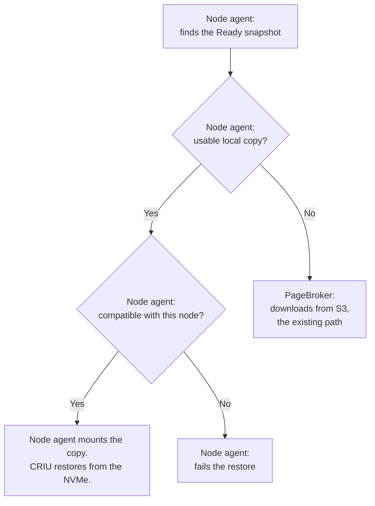
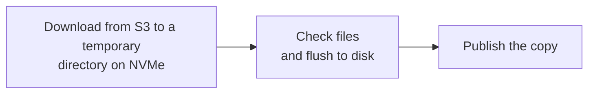
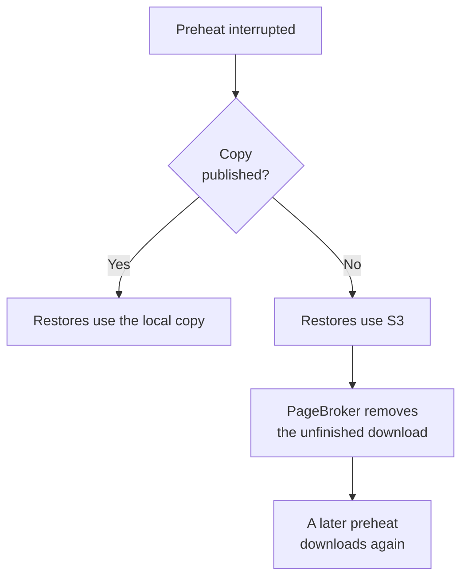
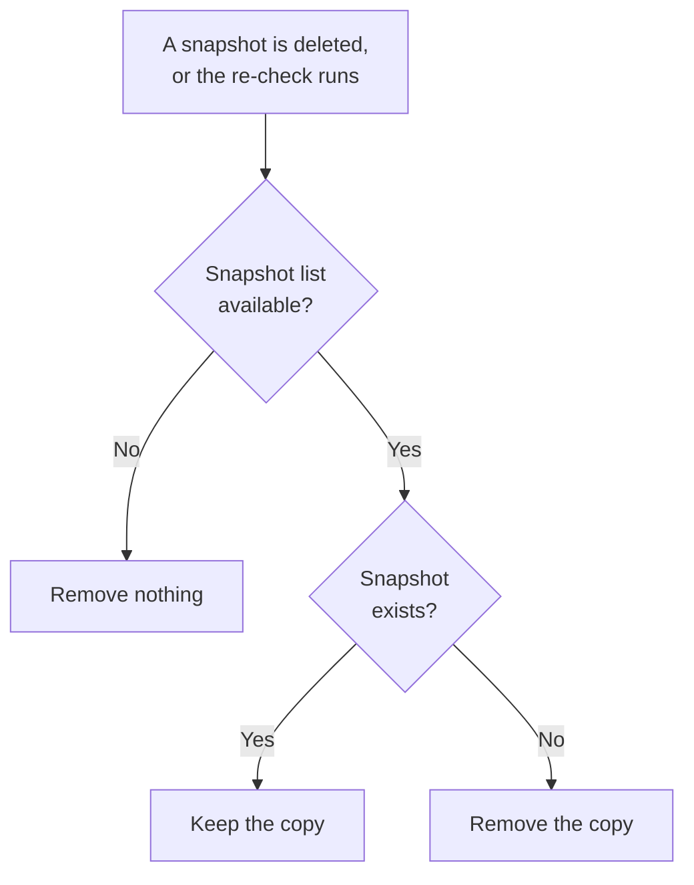
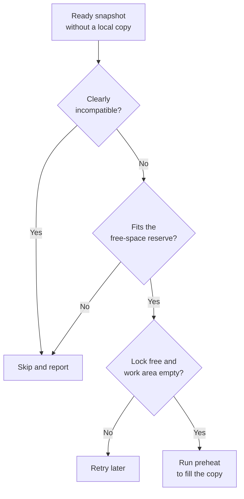

<!--
SPDX-FileCopyrightText: Copyright (c) 2026 NVIDIA CORPORATION & AFFILIATES. All rights reserved.
SPDX-License-Identifier: Apache-2.0
-->

# SNEP-644: Node Cache Preheat and Local Restore

This proposal describes local snapshot copies, preheat, and cleanup for S3
installations. It is a draft for author review. The feature is not implemented
or accepted by this document.

Tracking issue: [#644](https://github.com/ai-dynamo/snapshot/issues/644).
The preserved [source plan](full-plan.md) records the earlier detailed design.
This SNEP is the document to review; the source copy is historical context
and does not describe automatic preheat.

<!-- toc -->
- [Summary](#summary)
- [Motivation](#motivation)
  - [Goals](#goals)
  - [Non-Goals](#non-goals)
- [Proposal](#proposal)
  - [Limitations, Risks, and Mitigations](#limitations-risks-and-mitigations)
- [Design Details](#design-details)
  - [Changes by Component](#changes-by-component)
  - [Cache Identity and Layout](#cache-identity-and-layout)
  - [Restore Source](#restore-source)
  - [Preheat](#preheat)
  - [Interrupted Preheat](#interrupted-preheat)
  - [Cleanup](#cleanup)
  - [Automatic Preheat](#automatic-preheat)
  - [Copies Placed by an Administrator](#copies-placed-by-an-administrator)
  - [API](#api)
  - [Security](#security)
  - [Performance and Scalability](#performance-and-scalability)
  - [Monitoring](#monitoring)
  - [Dependencies](#dependencies)
  - [Test Plan](#test-plan)
  - [Graduation Criteria](#graduation-criteria)
  - [Future Work](#future-work)
- [Implementation History](#implementation-history)
- [Alternatives](#alternatives)
- [Appendix](#appendix)
  - [Decisions for Review](#decisions-for-review)
  - [Next Steps](#next-steps)
<!-- /toc -->

## Summary

Snapshot can restore a workload from a snapshot already stored on the node's
local disk. If no usable copy exists, it restores from S3. When automatic
preheat is enabled, each node attempts to keep a local copy of every eligible
snapshot before workloads start. S3 remains the source of truth.

## Motivation

Today, every restore from S3 downloads the whole snapshot first. Restoring the
same snapshot again downloads it again.

This proposal lets Snapshot keep a copy of each snapshot on the local NVMe of
every node. A restore reads the local copy and skips the download. If a node
has no copy, the restore uses S3 as it does today.

Issue #644 requests this node cache. This proposal covers S3 installations
first.

### Goals

This proposal has five goals. Each one maps to a requirement of issue #644,
with S3 as the shared store in place of a PVC:

- **Local restore (requirement 2):** restore from a usable local copy without
  staging it into RAM.
- **Fallback (requirements 1 and 2):** use the existing S3 path when no usable
  local copy exists.
- **Automatic preheat (requirement 5, in part):** preheat every participating
  node, including nodes added later, without starting a restore pod. The
  policy is one cluster-wide setting.
- **Preheat on request (requirement 5, in part):** preheat one node with an
  administrator command, not through the CRD.
- **Cleanup (requirement 6, in part):** remove local copies after their
  snapshot is deleted. Manual deletion and per-node status are not included.

This proposal also meets requirements 7 and 8 in part. See
[Cache Identity and Layout](#cache-identity-and-layout) and [API](#api).

### Non-Goals

This proposal excludes these features. Each one is a requirement of issue
#644 that is deferred:

- **Lazy pull-through (requirement 3):** filling the cache during a restore.
- **Cache-aware placement (requirement 4):** preferring nodes that already
  hold a copy when a restore pod is scheduled. The scheduler chooses the node
  as it does today.
- **Pre-staging on selected nodes (requirement 5):** choosing which nodes
  receive copies. This proposal copies to every participating node.
- **A shared PVC as the source of truth (requirement 1):** this proposal
  covers S3 installations only.

Multi-cluster support is also excluded. Issue #644 does not request it.

## Proposal

A **node cache** is a directory on the node's local NVMe. **Preheat** means
placing a complete snapshot copy there before an application starts. A preheat
downloads the snapshot from S3 straight to that directory.

The cache is optional and disabled by default. A restore still requires a
live, Ready snapshot object. A deleted snapshot cannot be restored, even if
its files are still on a node's disk.

Automatic preheat is a separate setting, also disabled by default. When it is
enabled, each node running a cache-enabled agent attempts to keep a local copy
of every eligible Ready snapshot. New nodes download existing snapshots, and
existing nodes download newly Ready snapshots. Downloads are asynchronous;
incomplete or unavailable copies use the existing S3 restore path.

This is eventual replication, not a guarantee. A node skips a snapshot that
does not fit, that it clearly cannot restore, or whose download fails. Each
agent downloads its own copy from S3. Nodes do not transfer snapshots to each
other.

Existing S3 restore correctness is preserved, with or without the cache.
Resource contention between a preheat and a restore stays within agreed
limits.

An administrator can also preheat one node with a command; see [API](#api).
An administrator can also place copies with another tool; see
[Copies Placed by an Administrator](#copies-placed-by-an-administrator).

### Limitations, Risks, and Mitigations

This proposal accepts these limits. Each one states its effect and what an
administrator does about it.

- **Snapshot does not know which copies are in use.** Deleting a snapshot or
  removing its copy can fail a restore that is reading that copy. Delete a
  snapshot, or remove its copy, only when no restore is using it.
- **Preheat shares the S3 reader with restores.** PageBroker has one S3
  reader. A preheat can slow a restore. A preheat that fails or times out can
  fail a restore that is running at that moment. Run the command before
  applications start. For automatic preheat, this is an open decision.
- **Preheat still uses memory.** It does not allocate snapshot-sized RAM
  staging. Its download buffers, mapped pages, and unwritten disk data still
  use memory. The limits must be measured.
- **An interrupted preheat wastes its download.** The unfinished files stay in
  the cache work area until PageBroker removes them, at the latest when the
  request reaches its maximum lifetime. A later preheat downloads the snapshot
  again.
- **Every node stores every snapshot.** Copies are never evicted. A snapshot
  that does not fit is skipped and restores from S3. A node with a different
  GPU model stores copies it cannot use. Delete old snapshots to free space.
- **Copies are not checked for damage after download.** A restore checks that
  a copy belongs to the snapshot, not that its content is intact. It does not
  switch to S3 after a failure, so a damaged copy keeps failing on that node.
  To repair it, move that copy out of the cache while no restore uses it.
  Later restores use S3, and preheat refills the copy. Give write access to
  the cache only to administrators.
- **A cluster-wide re-download is possible.** If the snapshot objects
  disappear for a moment, for example during a faulty upgrade, every node
  removes its copies and later downloads them again. No data is lost, but S3
  and the network carry the full load.
- **The cache can land on the wrong disk.** If the NVMe is not mounted at the
  configured path, copies go to the root disk. Check that the path is on the
  intended disk. See [API](#api).

The open decisions are part of the readiness gate in
[Graduation Criteria](#graduation-criteria).

## Design Details

Snapshot runs one agent pod on each selected node. The pod holds the node
agent and PageBroker, and it mounts a directory on the node's NVMe as the node
cache. A local copy serves only restore pods scheduled on that node. If the
cache directory is missing on a node, that node behaves as if the cache is
disabled: restores there use S3, and no preheat runs.

Each node agent subscribes to the snapshot objects in the cluster. It reacts
when a snapshot becomes Ready or is deleted. When it starts, it receives every
existing snapshot, which covers a new node and an agent that was down. It also
re-checks its local copies against the snapshots regularly, which covers a
failed download and a copy that was removed by hand.

The design has three flows:

- **S3 restore.** The flow is unchanged.
- **Preheat, from S3 to the NVMe.** The node agent decides what to download
  and publishes the result. PageBroker downloads into the node cache instead
  of into RAM. This requires modifications in PageBroker, which today supports
  only the S3 to tmpfs download flow.
- **Restore from the NVMe.** The existing PVC restore flow. The node agent
  mounts the local copy, and CRIU reads it. PageBroker transfers no snapshot
  data. It only opens the directory when the agent asks, and on nodes with
  CUDA custom storage it loads the GPU data.

### Changes by Component

Three components change. Each change below links to the section that explains
it.

- **Node agent**, which runs on every node:
  - **It looks in the node cache first.** When a restore starts, the agent
    uses a local copy if the node has one. Otherwise it uses S3, as today. See
    [Restore Source](#restore-source).
  - **It follows the snapshots in the cluster.** The agent learns when a
    snapshot becomes Ready and when one is deleted. It removes the local copy
    of a deleted snapshot. See [Cleanup](#cleanup).
  - **It prepares local copies.** The agent asks PageBroker to download a
    snapshot, then puts the finished copy in place. See [Preheat](#preheat)
    and [Automatic Preheat](#automatic-preheat).
  - **It offers a preheat command.** An administrator can prepare one snapshot
    on one node. See [API](#api).
- **PageBroker**, which runs next to the agent on every node:
  - **It downloads to the NVMe.** Today PageBroker downloads a snapshot only
    into RAM. It gains a download into the node cache, and it checks and
    flushes the files before it reports success. See [Preheat](#preheat).
  - **It cleans up after itself.** It removes a download that did not finish.
    See [Interrupted Preheat](#interrupted-preheat).
  - **It opens a local copy for a restore.** On S3 installations, PageBroker
    refuses today to open a snapshot directory on a disk. It must accept this
    for the node cache, for reading only.
- **Helm chart:**
  - **It gains new settings and one new mount.** The chart adds the node cache
    settings and mounts the cache directory into the agent pod. See
    [API](#api).
- **Not changed:** the operator, the CRDs, the S3 restore flow, and CRIU.

### Cache Identity and Layout

The node cache uses the same directory layout that a PVC installation uses
today, at the same path inside the agent pod:

```text
artifacts/<snapshot-uid>/containers/<container>/
```

A copy in the node cache looks to the restore code exactly like a snapshot on
a PVC. This is what lets a restore from the NVMe use the existing PVC restore
flow unchanged.

`<snapshot-uid>` is the UID of the snapshot's `PodSnapshotContent` object.

Before it uses a copy, a restore rejects symlinks and non-directories at that
entry. It checks that the manifest names this snapshot and container.

Validation has three separate meanings:

- **Identity:** checked at each local restore.
- **Completeness:** file lists, sizes, and modes are checked during preheat.
- **Content integrity:** checksums are not included.

An immutable snapshot does not need freshness updates. Immutability does not
prove that a local copy is complete or undamaged.

### Restore Source

Reject a restore whose snapshot object is missing or not Ready. For an
eligible snapshot, choose its source as shown in I1.

**Illustration 1 (I1): Choose the Restore Source**



A disabled cache, absent copy, or invalid manifest selects S3. A cache hit
returns a local source without an S3 handle. Compatibility checks read the
local manifest. A compatible copy can originate from another node. A restore
from the NVMe always reads in place, regardless of `pageBroker.restoreMode`.
A restore does not switch source after it starts.

### Preheat

A preheat run prepares one snapshot on one node. The command and automatic
preheat call the same routine. The node agent runs it and asks PageBroker to
download. No restore pod is needed.

One preheat runs on a node at a time. The command and the agent share a node
lock. The command waits for it up to a bounded timeout.

A preheat only fills a missing copy. It never replaces a copy, and publication
does not overwrite an entry that another writer published first.

A snapshot can cover several containers, and each one has its own copy.
Preheat handles them one at a time and skips a container whose copy is already
on the node.

I2 shows the main flow.

**Illustration 2 (I2): Prepare a Local Copy**



PageBroker reads the snapshot's file list and sizes before it writes. Skip a
copy if its required space would breach the free-space reserve,
`minFreeSpace`. The estimate must also account for filesystem overhead.

PageBroker writes into a temporary directory in a work area of the cache. Only
preheat uses that work area. PageBroker preserves file modes, directory modes,
and empty directories.

Before PageBroker reports success, it confirms the expected files, sizes,
modes, and directories, and it flushes the files to disk. A flush failure
prevents publication. The agent then checks the copy's identity, renames it
into place, and makes the rename durable.

Keep successful copies when another container fails. A later run processes
containers still missing.

### Interrupted Preheat

An interrupted preheat leaves an unfinished download in the work area. It is
never under a copy's final name, so no restore uses it. I3 shows the result.

**Illustration 3 (I3): Interrupted Preheat**



PageBroker removes its own unfinished downloads, as it does for its RAM
staging today. It tracks the downloads it is running, so it never removes
files that are still being written. It removes an unfinished download in
three cases:

- The download fails.
- The request reaches its maximum lifetime.
- PageBroker starts and finds downloads left by the previous process.

The node agent never deletes from the work area. It only moves a finished
copy out, to publish it, and only when it saw that download complete in the
same run. It never publishes a directory that it finds left over.

### Cleanup

When a snapshot is deleted, each node agent removes its local copy. The
regular re-check also removes any copy whose snapshot no longer exists. I4
applies equally to copies that preheat placed and copies that an administrator
placed.

**Illustration 4 (I4): Clean Up Node Copies**



Removal is subject to the active restore restriction. Cleanup does not touch
the work area.

### Automatic Preheat

Automatic preheat runs in the node agent when it is enabled; see [API](#api).
It starts a download when a snapshot becomes Ready. The start of the
subscription covers a node that joined later, and the regular re-check covers
a retry after a failure.

A snapshot is eligible when all of these conditions hold:

- It is Ready, bound to the S3 store, and not being deleted.
- The node has no copy of it.
- The node is not clearly unable to restore it.
- Its required space does not breach the free-space reserve.

The agent processes one snapshot at a time, newest first. I5 shows the
decision for each snapshot.

**Illustration 5 (I5): Decide an Automatic Preheat**



These rules keep the automatic path small:

- **Definite mismatches only.** The agent compares the snapshot's recorded CPU
  architecture, kernel version, and CPU features with its node. A missing
  value is unknown, not a mismatch. Checks that need the restore pod, such as
  GPU model and driver, stay at restore time.
- **Shared lock.** If the command holds the node lock, the agent tries again
  later.
- **Retries.** A failed download is retried later with an increasing delay.
  The agent tracks work in progress, which prevents duplicate work.
- **Spread starts.** Every node learns of a Ready snapshot at the same
  moment. Each node adds a small random delay before a download, which keeps
  all nodes from starting at once.
- **One download at a time.** Automatic preheat starts no new download on a
  node while the work area still holds an unfinished one. It does not cancel
  a running download.
- **Disabling.** Disabling automatic preheat stops new downloads. Existing
  copies stay subject to normal cleanup.

A preheat and a restore can run at the same time, since the agent runs
restores concurrently. They share PageBroker's S3 reader, the network, and the
disk. A preheat can slow a restore, and a preheat failure can fail one; see
[Limitations, Risks, and Mitigations](#limitations-risks-and-mitigations).
Processing one snapshot at a time bounds the overlap to one download. The
readiness gate in [Graduation Criteria](#graduation-criteria) states the
required outcomes.

### Copies Placed by an Administrator

An administrator can place copies in the node cache with their own tool. A
restore uses such a copy exactly like one that preheat placed. This works with
automatic preheat disabled.

A placed copy must meet these rules:

1. Its snapshot object exists in this cluster and is Ready.
2. It has the path described in
   [Cache Identity and Layout](#cache-identity-and-layout), and the same files
   that a PVC installation holds for that snapshot. File modes, directory
   modes, and empty directories are preserved.
3. It is written under a temporary name on the same disk, outside preheat's
   work area, and then renamed into place without overwriting an entry.
4. It is not changed after it is published.
5. Restore pods start only after the rename.

The supported way to obtain a correct copy is to preheat one node, then copy
that snapshot's directory to other nodes with a tool that keeps modes. A plain
S3 sync is not enough: the layout in S3 differs, and its index holds the modes
and the empty directories.

Snapshot treats a placed copy like any other. It removes the copy when its
snapshot is deleted, and it does not verify the content. Automatic preheat
fills only missing copies and never overwrites a placed one. A copy made for a
snapshot in another cluster is not accepted, since that snapshot has a
different ID.

### API

This proposal adds no new Kubernetes API or CRD. Its public interfaces are the
Helm values, the preheat command, and the node cache layout. The names remain
review decisions.

**Helm values.** The proposed values are:

- `storage.nodeCache.enabled`: disabled by default; S3 installations only.
- `storage.nodeCache.hostPath`: the local cache directory.
- `storage.nodeCache.minFreeSpace`: space to retain after a preheat copy.
- `storage.nodeCache.preheat.enabled`: disabled by default; when enabled with
  the cache, each agent preheats every eligible snapshot.

Units, required values, and defaults other than enablement are open.
A free-space check does not reserve disk space against other writers.

**Node preparation.** The participating nodes are the nodes where the agent
runs with the cache enabled. The chart's existing agent placement settings
choose those nodes. The chart mounts the `hostPath` directory into the agent
pod. Before enabling the cache, an administrator prepares each node that
should hold copies:

1. Format the NVMe and mount it on the node.
2. Use the same path on every such node. The setting is one value for the
   installation.
3. Confirm that the path is on the NVMe and not on the root disk.

Snapshot never creates the cache directory, and it does not format or mount
disks.

**Mount path.** The proposed mount path is `/checkpoints`, which reuses the
local restore path. A dedicated path adds mount-helper changes. Resolve this
choice against related storage designs before implementation.

**Preheat command.** It selects a snapshot by namespace and name, runs in a
node's agent pod, and reports ready, skipped, or failed results with reasons.

**Node cache layout.** It is a public interface for copies placed by an
administrator; see
[Copies Placed by an Administrator](#copies-placed-by-an-administrator).

The request that preheat adds between the node agent and PageBroker is
internal. Automatic preheat needs no new agent permission.

### Security

Snapshot files contain process memory and can contain application secrets.
Treat the cache as sensitive node storage. Restrict its ownership and access
to the privileged components that need it.

The command requires exec access to the privileged agent pod. A cache writer
can supply process state, so write access is administrator-level trust.
PageBroker can write only to the cache work directory; the rest of the cache
is read-only for it. Verify that it cannot change a published copy through a
descriptor or mapping kept open after the rename. Preserve its existing S3
credential path; the command should not need direct S3 credentials.

Automatic preheat widens where snapshot data rests. Snapshots from every
namespace are copied to every participating node, with no administrator action
for each snapshot. On a cluster shared by tenants, every participating node
holds process memory from every tenant. Leave automatic preheat disabled where
that is not acceptable.

Cleanup removes copies after snapshot deletion. Disabling the feature leaves
copies behind, so removal instructions are required. Filesystem deletion is
not a promise of secure erasure.

### Performance and Scalability

A cache hit avoids the S3 download and RAM staging. A preheat does not
allocate snapshot-sized RAM staging. Its download buffers, mapped pages, and
unwritten disk data still use memory.

Automatic preheat multiplies storage and S3 traffic by the number of nodes. A
snapshot set of 1 TiB needs about 1 TiB on each node, plus the reserve and
temporary working space. Fifty nodes hold about 50 TiB in total. A new node
downloads the whole set. Each agent keeps one subscription to the snapshot
objects and lists them when it starts.

Measure preheat duration, local versus S3 restore latency, peak memory during
a preheat, disk use, and restore slowdown during a preheat. Include GPU
snapshots, repeated restores, a snapshot larger than available RAM, and
catch-up time on a new node. Do not infer speedups from the diagrams.

### Monitoring

Each restore emits a log and pod event naming its selected source. Preheat
reports per-container results. Cleanup logs failures
with the snapshot identity and reason.

Automatic preheat emits an event when it skips or fails a snapshot, naming the
node and the reason. It rate-limits repeated events for the same snapshot and
reason. It logs each completed copy.

This proposal has no cluster-wide cache inventory or per-node API status.

### Dependencies

The design builds on [SNEP-237](../237-s3-storage/README.md), PageBroker's S3
download path, and the existing direct local restore path.
[Changes by Component](#changes-by-component) lists what PageBroker must gain.

The design was checked against `main` at `3e143360`.

### Test Plan

First, prove the key assumption: download from S3 straight to disk, and restore
through the direct local path. Include GPU data, restrictive modes, and empty
directories.

The implementation needs these tests:

- **Restore:** use a valid local copy; use S3 when the copy is absent or
  invalid. PageBroker serves direct local restore on S3 installations and
  rejects other path-based requests. S3 restore behaves the same with the
  cache disabled.
- **Preheat:** a complete, flushed copy with modes and empty directories,
  repeated requests, no space, a flush failure, an existing copy left
  unchanged, and partial success across containers. The command and the agent
  never write at once. PageBroker cannot change a published copy through a
  descriptor or mapping that it kept open.
- **Interruption:** an agent restart, a PageBroker restart, and a failed
  download never lead to an incomplete published copy. PageBroker removes its
  unfinished downloads and never removes files it is still writing. The agent
  never publishes a leftover directory.
- **Cleanup:** remove copies of deleted snapshots and keep all others. Cover a
  snapshot deleted while the agent is down. Remove nothing after a failed
  snapshot listing.
- **Automatic preheat:** a newly Ready snapshot, catch-up on a new node, skips
  for mismatch and for space, and no new download while the work area holds
  an unfinished one.
- **Isolation:** during a concurrent S3 restore, cause a full disk, a write
  failure, an S3 failure, and a timeout in a preheat. Measure restore slowdown
  and memory with a snapshot larger than available RAM, under the real
  container limits.
- **End to end:** a cache hit makes no S3 reads, a miss uses S3, and GPU state
  restores from the cache.

### Graduation Criteria

These are proposed evidence gates, not release dates:

- **Initial opt-in use:** the layout proof passes, the tests pass, resource
  use is measured, and administrators can follow the documented restrictions.
- **Broader use:** reader coordination, interrupted-operation handling, and
  disk checks have qualified tests.
- **Stable use:** public interfaces are settled, operational evidence supports
  the limits, and upgrade and disable behavior are documented.

Deliver the command and the shared implementation first. Automatic preheat
comes last and has its own readiness gate. Do not merge it until all of these
outcomes are shown:

- A preheat failure or timeout does not cause an otherwise successful
  concurrent restore to fail.
- Restore slowdown during a preheat stays within an agreed, measured bound.
- Large downloads stay within the agreed memory limits.
- An interruption never leads to an incomplete published copy, and no files
  are removed while they are being written.
- A node holds at most one unfinished preheat download.

Maintainers must agree the maturity labels and thresholds during review.

### Future Work

A preheat node selector is a possible enhancement. It limits copies to a
group of nodes, which helps clusters with mixed GPU models. It does not change
workload scheduling.

A preheat object can add per-snapshot node choice, with per-node status.
Later work can also track readers and check the intended disk. Retention or
eviction of live copies is another candidate. Automatic handling of a damaged
copy, such as switching later restores to S3, is a third.

Multi-cluster support depends on imports preserving snapshot identity, store
binding, and container handles. Readiness must reflect available snapshot
data. Shared stores need deletion and orphan-sweep rules that protect other
clusters. Cross-cluster tests are required. These dependencies are not
resolved here.

## Implementation History

On 2026-11-11, the source plan was adapted into this illustrated draft for
author review. On 2026-11-12, the draft added automatic preheat and changed
preheat to download straight to the node cache. No feature
implementation or runtime validation is recorded.

## Alternatives

The source plan and its review considered these alternatives:

- **Command-only preheat:** smaller, but an administrator must run
  it on each node for each snapshot. Preparing copies before applications
  start is the required initial functionality.
- **Administrator-selected nodes:** limits disk use on mixed clusters, but
  adds node-label lookup and an agent permission. Defer it as the preheat node
  selector.
- **Every node that can restore the snapshot:** a node cannot know this before
  the restore pod exists.
- **A preheat object with a controller:** gives per-snapshot node choice and
  status, but adds an API. Defer it.
- **Download into RAM, then copy in the agent:** reuses the existing download
  request unchanged. It limits a snapshot to the staging RAM, takes that RAM
  from restores, and adds a second copy.
- **A second S3 reader in PageBroker for preheat:** PageBroker supports one
  reader per process, and its teardown affects every S3 client in the process.
- **External distribution tools:** can help share downloads, but introduce
  integration and operating costs. Keep the download behind a small interface.

## Appendix

### Decisions for Review

Reviewers need to settle these points:

1. Accept the S3-first scope and the operating restrictions.
2. Choose the mount path and finalize configuration and command names.
3. Confirm deletion of copies placed by an administrator.
4. Agree the import contract and shared-store cleanup ownership.
5. Decide how preheat downloads are isolated from restores in PageBroker. The
   candidate is an isolated preheat download mechanism; implementation to be
   determined.
6. Confirm that PageBroker removes its own unfinished preheat downloads.
7. Agree the memory limits and the restore slowdown bound for a preheat.
8. Confirm the newest-first order for automatic preheat.
9. Accept copies of every namespace's snapshots on every participating node.
10. Confirm that the chart can mount the cache without Kubernetes creating a
    missing directory.

### Next Steps

Use these references for review and follow-up:

- [Snapshot Enhancement Proposal (SNEP)](../README.md) - Follow the proposal
  review process after the author review.
- [Issue #644](https://github.com/ai-dynamo/snapshot/issues/644) - Track scope,
  approval, and later implementation.
