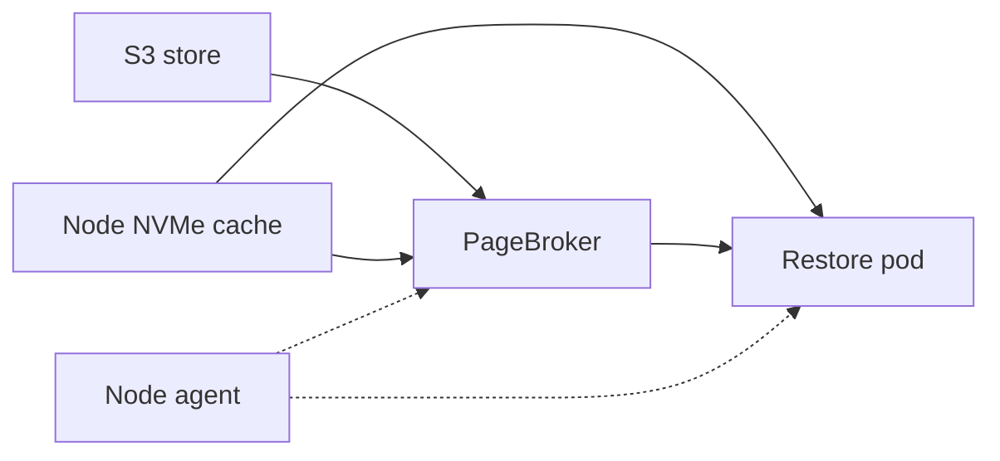
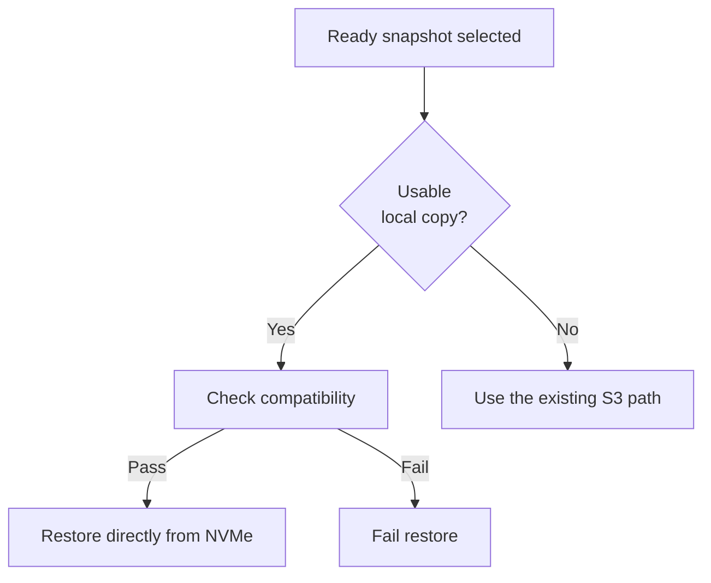
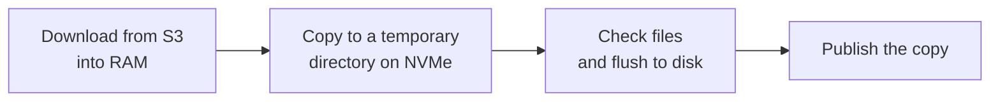
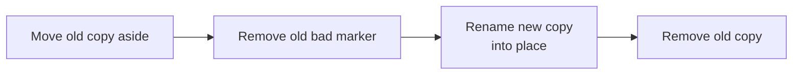
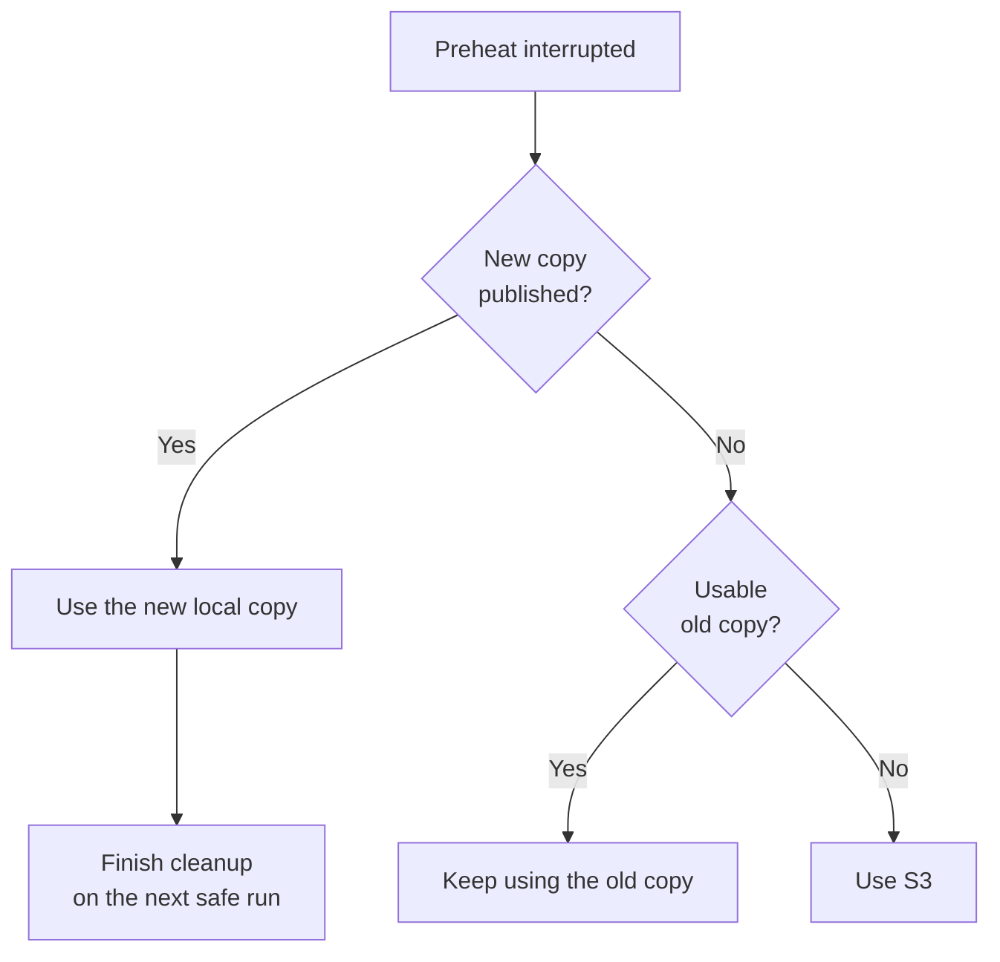
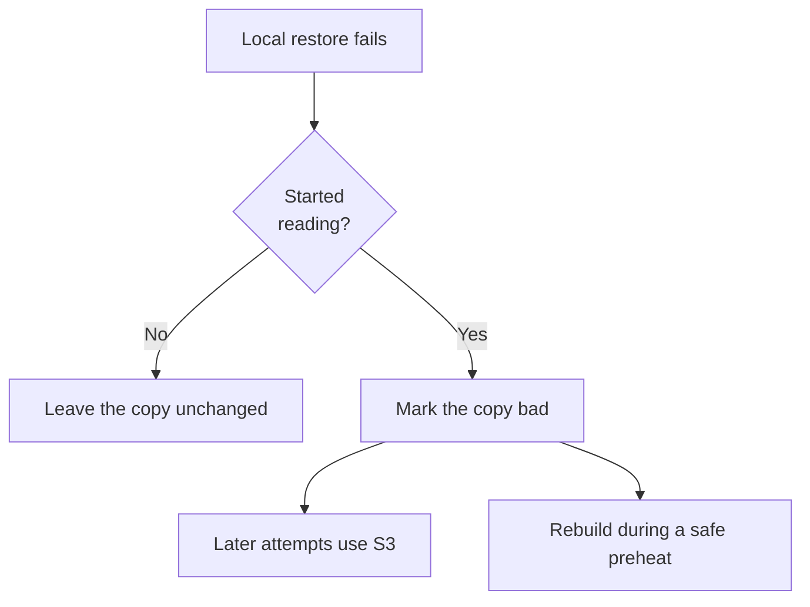
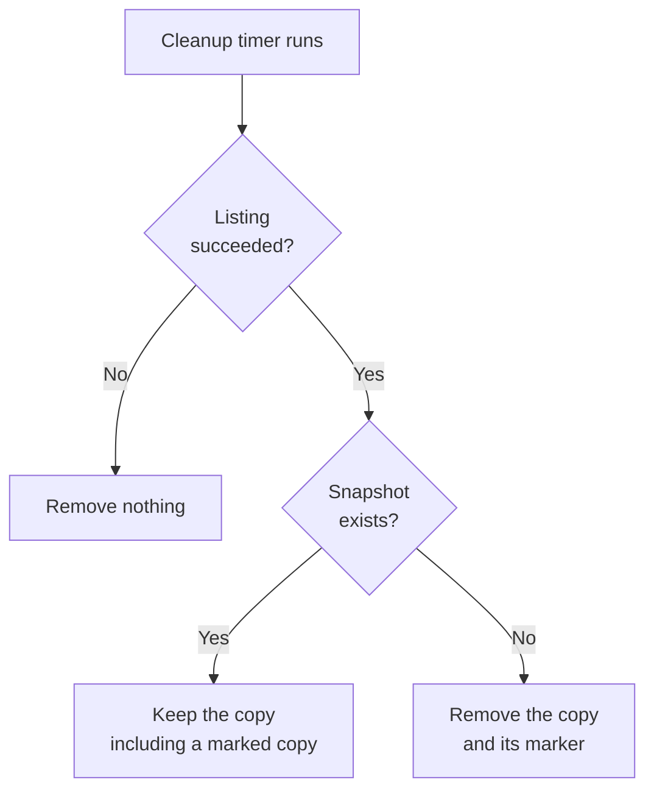

<!--
SPDX-FileCopyrightText: Copyright (c) 2026 NVIDIA CORPORATION & AFFILIATES. All rights reserved.
SPDX-License-Identifier: Apache-2.0
-->

# SNEP-644: Node Cache Preheat and Local Restore

This proposal describes local snapshot copies, preheat, and cleanup for S3
installations. It is a draft for author review. The feature is not implemented
or accepted by this document.

Tracking issue: [#644](https://github.com/ai-dynamo/snapshot/issues/644).
The preserved [source plan](full-plan.md) records the earlier detailed design.
This SNEP is the document to review; the source copy is historical context.

<!-- toc -->
- [Summary](#summary)
- [Motivation](#motivation)
  - [Goals](#goals)
  - [Non-Goals](#non-goals)
- [Proposal](#proposal)
  - [Limitations, Risks, and Mitigations](#limitations-risks-and-mitigations)
- [Design Details](#design-details)
  - [Components](#components)
  - [Cache Identity and Layout](#cache-identity-and-layout)
  - [Restore Source](#restore-source)
  - [Preheat](#preheat)
  - [Replace a Copy](#replace-a-copy)
  - [Interrupted Preheat](#interrupted-preheat)
  - [Failed Local Restore](#failed-local-restore)
  - [Cleanup](#cleanup)
  - [External Writers](#external-writers)
  - [API](#api)
  - [Security](#security)
  - [Configuration](#configuration)
  - [Performance and Scalability](#performance-and-scalability)
  - [Monitoring](#monitoring)
  - [Dependencies](#dependencies)
  - [Test Plan](#test-plan)
  - [Graduation Criteria](#graduation-criteria)
  - [Later Phases](#later-phases)
- [Implementation History](#implementation-history)
- [Alternatives](#alternatives)
- [Appendix](#appendix)
  - [Decisions for Review](#decisions-for-review)
  - [Source and Scope](#source-and-scope)
  - [Next Steps](#next-steps)
<!-- /toc -->

## Summary

Snapshot can restore a workload from a snapshot already stored on the node's
local disk. If no usable copy exists, it restores from S3. Administrators can
download snapshots before workloads start. S3 remains the source of truth.

## Motivation

The S3 restore path downloads a snapshot into RAM before restoring it. Repeated
restores repeat that download. A prepared local copy removes the download from
the startup path.

Issue #644 requests a node cache. This proposal starts with S3 installations
and gives administrators a built-in way to prepare copies.

### Goals

Phase 1 has four goals:

- Restore from a usable local copy without staging it into RAM.
- Use the existing S3 path when no usable local copy exists.
- Preheat chosen nodes without starting a restore pod.
- Remove local copies after their snapshot is deleted.

### Non-Goals

Phase 1 excludes these features:

- Filling the cache during a restore.
- Automatic scheduling preference for nodes with a copy.
- Removing live snapshots by age or cache size.
- A preheat API object, cancellation, or reader tracking.
- Direct downloads from S3 to NVMe.
- PVC installations and multi-cluster support.

## Proposal

A **node cache** is a directory on the node's local NVMe. **Preheat** means
placing a complete snapshot copy there before an application starts.

The cache is optional and disabled by default. A restore still requires a
live, Ready snapshot object. Files left on disk do not grant permission to
restore a deleted snapshot.

An administrator runs a preheat command inside the selected node's agent pod.
The command prepares each container's copy and reports the result. Another
tool can prepare copies if it follows the same publication contract.

### Limitations, Risks, and Mitigations

Phase 1 accepts these limits:

1. **No reader tracking.** Delete a snapshot or replace its copy only when no
   restore is running or starting against that copy. Rebuilding a bad copy is
   a replacement.
2. **Shared staging budget.** Preheat can consume capacity needed by restores.
   Preheat nodes before applications start. The behavior under pressure must
   be measured.
3. **Interrupted downloads.** A stopped command can leave RAM allocated until
   transaction expiry, pod recreation, or recovery. Ending an active download
   can fail other S3 restores. Recover while no restore is running on the node.
4. **RAM limit.** Each staged download must fit the PageBroker staging budget.
   Preheat does not remove the existing S3 staging limit.
5. **Trusted writers.** Restore checks identity, not payload checksums. External
   tools must write complete copies. Cache write access is privileged.
6. **Disk selection.** A missing directory can be created on the root disk.
   Administrators must ensure the configured path uses the intended disk.
7. **Manual capacity management.** Live copies are not evicted. Disabling the
   cache leaves copies on disk for manual removal.
8. **Independent downloads.** Each node downloads its own copy. Stagger large
   preheat jobs when needed.

Copying to disk also adds page-cache memory. Measurements must include both
staging and the preheat process. No performance improvement is claimed yet.

## Design Details

### Components

The node agent selects the source and coordinates restore. CRIU reads process
state. PageBroker downloads from S3 and restores GPU memory. The preheat
command runs in the agent pod and writes the node cache.

I1 shows restore responsibilities. Dashed arrows show coordination. Solid
arrows show reads or data movement. I3 shows preheat separately.

**Illustration 1 (I1): Restore Components**



The cache is mounted read-write into the node agent and read-only into
PageBroker. Local restore uses direct mode regardless of
`pageBroker.restoreMode`. PageBroker still opens a local restore transaction.

On an S3 installation, enable PageBroker's file engine for direct restore
when the cache is enabled. Reject path-based checkpoint and staged-restore
requests. The cache must not become the snapshot store.

### Cache Identity and Layout

Use the existing local layout:

```text
artifacts/<snapshot-uid>/containers/<container>/
```

Resolve `PodSnapshot.status.boundSnapshotContentName` to its
`PodSnapshotContent`. In phase 1, use that object's UID. Keep UID resolution
behind one accessor so an import can later supply the original UID.

Restore rejects symlinks and non-directories at the selected entry. It checks
the manifest's UID and container, then checks for a bad-copy marker.

Validation has three separate meanings:

- **Identity:** checked at each local restore.
- **Completeness:** file lists, sizes, and modes are checked during preheat.
- **Content integrity:** checksums are not included in phase 1.

An immutable snapshot does not need freshness updates. Immutability does not
prove that a local copy is complete or undamaged.

### Restore Source

Reject a restore whose snapshot object is missing or not Ready. For an
eligible snapshot, choose its source as shown in I2.

**Illustration 2 (I2): Choose the Restore Source**



A disabled cache, absent copy, invalid manifest, or bad marker selects S3.
A cache hit returns a local source without an S3 handle. Compatibility checks
read the local manifest. A compatible copy can originate from another node.

### Preheat

The command accepts a snapshot namespace and name. It runs inside the node
agent pod because PageBroker's socket and staging volume are available there.
No restore pod is needed.

Before processing containers, the command performs these steps:

1. Acquire the node's preheat lock, waiting up to a bounded timeout.
2. Recover unfinished attempts from the cache work area.
3. Read the Ready snapshot and its store ID and container handles.

For each container, skip a usable copy unless replacement was requested.
Otherwise, create a recovery record before starting the download. The record
holds the transaction ID and the paths needed for cleanup. It stays outside
the directory that will be published.

I3 shows the main flow. Publication details are separate in I4.

**Illustration 3 (I3): Prepare a Local Copy**



After download, check available space against `minFreeSpace`. Copy the staged
directory while preserving file modes, directory modes, and empty directories.
Validate the copy against staging and flush it before publication.

Ask PageBroker to end the transaction after validation. If that fails, the
complete copy can still be published. Keep the recovery record and report
the unresolved cleanup.

Every exit path attempts cleanup, including insufficient disk space. Remove
the record only after transaction and required local cleanup succeed.
"Transaction not found" counts as success; other errors retain the record.

Containers have separate copies and transactions. Keep successful copies when
another container fails. A later run processes containers still missing or
invalid. Report the affected containers and any pending cleanup. Final output
and exit-code names remain open.

### Replace a Copy

Replacement requires the phase 1 restriction on active restores. The new copy
must be complete and flushed before the operations in I4 begin.

**Illustration 4 (I4): Replace a Copy**



These are separate filesystem operations. If marker removal fails, do not
publish the new copy. If the final directory is absent, restores use S3.
Only a complete copy appears under the final name.

Retain the recovery record until both transaction and local cleanup succeed.
Do not discard it when removing the old directory fails.

### Interrupted Preheat

A crash can leave different states on disk. I5 shows which restore source is
available. The next safe preheat run uses recovery records to finish cleanup.

**Illustration 5 (I5): Interrupted Preheat**



A crash after moving the old copy can leave an old marker without a final
copy. That state uses S3. Recovery removes stale work and leaves any
successfully published copy intact.

Recovery repeats transaction cleanup safely. It retains records when cleanup
fails. Path identities must distinguish the final copy from temporary and old
copies, including when only part of replacement completed.

### Failed Local Restore

A restore cannot switch source midway. I6 describes what happens to the copy
after a local restore fails.

**Illustration 6 (I6): Handle a Failed Local Restore**



A compatibility failure leaves the copy unchanged. A failure after reading
starts writes a small marker beside the copy. The agent cannot prove that
the files caused the failure, so this rule can mark a good copy too.

Marking never moves or deletes the copy. Other restores can already be reading
it or preparing to mount it. A later preheat rebuilds it under the replacement
restriction. Several concurrent restores can fail before the marker is written.

### Cleanup

The node agent periodically lists snapshot objects and removes unreferenced
copies. I7 applies equally to Snapshot-created and externally created copies.

**Illustration 7 (I7): Clean Up Node Copies**



A marker does not change ownership. Keep marked copies while their snapshot
exists. Remove the copy and marker after deletion, subject to the active
restore restriction. Preheat recovery owns temporary work and old copies.

### External Writers

An external tool can publish a copy under this contract:

1. Resolve a live, Ready snapshot object.
2. Write a complete local-layout copy under a temporary name.
3. Publish by renaming on the same filesystem without overwriting an entry.
4. Leave published files unchanged.
5. Start restore pods only after publication completes.

The tool owns completeness checks. A plain S3 sync is insufficient: the S3
index also records modes and empty directories. Use the preheat command when
the tool cannot reconstruct that layout.

### API

Phase 1 changes no CRDs. It adds an administrator command and Helm values,
which are public interfaces. Exact command, flag, result, and event names
remain review decisions.

The command selects a snapshot by namespace and name. Running it in a node's
agent pod selects that node. It supports replacing an existing copy and
reports ready, skipped, or failed results with reasons. Cleanup failures must
remain visible even when a copy was successfully published.

The command wraps a reusable preheat package. Phase 2 can call that package
from a watcher. Phase 1 adds no agent endpoint or cancellation command.

### Security

Snapshot files contain process memory and can contain application secrets.
Treat the cache as sensitive node storage. Restrict its ownership and access
to the privileged components that need it.

The command requires exec access to the privileged agent pod. A cache writer
can supply process state, so write access is administrator-level trust.
PageBroker receives a read-only cache mount. Preserve its existing S3
credential path; the command should not need direct S3 credentials.

Cleanup removes copies after snapshot deletion. Disabling the feature leaves
copies behind, so removal instructions are required. Filesystem deletion is
not a promise of secure erasure. Checksums and untrusted writers are outside
phase 1.

### Configuration

The proposed Helm values are:

- `storage.nodeCache.enabled`: disabled by default; phase 1 supports S3 only.
- `storage.nodeCache.hostPath`: the local cache directory.
- `storage.nodeCache.minFreeSpace`: space to retain after a preheat copy.

Names, units, required values, and defaults other than enablement are open.
A free-space check does not reserve disk space against other writers.

The proposed mount path is `/checkpoints`, which reuses the local restore
path. A dedicated path adds mount-helper changes. Resolve this choice against
related storage designs before implementation.

### Performance and Scalability

A cache hit avoids the S3 download and RAM staging. Preheat still uses both
RAM and disk. Only one preheat runs per node, but it shares PageBroker's
resources with restores.

Measure preheat duration, local versus S3 restore latency, peak staging and
copy memory, disk use, and restore behavior near the staging limit. Include
GPU snapshots and repeated restores. Do not infer speedups from the diagrams.

### Monitoring

Each restore emits a log and pod event naming its selected source. Preheat
reports per-container results and unresolved cleanup. Cleanup logs failures
with the snapshot identity and reason.

Phase 1 has no cluster-wide cache inventory or per-node API status. Exact event
reasons and any new metrics remain open; use existing naming conventions.

### Dependencies

The design builds on [SNEP-237](../237-s3-storage/README.md), the S3 staged
download path, and the existing direct local restore path. PageBroker must
serve both S3 and direct file restore when the cache is enabled.

The source plan was written against `feat/pagebroker-restore-file-ranges` at
`fcb89163`. It is not proof that every referenced behavior is available on
`main`. Recheck the implementation baseline before coding. No new driver or
CUDA minimum is proposed without evidence.

### Test Plan

First, prove the key assumption: stage from S3, copy to disk, and restore
through the direct local path. Include GPU data, restrictive modes, and empty
directories. No such runtime test has been run for this proposal.

The implementation needs these tests:

- **Restore:** hit, miss, bad marker, wrong identity, symlink rejection,
  forced direct mode, compatibility failure, and source events.
- **Concurrency:** a failed restore marks a copy without disrupting another
  restore using it. Replacement still requires the phase 1 restriction.
- **PageBroker:** direct local restore works on S3 installations; path-based
  checkpoint and staged file restore remain rejected.
- **Preheat:** repeated requests, lock contention, modes, empty directories,
  replacement, no space, and partial success across containers.
- **Recovery:** interruption before download, during copy, after each rename,
  before marker removal, and after publication. Preserve published copies.
- **Cleanup failures:** an absent transaction counts as success; other
  transaction or local cleanup failures keep the recovery record.
- **Deletion:** retain named copies, including marked copies; remove unnamed
  copies and markers; remove nothing after a failed snapshot listing.
- **End to end:** a cache hit makes no S3 reads; a miss uses S3; GPU state
  restores from the cache.

Issue #644 tracks the work. Performance measurements and test results must be
recorded before declaring the implementation ready.

### Graduation Criteria

These are proposed evidence gates, not release dates:

- **Initial opt-in use:** the layout proof passes, phase 1 tests pass, resource
  use is measured, and administrators can follow the documented restrictions.
- **Broader use:** reader coordination, interrupted-operation handling,
  staging-budget policy, and disk checks have qualified tests.
- **Stable use:** public interfaces are settled, operational evidence supports
  the limits, and upgrade and disable behavior are documented.

Maintainers must agree the maturity labels and thresholds during review.

### Later Phases

Phase 2 adds a preheat object, node selection, and per-node status. Track all
objects that still need a copy, rather than only the object that created it.
Ownership of command-created and external copies needs an explicit policy.

Phase 2 also moves preheat into the agent process, tracks readers, defines a
staging-budget policy, and checks the intended disk. Node labeling requires
either agent permission or operator ownership of that action.

Phase 3 depends on imports preserving snapshot identity, store binding, and
container handles. Readiness must reflect available snapshot data. Shared
stores need deletion and orphan-sweep rules that protect other clusters.
Cross-cluster tests are required. These dependencies are not resolved here.

## Implementation History

On 2026-11-11, the source plan was adapted into this illustrated draft for
author review. No feature implementation or runtime validation is recorded.

## Alternatives

The source plan considered these alternatives:

- **Agent-managed preheat now:** survives dropped exec sessions but adds
  request handling. Defer it to phase 2.
- **Direct S3-to-disk download:** removes staging pressure but requires a new
  transfer path. Reuse PageBroker first.
- **External distribution tools:** can help share downloads, but introduce
  integration and operating costs. Keep the download behind a small interface.
- **A dedicated cache mount:** separates storage roles but changes mount
  helpers. Keep it as an open mount-path choice.

## Appendix

### Decisions for Review

Reviewers need to settle these points:

1. Accept the S3-first phases and phase 1 operating restrictions.
2. Choose the mount path and finalize configuration and command names.
3. Confirm bad-copy marking and deletion of externally prepared copies.
4. Define command results for published copies with pending cleanup.
5. Agree the import contract and shared-store cleanup ownership.
6. Clarify whether the source plan's proof-before-PR rule includes the future
   proposal PR or only implementation PRs.

### Source and Scope

The [source plan](full-plan.md) is preserved without edits. It contains older
paths, dated issue states, estimates, and code references from its original
branch. It is not a second current specification.

This draft refines cleanup record retention, crash-window wording, and
multi-container retry wording discussed during review. It does not qualify
runtime behavior or claim acceptance of future APIs.

### Next Steps

Use these references for review and follow-up:

- [Snapshot Enhancement Proposal (SNEP)](../README.md) - Follow the proposal
  review process after the author review.
- [Issue #644](https://github.com/ai-dynamo/snapshot/issues/644) - Track scope,
  approval, and later implementation.
