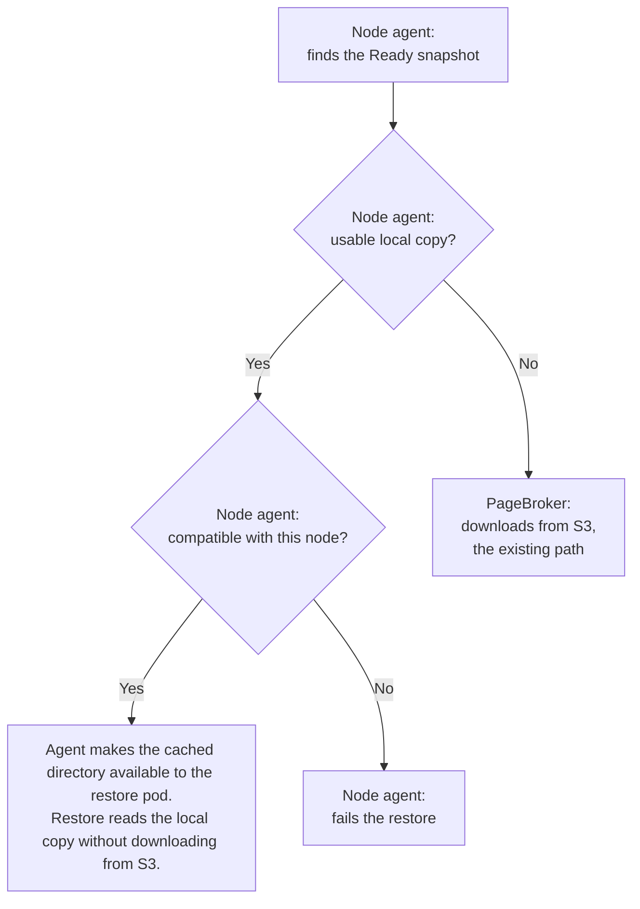
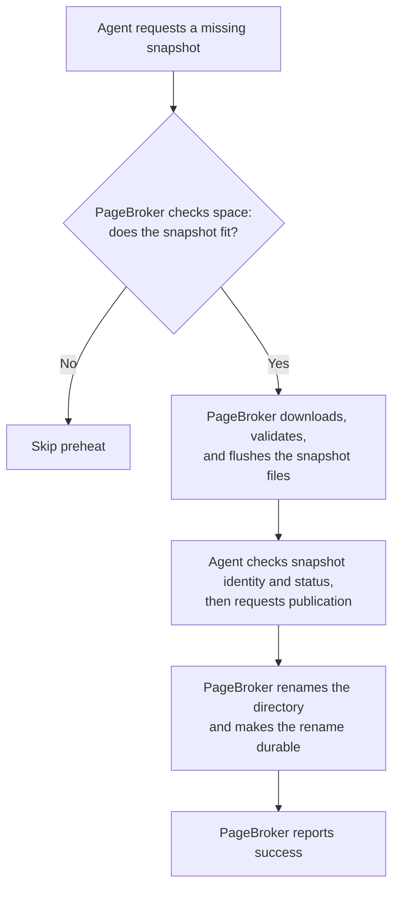
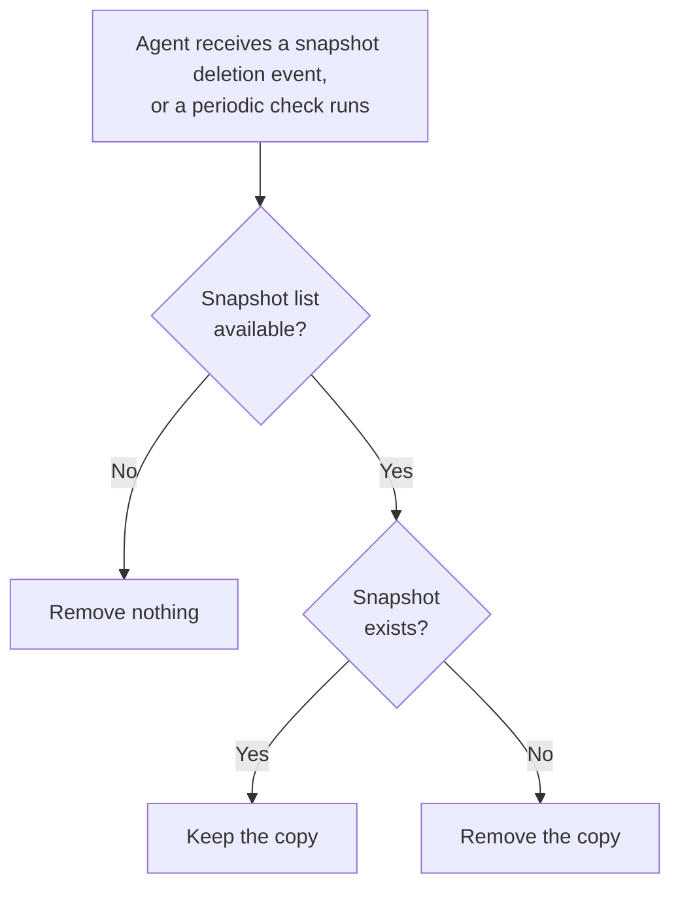

<!--
SPDX-FileCopyrightText: Copyright (c) 2026 NVIDIA CORPORATION & AFFILIATES. All rights reserved.
SPDX-License-Identifier: Apache-2.0
-->

# SNEP-644: Node Cache Preheat and Local Restore

This proposal describes local snapshot copies, preheat, and cleanup for S3
installations. It is a draft for author review. The feature is not implemented
or accepted by this document.

Tracking issue: [#644](https://github.com/ai-dynamo/snapshot/issues/644).

<!-- toc -->
- [Summary](#summary)
- [Motivation](#motivation)
  - [Goals](#goals)
  - [Non-Goals](#non-goals)
- [Proposal](#proposal)
  - [Limitations, Risks, and Mitigations](#limitations-risks-and-mitigations)
- [Design Details](#design-details)
  - [Changes by Component](#changes-by-component)
  - [Cache Identity and Layout](#cache-identity-and-layout)
  - [Restore Source](#restore-source)
  - [Preheat](#preheat)
  - [Cleanup](#cleanup)
  - [Copies Placed by an Administrator](#copies-placed-by-an-administrator)
  - [API](#api)
  - [Security](#security)
  - [Performance and Scalability](#performance-and-scalability)
  - [Monitoring](#monitoring)
  - [Dependencies](#dependencies)
  - [Test Plan](#test-plan)
  - [Graduation Criteria](#graduation-criteria)
  - [Future Work](#future-work)
- [Implementation History](#implementation-history)
- [Alternatives](#alternatives)
- [Appendix](#appendix)
  - [Decisions for Review](#decisions-for-review)
  - [Next Steps](#next-steps)
<!-- /toc -->

## Summary

Snapshot can restore a workload from a snapshot already stored on the node's
local disk. If no usable copy exists, it restores from S3. When preheat is
enabled, agents download eligible snapshots ahead of restores. Workloads do
not wait for preheat to finish. S3 remains the source of truth.

## Motivation

Today, every restore from S3 downloads the whole snapshot first. Restoring the
same snapshot again downloads it again.

This proposal lets Snapshot keep eligible snapshots on the local NVMe of
participating nodes, subject to available space. A restore reads the local
copy and skips the download. If a node has no copy, the restore uses S3 as it
does today.

Issue #644 requests this node cache. This proposal covers S3 installations
first.

### Goals

This proposal has four goals. Each one maps to a requirement of issue #644,
with S3 as the shared store in place of a PVC:

- **Local restore (requirement 2):** restore from a usable local copy without
  staging it into RAM.
- **Fallback (requirements 1 and 2):** use the existing S3 path when no usable
  local copy exists.
- **Preheat (requirement 5, in part):** prepare eligible snapshots on
  participating nodes, including nodes added later, subject to available
  space and without starting a restore pod. A participating node is a node
  where the agent runs with the cache enabled. The policy is one cluster-wide
  setting.
- **Cleanup (requirement 6, in part):** remove local copies after their
  snapshot is deleted. A cache-deletion command and per-node status are
  outside this proposal.

This proposal also meets requirements 7 and 8 in part. See
[Cache Identity and Layout](#cache-identity-and-layout) and [API](#api).

### Non-Goals

This proposal excludes these features. Each one is a requirement of issue
#644 that is deferred:

- **Lazy pull-through (requirement 3):** filling the cache during a restore.
- **Cache-aware placement (requirement 4):** preferring nodes that already
  hold a copy when a restore pod is scheduled. The scheduler chooses the node
  as it does today.
- **Pre-staging on selected nodes (requirement 5):** choosing which nodes
  receive copies. Preheat covers eligible snapshots on participating nodes,
  subject to available space.
- **A shared PVC as the source of truth (requirement 1):** this proposal
  covers S3 installations only.

An on-demand preheat command is outside this proposal. Administrators can
place existing snapshot copies themselves; see
[Copies Placed by an Administrator](#copies-placed-by-an-administrator).

Multi-cluster support is also excluded. Issue #644 does not request it.

## Proposal

A **node cache** is a directory on the node's local NVMe. **Preheat** is the
agent's background download of snapshots from S3 into that cache, ahead of
restores.

The cache is optional and disabled by default. A restore still requires a
live, Ready snapshot object. A deleted snapshot cannot be restored, even if
its files are still on a node's disk.

Preheat is a separate setting, also disabled by default. When both settings
are enabled, each agent attempts to keep a local copy of eligible Ready
snapshots. A restore uses the existing S3 path if its local copy is not yet
available. See [Preheat](#preheat) for eligibility and scheduling.

This is eventual replication, not a guarantee. A node skips snapshots that
do not fit or have known CPU or kernel incompatibilities. Failed preheats
have limited retries as described in [Preheat](#preheat). Each agent
downloads its own copy from S3. Nodes do not transfer snapshots to each other.

A preheat must not break an S3 restore, and its effect on restore speed must
stay within agreed limits. Both are open today; see
[Graduation Criteria](#graduation-criteria).

An administrator can also place copies with another tool; see
[Copies Placed by an Administrator](#copies-placed-by-an-administrator).

### Limitations, Risks, and Mitigations

- **Deletion during a restore.** Cleanup does not track active readers.
  Deleting a snapshot or removing its local copy can break a restore using it.
  Administrators must wait until those restores finish before deleting either.
- **Preheat can affect restores.** Preheat shares PageBroker's S3 reader,
  the network, and the disk with restores. Before preheat is enabled, tests
  must show that its failures do not fail concurrent restores and that restore
  slowdown stays within an agreed limit.
- **Damaged copies need manual recovery.** The cache does not verify content
  checksums, and a restore does not switch to S3 after it starts. A damaged
  copy can cause repeated failures. When no restore uses it, an administrator
  must remove it. Later restores use S3 until automatic preheat, when enabled,
  refills the copy or an administrator places a valid copy.

Administrators manage retention by deleting old snapshots. Agents then remove
their local copies. Copies of live snapshots are not evicted to make room.
When a snapshot does not fit, preheat skips it and restores use S3.

## Design Details

Snapshot runs one agent pod on each selected node. The pod holds the node
agent and PageBroker, and it mounts a directory on the node's NVMe as the node
cache. A local copy serves only restore pods scheduled on that node. If the
cache directory is missing on a node, that node behaves as if the cache is
disabled: restores there use S3, and no preheat runs.

Each node agent watches snapshot objects and periodically checks its cache
against them. [Preheat](#preheat) defines download scheduling;
[Cleanup](#cleanup) defines removal of published copies.

The design has three flows:

- **S3 restore.** The flow is unchanged.
- **Preheat, from S3 to the NVMe.** The node agent decides what to download
  and checks its identity. PageBroker downloads and publishes the copy.
  This adds a download to NVMe alongside its existing S3 to tmpfs flow.
- **Restore from the NVMe.** The existing PVC restore flow. The node agent
  mounts the local copy, and CRIU reads it. PageBroker opens the directory
  without downloading from S3. On nodes with CUDA custom storage, it also
  loads the GPU data.

### Changes by Component

Three components change:

- **Node agent:** selects the [Restore Source](#restore-source), schedules
  [Preheat](#preheat) and its download retries, and reports failures. It
  removes deleted snapshots through [Cleanup](#cleanup).
- **PageBroker:** downloads, validates, publishes, and cleans up preheat
  requests, including after restart. It also opens local copies for reading
  on S3 installations.
- **Helm chart:** adds the settings and cache mount described in [API](#api).

The operator, CRDs, S3 restore flow, and CRIU do not change.

### Cache Identity and Layout

Each snapshot captures one source container from a pod. The cache reserves
two directories under `storage.nodeCache.hostPath`:

- `artifacts/` holds published snapshots.
- `.preheat/` is PageBroker's work area, with a separate temporary directory
  for each request. Administrator tools must not write there.

Both directories must be on the same filesystem so publication can use an
atomic rename.

Published copies use the same directory layout as PVC installations. With
the proposed mount path, the path inside the agent pod is also the same:

```text
artifacts/<snapshot-uid>/containers/<container>/
```

A copy in the node cache is meant to look to the restore code exactly like a
snapshot on a PVC, so that a restore from the NVMe can use the existing PVC
restore flow unchanged. This is the key assumption, and the
[Test Plan](#test-plan) proves it first.

`<snapshot-uid>` is the UID of the snapshot's `PodSnapshotContent` object.

Before it uses a copy, a restore rejects symlinks and non-directories at that
entry. It checks that the manifest names this snapshot and container.

Validation has three separate meanings:

- **Identity:** checked at each local restore.
- **Completeness:** preheat checks file lists, sizes, file and directory
  modes, and empty directories.
- **Content integrity:** checksums are not included.

Copies preserve file and directory modes and empty directories. Before
publication, PageBroker flushes the files and directories and closes writable
descriptors and mappings.

A snapshot never changes after it is taken, so a local copy cannot become out
of date.

### Restore Source

Reject a restore whose snapshot object is missing or not Ready. For an
eligible snapshot, choose its source as shown in I1.

**Illustration 1 (I1): Choose the Restore Source**



A disabled cache, absent copy, or invalid manifest selects S3. A compatible
copy can originate from another node. A restore from the NVMe always reads in
place, regardless of `pageBroker.restoreMode`. A restore does not switch
source after it starts.

### Preheat

Preheat requires both `storage.nodeCache.enabled` and
`storage.nodeCache.preheat.enabled`; see [API](#api). The agent checks for
missing copies when snapshots become Ready, nodes join, or the agent restarts,
and during periodic checks. No restore pod is needed.

Before each attempt, the agent checks that preheat is enabled and the snapshot
is Ready, S3-backed, not being deleted, and has attempts remaining. It skips
published local copies and known CPU architecture, kernel, or CPU-feature
mismatches; missing values are allowed. GPU model and driver checks wait for
the restore pod.

One preheat runs per node, newest first among snapshots ready for an attempt.
While one snapshot waits to retry, the agent can preheat another once
cleanup finishes. PageBroker rejects new preheats while previous work,
cleanup, or startup recovery is unfinished. This restriction applies only
to preheat requests.

**Illustration 2 (I2): Preheat Flow**



Each request has a temporary directory owned by PageBroker in `.preheat/`
and a deadline. The timeout and whether it is configurable remain
[decisions for review](#decisions-for-review). The space check includes
filesystem overhead and the free-space reserve. File requirements are in
[Cache Identity and Layout](#cache-identity-and-layout).

Before requesting publication, the agent confirms snapshot identity and that
the snapshot still exists, is Ready, and is not being deleted. Deletion
triggers cancellation; normal [Cleanup](#cleanup) removes any copy published
before cancellation takes effect.

PageBroker uses one lock per request to serialize publication, cancellation,
and cleanup. Publication requires a complete, validated snapshot and an
unexpired request whose cleanup has not started. It renames without overwrite,
then flushes the affected parent directories. Cancellation and timeout cleanup
wait for publication to finish. Rename makes the copy visible; flushing makes it
durable. If that flush fails, PageBroker keeps the copy and reports failure;
the copy might not survive a node crash.

Recovery follows these rules; preheat cleanup never removes published copies:

- **Download failure, cancellation, or expiry:** PageBroker stops the download
  and waits for writes to finish before removing its temporary directory.
  It returns request errors to the agent when connected. Failed removal follows
  the cleanup failure rule below.
- **Agent stops or loses a reply:** PageBroker finishes publication if started;
  otherwise the deadline triggers cleanup. A connection error or timeout means
  the outcome is unknown. Before retrying, the agent checks for a published
  copy.
- **PageBroker crashes or restarts:** temporary files can remain while it is
  down. On startup, it rejects old requests, stops any remaining writers, and
  removes abandoned temporary directories before accepting new preheats.

**Download retries.** On each node, the agent tries a snapshot up to three
times. After a failure, it waits 10 seconds before the second attempt and
30 seconds before the third. Each attempt starts the download from scratch.
After three failures, preheat stops for that snapshot. Restores use S3
whenever no usable local copy is available and do not wait for preheat.

A lost response counts as an attempt. Requests rejected because PageBroker
is busy, recovering, or lacks space do not count.

The limit resets when the agent restarts, preheat is disabled and re-enabled,
or a published copy is found. Periodic checks and PageBroker restarts do not
reset it.

**Cleanup failure.** After all writes to a temporary directory have stopped,
PageBroker tries to remove it once. If removal fails, it reports the error and
blocks new preheats on that node until administrator recovery. On startup,
PageBroker tries cleanup again and accepts preheats only after it succeeds.
It does not retry removal in the background or delete published copies.

**Administrator recovery.** Fix the cleanup problem. Prevent new restores
from starting on the node, including pods already assigned to it, and wait
for active restores to finish. Then restart PageBroker and allow restores
again when it is ready. Disabling preheat or marking the node unschedulable
alone does not prevent restores in already assigned pods.

**Disabling preheat.** New downloads and retries stop; the running request and
cleanup continue, as do cache lookup and normal cleanup while the cache is
enabled.

### Cleanup

The node agent watches snapshot objects. When it receives a deletion event,
it starts cleanup of that snapshot's local copy. Periodic checks also remove
copies whose snapshots no longer exist, covering deletions missed while the
agent was down. This applies to copies placed by preheat or by an
administrator.

**Illustration 3 (I3): Clean Up Node Copies**



The agent checks only published copies under `artifacts/`. PageBroker's
preheat cleanup removes temporary directories only under `.preheat/`.
Both ignore administrator-managed temporary files outside those areas.
The agent does not check whether a restore is reading a copy; see
[Limitations, Risks, and Mitigations](#limitations-risks-and-mitigations).

### Copies Placed by an Administrator

An administrator can place copies in the node cache with their own tool. A
restore uses such a copy exactly like one that preheat placed. This works with
automatic preheat disabled.

A placed copy must meet these rules:

1. Its snapshot object exists in this cluster and is Ready.
2. It follows [Cache Identity and Layout](#cache-identity-and-layout), with
   the same files that a PVC installation holds for that snapshot.
3. Write the complete snapshot to a temporary location of your choice,
   outside `artifacts/` and `.preheat/`, on the same filesystem as the
   cache. Rename it into the published path only when complete, without
   overwriting an entry. Your tool manages its own temporary files.
4. It is not changed after it is published.

Administrator-placed copies must match the layout and contents produced by
PageBroker preheat. The snapshot must already be registered and Ready in this
cluster. Copying files alone does not import a snapshot from another cluster.

### API

This proposal adds no new Kubernetes API or CRD. Its public interfaces are the
Helm values and the node cache layout. The configuration names remain review
decisions.

**Helm values.** The proposed values are:

- `storage.nodeCache.enabled`: disabled by default; S3 installations only.
- `storage.nodeCache.hostPath`: the local cache directory.
- `storage.nodeCache.minFreeSpace`: space to retain after a preheat copy.
- `storage.nodeCache.preheat.enabled`: disabled by default; when enabled with
  the cache, each agent preheats every eligible snapshot.

Units, required values, and defaults other than enablement are open.
A free-space check does not reserve disk space against other writers.

**Administrator-placed copies.** After preparing the nodes and setting
`storage.nodeCache.hostPath`, use these settings to restore from copies placed
by an administrator with preheat disabled:

```yaml
storage:
  nodeCache:
    enabled: true
    preheat:
      enabled: false
```

The agent checks the NVMe cache first and uses S3 when no usable copy exists.
To also download eligible snapshots automatically, set
`storage.nodeCache.preheat.enabled` to `true` while keeping the cache enabled.

**Node preparation.** The participating nodes are the nodes where the agent
runs with the cache enabled. The chart's existing agent placement settings
choose those nodes. The chart mounts the `hostPath` directory into the agent
pod. Before enabling the cache, an administrator prepares each node that
should hold copies:

1. Format the NVMe and mount it on the node.
2. Use the same path on every such node. The setting is one value for the
   installation.
3. Confirm that the path is on the NVMe and not on the root disk.

Snapshot never creates the cache directory, and it does not format or mount
disks.

**Mount path.** The proposed mount path is `/checkpoints`, which reuses the
local restore path. A dedicated path adds mount-helper changes. Resolve this
choice against related storage designs before implementation.

**Finding snapshots.** These commands list registered snapshots and inspect
their details. They do not start preheat:

```bash
# List snapshots across all namespaces
kubectl get podsnapshots.nvidia.com --all-namespaces

# List cluster-wide snapshot content records
kubectl get podsnapshotcontents.nvidia.com

# Inspect one snapshot, including its Ready condition and content binding
kubectl get podsnapshots.nvidia.com <name> --namespace <namespace> -o yaml
```

For placement requirements and the supported layout, see
[Copies Placed by an Administrator](#copies-placed-by-an-administrator).

Preheat requests and responses between the node agent and PageBroker are
internal. PageBroker rejects new preheat while busy or recovering, or
after temporary cleanup fails. Retry and recovery rules are in
[Preheat](#preheat).
Preheat needs no new agent permission.

### Security

Snapshot files contain process memory and can contain application secrets.
Treat the cache as sensitive node storage. Restrict its ownership and access
to the privileged components that need it.

A cache writer can supply process state, so write access is
administrator-level trust.
PageBroker writes preheat snapshot data only in `.preheat/`. It also
needs permission to publish a new entry by rename and flush its parent
directories. It must not overwrite, modify, or remove published copies.
Verify that writable descriptors or mappings cannot bypass this rule.
Preserve PageBroker's existing S3 credential path.

Preheat can copy eligible snapshots from every namespace to participating
nodes, subject to available space and without administrator action for each
snapshot. A participating node can therefore hold process memory from every
tenant. Leave preheat disabled where that is not acceptable.

Disabling the node cache leaves its files on disk; administrator removal
instructions are required. Filesystem deletion is not a promise of secure
erasure.

### Performance and Scalability

A cache hit avoids the S3 download and RAM staging. A preheat does not
allocate snapshot-sized RAM staging. Its download buffers, mapped pages, and
unwritten disk data still use memory.

Preheat downloads eligible snapshots to participating nodes, subject to
available space. If the same 1 TiB snapshot set fits on all 50 nodes, it uses
about 50 TiB in total, plus reserves and temporary working space. Each node
downloads its own copy from S3. A new node downloads the eligible copies that
fit. Each agent keeps one subscription to snapshot objects and lists them when
it starts.

Measure preheat duration, local versus S3 restore latency, peak memory during
a preheat, disk use, and restore slowdown during a preheat. Include GPU
snapshots, repeated restores, a snapshot larger than available RAM, and
catch-up time on a new node.

### Monitoring

Each restore emits a log and pod event naming its selected source. The agent
logs failures to remove copies of deleted snapshots.

For preheat, the agent logs per-snapshot results and emits an event on a skip
or failure, naming the node and reason. Connection errors are reported as an
unknown outcome. Retry logs include the attempt number and delay. When
the retry limit is reached, the agent reports that preheat has stopped
for that snapshot on that node. Repeated events are rate-limited.

PageBroker logs temporary cleanup failures and startup recovery results.
A cleanup error identifies the request and states that preheat is blocked
until an administrator completes the recovery procedure in
[Preheat](#preheat).

This proposal has no cluster-wide cache inventory or per-node API status.

### Dependencies

The design builds on [SNEP-237](../237-s3-storage/README.md), PageBroker's S3
download path, and the existing PVC restore flow.
[Changes by Component](#changes-by-component) lists what PageBroker must gain.

The design was checked against `main` at `3e143360`.

### Test Plan

First, prove the key assumption: download from S3 straight to disk, and
restore through the existing PVC restore flow. Include GPU data, restrictive
modes, and empty directories.

The implementation needs these tests:

- **Restore:** use a valid local copy; use S3 when the copy is absent or its
  manifest is invalid. PageBroker opens local copies on S3 installations
  for reading only, and refuses to write a checkpoint into the cache.
  S3 restore behaves the same with the cache disabled.
- **Preheat:** a complete, flushed copy with modes and empty directories,
  repeated requests, no space, a flush failure, and an already published
  snapshot skipped without changing its copy.
  At most one preheat runs per node. PageBroker cannot change a published
  copy through a descriptor or mapping that it kept open.
- **Interruption:** cover download failure, timeout, agent restart, PageBroker
  crash and restart, and lost replies before and after rename. No incomplete
  copy is published. Cleanup waits for writers to stop. Startup rejects old
  requests and removes abandoned downloads before accepting new preheat.
  Failed cleanup keeps preheat blocked until startup cleanup succeeds after
  administrator recovery. Recovery does not delete published copies. An
  unknown outcome triggers a published-copy check; only missing copies
  with attempts remaining are downloaded from scratch.
- **Publication:** cancellation or expiry before publication prevents rename.
  Once publication starts, cleanup waits for it to finish. Cover a failed
  rename and a destination created by an administrator during preheat; neither
  overwrites the existing copy. A failed durability flush reports failure and
  preserves the published copy. The agent never performs the preheat rename.
- **Deletion during preheat:** deletion before the publication request cancels
  the download. If deletion races with publication, normal cleanup removes
  any published copy, including one found after an agent restart. A failed
  snapshot lookup prevents a new publication request.
- **Cleanup:** remove copies of deleted snapshots and keep all others. Cover a
  snapshot deleted while the agent is down. Remove nothing after a failed
  snapshot listing. Verify that the agent scans only `artifacts/` and
  PageBroker cleans only `.preheat/` for preheat recovery. Neither removes
  administrator-managed temporary files outside those areas.
- **Scheduling:** a newly Ready snapshot, catch-up on a new node, newest-first
  ordering among snapshots whose retry delay has passed, and skips for
  mismatch or space. One snapshot's retry delay does not block others.
  PageBroker rejects new preheat while previous work or cleanup is unfinished.
  Disabling preheat lets the running request finish and stops new downloads.
- **Download retries:** verify one initial attempt and two retries, with
  delays of 10 and 30 seconds after failures. No fourth attempt starts
  during periodic checks or after a PageBroker restart. Verify the reset
  rules in [Preheat](#preheat), including waiting for old cleanup. Unknown
  outcomes count as attempts; explicit busy, recovery, and space skips do
  not. Recheck eligibility and published copies before retrying. A failed
  durability flush preserves the copy without another download. Restores
  use S3 on a cache miss during retries and after the limit is reached.
- **Cleanup failure:** try temporary-file removal once after writes stop.
  If it fails, report the error and reject new preheats without background
  cleanup retries. Agent retries, agent restart, and toggling preheat do
  not clear the block. Exercise administrator recovery with new restores
  prevented and active restores finished before restarting PageBroker.
  Startup cleanup must succeed before preheat resumes; another failure
  keeps it blocked. Restore requests remain outside this preheat gate.
- **Reporting:** the agent reports skips, failures, unknown outcomes, and
  exhausted retries without flooding events. PageBroker logs failed
  cleanup, the required administrator action, and startup recovery.
- **Administrator-placed copies:** with the cache enabled and preheat disabled,
  a valid placed copy serves restores and a cache miss uses S3. No background
  preheat runs, and snapshot deletion still triggers normal cleanup. Verify
  publication by rename from a chosen temporary location on the same
  filesystem, outside `artifacts/` and `.preheat/`.
- **Isolation:** during a concurrent S3 restore, cause a full disk, a write
  failure, an S3 failure, and a timeout in a preheat. Measure restore slowdown
  and memory with a snapshot larger than available RAM, under the real
  container limits.
- **End to end:** a cache hit makes no S3 reads, a miss uses S3, and GPU state
  restores from the cache.

### Graduation Criteria

These are proposed evidence gates, not release dates:

- **Initial opt-in use:** the layout proof passes, the tests pass, resource
  use is measured, and administrators can follow the documented restrictions.
  Preheat also meets its readiness gate below.
- **Broader use:** the open decisions are settled and their tests pass.
- **Stable use:** public interfaces are settled, operational evidence supports
  the limits, and upgrade and disable behavior are documented.

Preheat has its own readiness gate. Do not merge it until all of
these outcomes are shown:

- A preheat failure or timeout does not cause an otherwise successful
  concurrent restore to fail.
- Restore slowdown during a preheat stays within an agreed, measured bound.
- Large downloads stay within the agreed memory limits.
- An interruption never leads to an incomplete published copy, and no files
  are removed while they are being written.
- A node holds at most one unpublished preheat snapshot download.
- The publication, deletion, and durability-failure rules in
  [Preheat](#preheat) are accepted and their tests pass before initial use.

Maintainers must agree the maturity labels and thresholds during review.

### Future Work

A preheat node selector is a possible enhancement. It limits copies to a
group of nodes, which helps clusters with mixed GPU models. It does not change
workload scheduling.

A preheat object can add per-snapshot node choice, with per-node status.
Later work can also track readers and check the intended disk. Retention or
eviction of live copies is another candidate. Automatic handling of a damaged
copy, such as switching later restores to S3, is a third.

Multi-cluster support is also later work. It depends on importing a snapshot
into another cluster, which this proposal does not cover.

## Implementation History

On 2026-11-11, this draft was written for author review. On 2026-11-12, the
draft added automatic preheat and changed preheat to download straight to the
node cache. No feature implementation or runtime validation is recorded.

## Alternatives

These alternatives were considered:

- **Command-only preheat:** requires an administrator to run it on each node
  for each snapshot. This proposal uses automatic preheat and allows
  administrator-placed copies; an on-demand command is not included.
- **Administrator-selected nodes:** limits disk use on mixed clusters, but
  adds node-label lookup and an agent permission. Defer it as the preheat node
  selector.
- **Preheat only on fully compatible nodes:** full compatibility cannot be
  confirmed before the restore pod exists. Preheat skips known CPU or
  kernel mismatches; remaining checks happen during restore.
- **A preheat object with a controller:** gives per-snapshot node choice and
  status, but adds an API. Defer it.
- **Download into RAM, then copy in the agent:** reuses the existing download
  request unchanged. It limits a snapshot to the staging RAM, takes that RAM
  from restores, and adds a second copy.
- **A second S3 reader in PageBroker for preheat:** PageBroker supports one
  reader per process, and its teardown affects every S3 client in the process.
- **External distribution tools:** can help share downloads, but introduce
  integration and operating costs.

## Appendix

### Decisions for Review

Reviewers need to settle these points:

1. Accept the S3-first scope and the operating restrictions.
2. Choose the mount path and finalize configuration names.
3. Confirm deletion of copies placed by an administrator.
4. **Failure isolation:** Decide how PageBroker keeps preheat failures and
   cancellation from affecting concurrent restores.
5. Agree the memory limits and the restore slowdown bound for a preheat.
6. Confirm the newest-first order among snapshots ready for a preheat attempt.
7. Accept eligible snapshots from every namespace on participating nodes,
   subject to available space.
8. Confirm that the chart can mount the cache without Kubernetes creating a
   missing directory.
9. Choose the preheat request timeout and whether it is configurable. It
   must allow large snapshots to finish while ensuring abandoned downloads
   are cleaned up.

### Next Steps

Use these references for review and follow-up:

- [Snapshot Enhancement Proposal (SNEP)](../README.md) - Follow the proposal
  review process after the author review.
- [Issue #644](https://github.com/ai-dynamo/snapshot/issues/644) - Track scope,
  approval, and later implementation.
