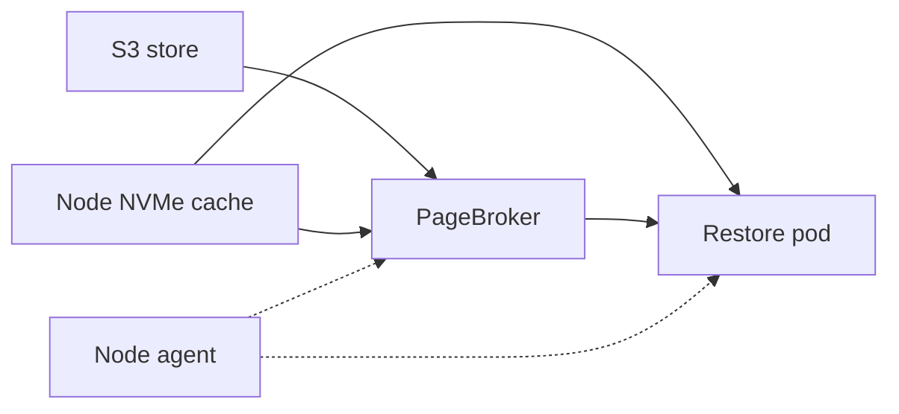
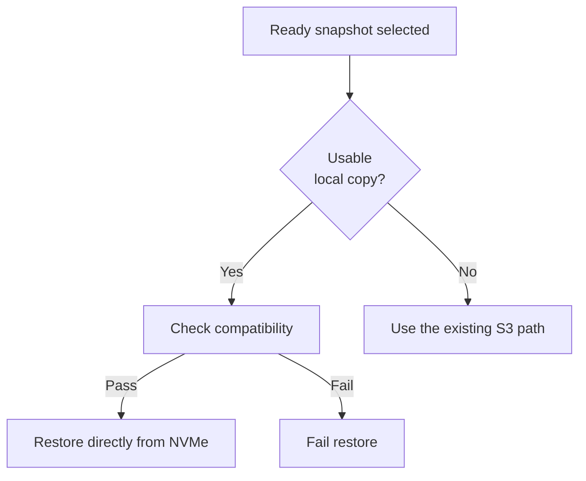
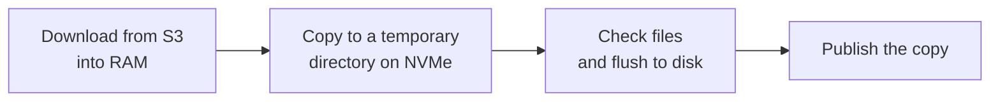
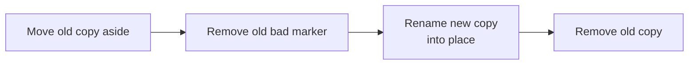
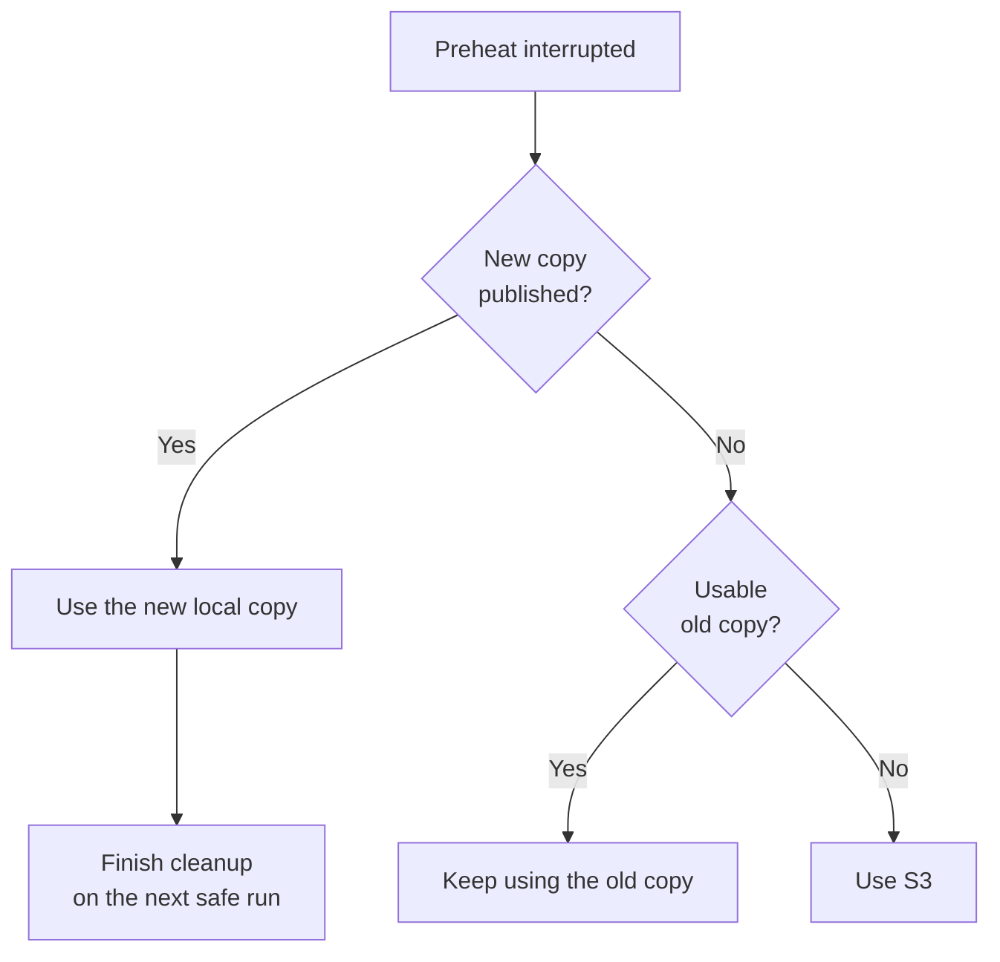
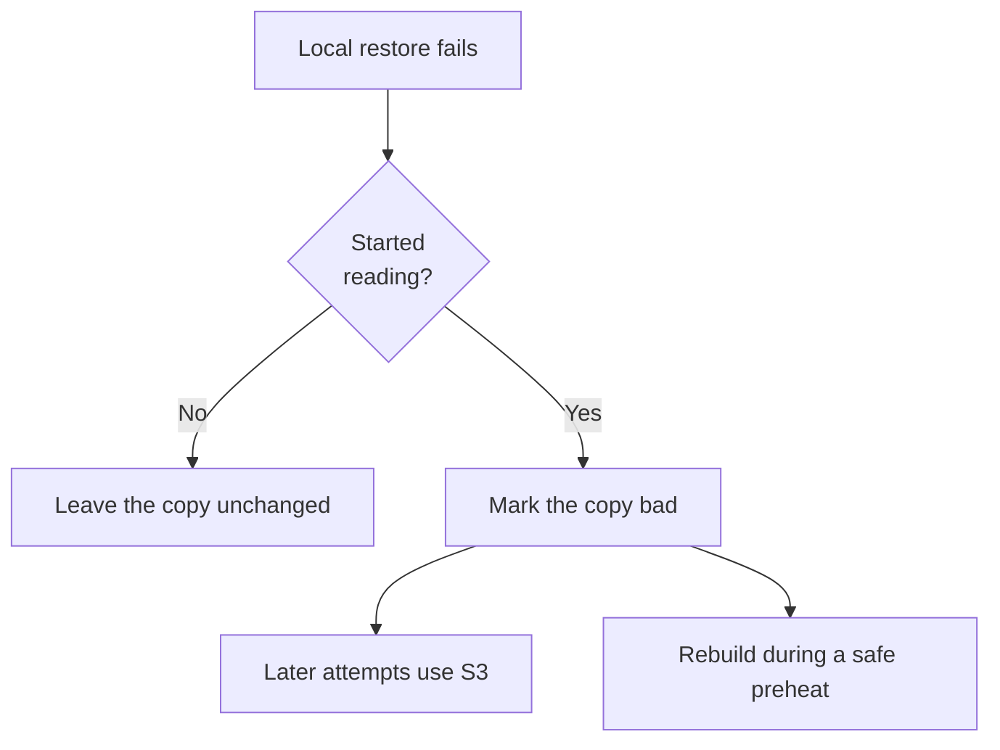
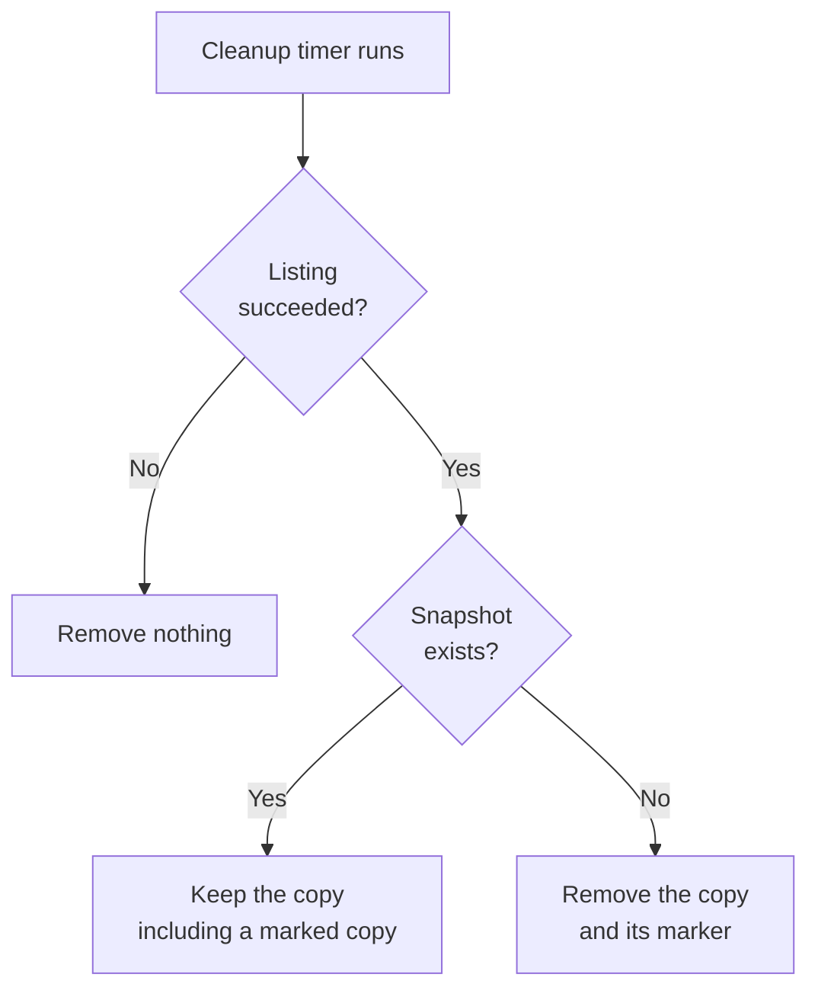
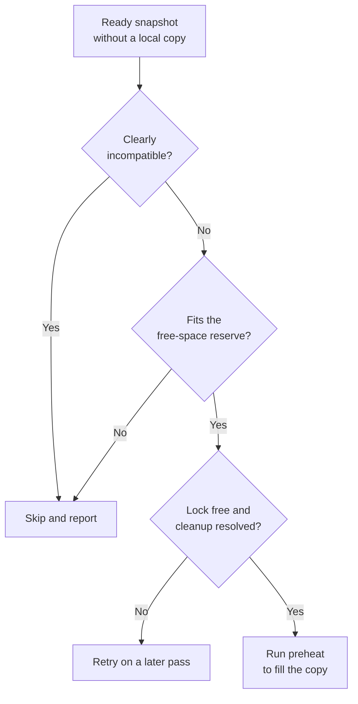

<!--
SPDX-FileCopyrightText: Copyright (c) 2026 NVIDIA CORPORATION & AFFILIATES. All rights reserved.
SPDX-License-Identifier: Apache-2.0
-->

# SNEP-644: Node Cache Preheat and Local Restore

This proposal describes local snapshot copies, preheat, and cleanup for S3
installations. It is a draft for author review. The feature is not implemented
or accepted by this document.

Tracking issue: [#644](https://github.com/ai-dynamo/snapshot/issues/644).
The preserved [source plan](full-plan.md) records the earlier detailed design.
This SNEP is the document to review; the source copy is historical context
and does not describe automatic preheat.

<!-- toc -->
- [Summary](#summary)
- [Motivation](#motivation)
  - [Goals](#goals)
  - [Non-Goals](#non-goals)
- [Proposal](#proposal)
  - [Limitations, Risks, and Mitigations](#limitations-risks-and-mitigations)
- [Design Details](#design-details)
  - [Components](#components)
  - [Cache Identity and Layout](#cache-identity-and-layout)
  - [Restore Source](#restore-source)
  - [Preheat](#preheat)
  - [Replace a Copy](#replace-a-copy)
  - [Interrupted Preheat](#interrupted-preheat)
  - [Failed Local Restore](#failed-local-restore)
  - [Cleanup](#cleanup)
  - [Automatic Preheat](#automatic-preheat)
  - [External Writers](#external-writers)
  - [API](#api)
  - [Security](#security)
  - [Configuration](#configuration)
  - [Performance and Scalability](#performance-and-scalability)
  - [Monitoring](#monitoring)
  - [Dependencies](#dependencies)
  - [Test Plan](#test-plan)
  - [Graduation Criteria](#graduation-criteria)
  - [Later Phases](#later-phases)
- [Implementation History](#implementation-history)
- [Alternatives](#alternatives)
- [Appendix](#appendix)
  - [Decisions for Review](#decisions-for-review)
  - [Next Steps](#next-steps)
<!-- /toc -->

## Summary

Snapshot can restore a workload from a snapshot already stored on the node's
local disk. If no usable copy exists, it restores from S3. When automatic
preheat is enabled, each node attempts to keep a local copy of every eligible
snapshot before workloads start. S3 remains the source of truth.

## Motivation

Today, every restore from S3 downloads the whole snapshot first. Restoring the
same snapshot again downloads it again.

This proposal lets Snapshot keep a copy of each snapshot on the local NVMe of
every node. A restore reads the local copy and skips the download. If a node
has no copy, the restore uses S3 as it does today.

Issue #644 requests this node cache. This proposal covers S3 installations
first.

### Goals

Phase 1 has five goals. Each one maps to a requirement of issue #644, with S3
as the shared store in place of a PVC:

- **Local restore (requirement 2):** restore from a usable local copy without
  staging it into RAM.
- **Fallback (requirements 1 and 2):** use the existing S3 path when no usable
  local copy exists.
- **Automatic preheat (requirement 5, in part):** preheat every participating
  node, including nodes added later, without starting a restore pod. The
  policy is one cluster-wide setting.
- **Preheat on request (requirement 5, in part):** preheat one node with an
  administrator command, not through the CRD.
- **Cleanup (requirement 6, in part):** remove local copies after their
  snapshot is deleted. Manual deletion and per-node status are not included.

Phase 1 also meets requirements 7 and 8 in part. See
[Cache Identity and Layout](#cache-identity-and-layout) and
[Configuration](#configuration).

### Non-Goals

Phase 1 excludes these features. Each one is a requirement of issue #644 that
this proposal defers:

- **Lazy pull-through (requirement 3):** filling the cache during a restore.
- **Cache-aware placement (requirement 4):** preferring nodes that already
  hold a copy when a restore pod is scheduled. The scheduler chooses the node
  as it does today.
- **Pre-staging on selected nodes (requirement 5):** choosing which nodes
  receive copies. Phase 1 copies to every participating node.
- **A shared PVC as the source of truth (requirement 1):** phase 1 covers S3
  installations only.

Multi-cluster support is also excluded. Issue #644 does not request it.

## Proposal

A **node cache** is a directory on the node's local NVMe. **Preheat** means
placing a complete snapshot copy there before an application starts.

The cache is optional and disabled by default. A restore still requires a
live, Ready snapshot object. Files left on disk do not grant permission to
restore a deleted snapshot.

Automatic preheat is a separate setting, also disabled by default. When it is
enabled, each node running a cache-enabled agent attempts to keep a local copy
of every eligible Ready snapshot. New nodes download existing snapshots, and
existing nodes download newly Ready snapshots. Downloads are asynchronous;
incomplete or unavailable copies use the existing S3 restore path.

This is eventual replication, not a guarantee. A node skips a snapshot that
does not fit, that it clearly cannot restore, or whose download fails. Each
agent downloads its own copy from S3. Nodes do not transfer snapshots to each
other.

An administrator can also preheat one node with a command; see [API](#api).
Another tool can prepare copies if it follows the contract in
[External Writers](#external-writers).

### Limitations, Risks, and Mitigations

Phase 1 accepts these limits:

1. **No reader tracking.** Delete a snapshot or replace its copy only when no
   restore is running or starting against that copy. Rebuilding a bad copy is
   a replacement.
2. **Shared staging budget.** Preheat can consume capacity needed by restores.
   Run the command before applications start. Automatic preheat can start
   soon after a checkpoint, or on a new node that is receiving restore pods.
3. **Interrupted downloads.** A stopped command or a restarted agent can leave
   RAM allocated until transaction expiry, pod recreation, or recovery. Ending
   an active download can fail other S3 restores. Recover a command's work
   while no restore is running on the node.
4. **RAM limit.** Each staged download must fit the PageBroker staging budget.
   Preheat does not remove the existing S3 staging limit.
5. **Trusted writers.** Restore checks identity, not payload checksums. External
   tools must write complete copies. Cache write access is privileged.
6. **Disk selection.** A missing directory can be created on the root disk.
   Administrators must ensure the configured path uses the intended disk.
7. **Capacity.** Live copies are not evicted, and every participating node
   needs room for every retained snapshot. A snapshot that does not fit is
   skipped and restores from S3. The design suits a bounded snapshot
   collection: delete old snapshots to free space. Disabling the cache leaves
   copies on disk for manual removal.
8. **Coarse node filter.** A node with a different GPU model still receives
   copies it cannot restore.
9. **Manual repair.** Automatic preheat leaves a copy marked bad in place.
   Use the command to rebuild it.

Limits 2 and 3 are accepted for the command only. For automatic preheat they
are open decisions, and the readiness gate in
[Graduation Criteria](#graduation-criteria) must pass first.

## Design Details

### Components

The node agent selects the source and coordinates restore. CRIU reads process
state. PageBroker downloads from S3 and restores GPU memory. Preheat runs in
the agent pod and writes the node cache.

I1 shows restore responsibilities. Dashed arrows show coordination. Solid
arrows show reads or data movement. I3 shows preheat separately.

**Illustration 1 (I1): Restore Components**



The cache is mounted read-write into the node agent and read-only into
PageBroker. Local restore uses direct mode regardless of
`pageBroker.restoreMode`. PageBroker still opens a local restore transaction.

On an S3 installation, enable PageBroker's file engine for direct restore
when the cache is enabled. Reject path-based checkpoint and staged-restore
requests. The cache must not become the snapshot store.

### Cache Identity and Layout

Use the existing local layout:

```text
artifacts/<snapshot-uid>/containers/<container>/
```

Resolve `PodSnapshot.status.boundSnapshotContentName` to its
`PodSnapshotContent`. In phase 1, use that object's UID.

Restore rejects symlinks and non-directories at the selected entry. It checks
the manifest's UID and container, then checks for a bad-copy marker.

Validation has three separate meanings:

- **Identity:** checked at each local restore.
- **Completeness:** file lists, sizes, and modes are checked during preheat.
- **Content integrity:** checksums are not included in phase 1.

An immutable snapshot does not need freshness updates. Immutability does not
prove that a local copy is complete or undamaged.

### Restore Source

Reject a restore whose snapshot object is missing or not Ready. For an
eligible snapshot, choose its source as shown in I2.

**Illustration 2 (I2): Choose the Restore Source**



A disabled cache, absent copy, invalid manifest, or bad marker selects S3.
A cache hit returns a local source without an S3 handle. Compatibility checks
read the local manifest. A compatible copy can originate from another node.

### Preheat

A preheat run prepares one snapshot on one node. The command and automatic
preheat call the same routine. A run executes inside the node agent pod
because PageBroker's socket and staging volume are available there. No restore
pod is needed.

Before processing containers, a run performs these steps:

1. Acquire the node's preheat lock.
2. Recover unfinished attempts from the cache work area.
3. Read the Ready snapshot and its store ID and container handles.

One preheat runs on a node at a time. The command and the agent share the
lock, and a run holds it throughout writing and recovery. The command waits
for it up to a bounded timeout.

For each container, skip a usable copy unless replacement was requested.
Otherwise, write a recovery record before starting the download. The record
stays outside the directory that will be published, and it lets a later run
finish the cleanup.

I3 shows the main flow. Publication details are separate in I4.

**Illustration 3 (I3): Prepare a Local Copy**



Before download, skip a copy if its required space would breach the
free-space reserve, `minFreeSpace`. How a run learns the size before download
is an open decision. After download, check available space again. Copy the
staged directory while preserving file modes, directory modes, and empty
directories. Validate the copy against staging and flush it before
publication.

Ask PageBroker to end the transaction after validation. Every exit path
attempts cleanup. If cleanup fails, keep the recovery record and report it; a
complete copy can still be published. Cleanup is safe to repeat; an
already-absent transaction is considered cleaned up.

Containers have separate copies and transactions. Keep successful copies when
another container fails. A later run processes containers still missing or
invalid.

### Replace a Copy

Replacement requires the phase 1 restriction on active restores. The new copy
must be complete and flushed before the operations in I4 begin.

**Illustration 4 (I4): Replace a Copy**



These are separate filesystem operations. If marker removal fails, do not
publish the new copy. If the final directory is absent, restores use S3.
Only a complete copy appears under the final name.

### Interrupted Preheat

A crash can leave different states on disk. I5 shows which restore source is
available. The next safe preheat run uses recovery records to finish cleanup.

**Illustration 5 (I5): Interrupted Preheat**



Recovery gives these guarantees:

- It preserves any published copy.
- It distinguishes the final copy from temporary and replacement files,
  including when only part of a replacement completed.
- It keeps its record until transaction cleanup and filesystem cleanup both
  finish.

Recovery removes a temporary directory only when the run holds the node lock
and one of its recovery records names that directory. The lock confirms that
no Snapshot writer is active. The record keeps another tool's temporary files
out of scope.

### Failed Local Restore

A restore cannot switch source midway. I6 describes what happens to the copy
after a local restore fails.

**Illustration 6 (I6): Handle a Failed Local Restore**



A compatibility failure leaves the copy unchanged. A failure after reading
starts writes a small marker beside the copy. The agent cannot prove that
the files caused the failure, so this rule can mark a good copy too.

Marking never moves or deletes the copy. Other restores can already be reading
it or preparing to mount it. Several concurrent restores can fail before the
marker is written.

### Cleanup

The node agent periodically lists snapshot objects and removes unreferenced
copies. I7 applies equally to Snapshot-created and externally created copies.

**Illustration 7 (I7): Clean Up Node Copies**



Removal is subject to the active restore restriction. Preheat recovery owns
temporary work and old copies.

### Automatic Preheat

Automatic preheat runs in the node agent when
`storage.nodeCache.preheat.enabled` is set. It reuses the periodic pass that
[Cleanup](#cleanup) introduces in phase 1. One rule covers a newly Ready
snapshot, a node that joined later, and a retry after a failure.

On each pass, the agent lists snapshots and selects those without a local
copy. A snapshot is eligible when all of these conditions hold:

- It is Ready, bound to the S3 store, and not being deleted.
- The node has no copy of it, usable or marked bad.
- The node is not clearly unable to restore it.
- Its required space does not breach the free-space reserve.

The agent processes one snapshot at a time, newest first. I8 shows the
decision for each snapshot.

**Illustration 8 (I8): Decide an Automatic Preheat**



These rules keep the automatic path small:

- **Fill only.** Automatic preheat creates missing copies. It never replaces
  a copy and never rebuilds one marked bad. Publication does not overwrite an
  entry that another writer published first.
- **Definite mismatches only.** The agent compares the snapshot's recorded CPU
  architecture, kernel version, and CPU features with its node. A missing
  value is unknown, not a mismatch. Checks that need the restore pod, such as
  GPU model and driver, stay at restore time.
- **Shared lock.** If the command holds the node lock, the agent skips the
  pass.
- **Retries.** A failed download or copy is retried on a later pass with an
  increasing delay. The agent tracks work in progress, which prevents a pass
  from starting duplicate work.
- **Spread starts.** Each node adds a small random delay before a download,
  which keeps all nodes from starting at once.
- **Bounded leftovers.** Automatic preheat starts no new download on a node
  while an earlier automatic attempt has unresolved cleanup. A node holds at
  most one unreleased automatic preheat download.
- **Disabling.** Disabling automatic preheat stops new downloads. Existing
  copies stay subject to normal cleanup.

Automatic recovery covers only interrupted fills. It leaves an interrupted
replacement for the command. Recovery has two operations with different risk:

- **Remove an unpublished temporary directory.** No restore reads a temporary
  name. [Interrupted Preheat](#interrupted-preheat) gives the removal rule.
- **End the interrupted download's transaction.** This can fail concurrent S3
  restores. It must not overlap with a restore that is starting or running on
  the node.

The proposed coordination is a gate inside the agent, which runs both restores
and automatic recovery. Recovery proceeds only when no restore is active, and
new restores wait until it finishes. Evidence that ending a finished, idle
download is safe during restores would remove the need for the gate. This is
an open decision. The command runs as a separate process and stays under the
phase 1 restriction.

A restore can arrive after a preheat starts, since the agent runs restores
concurrently. A check before the preheat starts does not protect that restore.
The policy must be admission control or a reservation for staging capacity.
The smaller option is admission control by waiting: a restore that needs S3
staging waits while a preheat holds it. Processing one snapshot at a time
bounds the wait to one download and copy. The timeout behavior is undecided:
the restore can fail, or it can proceed from S3 and accept the overlap. This
is an open decision.

### External Writers

An external tool can publish a copy under this contract:

1. Resolve a live, Ready snapshot object.
2. Write a complete local-layout copy under a temporary name.
3. Publish by renaming on the same filesystem without overwriting an entry.
4. Leave published files unchanged.
5. Start restore pods only after publication completes.

The tool owns completeness checks. A plain S3 sync is insufficient: the S3
index also records modes and empty directories. Use the preheat command when
the tool cannot reconstruct that layout.

### API

Phase 1 adds no new Kubernetes API or CRD. It adds an administrator command
and Helm values, which are public interfaces. Exact command, flag, value,
result, and event names remain review decisions.

The command selects a snapshot by namespace and name. Running it in a node's
agent pod selects that node. It supports replacing an existing copy and
reports ready, skipped, or failed results with reasons. Cleanup failures must
remain visible even when a copy was successfully published.

Phase 1 adds no agent endpoint or cancellation command. Automatic preheat
needs no new agent permission: the agent can already list snapshot objects and
create events.

### Security

Snapshot files contain process memory and can contain application secrets.
Treat the cache as sensitive node storage. Restrict its ownership and access
to the privileged components that need it.

The command requires exec access to the privileged agent pod. A cache writer
can supply process state, so write access is administrator-level trust.
PageBroker receives a read-only cache mount. Preserve its existing S3
credential path; the command should not need direct S3 credentials.

Automatic preheat widens where snapshot data rests. Snapshots from every
namespace are copied to every participating node, with no administrator action
for each snapshot. On a cluster shared by tenants, every participating node
holds process memory from every tenant. Leave automatic preheat disabled where
that is not acceptable.

Cleanup removes copies after snapshot deletion. Disabling the feature leaves
copies behind, so removal instructions are required. Filesystem deletion is
not a promise of secure erasure.

### Configuration

The proposed Helm values are:

- `storage.nodeCache.enabled`: disabled by default; phase 1 supports S3 only.
- `storage.nodeCache.hostPath`: the local cache directory.
- `storage.nodeCache.minFreeSpace`: space to retain after a preheat copy.
- `storage.nodeCache.preheat.enabled`: disabled by default; when enabled with
  the cache, each agent preheats every eligible snapshot.

Units, required values, and defaults other than enablement are open.
A free-space check does not reserve disk space against other writers.

The participating nodes are the nodes where the agent runs with the cache
enabled. The chart's existing agent placement settings choose those nodes.

The proposed mount path is `/checkpoints`, which reuses the local restore
path. A dedicated path adds mount-helper changes. Resolve this choice against
related storage designs before implementation.

### Performance and Scalability

A cache hit avoids the S3 download and RAM staging. Preheat still uses both
RAM and disk, and copying to disk adds page-cache memory.

Automatic preheat multiplies storage and S3 traffic by the number of nodes. A
snapshot set of 1 TiB needs about 1 TiB on each node, plus the reserve and
temporary working space. Fifty nodes hold about 50 TiB in total. A new node
downloads the whole set. Each agent also lists all snapshot objects on every
pass.

Measure preheat duration, local versus S3 restore latency, peak staging and
copy memory, disk use, and restore behavior near the staging limit. Include
GPU snapshots, repeated restores, a restore that arrives during a preheat, and
catch-up time on a new node. Do not infer speedups from the diagrams.

### Monitoring

Each restore emits a log and pod event naming its selected source. Preheat
reports per-container results and unresolved cleanup. Cleanup logs failures
with the snapshot identity and reason.

Automatic preheat emits an event when it skips or fails a snapshot, naming the
node and the reason. It rate-limits repeated events for the same snapshot and
reason. It logs each completed copy.

Phase 1 has no cluster-wide cache inventory or per-node API status.

### Dependencies

The design builds on [SNEP-237](../237-s3-storage/README.md), the S3 staged
download path, and the existing direct local restore path. PageBroker must
serve both S3 and direct file restore when the cache is enabled.

The design was checked against branch `feat/pagebroker-restore-file-ranges`
at `fcb89163`, not `main`. Recheck the implementation baseline before coding.

### Test Plan

First, prove the key assumption: stage from S3, copy to disk, and restore
through the direct local path. Include GPU data, restrictive modes, and empty
directories.

The implementation needs these tests:

- **Restore:** hit, miss, bad marker, wrong identity, symlink rejection,
  forced direct mode, compatibility failure, and source events.
- **Concurrency:** a failed restore marks a copy without disrupting another
  restore using it. Replacement still requires the phase 1 restriction.
- **PageBroker:** direct local restore works on S3 installations; path-based
  checkpoint and staged file restore remain rejected.
- **Preheat:** repeated requests, lock contention, modes, empty directories,
  replacement, no space, and partial success across containers.
- **Recovery:** interruption before download, during copy, after each rename,
  before marker removal, and after publication. Preserve published copies.
- **Cleanup failures:** an absent transaction counts as success; other
  transaction or local cleanup failures keep the recovery record.
- **Deletion:** retain named copies, including marked copies; remove unnamed
  copies and markers; remove nothing after a failed snapshot listing.
- **Automatic preheat:** a newly Ready snapshot, catch-up on a new node,
  newest-first order, skip on a definite mismatch, skip when space is short,
  retry delay, rate-limited events, a marked copy left unchanged, and no
  download while disabled.
- **Shared lock:** the command and the agent never write at once; the agent
  skips a pass while the command holds the lock.
- **Automatic recovery:** recover an interrupted fill; leave an interrupted
  replacement for the command; never overlap a restore start; start no new
  download while cleanup is unresolved.
- **Staging policy:** a restore that arrives during a preheat follows the
  agreed policy under memory pressure, including its timeout.
- **End to end:** a cache hit makes no S3 reads; a miss uses S3; GPU state
  restores from the cache.

### Graduation Criteria

These are proposed evidence gates, not release dates:

- **Initial opt-in use:** the layout proof passes, phase 1 tests pass, resource
  use is measured, and administrators can follow the documented restrictions.
- **Broader use:** reader coordination, interrupted-operation handling,
  staging-budget policy, and disk checks have qualified tests.
- **Stable use:** public interfaces are settled, operational evidence supports
  the limits, and upgrade and disable behavior are documented.

Deliver the command and the shared implementation first. Automatic preheat
comes last and has its own readiness gate. Do not merge it until all of these
conditions hold:

- Maintainers agree a policy for a restore that arrives during a preheat,
  including its timeout behavior.
- Tests show the policy holds under memory pressure, and neither the agent nor
  PageBroker is stopped for memory use.
- A node holds at most one unreleased automatic preheat download.
- Recovery coordination with restores is decided and tested.
- A run can learn a snapshot's size before download.

Maintainers must agree the maturity labels and thresholds during review.

### Later Phases

A preheat node selector is a possible enhancement. It limits copies to a
group of nodes, which helps clusters with mixed GPU models. It does not change
workload scheduling.

Phase 2 adds a preheat object for per-snapshot node choice, with per-node
status. It also tracks readers, extends the staging-budget policy, and checks
the intended disk. Retention or eviction of live copies is a candidate for a
later phase.

Phase 3 depends on imports preserving snapshot identity, store binding, and
container handles. Readiness must reflect available snapshot data. Shared
stores need deletion and orphan-sweep rules that protect other clusters.
Cross-cluster tests are required. These dependencies are not resolved here.

## Implementation History

On 2026-11-11, the source plan was adapted into this illustrated draft for
author review. On 2026-11-12, the draft added automatic preheat to phase 1. No
feature implementation or runtime validation is recorded.

## Alternatives

The source plan and its review considered these alternatives:

- **Command-only preheat in phase 1:** smaller, but an administrator must run
  it on each node for each snapshot. Preparing copies before applications
  start is the required initial functionality.
- **Administrator-selected nodes:** limits disk use on mixed clusters, but
  adds node-label lookup and an agent permission. Defer it as the preheat node
  selector.
- **Every node that can restore the snapshot:** a node cannot know this before
  the restore pod exists.
- **A preheat object with a controller:** gives per-snapshot node choice and
  status, but adds an API. Defer it to phase 2.
- **Direct S3-to-disk download:** removes staging pressure but requires a new
  transfer path. Reuse PageBroker first.
- **External distribution tools:** can help share downloads, but introduce
  integration and operating costs. Keep the download behind a small interface.

## Appendix

### Decisions for Review

Reviewers need to settle these points:

1. Accept the S3-first phases and phase 1 operating restrictions.
2. Choose the mount path and finalize configuration and command names.
3. Confirm bad-copy marking and deletion of externally prepared copies.
4. Define command results for published copies with pending cleanup.
5. Agree the import contract and shared-store cleanup ownership.
6. Agree the policy and timeout for a restore that arrives during a preheat.
7. Agree how automatic recovery coordinates with restores.
8. Confirm how a run learns a snapshot's size before download.
9. Confirm the newest-first order for automatic preheat.
10. Accept copies of every namespace's snapshots on every participating node.

### Next Steps

Use these references for review and follow-up:

- [Snapshot Enhancement Proposal (SNEP)](../README.md) - Follow the proposal
  review process after the author review.
- [Issue #644](https://github.com/ai-dynamo/snapshot/issues/644) - Track scope,
  approval, and later implementation.
