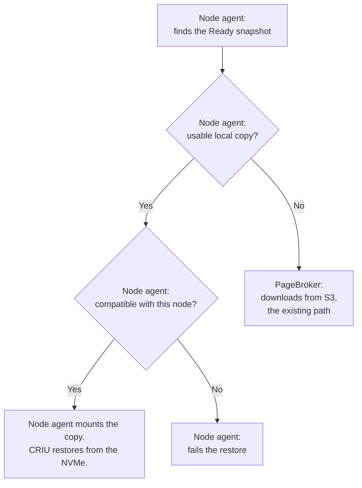
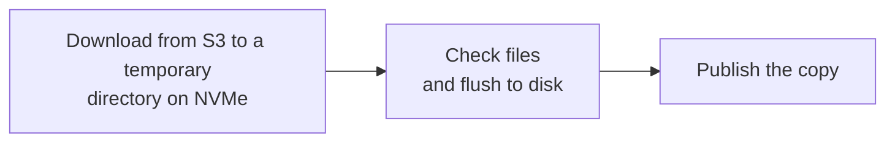
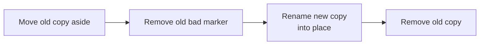
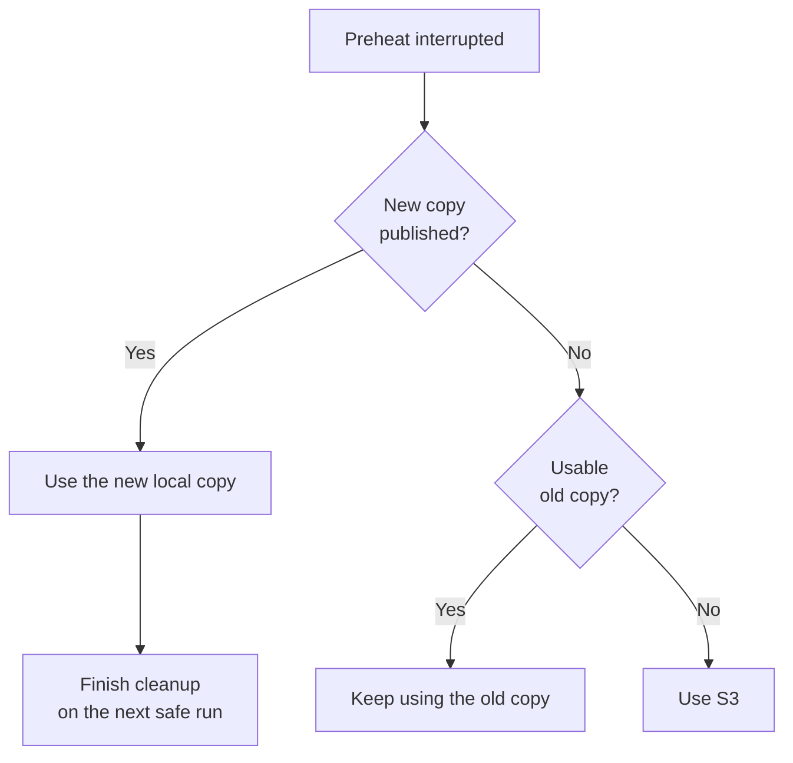
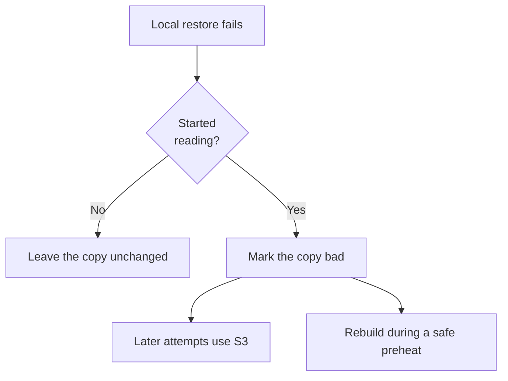
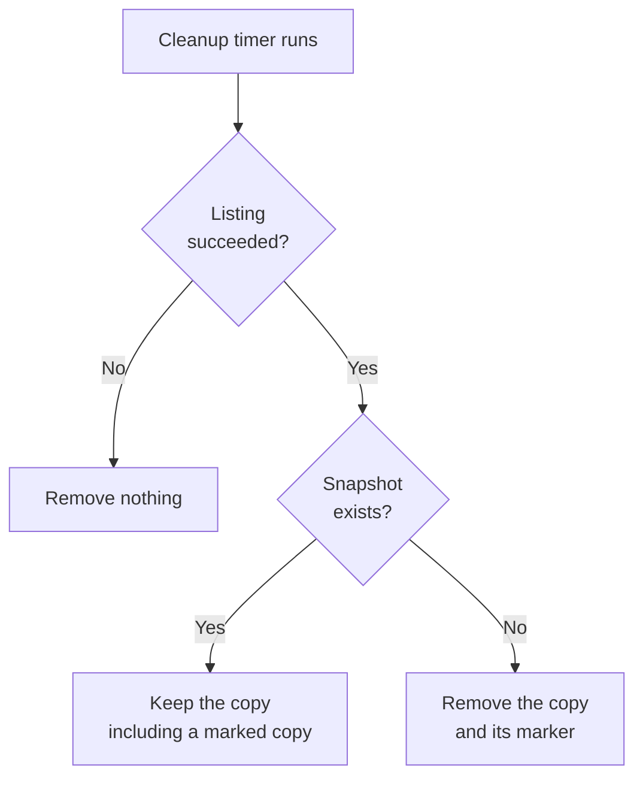
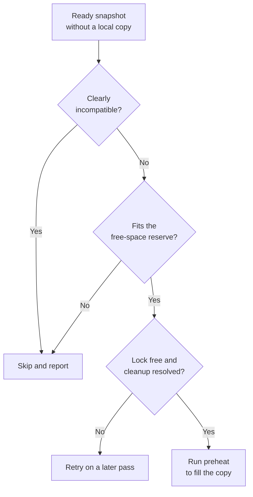

<!--
SPDX-FileCopyrightText: Copyright (c) 2026 NVIDIA CORPORATION & AFFILIATES. All rights reserved.
SPDX-License-Identifier: Apache-2.0
-->

# SNEP-644: Node Cache Preheat and Local Restore

This proposal describes local snapshot copies, preheat, and cleanup for S3
installations. It is a draft for author review. The feature is not implemented
or accepted by this document.

Tracking issue: [#644](https://github.com/ai-dynamo/snapshot/issues/644).
The preserved [source plan](full-plan.md) records the earlier detailed design.
This SNEP is the document to review; the source copy is historical context
and does not describe automatic preheat.

<!-- toc -->
- [Summary](#summary)
- [Motivation](#motivation)
  - [Goals](#goals)
  - [Non-Goals](#non-goals)
- [Proposal](#proposal)
  - [Limitations, Risks, and Mitigations](#limitations-risks-and-mitigations)
- [Design Details](#design-details)
  - [Cache Identity and Layout](#cache-identity-and-layout)
  - [Restore Source](#restore-source)
  - [Preheat](#preheat)
  - [Replace a Copy](#replace-a-copy)
  - [Interrupted Preheat](#interrupted-preheat)
  - [Failed Local Restore](#failed-local-restore)
  - [Cleanup](#cleanup)
  - [Automatic Preheat](#automatic-preheat)
  - [External Writers](#external-writers)
  - [API](#api)
  - [Security](#security)
  - [Configuration](#configuration)
  - [Performance and Scalability](#performance-and-scalability)
  - [Monitoring](#monitoring)
  - [Dependencies](#dependencies)
  - [Test Plan](#test-plan)
  - [Graduation Criteria](#graduation-criteria)
  - [Future Work](#future-work)
- [Implementation History](#implementation-history)
- [Alternatives](#alternatives)
- [Appendix](#appendix)
  - [Decisions for Review](#decisions-for-review)
  - [Next Steps](#next-steps)
<!-- /toc -->

## Summary

Snapshot can restore a workload from a snapshot already stored on the node's
local disk. If no usable copy exists, it restores from S3. When automatic
preheat is enabled, each node attempts to keep a local copy of every eligible
snapshot before workloads start. S3 remains the source of truth.

## Motivation

Today, every restore from S3 downloads the whole snapshot first. Restoring the
same snapshot again downloads it again.

This proposal lets Snapshot keep a copy of each snapshot on the local NVMe of
every node. A restore reads the local copy and skips the download. If a node
has no copy, the restore uses S3 as it does today.

Issue #644 requests this node cache. This proposal covers S3 installations
first.

### Goals

This proposal has five goals. Each one maps to a requirement of issue #644,
with S3 as the shared store in place of a PVC:

- **Local restore (requirement 2):** restore from a usable local copy without
  staging it into RAM.
- **Fallback (requirements 1 and 2):** use the existing S3 path when no usable
  local copy exists.
- **Automatic preheat (requirement 5, in part):** preheat every participating
  node, including nodes added later, without starting a restore pod. The
  policy is one cluster-wide setting.
- **Preheat on request (requirement 5, in part):** preheat one node with an
  administrator command, not through the CRD.
- **Cleanup (requirement 6, in part):** remove local copies after their
  snapshot is deleted. Manual deletion and per-node status are not included.

This proposal also meets requirements 7 and 8 in part. See
[Cache Identity and Layout](#cache-identity-and-layout) and
[Configuration](#configuration).

### Non-Goals

This proposal excludes these features. Each one is a requirement of issue
#644 that is deferred:

- **Lazy pull-through (requirement 3):** filling the cache during a restore.
- **Cache-aware placement (requirement 4):** preferring nodes that already
  hold a copy when a restore pod is scheduled. The scheduler chooses the node
  as it does today.
- **Pre-staging on selected nodes (requirement 5):** choosing which nodes
  receive copies. This proposal copies to every participating node.
- **A shared PVC as the source of truth (requirement 1):** this proposal
  covers S3 installations only.

Multi-cluster support is also excluded. Issue #644 does not request it.

## Proposal

A **node cache** is a directory on the node's local NVMe. **Preheat** means
placing a complete snapshot copy there before an application starts. A preheat
downloads the snapshot from S3 straight to that directory.

The cache is optional and disabled by default. A restore still requires a
live, Ready snapshot object. A deleted snapshot cannot be restored, even if
its files are still on a node's disk.

Automatic preheat is a separate setting, also disabled by default. When it is
enabled, each node running a cache-enabled agent attempts to keep a local copy
of every eligible Ready snapshot. New nodes download existing snapshots, and
existing nodes download newly Ready snapshots. Downloads are asynchronous;
incomplete or unavailable copies use the existing S3 restore path.

This is eventual replication, not a guarantee. A node skips a snapshot that
does not fit, that it clearly cannot restore, or whose download fails. Each
agent downloads its own copy from S3. Nodes do not transfer snapshots to each
other.

Existing S3 restore correctness is preserved, with or without the cache.
Resource contention between a preheat and a restore stays within agreed
limits.

An administrator can also preheat one node with a command; see [API](#api).
Another tool can prepare copies if it follows the contract in
[External Writers](#external-writers).

### Limitations, Risks, and Mitigations

This proposal accepts these limits. Each one states its effect and what an
administrator does about it.

- **Snapshot does not know which copies are in use.** Deleting a snapshot or
  replacing its copy can fail a restore that is reading that copy. Delete a
  snapshot, or replace its copy, only when no restore is using it.
- **Preheat shares the S3 reader with restores.** PageBroker has one S3
  reader. A preheat can slow a restore. A preheat that fails or times out can
  fail a restore that is running at that moment. Run the command before
  applications start. For automatic preheat, this is an open decision.
- **Preheat still uses memory.** It does not allocate snapshot-sized RAM
  staging. Its download buffers, mapped pages, and unwritten disk data still
  use memory. The limits must be measured.
- **An interrupted preheat leaves temporary files.** They stay on disk until
  recovery removes them. Recovery must first confirm that PageBroker has
  stopped writing. How it confirms this is an open decision.
- **Every node stores every snapshot.** Copies are never evicted. A snapshot
  that does not fit is skipped and restores from S3. A node with a different
  GPU model stores copies it cannot use. Delete old snapshots to free space.
- **Copies are not checked for damage.** A restore checks that a copy belongs
  to the snapshot, not that its content is intact. Give write access to the
  cache only to administrators.
- **A bad copy is not repaired automatically.** A copy that failed a restore
  is marked bad and stays on disk. Restores of that snapshot use S3. Run the
  command to rebuild the copy.
- **The cache can land on the wrong disk.** If the NVMe is not mounted at the
  configured path, copies go to the root disk. Check that the path is on the
  intended disk.

The open decisions are part of the readiness gate in
[Graduation Criteria](#graduation-criteria).

## Design Details

The design has three flows:

- **S3 restore.** The flow is unchanged.
- **Preheat, from S3 to the NVMe.** The node agent decides what to download
  and publishes the result. PageBroker downloads into the node cache instead
  of into RAM. This is the main PageBroker change.
- **Restore from the NVMe.** The existing PVC restore flow. The node agent
  mounts the local copy, and CRIU reads it. PageBroker transfers no snapshot
  data. It only opens the directory when the agent asks, and on nodes with
  CUDA custom storage it loads the GPU data.

### Cache Identity and Layout

Use the existing local layout:

```text
artifacts/<snapshot-uid>/containers/<container>/
```

Resolve `PodSnapshot.status.boundSnapshotContentName` to its
`PodSnapshotContent`. Use that object's UID.

Restore rejects symlinks and non-directories at the selected entry. It checks
the manifest's UID and container, then checks for a bad-copy marker.

Validation has three separate meanings:

- **Identity:** checked at each local restore.
- **Completeness:** file lists, sizes, and modes are checked during preheat.
- **Content integrity:** checksums are not included.

An immutable snapshot does not need freshness updates. Immutability does not
prove that a local copy is complete or undamaged.

### Restore Source

Reject a restore whose snapshot object is missing or not Ready. For an
eligible snapshot, choose its source as shown in I1.

**Illustration 1 (I1): Choose the Restore Source**



A disabled cache, absent copy, invalid manifest, or bad marker selects S3.
A cache hit returns a local source without an S3 handle. Compatibility checks
read the local manifest. A compatible copy can originate from another node.
A restore from the NVMe always reads in place, regardless of
`pageBroker.restoreMode`.

### Preheat

A preheat run prepares one snapshot on one node. The command and automatic
preheat call the same routine. The node agent runs it and asks PageBroker to
download. No restore pod is needed.

Before processing containers, a run performs these steps:

1. Acquire the node's preheat lock.
2. Recover unfinished attempts from the cache work area.
3. Read the Ready snapshot and its store ID and container handles.

One preheat runs on a node at a time. The command and the agent share the
lock, and a run holds it throughout writing and recovery. The command waits
for it up to a bounded timeout.

For each container, skip a usable copy unless replacement was requested.
Otherwise, write a recovery record before starting the download. The record
stays outside the directory that will be published, and it lets a later run
finish the cleanup.

I2 shows the main flow. Publication details are separate in I3.

**Illustration 2 (I2): Prepare a Local Copy**



PageBroker reads the snapshot's file list and sizes before it writes. Skip a
copy if its required space would breach the free-space reserve,
`minFreeSpace`. The estimate must also account for filesystem overhead.

PageBroker writes into a temporary directory in the cache work area. It
preserves file modes, directory modes, and empty directories.

Before PageBroker reports success, it confirms the expected files, sizes,
modes, and directories, and it flushes the files to disk. A flush failure
prevents publication. The agent then checks the copy's identity, renames it
into place, and makes the rename durable.

End the PageBroker transaction after publication. Every exit path attempts
cleanup. If cleanup fails, keep the recovery record and report it. Cleanup is
safe to repeat; an already-absent transaction is considered cleaned up.

Containers have separate copies and transactions. Keep successful copies when
another container fails. A later run processes containers still missing or
invalid.

### Replace a Copy

Replacement requires that no restore is using the copy. The new copy must be
complete and flushed before the operations in I3 begin.

**Illustration 3 (I3): Replace a Copy**



These are separate filesystem operations. If marker removal fails, do not
publish the new copy. If the final directory is absent, restores use S3.
Only a complete copy appears under the final name.

### Interrupted Preheat

A crash can leave different states on disk. I4 shows which restore source is
available. The next safe preheat run uses recovery records to finish cleanup.

**Illustration 4 (I4): Interrupted Preheat**



Recovery gives these guarantees:

- It preserves any published copy.
- It distinguishes the final copy from temporary and replacement files,
  including when only part of a replacement completed.
- It keeps its record until transaction cleanup and filesystem cleanup both
  finish.
- It never publishes an incomplete copy and never deletes files that are
  still being written.

After an agent restart, recovery must identify the existing download and
confirm that PageBroker has stopped writing before it publishes or deletes
anything. A missing or expired transaction alone authorizes neither. The cases
include a PageBroker restart and a lost completion response. How recovery
confirms this is an open decision.

Recovery removes a temporary directory only when the run holds the node lock,
one of its recovery records names that directory, and PageBroker has stopped
writing to it. The record keeps another tool's temporary files out of scope.

### Failed Local Restore

A restore cannot switch source midway. I5 describes what happens to the copy
after a local restore fails.

**Illustration 5 (I5): Handle a Failed Local Restore**



A compatibility failure leaves the copy unchanged. A failure after reading
starts writes a small marker beside the copy. The agent cannot prove that
the files caused the failure, so this rule can mark a good copy too.

Marking never moves or deletes the copy. Other restores can already be reading
it or preparing to mount it. Several concurrent restores can fail before the
marker is written.

### Cleanup

The node agent periodically lists snapshot objects and removes unreferenced
copies. I6 applies equally to Snapshot-created and externally created copies.

**Illustration 6 (I6): Clean Up Node Copies**



Removal is subject to the active restore restriction. Preheat recovery owns
temporary work and old copies.

### Automatic Preheat

Automatic preheat runs in the node agent when
`storage.nodeCache.preheat.enabled` is set. It reuses the periodic pass that
[Cleanup](#cleanup) introduces. One rule covers a newly Ready
snapshot, a node that joined later, and a retry after a failure.

On each pass, the agent lists snapshots and selects those without a local
copy. A snapshot is eligible when all of these conditions hold:

- It is Ready, bound to the S3 store, and not being deleted.
- The node has no copy of it, usable or marked bad.
- The node is not clearly unable to restore it.
- Its required space does not breach the free-space reserve.

The agent processes one snapshot at a time, newest first. I7 shows the
decision for each snapshot.

**Illustration 7 (I7): Decide an Automatic Preheat**



These rules keep the automatic path small:

- **Fill only.** Automatic preheat creates missing copies. It never replaces
  a copy and never rebuilds one marked bad. Publication does not overwrite an
  entry that another writer published first.
- **Definite mismatches only.** The agent compares the snapshot's recorded CPU
  architecture, kernel version, and CPU features with its node. A missing
  value is unknown, not a mismatch. Checks that need the restore pod, such as
  GPU model and driver, stay at restore time.
- **Shared lock.** If the command holds the node lock, the agent skips the
  pass.
- **Retries.** A failed download is retried on a later pass with an
  increasing delay. The agent tracks work in progress, which prevents a pass
  from starting duplicate work.
- **Spread starts.** Each node adds a small random delay before a download,
  which keeps all nodes from starting at once.
- **Bounded leftovers.** Automatic preheat starts no new download on a node
  while an earlier automatic attempt has unresolved cleanup. A node holds at
  most one unreleased automatic preheat download.
- **Disabling.** Disabling automatic preheat stops new downloads. Existing
  copies stay subject to normal cleanup.

Automatic recovery covers only interrupted fills. It leaves an interrupted
replacement for the command. It follows the ownership rule in
[Interrupted Preheat](#interrupted-preheat): it publishes or removes nothing
until PageBroker has stopped writing. It does not cancel a running download.

A preheat and a restore can run at the same time, since the agent runs
restores concurrently. They share PageBroker's S3 reader, the network, and the
disk. A preheat can slow a restore, and a preheat failure can fail one; see
[Limitations, Risks, and Mitigations](#limitations-risks-and-mitigations).
Processing one snapshot at a time bounds the overlap to one download. The
readiness gate in [Graduation Criteria](#graduation-criteria) states the
required outcomes.

### External Writers

An external tool can publish a copy under this contract:

1. Resolve a live, Ready snapshot object.
2. Write a complete local-layout copy under a temporary name.
3. Publish by renaming on the same filesystem without overwriting an entry.
4. Leave published files unchanged.
5. Start restore pods only after publication completes.

The tool owns completeness checks. A plain S3 sync is insufficient: the S3
index also records modes and empty directories. Use the preheat command when
the tool cannot reconstruct that layout.

### API

This proposal adds no new Kubernetes API or CRD. It adds an administrator
command and Helm values, which are public interfaces. Exact command, flag,
value, result, and event names remain review decisions.

The command selects a snapshot by namespace and name. Running it in a node's
agent pod selects that node. It supports replacing an existing copy and
reports ready, skipped, or failed results with reasons. Cleanup failures must
remain visible even when a copy was successfully published.

Preheat adds one request between the node agent and PageBroker. It is
internal and not a public interface. This proposal adds no agent endpoint or
cancellation command. Automatic preheat
needs no new agent permission: the agent can already list snapshot objects and
create events.

### Security

Snapshot files contain process memory and can contain application secrets.
Treat the cache as sensitive node storage. Restrict its ownership and access
to the privileged components that need it.

The command requires exec access to the privileged agent pod. A cache writer
can supply process state, so write access is administrator-level trust.
PageBroker can write only to the cache work directory; the rest of the cache
is read-only for it. Verify that it cannot change a published copy through a
descriptor or mapping kept open after the rename. Preserve its existing S3
credential path; the command should not need direct S3 credentials.

Automatic preheat widens where snapshot data rests. Snapshots from every
namespace are copied to every participating node, with no administrator action
for each snapshot. On a cluster shared by tenants, every participating node
holds process memory from every tenant. Leave automatic preheat disabled where
that is not acceptable.

Cleanup removes copies after snapshot deletion. Disabling the feature leaves
copies behind, so removal instructions are required. Filesystem deletion is
not a promise of secure erasure.

### Configuration

The proposed Helm values are:

- `storage.nodeCache.enabled`: disabled by default; S3 installations only.
- `storage.nodeCache.hostPath`: the local cache directory.
- `storage.nodeCache.minFreeSpace`: space to retain after a preheat copy.
- `storage.nodeCache.preheat.enabled`: disabled by default; when enabled with
  the cache, each agent preheats every eligible snapshot.

Units, required values, and defaults other than enablement are open.
A free-space check does not reserve disk space against other writers.

The participating nodes are the nodes where the agent runs with the cache
enabled. The chart's existing agent placement settings choose those nodes.

The proposed mount path is `/checkpoints`, which reuses the local restore
path. A dedicated path adds mount-helper changes. Resolve this choice against
related storage designs before implementation.

### Performance and Scalability

A cache hit avoids the S3 download and RAM staging. A preheat does not
allocate snapshot-sized RAM staging. Its download buffers, mapped pages, and
unwritten disk data still use memory.

Automatic preheat multiplies storage and S3 traffic by the number of nodes. A
snapshot set of 1 TiB needs about 1 TiB on each node, plus the reserve and
temporary working space. Fifty nodes hold about 50 TiB in total. A new node
downloads the whole set. Each agent also lists all snapshot objects on every
pass.

Measure preheat duration, local versus S3 restore latency, peak memory during
a preheat, disk use, and restore slowdown during a preheat. Include GPU
snapshots, repeated restores, a snapshot larger than available RAM, and
catch-up time on a new node. Do not infer speedups from the diagrams.

### Monitoring

Each restore emits a log and pod event naming its selected source. Preheat
reports per-container results and unresolved cleanup. Cleanup logs failures
with the snapshot identity and reason.

Automatic preheat emits an event when it skips or fails a snapshot, naming the
node and the reason. It rate-limits repeated events for the same snapshot and
reason. It logs each completed copy.

This proposal has no cluster-wide cache inventory or per-node API status.

### Dependencies

The design builds on [SNEP-237](../237-s3-storage/README.md), PageBroker's S3
download path, and the existing direct local restore path. PageBroker must
serve both S3 and direct file restore when the cache is enabled. It also needs
a download request that writes to the cache, accounts for disk space, flushes
its files, and leaves the directory in place.

The design was checked against branch `feat/pagebroker-restore-file-ranges`
at `fcb89163`, not `main`. Recheck the implementation baseline before coding.

### Test Plan

First, prove the key assumption: download from S3 straight to disk, and restore
through the direct local path. Include GPU data, restrictive modes, and empty
directories.

The implementation needs these tests:

- **Restore:** use a valid local copy; use S3 when the copy is absent,
  invalid, or marked bad. A failed local restore marks the copy without
  disrupting other restores. PageBroker serves direct local restore on S3
  installations and rejects other path-based requests. S3 restore behaves the
  same with the cache disabled.
- **Preheat:** a complete, flushed copy with modes and empty directories,
  repeated requests, no space, a flush failure, replacement, and partial
  success across containers. The command and the agent never write at once.
  PageBroker cannot change a published copy through a descriptor or mapping
  that it kept open.
- **Recovery:** an interruption at any stage preserves published copies. Cover
  an agent restart, a PageBroker restart, and a lost completion response.
  Recovery never publishes an incomplete copy or deletes files still being
  written. Cleanup is safe to repeat, and a failed cleanup keeps its record.
- **Cleanup:** remove copies of deleted snapshots and keep all others,
  including marked copies. Remove nothing after a failed snapshot listing.
- **Automatic preheat:** a newly Ready snapshot, catch-up on a new node, skips
  for mismatch and for space, and no new download while cleanup is
  unresolved.
- **Isolation:** during a concurrent S3 restore, cause a full disk, a write
  failure, an S3 failure, and a timeout in a preheat. Measure restore slowdown
  and memory with a snapshot larger than available RAM, under the real
  container limits.
- **End to end:** a cache hit makes no S3 reads, a miss uses S3, and GPU state
  restores from the cache.

### Graduation Criteria

These are proposed evidence gates, not release dates:

- **Initial opt-in use:** the layout proof passes, the tests pass, resource
  use is measured, and administrators can follow the documented restrictions.
- **Broader use:** reader coordination, interrupted-operation handling, and
  disk checks have qualified tests.
- **Stable use:** public interfaces are settled, operational evidence supports
  the limits, and upgrade and disable behavior are documented.

Deliver the command and the shared implementation first. Automatic preheat
comes last and has its own readiness gate. Do not merge it until all of these
outcomes are shown:

- A preheat failure or timeout does not cause an otherwise successful
  concurrent restore to fail.
- Restore slowdown during a preheat stays within an agreed, measured bound.
- Large downloads stay within the agreed memory limits.
- Recovery never publishes an incomplete copy or deletes files still being
  written.
- A node holds at most one unreleased automatic preheat download.

Maintainers must agree the maturity labels and thresholds during review.

### Future Work

A preheat node selector is a possible enhancement. It limits copies to a
group of nodes, which helps clusters with mixed GPU models. It does not change
workload scheduling.

A preheat object can add per-snapshot node choice, with per-node status.
Later work can also track readers and check the intended disk. Retention or
eviction of live copies is another candidate.

Multi-cluster support depends on imports preserving snapshot identity, store
binding, and container handles. Readiness must reflect available snapshot
data. Shared stores need deletion and orphan-sweep rules that protect other
clusters. Cross-cluster tests are required. These dependencies are not
resolved here.

## Implementation History

On 2026-11-11, the source plan was adapted into this illustrated draft for
author review. On 2026-11-12, the draft added automatic preheat and changed
preheat to download straight to the node cache. No feature
implementation or runtime validation is recorded.

## Alternatives

The source plan and its review considered these alternatives:

- **Command-only preheat:** smaller, but an administrator must run
  it on each node for each snapshot. Preparing copies before applications
  start is the required initial functionality.
- **Administrator-selected nodes:** limits disk use on mixed clusters, but
  adds node-label lookup and an agent permission. Defer it as the preheat node
  selector.
- **Every node that can restore the snapshot:** a node cannot know this before
  the restore pod exists.
- **A preheat object with a controller:** gives per-snapshot node choice and
  status, but adds an API. Defer it.
- **Download into RAM, then copy in the agent:** reuses the existing download
  request unchanged. It limits a snapshot to the staging RAM, takes that RAM
  from restores, and adds a second copy.
- **A second S3 reader in PageBroker for preheat:** PageBroker supports one
  reader per process, and its teardown affects every S3 client in the process.
- **External distribution tools:** can help share downloads, but introduce
  integration and operating costs. Keep the download behind a small interface.

## Appendix

### Decisions for Review

Reviewers need to settle these points:

1. Accept the S3-first scope and the operating restrictions.
2. Choose the mount path and finalize configuration and command names.
3. Confirm bad-copy marking and deletion of externally prepared copies.
4. Define command results for published copies with pending cleanup.
5. Agree the import contract and shared-store cleanup ownership.
6. Decide how preheat downloads are isolated from restores in PageBroker. The
   candidate is an isolated preheat download mechanism; implementation to be
   determined.
7. Decide how recovery confirms that PageBroker has stopped writing.
8. Agree the memory limits and the restore slowdown bound for a preheat.
9. Confirm the newest-first order for automatic preheat.
10. Accept copies of every namespace's snapshots on every participating node.

### Next Steps

Use these references for review and follow-up:

- [Snapshot Enhancement Proposal (SNEP)](../README.md) - Follow the proposal
  review process after the author review.
- [Issue #644](https://github.com/ai-dynamo/snapshot/issues/644) - Track scope,
  approval, and later implementation.
