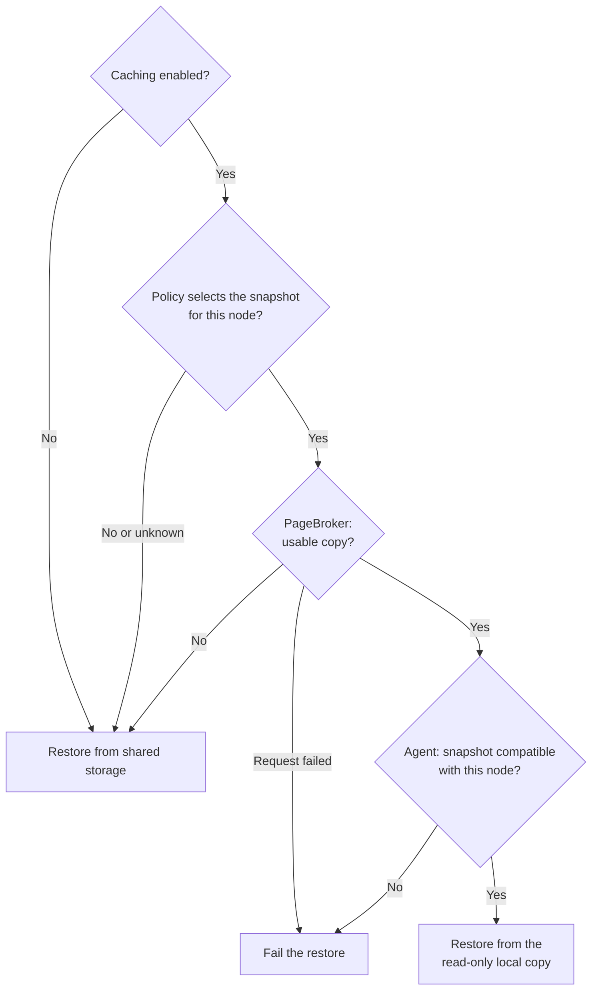
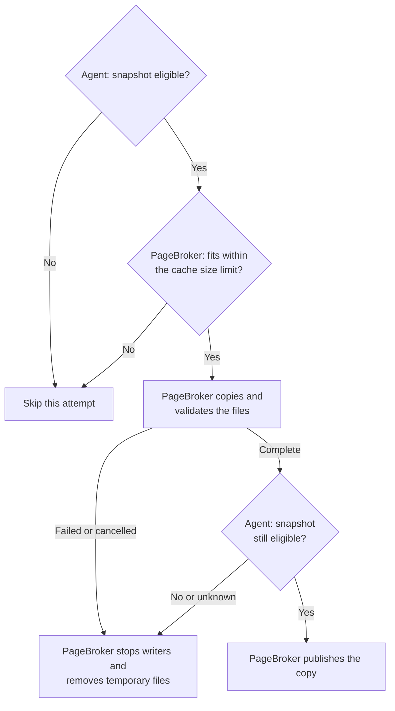
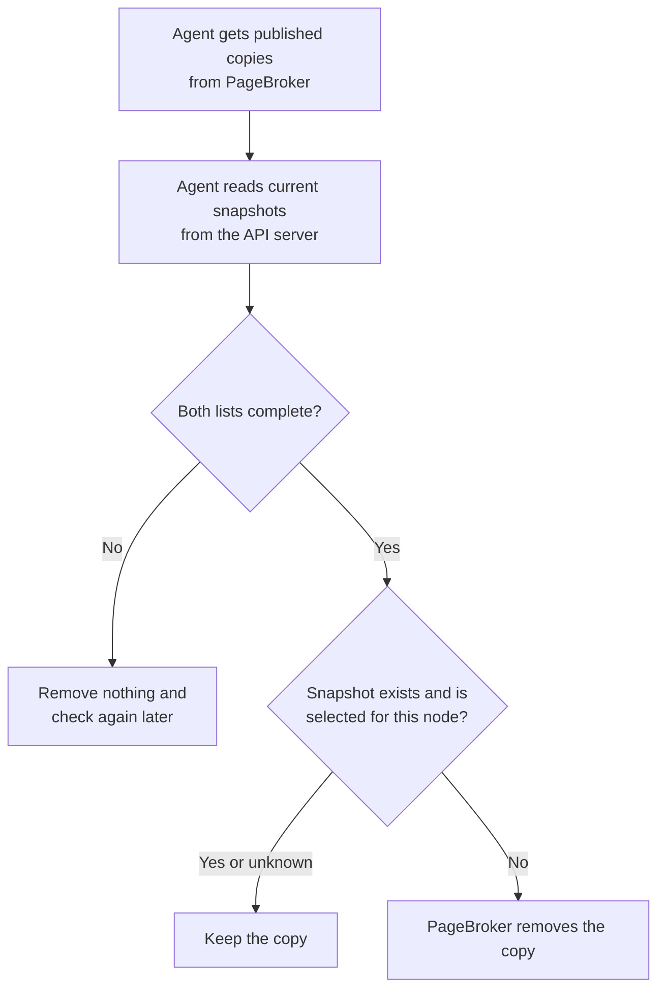

<!--
SPDX-FileCopyrightText: Copyright (c) 2026 NVIDIA CORPORATION & AFFILIATES. All rights reserved.
SPDX-License-Identifier: Apache-2.0
-->

# SNEP-644: Node Cache Preheat and Local Restore

Tracking issue: [#644](https://github.com/ai-dynamo/snapshot/issues/644).

<!-- toc -->
- [Summary](#summary)
- [Motivation](#motivation)
  - [Goals](#goals)
  - [Non-Goals](#non-goals)
- [Proposal](#proposal)
  - [Limitations, Risks, and Mitigations](#limitations-risks-and-mitigations)
- [Design Details](#design-details)
  - [Changes by Component](#changes-by-component)
  - [Cache Layout and Checks](#cache-layout-and-checks)
  - [Restore Source](#restore-source)
  - [Cache Capacity](#cache-capacity)
  - [Preheat](#preheat)
  - [Cleanup](#cleanup)
  - [Administrator Procedures](#administrator-procedures)
  - [API](#api)
  - [Security](#security)
  - [Performance and Scalability](#performance-and-scalability)
  - [Monitoring](#monitoring)
  - [Dependencies](#dependencies)
  - [Test Plan](#test-plan)
  - [Graduation Criteria](#graduation-criteria)
<!-- /toc -->

## Summary

The Snapshot agent can restore a workload from a snapshot copy on the node's
local disk. If no usable copy exists, it restores from shared storage: the
configured S3-compatible object store or a shared filesystem on a multi-node
PVC. When preheat is enabled, the agent asks PageBroker to copy snapshots to
the node ahead of restores. Administrators choose which nodes cache which
snapshots, and each node reports the state of its cache. Restores do not wait
for preheat, and workload scheduling does not change. The cache is optional,
and removing a local copy never affects the snapshot in shared storage.

## Motivation

Restoring the same snapshot on a node repeatedly reads its files from shared
storage. Keeping a local copy avoids those repeated reads and reduces traffic
to shared storage. Local NVMe can also shorten restore time, although it is
not always faster than well-provisioned shared storage.

### Goals

This proposal has six goals:

- **Local restore:** restore from a usable local copy without staging it into
  RAM.
- **Fallback:** restore from shared storage when no usable local copy exists.
- **Preheat:** copy eligible snapshots to nodes ahead of restores, including
  to new nodes, within the cache size limit and without starting a restore
  Pod.
- **Node selection:** let administrators choose which nodes cache which
  snapshots, including snapshots created later.
- **Status:** show the state of each node's cache.
- **Cleanup:** remove a local copy after its snapshot is deleted or is no
  longer selected for the node.

### Non-Goals

This proposal excludes these features:

- Filling the cache during a restore (lazy pull-through).
- Preferring nodes that hold a copy when scheduling restore Pods (cache-aware
  placement).
- User-facing commands to preheat or delete cached copies.
- A single cluster-wide inventory of cached copies.
- Tracking which restores read a cached copy.
- Content checksums and automatic recovery from a damaged copy.
- Evicting copies of live snapshots to free space.
- Checking that the configured path is on the intended disk.
- Importing a snapshot from another cluster.

Administrators can place copies with their own tools; see
[Administrator Procedures](#administrator-procedures).

## Proposal

A **node cache** is a directory on a node's local NVMe. A **participating
node** runs the agent with caching enabled. A restore on a participating node
can read a copy that is already in the cache.

**Preheat** copies snapshots from shared storage into the cache before a
restore needs them. Preheat has its own setting. Caching and preheat are both
disabled by default.

Administrators choose what is cached with a **cache policy**. A policy
selects nodes and snapshots, and it also covers snapshots created later.

Preheat copies only **Ready** snapshots: the `PodSnapshotContent` has a
`Ready` condition with status `"True"`. A node copies a Ready snapshot
directly from shared storage when a policy selects both, the snapshot is
compatible with the node, and it fits in the cache. Nodes do not copy from
each other. When the cache is full, the node skips new copies and keeps
existing ones.

Each copy belongs to its `PodSnapshotContent`. The node removes the copy
after that object is deleted, or when no policy selects the snapshot for the
node any more. Checks at startup and at intervals catch missed changes.

Each node reports its cache in a **cache status** object: the space used, the
state of each snapshot, and any failure.

### Limitations, Risks, and Mitigations

This proposal has these limitations:

- **Missing cache directory:** With caching enabled, a missing directory
  prevents the agent Pod from starting, including for shared-storage restores.
  Prepare each node first; see node preparation in [API](#api).
- **Removal during a restore:** Cleanup does not track the restores that
  read a copy. A restore that reads a copy can break in three cases: the
  snapshot is deleted, a policy change stops selecting it for the node, or
  the copy is removed by hand. Administrators must wait for those restores to
  finish first.
- **Restore interference:** Preheat shares storage, the network, the disk,
  and the S3 transfer session with restores. Preheat must meet the failure
  isolation and slowdown gates in [Graduation Criteria](#graduation-criteria).
- **Undetected corruption:** The cache does not verify file contents. A
  damaged copy can fail a restore, and a restore does not switch sources after
  it starts. An administrator removes the copy as described in
  [Administrator Procedures](#administrator-procedures). Restores then use
  shared storage until a new copy is available.

## Design Details

Each participating node runs the agent and PageBroker in one Pod, with the
node cache mounted. A cached copy serves restore Pods on that node only.

The design has three flows:

- **Shared-storage restore:** unchanged.
- **Preheat:** The agent decides which snapshots to copy, and PageBroker
  copies them into the cache. With S3, PageBroker downloads objects. With a
  shared filesystem, it copies files from the source mount.
- **Local restore:** reuses the existing filesystem restore path. The agent
  mounts the cached copy read-only, and CRIU reads it. On nodes with CUDA
  custom storage, PageBroker also loads the GPU data.

### Changes by Component

Four components change:

- **Node agent:** reads snapshots, cache policies, and its Node. It decides
  which snapshots to copy and which copies to remove, selects the restore
  source, and arranges restore mounts. It emits Kubernetes Events, schedules
  retries, and writes the node's cache status.
- **PageBroker:** performs all cache file operations. It copies and validates
  files, publishes completed copies, enforces the cache size limit, and
  removes copies.
- **Snapshot API:** adds the `SnapshotCachePolicy` and `SnapshotNodeCache`
  kinds described in [API](#api).
- **Helm chart:** adds the settings, mounts, new CRDs, and agent permissions
  described in [API](#api).

The operator, the existing kinds, shared-storage restore flows, and CRIU do
not change.

### Cache Layout and Checks

Each snapshot holds the state of one source container. The cache has two
directories under `storage.nodeCache.hostPath`:

- `artifacts/` holds completed copies that restores can use. Moving a
  completed copy here is called **publication**.
- `.preheat/` is PageBroker's staging area, with a separate temporary directory
  for each copy request. Administrator tools must not write there.

Both directories are on one filesystem. PageBroker publishes a copy in one
step and never exposes partly copied files.

Published copies use the existing filesystem layout:

```text
artifacts/<snapshot-uid>/containers/<container>/
```

`<snapshot-uid>` is the UID of the owning `PodSnapshotContent`.

The design has three kinds of checks:

- **Identity:** Before each local restore, PageBroker checks that the copy is
  a directory and not a symbolic link. Its `manifest.yaml` must name the
  requested snapshot UID and container. Both backends already use this
  manifest for identity and restore metadata.
- **Completeness:** Before publication, PageBroker checks file lists, sizes,
  permissions, and empty directories. With S3, the list comes from
  `index.json`. With a shared filesystem, PageBroker builds the list from the
  source directory, and no S3 index is needed.
- **Content integrity:** not checked. The proposal has no checksums and no
  full content scan before a restore. Identity and completeness checks cannot
  detect all damaged file contents.

A published copy never changes. A copy from a shared filesystem holds
independent files, with no links to shared storage and no files moved from it.

### Restore Source

Every restore requires an existing, Ready `PodSnapshotContent` that has no
deletion timestamp and belongs to the configured shared storage. A cached
copy cannot bypass these checks.

The agent then reaches one of three outcomes:

- **Local copy:** Caching is enabled, a cache policy selects the snapshot for
  this node, and PageBroker finds a usable copy. The agent then checks that
  the snapshot is compatible with the node, using metadata that PageBroker
  returns. Existing options to skip compatibility checks still apply.
- **Shared storage:** Caching is disabled, no policy selects the snapshot for
  this node, or the agent cannot confirm the selection. The agent also uses
  shared storage when the copy is missing or its manifest is invalid.
- **Failure:** A PageBroker request fails, including a timeout or a filesystem
  read error, or the compatibility checks reject the snapshot. The agent emits
  a Pod event and does not try shared storage.

The following diagram shows the choice.



If preheat is still copying a snapshot, a restore of that snapshot uses
shared storage and does not wait. The restore and the preheat run in
parallel, and neither cancels the other. After publication, later restores
use the copy. A restore keeps its source once it starts.

A local restore reads the cached files in place, regardless of
`pageBroker.restoreMode`. The restore Pod gets the read-only mount described
in [API](#api), and writable restore files stay outside the cache.

### Cache Capacity

Each node has a cache size limit, set in [API](#api). The limit counts
published copies, including copies placed by an administrator, the space that
unfinished copies need, and temporary files that are not yet removed.

PageBroker starts a copy only if the whole snapshot fits within the limit,
and it checks the limit throughout the copy. If the copy stops fitting,
PageBroker stops it and removes its temporary files, as described in
[Preheat](#preheat). A copy that is skipped or stopped for the limit does not
count as a failed attempt. Smaller snapshots can still be copied, and
periodic checks reconsider skipped snapshots.

After a restart, PageBroker measures current usage before it accepts new
copies. Unknown usage does not block restores or cleanup. Lowering the limit
below current usage stops new copies and keeps existing ones.

The limit is not a filesystem quota. Direct writes bypass it, and other
applications can use the same disk. Set the limit below the disk size to
leave room for filesystem overhead and other disk use. If the disk fills
during a copy, the copy fails like any other failed attempt. Administrator
tools must respect the limit, including temporary disk use.

### Preheat

**When it runs.** The agent looks for missing copies at startup, when a
snapshot becomes Ready, when a node joins, after a cache policy or Node label
change, and at intervals. No restore Pod is needed. A snapshot is eligible on
a node when all of these hold:

- Caching and preheat are both enabled.
- A cache policy selects the snapshot for this node.
- The `PodSnapshotContent` is Ready, belongs to the configured shared storage,
  and has no deletion timestamp.
- The node has no published copy of the snapshot.
- Attempts remain, as described under retries below.
- The existing CPU architecture, kernel, and CPU instruction-set checks find
  no mismatch.

A known mismatch prevents the copy. Missing compatibility information does
not prevent the copy, and it does not prove that a restore will work. Checks
that need the destination Pod or its devices, including GPU and driver
checks, run at restore time. If the agent cannot confirm the selection, it
starts no copy and keeps existing files.

One preheat runs on each node at a time, newest snapshot first. This limits
the node's resource use and its shared-storage traffic. Other nodes and
restores can read shared storage at the same time. While one snapshot waits
to retry, another can proceed. Unfinished preheat work, temporary cleanup, or
startup recovery blocks new preheats on that node.

**Copy and publication.** One preheat follows these steps:

1. PageBroker confirms the shared-storage binding and checks
   [Cache Capacity](#cache-capacity).
2. PageBroker copies the snapshot into `.preheat/` under a deadline and
   validates the files.
3. The agent checks again that the `PodSnapshotContent` has the same UID, is
   Ready, has no deletion timestamp, and is still selected for this node.
4. PageBroker publishes the copy in one step, without overwriting an existing
   copy.
5. PageBroker reports success after the copy is durable.

If the check in step 3 fails or its result is unknown, the agent cancels the
copy. [Cleanup](#cleanup) removes a copy whose snapshot is deleted or no
longer selected after publication.

Publication requires a complete, validated copy, an unexpired request, and
cleanup that has not started. PageBroker runs publication, cancellation, and
cleanup of one request one at a time, and cleanup waits for a publication that
is underway. If step 5 fails after the copy became visible, PageBroker
reports failure and keeps the copy. That copy might not survive a node crash.

The following diagram shows one preheat.



**Failures and restarts.** These rules apply:

- **Failure, cancellation, or timeout:** PageBroker stops all writers before
  it removes temporary files. Temporary cleanup never deletes published
  copies.
- **Agent stops or a reply is lost:** PageBroker finishes a publication that
  has started. Otherwise, the deadline triggers cleanup. Before a retry, the
  agent asks PageBroker whether the copy was published.
- **PageBroker restarts:** PageBroker rejects old requests, stops remaining
  writers, and removes abandoned temporary files before it accepts new
  preheats.

**Retries.** On each node, the agent allows three failed attempts for each
snapshot, with a longer delay before each retry. Each attempt copies from
scratch. After the third failure, automatic attempts stop and the agent emits
the `PreheatRetriesExhausted` event in [Monitoring](#monitoring). These rules
apply:

- **Counts as an attempt:** a failed or timed-out copy, and a lost reply.
- **Does not count:** a request that PageBroker rejects while it is busy or
  recovering, and a copy cancelled for the cache size limit or because the
  snapshot is no longer selected.
- **Resets the limit:** an agent restart, and disabling and re-enabling
  preheat. Both reset every snapshot on that node. For one snapshot, the
  limit resets when a published copy is found or when the snapshot is
  selected for the node again.
- **Does not reset the limit:** periodic checks, PageBroker restarts, and
  unrelated policy or label changes.

**Temporary cleanup failure.** If PageBroker cannot remove temporary files,
it stops new preheats on that node, and the agent emits the
`PreheatCleanupFailed` event. Restores remain available. PageBroker retries
the cleanup at startup, not in the background, and accepts preheats again
after the cleanup succeeds. Recovery is in
[Administrator Procedures](#administrator-procedures).

**For discussion:** How can PageBroker keep preheat failure or cancellation
from disrupting restores that share its native S3 session? Independent
concurrent sessions are unsupported. Maintainers must evaluate the requirement
in [Graduation Criteria](#graduation-criteria).

### Cleanup

The agent removes a copy from a node in two cases:

- The `PodSnapshotContent` with the copy's UID no longer exists. A deletion
  timestamp alone is not enough, and a new object with the same name does not
  keep the old copy.
- No cache policy selects the snapshot for this node any more.

The agent runs a cleanup pass after a `PodSnapshotContent` deletion, after a
cache policy or Node label change, at startup, and at intervals. The startup
and periodic passes catch changes that were missed while the agent or
PageBroker was down.

Each pass follows these steps:

1. The agent asks PageBroker for the list of published copies.
2. The agent then reads a current, complete list of `PodSnapshotContent`
   objects from the API server. It also reads the cache policies and its
   Node.
3. For each copy whose snapshot is gone or no longer selected, the agent asks
   PageBroker to remove the copy.
4. PageBroker removes the copy and reports the result.

The following diagram shows one pass.



These rules keep a pass safe:

- **Incomplete information:** If either list fails or is incomplete, the agent
  requests no removal. If the agent cannot read the policies or its Node, it
  removes only copies whose snapshot is confirmed deleted.
- **New copies:** A copy published after step 1 waits for the next pass.
- **Failed removal:** If a removal fails or its reply is lost, the next pass
  checks again and retries. A copy that is already absent counts as removed.

Cleanup covers preheated copies and copies placed by an administrator, on both
backends. A node that is offline or has caching disabled keeps its files
until a pass can run. Removal of published copies works only under
`artifacts/`, and temporary cleanup only under `.preheat/`. Neither touches
shared storage or administrator temporary files elsewhere.

### Administrator Procedures

**Restart the agent or PageBroker.** A restart interrupts restores on the
node. Follow these steps:

1. Prevent new restores on the node, including in Pods already assigned to
   it. Disabling preheat or marking the node unschedulable does not stop
   restores in those Pods.
2. Wait for running restores to finish.
3. Restart the service.
4. Allow restores again when the services are ready.

**Recover from a temporary cleanup failure.** Fix the cause, then restart
PageBroker with the steps above.

**Retry preheat after retries are exhausted.** Fix the cause, then restart
the agent with the steps above.

**Remove copies from a node.** Change or delete the cache policy so that it
no longer selects the snapshot for the node. Wait for restores that read the
copy to finish first.

**Remove a damaged copy.** Wait until no restore uses the copy, then remove
its directory under `artifacts/`.

**Disable preheat or caching.** Disabling preheat stops new attempts, and
running work and cleanup finish. Disabling caching stops copying and local
restores, and removes the cache mount. Cached files stay on disk until an
administrator removes them. Disable caching before a downgrade to a version
without the cache kinds.

**Place a copy.** Administrators can place copies with their own tools, with
or without preheat enabled. A placed copy follows the same restore and
cleanup rules as a preheated copy. Check these requirements first:

- The `PodSnapshotContent` exists in this cluster, is Ready, has no deletion
  timestamp, and belongs to the configured shared storage.
- A cache policy selects the snapshot for this node. Without one, the copy is
  not used for restores, and cleanup removes it.
- The copy holds all source files and metadata in
  [Cache Layout and Checks](#cache-layout-and-checks) and fits the limit in
  [Cache Capacity](#cache-capacity).

Then follow these steps:

1. Build the complete copy in a temporary directory on the cache filesystem,
   outside `artifacts/` and `.preheat/`. Your tool manages its own temporary
   files.
2. Rename the directory into the published path in one atomic operation,
   without overwriting an entry.
3. Leave the published copy unchanged.

Copying files does not import a snapshot from another cluster.

### API

The public additions are two kinds and Helm values. Existing kinds do not
change.

**Cache policy.** `SnapshotCachePolicy` is cluster-scoped and written by
administrators. It says which nodes cache which snapshots. The following
policy caches every snapshot of `team-a`, and one snapshot of `team-b`, on the
nodes of one pool:

```yaml
apiVersion: nvidia.com/v1alpha1
kind: SnapshotCachePolicy
metadata:
  name: gpu-pool-a
spec:
  nodeSelector:
    example.com/node-pool: gpu-pool-a
  snapshots:
    - namespace: team-a
    - namespace: team-b
      name: llm-warm
```

These rules apply:

- **Nodes:** `nodeSelector` maps node label names to values. A node must match
  every entry. An empty selector matches all participating nodes. A label
  unique to one node selects only that node.
- **Snapshots:** `snapshots` lists `PodSnapshot` objects by namespace, or by
  namespace and name. An entry with only a namespace covers every snapshot in
  that namespace, including snapshots created later. An empty list covers all
  snapshots.
- **Several policies:** A node caches a snapshot when at least one policy
  selects both. Policies add up and never conflict.
- **No policy:** No node caches anything.
- **Scope:** A policy decides where copies are allowed. It does not deploy
  agents, enable caching, or change workload scheduling.

**Cache status.** `SnapshotNodeCache` is cluster-scoped. Each agent creates
and updates one object, named after its node. Administrators read it and do
not write it. The following status shows one cached snapshot and one failed
snapshot:

```yaml
apiVersion: nvidia.com/v1alpha1
kind: SnapshotNodeCache
metadata:
  name: node-17
status:
  updatedAt: "2026-11-16T14:00:00Z"
  used: 310Gi
  maxSize: 500Gi
  conditions:
    - type: PreheatBlocked
      status: "False"
  snapshots:
    - namespace: team-a
      name: llm-base
      uid: 5f0c0f8e-3b0a-4c58-9d55-7f1d2a9e1c11
      state: Cached
    - namespace: team-b
      name: llm-warm
      uid: 9a1d7c42-6e2f-4d0b-8a37-0c5b6e4f2d90
      state: Failed
      reason: RetriesExhausted
      message: "copy timed out after 3 attempts"
```

These rules apply:

- **Snapshot state:** Each selected snapshot has one state: `Cached`,
  `Copying`, `Skipped`, or `Failed`. `Skipped` and `Failed` carry a reason
  and a message.
- **Node state:** `used` and `maxSize` show the cache size limit and its use.
  The `PreheatBlocked` condition is true after a temporary cleanup failure.
- **Freshness:** The agent updates the object when the node's cache changes
  and at each periodic check. A node that is offline keeps its last status,
  and `updatedAt` shows its age.
- **Finding a snapshot:** To see where a snapshot is cached, list these
  objects.

**Permissions.** Write access to `SnapshotCachePolicy` decides where copies
are placed. Agents need read access to policies and Nodes, and write access
to `SnapshotNodeCache`. An agent writes only the object of its own node. The
chart installs the agent permissions.

**Helm values.** Both backends use these values:

- `storage.nodeCache.enabled`: disabled by default.
- `storage.nodeCache.hostPath`: an existing local directory, required when
  caching is enabled.
- `storage.nodeCache.maxSize`: the cache size limit, a required positive
  storage quantity such as `500Gi`. Missing, invalid, zero, or negative values
  are rejected. There is no unlimited default.
- `storage.nodeCache.preheat.enabled`: disabled by default. Preheat requires
  both switches and a cache policy.

The existing `storage.type` and backend settings select the shared storage.

**For discussion:** Agent and PageBroker maintainers and administrators need
to agree on the preheat timeout and periodic-check interval, including whether
they are configurable. These choices affect recovery time and background
load.

**Node preparation.** The administrator prepares and mounts the NVMe
filesystem and creates the cache directory on every participating node. All
nodes use the same configured path. Verify that the directory is on the NVMe
filesystem and not on the root disk. Snapshot does not format or mount disks.

The chart requires `hostPath.type: Directory`. A missing or invalid directory
prevents the agent Pod from starting. When caching is disabled, the chart
omits this mount.

**Mount paths.** The agent and PageBroker mount the cache at `/node-cache`
and keep `/checkpoints` for a shared-PVC source. A restore Pod receives only
its own snapshot directory, read-only, at `/tmp/checkpoint`.

The agent and the privileged mount helper currently accept snapshot sources
only under `/checkpoints`. Both must also accept the selected snapshot under
`/node-cache/artifacts/`, without exposing the whole cache.

**PageBroker requests.** The agent sends PageBroker snapshot identities and
the shared-storage binding, never arbitrary paths. PageBroker lists copies,
checks a copy, and removes a copy. Listing a copy does not prove that it is
valid for restore. These internal operations reuse existing interfaces where
possible, and request formats are implementation details. Preheat events use
the agents' existing permission to create and patch Events.

### Security

These security rules apply:

- **Cache access:** Snapshots contain process memory and can contain secrets.
  Restrict cache ownership and access to the privileged components that need
  it. Treat permission to write cached files as administrator access: those
  files determine the state of the restored process.
- **Restore mounts:** A restore Pod receives only the read-only mount of its
  own snapshot, described in [API](#api). It cannot access other cached
  snapshots or the staging area.
- **File operations:** PageBroker validates request identities and keeps
  source and cache operations within their own directories. Removal must not
  follow symbolic links outside the requested entry. The agent does not scan,
  validate, or delete cache files directly.
- **Shared storage:** Copying and cache cleanup never alter snapshots in
  shared storage, even on failure. Existing checkpoint operations keep their
  write access. S3 uses PageBroker's existing credentials.
- **Placement and tenant exposure:** Cache policies and Node labels decide
  where sensitive copies are placed. Restrict their edits to trusted
  administrators. A policy with an empty `snapshots` list copies snapshots
  from every namespace to its nodes. Selecting a node does not grant access
  to its snapshots.
- **Status:** Cache status names snapshots and their namespaces. Restrict
  read access to it as for `PodSnapshotContent`.
- **Deleted data:** Deleting files does not guarantee that their data cannot
  be recovered from the disk.

### Performance and Scalability

Local restore avoids reading snapshot data from shared storage and avoids
RAM staging where the shared-storage path would require it. Preheat copies
directly to disk and does not stage the snapshot in RAM. Buffers, mapped
pages, and unwritten disk data still use memory.

A 1 TiB snapshot set on 50 selected nodes uses about 50 TiB; on five nodes,
about 5 TiB, plus temporary space. Each node reads its own copy from shared
storage. Each cleanup pass adds one list request to the API server. Each node
has one status object, and only its own agent updates it.

**For discussion:** What memory limits and maximum restore slowdown are
acceptable for each backend? PageBroker maintainers and workload owners
should agree on these limits using measurements from representative
restores. These limits determine whether preheat is ready to enable.

### Monitoring

The `SnapshotNodeCache` object of a node shows the current state of its
cache, as described in [API](#api). Events report what happened.

The agent already emits restore lifecycle events on the destination Pod.
This proposal adds a Pod event that says which source the restore selected:
the local cache or shared storage.

Preheat has no restore Pod. The node agent emits its events, and they refer
to the owning `PodSnapshotContent` by name and UID. Each event names the node
and explains what happened:

- **Normal: `PreheatCompleted`:** The copy was published.
- **Normal: `PreheatSkipped`:** The snapshot cannot be copied now. The reason
  is a known compatibility mismatch, the cache size limit, or unknown cache
  usage. The same event reports a copy that was cancelled for the limit.
- **Warning: `PreheatFailed`:** An attempt failed or timed out. The event
  gives the cause and the attempt number, and says when the result is unknown.
- **Warning: `PreheatRetriesExhausted`:** Three attempts failed. The event
  gives the last failure and says that automatic retries have stopped on that
  node.
- **Warning: `PreheatCleanupFailed`:** Temporary cleanup failed. The event
  gives the cause and says that new preheats on the node are blocked until
  recovery.

Events are stored through the Kubernetes API in the namespace named by
`PodSnapshotContent.spec.snapshotRef.namespace`. The `PodSnapshotContent`
itself is cluster-scoped. Administrators can list Events in that namespace
and filter them by snapshot UID. A failure to publish an event does not change
copying or cleanup.

Repeated events are rate-limited. An unchanged skip does not produce an event
on every check.

The agent and PageBroker log operation outcomes and failures, including a
failure to publish an event.

### Dependencies

The design builds on PageBroker's filesystem copy and restore support and,
for S3, [SNEP-237](../237-s3-storage/README.md) and its download path.
[Changes by Component](#changes-by-component) identifies the additions.

### Test Plan

**Unit.** The agent's decisions are table-tested: the restore source for each
case in [Restore Source](#restore-source), policy selection, preheat
eligibility and order, retry counting and resets, and the cleanup decision.
Every unknown input, such as an incomplete list or a failed policy or Node
read, is tested to remove nothing.

**Integration.** PageBroker runs against a real local filesystem and a
disposable S3-compatible service. Tests interrupt a copy at each stage, by
failure, cancellation, timeout, and crash. They assert that `artifacts/` never
holds an incomplete copy and that an existing copy is never overwritten. They
also cover the cache size limit, a disk that fills during a copy, and a
temporary cleanup failure.

**End to end.** The existing suite gains these scenarios on a GPU cluster:

- A CPU and a GPU restore from a preheated or administrator-placed copy
  succeed and read no snapshot data from shared storage. The restore Pod sees
  only its own snapshot, read-only.
- A restore uses shared storage when the node has no copy, including while
  preheat is still copying.
- A policy places copies only on selected nodes and covers a snapshot created
  later. Narrowing the policy removes the copies, and each node's status
  object matches.
- Deleting a snapshot removes its copies, including on a node whose agent was
  down.

**Performance.** Tests measure preheat duration, restore latency from the
cache and from shared storage, and peak memory, including a snapshot larger
than RAM. A preheat failure or cancellation does not fail a concurrent
restore. Results are compared with the limits under discussion in
[Performance and Scalability](#performance-and-scalability).

Each scenario runs for every backend that is implemented.

### Graduation Criteria

The proposal has two maturity levels:

- **Initial opt-in use:** The Test Plan passes for at least one backend, with
  usable setup and recovery instructions. Preheat does not fail concurrent
  restores and meets the agreed memory and slowdown limits before it is
  merged or enabled. Each further backend passes the same Test Plan before
  caching is enabled for it.
- **Stable use:** Public interfaces are settled, and operational evidence
  supports the documented limits.

The design is not final until stakeholders resolve the marked discussions
and agree on these maturity criteria. These are evidence gates, not dates.
