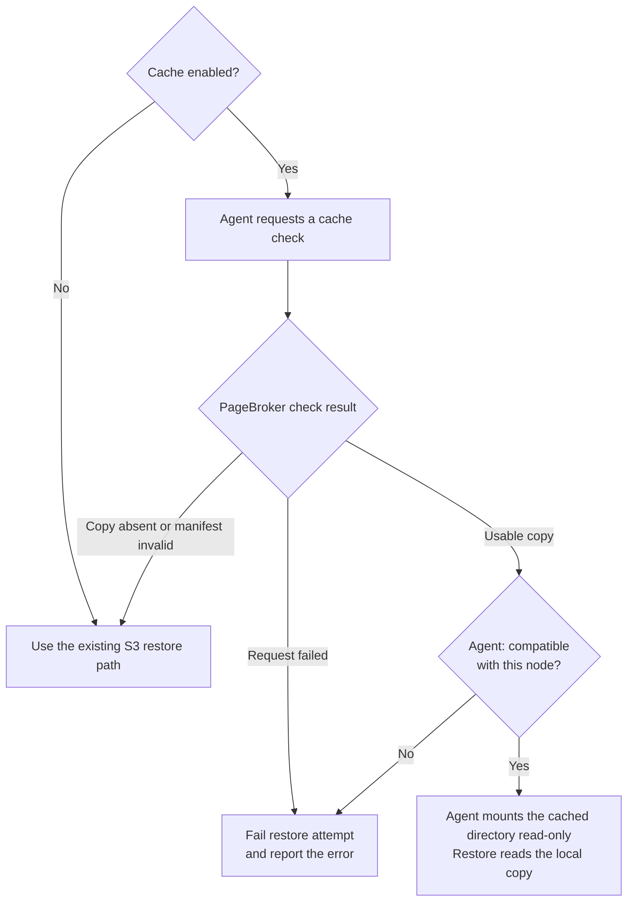
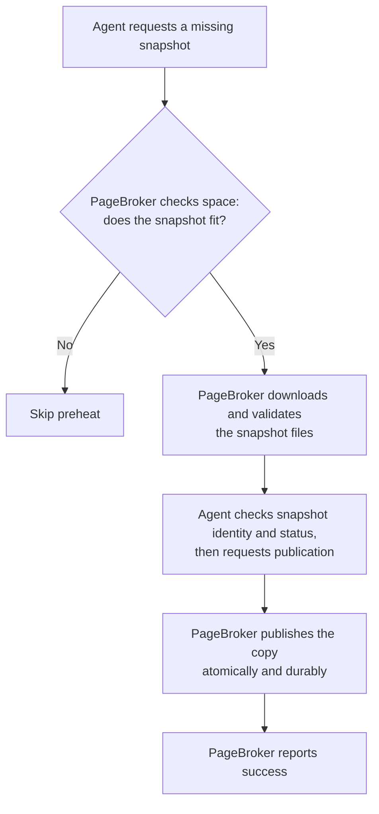
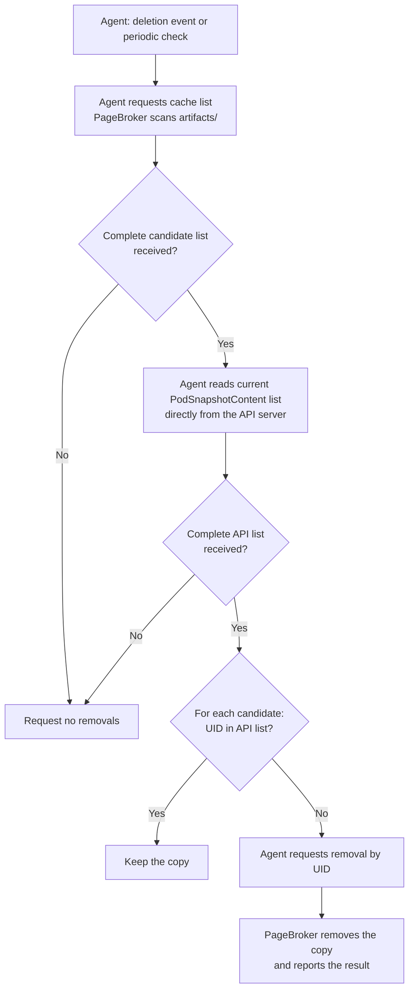

<!--
SPDX-FileCopyrightText: Copyright (c) 2026 NVIDIA CORPORATION & AFFILIATES. All rights reserved.
SPDX-License-Identifier: Apache-2.0
-->

# SNEP-644: Node Cache Preheat and Local Restore

This proposal describes local snapshot copies, preheat, and cleanup for S3
installations. It is a draft for author review. The feature is not implemented
or accepted by this document.

Tracking issue: [#644](https://github.com/ai-dynamo/snapshot/issues/644).

<!-- toc -->
- [Summary](#summary)
- [Motivation](#motivation)
  - [Goals](#goals)
  - [Non-Goals](#non-goals)
- [Proposal](#proposal)
  - [Limitations, Risks, and Mitigations](#limitations-risks-and-mitigations)
- [Design Details](#design-details)
  - [Changes by Component](#changes-by-component)
  - [Cache Identity and Layout](#cache-identity-and-layout)
  - [Restore Source](#restore-source)
  - [Preheat](#preheat)
  - [Cleanup](#cleanup)
  - [Copies Placed by an Administrator](#copies-placed-by-an-administrator)
  - [API](#api)
  - [Security](#security)
  - [Performance and Scalability](#performance-and-scalability)
  - [Monitoring](#monitoring)
  - [Dependencies](#dependencies)
  - [Test Plan](#test-plan)
  - [Graduation Criteria](#graduation-criteria)
  - [Future Work](#future-work)
- [Implementation History](#implementation-history)
- [Alternatives](#alternatives)
- [Appendix](#appendix)
  - [Decisions for Review](#decisions-for-review)
  - [Next Steps](#next-steps)
<!-- /toc -->

## Summary

The Snapshot agent can restore a workload from a snapshot already stored on
the node's local disk. If no usable copy exists, it restores from S3. When
preheat is enabled, the agent asks PageBroker to download eligible snapshots
ahead of restores. Workloads do not wait for preheat to finish. S3 remains
the source of truth.

## Motivation

Today, every restore from S3 downloads the whole snapshot first. Restoring the
same snapshot again downloads it again.

Keeping snapshots on local NVMe avoids repeated downloads. This proposal
addresses issue #644 for S3 installations.

### Goals

This proposal has four goals. Each one maps to a requirement of issue #644,
with S3 as the shared store in place of a PVC:

- **Local restore (requirement 2):** restore from a usable local copy without
  staging it into RAM.
- **Fallback (requirements 1 and 2):** use the existing S3 path when no usable
  local copy exists.
- **Preheat (requirement 5, in part):** prepare eligible snapshots on
  participating nodes, including nodes added later, subject to available
  space and without starting a restore pod. A participating node is a node
  where the agent runs with the cache enabled. The policy is one cluster-wide
  setting.
- **Cleanup (requirement 6, in part):** remove local copies after their
  snapshot is deleted. A user-facing cache-deletion command and per-node
  status are outside this proposal.

This proposal also meets requirements 7 and 8 in part. See
[Cache Identity and Layout](#cache-identity-and-layout) and [API](#api).

### Non-Goals

This proposal excludes these features. Each one is a requirement of issue
#644 that is deferred:

- **Lazy pull-through (requirement 3):** filling the cache during a restore.
- **Cache-aware placement (requirement 4):** preferring nodes that already
  hold a copy when a restore pod is scheduled. The scheduler chooses the node
  as it does today.
- **Pre-staging on selected nodes (requirement 5):** choosing which nodes
  receive copies. Preheat covers eligible snapshots on participating nodes,
  subject to available space.
- **A shared PVC as the source of truth (requirement 1):** this proposal
  covers S3 installations only.

An on-demand preheat command is outside this proposal. Administrators can
place existing snapshot copies themselves; see
[Copies Placed by an Administrator](#copies-placed-by-an-administrator).

Multi-cluster support is also excluded. Issue #644 does not request it.

## Proposal

A **node cache** is a directory on the node's local NVMe. **Preheat** is a
background download from S3 into that cache, ahead of restores. The agent
schedules the download, and PageBroker performs it.

The cache is optional and disabled by default. The owning
`PodSnapshotContent` controls whether a cached copy can be restored or removed;
see [Restore Source](#restore-source) and [Cleanup](#cleanup).

Preheat is a separate setting, also disabled by default. When both settings
are enabled, each agent schedules local copies of eligible Ready snapshots.
See [Preheat](#preheat) for eligibility and scheduling.

This is eventual replication, not a guarantee. A node skips snapshots that
do not fit or have known CPU or kernel incompatibilities. Failed preheats
have limited retries as described in [Preheat](#preheat). Each node's
PageBroker downloads its own copy from S3. Nodes do not transfer snapshots
to each other.

### Limitations, Risks, and Mitigations

- **Missing cache directory.** With caching enabled, a missing directory prevents
  the agent pod from starting, including for S3 restores. Prepare each node
  before enabling the cache; see [Node preparation](#api).
- **Deletion during a restore.** Cleanup does not track active readers.
  Deleting a snapshot or removing its local copy can break a restore using it.
  Administrators must wait until those restores finish before deleting either.
- **Preheat can affect restores.** Preheat shares PageBroker's S3 reader,
  the network, and the disk with restores. Before preheat is enabled, tests
  must show that its failures do not fail concurrent restores and that restore
  slowdown stays within an agreed limit.
- **Damaged copies need manual recovery.** The cache does not verify content
  checksums, and a restore does not switch to S3 after it starts. A damaged
  copy can cause repeated failures. When no restore uses it, an administrator
  must remove it. Later restores use S3 until automatic preheat, when enabled,
  refills the copy or an administrator places a valid copy.

Administrators manage retention by deleting old snapshots. Agents then ask
PageBroker to remove their local copies. Copies of live snapshots are not
evicted to make room.

## Design Details

Snapshot runs one agent pod on each selected node. The pod holds the node
agent and PageBroker, and it mounts a directory on the node's NVMe as the node
cache. A local copy serves only restore pods scheduled on that node.

The design has three flows:

- **S3 restore.** The flow is unchanged.
- **Preheat, from S3 to the NVMe.** The node agent decides what to download
  and checks its identity. PageBroker downloads and publishes the copy.
  This adds a download to NVMe alongside its existing S3 to tmpfs flow.
- **Restore from the NVMe.** Reuse the existing filesystem restore machinery.
  The agent mounts the validated local copy read-only, and CRIU reads it.
  PageBroker opens the directory without downloading from S3. On nodes with
  CUDA custom storage, it also loads the GPU data.

### Changes by Component

Three components change:

- **Node agent:** checks snapshot readiness and compatibility, selects the
  [Restore Source](#restore-source), and arranges restore mounts. It schedules
  [Preheat](#preheat) and retries, reads Kubernetes state, decides which copies
  need [Cleanup](#cleanup), requests removal, and reports failures.
- **PageBroker:** lists cached copies, checks their files, and opens usable
  copies for local restore. It downloads and publishes preheat copies, cleans
  temporary files after failure or restart, and removes published copies only
  when the agent explicitly requests it.
- **Helm chart:** adds the settings and cache mount described in [API](#api).

The operator, CRDs, S3 restore flow, and CRIU do not change.

### Cache Identity and Layout

Each snapshot captures one source container from a pod. The cache reserves
two directories under `storage.nodeCache.hostPath`:

- `artifacts/` holds published snapshots.
- `.preheat/` is PageBroker's work area, with a separate temporary directory
  for each request. Administrator tools must not write there.

Both directories must be on the same filesystem so publication can use an
atomic rename.

Published copies use the same directory layout as PVC installations. With
the proposed mount path, the path inside the agent pod is also the same:

```text
artifacts/<snapshot-uid>/containers/<container>/
```

This layout lets local restores reuse the existing filesystem restore
machinery while preserving snapshot identity and compatibility checks.
The [Test Plan](#test-plan) verifies that reuse.

`<snapshot-uid>` is the UID of the snapshot's `PodSnapshotContent` object.

Before a local restore, PageBroker rejects symlinks and non-directories at
the cache entry. It checks that the manifest names the requested snapshot
and container, then returns the metadata and local path to the agent.

Validation has three separate meanings:

- **Identity:** checked at each local restore.
- **Completeness:** preheat checks file lists, sizes, file and directory
  modes, and empty directories.
- **Content integrity:** checksums are not included.

Copies preserve file and directory modes and empty directories.
Published copies are complete and cannot be changed by remaining download work.

A snapshot never changes after it is taken, so a local copy cannot become out
of date.

### Restore Source

Before selecting a source, the agent requires an existing, Ready
`PodSnapshotContent` with no deletion timestamp. Otherwise, the restore
attempt fails.

With caching enabled, the agent asks PageBroker to check the local copy.
If the request fails, including a timeout or filesystem read error, the
restore attempt fails. The agent reports the error in its log and a pod event.
A failed check does not select S3.

**Illustration 1 (I1): Choose the Restore Source**



A disabled cache, confirmed absent copy, or invalid manifest selects S3.
For a usable copy, the agent checks compatibility using PageBroker's returned
metadata. A compatible copy can originate from another node.

The agent mounts the cached snapshot directory read-only into the restore pod.
Writable restore files stay outside the published cache. Local restore reads
in place, regardless of `pageBroker.restoreMode`, and does not switch source
after it starts.

### Preheat

Preheat requires both `storage.nodeCache.enabled` and
`storage.nodeCache.preheat.enabled`; see [API](#api). The agent asks PageBroker
about local copies when snapshots become Ready, nodes join, or the agent
restarts, and during periodic checks. No restore pod is needed.

Before each attempt, the agent checks that preheat is enabled and the owning
`PodSnapshotContent` is Ready, S3-backed, not being deleted, and has attempts
remaining. It skips published copies reported by PageBroker and known CPU
architecture, kernel, or CPU-feature mismatches; missing values are allowed.
GPU model and driver checks wait for the restore pod.

One preheat runs per node, newest first among snapshots ready for an attempt.
While one snapshot waits to retry, the agent can preheat another once
cleanup finishes. PageBroker rejects new preheats while previous work,
cleanup, or startup recovery is unfinished. This restriction applies only
to preheat requests.

**Illustration 2 (I2): Preheat Flow**



Each request has a temporary directory owned by PageBroker in `.preheat/`
and a deadline. The timeout and whether it is configurable remain
[decisions for review](#decisions-for-review). The space check includes
filesystem overhead and the free-space reserve. File requirements are in
[Cache Identity and Layout](#cache-identity-and-layout).

Before requesting publication, the agent confirms the owning
`PodSnapshotContent` UID, that the object still exists, is Ready, and has no
deletion timestamp. Deletion triggers cancellation; normal [Cleanup](#cleanup)
removes any copy published before cancellation takes effect.

PageBroker uses one lock per request to serialize publication, cancellation,
and cleanup. Publication requires a complete, validated snapshot and an
unexpired request whose cleanup has not started. It is atomic and never
overwrites an existing copy. Cancellation and timeout cleanup wait for
publication to finish. PageBroker reports success only after the copy is
durable. If durability fails after publication, it keeps the copy and reports
failure; the copy might not survive a node crash.

Recovery follows these rules; preheat cleanup never removes published copies:

- **Download failure, cancellation, or expiry:** PageBroker stops the download
  and waits for writes to finish before removing its temporary directory.
  It returns request errors to the agent when connected. Failed removal follows
  the cleanup failure rule below.
- **Agent stops or loses a reply:** PageBroker finishes publication if started;
  otherwise the deadline triggers cleanup. A connection error or timeout means
  the outcome is unknown. Before retrying, the agent asks PageBroker whether
  the copy was published.
- **PageBroker crashes or restarts:** temporary files can remain while it is
  down. On startup, it rejects old requests, stops any remaining writers, and
  removes abandoned temporary directories before accepting new preheats.

**Download retries.** On each node, the agent tries a snapshot up to three
times, with increasing delays chosen during implementation. Each attempt
starts the download from scratch. After three failures, preheat stops for
that snapshot.

A lost response counts as an attempt. Requests rejected because PageBroker
is busy, recovering, or lacks space do not count.

The limit resets when the agent restarts, preheat is disabled and re-enabled,
or a published copy is found. Periodic checks and PageBroker restarts do not
reset it.

**Cleanup failure.** After all writes to a temporary directory have stopped,
PageBroker tries to remove it once. If removal fails, it reports the error and
blocks new preheats on that node until administrator recovery. On startup,
PageBroker tries cleanup again and accepts preheats only after it succeeds.
Temporary cleanup does not retry removal in the background.

**Administrator recovery.** Fix the cleanup problem. Prevent new restores
from starting on the node, including pods already assigned to it, and wait
for active restores to finish. Then restart PageBroker and allow restores
again when it is ready. Disabling preheat or marking the node unschedulable
alone does not prevent restores in already assigned pods.

**Disabling preheat.** New downloads and retries stop; the running request and
cleanup continue, as do cache lookup and normal cleanup while the cache is
enabled.

### Cleanup

The agent starts a cleanup pass after a `PodSnapshotContent` deletion event
and during periodic checks. A copy is removed only after its owning content
UID no longer exists, not merely when a deletion timestamp is set.
PageBroker performs the file operations. Each pass follows these steps:

1. The agent asks PageBroker to scan published directories under `artifacts/`
   and return a fixed list of candidate snapshot UIDs.
2. After receiving the complete candidate list, the agent obtains a current,
   consistent list of `PodSnapshotContent` objects directly from the Kubernetes
   API server, bypassing its local informer cache.
3. For each candidate whose UID is absent from the Kubernetes list, the agent
   asks PageBroker to remove that copy. All other candidates are kept.

If either list fails or is incomplete, the agent requests no removals.
Copies published after the scan wait for the next pass. A copy found by the
scan belongs to an object that existed before publication. The later API
list includes that object unless it has been deleted. Compare UIDs, not names.

PageBroker reports the result of each removal. An already absent copy counts
as success. If removal fails or the response is lost, the agent logs the
failure or unknown result. The next cleanup pass checks again before retrying.

These rules apply to copies placed by preheat or by an administrator.
Periodic checks cover deletions missed while the agent was down.

**Illustration 3 (I3): Clean Up Node Copies**



PageBroker lists and removes published copies only under `artifacts/`.
Its preheat cleanup removes temporary directories only under `.preheat/`.
It ignores administrator-managed temporary files outside those areas.
Cache removal does not track active restores; see
[Limitations, Risks, and Mitigations](#limitations-risks-and-mitigations).

### Copies Placed by an Administrator

An administrator can place copies in the node cache with their own tool. A
restore uses such a copy exactly like one that preheat placed. This works with
automatic preheat disabled.

A placed copy must meet these rules:

1. Its owning `PodSnapshotContent` exists in this cluster, is Ready, and has
   no deletion timestamp.
2. It follows [Cache Identity and Layout](#cache-identity-and-layout), with
   the same files that a PVC installation holds for that snapshot.
3. Write the complete snapshot to a temporary location of your choice,
   outside `artifacts/` and `.preheat/`, on the same filesystem as the
   cache. Rename it into the published path only when complete, without
   overwriting an entry. Your tool manages its own temporary files.
4. It is not changed after it is published.

Copying files alone does not import a snapshot from another cluster.

After preparing the nodes as described in [API](#api) and setting
`storage.nodeCache.hostPath`, use these settings to restore from
administrator-placed copies without automatic preheat:

```yaml
storage:
  nodeCache:
    enabled: true
    preheat:
      enabled: false
```

To also download eligible snapshots automatically, set
`storage.nodeCache.preheat.enabled` to `true`.

### API

This proposal adds no new Kubernetes API or CRD. Its public interfaces are the
Helm values and the node cache layout. The configuration names remain review
decisions.

**Helm values.** The proposed values are:

- `storage.nodeCache.enabled`: disabled by default; S3 installations only.
- `storage.nodeCache.hostPath`: an existing local cache directory; required when
  the cache is enabled.
- `storage.nodeCache.minFreeSpace`: space to retain after a preheat copy.
- `storage.nodeCache.preheat.enabled`: disabled by default; when enabled with
  the cache, each agent preheats every eligible snapshot.

Units and defaults for the free-space reserve remain open.
A free-space check does not reserve disk space against other writers.

**Node preparation.** The participating nodes are the nodes where the agent
runs with the cache enabled. The chart's existing agent placement settings
choose those nodes. When caching is enabled, the chart mounts the configured
path with `hostPath.type: Directory`. Kubernetes requires an existing directory
and does not create it. A missing path or a path that is not a directory
prevents the agent pod from starting.

Before enabling the cache, an administrator prepares every selected node:

1. Format the NVMe and mount it on the node.
2. Create the cache directory on the mounted NVMe, using the same path on every
   selected node. The setting is one value for the installation.
3. Confirm that the path is on the NVMe and not on the root disk.

Snapshot does not format or mount disks. When caching is disabled, the chart
omits the cache mount.

**Mount path.** The proposed mount path is `/checkpoints`, which reuses the
local restore path. A dedicated path adds mount-helper changes. Resolve this
choice against related storage designs before implementation.

**Internal PageBroker requests.** The agent needs these cache operations:

- **List copies:** PageBroker scans `artifacts/` and returns a fixed set of
  snapshot UIDs using responses within the protocol's message-size limit.
  The agent must receive the complete candidate set before requesting removal.
  Transfer mechanics are left to implementation. A failed or incomplete scan
  must be reported as such. Listing does not validate every copy for restore.
- **Check a copy:** given a snapshot UID and container name, PageBroker checks
  the local entry and manifest. It returns usable metadata and a local path,
  or reports that the copy is absent or invalid. A request failure is reported
  separately from a cache miss.
- **Remove a copy:** given a snapshot UID, PageBroker removes only that
  snapshot's directory under `artifacts/`. It reports success when the copy
  is gone, including when it was already absent. Failures are returned to
  the agent.

Reuse existing metadata or restore requests where they fit. Add requests
where needed; exact message names and fields remain implementation details.
The agent supplies snapshot identities, not arbitrary filesystem paths.
These are internal operations, not new user-facing commands.

Preheat requests are also internal and need no new agent permission.
Their behavior is described in [Preheat](#preheat).

### Security

Snapshot files contain process memory and can contain application secrets.
Treat the cache as sensitive node storage. Restrict its ownership and access
to the privileged components that need it. Restore pods receive the cached
snapshot directory read-only. Any writable restore files must be separate
from the published cache.

A cache writer can supply process state, so write access is
administrator-level trust.
PageBroker writes preheat data only in `.preheat/` and publishes completed
copies under `artifacts/`. Published copies remain immutable. PageBroker removes
them only through an explicit cache-removal request from the agent.
Temporary-download cleanup must never remove published copies.

PageBroker validates request identities and keeps cache operations within
the configured cache. Removal must not follow symlinks outside the requested
entry or touch S3 artifacts. The agent must not scan, validate, or delete cache
files directly. Preserve PageBroker's existing S3 credential path.

Preheat can copy eligible snapshots from every namespace to participating
nodes, subject to available space and without administrator action for each
snapshot. A participating node can therefore hold process memory from every
tenant. Leave preheat disabled where that is not acceptable.

Disabling the node cache leaves its files on disk; administrator removal
instructions are required. Filesystem deletion is not a promise of secure
erasure.

### Performance and Scalability

A cache hit avoids the S3 download and RAM staging. A preheat does not
allocate snapshot-sized RAM staging. Its download buffers, mapped pages, and
unwritten disk data still use memory.

Preheat downloads eligible snapshots to participating nodes, subject to
available space. If the same 1 TiB snapshot set fits on all 50 nodes, it uses
about 50 TiB in total, plus reserves and temporary working space. Each node
downloads its own copy from S3. A new node downloads the eligible copies that
fit. Each agent keeps one subscription to snapshot objects and lists them when
it starts. Each cleanup pass also reads a current API-server list, as described
in [Cleanup](#cleanup).

Measure preheat duration, local versus S3 restore latency, peak memory during
a preheat, disk use, and restore slowdown during a preheat. Include GPU
snapshots, repeated restores, a snapshot larger than available RAM, and
catch-up time on a new node.

### Monitoring

Each restore emits a log and pod event naming its selected source. PageBroker
reports cache listing and removal errors to the agent. The agent logs failed
cleanup requests and lost responses, including the snapshot UID for removal.

For preheat, the agent logs per-snapshot results and emits an event on a skip
or failure, naming the node and reason. Connection errors are reported as an
unknown outcome. Retry logs include the attempt number and delay. When
the retry limit is reached, the agent reports that preheat has stopped
for that snapshot on that node. Repeated events are rate-limited.

PageBroker logs temporary cleanup failures and startup recovery results.
A temporary-download cleanup error identifies the request and states that
preheat is blocked until administrator recovery; see [Preheat](#preheat).
Failed removal of a published copy is retried in a later cleanup pass.

This proposal has no cluster-wide cache inventory or per-node API status.

### Dependencies

The design builds on [SNEP-237](../237-s3-storage/README.md), PageBroker's S3
download path, and the existing PVC restore flow.
[Changes by Component](#changes-by-component) lists what PageBroker must gain.

The design was checked against `main` at `3e143360`.

### Test Plan

The implementation must verify these outcomes:

- **Setup and restore:** caching requires an existing directory. Valid local
  copies, including administrator-placed copies, support CPU and GPU restores
  without S3 reads. Disabled caching, missing copies, and invalid manifests
  use S3. Failed cache checks fail the restore and report the error. Snapshot
  readiness, identity, and compatibility checks remain enforced.
- **Access and file safety:** restore pods receive cached files read-only,
  with writable restore files kept separately. Copies preserve the required
  files, permissions, and empty directories. Cache operations cannot affect
  files outside their allowed locations or delete S3 artifacts.
- **Preheat and retries:** verify eligibility, scheduling, one preheat per
  node, and the retry and disable behavior defined in [Preheat](#preheat).
  Downloads go directly to disk without staging the whole snapshot in RAM.
- **Publication and recovery:** only complete copies become visible, existing
  copies are never overwritten, and success requires durability. Exercise
  failures, cancellation, timeouts, restarts, and lost replies. Verify the
  defined recovery behavior in [Preheat](#preheat), including durability
  failure after publication, without exposing incomplete copies or deleting
  files still being written.
- **Published-copy cleanup:** remove copies only after their owning content
  UID is gone. Cover deletion during preheat, concurrent publication, missed
  deletion events, large listings, incomplete or failed listings, and failed
  removal. These cases must preserve the ordering and safety rules in
  [Cleanup](#cleanup).
- **Temporary cleanup failure:** failed cleanup blocks new preheats until
  administrator recovery succeeds. Verify that the documented recovery
  procedure works and that the preheat block does not itself block restores.
- **Performance and reporting:** preheat failures must not fail concurrent
  restores. Measure restore slowdown and memory use, including snapshots
  larger than RAM. Verify that logs and events explain failures and recovery
  without excessive repetition.

### Graduation Criteria

These are proposed evidence gates, not release dates:

- **Initial opt-in use:** the layout proof passes, the tests pass, resource
  use is measured, and administrators can follow the documented restrictions.
  Preheat also meets its readiness gate below.
- **Broader use:** the open decisions are settled and their tests pass.
- **Stable use:** public interfaces are settled, operational evidence supports
  the limits, and upgrade and disable behavior are documented.

Preheat has its own readiness gate. Do not merge it until all of
these outcomes are shown:

- A preheat failure or timeout does not cause an otherwise successful
  concurrent restore to fail.
- Restore slowdown during a preheat stays within an agreed, measured bound.
- Large downloads stay within the agreed memory limits.
- An interruption never leads to an incomplete published copy, and no files
  are removed while they are being written.
- A node holds at most one unpublished preheat snapshot download.
- The publication, deletion, and durability-failure rules in
  [Preheat](#preheat) are accepted and their tests pass before initial use.

Maintainers must agree the maturity labels and thresholds during review.

### Future Work

A preheat node selector is a possible enhancement. It limits copies to a
group of nodes, which helps clusters with mixed GPU models. It does not change
workload scheduling.

A preheat object can add per-snapshot node choice, with per-node status.
Later work can also track readers and check the intended disk. Retention or
eviction of live copies is another candidate. Automatic handling of a damaged
copy, such as switching later restores to S3, is a third.

Multi-cluster support is also later work. It depends on importing a snapshot
into another cluster, which this proposal does not cover.

## Implementation History

On 2026-11-11, this draft was written for author review. On 2026-11-12, the
draft added automatic preheat and changed preheat to download straight to the
node cache. No feature implementation or runtime validation is recorded.

## Alternatives

These alternatives were considered:

- **Command-only preheat:** requires an administrator to run it on each node
  for each snapshot. This proposal uses automatic preheat and allows
  administrator-placed copies; an on-demand command is not included.
- **Administrator-selected nodes:** limits disk use on mixed clusters, but
  adds node-label lookup and an agent permission. Defer it as the preheat node
  selector.
- **Preheat only on fully compatible nodes:** full compatibility cannot be
  confirmed before the restore pod exists. Preheat skips known CPU or
  kernel mismatches; remaining checks happen during restore.
- **A preheat object with a controller:** gives per-snapshot node choice and
  status, but adds an API. Defer it.
- **Download into RAM, then copy in the agent:** reuses the existing download
  request unchanged. It limits a snapshot to the staging RAM, takes that RAM
  from restores, and adds a second copy.
- **A second S3 reader in PageBroker for preheat:** PageBroker supports one
  reader per process, and its teardown affects every S3 client in the process.
- **External distribution tools:** can help share downloads, but introduce
  integration and operating costs.

## Appendix

### Decisions for Review

Reviewers need to settle these points:

1. Accept the S3-first scope and the operating restrictions.
2. Choose the mount path and finalize configuration names.
3. Confirm deletion of copies placed by an administrator.
4. **Failure isolation:** Decide how PageBroker keeps preheat failures and
   cancellation from affecting concurrent restores.
5. Agree the memory limits and the restore slowdown bound for a preheat.
6. Confirm the newest-first order among snapshots ready for a preheat attempt.
7. Accept eligible snapshots from every namespace on participating nodes,
   subject to available space.
8. Choose the preheat request timeout and whether it is configurable. It
   must allow large snapshots to finish while ensuring abandoned downloads
   are cleaned up.

### Next Steps

Use these references for review and follow-up:

- [Snapshot Enhancement Proposal (SNEP)](../README.md) - Follow the proposal
  review process after the author review.
- [Issue #644](https://github.com/ai-dynamo/snapshot/issues/644) - Track scope,
  approval, and later implementation.
