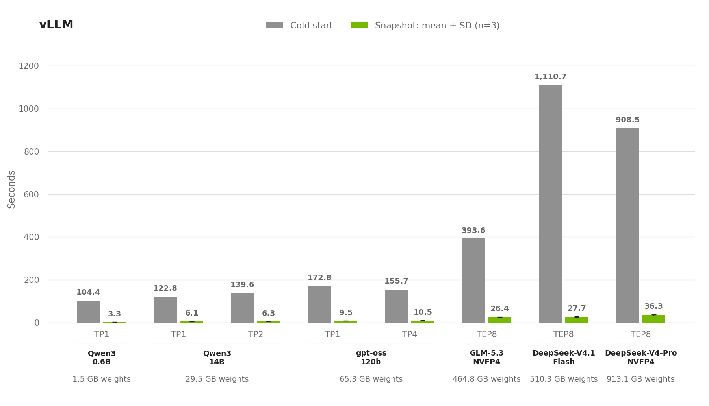
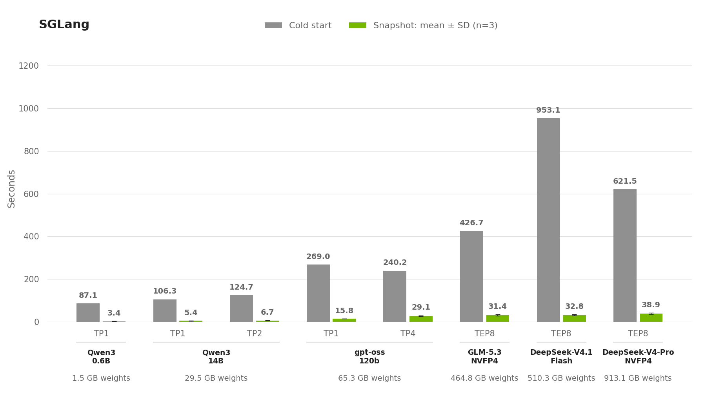
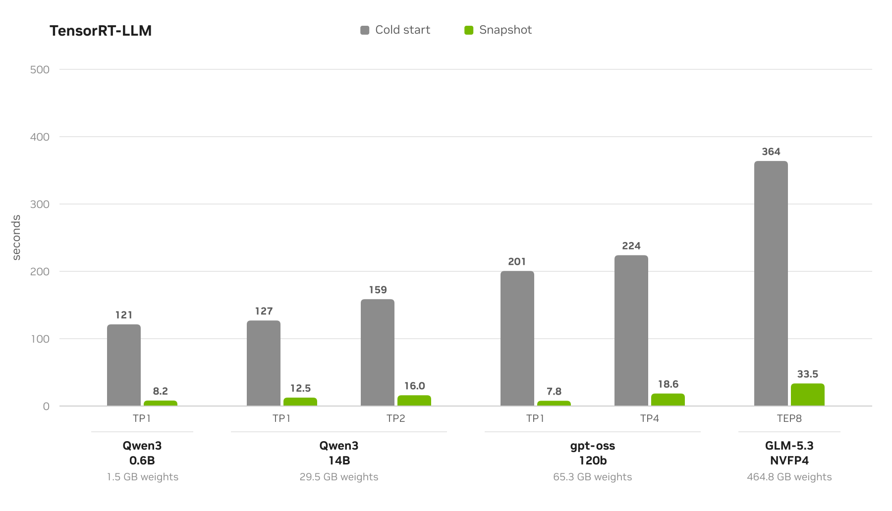
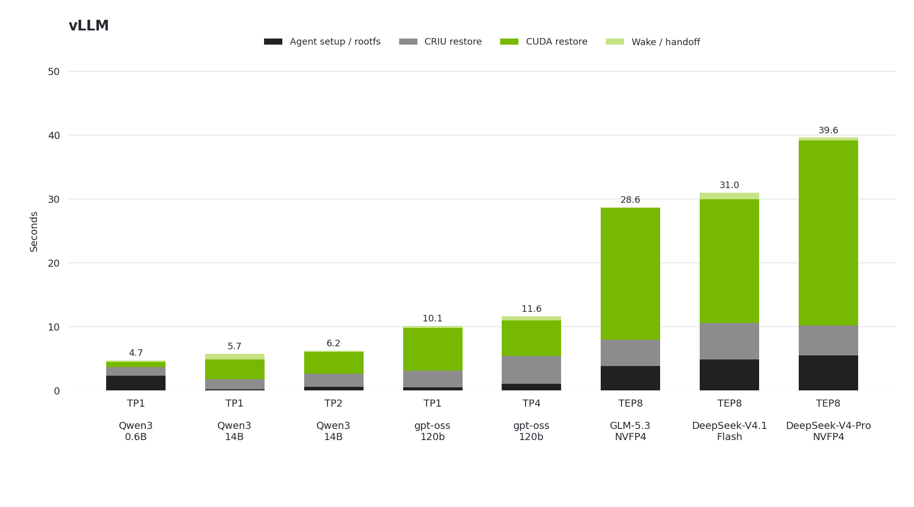

# Performance Benchmarks

We tested 22 configurations of vLLM, SGLang and TensorRT-LLM on one to eight B200 GPUs.
Restore was 8.2–40.0 times faster than cold start. Both measurements end when the engine
is ready, before inference. Read the [limitations](#limitations) before you compare
these results with another setup.

> [!TIP]
> See the [benchmark guide](benchmarks-guide.md) for setup and commands, and the
> [runner README](../../benchmarks/README.md) for the code layout.

During cold start, the engine loads weights, creates workers and sets up device memory.
It also compiles and tunes kernels, then captures CUDA graphs. Snapshot restores the
process with this work complete and the engine ready to serve requests.

## Benchmarking setup

| Property | Value |
|---|---|
| GPU | NVIDIA B200; 1, 2, 4 or 8 GPUs per workload |
| NVIDIA driver | 615.71.09 |
| Snapshot | v0.2.0-rc.2 |
| Engines | vLLM 0.31.0; SGLang 0.5.21; TensorRT-LLM 1.3.0rc24 |
| Model weights | 1.50–913.09 GB, already present on shared storage |
| Storage | VAST NFSv3 over TCP; 1 MiB reads/writes; `nconnect=32`, `spread_reads`, four server addresses |
| Compiler caches | Fresh directories for each cold start |
| Weight loading | vLLM: prefetch with eight threads and 16 MiB blocks; SGLang: checkpoint prefetch with four threads |
| Parallelism | TP: tensor parallelism. TEP8: tensor and expert parallelism across eight GPUs; exact settings are in each manifest |

## Limitations

- Cold starts and restores came from separate runs. Some runs used different nodes.
- Results apply to this B200 and VAST NFS setup. GPU, driver, storage and engine settings can change the times.
- Timing instrumentation adds work during cold start.

Weight size is the sum of the logical sizes of cached weight files. Checkpoint size is
the sum of the logical sizes of saved container files. It includes CPU state, GPU state
and the root filesystem archive. Both sizes use decimal GB. File size can differ from
GPU memory use and the disk space used.

Before capture, we asked each engine to release KV cache memory. For vLLM, model
weights are resident on the GPU at capture time.

## Measurement boundaries

**Cold start** begins at the process-start marker and ends when engine initialization
returns. This time excludes model download, pod scheduling, image pull and container
startup. We check text generation after initialization. That check is outside the
measured time.

**Snapshot** begins at the agent's external-restore start marker. It ends when the
application completes its wake and resume calls. The destination container already
exists. We then check inference and the saved process token. These checks are outside
the measured time.

**Checkpoint time** is the time the agent takes to capture the process. It excludes the
application's sleep or memory-release call before capture.

### Cold-start stages

| Stage | What is included |
|---|---|
| Startup | Imports, worker creation and runtime setup before model construction. |
| Model load | Model construction, weight reads and weight preparation, excluding separately timed nested phases. |
| Initialization | Memory profiling, attention/sampler initialization and remaining measured engine warmup. |
| Compilation, autotuning & graph capture | The combined measured time for kernel compilation, tuning and graph-capture scopes, including compilation inside those scopes. |

### Restore stages

| Stage | What is included |
|---|---|
| Agent setup / rootfs | The agent duration outside its CRIU and CUDA phase timers, including filesystem preparation and rootfs work. |
| CRIU restore | The measured CRIU phase that reconstructs the saved process state. |
| CUDA restore | The measured CUDA restoration phase, including multi-GPU reconstruction where applicable. |
| Wake | Time from agent completion through the application's wake and resume calls. |

## Results

All times are in seconds. Restore values are mean ± sample standard deviation across
three consecutive attempts. Speedup is cold-start time divided by the mean restore time.
Cold-start values use the mean when multiple samples are available.

### Cold start compared with Snapshot

| Model | Engine | Parallelism | Weights (GB) | Checkpoint (GB) | Checkpoint (s) | Cold start (s) | Restore (s, mean ± SD) | Speedup |
| --- | --- | --- | --- | --- | --- | --- | --- | --- |
| Qwen3-0.6B | vLLM | TP1 | 1.50 | 8.13 | 15.30 | 104.43 | 3.32 ± 1.16 | 31.43× |
| Qwen3-0.6B | SGLang | TP1 | 1.50 | 9.42 | 20.71 | 87.08 | 3.41 ± 0.16 | 25.57× |
| Qwen3-0.6B | TRT-LLM | TP1 | 1.50 | 8.04 | 20.07 | 121.26 | 5.13 ± 2.62 | 23.64× |
| Qwen3-14B | vLLM | TP1 | 29.54 | 37.71 | 19.98 | 122.76 | 6.12 ± 0.97 | 20.07× |
| Qwen3-14B | vLLM | TP2 | 29.54 | 48.29 | 38.37 | 139.63 | 6.25 ± 0.13 | 22.34× |
| Qwen3-14B | SGLang | TP1 | 29.54 | 40.19 | 26.17 | 106.26 | 5.44 ± 0.14 | 19.52× |
| Qwen3-14B | SGLang | TP2 | 29.54 | 51.93 | 33.88 | 124.72 | 6.74 ± 0.82 | 18.52× |
| Qwen3-14B | TRT-LLM | TP1 | 29.54 | 36.38 | 23.72 | 127.02 | 7.96 ± 3.93 | 15.95× |
| Qwen3-14B | TRT-LLM | TP2 | 29.54 | 47.97 | 42.90 | 158.66 | 10.30 ± 4.92 | 15.40× |
| gpt-oss-120b | vLLM | TP1 | 65.25 | 81.56 | 44.37 | 172.80 | 9.50 ± 0.72 | 18.19× |
| gpt-oss-120b | vLLM | TP4 | 65.25 | 119.69 | 133.01 | 155.66 | 10.52 ± 1.06 | 14.79× |
| gpt-oss-120b | SGLang | TP1 | 65.25 | 172.32 | 55.63 | 268.96 | 15.78 ± 0.15 | 17.05× |
| gpt-oss-120b | SGLang | TP4 | 65.25 | 693.89 | 174.20 | 240.17 | 29.13 ± 1.94 | 8.25× |
| gpt-oss-120b | TRT-LLM | TP1 | 65.25 | 77.87 | 29.98 | 200.55 | 7.57 ± 0.19 | 26.48× |
| gpt-oss-120b | TRT-LLM | TP4 | 65.25 | 111.34 | 85.29 | 223.96 | 14.03 ± 3.99 | 15.96× |
| GLM-5.3-NVFP4 | vLLM | TEP8 | 464.82 | 604.00 | 282.80 | 393.65 | 26.43 ± 1.98 | 14.89× |
| GLM-5.3-NVFP4 | SGLang | TEP8 | 464.82 | 669.49 | 327.20 | 426.70 | 31.41 ± 3.47 | 13.59× |
| GLM-5.3-NVFP4 | TRT-LLM | TEP8 | 464.82 | 628.30 | 231.33 | 363.90 | 32.10 ± 3.11 | 11.34× |
| DeepSeek-V4.1-Flash | vLLM | TEP8 | 510.30 | 647.18 | 274.75 | 1110.65 | 27.75 ± 2.80 | 40.03× |
| DeepSeek-V4.1-Flash | SGLang | TEP8 | 510.30 | 743.35 | 286.77 | 953.09 | 32.84 ± 3.26 | 29.02× |
| DeepSeek-V4-Pro-NVFP4 | vLLM | TEP8 | 913.09 | 996.53 | 193.84 | 908.48 | 36.25 ± 2.87 | 25.06× |
| DeepSeek-V4-Pro-NVFP4 | SGLang | TEP8 | 913.09 | 1039.09 | 253.72 | 621.55 | 38.91 ± 3.30 | 15.98× |

Restore summarizes three attempts. Cold-start and checkpoint values are reported
without a standard deviation.

Figures 1–3 compare cold start with mean restore time. Error bars show one sample
standard deviation across the three restores.

<picture>
  <source media="(prefers-color-scheme: dark)" srcset="img/vllm-cold-start-vs-snapshot-dark.png">
  
</picture>

*Figure 1. Cold start and mean restore time on vLLM.*

<picture>
  <source media="(prefers-color-scheme: dark)" srcset="img/sglang-cold-start-vs-snapshot-dark.png">
  
</picture>

*Figure 2. Cold start and mean restore time on SGLang.*

<picture>
  <source media="(prefers-color-scheme: dark)" srcset="img/trtllm-cold-start-vs-snapshot-dark.png">
  
</picture>

*Figure 3. Cold start and mean restore time on TensorRT-LLM.*

### Where the cold start time goes

| Model | Engine | Parallelism | Startup | Model load | Initialization | Compilation, autotuning & graph capture | Total |
| --- | --- | --- | --- | --- | --- | --- | --- |
| Qwen3-0.6B | vLLM | TP1 | 31.37 | 17.27 | 14.58 | 41.21 | 104.43 |
| Qwen3-0.6B | SGLang | TP1 | 33.74 | 11.67 | 8.41 | 33.26 | 87.08 |
| Qwen3-0.6B | TRT-LLM | TP1 | 25.79 | 3.79 | 40.64 | 51.04 | 121.26 |
| Qwen3-14B | vLLM | TP1 | 31.16 | 26.15 | 15.30 | 50.15 | 122.76 |
| Qwen3-14B | vLLM | TP2 | 42.18 | 18.96 | 15.29 | 63.20 | 139.63 |
| Qwen3-14B | SGLang | TP1 | 33.45 | 20.79 | 8.28 | 43.74 | 106.26 |
| Qwen3-14B | SGLang | TP2 | 47.62 | 18.93 | 8.29 | 49.88 | 124.72 |
| Qwen3-14B | TRT-LLM | TP1 | 25.35 | 11.54 | 39.36 | 50.77 | 127.02 |
| Qwen3-14B | TRT-LLM | TP2 | 27.42 | 8.88 | 70.62 | 51.74 | 158.66 |
| gpt-oss-120b | vLLM | TP1 | 35.15 | 38.69 | 10.49 | 88.47 | 172.80 |
| gpt-oss-120b | vLLM | TP4 | 49.91 | 24.71 | 12.13 | 68.91 | 155.66 |
| gpt-oss-120b | SGLang | TP1 | 42.54 | 34.44 | 0.36 | 191.62 | 268.96 |
| gpt-oss-120b | SGLang | TP4 | 57.97 | 49.06 | 1.33 | 131.81 | 240.17 |
| gpt-oss-120b | TRT-LLM | TP1 | 26.21 | 47.50 | 42.85 | 83.99 | 200.55 |
| gpt-oss-120b | TRT-LLM | TP4 | 34.28 | 42.72 | 22.34 | 124.62 | 223.96 |
| GLM-5.3-NVFP4 | vLLM | TEP8 | 65.47 | 65.88 | 48.88 | 213.42 | 393.65 |
| GLM-5.3-NVFP4 | SGLang | TEP8 | 60.77 | 73.98 | 2.66 | 289.29 | 426.70 |
| GLM-5.3-NVFP4 | TRT-LLM | TEP8 | 31.58 | 90.39 | 120.43 | 121.50 | 363.90 |
| DeepSeek-V4.1-Flash | vLLM | TEP8 | 63.96 | 184.90 | 77.25 | 784.54 | 1110.65 |
| DeepSeek-V4.1-Flash | SGLang | TEP8 | 56.18 | 74.21 | 38.50 | 784.20 | 953.09 |
| DeepSeek-V4-Pro-NVFP4 | vLLM | TEP8 | 64.42 | 95.14 | 64.87 | 684.05 | 908.48 |
| DeepSeek-V4-Pro-NVFP4 | SGLang | TEP8 | 58.80 | 87.68 | 42.55 | 432.52 | 621.55 |

Cold-start phases may not sum to the total because logging and instrumentation do not
capture every interval. Each run saves the raw timings.

### Where the restore time goes

| Model | Engine | Parallelism | Agent setup / rootfs | CRIU restore | CUDA restore | Wake | Total |
| --- | --- | --- | --- | --- | --- | --- | --- |
| Qwen3-0.6B | vLLM | TP1 | 1.08 ± 1.06 | 1.24 ± 0.10 | 0.78 ± 0.01 | 0.22 ± 0.01 | 3.32 ± 1.16 |
| Qwen3-0.6B | SGLang | TP1 | 0.16 ± 0.08 | 1.22 ± 0.09 | 1.03 ± 0.01 | 1.00 ± 0.02 | 3.41 ± 0.16 |
| Qwen3-0.6B | TRT-LLM | TP1 | 2.81 ± 2.52 | 1.32 ± 0.10 | 0.83 ± 0.01 | 0.17 ± 0.01 | 5.13 ± 2.62 |
| Qwen3-14B | vLLM | TP1 | 0.10 ± 0.02 | 2.00 ± 0.97 | 3.17 ± 0.01 | 0.84 ± 0.01 | 6.12 ± 0.97 |
| Qwen3-14B | vLLM | TP2 | 0.59 ± 0.08 | 2.07 ± 0.05 | 3.19 ± 0.36 | 0.40 ± 0.35 | 6.25 ± 0.13 |
| Qwen3-14B | SGLang | TP1 | 0.22 ± 0.10 | 1.27 ± 0.07 | 3.55 ± 0.11 | 0.40 ± 0.11 | 5.44 ± 0.14 |
| Qwen3-14B | SGLang | TP2 | 0.86 ± 0.12 | 1.87 ± 0.26 | 3.31 ± 0.15 | 0.69 ± 0.43 | 6.74 ± 0.82 |
| Qwen3-14B | TRT-LLM | TP1 | 3.20 ± 3.12 | 1.76 ± 0.81 | 2.82 ± 0.02 | 0.18 ± 0.02 | 7.96 ± 3.93 |
| Qwen3-14B | TRT-LLM | TP2 | 4.76 ± 4.23 | 2.73 ± 0.68 | 2.44 ± 0.03 | 0.36 ± 0.04 | 10.30 ± 4.92 |
| gpt-oss-120b | vLLM | TP1 | 0.22 ± 0.22 | 2.27 ± 0.58 | 6.61 ± 0.09 | 0.40 ± 0.09 | 9.50 ± 0.72 |
| gpt-oss-120b | vLLM | TP4 | 1.23 ± 0.33 | 2.99 ± 1.22 | 5.73 ± 0.37 | 0.57 ± 0.44 | 10.52 ± 1.06 |
| gpt-oss-120b | SGLang | TP1 | 0.16 ± 0.08 | 1.62 ± 0.08 | 13.49 ± 0.03 | 0.51 ± 0.03 | 15.78 ± 0.15 |
| gpt-oss-120b | SGLang | TP4 | 2.74 ± 0.51 | 3.98 ± 1.03 | 21.88 ± 0.29 | 0.52 ± 0.39 | 29.13 ± 1.94 |
| gpt-oss-120b | TRT-LLM | TP1 | 0.16 ± 0.10 | 1.42 ± 0.09 | 5.80 ± 0.07 | 0.20 ± 0.07 | 7.57 ± 0.19 |
| gpt-oss-120b | TRT-LLM | TP4 | 5.63 ± 3.78 | 3.32 ± 0.23 | 4.63 ± 0.54 | 0.46 ± 0.45 | 14.03 ± 3.99 |
| GLM-5.3-NVFP4 | vLLM | TEP8 | 2.81 ± 0.88 | 3.48 ± 0.61 | 19.70 ± 0.96 | 0.44 ± 0.41 | 26.43 ± 1.98 |
| GLM-5.3-NVFP4 | SGLang | TEP8 | 3.12 ± 0.21 | 6.65 ± 3.60 | 20.73 ± 0.67 | 0.91 ± 0.46 | 31.41 ± 3.47 |
| GLM-5.3-NVFP4 | TRT-LLM | TEP8 | 7.32 ± 3.13 | 5.27 ± 0.13 | 18.78 ± 0.99 | 0.73 ± 0.44 | 32.10 ± 3.11 |
| DeepSeek-V4.1-Flash | vLLM | TEP8 | 3.62 ± 1.23 | 4.44 ± 1.13 | 19.01 ± 0.49 | 0.68 ± 0.41 | 27.75 ± 2.80 |
| DeepSeek-V4.1-Flash | SGLang | TEP8 | 4.34 ± 0.13 | 6.60 ± 2.76 | 21.23 ± 0.16 | 0.67 ± 0.38 | 32.84 ± 3.26 |
| DeepSeek-V4-Pro-NVFP4 | vLLM | TEP8 | 3.41 ± 1.76 | 3.37 ± 1.18 | 28.89 ± 0.16 | 0.58 ± 0.17 | 36.25 ± 2.87 |
| DeepSeek-V4-Pro-NVFP4 | SGLang | TEP8 | 2.99 ± 0.14 | 6.41 ± 3.25 | 28.80 ± 0.21 | 0.70 ± 0.22 | 38.91 ± 3.30 |

Wake starts when the agent finishes and ends when the application completes its wake
and resume calls. CUDA restore includes multi-GPU reconstruction. Each stage shows
mean ± sample standard deviation across three restores. Mean stage times add to the
mean total; standard deviations do not add. Values are rounded to two
decimal places.

Figure 4 shows how much each stage contributes to mean vLLM restore time.

<picture>
  <source media="(prefers-color-scheme: dark)" srcset="img/vllm-restore-stages-dark.png">
  
</picture>

*Figure 4. Restore on vLLM, split into the four reported stages.*

## Reading the results

### Startup work

Restore skips model loading, kernel compilation, autotuning and CUDA graph capture.
Compilation can run during tuning and graph capture, so the table groups these phases
in one column.

### Restore work and storage

CUDA restore takes 19.01–28.89 seconds on average for the eight-GPU vLLM models.
For Qwen3-0.6B, agent setup and CRIU take 2.32 of the 3.32-second mean restore.

Checkpoint size, storage throughput and parallel reads affect restore time. The
81.56 GB vLLM GPT-OSS TP1 checkpoint restores in 9.50 seconds on average. The 119.69 GB TP4
checkpoint restores in 10.52 seconds on average.

### SGLang model loading

Qwen3-14B TP1 loads in 20.79 seconds,
compared with 26.15 seconds on vLLM. GPT-OSS TP1 loads in 34.44 seconds on SGLang and
38.69 seconds on vLLM. At TP4, GPT-OSS loads in 49.06 seconds on SGLang and
24.71 seconds on vLLM. Model load includes weight reads and preparation.
