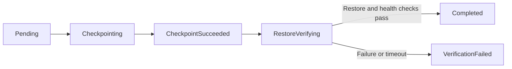

<!--
SPDX-FileCopyrightText: Copyright (c) 2026 NVIDIA CORPORATION & AFFILIATES. All rights reserved.
SPDX-License-Identifier: Apache-2.0
-->

# Verify a Restore Before Reuse

Use one canary to detect a faulty snapshot before many replicas restore from
it. Verification is optional. Upgrade all node agents and the Operator to a
version that supports verification before you enable it.

1. Create one restore Pod that references the intended snapshot name, before
   creating that snapshot. Follow the [Restore Pod Contract](../reference/restore-pod-contract.md).
   Give each destination container a readiness probe that checks application
   health after restore. Do not expose the canary through a production Service.
2. Read its UID and put this policy in the new `PodSnapshot.spec`. For a
   `SnapshotJob`, put it in `spec.podSnapshotTemplate` instead:

   ```yaml
   restoreVerification:
     podRef:
       name: model-canary
       uid: <UID from kubectl get pod model-canary -o jsonpath='{.metadata.uid}'>
     observationWindowSeconds: 30
     timeoutSeconds: 600
   ```

3. Create the snapshot. The Operator waits for checkpoint completion and any
   required SnapshotJob work, then records the canary execution and deadline.
   Only this Pod can restore while the phase is `RestoreVerifying`.
4. Check the snapshot:

   ```bash
   kubectl get podsnapshot model-snapshot -o yaml
   ```

   General reuse requires `Ready=True`, `phase=Completed`, and a successful
   `restoreVerifyInfo` for the current Content UID and policy. Other consumers
   are released only after actual restore and continuous application readiness
   pass the configured window. The record remains after the canary is deleted.



If verification fails, read `restoreVerifyInfo.reason` and `message`, plus
the canary Pod's conditions and logs. Waiting restore proxies receive an
explicit failure. Correct the cause and create a new snapshot and canary;
the snapshot spec is immutable. A zero observation window removes only the
timed wait. It still requires restore and an application readiness probe.

See the [API reference](../reference/api.md#restore-verification) for all phases
and the recorded fields. Snapshot does not create or delete the canary Pod.
