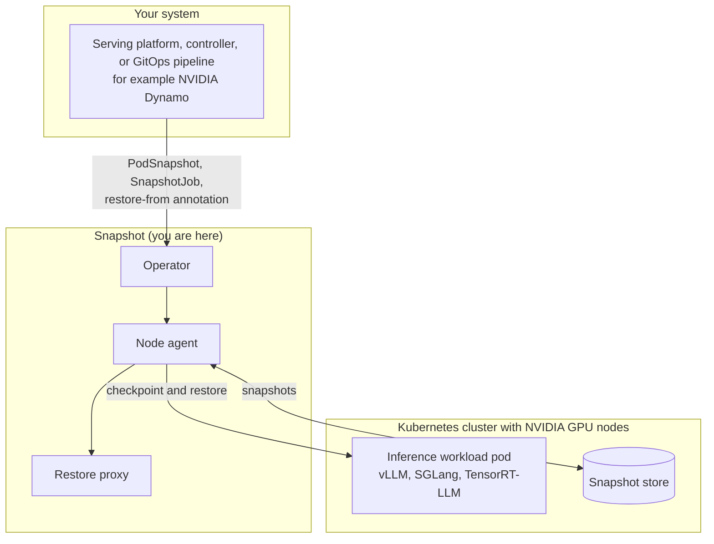

<!--
SPDX-FileCopyrightText: Copyright (c) 2026 NVIDIA CORPORATION & AFFILIATES. All rights reserved.
SPDX-License-Identifier: Apache-2.0
-->

# What Is Snapshot?

Snapshot is a Kubernetes-native checkpoint and restore system for NVIDIA GPU
workloads. It checkpoints a fully initialized GPU pod, including its running
process and its CPU and GPU memory, and restores that state on any compatible
node. A restored pod is ready in seconds instead of minutes.

Snapshot provides the checkpoint and restore primitives. The system that
integrates it decides which pods to checkpoint, when, and how to restore them.
It is for developers who build Kubernetes controllers, operators, and serving
platforms, and for MLOps and platform engineers who assemble deployment
pipelines with GitOps or workflow tools. Snapshot is licensed under the
[Apache License 2.0](../../LICENSE).

> [!NOTE]
> Snapshot's APIs may still change, so it is not yet recommended for
> production-critical workloads.

## Why Snapshot Exists

In inference serving, a replica cannot answer a single request until it is fully
initialized: model weights are loaded into GPU memory, CUDA and runtime
libraries are initialized, execution kernels are warmed up, and computation
graphs are compiled. For large models, this **cold start** takes minutes.

That cost is paid over and over. Every replica added to meet demand, every
scale-up from zero, and every restart or reschedule pays the full cold start
again before it can serve traffic:

- New replicas take minutes to become ready, so autoscaling lags behind demand.
- Teams over-provision idle GPUs to absorb demand spikes.
- Restarts and reschedules stall serving capacity exactly when it is needed.

Snapshot checkpoints a fully initialized pod once and restores it on demand, so a
new replica comes online in seconds instead of minutes:

- **Checkpoint:** Pause a running pod and save its complete execution state, CPU
  and GPU memory, as a portable snapshot.
- **Restore:** Start a new pod from a snapshot on any node with matching GPU
  hardware and driver versions. The new pod skips model loading and warm-up, and
  the process resumes from where it was checkpointed.

See [Performance](performance.md) for measured cold start and restore times.

## When to Use Snapshot

Snapshot helps most in three typical cases, where a replica must become ready
quickly:

- **Autoscaling inference.** Restore from an existing snapshot to bring the next
  replica online in seconds and keep pace with demand.
- **Scale-to-zero.** Park idle models at zero replicas and restore them quickly
  when capacity is needed again.
- **Faster restarts and reschedules.** Recover a pod's initialized state after a
  restart or a move to another node.

> [!NOTE]
> Snapshot currently focuses on inference cold start. Further use cases are on
> the roadmap.

## Key Features

- **Kubernetes-native control:** Request a checkpoint with a `PodSnapshot` or a
  `SnapshotJob`, and restore by annotating a new pod with
  `nvidia.com/restore-from`.
- **Multi-GPU workloads:** Checkpoint and restore a pod that uses several GPUs on
  one node. You opt in with an annotation.
- **Flexible storage:** Keep snapshots on a shared `ReadWriteMany` volume, which
  is the default, or in an S3-compatible bucket.
- **Compatibility checks before a restore:** Snapshot compares the snapshot with
  the target node, including CPU architecture, kernel, GPU model and count, and
  driver version. It refuses a mismatched restore and names the check that
  failed.
- **Clear failures:** A failed checkpoint or restore reports a reason on its
  resource. A snapshot is never published half-written.
- **One-step install:** A single Helm release installs the operator and the node
  agent.

## Architecture Overview

Snapshot installs as one Helm release with these parts:

- **Operator:** A cluster-wide control-plane Deployment. It reconciles the
  Snapshot resources and sends work to the nodes.
- **Node agent:** A privileged DaemonSet on GPU nodes. It runs the checkpoint
  and the restore for the pods on its node.
- **Restore proxy:** A small process that Snapshot injects into each restore
  container. It waits for the restore, then follows the restored process.

The node agent uses CRIU and `cuda-checkpoint` to do the checkpoint and restore
work. Snapshot runs on GPU nodes that have the NVIDIA GPU Operator and driver
installed, and it keeps snapshots in shared storage. See the
[Architecture Overview](architecture-overview.md) for how the parts
work together.

## Where Snapshot Fits

Snapshot sits between the system that decides when to checkpoint and restore a
pod, and the cluster that runs it. A serving platform, a controller, or a GitOps
pipeline, such as NVIDIA Dynamo, chooses which pods to checkpoint and when to
restore them. It asks Snapshot through Kubernetes resources. Snapshot then does
the checkpoint and restore on the GPU nodes, and keeps the snapshots in the
snapshot store. Your inference workload, for example vLLM, SGLang, or
TensorRT-LLM, is the pod that Snapshot checkpoints and restores.

