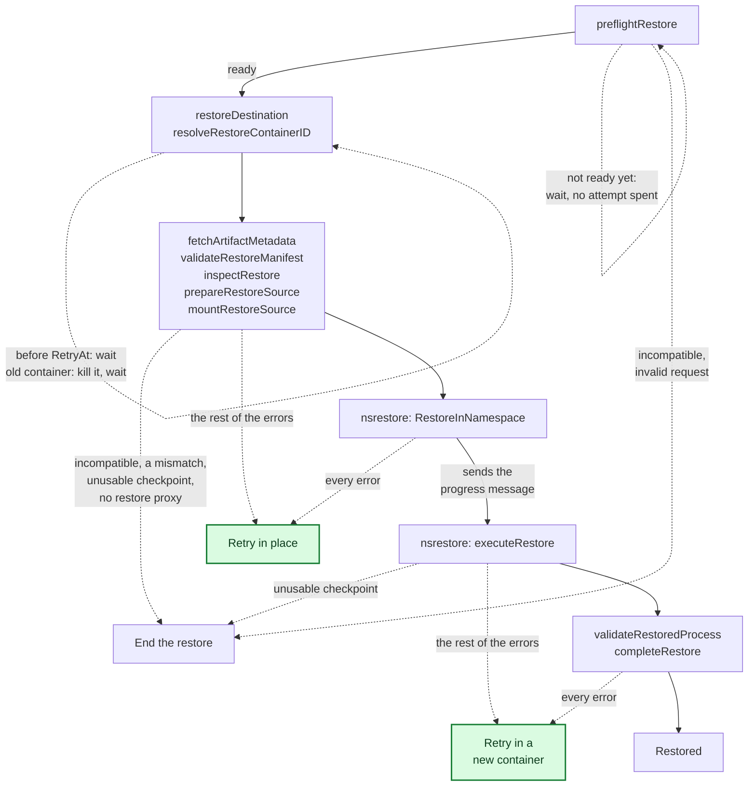

<!--
SPDX-FileCopyrightText: Copyright (c) 2026 NVIDIA CORPORATION & AFFILIATES. All rights reserved.
SPDX-License-Identifier: Apache-2.0
-->

# SNEP-247: Retry restore with a limit of retries

<!-- toc -->
- [Summary](#summary)
- [Motivation](#motivation)
  - [Goals](#goals)
  - [Non-Goals](#non-goals)
- [Proposal](#proposal)
  - [User Stories](#user-stories)
    - [Story 1: a scale-up lands several replicas on one busy node](#story-1-a-scale-up-lands-several-replicas-on-one-busy-node)
    - [Story 2: a restore fails halfway](#story-2-a-restore-fails-halfway)
    - [Story 3: teams need different limits](#story-3-teams-need-different-limits)
  - [Limitations, Risks, and Mitigations](#limitations-risks-and-mitigations)
- [Design Details](#design-details)
  - [Failure types](#failure-types)
    - [Failures that end the restore](#failures-that-end-the-restore)
    - [Failures not counted toward the budget](#failures-not-counted-toward-the-budget)
    - [Failures counted toward the budget](#failures-counted-toward-the-budget)
  - [Retry types](#retry-types)
  - [Attempt failure](#attempt-failure)
  - [What nsrestore reports](#what-nsrestore-reports)
  - [Recovery decision](#recovery-decision)
  - [Scheduling the next attempt](#scheduling-the-next-attempt)
  - [Attempt record](#attempt-record)
  - [Picking up a pending restore](#picking-up-a-pending-restore)
  - [Deadline](#deadline)
  - [API](#api)
  - [Security](#security)
  - [Configuration](#configuration)
  - [Performance and Scalability](#performance-and-scalability)
  - [Monitoring](#monitoring)
  - [Dependencies](#dependencies)
  - [Test Plan](#test-plan)
  - [Graduation Criteria](#graduation-criteria)
- [Alternatives](#alternatives)
- [Appendix](#appendix)
<!-- /toc -->

## Summary

A restore that passes the compatibility checks and then fails will be retried in the same Pod. Each attempt will start from a clean container. If the failed attempt left the container untouched, the agent will retry in place. Otherwise it will restart the container first. The retry limit will be set cluster-wide and per restore Pod, with a default of 0. Failures known to be final, including compatibility refusals, will end the restore immediately, and a restore that exhausts its retries will be reported as exhausted. All attempts will share one restore timeout, and the Pod will show each failed attempt and its cause.

## Motivation

[#247](https://github.com/ai-dynamo/snapshot/issues/247) was opened with the compatibility checks of [#231](https://github.com/ai-dynamo/snapshot/issues/231) and the cold-start fallback of [#244](https://github.com/ai-dynamo/snapshot/issues/244) to make a failed restore safe for autoscaling inference replicas, with retry before fallback. Today any restore failure is final for its Pod. A Pod under a Deployment crash-loops on its GPUs until something deletes it ([limitations](../../limitations.md)), and fallback alone would turn every failure into a cold start, even one another attempt would have restored.

Some failures are transient by design and come with load, so they peak during a scale-up. The node refuses a restore past its GPU connection limit ([daemon.cpp](https://github.com/ai-dynamo/snapshot/blob/b6343d0641aac414c9b51876ee579723f63e1801/agent/pagebroker/daemon.cpp#L468-L470)) and drops new connections past its request cap ([daemon.cpp](https://github.com/ai-dynamo/snapshot/blob/b6343d0641aac414c9b51876ee579723f63e1801/agent/pagebroker/daemon.cpp#L673-L676)). Storage and internal errors are meant to be retried ([pagebroker.proto](https://github.com/ai-dynamo/snapshot/blob/b6343d0641aac414c9b51876ee579723f63e1801/agent/pagebroker/v1/pagebroker.proto#L223-L226)), but nothing retries them today.

### Goals

- **Restores succeed more often.** A failure that does not recur costs an attempt, not the Pod.
- **Retriable failures are told apart from final ones.** A failure known to be final ends the restore at once.
- **Users choose how much to retry.** Each workload sets its own limit, and one that sets none behaves as today.
- **Retries are visible.** An operator can see that a restore was retried and why.

### Non-Goals

- **Recovering elsewhere.** Every retry stays in the same Pod. Falling back to a cold start is [#244](https://github.com/ai-dynamo/snapshot/issues/244).
- **Repairing a failed restore.** Retry will not fix what made an attempt fail. It only tries again.
- **Alerting.** Retries will show as Pod events, not as metrics or alerts. The agent has no metrics endpoint, so alerting on a rising retry rate is left to the cluster's monitoring.

## Proposal

The agent will choose each recovery from the failed attempt's cause, which decides whether another attempt can help, and from how far it got, which decides whether the container can be used again. Today every failure ends the restore.

An attempt changes the container once it starts restoring the checkpoint into it. Everything before that, such as fetching and staging the checkpoint, leaves the container untouched.

Along the restore path, each function's errors lead to one recovery. Dashed arrows are errors, and the parts in green are new.



Restarting the container is what makes a retry safe after a change. The new container starts clean from its image, still in the same Pod on the same node and GPUs, and waits to be restored like any new container. This needs a restart policy that restarts containers. Under `restartPolicy: Never`, a failure after the container changed ends the restore.

The retry limit defaults to 0, can be set for the whole cluster, and can be overridden on a restore Pod. One restore timeout covers all attempts together. Each failed attempt shows as a warning event, and the Pod shows the current attempt and where and why the last one failed. The restore stays in progress while attempts remain, and a restore that runs out of retries says so.

The agent will keep each container's attempt count, deadline, and last failure in a record on the Pod's own volume, which outlives container restarts. Every pass, including the first after an agent restart or upgrade, will pick the restore up from that record, so an agent restart does not reset the count or the timeout. An attempt the restart cut off counts as one failed attempt that changed the container. With the default of 0, the agent runs the restore again as it does today.

### User Stories

#### Story 1: a scale-up lands several replicas on one busy node

A platform team scales an inference service from a checkpoint, and several replicas land on the same node at once. The node is at its limit and refuses one of the restores before anything in its container has changed.

Today that replica's Pod fails and crash-loops until someone deletes it. With this proposal the agent waits and tries again, the replica restores shortly after, and the team sees a warning event for the refused attempt.

#### Story 2: a restore fails halfway

Another replica gets further. Its processes are back, and restoring their GPU state then fails, leaving the container half-restored.

Today the Pod fails, and the half-restored container cannot be used again. With this proposal the agent restarts the container, which comes back clean in the same Pod, and restores into it. The replica keeps its node and GPUs and serves after one container restart, and a warning event says where the first attempt failed.

#### Story 3: teams need different limits

A cluster admin sets a default of two retries. One team validating a new checkpoint wants every failure to surface at once, and another serves a model that takes many minutes to load cold.

Today neither can retry. With this proposal the first team's restore Pods set a limit of 0 and fail on the first error, the second team's allow five retries within the same restore timeout, and every other Pod uses the cluster default.

### Limitations, Risks, and Mitigations

**Retries after a change need a container that restarts.** The restore Pod contract recommends `restartPolicy: Never` today, and the restore guides and end-to-end workloads use it. Those Pods get only in-place retries, and so do Pods on a node without the restore proxy. The contract will say which policy enables which retries, and the agent will warn when a Pod asks for retries its policy or node cannot honor.

**An unrecognized error is retried.** A CRIU or CUDA error that would repeat every time still spends every attempt before the restore fails.

## Design Details

Retry will live in the node agent's handling of one destination container, `restoreDestination` ([controller.go](https://github.com/ai-dynamo/snapshot/blob/b6343d0641aac414c9b51876ee579723f63e1801/agent/internal/controller/controller.go#L953-L992)), which will open each pass by reading the container's attempt record to decide whether to start an attempt, wait, or end the restore. A failed attempt will return one error carrying what the decision needs, and one function will choose the recovery from it, leaving a retry in the record for the next pass.

### Failure types

#### Failures that end the restore

- **Compatibility refusals** from the preflight or the inspect gate.
- **An invalid restore request**: a malformed restore annotation, including the new retry limit, a destination container the Pod does not have, or a Pod that does not match its PodSnapshot. These already fail before any attempt.
- **An artifact this node cannot use**, each setting `Final` ([Attempt failure](#attempt-failure)):
  - a manifest that does not match the request ([restore.go](https://github.com/ai-dynamo/snapshot/blob/b6343d0641aac414c9b51876ee579723f63e1801/agent/internal/executor/restore.go#L265-L267))
  - a cuinterpose library whose identity differs ([restore.go](https://github.com/ai-dynamo/snapshot/blob/b6343d0641aac414c9b51876ee579723f63e1801/agent/internal/executor/restore.go#L268-L274))
  - a placeholder without the restore proxy where one is required ([restore.go](https://github.com/ai-dynamo/snapshot/blob/b6343d0641aac414c9b51876ee579723f63e1801/agent/internal/executor/restore.go#L587-L591))
  - a mismatched CustomStorage mode ([restore.go](https://github.com/ai-dynamo/snapshot/blob/b6343d0641aac414c9b51876ee579723f63e1801/agent/internal/executor/restore.go#L276-L279))
- **PageBroker failures that name the artifact or the request**: `ARTIFACT_NOT_FOUND`, `ARTIFACT_CORRUPT`, `UNSUPPORTED_ARTIFACT`, `ACCESS_DENIED`, `STORE_MISMATCH`, and `INVALID_REQUEST`.
- **A PageBroker abort that failed**, since the transaction may still be open ([restore.go](https://github.com/ai-dynamo/snapshot/blob/b6343d0641aac414c9b51876ee579723f63e1801/agent/internal/executor/restore.go#L205-L218)). It sets `Final` too.
- **The restore timeout.**
- **A failure that changed the container when it cannot restart**, under `restartPolicy: Never`, or on a node without the restore proxy, where a restarted container runs its own command instead of waiting to be restored ([main.go](https://github.com/ai-dynamo/snapshot/blob/b6343d0641aac414c9b51876ee579723f63e1801/agent/cmd/agent/main.go#L95-L98)).
- **The failure of the last allowed attempt**, after `RestoreRetriesExhausted`.

#### Failures not counted toward the budget

These bring the agent back to the Pod later without spending an attempt. Before the first attempt they spend no time either. After it they spend time from the deadline. The agent comes back on the Pod's next update or after 30 seconds, whichever comes first ([controller.go](https://github.com/ai-dynamo/snapshot/blob/b6343d0641aac414c9b51876ee579723f63e1801/agent/internal/controller/controller.go#L293-L298), [controller.go](https://github.com/ai-dynamo/snapshot/blob/b6343d0641aac414c9b51876ee579723f63e1801/agent/internal/controller/controller.go#L468-L474)).

- **The PodSnapshot isn't ready.** It doesn't exist yet, isn't Ready yet, or the agent can't read it ([controller.go](https://github.com/ai-dynamo/snapshot/blob/b6343d0641aac414c9b51876ee579723f63e1801/agent/internal/controller/controller.go#L604-L613), [controller.go](https://github.com/ai-dynamo/snapshot/blob/b6343d0641aac414c9b51876ee579723f63e1801/agent/internal/controller/controller.go#L630-L633)).
- **The PodSnapshotContent isn't ready.** The same three cases for the content the PodSnapshot is bound to ([controller.go](https://github.com/ai-dynamo/snapshot/blob/b6343d0641aac414c9b51876ee579723f63e1801/agent/internal/controller/controller.go#L640-L649), [controller.go](https://github.com/ai-dynamo/snapshot/blob/b6343d0641aac414c9b51876ee579723f63e1801/agent/internal/controller/controller.go#L669-L671)).
- **The checkpoint isn't on this node yet.** The agent can't inspect the checkpoint's directory, or the content doesn't list the container's published artifact yet ([controller.go](https://github.com/ai-dynamo/snapshot/blob/b6343d0641aac414c9b51876ee579723f63e1801/agent/internal/controller/controller.go#L740-L746), [controller.go](https://github.com/ai-dynamo/snapshot/blob/b6343d0641aac414c9b51876ee579723f63e1801/agent/internal/controller/controller.go#L781-L782)).
- **The Pod has no IP yet.** Only when established TCP connections are restored, which is on by default ([controller.go](https://github.com/ai-dynamo/snapshot/blob/b6343d0641aac414c9b51876ee579723f63e1801/agent/internal/controller/controller.go#L591-L593)).
- **The destination container isn't running yet.** The agent asks the container runtime for up to 30 seconds, then ends the pass and comes back ([controller.go](https://github.com/ai-dynamo/snapshot/blob/b6343d0641aac414c9b51876ee579723f63e1801/agent/internal/controller/controller.go#L962-L965), [controller.go](https://github.com/ai-dynamo/snapshot/blob/b6343d0641aac414c9b51876ee579723f63e1801/agent/internal/controller/controller.go#L997-L1047)). The NRI hook reporting the container also brings the agent back ([controller.go](https://github.com/ai-dynamo/snapshot/blob/b6343d0641aac414c9b51876ee579723f63e1801/agent/internal/controller/controller.go#L418-L426)). Before a fresh-container attempt, the agent also waits for a container whose ID differs from the failed attempt's ([Picking up a pending restore](#picking-up-a-pending-restore)).
- **The agent can't read the Pod from its cache** ([controller.go](https://github.com/ai-dynamo/snapshot/blob/b6343d0641aac414c9b51876ee579723f63e1801/agent/internal/controller/controller.go#L486-L489)).
- **The agent can't add its finalizer to the Pod** ([controller.go](https://github.com/ai-dynamo/snapshot/blob/b6343d0641aac414c9b51876ee579723f63e1801/agent/internal/controller/controller.go#L551-L555)).
- **The agent can't write the Pod's `Restored` condition**, when a pass starts ([controller.go](https://github.com/ai-dynamo/snapshot/blob/b6343d0641aac414c9b51876ee579723f63e1801/agent/internal/controller/controller.go#L794-L797)) or with the final outcome ([controller.go](https://github.com/ai-dynamo/snapshot/blob/b6343d0641aac414c9b51876ee579723f63e1801/agent/internal/controller/controller.go#L1327-L1330)). After a failed final write, the next pass starts again from the preflight.
- **The agent can't remove its finalizer** after the outcome is recorded or while the Pod is being deleted ([controller.go](https://github.com/ai-dynamo/snapshot/blob/b6343d0641aac414c9b51876ee579723f63e1801/agent/internal/controller/controller.go#L1337-L1341), [controller.go](https://github.com/ai-dynamo/snapshot/blob/b6343d0641aac414c9b51876ee579723f63e1801/agent/internal/controller/controller.go#L504-L507)).

#### Failures counted toward the budget

Every other failure spends an attempt and is retried while attempts and time remain, such as:

- **PageBroker error codes**: `UNAVAILABLE`, `INSUFFICIENT_STORAGE`, `STORAGE_ERROR`, `STORAGE_UNAVAILABLE`, `INTERNAL_ERROR`, `TRANSACTION_NOT_FOUND`, `TRANSACTION_EXPIRED`, and `TRANSACTION_CONFLICT`.
- **A failure to reach PageBroker at all.**
- **Failures in CRIU and the CUDA restore.**

### Retry types

A retry will be either an in-place retry or a fresh-container retry.

A **fresh-container retry** runs the next attempt in a new container that kubelet starts. It applies when the failed attempt changed the container, which nothing undoes. The agent will record the retry, and its next pass will kill the container without writing `restore-failed`, so kubelet restarts it and the restore proxy waits again as in a first container. The next attempt runs once the agent sees a container ID that differs from the failed attempt's. Every other retry is an **in-place retry**, which runs the next attempt in the same container after an exponential backoff.

An attempt will count as having changed the container when:

- nsrestore reported that it started changing the container ([What nsrestore reports](#what-nsrestore-reports)). It applies the rootfs diff and unmounts `/dev/shm` before CRIU runs ([nsrestore.go](https://github.com/ai-dynamo/snapshot/blob/b6343d0641aac414c9b51876ee579723f63e1801/agent/internal/executor/nsrestore.go#L154-L188)), and a CUDA failure after CRIU leaves restored processes behind.
- validating the restored process failed after nsrestore returned ([restore.go](https://github.com/ai-dynamo/snapshot/blob/b6343d0641aac414c9b51876ee579723f63e1801/agent/internal/executor/restore.go#L383-L385))
- a restore mount could not be unmounted, since it stays in the container ([restore.go](https://github.com/ai-dynamo/snapshot/blob/b6343d0641aac414c9b51876ee579723f63e1801/agent/internal/executor/restore.go#L196-L199))
- the container exited during the attempt, whether the workload's liveness probe, the startup gate, or anything else ended it
- writing `restore-complete` failed after the restore succeeded ([controller.go](https://github.com/ai-dynamo/snapshot/blob/b6343d0641aac414c9b51876ee579723f63e1801/agent/internal/controller/controller.go#L1196-L1211))

### Attempt failure

`Restore` will return one `executor.RestoreFailure` for every failed attempt. Today it returns a `StepError` whose cause may be typed or plain text, with cleanup errors joined in ([step.go](https://github.com/ai-dynamo/snapshot/blob/b6343d0641aac414c9b51876ee579723f63e1801/agent/internal/executor/step.go#L51-L67), [restore.go](https://github.com/ai-dynamo/snapshot/blob/b6343d0641aac414c9b51876ee579723f63e1801/agent/internal/executor/restore.go#L201-L235)). The new type keeps the step and adds only what the decision reads.

```go
type RestoreFailure struct {
	Step             Step  // as StepError carries today
	Cause            error // typed where the failing code knows the type
	Final            bool  // no further attempt can succeed
	ContainerChanged bool  // the next attempt needs a new container
	Cleanup          error // reported, never read as the cause
}
```

- **`Step` and `Cause` come from `failStep`**, as today ([step.go](https://github.com/ai-dynamo/snapshot/blob/b6343d0641aac414c9b51876ee579723f63e1801/agent/internal/executor/step.go#L62-L76)). A typed cause keeps its type, such as `*compat.IncompatibleError` for a compatibility refusal.
- **`Final` is set for a failure no attempt can fix**, in each case marked under [Failures that end the restore](#failures-that-end-the-restore). When it is set, the restore will end without another attempt.
- **`ContainerChanged` is set for an attempt that changed the container**, in each case listed under [Retry types](#retry-types). When it is set, the container will be restarted before the next attempt.
- **`Cleanup` holds the unmount and abort errors**, marked with capture's `CleanupFailure` ([checkpoint.go](https://github.com/ai-dynamo/snapshot/blob/b6343d0641aac414c9b51876ee579723f63e1801/agent/internal/executor/checkpoint.go#L45-L46)). `Restore` returns them today, joined into the attempt's error ([restore.go](https://github.com/ai-dynamo/snapshot/blob/b6343d0641aac414c9b51876ee579723f63e1801/agent/internal/executor/restore.go#L212-L214), [restore.go](https://github.com/ai-dynamo/snapshot/blob/b6343d0641aac414c9b51876ee579723f63e1801/agent/internal/executor/restore.go#L234)). A field of their own will keep them from mixing with `Cause`, so the reported cause and the decision see only what broke the attempt.

### What nsrestore reports

nsrestore runs inside the container and reports to the agent through one JSON result on stdout ([main.go](https://github.com/ai-dynamo/snapshot/blob/b6343d0641aac414c9b51876ee579723f63e1801/agent/cmd/nsrestore/main.go#L81-L88)). The recovery decision will need two more things from it:

- **Whether nsrestore started changing the container**, to decide between an in-place and a fresh-container retry.
- **The code of its failure**, to tell a failure no retry can fix, such as a corrupt artifact, from one worth retrying.

```go
// Sent on stdout right before the rootfs diff.
type RestoreInNamespaceProgress struct {
	ChangingContainer bool `json:"changingContainer"`
}

type RestoreInNamespaceResult struct {
	// existing fields, including Error and Step
	Code string `json:"code,omitempty"` // the failure's code, if it has one
}
```

The progress message will tell the agent that the container changed. `executeRestore` will send it right before `ApplyRootfsDiff`, the first change nsrestore makes in the container ([nsrestore.go](https://github.com/ai-dynamo/snapshot/blob/b6343d0641aac414c9b51876ee579723f63e1801/agent/internal/executor/nsrestore.go#L154-L157)). The agent will treat no progress message as untouched.

Today stdout carries only the result, and the agent parses all of it as one result ([nsrestore_output.go](https://github.com/ai-dynamo/snapshot/blob/b6343d0641aac414c9b51876ee579723f63e1801/agent/internal/executor/nsrestore_output.go#L30-L33), [nsrestore_output.go](https://github.com/ai-dynamo/snapshot/blob/b6343d0641aac414c9b51876ee579723f63e1801/agent/internal/executor/nsrestore_output.go#L58-L61)). The progress message will go there too, so the agent will split stdout into lines, look for the progress message in every line, and take the last line as the result. The agent keeps all of stdout ([process_output.go](https://github.com/ai-dynamo/snapshot/blob/b6343d0641aac414c9b51876ee579723f63e1801/agent/internal/runtime/process_output.go#L40-L47)), so a progress message sent before nsrestore fails or is killed still counts. `reportedCause` will rebuild a typed failure from the result's code ([nsrestore_output.go](https://github.com/ai-dynamo/snapshot/blob/b6343d0641aac414c9b51876ee579723f63e1801/agent/internal/executor/nsrestore_output.go#L84-L90)), so the decision reads it as it reads the same failure on the host.

### Recovery decision

`chooseRecovery` will run in `runRestore` ([controller.go](https://github.com/ai-dynamo/snapshot/blob/b6343d0641aac414c9b51876ee579723f63e1801/agent/internal/controller/controller.go#L1081-L1096)), the one place holding everything the choice needs:

- the attempts and time left from the attempt record
- whether the container can restart, from the Pod's `restartPolicy` and the node's restore proxy
- the timeout from the restore context `runRestore` creates

Like capture's `classifyCaptureFailure` ([capture_failure.go](https://github.com/ai-dynamo/snapshot/blob/b6343d0641aac414c9b51876ee579723f63e1801/agent/internal/controller/capture_failure.go#L36-L64)), it will read a failure code by what the code means to its own operation, so a code that ends a capture may be retried by a restore.

```go
func chooseRecovery(f *executor.RestoreFailure, ctxErr error, left budget) recovery {
	switch {
	case ctxErr != nil, f.Final, finalCodes[failureCode(f.Cause)]:
		return endRestore
	case left.attempts == 0 || left.time <= 0:
		return retriesExhausted
	case !f.ContainerChanged:
		return retryInPlace
	case left.freshContainer:
		return retryInFreshContainer
	default:
		return endRestore
	}
}
```

### Scheduling the next attempt

Restore will split an attempt from its outcome, as capture does since [#682](https://github.com/ai-dynamo/snapshot/pull/682). After each attempt, the switch below will choose what follows it.

```go
if ctx.Err() != nil {
	return errRestorePending // the agent is shutting down, and its replacement decides
}
recovery := chooseRecovery(failure, restoreCtx.Err(), op.budget())
op.recordFailure(failure, recovery)
switch recovery {
case retryInPlace, retryInFreshContainer:
	return errRestorePending // the record holds the retry, and the next pass carries it out
default:
	return op.failRestore(ctx, err) // writes restore-failed and kills, as today
}
```

### Attempt record

Each container will keep one record in a `restore-attempts` file on the Pod's snapshot-control volume, next to the restore sentinels. The volume outlives container restarts, has a directory named after each container, so a restarted container finds its record, and is reachable from the node when the container has no process ([control.go](https://github.com/ai-dynamo/snapshot/blob/b6343d0641aac414c9b51876ee579723f63e1801/agent/internal/runtime/control.go#L80-L124)). It is discarded with the Pod, so a new Pod starts a new restore with a fresh budget.

```go
type restoreAttempts struct {
	Limit                 int                         `json:"limit"`                 // resolved once, at the first attempt
	Attempt               int                         `json:"attempt"`               // the current or last attempt, from 1
	Deadline              time.Time                   `json:"deadline"`              // set at the first attempt, ends every attempt
	ContainerID           string                      `json:"containerID"`           // the container the attempt ran in
	RetryAt               time.Time                   `json:"retryAt"`               // an in-place retry's due time, zero otherwise
	RetryInFreshContainer bool                        `json:"retryInFreshContainer"` // the next attempt runs in a new container
	LastFailure           *podcontract.FailureSummary `json:"lastFailure"`           // the source of the retry status annotation
}
```

The agent will write the record before each attempt, with the new `Attempt` and `ContainerID` and both retry fields cleared, and after each failure, with its `LastFailure` and the retry field of the chosen recovery. It sets `RetryAt` for an in-place retry, and `RetryInFreshContainer` for a fresh-container retry.

After each pass with a failed attempt, the agent will also write the `nvidia.com/restore-retry-status` annotation on the restore Pod, so a user or a controller can read which attempt a restore is on and why the last one failed, without parsing messages. It holds one entry per container with a failed attempt. The containers of a Pod restore in parallel within a pass, so the pass will write the annotation once, from the `LastFailure` in every container's record, and no container's write will drop another's entry.

The agent never reads the annotation back. A restore that succeeds on its first attempt gets none, and the outcome leaves it on the Pod. `podcontract` gains the annotation's name, its type, and a parser.

```go
const RestoreRetryStatusAnnotation = "nvidia.com/restore-retry-status"

type RestoreRetryStatus map[string]ContainerRetryStatus // keyed by container name

type ContainerRetryStatus struct {
	Attempt     int            `json:"attempt"`     // the current or last attempt, from 1
	RetryLimit  int            `json:"retryLimit"`  // the limit resolved at the first attempt
	LastFailure FailureSummary `json:"lastFailure"` // the last failed attempt
}

type FailureSummary struct {
	Step               string `json:"step"`                         // where the attempt failed
	Cause              string `json:"cause"`                        // cut to 1,024 bytes, the limit of an event message
	CheckpointUnusable bool   `json:"checkpointUnusable,omitempty"` // the checkpoint itself is missing, corrupt, or unsupported
}
```

### Picking up a pending restore

On every pass, including the first after an agent restart, the agent will read each destination container's record and decide from it whether to start an attempt, wait, or end the restore.

- **`restore-complete` or `restore-failed` exists.** The outcome is already written, so the agent reports it again. It will check both through the node's path of the volume, which works while the container has no process. Today an agent restart checks only `restore-complete`, through the container ([controller.go](https://github.com/ai-dynamo/snapshot/blob/b6343d0641aac414c9b51876ee579723f63e1801/agent/internal/controller/controller.go#L1100-L1119)).
- **No record.** The first attempt starts, and the agent resolves the limit and the deadline.
- **`RetryAt` is still ahead.** The agent waits. A pending restore gets a pass on the Pod's next update or 30 seconds after the last one ([controller.go](https://github.com/ai-dynamo/snapshot/blob/b6343d0641aac414c9b51876ee579723f63e1801/agent/internal/controller/controller.go#L293-L298), [controller.go](https://github.com/ai-dynamo/snapshot/blob/b6343d0641aac414c9b51876ee579723f63e1801/agent/internal/controller/controller.go#L468-L474)), so the in-place retry will start no later than 30 seconds after it falls due. An earlier pass, such as one the agent's own update of the Pod starts, leaves the restore pending.
- **`RetryInFreshContainer` is set, and the container ID still matches `ContainerID`.** The agent kills the container if it still runs, without writing `restore-failed`, and waits for kubelet's new one. Only this step kills for a retry, so the kill still happens when the agent restarts after recording the retry, and repeating it on a dying container is harmless.
- **Neither is set, and the record names the current container.** The agent restarted during that attempt, since one agent never runs two passes of the same Pod at once. The attempt will count as a failure that changed the container and go through the [recovery decision](#recovery-decision) like any other. With a limit of 0, the agent will instead repeat that attempt in the same container, as it does today, so the default keeps today's behavior.
- **Otherwise**, such as a new container after a fresh-container kill or an in-place retry that is due, the next attempt starts if attempts and time remain, and the restore ends as exhausted if not ([Deadline](#deadline)).

An agent that is shutting down will leave its attempt as it is, without recording a failure or killing the container, so its replacement finds an attempt that never finished. The agent exits without waiting for running restores ([main.go](https://github.com/ai-dynamo/snapshot/blob/b6343d0641aac414c9b51876ee579723f63e1801/agent/cmd/agent/main.go#L107-L111), [controller.go](https://github.com/ai-dynamo/snapshot/blob/b6343d0641aac414c9b51876ee579723f63e1801/agent/internal/controller/controller.go#L464)), so a decision started during shutdown could stop halfway.

### Deadline

`restore.timeoutSeconds` will be one deadline for all attempts of a destination container, counted from the first attempt's start. Waits between attempts and container restarts count toward it. A restore whose next attempt cannot start before the deadline will end as one that ran out of retries. Today each restore run gets its own timeout, and an agent restart starts it again ([controller.go](https://github.com/ai-dynamo/snapshot/blob/b6343d0641aac414c9b51876ee579723f63e1801/agent/internal/controller/controller.go#L1074-L1079)).

```go
restoreCtx, cancel := context.WithDeadline(ctx, record.Deadline)
```

### API

**Cluster-wide default.** `restore.retryLimit` in the agent configuration, rendered by the Helm chart. It pairs with `checkpoint.retryLimit`, which [#684](https://github.com/ai-dynamo/snapshot/pull/684) added for capture with this name in mind.

**Per-restore value.** An optional `nvidia.com/restore-retry-limit` annotation on the restore Pod, next to `nvidia.com/restore-from`, will override the default. Callers of `podcontract.Build` will set it through a new `podcontract.Options` field, and `podcontract.Validate` will reject a negative or non-numeric value.

**Retry status on the Pod.** The `nvidia.com/restore-retry-status` annotation and its `podcontract` type, described under [Attempt record](#attempt-record).

**The restore Pod contract** changes in one sentence. "A Pod gets one restore" becomes "a Pod gets one successful restore, after at most the retry limit plus one attempts".

### Security

The attempt record sits on a volume the Pod's containers can write, so the agent will treat it as untrusted input. It will open the record without following links, as it opens the restore sentinels, cap the size it reads, and end the restore if the record does not parse. A container that rewrites the record can reset its own attempt count, which gives it no more than the retry limit annotation already allows, or move its own deadline. Either way the extra attempts restore only its own Pod, on the node and GPUs that Pod already holds.

### Configuration

| Setting | Where | Default |
| --- | --- | --- |
| `restore.retryLimit` | agent configuration, Helm `config.restore.retryLimit` | `0` |
| `nvidia.com/restore-retry-limit` | restore Pod annotation | absent, uses the cluster default |

The default of 0 keeps every restore at one attempt after an upgrade.

### Performance and Scalability

A restore that succeeds on its first attempt adds one read and one write of the attempt record.

A retried restore is slower by design. An in-place retry costs its backoff, or up to 30 seconds more until the agent's next pass, and the preparation again. A fresh-container retry costs kubelet's restart backoff and a full restore, which reads the artifact again, so retries add read load on the checkpoint store. kubelet, not the agent, sets that backoff. The first restart is immediate, and later ones wait 10 seconds, doubling up to 5 minutes. The limit and the shared deadline bound both.

### Monitoring

- **Logs**
- **Warning events on the restore Pod.**
  - `RestoreAttemptFailed` for each failed attempt, naming the container, the attempt, the step, the cause, and the recovery.
  - `RestoreRetriesExhausted` when retries run out, before the final `RestoreFailed`.
  - `RestoreRetryLimited` once per Pod with a nonzero limit when only in-place retries are possible, under `restartPolicy: Never` or on a node without the restore proxy.
- **The retry status annotation**, showing the current attempt and why the last one failed ([Attempt record](#attempt-record)).

### Dependencies

N/A

### Test Plan

**Unit.** Each part this design adds or changes will get unit tests.

**Integration.** Agent controller tests, alongside `TestRunRestoreFailureKillsPlaceholder` ([controller_test.go](https://github.com/ai-dynamo/snapshot/blob/b6343d0641aac414c9b51876ee579723f63e1801/agent/internal/controller/controller_test.go#L1775)), with the restore function replaced to inject failures:

- A restore that fails once while preparing and succeeds in place.
- A restore that fails after the rootfs diff, is killed without `restore-failed`, and succeeds in a container with a new ID.
- A restore that uses up its retries and ends `RestoreFailed` after `RestoreRetriesExhausted`.
- A failure that changed the container under `restartPolicy: Never`, ending the restore with the `RestoreRetryLimited` warning.
- An agent restart during an attempt, and an agent shutdown that leaves its attempt to the restarted agent.
- A pass that still finds the old container, which kills it only if it runs, and reports no failed attempt.
- Two containers of one Pod that fail in the same pass, each keeping its entry in the annotation.

**End-to-end.** In the restore failure suite ([restore_failure_qualification.py](../../../e2e/snapshot_e2e/restore_failure_qualification.py)), on a GPU node, a restore Pod with `restartPolicy: Always` whose staged checkpoint is damaged, as the existing damaged-checkpoint case does, and repaired after the first attempt fails. The container restarts once, the next attempt starts with the failed attempt's GPU memory released and restores into the new container, and inference matches the source.

### Graduation Criteria

**GA.** Retry will ship straight to GA. Its default of 0 keeps every restore at one attempt, and a retry runs only for a restore that has already failed, within its existing timeout. It ships once both recoveries have unit and end-to-end coverage, including inference after a container restart, a failure that ends the restore ends it on the attempt that hit it, and the restore Pod contract documents which restart policies allow which retries.

## Alternatives

**Recreate the Pod instead of restarting the container.** [#244](https://github.com/ai-dynamo/snapshot/issues/244) weighs recreating the Pod for its cold-start fallback. For a retry, recreating would give up the node and GPUs the restore was placed on, work only for Pods with an owner, and overlap the fallback. A container restart keeps all of them.

**Keep the retry status and the attempt record in the Pod's status.** The agent could write both as Pod conditions next to `Restored`, instead of the `nvidia.com/restore-retry-status` annotation and the `restore-attempts` file. Only writers with `pods/status` access could change them, and they would outlive container restarts as the file does, since kubelet keeps the conditions it does not own ([status_manager.go](https://github.com/kubernetes/kubernetes/blob/3c690c189e5d367715dbd056a5c2009a476c8d77/pkg/kubelet/status/status_manager.go#L1452-L1459)). The annotation and the file fit better:

- A condition carries data only as text ([types.go](https://github.com/kubernetes/kubernetes/blob/3c690c189e5d367715dbd056a5c2009a476c8d77/staging/src/k8s.io/api/core/v1/types.go#L3940-L3963)), which consumers must parse.
- The file's format stays private, so it can change between agent versions.
- Status is read from a cache that can lag the agent's writes ([controller.go](https://github.com/ai-dynamo/snapshot/blob/b6343d0641aac414c9b51876ee579723f63e1801/agent/internal/controller/controller.go#L482)).
- Every status write is a Pod update sent to all its watchers.

## Appendix

- [#247](https://github.com/ai-dynamo/snapshot/issues/247), the tracking issue.
- [SNEP-394](../394-capture-retry/README.md), with [#319](https://github.com/ai-dynamo/snapshot/issues/319) and [#632](https://github.com/ai-dynamo/snapshot/issues/632), capture retry and its implementation.
- [#244](https://github.com/ai-dynamo/snapshot/issues/244), cold-start fallback.
- [SNEP-411](https://github.com/ai-dynamo/snapshot/pull/437), application contracts, including the restore release and its single deadline.
- [Restore Pod contract](../../reference/restore-pod-contract.md).
