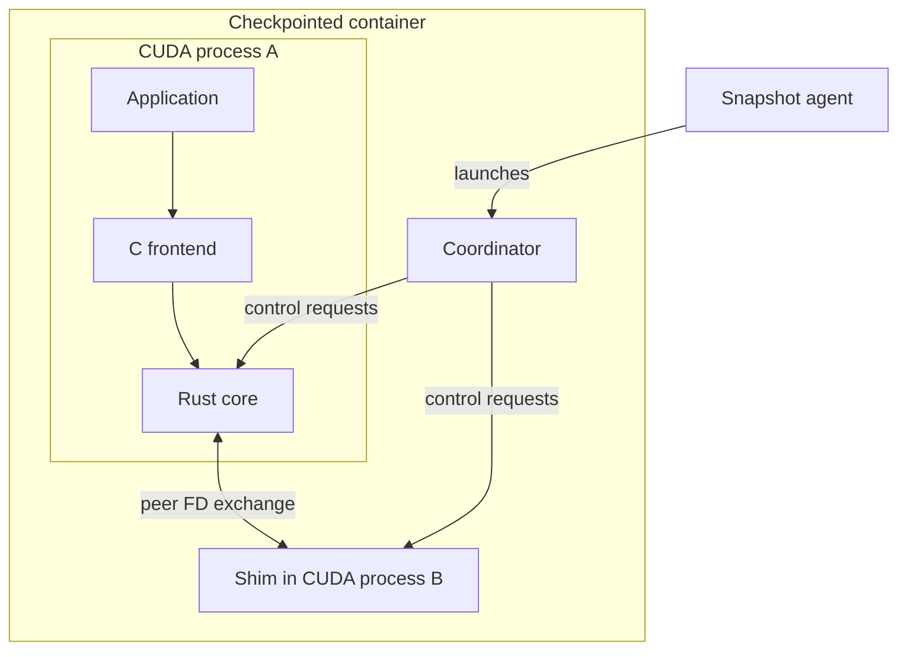
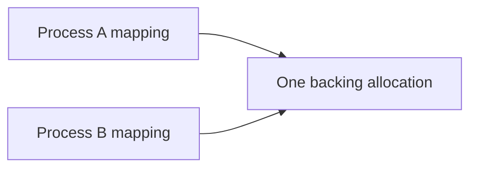
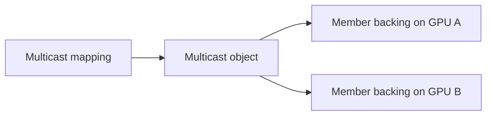
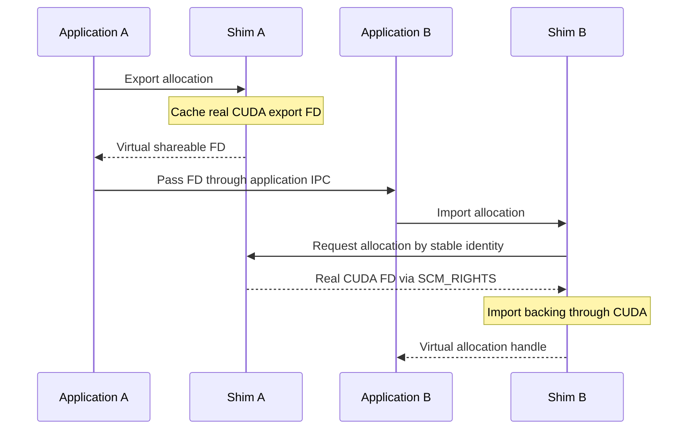
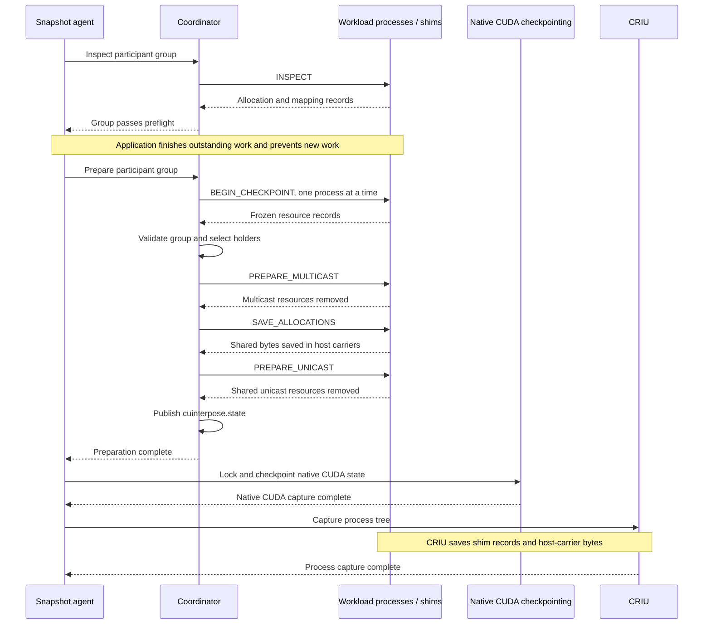
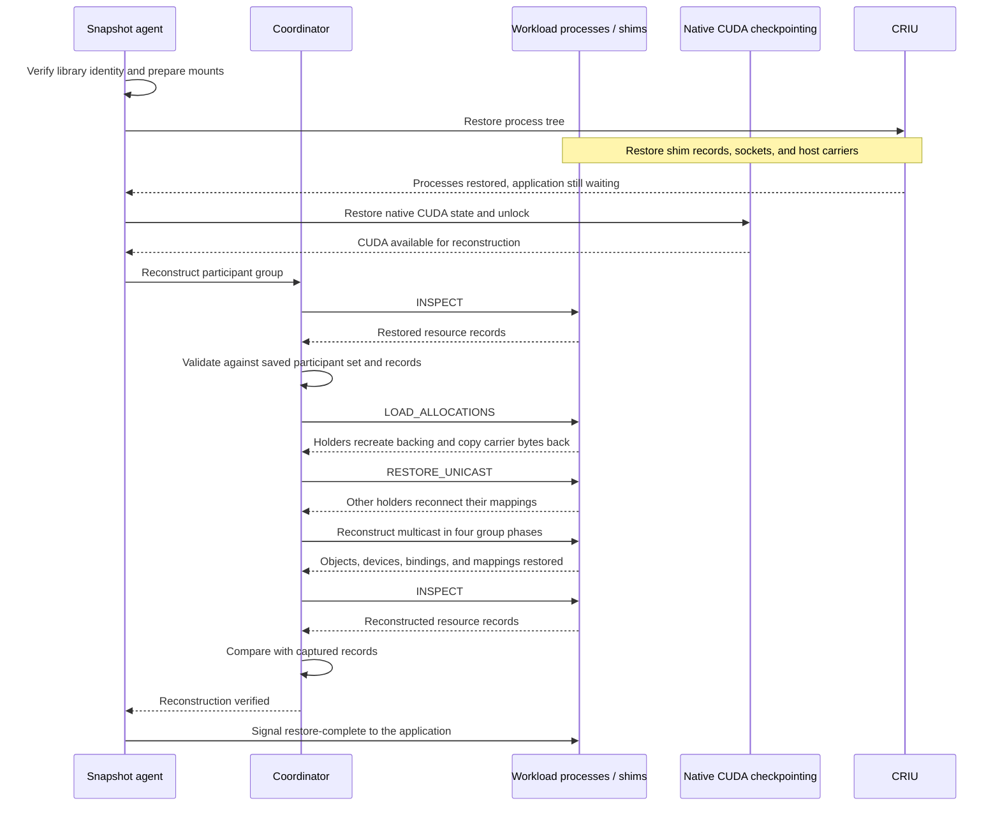

<!--
SPDX-FileCopyrightText: Copyright (c) 2026 NVIDIA CORPORATION & AFFILIATES.
SPDX-License-Identifier: Apache-2.0
-->

# SNEP-295: Checkpoint and restore of shared CUDA memory

<!-- toc -->
- [Summary](#summary)
- [Motivation](#motivation)
  - [Goals](#goals)
  - [Non-Goals](#non-goals)
- [Proposal](#proposal)
  - [Workload contract](#workload-contract)
  - [Limitations, Risks, and Mitigations](#limitations-risks-and-mitigations)
- [Design Details](#design-details)
  - [Components](#components)
  - [CUDA memory and mappings](#cuda-memory-and-mappings)
    - [Unicast mappings](#unicast-mappings)
    - [Multicast mappings](#multicast-mappings)
    - [Preserving CUDA graphs](#preserving-cuda-graphs)
  - [Interposing VMM sharing](#interposing-vmm-sharing)
    - [Creator and checkpoint holder](#creator-and-checkpoint-holder)
    - [Multicast tracking](#multicast-tracking)
  - [Adapting legacy allocation and IPC APIs](#adapting-legacy-allocation-and-ipc-apis)
    - [Why allocation must be intercepted before export](#why-allocation-must-be-intercepted-before-export)
    - [IPC and mapping lifetime](#ipc-and-mapping-lifetime)
    - [Peer access and isolation](#peer-access-and-isolation)
  - [Host carriers](#host-carriers)
    - [What is saved](#what-is-saved)
    - [Copying and lifetime](#copying-and-lifetime)
  - [Capture](#capture)
  - [Restore](#restore)
  - [Process runtime and concurrency](#process-runtime-and-concurrency)
    - [State and driver calls](#state-and-driver-calls)
    - [Process ownership](#process-ownership)
  - [API](#api)
    - [Delivery and activation](#delivery-and-activation)
    - [Participants and native CUDA state](#participants-and-native-cuda-state)
  - [Failure behavior](#failure-behavior)
  - [Checkpoint files and compatibility](#checkpoint-files-and-compatibility)
  - [Performance and Scalability](#performance-and-scalability)
    - [Allocation granularity](#allocation-granularity)
    - [Host memory and transfer cost](#host-memory-and-transfer-cost)
  - [Security](#security)
  - [Configuration](#configuration)
  - [Dependencies](#dependencies)
  - [Monitoring](#monitoring)
  - [Test Plan](#test-plan)
  - [Graduation Criteria](#graduation-criteria)
- [Implementation History](#implementation-history)
- [Alternatives](#alternatives)
- [Appendix](#appendix)
  - [Interception and loader contract](#interception-and-loader-contract)
    - [Backend runtime installation](#backend-runtime-installation)
    - [Intercepted API reference](#intercepted-api-reference)
  - [Handle and state formats](#handle-and-state-formats)
    - [Decoded state example](#decoded-state-example)
  - [Further reading](#further-reading)
<!-- /toc -->

Tracking issue: [#295](https://github.com/ai-dynamo/snapshot/issues/295).

## Summary

CuInterpose enables Snapshot to checkpoint CUDA memory shared by processes in
one container and restore those processes together on a compatible node. It
preserves each process's application pointers, the memory contents, and the
sharing relationships between processes. The supported mechanisms are CUDA
virtual memory management (VMM) allocations shared through POSIX file
descriptors, synchronous allocation and memory IPC APIs, and CUDA multicast
objects.

## Motivation

GPU workloads often share memory between processes, for example when inference
workers exchange data across GPUs. Two processes can map the same CUDA
allocation at different virtual addresses. A correct restore must reconnect
both mappings to one allocation. Restoring an independent copy for each process
would preserve the initial contents, but subsequent writes through one mapping
would no longer be visible through the other.

CUDA multicast adds another relationship: one virtual address range refers to
memory on several GPUs. Restoring its member allocations is insufficient unless
the multicast object, participating devices, and memory bindings are also
recreated. Native CUDA checkpointing can refuse workloads that retain shared
VMM or multicast resources, so CuInterpose removes those resources before native
capture and reconstructs them after native restore.

Workloads also share allocations through legacy CUDA memory IPC, which presents
additional compatibility constraints with native checkpointing. Supporting these
workloads should not require applications to replace their existing allocation
and sharing APIs.

### Goals

- Preserve allocation identity, contents, virtual addresses, access permissions,
  and supported unicast and multicast relationships.
- Preserve existing CUDA graphs so they can replay after restore without graph
  recapture or changes to the pointers recorded in their nodes.
- Save one content copy per shared tracked allocation, while leaving
  never-shared allocations on the native CUDA checkpoint path.
- Validate the participant group before teardown and verify reconstructed
  records before releasing the application.
- Define activation, synchronization, lifetime, and compatibility contracts
  that callers can rely on.

### Non-Goals

- Cross-Pod coordination or live sharing between nodes. Cross-node restore
  moves the captured group together to a compatible destination.
- Changing native CUDA checkpointing or adding a storage interface to the shim.
- Automatically draining GPU work, changing the participant group during
  capture, or retrying and rolling back a failed lifecycle operation.
- General support for every CUDA allocation or IPC API. In particular, the
  legacy adapter does not cover event IPC, memory-pool IPC, foreign native
  memory-IPC handles, or managed, async, and pitched allocation families.
- Strict context isolation for malloc and IPC mappings converted to VMM.

## Proposal

Each participating CUDA process loads a shim, a library that intercepts selected
CUDA calls and records their effects. A short-lived coordinator validates the
participating processes and orders their checkpoint and restore operations.
Snapshot combines this coordination with native CUDA checkpointing for GPU state
and CRIU for process memory and other process state:

1. Record allocation identity and sharing while the application runs.
2. Select one process that still holds a handle or mapping for each shared
   allocation, and have it save that allocation's bytes in host memory.
3. Remove shared CUDA resources, then capture native CUDA state and process
   memory. CRIU captures the saved host bytes.
4. Restore process and native CUDA state, recreate the shared allocations, and
   reconnect each process's mappings to them.
5. Verify that the reconstructed allocations, mappings, and multicast
   relationships match the captured records before the application resumes.

The host buffers in step 2 are called *host carriers*. CRIU preserves their
contents while the shared CUDA resources are absent. Allocations that were
never shared stay allocated and are saved and restored by native CUDA
checkpointing.

### Workload contract

Before capture, the application must finish outstanding CUDA calls and GPU work,
stop CPU writes to shared host allocations, and prevent new work from starting.
It must keep that state until restore completes. The shim records resources and
rejects intercepted memory operations during checkpoint, but it cannot pause
application threads or detect every GPU operation and CPU writer.

Every process that shares these resources must load the shim and belong to the
same fixed checkpoint group. The group must include the original creator of each
allocation, even if another process holds its only remaining handle or mapping.
Applications must also synchronize object and context destruction with all calls
that use them. The shim's tracking locks do not extend CUDA object lifetimes.

### Limitations, Risks, and Mitigations

Tracked VMM allocations and multicast objects must use the POSIX file-descriptor
handle type. Unicast allocations may use pinned memory at CUDA's `DEVICE` or
`HOST_NUMA` locations, meaning GPU memory or host memory associated with a NUMA
node. FABRIC handles, combinations of exportable handle types, and multicast
objects without POSIX export support are outside this design.

The shim rejects unsupported exportable creation requests and non-POSIX imports
before acquiring CUDA resources. It permits raw POSIX imports from processes
without the shim, but cannot reconstruct those external sharing relationships.
Every handle and mapping for such an import must therefore be released before
checkpoint. The legacy IPC adapter rejects native memory-IPC handles produced
outside the shim.

| Risk or constraint | Contract |
| --- | --- |
| Concurrent application work | The application must finish outstanding work and prevent new work until restore completes. Checkpoint entry blocks tracked mutations but does not stop the application itself. |
| Incomplete participant group | Preflight requires creators, surviving holders, and complete multicast membership. |
| Failure during preparation or reconstruction | The attempt is unusable. Terminate the affected workload rather than retrying a lost reply or resuming partial state. |
| Memory overhead | Budget full shared backing in host carriers and VMM rounding for converted malloc allocations. See [Performance and Scalability](#performance-and-scalability). |
| Artifact mismatch | Restore requires the captured frontend and core library hashes. A protocol version alone does not establish compatibility. |

## Design Details

### Components

The shim has two components inside each CUDA process: a C frontend that
intercepts calls and a Rust core that tracks and reconstructs resources. The
coordinator runs as a separate process and sends control requests to those cores.
CUDA calls and memory copies execute inside the participating processes.



`libcuinterpose.so` intercepts CUDA calls and resolves the real driver functions.
`libcuinterpose_core.so` owns tracking state, driver resources, and host carriers.
Each core listens on `/tmp/cuinterpose-<namespace-pid>.sock` for both coordinator
commands and peer requests for export descriptors.

The Snapshot agent discovers participants and launches a coordinator in the
target container's namespaces for each inspection, preparation, or reconstruction
operation. The agent also orders native CUDA operations and CRIU, then signals
that the application may resume after restore. The coordinator exits when its
requested operation finishes.

### CUDA memory and mappings

An allocation owns a region of GPU or host memory. This memory is the allocation's
*backing*. A mapping connects a virtual address range in a process to some or all
of that backing, with permissions specifying which devices may access it.

An application pointer identifies a virtual address, while a CUDA allocation
handle identifies the underlying resource. Several mappings can refer to the
same allocation, and a process can release its handle while a mapping continues
to retain the allocation. CuInterpose tracks these relationships separately so
that restoring a pointer also restores the memory it refers to.

#### Unicast mappings

A unicast mapping refers to one backing allocation. Two processes can import the
same backing and map it at different addresses:



For example, A may map an allocation at `0x700000000000` and B at
`0x710000000000`. Restore must preserve both addresses and reconnect them to one
recreated allocation. The new driver handles and export FDs need not have their
old values.

#### Multicast mappings

A multicast mapping refers to an object that binds memory ranges from a team of
devices. The member allocations contain the bytes. The object supplies the
membership and bindings used to access those bytes through multicast operations.

A multicast store writes to the corresponding locations in all bound members.
A multicast load-reduce reads those locations and combines their values. These
addresses require the appropriate multicast instructions, rather than ordinary
loads and stores. See the [PTX multimem instructions](https://docs.nvidia.com/cuda/parallel-thread-execution/#data-movement-and-conversion-instructions-multimem-ld-reduce-multimem-st-multimem-red).



Reconstructing multicast therefore requires more than importing a single
allocation. The object, its imports, device attachments, bindings, mappings, and
permissions must be recreated in dependency order. The object has no separate
payload that needs another copy of every member's bytes.

The [CUDA multicast API](https://docs.nvidia.com/cuda/cuda-driver-api/cuda_driver_api/group__CUDA__MULTICAST.html)
describes creation, device attachment, binding, and mapping of these objects.

#### Preserving CUDA graphs

Preserving virtual addresses is essential for CUDA graphs as well as application
pointers. Graph nodes retain the memory addresses supplied when the graph was
captured or constructed. Restoring the bytes at different addresses would leave
those nodes referring to the old locations. The goal is to replay the existing
graphs after restore without recapturing them or updating their memory
references. See NVIDIA's [CUDA graph memory constraints](https://docs.nvidia.com/dl-cuda-graph/latest/cuda-graph-basics/constraints.html).

VMM separates virtual-address reservations from physical backing, which lets
CuInterpose remove shared resources without discarding their application address
ranges. During checkpoint preparation, it uses `cuMemUnmap` and `cuMemRelease`
to remove mappings and release backing references, while retaining the address
reservations. During reconstruction, it uses `cuMemMap` and `cuMemSetAccess` to
restore backing and permissions at the original addresses. The same address
requirement applies to multicast mappings. These operations rely on the
[VMM reservation and mapping model](https://docs.nvidia.com/cuda/cuda-programming-guide/04-special-topics/virtual-memory-management.html).

Native CUDA checkpointing remains responsible for graph objects and executable
graph state. CuInterpose reconstructs the shared memory those graphs reference
before the application can replay them. Graph execution must remain stopped
throughout preparation and reconstruction, including while CUDA is unlocked for
the shim's driver calls.

### Interposing VMM sharing

The shim gives each tracked allocation a random 128-bit ID and pairs it with the
creator's PID in the container's PID namespace. This allocation reference remains
stable across checkpoint and restore. The application receives a virtual
allocation handle, which the shim translates to the process's current CUDA
driver handle. Recreating a driver resource therefore does not require changing
the handle stored in application memory.

For POSIX export, the shim retains a real CUDA export file descriptor and returns
a descriptor for a small memory-backed file containing the allocation reference.
This *virtual shareable FD* passes through the application's existing IPC
mechanism. When the receiving application imports it, the receiving shim reads
the reference and requests the real CUDA descriptor from the creator's socket.



A unicast export reply carries the full backing size and creator location.
The importer obtains allocation properties from CUDA and records its own handles
and mappings. HOST_NUMA imports also retain the creator's NUMA node because CUDA
reports node zero for imported handles. Re-exporting an import preserves the
original allocation reference.

Multicast uses the same descriptor exchange to import an object, but importing
the object does not reconstruct its device membership or memory bindings. The
export reply carries the object's creation properties, which CUDA cannot query
after import. The shim preserves those properties together with the additional
multicast records described below. The [appendix](#handle-and-state-formats)
specifies both handle encodings.

#### Creator and checkpoint holder

The creator is the process that originally allocated the memory, and its PID
remains part of the allocation's identity. A holder is any process that retains
a handle or mapping for that allocation. The coordinator selects one holder to
save and recreate the backing, which need not be the creator.

The coordinator prefers the creator if it still has a handle or mapping.
Otherwise it selects the lowest namespace PID among surviving holders. Each
recorded holder must have a local handle or mapping, and the creator process
must still belong to the group. Multicast objects require their original creator.

Existing VMM imports can remain valid after the creator releases its own handles
and mappings. New imports still contact the creator, so they require the creator
to retain a handle or mapping from which it can export the backing. Keeping only
a virtual shareable FD is insufficient: the file records allocation identity but
does not itself retain CUDA memory. Once an allocation has been shared, closing
its export descriptor does not return it to native-only checkpointing.

#### Multicast tracking

The shim records multicast creation properties, device attachments, bindings,
and mappings. Binding a tracked allocation into multicast marks that allocation
shared, even if the application never exported a unicast FD.

`BindMem` identifies the member memory by an allocation handle, so the shim
records the allocation reference and offset within it. `BindAddr` identifies
memory by an address, so the shim records that address and its tracked allocation
when one exists. If the address refers to memory outside this tracking model,
native CUDA checkpointing remains responsible for preserving the memory. Removing
a binding does not change a previously shared tracked allocation back to private.

Each participant must add and bind its device in the same process. Device
ordinals are local to that process, so two participants can each use device
zero. An attachment in one participant cannot satisfy a binding in another.

### Adapting legacy allocation and IPC APIs

Applications that use `cuMemAlloc_v2` and `cuIpc*MemHandle` do not explicitly
create VMM allocations or exchange POSIX descriptors. Supporting these interfaces
requires handling both the allocation and its later export or import.

CUDA CustomStorage allows native checkpointing to hand memory to an external
storage implementation. In the cross-GPU legacy-IPC case that motivated this
design, the CustomStorage export operation used the importing GPU's ownership
even though the allocation belonged to another GPU. That mismatch prevented the
allocation from being exported correctly.

The memory-IPC adapter avoids that native legacy-IPC export path by implementing
the supported allocation and IPC calls with tracked VMM allocations and the peer
exchange described above. Applications retain their malloc and IPC interfaces,
while CuInterpose can save and reconstruct the underlying shared memory.

#### Why allocation must be intercepted before export

By the time an application exports an IPC handle, its pointer may already be
stored in application objects, communication state, or captured GPU work.
Intercepting `cuIpcGetMemHandle` alone cannot assume that a live native allocation
can be replaced safely with VMM backing.

The shim therefore creates POSIX-capable VMM backing at the initial synchronous
malloc call. It reserves and maps an address, rounds the backing size to CUDA's
required granularity, and records the requested size separately. The application
continues to use the returned pointer.

The shim cannot know at allocation time whether the application will later export
the pointer, so it converts every supported synchronous malloc call. Allocations
that are never shared still use native CUDA checkpointing to preserve their
contents. They incur VMM allocation costs but do not require host carriers.

#### IPC and mapping lifetime

`cuIpcGetMemHandle` returns a virtual handle in CUDA's fixed 64-byte IPC value.
Unlike the virtual shareable FD, this value is not a file descriptor. An importer
uses its allocation reference to obtain a real FD through the peer service and
map the backing.

Repeated opens of the same allocation in the supported owning context return
the same address and increment an open count. The final `cuIpcCloseMemHandle`
removes the imported mapping. An allocation created by `cuMemAlloc_v2` instead
uses `cuMemFree_v2`, which synchronizes its owning context before removing the
mapping. If synchronization fails, the mapping is preserved. The adapter rejects
attempts to free an imported IPC pointer through `cuMemFree_v2`.

Successful context destruction, primary reset, and final primary release also
reclaim converted malloc and IPC mappings. Failed teardown and nonfinal primary
release preserve them. Explicit VMM allocations survive context teardown, though
the shim clears their cached operational context.

#### Peer access and isolation

Converted malloc mappings grant access to the allocating GPU, and IPC imports
grant access to the importing GPU. Successful native peer enables also grant
the accessing GPU permission on existing and future converted mappings owned
by the peer context.

Peer disable stops future grants but preserves permissions already added to
existing mappings. This design assumes cooperating processes, typically one
process per GPU. Context boundaries and peer disable do not provide strict
access isolation for converted mappings. Explicit application-managed VMM
mappings retain their own access policy.

### Host carriers

Removing shared CUDA resources makes native CUDA checkpointing possible, but it
also removes the memory whose contents must be preserved. Before that teardown,
the selected holder copies the shared allocation into a host carrier: an
anonymous host-memory region owned by the holder's process.

CRIU captures the carrier as process memory alongside the shim's allocation and
mapping records. On restore, the shim uses those records to recreate the CUDA
allocation and copies the carrier's bytes back into it. The carrier therefore
provides content preservation without requiring the shim to implement its own
checkpoint storage interface.

#### What is saved

Each selected holder saves the full backing of its assigned shared allocations,
including regions outside its own application mappings. Saving only the holder's
mapped ranges could omit bytes mapped by another process. Other holders do not
save additional copies of the same allocation. If the selected holder retains
only a mapping, it obtains a temporary driver handle for the transfer.

| Allocation state | Content preservation |
| --- | --- |
| Native, nonexportable VMM | Native CUDA checkpointing |
| Tracked allocation or converted malloc never shared | Native CUDA checkpointing, with mappings and handles left intact |
| Shared tracked DEVICE or HOST_NUMA backing | One full copy in the selected holder's carrier |
| Tracked member bound into multicast | The same carrier path, without a separate multicast payload |

An allocation is exportable when its properties permit sharing. It becomes
shared after a successful tracked export/import or a binding into tracked
multicast. Export capability alone does not select the carrier path.

#### Copying and lifetime

DEVICE allocations are grouped by CUDA context and device. The carrier maps
their backing into temporary consecutive address ranges and copies on one
stream per group. HOST_NUMA allocations use CPU copies through temporary
host-accessible VMM aliases. Application mappings and permissions are preserved.

The arena is registered as pinned host memory during save and load transfers.
The registration's context stays alive until copies finish and the arena is
unregistered. Between transfers, the carrier is ordinary anonymous memory that
CRIU can capture.

If an allocation's recorded CUDA context has been destroyed, the carrier code
uses a primary context on the recorded device for DEVICE memory. For HOST_NUMA
memory, it uses a context on CUDA device zero to perform the required driver
operations, while preserving the allocation's recorded host NUMA placement.
After restore, the carrier is released only after the successful load reply has
been sent to the coordinator.

### Capture

The agent first discovers the CUDA processes and checks which shim libraries
each process has mapped. It verifies the required frontend coverage and matching
library contents across the group. Processes with a mapped core library take
part in coordinator operations, and each must expose a healthy control socket.
A missing or unresponsive socket is an error, not a reason to omit that process.

The read-only `INSPECT` operation validates creators, holders, mapping ranges,
permissions, and multicast membership without changing process state. Because
resources can still change after inspection, preparation validates the records
again after each participant has entered checkpoint mode.

The sequence below shows a successful capture. Process shims share one lifeline
to keep the group interactions readable. The coordinator lifeline represents
separate invocations for inspection and preparation, and the agent lifeline
includes its namespace helpers.



`BEGIN_CHECKPOINT` requires an active process with no outstanding driver calls
that temporarily released the state lock. It prevents tracked mutations before
returning the process's records. `PREPARE_MULTICAST` removes exports, mappings,
bindings, and multicast handles. After the carriers hold the shared bytes,
`PREPARE_UNICAST` waits for peer export sends to finish, removes shared exports
and mappings, and releases shared driver handles.

After sequential checkpoint entry, the coordinator dispatches each mutating
phase concurrently to all participants and waits for every reply before starting
the next phase. Concurrent dispatch allows CUDA multicast calls in different
processes to make progress together. Every participant receives each phase,
including participants with no resources to modify in that phase.

The ordering follows the resource dependencies: remove multicast before its
member backing, and save bytes before releasing that backing. All shim
preparation precedes native CUDA lock because the transfers and teardown need
working CUDA calls.

Virtual handles, allocation references, mapping records, and carrier addresses
remain in process memory for CRIU to capture. Native CUDA checkpointing preserves
allocations that were never shared. If no process has initialized the core, the
agent skips coordinator operations but still performs native CUDA capture and
library identity checks.

### Restore

Before starting CRIU restore, the agent verifies the captured library identities
and restores the required library mounts. Shim socket paths are excluded from
rootfs archives because CRIU restores the live socket bindings with the process
tree. CRIU also restores namespace PIDs, shim records, and host carriers.

The restore sequence begins with those process resources and ends only after
the reconstructed sharing relationships have been verified. Application threads
continue waiting while the restored shims handle coordinator requests.



`LOAD_ALLOCATIONS` recreates backing in the selected holders, copies carrier
contents into it, and restores their mappings, permissions, and export FDs.
`RESTORE_UNICAST` reconnects the other holders to that same backing at their
original addresses. Each reconstruction phase runs across the group and must
receive every participant's reply before the next phase begins.

Unlocking CUDA allows the shim to call the driver during reconstruction. It does
not mean the application may resume: application threads must continue waiting
until the entire group has been verified. Native CUDA restore includes every
process in `cudaRestore.pids`, while coordinator operations use the subset
recorded in `cuinterpose.pids`.

Multicast reconstruction requires four separate group barriers:

| Operation | Dependency satisfied before advancing |
| --- | --- |
| `RESTORE_MULTICAST_CREATORS` | Creators publish fresh object export FDs. |
| `RESTORE_MULTICAST_IMPORTERS` | Every importer obtains a local object handle. |
| `RESTORE_MULTICAST_DEVICES` | The whole device team is attached before binding. |
| `RESTORE_MULTICAST_BINDINGS` | Bindings, original mappings, and access permissions are restored. |

These barriers explain why multicast restore needs more phases than teardown.
Existing references can be removed concurrently in one phase, but new importers
must wait for creators to publish objects, and binding must wait for every
device to join. A process can create one resource and import another, so the
coordinator applies these dependencies per resource rather than dividing
processes into separate creator and importer groups.

### Process runtime and concurrency

Loading the backend makes its functions available through the private C ABI,
but does not start its runtime services. A successful intercepted `cuInit`
installs the tracking state, control socket, and two worker threads. This
separation keeps symbol lookup from starting CUDA process services. The
[loader appendix](#interception-and-loader-contract) explains the ABI and the
initialization constraints in detail.

The peer worker accepts connections and serves cached export FDs without taking
the allocation-state mutex or calling CUDA. It queues lifecycle requests to the
control worker, which processes them sequentially and enters the relevant CUDA
context. A bounded queue refuses excess control requests.

This separation matters during restore: an importer must be able to obtain an
FD while the exporting process's control worker is busy with another resource.
Peer connections are opened on demand, with no permanent all-to-all connection
set.

#### State and driver calls

The core keeps allocations and multicast objects in one registry, referenced by
their virtual handles and mappings. Converted malloc and IPC allocations also
have reservation records for requested sizes and IPC open counts. These records
let the shim distinguish an application's allocation lifetime from the lifetime
of its CUDA mappings. Retaining an allocation through an existing mapping returns
its recorded application handle and adds a handle reference, even if the
application previously released that handle.

Most tracking updates hold the state mutex. The shim releases it during blocking
multicast calls, IPC synchronization, and context teardown so other operations
can make progress. The `unlocked_driver_calls` counter includes those operations
and waits for multicast binding locks until their results have been recorded.
Checkpoint entry requires the counter to be zero, ensuring that no such
operation can later return and change the captured records.

Multicast bind and unbind use a per-object mutex so the order of driver mutations
matches the order recorded by the shim. Device addition remains possible while
a bind waits. This lock does not retain the CUDA object or its context, so the
application must prevent destruction while either is in use.

The peer service holds the export-cache lock through each FD send. Teardown
waits on that same lock before removing exports. Socket timeouts bound a stalled
send, though a slow peer can delay cache mutation until the send finishes.

#### Process ownership

The runtime checks its creating PID before taking any mutex. A child forked
before CUDA initialization can initialize independently. After initialization,
fork children must exec or exit. Fork during initialization and long-lived
post-initialization children during checkpoint are unsupported.

When its socket path already exists, runtime installation removes it only if
the path is an owned socket and a nonblocking connection attempt immediately
returns `ECONNREFUSED`. The runtime rechecks the path's identity before removing
it and retries binding once. It leaves the path unchanged for live listeners,
full queues, non-socket files, symlinks, or ambiguous errors.

### API

There are no new CRDs or CRD fields. The source Pod opts in through an annotation
on an ordinary Pod or a SnapshotJob Pod template:

```yaml
metadata:
  annotations:
    nvidia.com/cuda-shared-memory-support: "enabled"
```

After trimming whitespace, the accepted values are the case-sensitive strings
`enabled` and `disabled`. An absent annotation does not request the feature.
SnapshotJob admission rejects other values through CEL, and the agent validates
ordinary Pod values as well. Removing the annotation cannot unload a shim from
an already-running process.

#### Delivery and activation

For a SnapshotJob source, the operator copies the frontend, core, and static
launcher from the configured image into an `emptyDir`, mounted read-only at
`/tmp/snapshot-cuda`. It prefixes the target container's explicit `command` with
the launcher and leaves `args` and `env` unchanged.

The launcher prepends the frontend to the runtime-resolved `LD_PRELOAD`, then
executes the original command. It preserves existing preload bytes, argument
boundaries, and non-UTF-8 environment values. There is no shell or persistent
launcher parent, and normal image, `envFrom`, and Pod environment precedence
is preserved.

Ordinary Pods must arrange the same library and launcher delivery before the
workload starts. Capture requires their target container command to begin with
the expected launcher and library arguments. Adding an annotation after the
workload has started cannot load the shim into its processes.

Capture rejects an opted-in target without the launcher prefix before waiting
for readiness or modifying the source. It also rejects writable library delivery
mounts because CRIU reapplies source mount flags when restoring the library bind
mounts. For SnapshotJobs, missing commands and collisions with installer names
or mount paths fail before the operator creates the source Job.

Deployment examples and build or test commands are maintained separately in
[PR #456](https://github.com/ai-dynamo/snapshot/pull/456).

#### Participants and native CUDA state

If the agent finds a shim in any CUDA process, it requires the frontend in every
discovered CUDA participant, even if the opt-in annotation has been removed.
A process with the core mapped but no frontend fails this check. Processes that
have only the frontend remain part of native CUDA capture and restore, but have
no core runtime for coordinator operations.

To establish library identity, the agent opens each library file and matches its
device and inode to the process's mapping before hashing its contents. Missing,
deleted, replaced, or inconsistent libraries fail preflight. Even a process with
only the frontend loaded must have a regular core library file available for
hashing. The files must remain unchanged throughout capture.

The coordinator accepts `--inspect`, `--prepare`, or `--restore`, a
`--socket-dir`, and repeated `--process` namespace PIDs supplied by the agent.
Preparation and restore require `--checkpoint-dir`. It does not scan for peers
or discover a group through rendezvous.

The native CUDA helper can use jobfiles that describe its checkpoint work.
Snapshot continues to stage, validate, and restore these files when present.
Having coordinator participants permits an absent jobfile, but does not bypass
validation of an existing one. With no coordinator participants, the helper's
native multi-GPU jobfile requirement still applies. The launcher does not enable
jobfile creation.

### Failure behavior

Read-only inspection failures preserve the source. Once coordinator preparation
begins, the agent conservatively terminates the source on failure, including
lost replies and failures after successful preflight. Standalone coordinator
callers must enforce the same rule.

The coordinator does not retry, roll back, or resume partially completed
lifecycle operations. If a reply is lost, it cannot know whether the process
completed the requested driver mutations. The process phase and holder plan
describe what an operation should do, but do not record enough per-object
progress to resume it safely.

An application operation can return an ordinary driver error when it has not
irreversibly changed tracked state. For example, failed malloc or IPC setup
cleans up resources before returning an error if no pointer has been published
to the application. If that cleanup fails, or a destructive checkpoint mutation
fails, the shim terminates the process because its resource records may no
longer match CUDA state. The Rust libraries also use `panic = "abort"`, so a
panic in any shim thread terminates the process without stack unwinding.

### Checkpoint files and compatibility

CuInterpose adds allocation metadata and process identity to the checkpoint
through two files:

- `cuinterpose.state` is versioned MessagePack metadata mapping namespace PIDs
  to captured allocation, mapping, and multicast records. It contains no bytes
  from allocations and no durable driver handles or socket paths.
- `manifest.yaml` records the coordinator PID subset and both library hashes
  alongside Snapshot's native CUDA participants.

```yaml
cudaRestore:
  pids: [41, 42, 43]
cuinterpose:
  pids: [41, 42]
  libraries:
    libcuinterpose.so:
      sha256: "aaaaaaaaaaaaaaaaaaaaaaaaaaaaaaaaaaaaaaaaaaaaaaaaaaaaaaaaaaaaaaaa"
    libcuinterpose_core.so:
      sha256: "bbbbbbbbbbbbbbbbbbbbbbbbbbbbbbbbbbbbbbbbbbbbbbbbbbbbbbbbbbbbbbbb"
```

Here process 43 has only the frontend loaded. Coordinator PIDs must be positive,
unique, and a subset of `cudaRestore.pids`. Exactly the two named library records
and `pids` are required when `cuinterpose` is present. An explicit empty subset
needs no coordinator state, but still requires both matching libraries. Native
checkpoints omit `cuinterpose`.

To publish the state file, the coordinator sorts the records, writes and syncs a
private temporary file, installs it without replacing an existing destination,
and syncs the containing directory. A failure at any of these steps fails
preparation. In particular, finding a state file after a directory-sync failure
does not establish that preparation completed successfully.

CRIU preserves namespace PIDs, virtual handles, allocation IDs, and shim state.
Restore requires the saved coordinator PID set and compares reconstructed records
with the captured records. The private ABI, protocol/state envelope, virtual
shareable handle, and virtual IPC handle formats are version 1.

Both libraries are part of the checkpointed process and must be supplied at their
original paths with identical SHA-256 hashes. `SkipCompatCheck` does not bypass
this check. Launcher and coordinator bytes are excluded because those executables
are absent from the checkpointed workload, but the coordinator must understand
the shim protocol.

Restoring an existing checkpoint therefore requires the original library
contents. A workload that needs upgraded shim libraries must create a new
checkpoint. Unrelated agent changes do not invalidate library identity.
Automatically archiving the libraries with the checkpoint remains follow-up work.

### Performance and Scalability

#### Allocation granularity

Each converted synchronous malloc gets its own VMM allocation. The shim queries
`cuMemGetAllocationGranularity` and rounds the backing size up to that minimum.
For example, on a device with a 2 MiB minimum, a 64 KiB request consumes 2 MiB of
backing. CuInterpose does not combine requests into a larger pool or suballocate
them from existing backing, and it does not hard-code the 2 MiB value.

The rounding applies to underlying CUDA allocations rather than individual
tensors. Framework allocators, such as
[PyTorch's caching allocator](https://github.com/pytorch/pytorch/blob/main/c10/cuda/CUDACachingAllocator.cpp),
can serve many small tensors from larger cached allocations. In that case the
shim rounds each larger allocation once, and reuse avoids repeated VMM setup
during inference.

Inference workloads also tend to retain large model and cache allocations, for
which rounding adds a smaller fraction of the total size. Together with framework
pooling, this explains why granularity overhead has not been prominent in our
inference use. The effect still depends on the engine and its allocation pattern.

Applications that make many small direct CUDA allocations can waste substantial
memory under this policy. Frequent allocation and free operations also incur VMM
setup costs, and even modest rounding can matter near the device-memory limit.
Caching device attributes and granularity queries reduces setup work but does
not reduce backing size. Converted allocations incur these costs even if they
are never shared.

#### Host memory and transfer cost

Each holder's carrier is sized to the sum of the full shared allocations assigned
to it, without a fixed size cap. Capture and restore therefore require enough
host memory for the carriers and enough checkpoint storage for their contents.
Temporary mappings, host-memory registration, and CRIU reads and writes add
further work to the transfer.

Restore must recover the host pages and copy their contents into recreated
backing before application release. A large shared cache left allocated at
capture can therefore dominate carrier size. Saving one copy per allocation
avoids multiplying this cost by its number of importers.

The coordinator starts one concurrent exchange per participant for each mutating
phase. Limiting those exchanges to a smaller worker pool could deadlock a CUDA
collective if an active participant waits for one that has not started. This
concurrency requires resources proportional to the participant count. Metadata
size and the requirement for a fixed, cooperating group also limit scale.

### Security

Each endpoint has mode `0600` and lives in the target container's writable
`/tmp`. There is no network listener or new service credential. Access relies
on filesystem credentials and mount isolation, not a separate authentication
protocol. Processes sharing those credentials can request FDs or lifecycle work.
Node root and privileged agents remain trusted.

The coordinator enters the target mount, UTS, IPC, network, and PID namespaces,
but not its user or cgroup namespace. The agent opens trusted executable and
checkpoint-directory descriptors before entry. An open mount-namespace descriptor
pins that namespace. Cancellation kills the helper process group, including
forked descendants, and bounds output-pipe waiting.

Host carriers put shared workload data in CRIU images. They require the same
storage access controls as other process memory. This design adds no encryption.
Version checks, 32 MiB message/state limits, timeouts, and bounded control queues
limit malformed input and stalled peers, but do not make untrusted images safe.

The installer drops capabilities, disallows privilege escalation, and uses a
read-only root filesystem. It uses the Pod's positive `runAsUser` when specified,
otherwise UID 65532, with `runAsNonRoot: true`. Workload security contexts remain
unchanged.

### Configuration

Helm supplies `--cuinterpose-image` and `--cuinterpose-image-pull-policy` to the
operator. Both are validated at startup. Image pulls use the workload Pod's or
ServiceAccount's credentials. Delivery settings apply to new source Jobs, with
installer requests and limits of `100m` CPU and `64Mi` memory to preserve an
otherwise Guaranteed Pod's QoS.

The shim normally binds in `/tmp`. `CUINTERPOSE_SOCKET_DIR` overrides that path
for test isolation. Internal process settings are
`SNAPSHOT_CONTROL_TIMEOUT_SECONDS` (default 10 seconds) and
`SNAPSHOT_CARRIER_TIMEOUT_SECONDS` (default 3600 seconds for save/load). Each
process reads its own environment. These are not new CRD fields.

### Dependencies

The supported platform is Linux/amd64 with compatible GPUs and drivers providing
the VMM and multicast APIs the workload uses. The preload libraries require
glibc 2.34 or newer. Runtime driver-entry lookup requires CUDA Runtime 12.0 or
newer when a runtime library is used. Existing Snapshot and CRIU compatibility
and privilege requirements still apply.

Fork, alternate linker namespaces, runtime-library visibility, and loader
assumptions are detailed in the [interception appendix](#interception-and-loader-contract).
Build requirements and running instructions belong to the operational
documentation in [PR #456](https://github.com/ai-dynamo/snapshot/pull/456).

### Monitoring

Coordinator errors identify the participant endpoint and operation when that
information is available, and the agent includes them in its existing checkpoint
and restore error reporting. Transfer byte counts are validated against expected
allocation sizes to detect incomplete saves or loads. The design introduces no
dedicated metrics, phase-report API, or dashboard.

### Test Plan

Tests should verify the contracts at each boundary:

- Protocol and ABI tests cover versions, layouts, framing, identity, and FD
  transfer. Real-driver frontend tests cover resolution, initialization,
  runtime ownership, and fork/exec behavior.
- Coordinator tests cover read-only preflight, frozen topology validation,
  holder selection, concurrent phase barriers, missing/lost replies, failed
  state publication, and corrupt or mismatched restore state.
- GPU tests compare private and shared bytes, original addresses, permissions,
  importers surviving creator reference release, full backing behind partial
  mappings, multicast and graph replay, HOST_NUMA, peer access, context teardown,
  and foreign-import refusal until all references are released.
- Graph tests must replay graphs captured before checkpoint against the restored
  shared memory and verify their results, without recapturing or updating the
  graphs after restore.
- Agent, operator, and Helm tests cover delivery, command/environment preservation,
  library identity, participant subsets, namespace execution, cancellation, and
  the boundary between safe preflight refusal and source termination.
- End-to-end tests capture a multi-process workload, restore it on a compatible
  different node, and verify computation and sharing after application release.
  Coordinator-only tests do not cover native CUDA and CRIU orchestration.

[#338](https://github.com/ai-dynamo/snapshot/pull/338) carries assembled-stack
coverage. [#294](https://github.com/ai-dynamo/snapshot/issues/294) tracks the
opt-in cross-node suite. This proposal defines the required behavior and coverage.
Running instructions belong to #456, and execution results belong with the tests
and qualification reports.

### Graduation Criteria

No beta/GA designation or release date is proposed. Qualification requires
passing assembled-artifact checks, physical-GPU coverage without silently
skipping selected prerequisites, and full cross-node capture/restore with
post-restore workload verification. Compatibility beyond matching artifacts is
not promised.

## Implementation History

The eleven implementation PRs through
[#336](https://github.com/ai-dynamo/snapshot/pull/336) merged on October 7, 2026.
They cover the frontend, protocol, process runtime, VMM and IPC tracking,
carriers, multicast, coordinator, packaging, and Snapshot integration.

The remaining review work is separated into
[recipes](https://github.com/ai-dynamo/snapshot/pull/456),
[this documentation](https://github.com/ai-dynamo/snapshot/pull/337), and
[assembled tests and CI](https://github.com/ai-dynamo/snapshot/pull/338).

## Alternatives

- **Checkpoint processes independently:** preserves neither a shared allocation
  nor multicast dependencies merely by restoring their initial bytes.
- **Intercept legacy IPC only at export:** arrives after the allocation's pointer
  is already in use. VMM backing from allocation time gives the adapter an
  allocation it can track and reconstruct without changing that pointer.
- **Keep native memory IPC for converted malloc:** retains a separate native
  ownership path and its CustomStorage compatibility constraint. Using the VMM
  model gives supported sharing one reconstruction mechanism.
- **Add storage inside the shim:** creates another byte-persistence interface.
  Host carriers use CRIU's existing process-memory capture instead.
- **Track per-object checkpoint progress and retry:** an ambiguous reply cannot
  prove a mutation completed safely. The current design abandons failed attempts.
- **Rewrite Pod preload environment:** duplicates environment precedence rules.
  The static launcher receives the resolved environment and requires an explicit
  workload command.

## Appendix

### Interception and loader contract

The frontend intercepts direct CUDA symbol calls and the supported lookup paths:
`dlsym`, `cuGetProcAddress*`, and the CUDA runtime's `cudaGetDriverEntryPoint*`.
For a resolver query, it calls the real resolver first and replaces only a
successful lookup of a supported API. The returned symbol determines which
calling convention the wrapper must use.

If the frontend cannot wrap that result, it reports a missing symbol using a
`NULL` pointer and the API's "symbol not found" status. For the
`cuGetProcAddress` form without a status argument, it returns
`CUDA_ERROR_NOT_FOUND`.

The frontend obtains glibc's real `dlsym` with
`dlvsym(RTLD_NEXT, "dlsym", "GLIBC_2.34")`. It caches the pointer without making
one caller wait for another caller to initialize it. This matters because
`dlvsym` takes glibc's loader lock, which `dlopen` holds while running library
constructors. A constructor that waited for another thread's lookup could
deadlock with that thread waiting for the loader lock.

glibc chooses the `RTLD_DEFAULT` and `RTLD_NEXT` search scope from its caller's
return address. The frontend forwards these lookups as a tail call using GCC's
`musttail`, preserving the original caller's search scope and returning the
result unchanged. Only lookups with an explicit library handle are resolved by
the frontend and may return wrappers.

On the first CUDA call or lookup that needs the backend, the frontend loads
`$ORIGIN/libcuinterpose_core.so` with `RTLD_LAZY | RTLD_LOCAL`. glibc resolves
`$ORIGIN` to the frontend's load-time directory, so a later working-directory
change does not affect backend discovery. The frontend's linker export list
exposes only the intended CUDA and resolver functions, and
`-Bsymbolic-functions` keeps its internal function references local.

The private C ABI consists of `FrontendAbi` and `BackendAbi` function tables.
Cbindgen generates their declarations, while NVIDIA's `cuda.h` supplies the C
CUDA types and cudarc supplies the corresponding Rust definitions. Rust objects
and ownership do not cross this boundary.

Runtime preparation resolves the backend's driver function table through the frontend before acquiring the installation or process-state mutex. It publishes the completed table without running loader calls inside a `OnceLock` initializer.

Backend driver calls, including context and cleanup operations, then use the
cached function pointers. Missing optional symbols cause errors only when an
operation needs them. The CUDA libraries remain loaded for the process lifetime,
and the backend does not use cudarc's loader or buffer and context wrappers.

Loading the backend and starting its runtime are separate operations:

| Operation | Concurrency and lifetime |
| --- | --- |
| ABI registration (`cuinterpose_core_init`) | Copies the frontend table and returns an immutable backend table. Repeated or concurrent registrations must agree on the resolver. It starts no workers and makes no frontend callbacks. |
| Frontend publication | Concurrent callers may each `dlopen` the backend. glibc serializes its construction. Atomic publication retains one process-lifetime library reference and closes redundant references. Same-thread constructor reentry returns `CUDA_ERROR_NOT_INITIALIZED` without poisoning a later call. |
| Runtime startup | Only successful intercepted `cuInit` calls `ensure_cuinterpose_initialized`, which prepares private candidates and installs one process runtime, control socket, and worker pair. Concurrent callers reuse the installed runtime. Same-thread preparation reentry returns `CUDA_ERROR_NOT_INITIALIZED` without poisoning it. |

There is no frontend-wide loading lock. The backend's installation lock remains
necessary for unique runtime resources. A `OnceLock` publishes the completed
runtime. Its initializer never performs loader-sensitive startup.
Obtaining the ABI table alone does not mean runtime services are ready.

#### Backend runtime installation

1. Prepare private tracking state and channels without the installation mutex.
2. Spawn workers parked on empty channels.
3. Acquire the installation mutex and check whether another caller has already
   installed a healthy runtime or recorded an initialization failure.
4. If no runtime exists, bind and configure the listener, activate it, and publish state.
5. Release the mutex before discarding private candidates or cleaning up.

Thread creation can register Rust thread-local destructors with glibc's loader.
A CUDA caller running in a library constructor already holds the loader lock,
so it must not wait for an installer that needs that lock to create workers.
The runtime therefore prepares candidate workers before acquiring the installation
mutex. Installation also does not wait for a worker to report that it has been
scheduled. Successful thread creation is sufficient to establish readiness.

Only the installer binds the canonical endpoint. One nonblocking listener
handoff activates the peer worker, which owns the control queue's only sender.
Discarding a candidate disconnects that chain so both workers eventually exit.
Callers never join them. Cleanup, unlinking, logging, and candidate destruction
happen outside the installation mutex. There can temporarily be two private
workers per contender, but only one installed pair.

Callers check for a recorded initialization failure before using installed state.
If private preparation fails but another caller has already installed a healthy
runtime, the caller can use that runtime. It never waits for an unfinished
candidate. Otherwise, a preparation or installation error remains recorded and
later calls cannot restart initialization.

Intercepted memory calls require an initialized runtime owned by the calling
PID. They do not initialize it themselves. Function lookup remains available
independently of runtime readiness.

The installation code that holds the mutex must avoid operations that can enter
the dynamic loader. This assumption is checked against the pinned Rust standard
library and the supported Linux/glibc workload images. Rust's standard library
ships in the core, but glibc and the dynamic loader come from the workload image,
so a pinned builder alone does not establish compatibility:

- Backend ELF eager binding prevents first-use PLT lookup while holding the mutex.
- The preparation guard initializes non-destructible backend TLS before commit.
  Rust futex mutexes and panic-count TLS do not register loader destructors.
- The capacity-one activation channel is preallocated. `try_send` never enters
  blocking-send context initialization. Wakeups use non-Drop TLS and futex
  unparking. Receiver context setup happens before its waker lock is held.
- Bind/listen, nonblocking setup, and chmod make no frontend callbacks or
  formatted/logging calls. Arbitrary allocator/libc interposers that call the
  loader are outside this assumption.

Re-audit this path when upgrading Rust and repeat cold-start and loader-contention
checks for the workload image. The preload libraries' glibc 2.34 symbol floor is
an ABI requirement, not a guarantee about every newer loader implementation.

Because lookup alone starts no workers and creates no endpoint, a process can
fork before CUDA initialization and let each child initialize independently.
After CUDA initialization, children must exec or exit rather than reuse or
restart the inherited shim. Fork during initialization and long-lived children
of an initialized process during checkpoint are unsupported.

The Rust workspace uses `panic = "abort"` in debug and release builds. A panic
in any shim thread, including background workers, terminates the process
without stack unwinding or destructor cleanup. No catch-and-abort wrapper is
needed at the C ABI.

Cargo unit tests still use unwinding, so their panic behavior does not establish
the behavior of shipped libraries. The shim cannot safely continue after a panic
that may have interrupted a state-changing operation. Invalid application
pointers, foreign C++ exceptions, and allocator aborts are also not recoverable
through this mechanism.

#### Intercepted API reference

| Intercepted APIs | What the shim does |
| --- | --- |
| `cuInit` | Initializes the shim alongside CUDA. |
| `cuMemCreate`, `cuMemRelease`, `cuMemRetainAllocationHandle` | Tracks supported VMM allocations and translates application-visible virtual allocation handles to the CUDA driver handle. |
| `cuMemMap`, `cuMemUnmap`, `cuMemSetAccess` | Records address ranges, allocation offsets, and access permissions. |
| `cuMemGetAllocationPropertiesFromHandle` | Resolves virtual handles and preserves application-visible allocation properties. |
| `cuMemExportToShareableHandle`, `cuMemImportFromShareableHandle` | Replaces raw export FDs with virtual shareable handles and imports the creator's real allocation through a peer request. |
| `cuMemAlloc_v2`, `cuMemFree_v2`, `cuMemGetAddressRange_v2` | Implements synchronous device malloc with VMM backing, frees it, and reports the application's requested range. |
| `cuCtxEnablePeerAccess`, `cuCtxDisablePeerAccess` | Mirrors successful native peer enables into VMM permissions on existing and future converted malloc/IPC mappings. Disable stops future grants and preserves existing device permissions. |
| `cuCtxDestroy*`, `cuDevicePrimaryCtxReset*`, `cuDevicePrimaryCtxRelease*` | Reclaims converted malloc/IPC mappings after successful context teardown. Nonfinal primary releases preserve them. |
| `cuIpcGetMemHandle`, `cuIpcOpenMemHandle`, `cuIpcOpenMemHandle_v2`, `cuIpcCloseMemHandle` | Implements supported memory IPC using the same VMM records and peer export service, without native memory-IPC calls. |
| `cuMulticastCreate`, `cuMulticastAddDevice`, `cuMulticastBindMem*`, `cuMulticastBindAddr*`, `cuMulticastUnbind` | Tracks multicast objects, device membership, bindings, and their reconstruction. |

Property-only queries such as `cuMemGetAllocationGranularity` and `cuMulticastGetGranularity` go directly to CUDA.

Modern proc-address aliases for malloc/free/address-range queries are handled without treating historical 32-bit ELF entry points as modern APIs.

CUDA Runtime 11 is unsupported. Before calling a runtime driver-entry lookup,
the frontend resolves `cudaRuntimeGetVersion` in the same library as the lookup
function and requires version 12.0 or newer. Older versions, a missing version
function, or a failed version query return `cudaErrorInitializationError` without
calling the lookup or accessing the caller's output and status pointers. This
also avoids reading the absent fourth argument of CUDA 11's three-argument API.
The same version guard applies to the `ByVersion` and per-thread variants.

One CUDA runtime library per process is supported. It must be visible globally
or already retained through an intercepted handle lookup before a runtime
wrapper resolves it. Multiple CUDA runtimes and an undiscovered runtime confined
to `RTLD_LOCAL` are unsupported. The shim does not route calls by runtime caller.

Explicit `dlvsym` calls and CUDA libraries loaded in separate linker namespaces
bypass this interception. The frontend also does not support arbitrary chains
of other `dlsym` interposers. A library opened with `RTLD_DEEPBIND` that links a
CUDA library directly resolves its direct calls and `RTLD_DEFAULT` lookups to
that library, bypassing the preloaded wrappers.


### Handle and state formats

The protocol and state file use a versioned MessagePack envelope. Frames and
state files are limited to 32 MiB. Allocation contents never enter this format.
The virtual shareable FD contains a fixed 24-byte value:

| Bytes | Value |
| --- | --- |
| 4 | `CUI\x01` |
| 4 | Creator namespace PID, little-endian |
| 16 | Allocation ID |

The last two fields form an `AllocationReference`. There is no socket path or
unicast/multicast discriminator. The peer reply identifies the resource type.
During ordinary import the request targets the creator's namespace PID. During
restore it can target the selected holder without changing the creator identity.

The virtual memory-IPC handle occupies CUDA's fixed 64-byte value:

| Field | Bytes |
| --- | --- |
| ASCII `CUIPC001` | 8 |
| Creator namespace PID | 4 |
| Allocation ID | 16 |
| Reserved zeros | 20 |
| Requested allocation size | 8 |
| Rounded backing extent | 8 |

Integer fields are little-endian. Requested size and extent remain distinct so
address-range queries retain the application's requested range.

#### Decoded state example

```yaml
version: 1
body:
  41:
    - allocation:
        allocation:
          id: "aaaaaaaaaaaaaaaaaaaaaaaaaaaaaaaa"
          creator_pid: 41
        shared: true
        size: 2097152
    - mapping:
        allocation:
          id: "aaaaaaaaaaaaaaaaaaaaaaaaaaaaaaaa"
          creator_pid: 41
        address: 0x700000000000
        size: 2097152
        offset: 0
        access:
        - location: {location_type: 1, id: 0}
          flags: 3
  42:
    - allocation:
        allocation:
          id: "aaaaaaaaaaaaaaaaaaaaaaaaaaaaaaaa"
          creator_pid: 41
        shared: true
        size: 2097152
    - mapping:
        allocation:
          id: "aaaaaaaaaaaaaaaaaaaaaaaaaaaaaaaa"
          creator_pid: 41
        address: 0x710000000000
        size: 2097152
        offset: 0
        access:
        - location: {location_type: 1, id: 1}
          flags: 3
```

The outer namespace-PID key identifies the process. Both holders use the same
allocation reference. Addresses and binary allocation IDs are displayed as hex
for readability. Allocation-property and handle-count fields are omitted here.
The access records grant read/write permission to GPU 0 in A and GPU 1 in B.

Multicast adds records to the same process state. For example, this complete
`multicast_binding` record says that GPU 0 binds the first 2 MiB of allocation
`aaaaaaaa…` into the start of multicast object `bbbbbbbb…` using `BindMem`'s v1
ABI:

```yaml
multicast_binding:
  allocation:
    id: "bbbbbbbbbbbbbbbbbbbbbbbbbbbbbbbb"
    creator_pid: 41
  source:
    memory:
      allocation:
        id: "aaaaaaaaaaaaaaaaaaaaaaaaaaaaaaaa"
        creator_pid: 41
      offset: 0
  size: 2097152
  offset: 0
  flags: 0
  version: v1
  device: 0
```

The member offset is nested under `source`. The outer offset is into the
multicast object. Separate `multicast`, `multicast_device`, and
`multicast_mapping` records describe the object, attached devices, and virtual
mappings. This binding alone is not a complete multicast checkpoint.

### Further reading

- [Developer, workload, and running documentation in PR #456](https://github.com/ai-dynamo/snapshot/pull/456)
- [Native test coverage and CI in PR #338](https://github.com/ai-dynamo/snapshot/pull/338)
- [Restore Pod contract](../../reference/restore-pod-contract.md)
