<!--
SPDX-FileCopyrightText: Copyright (c) 2026 NVIDIA CORPORATION & AFFILIATES.
SPDX-License-Identifier: Apache-2.0
-->

# SNEP-295: Checkpoint and restore of shared CUDA memory

<!-- toc -->
- [Summary](#summary)
- [Motivation](#motivation)
  - [Goals](#goals)
  - [Non-Goals](#non-goals)
- [Proposal](#proposal)
  - [Workload contract](#workload-contract)
  - [Limitations, Risks, and Mitigations](#limitations-risks-and-mitigations)
- [Background](#background)
  - [Unicast mappings](#unicast-mappings)
  - [Multicast mappings](#multicast-mappings)
  - [Preserving CUDA graphs](#preserving-cuda-graphs)
- [Design Details](#design-details)
  - [Components](#components)
  - [Interposing VMM sharing](#interposing-vmm-sharing)
    - [Creator and checkpoint holder](#creator-and-checkpoint-holder)
    - [Multicast tracking](#multicast-tracking)
  - [Adapting legacy allocation and IPC APIs](#adapting-legacy-allocation-and-ipc-apis)
    - [Why allocation must be intercepted before export](#why-allocation-must-be-intercepted-before-export)
    - [IPC and mapping lifetime](#ipc-and-mapping-lifetime)
    - [Peer access and isolation](#peer-access-and-isolation)
    - [Planned deprecation](#planned-deprecation)
  - [Host carriers](#host-carriers)
    - [What is saved](#what-is-saved)
    - [Copying and lifetime](#copying-and-lifetime)
    - [HOST_NUMA allocations](#host_numa-allocations)
  - [Capture](#capture)
  - [Restore](#restore)
  - [API](#api)
    - [Kubernetes opt-in](#kubernetes-opt-in)
    - [Source Pod shaping](#source-pod-shaping)
    - [Launcher CLI](#launcher-cli)
    - [Coordinator CLI](#coordinator-cli)
    - [Capture requirements](#capture-requirements)
  - [Configuration](#configuration)
  - [Failure behavior](#failure-behavior)
  - [Checkpoint files and compatibility](#checkpoint-files-and-compatibility)
  - [Performance and Scalability](#performance-and-scalability)
    - [Allocation granularity](#allocation-granularity)
    - [Host memory and transfer cost](#host-memory-and-transfer-cost)
  - [Security](#security)
  - [Dependencies](#dependencies)
  - [Monitoring](#monitoring)
  - [Test Plan](#test-plan)
  - [Graduation Criteria](#graduation-criteria)
- [Alternatives](#alternatives)
- [Appendix](#appendix)
  - [Interception and loader contract](#interception-and-loader-contract)
    - [Keeping backend symbols local](#keeping-backend-symbols-local)
    - [Intercepting symbol lookups](#intercepting-symbol-lookups)
    - [Preserving CUDA's API selection](#preserving-cudas-api-selection)
    - [Loading and compatibility requirements](#loading-and-compatibility-requirements)
    - [Intercepted API reference](#intercepted-api-reference)
  - [Handle and state formats](#handle-and-state-formats)
    - [Decoded state example](#decoded-state-example)
  - [Further reading](#further-reading)
<!-- /toc -->

Tracking issue: [#295](https://github.com/ai-dynamo/snapshot/issues/295).

## Summary

CuInterpose enables Snapshot to checkpoint CUDA memory shared by processes in one container and restore those processes together on a compatible node.
It preserves each process's application pointers, the memory contents, and the sharing relationships between processes, so existing CUDA graphs can replay after restore without recapture.
Applications retain their supported CUDA allocation and sharing APIs.

## Motivation

GPU workloads often share memory between processes, for example when inference workers exchange data across GPUs.
A correct checkpoint must preserve both the data and the relationships between the processes using it.
Restoring a separate copy for each process would break subsequent communication through shared memory.

Inference workloads also use CUDA graphs to reduce CPU overhead when submitting recurring GPU operations.
Those graphs refer to memory at specific addresses, so a restore must preserve those addresses as well as the data.
Requiring graph recapture would add work before the restored application could resume serving.

Native CUDA checkpointing has compatibility limits for some shared-memory resources and legacy memory IPC.
CuInterpose addresses those limits while preserving the application's existing allocation and sharing interfaces.

### Goals

- Preserve allocation identity, contents, virtual addresses, access permissions, and supported unicast and multicast relationships.
- Preserve existing CUDA graphs so they can replay after restore without graph recapture or changes to the pointers recorded in their nodes.
- Avoid saving duplicate copies of memory shared by several processes.
- Detect unsupported sharing configurations before capture and verify restoration before allowing the application to resume.
- Define how callers enable the feature, synchronize capture and restore, manage resource lifetimes, and meet compatibility requirements.

### Non-Goals

- Cross-Pod coordination or live sharing between nodes.
  Cross-node restore moves the captured group together to a compatible destination.
- Replacing native CUDA checkpointing, CRIU, or Snapshot's storage interfaces.
- Automatically draining GPU work, changing the participant group during capture, or retrying and rolling back a failed lifecycle operation.
- General support for every CUDA allocation or IPC API.
- Providing isolation between mutually untrusted sharing participants.

## Proposal

CuInterpose is enabled when the source workload starts.
It records supported memory allocations and sharing operations while the application runs, then coordinates their preservation across the participating processes.
On restore, it reestablishes shared memory at the original addresses before the application resumes.

Snapshot continues to use native CUDA checkpointing for GPU state and CRIU for process memory and other process state.
CuInterpose supplies the tracking and reconstruction needed for shared memory to work with those existing mechanisms.

### Workload contract

Checkpoint preparation removes mappings that application kernels may use.
The application must first finish outstanding CUDA calls and GPU work, stop CPU writes to shared host allocations, and prevent new work from starting.
It must remain paused through preparation, capture, and restore.
Snapshot calls `cuCheckpointProcessLock` after the shim finishes preparation and `cuCheckpointProcessUnlock` before the shim reconstructs shared memory.
The application may resume only after reconstruction has been verified.

Every process participating in the supported sharing relationships must enable CuInterpose and remain in the same fixed checkpoint group.
Applications remain responsible for synchronization and resource lifetime throughout that group's execution.

### Limitations, Risks, and Mitigations

This proposal covers memory sharing through CUDA legacy memory IPC and VMM APIs between processes in one container on a single node.
We plan to extend the proposal to [Multi-Node NVLink (MNNVL)](https://docs.nvidia.com/multi-node-nvlink-systems/mnnvl-user-guide/overview.html) to support memory sharing across nodes.
That extension is outside the current scope.

The main operational constraints are:

| Risk or constraint | Contract |
| --- | --- |
| Incomplete participant group | All required sharing processes must be captured and restored together. |
| Fork and exec | Children forked before the parent's `cuInit` may initialize CUDA independently. Children forked after initialization must `exec` or exit before using CUDA or being checkpointed. Forking during initialization is unsupported. |
| Failure during preparation or reconstruction | The attempt is unusable. Terminate the affected workload rather than retrying a lost reply or resuming partial state. |
| Memory overhead | Preserving shared data requires additional host memory, and adapting allocations can increase GPU memory use. See [Performance and Scalability](#performance-and-scalability). |
| Artifact mismatch | Restore requires matching CuInterpose libraries. See [Checkpoint files and compatibility](#checkpoint-files-and-compatibility). |

## Background

Restoring shared memory requires recovering its contents at the addresses each process already uses.
CUDA virtual memory management (VMM) separates memory allocations from address reservations, allowing CuInterpose to recreate the memory while preserving application pointers.

`cuMemCreate` allocates GPU or host memory and returns a `CUmemGenericAllocationHandle`.
This memory is the allocation's *backing*.
`cuMemAddressReserve` reserves a virtual address range, and `cuMemMap` connects that range to some or all of the backing.
`cuMemSetAccess` sets which devices may access the mapping.

An application pointer (`CUdeviceptr`) identifies a virtual address, while the allocation handle identifies the underlying resource.
Several mappings can refer to the same allocation, and a process can call `cuMemRelease` while a mapping continues to retain the allocation.
CuInterpose tracks these relationships separately so that restoring a pointer also restores the memory it refers to.

### Unicast mappings

A unicast mapping refers to one backing allocation.
When processes share that allocation, writes through one process's mapping must remain visible through the others.
The processes can map the same backing at different addresses:

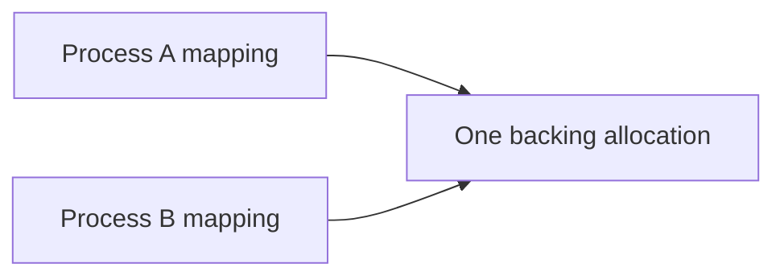

For example, A may map an allocation at `0x700000000000` and B at `0x710000000000`.
Restore must preserve both addresses and reconnect them to one recreated allocation.

The following sketch shows how the two processes obtain handles to the same backing.
Here `memory_props` is a `CUmemAllocationProp` for pinned, POSIX-exportable device memory, and `bytes` satisfies the allocation's granularity requirement.
The processes have reserved their respective addresses with `cuMemAddressReserve`.
The application helpers `send_fd` and `receive_fd` transfer a file descriptor through a Unix socket using `SCM_RIGHTS`.
The sketch omits context setup, access permissions, error handling, and cleanup.

```cpp
// Process A: create, map, and export the allocation.
CUmemGenericAllocationHandle allocation;
cuMemCreate(&allocation, bytes, &memory_props, 0);
cuMemMap(address_a, bytes, 0, allocation, 0);
int exported_fd;
cuMemExportToShareableHandle(
    &exported_fd, allocation, CU_MEM_HANDLE_TYPE_POSIX_FILE_DESCRIPTOR, 0);
send_fd(exported_fd);

// Process B: receive the descriptor, import the allocation, and map it.
int received_fd = receive_fd();
CUmemGenericAllocationHandle imported;
cuMemImportFromShareableHandle(
    &imported, reinterpret_cast<void *>(static_cast<intptr_t>(received_fd)),
    CU_MEM_HANDLE_TYPE_POSIX_FILE_DESCRIPTOR);
cuMemMap(address_b, bytes, 0, imported, 0);
```

Both `allocation` and `imported` are process-local `CUmemGenericAllocationHandle` values that refer to the same backing.
The exported and received file descriptors are `int` values used to share that allocation between processes.

### Multicast mappings

Multicast lets a GPU operation access corresponding memory ranges across a team of devices.
Handles for member allocations and multicast objects share the C type `CUmemGenericAllocationHandle`, but identify different resources.
`cuMemCreate` returns a handle to memory backing, while `cuMulticastCreate` returns a handle to the object that groups the devices and binds their memory ranges.

A multicast store writes to the corresponding locations in all bound members.
A multicast load-reduce reads those locations and combines their values.
These addresses require the appropriate multicast instructions, rather than ordinary loads and stores.
See the [PTX multimem instructions](https://docs.nvidia.com/cuda/parallel-thread-execution/#data-movement-and-conversion-instructions-multimem-ld-reduce-multimem-st-multimem-red).

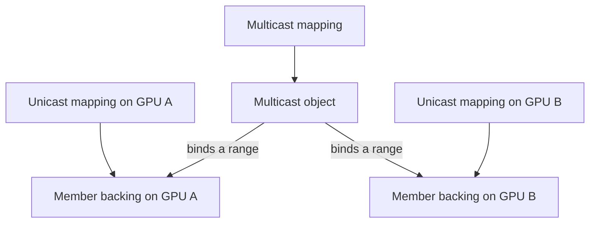

Reconstructing multicast therefore requires more than importing a single allocation.
The object, its imports, device attachments, bindings, mappings, and permissions must be recreated in dependency order.

The [CUDA multicast API](https://docs.nvidia.com/cuda/cuda-driver-api/cuda_driver_api/group__CUDA__MULTICAST.html) describes creation, device attachment, binding, and mapping of these objects.

A small setup example makes the distinction concrete: one process uses two compatible GPUs, each contributing an equal-sized memory region at multicast offset zero.
Here `group_props` is a `CUmulticastObjectProp` with `numDevices = 2`, `size = bytes`, and POSIX export enabled.
`memory_props` is a `CUmemAllocationProp` for pinned, POSIX-exportable device memory, and `bytes` satisfies both VMM and multicast granularity requirements.
The sketch assumes initialized CUDA contexts and omits error handling and cleanup.

```cpp
CUmemGenericAllocationHandle group, member[2];
cuCtxSetCurrent(contexts[0]);
cuMulticastCreate(&group, &group_props);

for (int i = 0; i < 2; ++i)
    cuMulticastAddDevice(group, devices[i]);

for (int i = 0; i < 2; ++i) {
    cuCtxSetCurrent(contexts[i]);
    memory_props.location.id = devices[i];
    cuMemCreate(&member[i], bytes, &memory_props, 0);
    cuMulticastBindMem(group, 0, member[i], 0, bytes, 0);
}
```

A subsequent `cuMemMap` uses `member[i]` for a unicast view of that GPU's memory or `group` for a multicast view of the bound regions.
CuInterpose tracks the member handles and their contents separately from the group handle and its bindings.

### Preserving CUDA graphs

CUDA graphs are crucial for performance in inference workloads, and it is important to preserve the captured CUDA graphs, as recapturing them is costly.
Graphs retain the virtual memory addresses (specific to a particular CUDA context) referenced in kernels, so it is important to replay the existing graphs after restore without recapturing them or updating their memory references.
See NVIDIA's [CUDA graph memory constraints](https://docs.nvidia.com/dl-cuda-graph/latest/cuda-graph-basics/constraints.html).

Fortunately, the VMM API separates virtual-address reservations from physical backing, which lets CuInterpose remove shared resources without discarding their application address ranges.
During checkpoint preparation, it uses `cuMemUnmap` and `cuMemRelease` to remove mappings and release backing references, while retaining the address reservations.
During reconstruction, it uses `cuMemMap` and `cuMemSetAccess` to restore backing and permissions at the original addresses.
The same address requirement applies to multicast mappings.
These operations rely on the [VMM reservation and mapping model](https://docs.nvidia.com/cuda/cuda-programming-guide/04-special-topics/virtual-memory-management.html).

cuCheckpoint remains responsible for graph objects (`CUgraph`) and executable graph state (`CUgraphExec`).
CuInterpose reconstructs the shared memory those graphs reference before the application can replay them.

## Design Details

### Components

Shared memory spans several processes, but its CUDA handles and mappings belong to individual processes.
CuInterpose therefore loads a shim library in each CUDA process and uses a coordinator to order checkpoint and restore across the group.

The shim has a C frontend that intercepts selected CUDA calls and a Rust core that tracks and reconstructs resources.
The coordinator sends requests to those cores, which execute CUDA calls and memory copies inside their own processes.

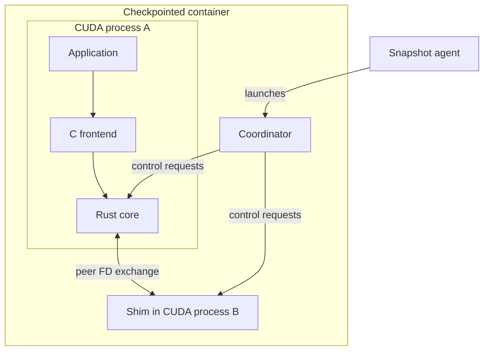

`libcuinterpose.so` intercepts CUDA calls and resolves the real driver functions.
`libcuinterpose_core.so` owns tracking state, driver resources, and host carriers.
Each core listens on `/tmp/cuinterpose-<namespace-pid>.sock` for both coordinator commands and peer requests for export descriptors.

The Snapshot agent discovers participants and launches a coordinator in the target container's namespaces for each inspection, preparation, or reconstruction operation.
The agent also orders native CUDA operations and CRIU, then signals that the application may resume after restore.
The coordinator exits when its requested operation finishes.

### Interposing VMM sharing

To share VMM memory through a POSIX file descriptor, an application calls `cuMemExportToShareableHandle` to obtain a file descriptor and passes it to another process.
That process calls `cuMemImportFromShareableHandle` to obtain a local allocation handle, then maps the same backing with `cuMemMap`.

Recreating the backing produces new driver handles, while the application still holds the values captured in its process memory.
CuInterpose therefore gives the application a virtual allocation handle (`CUmemGenericAllocationHandle`) and translates it to the current driver handle.
It also tracks which processes share the backing so they can reconnect to one recreated allocation.

On export, the shim retains the real CUDA file descriptor and returns a descriptor for a small memory-backed file containing a stable allocation reference.
This *virtual shareable FD* passes through the application's existing IPC mechanism.
When the receiving application calls `cuMemImportFromShareableHandle`, its shim reads the reference and requests the real CUDA descriptor from the creator's socket.

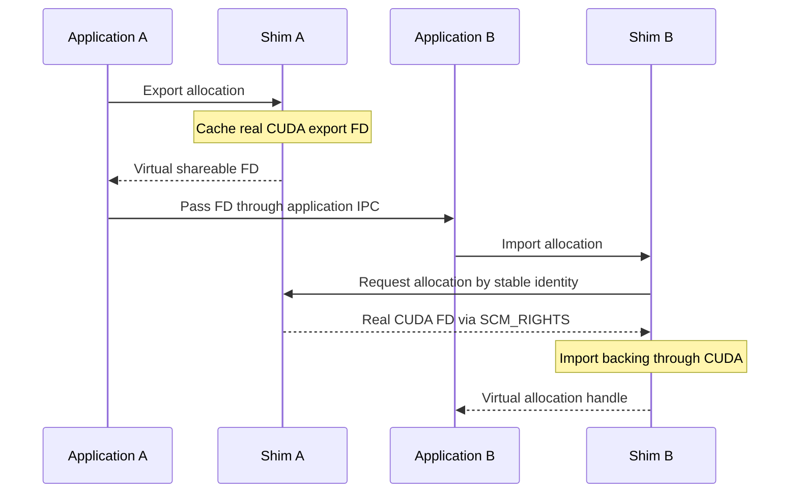

The shim gives each tracked allocation a random 128-bit ID and pairs it with the creator's PID in the container's PID namespace.
This allocation reference remains stable across checkpoint and restore.
Exporting an imported allocation again preserves this reference.
The [appendix](#handle-and-state-formats) specifies the handle encodings.

A reply to a unicast export request includes the full backing size and the CUDA location where the creator allocated it.
The importer queries `cuMemGetAllocationPropertiesFromHandle` and records its own handles and mappings.

Tracked sharing uses only `CU_MEM_HANDLE_TYPE_POSIX_FILE_DESCRIPTOR`, with pinned DEVICE or HOST_NUMA backing for unicast allocations.
Multicast objects must also enable POSIX export.
Imports from processes without CuInterpose must be released, together with their mappings, before checkpoint because the shim cannot reconstruct those external sharing relationships.

#### Creator and checkpoint holder

Several processes may retain the same allocation, but saving its contents in every process would duplicate the checkpoint data.
The coordinator therefore selects one *holder*, a process with a handle or mapping, to save and recreate the backing.
The *creator* is the process that originally allocated it.
Existing imports can remain valid after the creator releases its own handles and mappings, so another holder may need to preserve the allocation.

The coordinator prefers the creator if it still has a handle or mapping.
Otherwise it selects the holder with the **lowest namespace PID** among processes that still retain the allocation.
Each recorded holder must have a local handle or mapping, and the creator process must still belong to the group.

New imports contact the creator, so it must retain a handle or mapping from which it can export the backing.
Keeping only a virtual shareable FD is insufficient: the file records allocation identity but does not itself retain CUDA memory.

#### Multicast tracking

A restored multicast mapping must still access the corresponding memory range on every device in its team.
This requires preserving both the member allocations' contents and the bindings that associate them with the multicast object.

CuInterpose preserves tracked member allocations through the same allocation records and host carriers used for unicast.
It additionally records the multicast object's creation properties, device membership, bindings, and virtual mappings so it can reconstruct those relationships around the restored memory.

`cuMulticastBindMem` identifies the member memory by an allocation handle, so the shim records the allocation reference and offset within it.
`cuMulticastBindAddr` identifies memory by an address, so the shim records that address and its tracked allocation when one exists.
If the address refers to memory outside this tracking model, native CUDA checkpointing remains responsible for preserving the memory.

During capture, the shim removes multicast mappings with `cuMemUnmap` and bindings with `cuMulticastUnbind`, then releases the object handle with `cuMemRelease`.
It retains the records needed to rebuild the object after its member allocations have been restored.

During restore, the creator recreates the object with `cuMulticastCreate`, and peers import it through `cuMemImportFromShareableHandle`.
CUDA requires every device to be attached with `cuMulticastAddDevice` before binding or mapping the multicast object.
The shim follows that ordering when restoring bindings with `cuMulticastBindMem` or `cuMulticastBindAddr`.
Each shim restores its virtual mappings and permissions with `cuMemMap` and `cuMemSetAccess`.

The example below starts after both member allocations have been recreated:

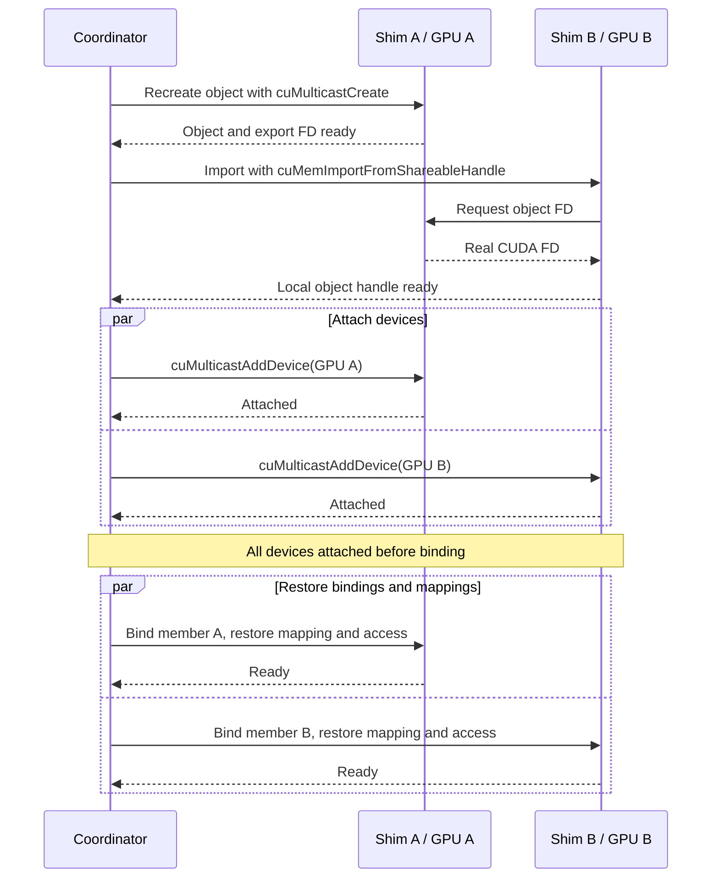

CuInterpose adds these checkpoint requirements to CUDA's multicast model:

- Device attachment with `cuMulticastAddDevice` and memory binding must occur **in the same process**.
- The **original creator must retain the tracked multicast object and remain in the checkpoint group** to recreate it.
- At capture, **every declared device must be attached and have a recorded binding**.

### Adapting legacy allocation and IPC APIs

Applications also share memory through the legacy `cuMemAlloc_v2` and `cuIpc*MemHandle` interfaces.
These allocations need to work with checkpointing without requiring the application to adopt VMM itself.

CUDA CustomStorage allows native checkpointing to hand memory to an external storage implementation.
In the cross-GPU legacy-IPC case that motivated this design, CustomStorage tried to export the allocation using the importing GPU rather than the GPU that owned it.
The ownership mismatch caused the export to fail.

CuInterpose works around this failure by implementing the legacy allocation and IPC calls with tracked VMM backing and the peer exchange described above.
Applications keep their existing interfaces, while the shim can save and reconstruct the shared memory.
The adapter is temporary, pending the driver fix described under [Planned deprecation](#planned-deprecation).

#### Why allocation must be intercepted before export

By the time an application calls `cuIpcGetMemHandle`, its allocation's address may already be stored in application objects or captured CUDA graphs.
Replacing that allocation at export time could invalidate those references.

The shim therefore creates POSIX-capable VMM backing at the initial synchronous malloc call.
It reserves and maps an address, rounds the backing size to CUDA's required granularity, and records the requested size separately.
The application continues to use the returned pointer.

The allocation sequence shows how one application call becomes VMM operations inside the shim:


The shim cannot know at allocation time whether the application will later export the pointer, so it converts every supported synchronous malloc call.
The current implementation leaves allocations that are never shared and never accessed by another GPU to native CUDA checkpointing.

#### IPC and mapping lifetime

The application expects to exchange a `CUipcMemHandle`, CUDA's fixed 64-byte IPC value.
The shim preserves that interface by placing an allocation reference in the value returned by `cuIpcGetMemHandle`.
On `cuIpcOpenMemHandle`, the importing shim uses that reference to obtain a real FD and map the backing.

The following sequence shows a successful export and first import.
The applications exchange the opaque IPC value, while only the shims exchange the real CUDA file descriptor:

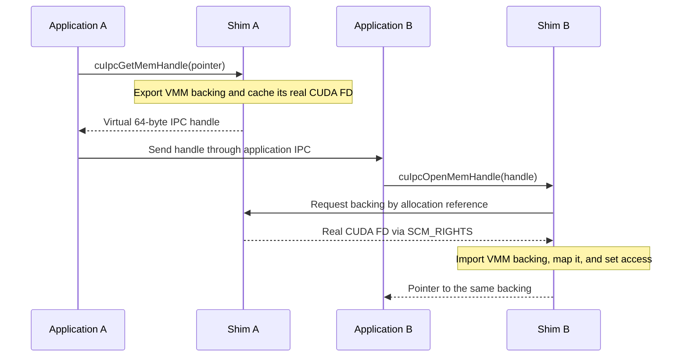

Opening the same allocation again in the CUDA context (`CUcontext`) that owns the import returns the same address and increments its open count.
Calling `cuIpcCloseMemHandle` removes the imported mapping only when that count reaches zero.
An allocation created by `cuMemAlloc_v2` instead uses `cuMemFree_v2`, which calls `cuCtxSynchronize` on its owning context before removing the mapping.
If synchronization fails, the mapping is preserved.
The adapter rejects attempts to free an imported IPC pointer through `cuMemFree_v2`.

Destroying a context with `cuCtxDestroy` also removes the converted malloc and IPC mappings it owns.
The same applies when `cuDevicePrimaryCtxReset` resets a primary context or `cuDevicePrimaryCtxRelease` releases its final reference.
The shim preserves those mappings if context teardown fails or the primary context still has references.

This adapter supports synchronous device allocation and memory IPC.
It does not cover event IPC, memory-pool IPC, or managed, async, and pitched allocation families.
It also rejects native memory-IPC handles produced outside the shim.

#### Peer access and isolation

Applications use `cuCtxEnablePeerAccess` to let the current GPU access memory owned by a peer context.
Because the adapter implements malloc and IPC with VMM, it must apply those permissions to the VMM mappings through `cuMemSetAccess`.
Each mapping initially permits access from its allocating or importing GPU.
After peer access is enabled successfully, the shim also grants the current GPU access to existing and future converted mappings owned by the peer context.

Disabling peer access with `cuCtxDisablePeerAccess` stops the shim from granting the current GPU access to future mappings owned by that context.
Existing mappings keep the device permissions already granted.
This design assumes cooperating processes, typically one process per GPU.
VMM permissions apply to devices, so separate CUDA contexts and disabling peer access do not provide strict access isolation for converted mappings.

#### Planned deprecation

Once the driver fix for legacy IPC with CustomStorage is available, the intent is to deprecate this adapter and let the driver handle the legacy allocation and memory-IPC calls natively.
Before retiring the adapter, we must validate native cross-GPU IPC checkpoint and restore on the supported driver versions, including replay of CUDA graphs captured before checkpoint.

### Host carriers

The shared allocation's data must survive the removal of its CUDA backing during checkpoint preparation.
The selected holder therefore copies it into a *host carrier*, an anonymous host-memory region owned by that process.

CRIU captures the carrier as process memory alongside the shim's allocation and mapping records.
On restore, the shim uses those records to recreate the CUDA allocation and copies the carrier's bytes back into it.
This lets CuInterpose preserve shared data through Snapshot's existing process-memory capture.

#### What is saved

A holder may map only part of an allocation, while other processes use the remaining regions.
It therefore saves the full backing of each assigned allocation so the checkpoint includes every process's data.
Each shared allocation is saved once.

For `cuMemCreate`, [`CUmemAllocationProp.requestedHandleTypes`](https://docs.nvidia.com/cuda/cuda-driver-api/cuda_driver_api/structCUmemAllocationProp__v1.html) controls exportability.
Setting it to `0` creates a nonexportable allocation, while `CU_MEM_HANDLE_TYPE_POSIX_FILE_DESCRIPTOR` enables POSIX file descriptor export.

The shim marks an allocation as shared after a successful tracked export, import, or binding into a tracked multicast object.
It keeps that classification after export descriptors are closed or `cuMulticastUnbind` removes bindings.

Native CUDA checkpointing can also fail to restore an allocation that another GPU in the same process maps, even if the allocation was never exported.
The shim therefore also uses a host carrier once a successful access update grants a GPU other than the allocation's home GPU access.
The home GPU is the backing's GPU for device memory, or the GPU that created host NUMA memory.
This selection is kept after the access is revoked.

If the selected holder retains only a mapping, it calls `cuMemRetainAllocationHandle` to obtain a temporary allocation handle for the transfer.

| Allocation state | Current preservation path |
| --- | --- |
| Nonexportable `cuMemCreate` allocation whose properties a carrier cannot reconstruct | Left to native CUDA checkpointing |
| Tracked `cuMemCreate` or adapted `cuMemAlloc_v2` allocation never shared or accessed by another GPU | Left to native CUDA checkpointing, with mappings and handles left intact |
| Tracked DEVICE or HOST_NUMA backing that is shared or accessed by another GPU | One full copy in the selected holder's carrier |
| Tracked allocation bound into a multicast object | One copy in a host carrier, with no additional copy for the multicast object |

#### Copying and lifetime

To copy GPU memory, the carrier code groups DEVICE allocations by CUDA context and device.
It maps their backing into temporary consecutive address ranges and copies their contents using one CUDA stream (`CUstream`) per group.
Transfers use `cuMemcpyDtoHAsync_v2` for capture and `cuMemcpyHtoDAsync_v2` for restore.

Asynchronous CUDA copies require pinned host memory, so the shim registers the carrier with `cuMemHostRegister_v2` during transfers.
The CUDA context used for registration stays alive until the copies finish and `cuMemHostUnregister` unregisters the memory.
Between transfers, the carrier is ordinary anonymous memory that CRIU can capture.

If an allocation's recorded CUDA context has been destroyed, the carrier code uses a primary context on the recorded device for DEVICE memory.
After restore, the carrier is released only after the successful load reply has been sent to the coordinator.

#### HOST_NUMA allocations

A HOST_NUMA allocation is created with [`cuMemCreate`](https://docs.nvidia.com/cuda/cuda-driver-api/cuda_driver_api/group__CUDA__VA.html), specifying `CU_MEM_LOCATION_TYPE_HOST_NUMA` and the NUMA node ID in `CUmemAllocationProp.location`.
This selects the host memory's placement, independently of which CPUs run the processes that map it.
The backing is still managed through CUDA VMM, so its contents must be copied into a carrier before it is released.

In this example, process A runs on CPUs on NUMA node 0 and process B runs on CPUs on NUMA node 1.
Both processes map two shared allocations, one on each NUMA node.
Process A is the selected holder for both allocations and saves their contents in its carrier.

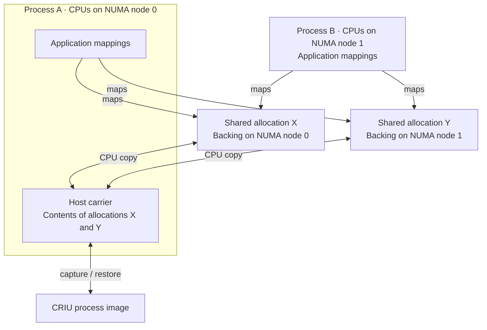

The application's mappings may cover only part of an allocation or lack CPU access.
For each allocation, the holder uses `cuMemAddressReserve`, `cuMemMap`, and `cuMemSetAccess` to create a temporary CPU-accessible mapping of the full backing for the copy shown above.
The carrier stores the bytes, while the allocation records retain each backing's NUMA node ID.
The shim preserves the creator's node ID during sharing because `cuMemGetAllocationPropertiesFromHandle` reports node zero for imported handles.

During restore, `cuMemCreate` recreates X on node 0 and Y on node 1, then the holder copies their contents back from the carrier.
Both processes reconnect their original mappings to those recreated allocations.

When restoring on another host, these are the recorded numeric node IDs on the destination host.
CuInterpose does not remap NUMA node IDs or compare CPU/GPU locality between hosts.
The destination must support allocations on those IDs, and preserving the original locality requires compatible NUMA topology and process placement.

### Capture

Capture saves the contents of shared and peer-accessed allocations in host carriers and removes their CUDA resources before native CUDA checkpointing runs.
CRIU then captures the processes, including their carriers and tracking records.

The sequence below shows a successful capture.
Process shims share one lifeline to keep the group interactions readable.
The coordinator lifeline represents separate invocations for inspection and preparation, and the agent lifeline includes its namespace helpers.

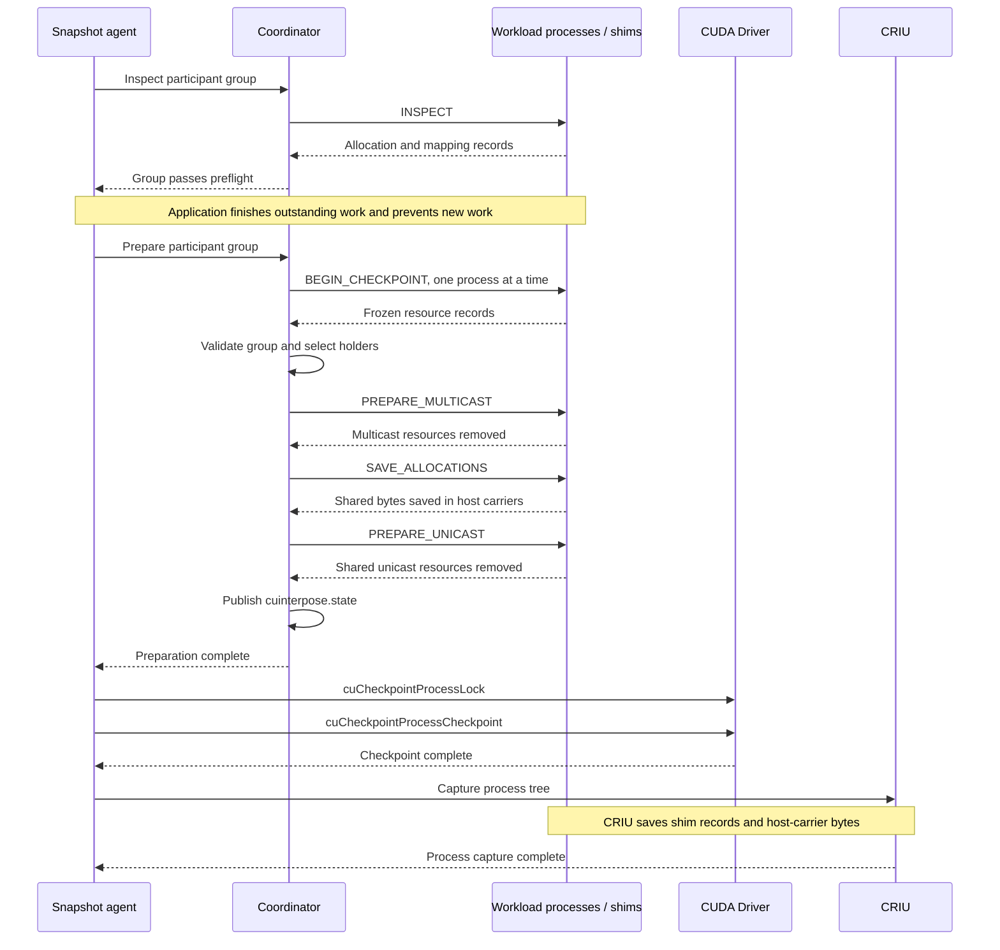

The agent first discovers the CUDA processes and checks which shim libraries each process has mapped.
It verifies that every required process has loaded the frontend and that the library contents match across the group.
Processes with a mapped core library take part in coordinator operations, and each must expose a healthy control socket.
A missing or unresponsive socket is an error, not a reason to omit that process.

The read-only `INSPECT` operation lets the coordinator validate creators, holders, mapping ranges, and multicast membership without changing process state.
Because resources can still change after inspection, the coordinator validates the records again after each participant has entered checkpoint mode.

`BEGIN_CHECKPOINT` requires an active process with no outstanding driver calls that temporarily released the state lock.
It prevents changes to tracked resources before returning the process's records.
`PREPARE_MULTICAST` removes exports, mappings, bindings, and multicast handles.
After the carriers hold the shared bytes, `PREPARE_UNICAST` waits for pending file-descriptor sends to peers to finish.
It then removes shared exports and mappings and releases shared driver handles.

After entering checkpoint mode in each process sequentially, the coordinator sends each mutating phase's request to all participants concurrently.
It waits for every reply before starting the next phase.
Concurrent dispatch allows CUDA multicast calls in different processes to make progress together.
Every participant receives each phase, including participants with no resources to modify in that phase.

The ordering follows the resource dependencies: remove multicast before its member backing, and save bytes before releasing that backing.
The shim must finish preparation before Snapshot locks CUDA because copying memory and removing shared resources require working CUDA calls.

Virtual handles, allocation references, mapping records, and carrier addresses remain in process memory for CRIU to capture.
Allocations that are neither shared nor accessed by another GPU remain in place for native CUDA checkpointing.
If no process has initialized the core, the agent skips coordinator operations but still performs native CUDA capture and library identity checks.

### Restore

Restore first recovers the processes through CRIU and their native CUDA state through CUDA checkpointing.
The restored shims then recreate shared backing and reconnect the original mappings before the application resumes.
Application threads continue waiting while the restored shims handle coordinator requests.

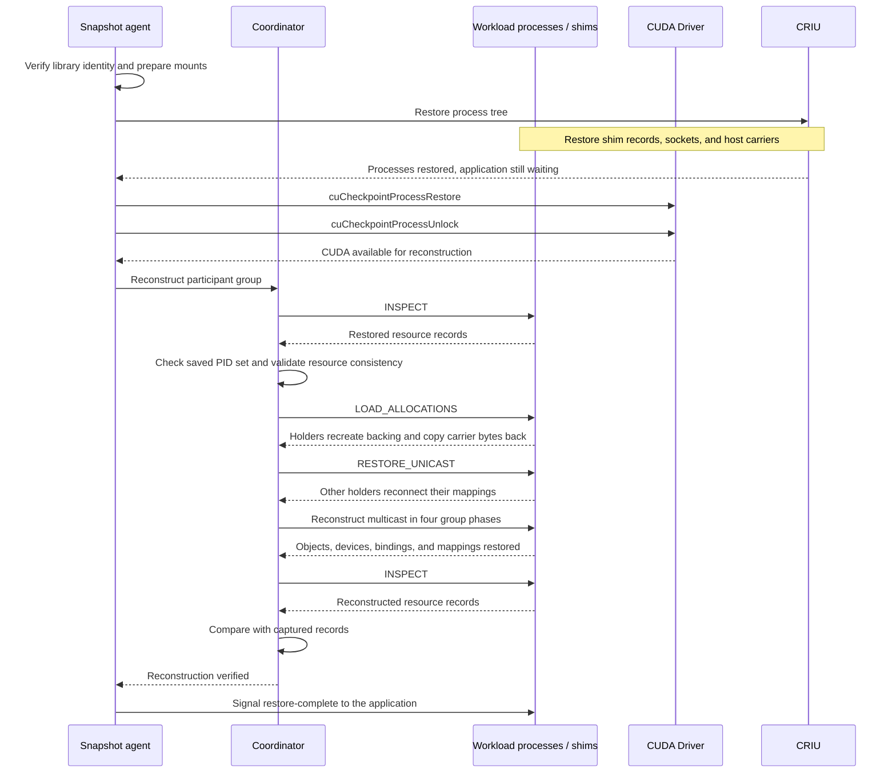

Before starting CRIU restore, the agent verifies the captured library identities and restores the required library mounts.
Shim socket paths are excluded from rootfs archives because CRIU restores the live socket bindings with the process tree.
CRIU also restores namespace PIDs, shim records, and host carriers.

`LOAD_ALLOCATIONS` recreates backing in the selected holders, copies carrier contents into it, and restores their mappings, permissions, and export FDs.
`RESTORE_UNICAST` reconnects the other holders to that same backing at their original addresses.
For each reconstruction phase, the coordinator sends requests across the group and waits for every participant's reply before advancing.

Multicast reconstruction requires four separate group barriers:

| Operation | Dependency satisfied before advancing |
| --- | --- |
| `RESTORE_MULTICAST_CREATORS` | Each creator makes an export FD for its recreated multicast object available to peers. |
| `RESTORE_MULTICAST_IMPORTERS` | Every importer obtains a local object handle. |
| `RESTORE_MULTICAST_DEVICES` | Every participating device is attached to the object before any process binds member memory. |
| `RESTORE_MULTICAST_BINDINGS` | Bindings, original mappings, and access permissions are restored. |

These barriers explain why multicast restore needs more phases than teardown.
During teardown, participants can remove their existing references concurrently in one phase.
During reconstruction, importers must wait for creators to make the new objects available, and memory binding must wait for every device to join.
A process can create one resource and import another, so the coordinator applies these dependencies per resource rather than dividing processes into separate creator and importer groups.

### API

#### Kubernetes opt-in

CuInterpose opt-in belongs to the source Pod, including when that Pod is captured through a PodSnapshot.

- With SnapshotJob, set the annotation in `spec.podTemplate.metadata.annotations`.
- With a Pod you deploy yourself, set it in that Pod's `metadata.annotations`.

The annotation is ignored for CuInterpose activation when placed on `PodSnapshot.metadata.annotations`.
It is not copied to the source Pod.

```yaml
metadata:
  annotations:
    nvidia.com/cuda-shared-memory-support: "enabled"
```

- `enabled` requests CuInterpose support.
  `disabled` or an absent annotation does not request it.
- Values are case-sensitive after trimming whitespace.
  SnapshotJob admission and the agent's ordinary-Pod validation reject other values.
- Removing the annotation does not unload the shim from a running process.
- Adding the annotation to an already-running Pod does not load the shim.
  An opted-in Pod that was not started through the launcher fails capture preflight.

This proposal adds no CRDs or CRD fields.

#### Source Pod shaping

The shim must load before the application creates CUDA allocations so it can record their full lifetime.
Users who deploy their own Pod must prepare its target container before startup, then create a PodSnapshot referring to that Pod.
SnapshotJob automates this preparation from the annotated Pod template and the selected target container's explicit application `command`:

| Preparation | User-created Pod | SnapshotJob |
| --- | --- | --- |
| Deliver the shim | Supply `cuinterpose-launch`, `libcuinterpose.so`, and `libcuinterpose_core.so` from a matching build before the application starts. | Adds an init container that copies the three files from the configured installer image into an `emptyDir`. |
| Mount the files | Mount the delivery volume read-only at `/tmp/snapshot-cuda` in the target container. | Adds the volume and read-only target mount. |
| Start the application | Prefix the target container's `command` with the [launcher arguments](#launcher-cli). | Prepends that prefix to the supplied application `command`, preserving `args` and `env`. |

In the source Pod, the installer fills the shared volume before the target container starts.
Both containers mount that volume at `/tmp/snapshot-cuda`, with different access modes:

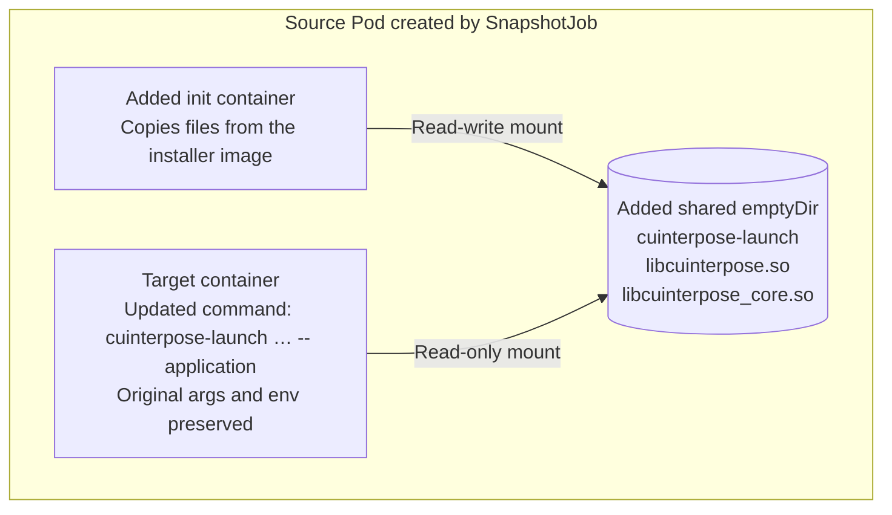

The operator rejects a missing application `command` or collisions with reserved installer names or mount paths before creating the source Job.
For either workflow, the agent rejects an opted-in target without the expected launcher prefix before waiting for readiness or modifying the workload.
Library delivery mounts must be read-only because CRIU reapplies their source mount flags during restore.

#### Launcher CLI

```text
cuinterpose-launch --library PATH -- COMMAND [ARG...]
```

`PATH` identifies the frontend library, with `libcuinterpose_core.so` in the same directory.
The launcher verifies both libraries against its build's hashes, prepends `PATH` to the resolved `LD_PRELOAD`, and replaces itself with `COMMAND` using `exec`.
It preserves existing preload entries, argument boundaries, and the resolved environment without invoking a shell.

Snapshot requires this prefix in the target container's `command`:

```yaml
command: ["/tmp/snapshot-cuda/cuinterpose-launch", "--library", "/tmp/snapshot-cuda/libcuinterpose.so", "--", "<original-command>"]
```

#### Coordinator CLI

The agent invokes the coordinator with an explicit participant list:

```text
cuinterpose-coordinator (--inspect | --prepare | --restore)
    --socket-dir DIR --process PID [--process PID ...]
    [--checkpoint-dir DIR]
```

| Argument | Contract |
| --- | --- |
| `--inspect` | Read and validate resource records without changing process state. |
| `--prepare` | Save shared and peer-accessed allocation contents in host carriers, release their CUDA resources, and write `cuinterpose.state`. |
| `--restore` | Reconstruct shared resources and validate them against the checkpoint records. |
| `--socket-dir DIR` | Required directory containing participant control sockets. |
| `--process PID` | Required namespace PID of a participant. Repeat for every participant. The coordinator does not discover additional processes. |
| `--checkpoint-dir DIR` | Required for `--prepare` and `--restore`, and rejected with `--inspect`. |

Select exactly one operation.
The [capture](#capture) and [restore](#restore) sequences define when the agent invokes each operation relative to the CUDA Driver and CRIU.

#### Capture requirements

Snapshot captures every CUDA process, while the coordinator operates only on processes that have initialized CuInterpose's core.

- If any CUDA process has the shim loaded, every discovered CUDA participant must have the frontend loaded, even if the annotation has been removed.
- Both library files must be available and consistent across participants, including processes with only the frontend loaded.
  The agent verifies file identity against process mappings before hashing and rejects missing, deleted, replaced, or inconsistent libraries.
- Library files must remain unchanged throughout capture.

Snapshot stages, validates, and restores native CUDA helper jobfiles when present.
An absent jobfile is permitted when there are coordinator participants.
Otherwise, the helper's native multi-GPU jobfile requirement still applies.

### Configuration

- `--cuinterpose-image` and `--cuinterpose-image-pull-policy` configure the operator's installer image and pull policy.
  Helm supplies these flags, and the operator validates them at startup.
- The installer uses the workload Pod's or ServiceAccount's image-pull credentials.
- Installer resource requests and limits are both `100m` CPU and `64Mi` memory, preserving Guaranteed QoS when the rest of the Pod meets its requirements.
- `CUINTERPOSE_SOCKET_DIR` overrides the shim's control socket directory, which defaults to `/tmp`.
  This override supports test isolation.
- `SNAPSHOT_CONTROL_TIMEOUT_SECONDS` sets the internal control timeout, defaulting to 10 seconds.
- `SNAPSHOT_CARRIER_TIMEOUT_SECONDS` sets the internal carrier save/load timeout, defaulting to 3600 seconds.

Each process reads these environment settings from its own environment.

### Failure behavior

A failed checkpoint or restore operation can leave processes with only some of their shared resources reconstructed or removed.
If a reply is lost, the coordinator cannot determine which driver mutations completed, and its records are insufficient to resume or roll back the operation safely.
It therefore abandons the attempt rather than retrying.

Read-only inspection is different because it leaves the source workload unchanged.
Once preparation begins, the agent terminates the source workload if preparation fails or a reply is lost.
Callers that run the coordinator directly must enforce the same rule.

An application operation can return an ordinary driver error when it has not irreversibly changed tracked state.
For example, if malloc or IPC setup fails before returning a pointer to the application, the shim cleans up the resources before returning an error.
If that cleanup fails, or a destructive checkpoint mutation fails, the shim terminates the process because its resource records may no longer match CUDA state.
The Rust libraries also use `panic = "abort"`, so a panic in any shim thread terminates the process without stack unwinding.

### Checkpoint files and compatibility

Restore needs to know which processes shared each allocation and verify that reconstruction matches the captured state.
CuInterpose records that information in two checkpoint files:

- `cuinterpose.state` is versioned MessagePack metadata mapping namespace PIDs to captured allocation, mapping, and multicast records.
  It contains no allocation contents, persistent driver handles, or socket paths.
- `manifest.yaml` records the PIDs that participate in coordinator operations and both library hashes alongside Snapshot's full list of native CUDA participants.

```yaml
cudaRestore:
  pids: [41, 42, 43]
cuinterpose:
  pids: [41, 42]
  libraries:
    libcuinterpose.so:
      sha256: "aaaaaaaaaaaaaaaaaaaaaaaaaaaaaaaaaaaaaaaaaaaaaaaaaaaaaaaaaaaaaaaa"
    libcuinterpose_core.so:
      sha256: "bbbbbbbbbbbbbbbbbbbbbbbbbbbbbbbbbbbbbbbbbbbbbbbbbbbbbbbbbbbbbbbb"
```

Here process 43 has only the frontend loaded.
Coordinator PIDs must be positive, unique, and a subset of `cudaRestore.pids`.
Exactly the two named library records and `pids` are required when `cuinterpose` is present.
If `cuinterpose.pids` is explicitly empty, restore needs no coordinator state file but still requires both matching libraries.
Checkpoints captured without CuInterpose omit the `cuinterpose` entry.

The coordinator reports successful preparation only after durably publishing `cuinterpose.state` without replacing an existing file.
On restore, it requires the captured participant PID set and verifies that reconstructed resource records match the checkpoint.

CRIU restores the shim's in-memory state, so both libraries must be available at their original paths with the SHA-256 hashes recorded in the manifest.
`SkipCompatCheck` does not bypass this requirement.
Upgrading either library requires a new checkpoint, and the libraries are not currently archived with it.

The launcher and coordinator are not part of the checkpointed workload and need not match those hashes.
The coordinator must support the checkpoint's state format and the restored shim's protocol.

### Performance and Scalability

#### Allocation granularity

Each adapted `cuMemAlloc_v2` call receives VMM backing rounded up to the minimum returned by `cuMemGetAllocationGranularity`.
With a 2 MiB minimum, a 64 KiB request consumes 2 MiB of backing, even if the allocation is never shared.

This rounding applies to CUDA allocations, not individual tensors.
Framework allocators can serve small tensors from larger pooled allocations, while inference workloads commonly retain large model and cache allocations.
These patterns explain why rounding overhead has not been prominent in our inference use.
Workloads that make many small direct allocations can still waste substantial memory and incur repeated VMM setup costs.

#### Host memory and transfer cost

- Each shared allocation requires one full copy in a host carrier, regardless of how many processes map it.
  Large shared caches therefore increase both host-memory use and checkpoint size.
- Restore must recover the carrier pages and copy their contents into recreated backing before the application resumes.
- Coordination requires every participant to complete each phase before the group advances.
  Participants enter a phase concurrently because multicast operations may wait for other group members.
  Coordination resources and metadata grow with the participant group and its tracked resources.

### Security

- Control sockets can export allocation FDs and modify CUDA resources.
  They use `0600` permissions within the target container, and the design assumes cooperating processes and trusted privileged Snapshot agents.
- Host carriers place shared allocation contents in CRIU images.
  Checkpoint storage must protect these contents like other process memory.
- The installer runs without root privileges, drops capabilities, and uses a read-only root filesystem.
  It leaves workload security contexts unchanged.

### Dependencies

- Linux/amd64 with compatible GPUs and drivers providing the VMM and multicast APIs the workload uses.
- glibc 2.34 or newer for the preload libraries.
- CUDA Runtime 12.0 or newer when an application looks up driver entry points through a CUDA runtime library.
- Existing Snapshot and CRIU compatibility and privilege requirements.

The [interception appendix](#interception-and-loader-contract) describes the requirements for linker namespaces, runtime-library visibility, and library loading.

### Monitoring

The agent reports coordinator failures through Snapshot's existing checkpoint and restore errors, including the participant and operation when available.
This proposal adds no dedicated metrics.

### Test Plan

Validation must cover these architectural contracts:

- Capture and restore preserve contents, original addresses, and sharing for unicast, multicast, HOST_NUMA, and adapted legacy IPC allocations.
  Include partial mappings and importers that outlive the creator's references.
  Refuse checkpoint while the group retains allocations imported from outside it.
- CUDA graphs captured before checkpoint replay correctly after restore without recapture or pointer updates.
- Both SnapshotJob and user-created Pods load the shim correctly, preserve application arguments and environment, and enforce library compatibility.
- Inspection leaves the workload unchanged, while failures after preparation begins terminate the attempt.
  Corrupt state, missing participants, and lost replies must not allow an incomplete restore to resume.
- An end-to-end test restores the complete process group on another compatible node and verifies computation and sharing.

### Graduation Criteria

CuInterpose is available as an opt-in Beta within the workload contract defined above.
Graduation to GA requires:

- Qualify real single-node, multi-GPU inference workloads in vLLM, SGLang, and TensorRT-LLM across supported GPU and driver configurations.
  Capture each workload on one node and restore it on another compatible node, verifying inference results, shared-memory communication, and replay of existing CUDA graphs.
- Maintain automated regression coverage for supported allocation types, compatibility checks, and checkpoint and restore failures.
- Publish support requirements and deployment documentation for both SnapshotJob and user-created Pods.

## Alternatives

- [NCCL checkpoint shim and hooks](https://github.com/NVIDIA/nccl/tree/master/contrib/nccl_checkpoint) handle NCCL resources but do not cover memory shared through other libraries or application code.
- In-workload `checkpoint_prepare` / `checkpoint_restore` hooks, as in [vLLM](https://docs.vllm.ai/en/latest/api/vllm/distributed/parallel_state/#vllm.distributed.parallel_state.checkpoint_prepare_distributed_state) and [FlashInfer](https://docs.flashinfer.ai/generated/flashinfer.comm.MoeAlltoAll.checkpoint_prepare.html), require explicit integration for each supported communication backend and are not transparent to the workload.
- [`cuda-checkpoint --launch-job`](https://github.com/NVIDIA/cuda-checkpoint#610-features) supports legacy `cuIpcGetMemHandle` sharing, but does not cover generic shared VMM unicast or multicast mappings or shared HOST_NUMA allocations.

## Appendix

### Interception and loader contract

CuInterpose must observe allocation and sharing calls regardless of how the application reaches CUDA.
Preloading wrappers covers ordinary calls to CUDA symbols, but an application can also obtain function pointers through `dlsym`, `cuGetProcAddress*`, or `cudaGetDriverEntryPoint*` and call those pointers directly.
The [frontend](../../../agent/cmd/cuinterpose/frontend/frontend.c) intercepts these lookup APIs so supported calls still reach the same wrappers.

#### Keeping backend symbols local

Preloading the entire implementation would expose its exported symbols to the application's global symbol lookup scope.
Instead, `LD_PRELOAD` loads only `libcuinterpose.so`, whose export list contains the CUDA wrappers and lookup functions it interposes.

The frontend loads the Rust core with `dlopen("$ORIGIN/libcuinterpose_core.so", RTLD_LAZY | RTLD_LOCAL)`.
`$ORIGIN` locates the core beside the frontend, and `RTLD_LOCAL` keeps the core's symbols out of the global lookup scope.
The frontend obtains a private function table through `cuinterpose_core_init` and uses it to call the core without publishing its entry points globally.

The core also needs to call CUDA without re-entering the wrappers.
It obtains real driver addresses through the frontend's resolver and caches them for subsequent calls.
The frontend retains the CUDA libraries so application calls to `dlclose` cannot invalidate those cached addresses.

#### Intercepting symbol lookups

Because the frontend defines `dlsym`, it needs another way to obtain glibc's original function without recursively calling itself.
It uses `dlvsym(RTLD_NEXT, "dlsym", "GLIBC_2.34")`, which requests the versioned symbol after the frontend in the loader's search order, and caches the returned function pointer.
The frontend uses `dlvsym` internally but does not interpose application calls to it.

For an explicit CUDA library handle, the frontend first calls glibc's `dlsym` and checks that the result belongs to `libcuda` or `libcudart` in the base linker namespace.
It substitutes a frontend wrapper when the requested symbol is intercepted.
Other lookups retain their original results.
For example, after obtaining glibc's resolver:

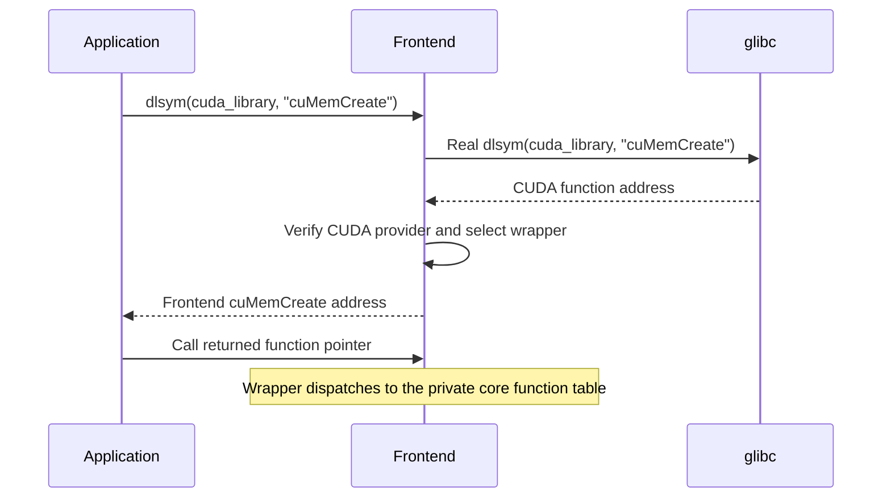

`RTLD_DEFAULT` and `RTLD_NEXT` require different handling because glibc determines their search scope from the caller's return address.
An ordinary forwarding call would make the frontend appear to be the caller and could change which symbol glibc selects.
The frontend therefore uses a guaranteed tail call to preserve the application's return address and returns glibc's result unchanged.
Normal `RTLD_DEFAULT` lookup already finds the preloaded wrappers.

#### Preserving CUDA's API selection

CUDA's function-address APIs can choose an entry point based on the requested API version and flags.
The frontend therefore calls the real `cuGetProcAddress*` or `cudaGetDriverEntryPoint*` first, then matches the returned symbol to a wrapper with the same calling convention.
For example, a query for `cuMemAlloc` can select `cuMemAlloc_v2`, while a literal `dlsym` lookup of the historical `cuMemAlloc` symbol must retain its original ABI.

For an intercepted API, if the returned entry point has no matching wrapper, the frontend clears the output pointer and reports the query API's missing-symbol result.
This prevents the caller from receiving a function that would bypass tracking or use the wrong calling convention.
Queries for APIs outside the interception set retain CUDA's result.

#### Loading and compatibility requirements

CUDA calls can occur inside library constructors while glibc holds its loader lock.
To avoid deadlocks, the frontend performs loader calls without holding shim locks or waiting for another thread to finish its first lookup.
Loading the core registers the private function tables but starts no workers.
The process runtime starts only after an intercepted `cuInit` succeeds.

- CUDA runtime entry-point lookup requires CUDA Runtime 12.0 or newer because CUDA 11 uses an incompatible query signature.
  The frontend checks `cudaRuntimeGetVersion` in the library providing the query function before calling it.
- One CUDA runtime library per process is supported.
  It must be globally visible or discovered through an intercepted lookup using its explicit library handle.
- Application calls to `dlvsym`, separate linker namespaces, and `RTLD_DEEPBIND` can bypass the frontend.
  Arbitrary chains of other `dlsym` interposers are unsupported.

#### Intercepted API reference

| Intercepted APIs | What the shim does |
| --- | --- |
| `cuInit` | Initializes the shim alongside CUDA. |
| `cuMemCreate`, `cuMemRelease`, `cuMemRetainAllocationHandle` | Tracks supported VMM allocations and translates application-visible virtual allocation handles to the CUDA driver handle. |
| `cuMemMap`, `cuMemUnmap`, `cuMemSetAccess` | Records address ranges, allocation offsets, and access permissions. Access from another GPU selects the host carrier. |
| `cuMemGetAllocationPropertiesFromHandle` | Resolves virtual handles and preserves application-visible allocation properties. |
| `cuMemExportToShareableHandle`, `cuMemImportFromShareableHandle` | Replaces raw export FDs with virtual shareable handles and imports the creator's real allocation through a peer request. |
| `cuMemAlloc_v2`, `cuMemFree_v2`, `cuMemGetAddressRange_v2` | Implements synchronous device malloc with VMM backing, frees it, and reports the application's requested range. |
| `cuCtxEnablePeerAccess`, `cuCtxDisablePeerAccess` | After peer access is enabled successfully, grants the current GPU access to existing and future converted malloc/IPC mappings owned by the peer context. Disabling peer access stops grants for future mappings but preserves permissions already granted to existing mappings. |
| `cuCtxDestroy*`, `cuDevicePrimaryCtxReset*`, `cuDevicePrimaryCtxRelease*` | Removes converted malloc/IPC mappings after successful context teardown. Releasing a primary-context reference preserves its mappings if other references remain. |
| `cuIpcGetMemHandle`, `cuIpcOpenMemHandle`, `cuIpcOpenMemHandle_v2`, `cuIpcCloseMemHandle` | Implements supported memory IPC using the same VMM records and peer export service, without native memory-IPC calls. |
| `cuMulticastCreate`, `cuMulticastAddDevice`, `cuMulticastBindMem*`, `cuMulticastBindAddr*`, `cuMulticastUnbind` | Tracks multicast objects, device membership, bindings, and their reconstruction. |

Property-only queries such as `cuMemGetAllocationGranularity` and `cuMulticastGetGranularity` go directly to CUDA.

### Handle and state formats

Peers need a stable allocation reference to find the same backing, and the coordinator needs records it can compare across capture and restore.
The protocol and state file encode this metadata in a versioned MessagePack envelope, limited to 32 MiB.
The memory-backed file referenced by a virtual shareable FD contains a fixed 24-byte value:

| Bytes | Value |
| --- | --- |
| 4 | `CUI\x01` |
| 4 | Creator namespace PID, little-endian |
| 16 | Allocation ID |

The last two fields form an `AllocationReference`.
The value contains neither a socket path nor a field indicating whether the resource is unicast or multicast.
The reply from the exporting peer identifies the resource type.
During an ordinary import, the shim sends the request to the creator identified by its namespace PID.
During restore, it can send the request to the selected holder while retaining the creator's identity in the allocation reference.

The virtual memory-IPC handle occupies a 64-byte `CUipcMemHandle`:

| Field | Bytes |
| --- | --- |
| ASCII `CUIPC001` | 8 |
| Creator namespace PID | 4 |
| Allocation ID | 16 |
| Reserved zeros | 20 |
| Requested allocation size | 8 |
| Rounded backing extent | 8 |

Integer fields are little-endian.
The handle records the requested size separately from the rounded backing extent so address-range queries return the range the application requested.

#### Decoded state example

```yaml
version: 1
body:
  41:
    - allocation:
        allocation:
          id: "aaaaaaaaaaaaaaaaaaaaaaaaaaaaaaaa"
          creator_pid: 41
        shared: true
        size: 2097152
    - mapping:
        allocation:
          id: "aaaaaaaaaaaaaaaaaaaaaaaaaaaaaaaa"
          creator_pid: 41
        address: 0x700000000000
        size: 2097152
        offset: 0
        access:
        - location: {location_type: 1, id: 0}
          flags: 3
  42:
    - allocation:
        allocation:
          id: "aaaaaaaaaaaaaaaaaaaaaaaaaaaaaaaa"
          creator_pid: 41
        shared: true
        size: 2097152
    - mapping:
        allocation:
          id: "aaaaaaaaaaaaaaaaaaaaaaaaaaaaaaaa"
          creator_pid: 41
        address: 0x710000000000
        size: 2097152
        offset: 0
        access:
        - location: {location_type: 1, id: 1}
          flags: 3
```

Each outer key identifies a process by its PID in the container's namespace.
Both holders use the same allocation reference.
Addresses and binary allocation IDs are displayed as hex for readability.
The example omits the fields describing allocation properties and handle counts.
The access records grant read/write permission to GPU 0 in A and GPU 1 in B.

Multicast adds records to the same process state.
For example, this complete `multicast_binding` record says that GPU 0 binds the first 2 MiB of allocation `aaaaaaaa…` into the start of multicast object `bbbbbbbb…` using `BindMem`'s v1 ABI:

```yaml
multicast_binding:
  allocation:
    id: "bbbbbbbbbbbbbbbbbbbbbbbbbbbbbbbb"
    creator_pid: 41
  source:
    memory:
      allocation:
        id: "aaaaaaaaaaaaaaaaaaaaaaaaaaaaaaaa"
        creator_pid: 41
      offset: 0
  size: 2097152
  offset: 0
  flags: 0
  version: v1
  device: 0
```

The offset nested under `source` identifies a location within the member allocation.
The outer `offset` field identifies the location where that memory is bound within the multicast object.
Separate `multicast`, `multicast_device`, and `multicast_mapping` records describe the object, attached devices, and virtual mappings.

### Further reading

- [Building Snapshot from source](../../development/build-from-source.md)
- [Checkpointing with PodSnapshot and SnapshotJob](../../guides/checkpoint.md)
- [Workload contract](../../reference/workload-contract.md)
- [Restore Pod contract](../../reference/restore-pod-contract.md)
