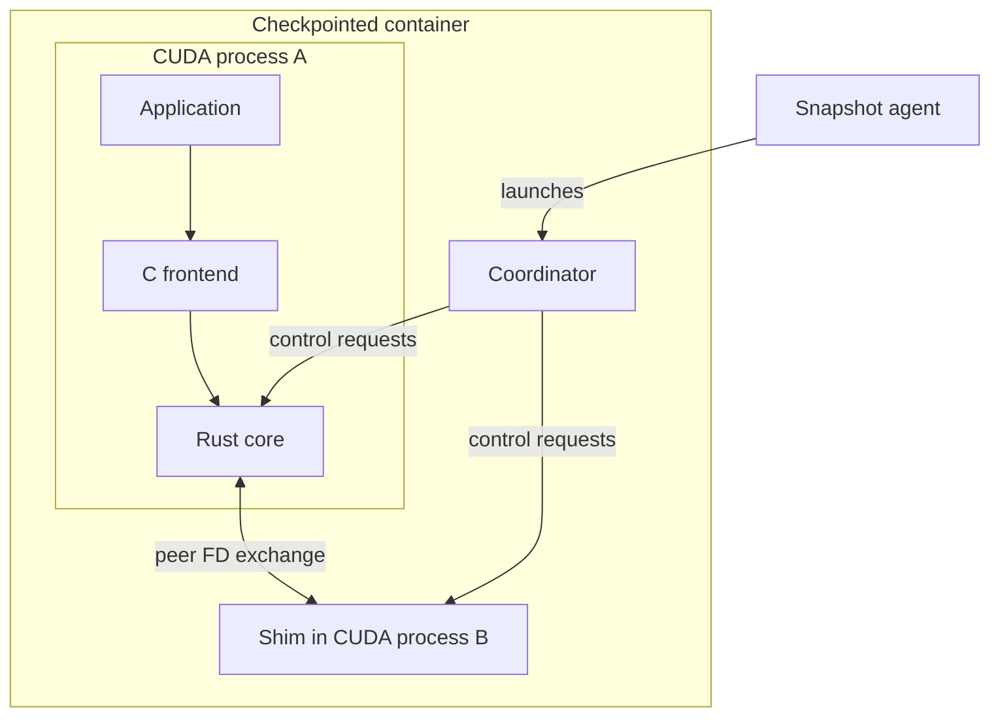
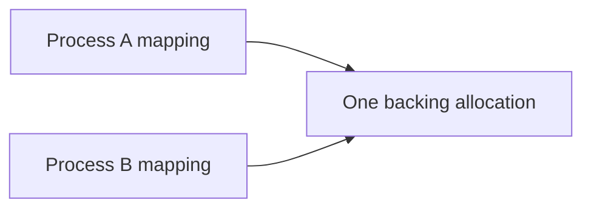
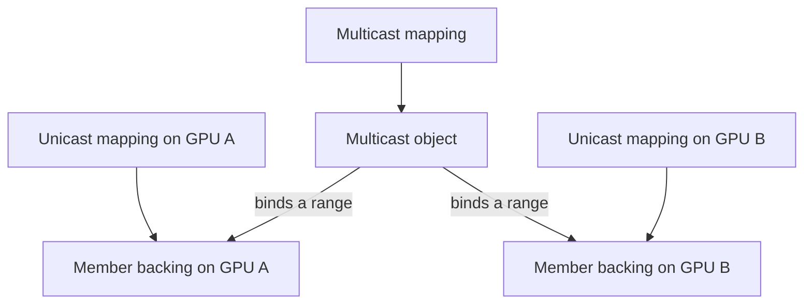
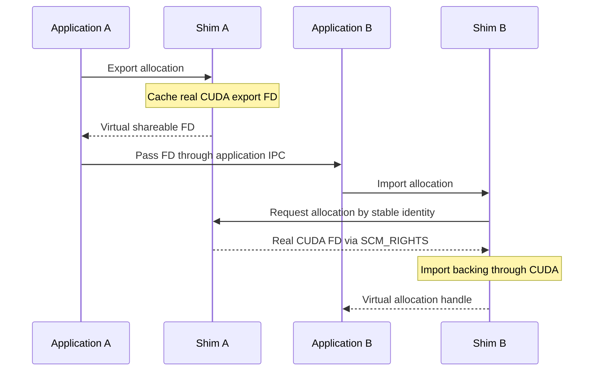
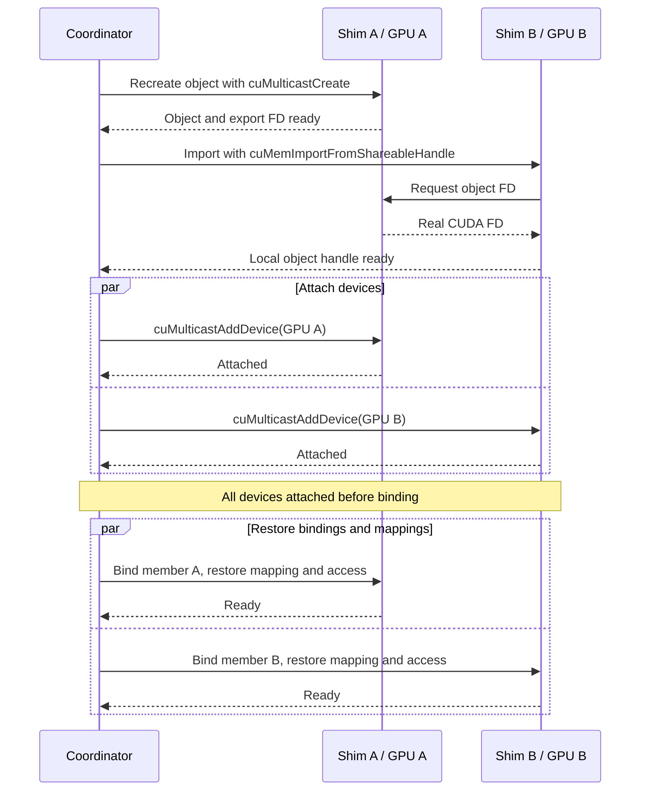
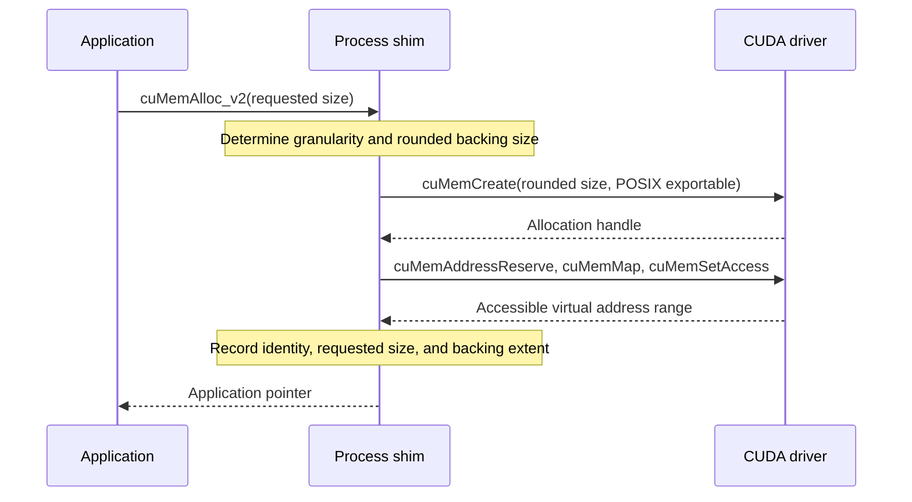
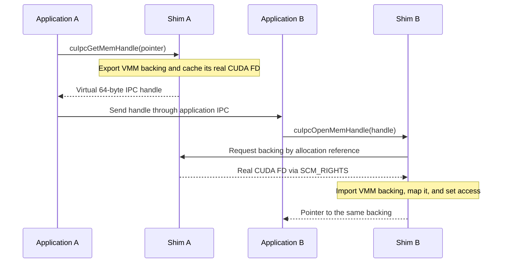
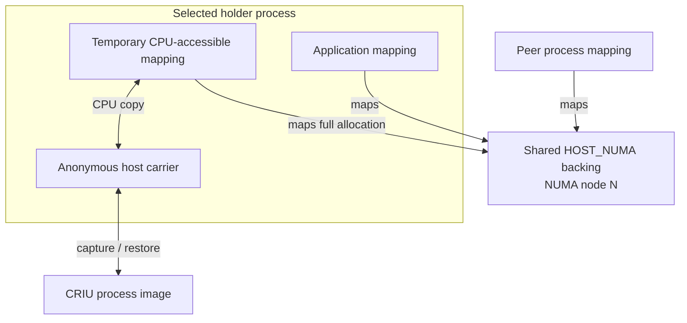
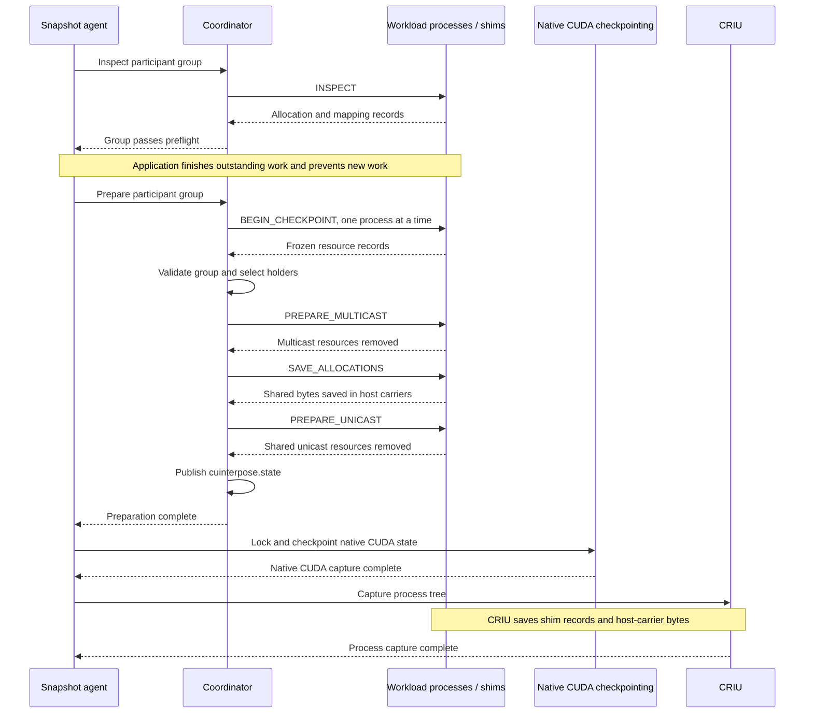
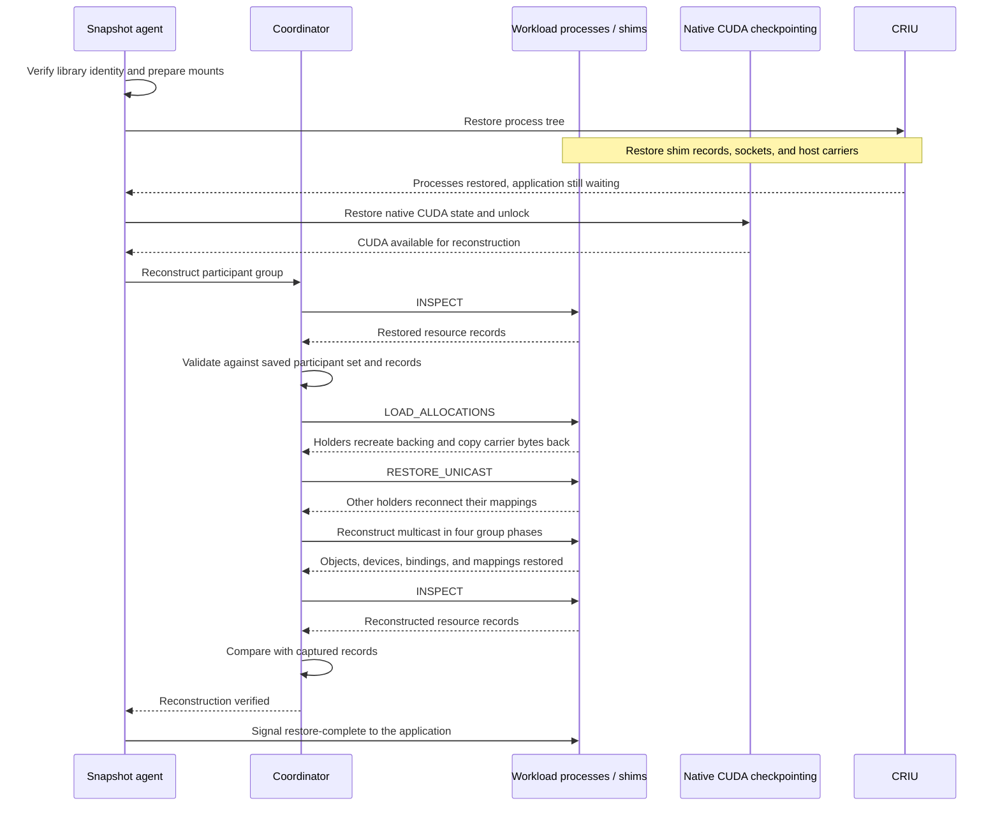

<!--
SPDX-FileCopyrightText: Copyright (c) 2026 NVIDIA CORPORATION & AFFILIATES.
SPDX-License-Identifier: Apache-2.0
-->

# SNEP-295: Checkpoint and restore of shared CUDA memory

<!-- toc -->
- [Summary](#summary)
- [Motivation](#motivation)
  - [Goals](#goals)
  - [Non-Goals](#non-goals)
- [Proposal](#proposal)
  - [Workload contract](#workload-contract)
  - [Limitations, Risks, and Mitigations](#limitations-risks-and-mitigations)
- [Design Details](#design-details)
  - [Components](#components)
  - [CUDA memory and mappings](#cuda-memory-and-mappings)
    - [Unicast mappings](#unicast-mappings)
    - [Multicast mappings](#multicast-mappings)
    - [Preserving CUDA graphs](#preserving-cuda-graphs)
  - [Interposing VMM sharing](#interposing-vmm-sharing)
    - [Creator and checkpoint holder](#creator-and-checkpoint-holder)
    - [Multicast tracking](#multicast-tracking)
    - [Supported sharing configurations](#supported-sharing-configurations)
  - [Adapting legacy allocation and IPC APIs](#adapting-legacy-allocation-and-ipc-apis)
    - [Why allocation must be intercepted before export](#why-allocation-must-be-intercepted-before-export)
    - [IPC and mapping lifetime](#ipc-and-mapping-lifetime)
    - [Peer access and isolation](#peer-access-and-isolation)
    - [Planned deprecation](#planned-deprecation)
  - [Host carriers](#host-carriers)
    - [What is saved](#what-is-saved)
    - [Copying and lifetime](#copying-and-lifetime)
    - [HOST_NUMA allocations](#host_numa-allocations)
  - [Capture](#capture)
  - [Restore](#restore)
  - [Process runtime and concurrency](#process-runtime-and-concurrency)
    - [State and driver calls](#state-and-driver-calls)
    - [Process ownership](#process-ownership)
  - [API](#api)
    - [Delivery and activation](#delivery-and-activation)
    - [Participants and native CUDA state](#participants-and-native-cuda-state)
  - [Failure behavior](#failure-behavior)
  - [Checkpoint files and compatibility](#checkpoint-files-and-compatibility)
  - [Performance and Scalability](#performance-and-scalability)
    - [Allocation granularity](#allocation-granularity)
    - [Host memory and transfer cost](#host-memory-and-transfer-cost)
  - [Security](#security)
  - [Configuration](#configuration)
  - [Dependencies](#dependencies)
  - [Monitoring](#monitoring)
  - [Test Plan](#test-plan)
  - [Graduation Criteria](#graduation-criteria)
- [Implementation History](#implementation-history)
- [Alternatives](#alternatives)
- [Appendix](#appendix)
  - [Interception and loader contract](#interception-and-loader-contract)
    - [Backend runtime installation](#backend-runtime-installation)
    - [Intercepted API reference](#intercepted-api-reference)
  - [Handle and state formats](#handle-and-state-formats)
    - [Decoded state example](#decoded-state-example)
  - [Further reading](#further-reading)
<!-- /toc -->

Tracking issue: [#295](https://github.com/ai-dynamo/snapshot/issues/295).

## Summary

CuInterpose enables Snapshot to checkpoint CUDA memory shared by processes in one container and restore those processes together on a compatible node.
It preserves each process's application pointers, the memory contents, and the sharing relationships between processes, so existing CUDA graphs can replay after restore without recapture.
Applications retain their supported CUDA allocation and sharing APIs.

## Motivation

GPU workloads often share memory between processes, for example when inference workers exchange data across GPUs.
A correct checkpoint must preserve both the data and the relationships between the processes using it.
Restoring a separate copy for each process would break subsequent communication through shared memory.

Inference workloads also use CUDA graphs to reduce CPU overhead when submitting recurring GPU operations.
Those graphs refer to memory at specific addresses, so a restore must preserve those addresses as well as the data.
Requiring graph recapture would add work before the restored application could resume serving.

Native CUDA checkpointing has compatibility limits for some shared-memory resources and legacy memory IPC.
CuInterpose addresses those limits while preserving the application's existing allocation and sharing interfaces.

### Goals

- Preserve allocation identity, contents, virtual addresses, access permissions, and supported unicast and multicast relationships.
- Preserve existing CUDA graphs so they can replay after restore without graph recapture or changes to the pointers recorded in their nodes.
- Avoid saving duplicate copies of memory shared by several processes.
- Detect unsupported sharing configurations before capture and verify restoration before allowing the application to resume.
- Define how callers enable the feature, synchronize capture and restore, manage resource lifetimes, and meet compatibility requirements.

### Non-Goals

- Cross-Pod coordination or live sharing between nodes.
  Cross-node restore moves the captured group together to a compatible destination.
- Replacing native CUDA checkpointing, CRIU, or Snapshot's storage interfaces.
- Automatically draining GPU work, changing the participant group during capture, or retrying and rolling back a failed lifecycle operation.
- General support for every CUDA allocation or IPC API.
- Providing isolation between mutually untrusted sharing participants.

## Proposal

CuInterpose is enabled when the source workload starts.
It records supported memory allocations and sharing operations while the application runs, then coordinates their preservation across the participating processes.
On restore, it reestablishes shared memory at the original addresses before the application resumes.

Snapshot continues to use native CUDA checkpointing for GPU state and CRIU for process memory and other process state.
CuInterpose supplies the tracking and reconstruction needed for shared memory to work with those existing mechanisms.

### Workload contract

Checkpoint preparation removes mappings that application kernels may use.
The application must first finish outstanding CUDA calls and GPU work, stop CPU writes to shared host allocations, and prevent new work from starting.
It must remain paused through preparation, capture, and restore.
Snapshot calls `cuCheckpointProcessLock` after the shim finishes preparation and `cuCheckpointProcessUnlock` before the shim reconstructs shared memory.
The application may resume only after reconstruction has been verified.

Every process participating in the supported sharing relationships must enable CuInterpose and remain in the same fixed checkpoint group.
Applications remain responsible for synchronization and resource lifetime throughout that group's execution.

### Limitations, Risks, and Mitigations

The main operational constraints are:

| Risk or constraint | Contract |
| --- | --- |
| Incomplete participant group | All required sharing processes must be captured and restored together. |
| Failure during preparation or reconstruction | The attempt is unusable. Terminate the affected workload rather than retrying a lost reply or resuming partial state. |
| Memory overhead | Preserving shared data requires additional host memory, and adapting allocations can increase GPU memory use. See [Performance and Scalability](#performance-and-scalability). |
| Artifact mismatch | Restore requires matching CuInterpose libraries. See [Checkpoint files and compatibility](#checkpoint-files-and-compatibility). |

## Design Details

### Components

Shared memory spans several processes, but its CUDA handles and mappings belong to individual processes.
CuInterpose therefore loads a shim library in each CUDA process and uses a coordinator to order checkpoint and restore across the group.

The shim has a C frontend that intercepts selected CUDA calls and a Rust core that tracks and reconstructs resources.
The coordinator sends requests to those cores, which execute CUDA calls and memory copies inside their own processes.



`libcuinterpose.so` intercepts CUDA calls and resolves the real driver functions.
`libcuinterpose_core.so` owns tracking state, driver resources, and host carriers.
Each core listens on `/tmp/cuinterpose-<namespace-pid>.sock` for both coordinator commands and peer requests for export descriptors.

The Snapshot agent discovers participants and launches a coordinator in the target container's namespaces for each inspection, preparation, or reconstruction operation.
The agent also orders native CUDA operations and CRIU, then signals that the application may resume after restore.
The coordinator exits when its requested operation finishes.

### CUDA memory and mappings

Restoring shared memory requires recovering its contents at the addresses each process already uses.
CUDA virtual memory management (VMM) separates memory allocations from address reservations, allowing CuInterpose to recreate the memory while preserving application pointers.

`cuMemCreate` allocates GPU or host memory and returns a `CUmemGenericAllocationHandle`.
This memory is the allocation's *backing*.
`cuMemAddressReserve` reserves a virtual address range, and `cuMemMap` connects that range to some or all of the backing.
`cuMemSetAccess` sets which devices may access the mapping.

An application pointer (`CUdeviceptr`) identifies a virtual address, while the allocation handle identifies the underlying resource.
Several mappings can refer to the same allocation, and a process can call `cuMemRelease` while a mapping continues to retain the allocation.
CuInterpose tracks these relationships separately so that restoring a pointer also restores the memory it refers to.

#### Unicast mappings

A unicast mapping refers to one backing allocation.
When processes share that allocation, writes through one process's mapping must remain visible through the others.
The processes can map the same backing at different addresses:



For example, A may map an allocation at `0x700000000000` and B at `0x710000000000`.
Restore must preserve both addresses and reconnect them to one recreated allocation.

#### Multicast mappings

Multicast lets a GPU operation access corresponding memory ranges across a team of devices.
Handles for member allocations and multicast objects share the C type `CUmemGenericAllocationHandle`, but identify different resources.
`cuMemCreate` returns a handle to memory backing, while `cuMulticastCreate` returns a handle to the object that groups the devices and binds their memory ranges.

A multicast store writes to the corresponding locations in all bound members.
A multicast load-reduce reads those locations and combines their values.
These addresses require the appropriate multicast instructions, rather than ordinary loads and stores.
See the [PTX multimem instructions](https://docs.nvidia.com/cuda/parallel-thread-execution/#data-movement-and-conversion-instructions-multimem-ld-reduce-multimem-st-multimem-red).



Reconstructing multicast therefore requires more than importing a single allocation.
The object, its imports, device attachments, bindings, mappings, and permissions must be recreated in dependency order.

The [CUDA multicast API](https://docs.nvidia.com/cuda/cuda-driver-api/cuda_driver_api/group__CUDA__MULTICAST.html) describes creation, device attachment, binding, and mapping of these objects.

A small setup example makes the distinction concrete: one process uses two compatible GPUs, each contributing an equal-sized memory region at multicast offset zero.
Here `group_props` is a `CUmulticastObjectProp` with `numDevices = 2`, `size = bytes`, and POSIX export enabled.
`memory_props` is a `CUmemAllocationProp` for pinned, POSIX-exportable device memory, and `bytes` satisfies both VMM and multicast granularity requirements.
The sketch assumes initialized CUDA contexts and omits error handling and cleanup.

```cpp
CUmemGenericAllocationHandle group, member[2];
cuCtxSetCurrent(contexts[0]);
cuMulticastCreate(&group, &group_props);

for (int i = 0; i < 2; ++i)
    cuMulticastAddDevice(group, devices[i]);

for (int i = 0; i < 2; ++i) {
    cuCtxSetCurrent(contexts[i]);
    memory_props.location.id = devices[i];
    cuMemCreate(&member[i], bytes, &memory_props, 0);
    cuMulticastBindMem(group, 0, member[i], 0, bytes, 0);
}
```

A subsequent `cuMemMap` uses `member[i]` for a unicast view of that GPU's memory or `group` for a multicast view of the bound regions.
CuInterpose tracks the member handles and their contents separately from the group handle and its bindings.

#### Preserving CUDA graphs

CUDA graphs are crucial for performance in inference workloads, and it is important to preserve the captured CUDA graphs, as recapturing them is costly.
Graphs retain the virtual memory addresses (specific to a particular CUDA context) referenced in kernels, so it is important to replay the existing graphs after restore without recapturing them or updating their memory references.
See NVIDIA's [CUDA graph memory constraints](https://docs.nvidia.com/dl-cuda-graph/latest/cuda-graph-basics/constraints.html).

Fortunately, the VMM API separates virtual-address reservations from physical backing, which lets CuInterpose remove shared resources without discarding their application address ranges.
During checkpoint preparation, it uses `cuMemUnmap` and `cuMemRelease` to remove mappings and release backing references, while retaining the address reservations.
During reconstruction, it uses `cuMemMap` and `cuMemSetAccess` to restore backing and permissions at the original addresses.
The same address requirement applies to multicast mappings.
These operations rely on the [VMM reservation and mapping model](https://docs.nvidia.com/cuda/cuda-programming-guide/04-special-topics/virtual-memory-management.html).

cuCheckpoint remains responsible for graph objects (`CUgraph`) and executable graph state (`CUgraphExec`).
CuInterpose reconstructs the shared memory those graphs reference before the application can replay them.

### Interposing VMM sharing

To share VMM memory through a POSIX file descriptor, an application calls `cuMemExportToShareableHandle` to obtain a file descriptor and passes it to another process.
That process calls `cuMemImportFromShareableHandle` to obtain a local allocation handle, then maps the same backing with `cuMemMap`.

Recreating the backing produces new driver handles, while the application still holds the values captured in its process memory.
CuInterpose therefore gives the application a virtual allocation handle (`CUmemGenericAllocationHandle`) and translates it to the current driver handle.
It also tracks which processes share the backing so they can reconnect to one recreated allocation.

On export, the shim retains the real CUDA file descriptor and returns a descriptor for a small memory-backed file containing a stable allocation reference.
This *virtual shareable FD* passes through the application's existing IPC mechanism.
When the receiving application calls `cuMemImportFromShareableHandle`, its shim reads the reference and requests the real CUDA descriptor from the creator's socket.



The shim gives each tracked allocation a random 128-bit ID and pairs it with the creator's PID in the container's PID namespace.
This allocation reference remains stable across checkpoint and restore.
Exporting an imported allocation again preserves this reference.
The [appendix](#handle-and-state-formats) specifies the handle encodings.

A reply to a unicast export request includes the full backing size and the CUDA location where the creator allocated it.
The importer queries `cuMemGetAllocationPropertiesFromHandle` and records its own handles and mappings.

#### Creator and checkpoint holder

Several processes may retain the same allocation, but saving its contents in every process would duplicate the checkpoint data.
The coordinator therefore selects one *holder*, a process with a handle or mapping, to save and recreate the backing.
The *creator* is the process that originally allocated it.
Existing imports can remain valid after the creator releases its own handles and mappings, so another holder may need to preserve the allocation.

The coordinator prefers the creator if it still has a handle or mapping.
Otherwise it selects the holder with the **lowest namespace PID** among processes that still retain the allocation.
Each recorded holder must have a local handle or mapping, and the creator process must still belong to the group.

New imports contact the creator, so it must retain a handle or mapping from which it can export the backing.
Keeping only a virtual shareable FD is insufficient: the file records allocation identity but does not itself retain CUDA memory.

#### Multicast tracking

A restored multicast mapping must still access the corresponding memory range on every device in its team.
This requires preserving both the member allocations' contents and the bindings that associate them with the multicast object.

CuInterpose preserves tracked member allocations through the same allocation records and host carriers used for unicast.
It additionally records the multicast object's creation properties, device membership, bindings, and virtual mappings so it can reconstruct those relationships around the restored memory.

`cuMulticastBindMem` identifies the member memory by an allocation handle, so the shim records the allocation reference and offset within it.
`cuMulticastBindAddr` identifies memory by an address, so the shim records that address and its tracked allocation when one exists.
If the address refers to memory outside this tracking model, native CUDA checkpointing remains responsible for preserving the memory.

During capture, the shim removes multicast mappings with `cuMemUnmap` and bindings with `cuMulticastUnbind`, then releases the object handle with `cuMemRelease`.
It retains the records needed to rebuild the object after its member allocations have been restored.

During restore, the creator recreates the object with `cuMulticastCreate`, and peers import it through `cuMemImportFromShareableHandle`.
CUDA requires every device to be attached with `cuMulticastAddDevice` before binding or mapping the multicast object.
The shim follows that ordering when restoring bindings with `cuMulticastBindMem` or `cuMulticastBindAddr`.
Each shim restores its virtual mappings and permissions with `cuMemMap` and `cuMemSetAccess`.

The example below starts after both member allocations have been recreated:



CuInterpose adds these checkpoint requirements to CUDA's multicast model:

- Device attachment with `cuMulticastAddDevice` and memory binding must occur **in the same process**.
- The **original creator must retain the tracked multicast object and remain in the checkpoint group** to recreate it.
- At capture, **every declared device must be attached and have a recorded binding**.

#### Supported sharing configurations

Tracked VMM allocations and multicast objects must use `CU_MEM_HANDLE_TYPE_POSIX_FILE_DESCRIPTOR` for sharing.
Unicast allocations may use pinned memory at CUDA's `DEVICE` or `HOST_NUMA` locations, meaning GPU memory or host memory associated with a NUMA node.

FABRIC handles, combinations of exportable handle types, and multicast objects without POSIX export support are outside this design.

The shim rejects requests to create allocations with unsupported sharing properties or import non-POSIX handles before acquiring CUDA resources.
It permits raw POSIX imports from processes without the shim, but cannot reconstruct those external sharing relationships.
Every handle and mapping for such an import must therefore be released before checkpoint.

### Adapting legacy allocation and IPC APIs

Applications also share memory through the legacy `cuMemAlloc_v2` and `cuIpc*MemHandle` interfaces.
These allocations need to work with checkpointing without requiring the application to adopt VMM itself.

CUDA CustomStorage allows native checkpointing to hand memory to an external storage implementation.
In the cross-GPU legacy-IPC case that motivated this design, CustomStorage tried to export the allocation using the importing GPU rather than the GPU that owned it.
The ownership mismatch caused the export to fail.

CuInterpose works around this failure by implementing the legacy allocation and IPC calls with tracked VMM backing and the peer exchange described above.
Applications keep their existing interfaces, while the shim can save and reconstruct the shared memory.
The adapter is temporary, pending the driver fix described under [Planned deprecation](#planned-deprecation).

#### Why allocation must be intercepted before export

By the time an application calls `cuIpcGetMemHandle`, its allocation's address may already be stored in application objects or captured CUDA graphs.
Replacing that allocation at export time could invalidate those references.

The shim therefore creates POSIX-capable VMM backing at the initial synchronous malloc call.
It reserves and maps an address, rounds the backing size to CUDA's required granularity, and records the requested size separately.
The application continues to use the returned pointer.

The allocation sequence shows how one application call becomes VMM operations inside the shim:



The shim cannot know at allocation time whether the application will later export the pointer, so it converts every supported synchronous malloc call.
Allocations that are never shared still use native CUDA checkpointing to preserve their contents.

#### IPC and mapping lifetime

The application expects to exchange a `CUipcMemHandle`, CUDA's fixed 64-byte IPC value.
The shim preserves that interface by placing an allocation reference in the value returned by `cuIpcGetMemHandle`.
On `cuIpcOpenMemHandle`, the importing shim uses that reference to obtain a real FD and map the backing.

The following sequence shows a successful export and first import.
The applications exchange the opaque IPC value, while only the shims exchange the real CUDA file descriptor:



Opening the same allocation again in the CUDA context (`CUcontext`) that owns the import returns the same address and increments its open count.
Calling `cuIpcCloseMemHandle` removes the imported mapping only when that count reaches zero.
An allocation created by `cuMemAlloc_v2` instead uses `cuMemFree_v2`, which calls `cuCtxSynchronize` on its owning context before removing the mapping.
If synchronization fails, the mapping is preserved.
The adapter rejects attempts to free an imported IPC pointer through `cuMemFree_v2`.

Destroying a context with `cuCtxDestroy` also removes the converted malloc and IPC mappings it owns.
The same applies when `cuDevicePrimaryCtxReset` resets a primary context or `cuDevicePrimaryCtxRelease` releases its final reference.
The shim preserves those mappings if context teardown fails or the primary context still has references.

This adapter supports synchronous device allocation and memory IPC.
It does not cover event IPC, memory-pool IPC, or managed, async, and pitched allocation families.
It also rejects native memory-IPC handles produced outside the shim.

#### Peer access and isolation

Applications use `cuCtxEnablePeerAccess` to let the current GPU access memory owned by a peer context.
Because the adapter implements malloc and IPC with VMM, it must apply those permissions to the VMM mappings through `cuMemSetAccess`.
Each mapping initially permits access from its allocating or importing GPU.
After peer access is enabled successfully, the shim also grants the current GPU access to existing and future converted mappings owned by the peer context.

Disabling peer access with `cuCtxDisablePeerAccess` stops the shim from granting the current GPU access to future mappings owned by that context.
Existing mappings keep the device permissions already granted.
This design assumes cooperating processes, typically one process per GPU.
VMM permissions apply to devices, so separate CUDA contexts and disabling peer access do not provide strict access isolation for converted mappings.

#### Planned deprecation

Once the driver fix for legacy IPC with CustomStorage is available, the intent is to deprecate this adapter and let the driver handle the legacy allocation and memory-IPC calls natively.
Before retiring the adapter, we must validate native cross-GPU IPC checkpoint and restore on the supported driver versions, including replay of CUDA graphs captured before checkpoint.

### Host carriers

The shared allocation's data must survive the removal of its CUDA backing during checkpoint preparation.
The selected holder therefore copies it into a *host carrier*, an anonymous host-memory region owned by that process.

CRIU captures the carrier as process memory alongside the shim's allocation and mapping records.
On restore, the shim uses those records to recreate the CUDA allocation and copies the carrier's bytes back into it.
This lets CuInterpose preserve shared data through Snapshot's existing process-memory capture.

#### What is saved

A holder may map only part of an allocation, while other processes use the remaining regions.
It therefore saves the full backing of each assigned allocation so the checkpoint includes every process's data.
Each shared allocation is saved once.

The shim marks an allocation as shared after a successful tracked export, import, or binding into a tracked multicast object.
It keeps that classification after export descriptors are closed or `cuMulticastUnbind` removes bindings.
If the selected holder retains only a mapping, it calls `cuMemRetainAllocationHandle` to obtain a temporary allocation handle for the transfer.

| Allocation state | Content preservation |
| --- | --- |
| Native, nonexportable VMM | Native CUDA checkpointing |
| Tracked allocation or converted malloc never shared | Native CUDA checkpointing, with mappings and handles left intact |
| Shared tracked DEVICE or HOST_NUMA backing | One full copy in the selected holder's carrier |
| Tracked allocation bound into a multicast object | One copy in a host carrier, with no additional copy for the multicast object |

#### Copying and lifetime

To copy GPU memory, the carrier code groups DEVICE allocations by CUDA context and device.
It maps their backing into temporary consecutive address ranges and copies their contents using one CUDA stream (`CUstream`) per group.
Transfers use `cuMemcpyDtoHAsync_v2` for capture and `cuMemcpyHtoDAsync_v2` for restore.

Asynchronous CUDA copies require pinned host memory, so the shim registers the carrier with `cuMemHostRegister_v2` during transfers.
The CUDA context used for registration stays alive until the copies finish and `cuMemHostUnregister` unregisters the memory.
Between transfers, the carrier is ordinary anonymous memory that CRIU can capture.

If an allocation's recorded CUDA context has been destroyed, the carrier code uses a primary context on the recorded device for DEVICE memory.
After restore, the carrier is released only after the successful load reply has been sent to the coordinator.

#### HOST_NUMA allocations

A HOST_NUMA allocation is created with `cuMemCreate`, specifying `CU_MEM_LOCATION_TYPE_HOST_NUMA` and the NUMA node ID in `CUmemAllocationProp.location`.
Its backing resides in host memory but is still managed through CUDA VMM, so its contents must be copied into a carrier before the backing is released.

The application's mappings may cover only part of the allocation or lack CPU access.
The selected holder therefore uses `cuMemAddressReserve`, `cuMemMap`, and `cuMemSetAccess` to create a temporary CPU-accessible mapping of the full backing.



During capture, the CPU copies the full allocation through the temporary mapping into the carrier.
During restore, `cuMemCreate` recreates the backing at its recorded NUMA location, and the CPU copies the carrier's contents back before the processes reconnect their original mappings.

The shim records the creator's NUMA node during sharing because `cuMemGetAllocationPropertiesFromHandle` reports node zero for imported handles.
If the recorded CUDA context is gone, HOST_NUMA operations use a primary context on CUDA device zero while retaining the recorded host NUMA placement.

### Capture

Capture saves shared allocation contents in host carriers and removes the shared CUDA resources before native CUDA checkpointing runs.
CRIU then captures the processes, including their carriers and tracking records.

The sequence below shows a successful capture.
Process shims share one lifeline to keep the group interactions readable.
The coordinator lifeline represents separate invocations for inspection and preparation, and the agent lifeline includes its namespace helpers.



The agent first discovers the CUDA processes and checks which shim libraries each process has mapped.
It verifies that every required process has loaded the frontend and that the library contents match across the group.
Processes with a mapped core library take part in coordinator operations, and each must expose a healthy control socket.
A missing or unresponsive socket is an error, not a reason to omit that process.

The read-only `INSPECT` operation validates creators, holders, mapping ranges, permissions, and multicast membership without changing process state.
Because resources can still change after inspection, the coordinator validates the records again after each participant has entered checkpoint mode.

`BEGIN_CHECKPOINT` requires an active process with no outstanding driver calls that temporarily released the state lock.
It prevents changes to tracked resources before returning the process's records.
`PREPARE_MULTICAST` removes exports, mappings, bindings, and multicast handles.
After the carriers hold the shared bytes, `PREPARE_UNICAST` waits for pending file-descriptor sends to peers to finish.
It then removes shared exports and mappings and releases shared driver handles.

After entering checkpoint mode in each process sequentially, the coordinator sends each mutating phase's request to all participants concurrently.
It waits for every reply before starting the next phase.
Concurrent dispatch allows CUDA multicast calls in different processes to make progress together.
Every participant receives each phase, including participants with no resources to modify in that phase.

The ordering follows the resource dependencies: remove multicast before its member backing, and save bytes before releasing that backing.
The shim must finish preparation before Snapshot locks CUDA because copying memory and removing shared resources require working CUDA calls.

Virtual handles, allocation references, mapping records, and carrier addresses remain in process memory for CRIU to capture.
Native CUDA checkpointing preserves allocations that were never shared.
If no process has initialized the core, the agent skips coordinator operations but still performs native CUDA capture and library identity checks.

### Restore

Restore first recovers the processes through CRIU and their native CUDA state through CUDA checkpointing.
The restored shims then recreate shared backing and reconnect the original mappings before the application resumes.
Application threads continue waiting while the restored shims handle coordinator requests.



Before starting CRIU restore, the agent verifies the captured library identities and restores the required library mounts.
Shim socket paths are excluded from rootfs archives because CRIU restores the live socket bindings with the process tree.
CRIU also restores namespace PIDs, shim records, and host carriers.

`LOAD_ALLOCATIONS` recreates backing in the selected holders, copies carrier contents into it, and restores their mappings, permissions, and export FDs.
`RESTORE_UNICAST` reconnects the other holders to that same backing at their original addresses.
For each reconstruction phase, the coordinator sends requests across the group and waits for every participant's reply before advancing.

Multicast reconstruction requires four separate group barriers:

| Operation | Dependency satisfied before advancing |
| --- | --- |
| `RESTORE_MULTICAST_CREATORS` | Each creator makes an export FD for its recreated multicast object available to peers. |
| `RESTORE_MULTICAST_IMPORTERS` | Every importer obtains a local object handle. |
| `RESTORE_MULTICAST_DEVICES` | Every participating device is attached to the object before any process binds member memory. |
| `RESTORE_MULTICAST_BINDINGS` | Bindings, original mappings, and access permissions are restored. |

These barriers explain why multicast restore needs more phases than teardown.
During teardown, participants can remove their existing references concurrently in one phase.
During reconstruction, importers must wait for creators to make the new objects available, and memory binding must wait for every device to join.
A process can create one resource and import another, so the coordinator applies these dependencies per resource rather than dividing processes into separate creator and importer groups.

### Process runtime and concurrency

During restore, a process may need an allocation FD from a peer that is still reconstructing its own resources.
Each shim therefore uses separate workers for peer communication and lifecycle operations.
The peer worker accepts connections and serves cached export FDs without taking the allocation-state mutex or calling CUDA.
It queues lifecycle requests to the control worker, which processes them sequentially and enters the relevant CUDA context.

The shims open connections to peers as needed instead of maintaining connections between every pair of processes.
The control worker's queue has a fixed capacity and rejects requests when it is full.

Loading the backend makes its functions available through the private C ABI, but does not start its runtime services.
A successful intercepted `cuInit` installs the tracking state, control socket, and two worker threads.
This separation keeps symbol lookup from starting CUDA process services.
The [loader appendix](#interception-and-loader-contract) explains the ABI and the initialization constraints in detail.

#### State and driver calls

Handles and mappings can retain an allocation independently, so the core records both in a registry of allocations and multicast objects.
Converted malloc and IPC allocations also need reservation records for requested sizes and IPC open counts.
Retaining an allocation through an existing mapping returns its recorded application handle and adds a handle reference, even if the application previously released that handle.

Tracking records must reflect completed CUDA operations before they can be checkpointed.
The shim protects updates with a state mutex, but releases it during blocking multicast calls, IPC synchronization, and context teardown so other operations can make progress.
The `unlocked_driver_calls` counter tracks these operations, including time spent waiting for multicast binding locks, until their results have been recorded.
A process can enter checkpoint mode only when this counter is zero, so no such operation can later return and change the captured records.

Calls that bind or unbind multicast memory use a per-object mutex so the order of driver mutations matches the order recorded by the shim.
Another thread can still add a device to the multicast object while a binding call waits.
This lock does not retain the CUDA object or its context, so the application must prevent destruction while either is in use.

The peer service holds the export-cache lock through each FD send.
Before removing cached exports during teardown, the shim acquires that same lock to wait for any active send to finish.
Socket timeouts limit how long a send can stall, though a slow peer can delay changes to the cache until the send finishes.

#### Process ownership

A forked child inherits the parent's tracking state and locks, so it must not use the parent's initialized runtime.
The shim checks the calling PID before taking any mutex.
A child forked before CUDA initialization can initialize independently.
After CUDA initialization, a child created by `fork` must call `exec` or exit.
Forking during initialization, or retaining a child of an initialized process through checkpoint, is unsupported.

When its socket path already exists, the runtime removes it during installation only if it is an owned socket and a nonblocking connection attempt immediately returns `ECONNREFUSED`.
The runtime rechecks the path's identity before removing it and retries binding once.
It leaves the path unchanged for live listeners, full queues, non-socket files, symlinks, or ambiguous errors.

### API

The source Pod opts in through an annotation on an ordinary Pod or a SnapshotJob Pod template:

```yaml
metadata:
  annotations:
    nvidia.com/cuda-shared-memory-support: "enabled"
```

There are no new CRDs or CRD fields.
After trimming whitespace, the accepted values are the case-sensitive strings `enabled` and `disabled`.
An absent annotation does not request the feature.
Admission validation for SnapshotJobs rejects other values through CEL, and the agent also validates the annotation on ordinary Pods.
Removing the annotation cannot unload a shim from an already-running process.

#### Delivery and activation

The shim must be loaded before the application creates CUDA allocations so it can record their full lifetime.
For a SnapshotJob source, the operator copies the frontend, core, and static launcher from the configured image into an `emptyDir`, mounted read-only at `/tmp/snapshot-cuda`.
It prefixes the target container's explicit `command` with the launcher and leaves `args` and `env` unchanged.

The launcher prepends the frontend library path to the resolved value of `LD_PRELOAD`, then executes the original command.
It preserves the existing preload value, the boundaries between arguments, and any non-UTF-8 environment values.
It starts no shell and leaves no launcher process running as the workload's parent.
Environment values retain the normal precedence among the image, `envFrom`, and Pod settings.

Ordinary Pods must arrange the same library and launcher delivery before the workload starts.
Before capture, the agent requires their target container command to begin with the expected launcher and library arguments.

The agent rejects capture of an opted-in target without the launcher prefix before waiting for readiness or modifying the source workload.
It also rejects writable mounts used to deliver the libraries because CRIU reapplies the source mount flags when restoring the library bind mounts.
For SnapshotJobs, the operator rejects missing commands and collisions with installer names or mount paths before creating the source Job.

Deployment examples and build or test commands are maintained separately in [PR #456](https://github.com/ai-dynamo/snapshot/pull/456).

#### Participants and native CUDA state

Snapshot must capture all CUDA processes, while the coordinator operates on the processes that have initialized CuInterpose's core.
Processes with only the frontend loaded still participate in native CUDA capture and restore.

If the agent finds a shim in any CUDA process, it requires the frontend in every discovered CUDA participant, even if the opt-in annotation has been removed.
A process with the core mapped but no frontend fails this check.

To establish library identity, the agent opens each library file and matches its device and inode to the process's mapping before hashing its contents.
The agent rejects the workload during preflight if any required library is missing, deleted, replaced, or inconsistent with the others.
Even a process with only the frontend loaded must have a regular core library file available for hashing.
The files must remain unchanged throughout capture.

The coordinator accepts `--inspect`, `--prepare`, or `--restore`, a `--socket-dir`, and repeated `--process` namespace PIDs supplied by the agent.
The coordinator also requires `--checkpoint-dir` when preparing a checkpoint or reconstructing resources after restore.
It uses the supplied process list rather than discovering which processes belong to the group.

The native CUDA helper can use jobfiles that describe its checkpoint work.
Snapshot continues to stage, validate, and restore these files when present.
If any processes participate in coordinator operations, Snapshot permits an absent jobfile but still validates one that exists.
With no coordinator participants, the helper's native multi-GPU jobfile requirement still applies.

### Failure behavior

A failed checkpoint or restore operation can leave processes with only some of their shared resources reconstructed or removed.
If a reply is lost, the coordinator cannot determine which driver mutations completed, and its records are insufficient to resume or roll back the operation safely.
It therefore abandons the attempt rather than retrying.

Read-only inspection is different because it leaves the source workload unchanged.
Once preparation begins, the agent terminates the source workload if preparation fails or a reply is lost.
Callers that run the coordinator directly must enforce the same rule.

An application operation can return an ordinary driver error when it has not irreversibly changed tracked state.
For example, if malloc or IPC setup fails before returning a pointer to the application, the shim cleans up the resources before returning an error.
If that cleanup fails, or a destructive checkpoint mutation fails, the shim terminates the process because its resource records may no longer match CUDA state.
The Rust libraries also use `panic = "abort"`, so a panic in any shim thread terminates the process without stack unwinding.

### Checkpoint files and compatibility

Restore needs to know which processes shared each allocation and verify that reconstruction matches the captured state.
CuInterpose records that information in two checkpoint files:

- `cuinterpose.state` is versioned MessagePack metadata mapping namespace PIDs to captured allocation, mapping, and multicast records.
  It contains no allocation contents, persistent driver handles, or socket paths.
- `manifest.yaml` records the PIDs that participate in coordinator operations and both library hashes alongside Snapshot's full list of native CUDA participants.

```yaml
cudaRestore:
  pids: [41, 42, 43]
cuinterpose:
  pids: [41, 42]
  libraries:
    libcuinterpose.so:
      sha256: "aaaaaaaaaaaaaaaaaaaaaaaaaaaaaaaaaaaaaaaaaaaaaaaaaaaaaaaaaaaaaaaa"
    libcuinterpose_core.so:
      sha256: "bbbbbbbbbbbbbbbbbbbbbbbbbbbbbbbbbbbbbbbbbbbbbbbbbbbbbbbbbbbbbbbb"
```

Here process 43 has only the frontend loaded.
Coordinator PIDs must be positive, unique, and a subset of `cudaRestore.pids`.
Exactly the two named library records and `pids` are required when `cuinterpose` is present.
If `cuinterpose.pids` is explicitly empty, restore needs no coordinator state file but still requires both matching libraries.
Checkpoints captured without CuInterpose omit the `cuinterpose` entry.

To publish the state file, the coordinator sorts the records, writes and syncs a private temporary file, installs it without replacing an existing destination, and syncs the containing directory.
A failure at any of these steps causes the coordinator to report that checkpoint preparation failed.

CRIU preserves namespace PIDs, virtual handles, allocation IDs, and shim state.
During restore, the coordinator requires the same participant PID set and compares the reconstructed records with the captured records.
The private ABI, protocol/state envelope, virtual shareable handle, and virtual IPC handle formats are version 1.

CRIU restores the shim's in-memory state, so the frontend and core must match the libraries that created that state.
Both libraries must be supplied at their original paths with identical SHA-256 hashes.
`SkipCompatCheck` does not bypass this check.
The library identity check excludes the launcher and coordinator executables because they are absent from the checkpointed workload.
The coordinator must still understand the shim's protocol.

Restoring an existing checkpoint therefore requires the original library contents.
A workload that needs upgraded shim libraries must create a new checkpoint.
Automatically archiving the libraries with the checkpoint remains follow-up work.

### Performance and Scalability

#### Allocation granularity

Adapting synchronous malloc to VMM can increase memory use because VMM allocations must satisfy a minimum size granularity.
Each malloc call receives its own allocation, rounded up to the minimum returned by `cuMemGetAllocationGranularity`.
For example, on a device with a 2 MiB minimum, a 64 KiB request consumes 2 MiB of backing.

The rounding applies to underlying CUDA allocations rather than individual tensors.
Framework allocators, such as [PyTorch's caching allocator](https://github.com/pytorch/pytorch/blob/main/c10/cuda/CUDACachingAllocator.cpp), can serve many small tensors from larger cached allocations.
In that case the shim rounds each larger allocation once, and the framework can reuse it without repeating VMM setup during inference.

Inference workloads also tend to retain large model and cache allocations, for which rounding adds a smaller fraction of the total size.
Together with framework pooling, this explains why granularity overhead has not been prominent in our inference use.
The effect still depends on the engine and its allocation pattern.

Applications that make many small direct CUDA allocations can waste substantial memory under this policy.
Frequent allocation and free operations also incur VMM setup costs, and even modest rounding can matter near the device-memory limit.
Caching device attributes and the results of granularity queries reduces setup work.
Converted allocations incur these costs even if they are never shared.

#### Host memory and transfer cost

Preserving shared data in host carriers requires an additional host-memory copy and space for that copy in the checkpoint.
Each holder's carrier is sized to the sum of the full shared allocations assigned to it, without a fixed size cap.
Temporary mappings, host-memory registration, and CRIU reads and writes add further work to the transfer.

During restore, CRIU must recover the host pages and the shim must copy their contents into recreated backing before the application can resume.
A large shared cache left allocated at capture can therefore dominate carrier size.
Saving one copy per allocation avoids multiplying this cost by its number of importers.

The coordinator starts one concurrent exchange per participant for each mutating phase.
Limiting those exchanges to a smaller worker pool could deadlock a CUDA collective if an active participant waits for one that has not started.
This concurrency requires resources proportional to the participant count.
Metadata size and the requirement for a fixed, cooperating group also limit scale.

### Security

The control interface can export allocation FDs and modify a process's CUDA resources, so access is restricted through filesystem credentials and container mount isolation.
Each control socket has permissions `0600` and lives in the target container's writable `/tmp`.
The design assumes cooperating workload processes and trusts the node's root user and privileged Snapshot agents.

The coordinator enters the target mount, UTS, IPC, network, and PID namespaces, but not its user or cgroup namespace.
Before entering those namespaces, the agent opens file descriptors for the trusted executable and checkpoint directory.
Keeping a mount-namespace descriptor open prevents that namespace from disappearing while the helper uses it.
If the operation is cancelled, the agent kills the helper's process group, including forked descendants, and limits how long it waits for output pipes to close.

Host carriers put shared workload data in CRIU images.
They require the same storage access controls as other process memory.
This design adds no encryption.
The shim and coordinator check format versions, limit messages and state files to 32 MiB, apply timeouts, and bound the control queue.
These checks limit the effects of malformed input and unresponsive peers.

The installer drops capabilities, disallows privilege escalation, and uses a read-only root filesystem.
It uses the Pod's positive `runAsUser` when specified, otherwise UID 65532, with `runAsNonRoot: true`.
Workload security contexts remain unchanged.

### Configuration

The operator needs an image containing the shim libraries and launcher to install them in new source Jobs.
Helm supplies this through `--cuinterpose-image` and `--cuinterpose-image-pull-policy`, which the operator validates at startup.
The image is pulled using the workload Pod's or ServiceAccount's credentials.
The installer requests and is limited to `100m` CPU and `64Mi` memory, preserving the Guaranteed QoS class when the rest of the Pod meets its requirements.

The shim normally creates its control socket in `/tmp`.
`CUINTERPOSE_SOCKET_DIR` overrides that path for test isolation.
Internal process settings are `SNAPSHOT_CONTROL_TIMEOUT_SECONDS` (default 10 seconds) and `SNAPSHOT_CARRIER_TIMEOUT_SECONDS` (default 3600 seconds for save/load).
Each process reads its own environment.

### Dependencies

The supported platform is Linux/amd64 with compatible GPUs and drivers providing the VMM and multicast APIs the workload uses.
The preload libraries require glibc 2.34 or newer.
When an application uses a CUDA runtime library, looking up driver entry points through that library requires CUDA Runtime 12.0 or newer.
Existing Snapshot and CRIU compatibility and privilege requirements still apply.

The [interception appendix](#interception-and-loader-contract) describes the requirements for forking, linker namespaces, runtime-library visibility, and library loading.
Build requirements and running instructions belong to the operational documentation in [PR #456](https://github.com/ai-dynamo/snapshot/pull/456).

### Monitoring

Coordinator errors identify the participant endpoint and operation when that information is available, and the agent includes them in its existing checkpoint and restore error reporting.
Transfer byte counts are validated against expected allocation sizes to detect incomplete saves or loads.
The design introduces no dedicated metrics, phase-report API, or dashboard.

### Test Plan

Tests should verify the contracts at each boundary:

- Protocol and ABI tests check format versions, structure layouts, message framing, allocation identity, and file-descriptor transfer.
  Frontend tests with a real driver check function resolution, initialization, ownership of the runtime by its process, and behavior after `fork` or `exec`.
- Coordinator tests verify that inspection leaves resources unchanged, then check group validation after checkpoint entry, holder selection, and barriers between concurrent phases.
  They also cover missing or lost replies, failure to publish the state file, and rejection of corrupt or mismatched restore records.
- GPU tests verify private and shared memory contents, original addresses, and access permissions.
  They cover importers that outlive the creator's references, full allocation contents behind partial mappings, multicast and graph replay, HOST_NUMA, peer access, and context teardown.
  They also verify that checkpoint is refused while any handle or mapping for an allocation imported from outside the group remains.
- Graph tests must replay graphs captured before checkpoint against the restored shared memory and verify their results, without recapturing or updating the graphs after restore.
- Agent, operator, and Helm tests cover library delivery, preservation of commands and environment values, library identity checks, participant selection, execution in target namespaces, and cancellation.
  They verify that preflight failures leave the source workload unchanged and preparation failures terminate it.
- End-to-end tests capture a multi-process workload, restore it on a compatible different node, and verify computation and sharing after application release.

[#338](https://github.com/ai-dynamo/snapshot/pull/338) adds tests that exercise the built components together.
[#294](https://github.com/ai-dynamo/snapshot/issues/294) tracks the opt-in cross-node suite.

### Graduation Criteria

Qualification must establish that the components work together through a complete capture and restore.
It requires running the selected physical-GPU tests and restoring a workload on another compatible node, then verifying computation and sharing.
Missing prerequisites must be reported rather than silently skipping cases.
No beta/GA designation or release date is proposed.

## Implementation History

The eleven implementation PRs through [#336](https://github.com/ai-dynamo/snapshot/pull/336) merged on October 7, 2026.
They cover the frontend, protocol, process runtime, VMM and IPC tracking, carriers, multicast, coordinator, packaging, and Snapshot integration.

The remaining review work is separated into [recipes](https://github.com/ai-dynamo/snapshot/pull/456), [this documentation](https://github.com/ai-dynamo/snapshot/pull/337), and [assembled tests and CI](https://github.com/ai-dynamo/snapshot/pull/338).

## Alternatives

- **Checkpoint processes independently:** restoring each process's initial bytes alone does not preserve shared allocations or multicast relationships.
- **Intercept legacy IPC only at export:** by the time the shim sees an export request, the allocation's pointer may already be in use.
  Creating VMM backing when the application allocates memory lets the adapter reconstruct it without changing that pointer.
- **Keep native memory IPC for converted malloc:** using native IPC would retain the driver's separate ownership rules and the CustomStorage compatibility problem.
  Implementing sharing through VMM lets the shim use the same reconstruction mechanism for these allocations.
- **Add storage inside the shim:** having the shim persist allocation contents directly would introduce another storage interface.
  Host carriers use CRIU's existing process-memory capture instead.
- **Track per-object checkpoint progress and retry:** if a reply is lost or ambiguous, the coordinator cannot establish whether the requested mutation completed safely.
  The current design abandons failed attempts.
- **Rewrite Pod preload environment:** rewriting `LD_PRELOAD` in the Pod specification would require reproducing the rules for resolving environment values.
  The static launcher receives the resolved environment and requires an explicit workload command.

## Appendix

### Interception and loader contract

Applications can call CUDA symbols directly or obtain function pointers at runtime, so the frontend must intercept both paths.
It wraps direct calls and the supported lookup APIs: `dlsym`, `cuGetProcAddress*`, and the CUDA runtime's `cudaGetDriverEntryPoint*`.
When an application requests a function address, the frontend calls the real resolver first and replaces the returned function only if the lookup succeeded for a supported API.
The returned symbol determines which calling convention the wrapper must use.

If the frontend cannot wrap that result, it reports a missing symbol using a `NULL` pointer and the API's "symbol not found" status.
For the `cuGetProcAddress` form without a status argument, it returns `CUDA_ERROR_NOT_FOUND`.

The frontend obtains glibc's real `dlsym` with `dlvsym(RTLD_NEXT, "dlsym", "GLIBC_2.34")`.
It caches the pointer without making one caller wait for another caller to initialize it.
This matters because `dlvsym` takes glibc's loader lock, which `dlopen` holds while running library constructors.
A constructor that waited for another thread's lookup could deadlock with that thread waiting for the loader lock.

glibc chooses the `RTLD_DEFAULT` and `RTLD_NEXT` search scope from its caller's return address.
The frontend forwards these lookups as a tail call using GCC's `musttail`, preserving the original caller's search scope and returning the result unchanged.
Only lookups with an explicit library handle are resolved by the frontend and may return wrappers.

On the first CUDA call or lookup that needs the backend, the frontend loads `$ORIGIN/libcuinterpose_core.so` with `RTLD_LAZY | RTLD_LOCAL`.
glibc resolves `$ORIGIN` to the directory from which the frontend was loaded, so changing the working directory later does not change where it finds the backend.
The frontend's linker export list exposes only the intended CUDA and resolver functions, and `-Bsymbolic-functions` keeps its internal function references local.

The private C ABI consists of `FrontendAbi` and `BackendAbi` function tables.
Cbindgen generates their declarations, while NVIDIA's `cuda.h` supplies the C CUDA types and cudarc supplies the corresponding Rust definitions.
The ABI does not pass Rust objects or transfer responsibility for managing their lifetimes between the libraries.

While preparing the runtime, the backend resolves its driver function table through the frontend before acquiring the installation or process-state mutex.
It makes the completed table available without calling the dynamic loader inside a `OnceLock` initializer.

Backend driver calls, including context and cleanup operations, then use the cached function pointers.
Missing optional symbols cause errors only when an operation needs them.
The CUDA libraries remain loaded for the process lifetime.

Loading the backend and starting its runtime are separate operations:

| Operation | Concurrency and lifetime |
| --- | --- |
| ABI registration (`cuinterpose_core_init`) | Copies the frontend table and returns an immutable backend table. All registrations, including concurrent calls, must supply the same resolver. Registration starts no workers and makes no callbacks into the frontend. |
| Frontend publication | Concurrent callers may each call `dlopen` for the backend. glibc serializes the library's construction. The frontend atomically retains one library reference for the process lifetime and closes redundant references. If a constructor reenters initialization on the same thread, that call returns `CUDA_ERROR_NOT_INITIALIZED` without preventing a later attempt from succeeding. |
| Runtime startup | After an intercepted `cuInit` succeeds, the shim calls `ensure_cuinterpose_initialized`. Concurrent initializers may prepare candidate resources, but only one runtime, control socket, and worker pair are installed. Concurrent callers reuse the installed runtime. Reentering preparation on the same thread returns `CUDA_ERROR_NOT_INITIALIZED` without preventing a later attempt from succeeding. |

There is no frontend-wide loading lock.
The backend still needs an installation lock to ensure that only one set of runtime resources is installed.
A `OnceLock` publishes the completed runtime.
Its initializer never performs startup operations that could acquire the dynamic loader's lock.

#### Backend runtime installation

Thread creation can register Rust thread-local destructors with glibc's loader.
A CUDA caller running in a library constructor already holds the loader lock, so it must not wait for an installer that needs that lock to create workers.
The runtime therefore prepares candidate workers before acquiring the installation mutex.

1. Prepare tracking state and channels for this caller's candidate runtime without holding the installation mutex.
2. Spawn worker threads that wait for requests on those channels.
3. Acquire the installation mutex and check whether another caller has already installed a healthy runtime or recorded an initialization failure.
4. If no runtime exists, bind and configure its listener, activate it, and make the runtime state available to callers.
5. Release the mutex before discarding unused candidate resources or performing cleanup.

The thread installing the runtime does not wait for a worker to report that it has been scheduled.
Successful thread creation is sufficient to establish readiness.

Only the thread installing the selected runtime binds the process's control socket.
It activates the peer worker by passing the listener through a nonblocking channel operation.
The peer worker holds the only channel sender that can enqueue requests for the control worker.
Discarding an unused candidate closes its channels, causing both workers to exit without the caller joining them.
The installer releases the installation mutex before cleaning up resources, unlinking paths, writing logs, or destroying unused candidates.
Each concurrent caller can temporarily have two candidate workers, but only one worker pair remains installed.

Callers check for a recorded initialization failure before using the installed runtime state.
If a caller fails to prepare its candidate resources but another caller has already installed a healthy runtime, it can use that runtime.
It never waits for another caller's unfinished candidate.
Otherwise, a preparation or installation error remains recorded and later calls cannot restart initialization.

Intercepted memory calls require an initialized runtime owned by the calling PID.
They do not initialize it themselves.
The frontend can still resolve function addresses before the process runtime is ready.

The installation code that holds the mutex must avoid operations that can enter the dynamic loader.
This assumption is checked against the pinned Rust standard library and the supported Linux/glibc workload images.
Rust's standard library ships in the core, but glibc and the dynamic loader come from the workload image, so a pinned builder alone does not establish compatibility:

- The backend resolves ELF procedure linkage table (PLT) entries eagerly, avoiding a loader lookup on the first function call while holding the mutex.
- The preparation guard initializes the backend's thread-local storage before the runtime is installed.
  That storage has no destructors, and neither Rust's futex mutexes nor its thread-local panic counter register destructors with the loader.
- The channel used to activate the peer worker is preallocated with capacity for one message.
  Its `try_send` call does not initialize the thread state used for blocking sends.
  Waking the worker uses thread-local state without destructors and futex-based thread notification.
  The receiving thread initializes its channel context before taking the lock used to register wakeups.
- Binding and listening on the socket, enabling nonblocking mode, and setting its permissions make no callbacks into the frontend and perform no formatting or logging.
  This assumption excludes other allocator or libc interposers that could call the dynamic loader.

Re-audit this path when upgrading Rust and repeat cold-start and loader-contention checks for the workload image.
The preload libraries require glibc symbols from version 2.34 or newer, but satisfying that ABI requirement does not establish compatibility with every newer loader implementation.

Because resolving function addresses starts no workers and creates no control socket, a process can fork before CUDA initialization and let each child initialize independently.
After CUDA initialization, children must exec or exit rather than reuse or restart the inherited shim.
Forking during initialization, or retaining a child of an initialized process through checkpoint, is unsupported.

The Rust workspace uses `panic = "abort"` in debug and release builds.
A panic in any shim thread, including background workers, terminates the process without stack unwinding or destructor cleanup.

#### Intercepted API reference

| Intercepted APIs | What the shim does |
| --- | --- |
| `cuInit` | Initializes the shim alongside CUDA. |
| `cuMemCreate`, `cuMemRelease`, `cuMemRetainAllocationHandle` | Tracks supported VMM allocations and translates application-visible virtual allocation handles to the CUDA driver handle. |
| `cuMemMap`, `cuMemUnmap`, `cuMemSetAccess` | Records address ranges, allocation offsets, and access permissions. |
| `cuMemGetAllocationPropertiesFromHandle` | Resolves virtual handles and preserves application-visible allocation properties. |
| `cuMemExportToShareableHandle`, `cuMemImportFromShareableHandle` | Replaces raw export FDs with virtual shareable handles and imports the creator's real allocation through a peer request. |
| `cuMemAlloc_v2`, `cuMemFree_v2`, `cuMemGetAddressRange_v2` | Implements synchronous device malloc with VMM backing, frees it, and reports the application's requested range. |
| `cuCtxEnablePeerAccess`, `cuCtxDisablePeerAccess` | After peer access is enabled successfully, grants the current GPU access to existing and future converted malloc/IPC mappings owned by the peer context. Disabling peer access stops grants for future mappings but preserves permissions already granted to existing mappings. |
| `cuCtxDestroy*`, `cuDevicePrimaryCtxReset*`, `cuDevicePrimaryCtxRelease*` | Removes converted malloc/IPC mappings after successful context teardown. Releasing a primary-context reference preserves its mappings if other references remain. |
| `cuIpcGetMemHandle`, `cuIpcOpenMemHandle`, `cuIpcOpenMemHandle_v2`, `cuIpcCloseMemHandle` | Implements supported memory IPC using the same VMM records and peer export service, without native memory-IPC calls. |
| `cuMulticastCreate`, `cuMulticastAddDevice`, `cuMulticastBindMem*`, `cuMulticastBindAddr*`, `cuMulticastUnbind` | Tracks multicast objects, device membership, bindings, and their reconstruction. |

Property-only queries such as `cuMemGetAllocationGranularity` and `cuMulticastGetGranularity` go directly to CUDA.

When a CUDA function-address query returns a modern malloc, free, or address-range alias, the frontend uses the wrapper for that alias.
It does not apply those wrappers to historical 32-bit ELF entry points.

CUDA Runtime 11 is unsupported.
Before asking a CUDA runtime library for a driver entry point, the frontend resolves `cudaRuntimeGetVersion` in that same library and requires version 12.0 or newer.
If the version is older, the version function is missing, or the version query fails, the frontend returns `cudaErrorInitializationError`.
It does so without calling the lookup function or accessing the caller's output and status pointers.
This also avoids reading the absent fourth argument of CUDA 11's three-argument API.
The same version guard applies to the `ByVersion` and per-thread variants.

One CUDA runtime library per process is supported.
The library must be globally visible or already retained by the frontend through an intercepted library-handle lookup before a runtime wrapper tries to resolve it.
The shim does not support multiple CUDA runtime libraries or a library confined to `RTLD_LOCAL` that the frontend has not discovered.

Explicit `dlvsym` calls and CUDA libraries loaded in separate linker namespaces bypass this interception.
The frontend also does not support arbitrary chains of other `dlsym` interposers.
A library opened with `RTLD_DEEPBIND` that links a CUDA library directly resolves its direct calls and `RTLD_DEFAULT` lookups to that library, bypassing the preloaded wrappers.

### Handle and state formats

Peers need a stable allocation reference to find the same backing, and the coordinator needs records it can compare across capture and restore.
The protocol and state file encode this metadata in a versioned MessagePack envelope, limited to 32 MiB.
The memory-backed file referenced by a virtual shareable FD contains a fixed 24-byte value:

| Bytes | Value |
| --- | --- |
| 4 | `CUI\x01` |
| 4 | Creator namespace PID, little-endian |
| 16 | Allocation ID |

The last two fields form an `AllocationReference`.
The value contains neither a socket path nor a field indicating whether the resource is unicast or multicast.
The reply from the exporting peer identifies the resource type.
During an ordinary import, the shim sends the request to the creator identified by its namespace PID.
During restore, it can send the request to the selected holder while retaining the creator's identity in the allocation reference.

The virtual memory-IPC handle occupies a 64-byte `CUipcMemHandle`:

| Field | Bytes |
| --- | --- |
| ASCII `CUIPC001` | 8 |
| Creator namespace PID | 4 |
| Allocation ID | 16 |
| Reserved zeros | 20 |
| Requested allocation size | 8 |
| Rounded backing extent | 8 |

Integer fields are little-endian.
The handle records the requested size separately from the rounded backing extent so address-range queries return the range the application requested.

#### Decoded state example

```yaml
version: 1
body:
  41:
    - allocation:
        allocation:
          id: "aaaaaaaaaaaaaaaaaaaaaaaaaaaaaaaa"
          creator_pid: 41
        shared: true
        size: 2097152
    - mapping:
        allocation:
          id: "aaaaaaaaaaaaaaaaaaaaaaaaaaaaaaaa"
          creator_pid: 41
        address: 0x700000000000
        size: 2097152
        offset: 0
        access:
        - location: {location_type: 1, id: 0}
          flags: 3
  42:
    - allocation:
        allocation:
          id: "aaaaaaaaaaaaaaaaaaaaaaaaaaaaaaaa"
          creator_pid: 41
        shared: true
        size: 2097152
    - mapping:
        allocation:
          id: "aaaaaaaaaaaaaaaaaaaaaaaaaaaaaaaa"
          creator_pid: 41
        address: 0x710000000000
        size: 2097152
        offset: 0
        access:
        - location: {location_type: 1, id: 1}
          flags: 3
```

Each outer key identifies a process by its PID in the container's namespace.
Both holders use the same allocation reference.
Addresses and binary allocation IDs are displayed as hex for readability.
The example omits the fields describing allocation properties and handle counts.
The access records grant read/write permission to GPU 0 in A and GPU 1 in B.

Multicast adds records to the same process state.
For example, this complete `multicast_binding` record says that GPU 0 binds the first 2 MiB of allocation `aaaaaaaa…` into the start of multicast object `bbbbbbbb…` using `BindMem`'s v1 ABI:

```yaml
multicast_binding:
  allocation:
    id: "bbbbbbbbbbbbbbbbbbbbbbbbbbbbbbbb"
    creator_pid: 41
  source:
    memory:
      allocation:
        id: "aaaaaaaaaaaaaaaaaaaaaaaaaaaaaaaa"
        creator_pid: 41
      offset: 0
  size: 2097152
  offset: 0
  flags: 0
  version: v1
  device: 0
```

The offset nested under `source` identifies a location within the member allocation.
The outer `offset` field identifies the location where that memory is bound within the multicast object.
Separate `multicast`, `multicast_device`, and `multicast_mapping` records describe the object, attached devices, and virtual mappings.

### Further reading

- [Developer, workload, and running documentation in PR #456](https://github.com/ai-dynamo/snapshot/pull/456)
- [Native test coverage and CI in PR #338](https://github.com/ai-dynamo/snapshot/pull/338)
- [Restore Pod contract](../../reference/restore-pod-contract.md)
