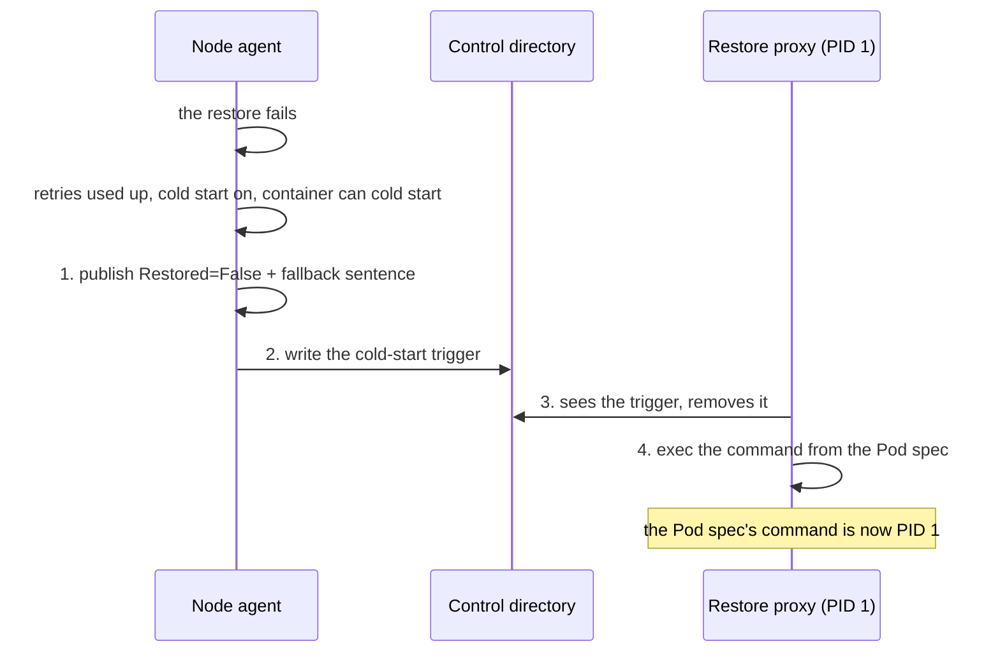

<!--
SPDX-FileCopyrightText: Copyright (c) 2026 NVIDIA CORPORATION & AFFILIATES. All rights reserved.
SPDX-License-Identifier: Apache-2.0
-->

# SNEP-322: Cold-start fallback when a restore fails

<!-- toc -->
- [Summary](#summary)
- [Motivation](#motivation)
  - [Goals](#goals)
  - [Non-Goals](#non-goals)
- [Proposal](#proposal)
  - [User Stories](#user-stories)
    - [Story 1: the checkpoint on this node is damaged or gone](#story-1-the-checkpoint-on-this-node-is-damaged-or-gone)
    - [Story 2: the Pod lands on a node the checkpoint does not fit](#story-2-the-pod-lands-on-a-node-the-checkpoint-does-not-fit)
    - [Story 3: the cold-started workload crashes](#story-3-the-cold-started-workload-crashes)
    - [Story 4: a team wants a failed restore to stay failed](#story-4-a-team-wants-a-failed-restore-to-stay-failed)
  - [Limitations, Risks, and Mitigations](#limitations-risks-and-mitigations)
- [Design Details](#design-details)
  - [When the agent starts a cold start](#when-the-agent-starts-a-cold-start)
  - [Which failures can cold start: green, yellow, red](#which-failures-can-cold-start-green-yellow-red)
  - [How the proxy starts the command](#how-the-proxy-starts-the-command)
  - [Several destination containers](#several-destination-containers)
  - [If the agent restarts midway](#if-the-agent-restarts-midway)
  - [Restart policy and later restarts](#restart-policy-and-later-restarts)
  - [Probes](#probes)
  - [API](#api)
  - [Security](#security)
  - [Monitoring](#monitoring)
  - [Dependencies](#dependencies)
  - [Test Plan](#test-plan)
  - [Graduation Criteria](#graduation-criteria)
- [Open Questions](#open-questions)
  - [What does a container started after a cold start do?](#what-does-a-container-started-after-a-cold-start-do)
  - [Should a missing checkpoint fall back?](#should-a-missing-checkpoint-fall-back)
  - [Facts to confirm on a node](#facts-to-confirm-on-a-node)
- [Alternatives](#alternatives)
- [Appendix](#appendix)
<!-- /toc -->

## Summary

When a restore fails and cannot succeed, the Pod starts its workload from
scratch (a cold start) in the same container, running as its Pod spec describes,
instead of staying failed. A cold start is slower than a restore, but the Pod
ends up serving rather than waiting for someone to replace it. The Pod still
reports that its restore failed. A Pod opts in with an annotation; fallback is
off otherwise.

## Motivation

A restore is an optimisation: the Pod's own command could start the same
workload, only slower. Today, when a restore fails, nothing takes over. The
node agent publishes `nvidia.com/Restored=False`, the container ends, and a Pod
that should have been serving in seconds is not serving at all. A restore can
fail for reasons nobody in the request path controls: the checkpoint is damaged
or gone, the node refuses it as incompatible, or CRIU, the CUDA restore, or
PageBroker fails on this node only. The caller must notice and recreate the Pod
while the GPU sits idle. A cold start does not depend on the checkpoint, so it
can work when the restore cannot.

This proposal is about what happens after a restore has failed. It is separate
from restore retry (#247), which makes transient failures succeed on another
attempt. When retry exists, fallback runs after the retries are used up.

### Goals

1. A restore that failed, with retries used up, on a Pod that opted in and whose
   container is still [clean enough](#which-failures-can-cold-start-green-yellow-red),
   ends with the Pod running exactly as its Pod spec describes (image, command,
   arguments, environment, mounts, probes), with no action from the caller.
2. The cold start happens in place: the same container, with no kubelet restart,
   so it works with any `restartPolicy`.
3. The Pod behaves as if started without Snapshot, except for the record of the
   failed restore: the `Restored=False` condition and an event.
4. A restore that succeeds, or is still in progress, behaves as it does today.
5. A failure the container cannot be cleaned of is never cold started. It ends as
   it does today.
6. Fallback is a per-Pod switch, off by default, with no new CRD field or
   controller.

### Non-Goals

1. **Retrying a failed restore** (#247). Fallback acts after the retries.
2. **Nodes without the restore proxy.** On those, a Pod cannot fall back.
3. **Restoring again into a restarted container** (#247, PR #174). See
   [Restart policy and later restarts](#restart-policy-and-later-restarts).

## Proposal

A Pod turns fallback on with the annotation
`nvidia.com/restore-fallback-to-cold-start: "true"`. The restore proxy
(`snapshot-restore-proxy`) is already PID 1 of every destination container,
waiting for the restore result. When the restore fails, the node agent decides
whether a cold start is allowed. If it is, the agent tells the proxy, and the
proxy replaces itself with the container's own command.

The agent starts a cold start only if all three hold:

1. **The retries are used up.** There is nothing left to try for this restore.
2. **Cold start is on.** The Pod has the annotation set to `"true"`.
3. **The container can cold start.** The failed restore did not change the
   container, or the agent has undone the change. Otherwise the container
   stays as it is today.



The agent makes no further restore attempt on this container. From here on it is
an ordinary container running the Pod spec's command.

### User Stories

#### Story 1: the checkpoint on this node is damaged or gone

After a node is replaced, a `PodSnapshot` still reads `Ready` but the files
behind it are gone. Without fallback, every replica scheduled onto the broken
storage stays failed until a person finds out. With fallback, each replica loads
the model from scratch and joins the service late, but joins it. The failure is
found while the agent reads the checkpoint, before the container is touched, so
it is [green](#which-failures-can-cold-start-green-yellow-red).

#### Story 2: the Pod lands on a node the checkpoint does not fit

A checkpoint taken on one GPU generation is scheduled onto a node of another. The
compatibility check refuses the restore (`RestoreIncompatible`) before anything
is changed. The Pod falls back to a cold start on the GPU it was given, which is
correct on any node.

#### Story 3: the cold-started workload crashes

A replica falls back, starts cold, and later crashes (an out-of-memory kill, for
example). The kubelet restarts it by the Pod's `restartPolicy`, with the usual
back-off. What the new container does is described in
[Restart policy and later restarts](#restart-policy-and-later-restarts).

#### Story 4: a team wants a failed restore to stay failed

A team suspects a bad capture and wants the failure to be visible, not hidden by
a Pod that serves anyway. It leaves the annotation unset.

### Limitations, Risks, and Mitigations

- **Not every failure can cold start.** After a restore has started changing the
  container, the container may not be clean. Those failures end as they do today
  (see [green, yellow, red](#which-failures-can-cold-start-green-yellow-red)).
  Alpha covers the failures found before the container is touched.
- **Probes must suit both starts.** See [Probes](#probes).
- **A workload that crashes on every start loops**, bounded by the kubelet's
  restart back-off and the restart policy.
- **A stale trigger could cold start a later container.** The proxy removes the
  trigger before it starts the command (see
  [How the proxy starts the command](#how-the-proxy-starts-the-command)).
- **The Pod needs the restore proxy.** A node without it keeps today's behavior.

## Design Details

### When the agent starts a cold start

One function in the node agent, `requestColdStart`, is the only place that tells
a proxy to cold start. The controller calls it from the point where a restore
ends in failure, and only when all three conditions of the
[Proposal](#proposal) hold:

| Condition | Where it comes from |
| --- | --- |
| Retries used up | Restore retry (#247). Today only "not yet" waits retry (30 s, no limit); every other failure is final at once. |
| Cold start on | `nvidia.com/restore-fallback-to-cold-start` is `"true"` on the Pod. |
| Container can cold start | The `canColdStart` flag, from `nsrestore` and the host-side restore (see below). |

```text
on restore failure for destination D:
  if retriesLeft(D) > 0:              retry (#247)
  elif !annotationOn(pod):            fail as today
  elif !canColdStart(D):              fail as today
  else:                               requestColdStart(D)
```

`requestColdStart` does two steps, in this order:

1. **Publish the terminal condition.** It sets `nvidia.com/Restored` to `False`
   with the original reason (`RestoreFailed`, or `RestoreIncompatible` when the
   node refused the checkpoint), and ends the message with `Falling back to the
   container command.` The Pod event carries the same message. This is a
   server-side apply on the status subresource, so conditions owned by the
   kubelet are untouched.
2. **Write the trigger.** It writes `cold-start` into the destination
   container's control directory. If it still cannot after a few attempts, the
   agent replaces the condition's message with the failure text and `Fallback
   could not be prepared: <cause>.` (same reason, still terminal) and ends the
   restore as it does today (`restore-failed`, then the kill), so the condition
   never promises a cold start that does not happen.

The condition comes first because it is the record of what is owed: it is what
the agent finds again after a restart (see
[If the agent restarts midway](#if-the-agent-restarts-midway)).

**What changes from today.** Today a failed restore writes `restore-failed`,
kills PID 1, and then publishes the condition. For a cold start the agent does
neither: it must not end the container.

### Which failures can cold start: green, yellow, red

A cold start in place is only right if the container looks as it did before the
restore. A restore changes the container in steps, so each step has a colour:

- **Green:** nothing in the container was touched. The agent can cold start.
- **Yellow:** the container was touched, and the agent knows how to undo it. The
  agent runs the undo, then cold starts.
- **Red:** the change cannot be undone, or the agent cannot prove the container
  is clean. The restore ends as it does today. The agent never cold starts a red
  container.

The restore keeps a `canColdStart` flag, starting true, and a ledger of undo
actions:

- **Set before do.** The flag is turned off, or the undo is added to the ledger,
  *before* the risky call, so a call that dies half way still counts.
- **The flag only turns off.** Once off, nothing turns it on again.
- **A crash is red.** If `nsrestore` is killed, its ledger is lost, so the flag
  is off.
- **The default is red.** A step that is not in the table below is red.

The table follows the restore in execution order. "Host" steps run in the agent;
"in the container" steps run in `nsrestore`, inside the container's namespaces
(`agent/internal/executor/nsrestore.go`).

| Step | Colour | What it does, and the undo |
| --- | --- | --- |
| Host: resolve the checkpoint, read the manifest, check compatibility | Green | Read-only. A refusal (`RestoreIncompatible`) is here. |
| Host: find the container, check that PID 1 is the proxy | Green | Read-only. No proxy means no fallback. |
| Host: mount the bundle, `cuinterpose`, the checkpoint source into the container | Yellow | The deferred cleanup that already runs. |
| Host: PageBroker stage | Yellow | The PageBroker abort that already runs. |
| In the container: read the manifest, check the CUDA job file, check LSM labels, build the CRIU options | Green | Read-only. |
| In the container: write the inet remap file (`snapshot-inet-remap-*.map`) | Yellow | Delete the file. Today it is never deleted. |
| In the container: stage the rootfs diff to a temporary file | Yellow | Delete the temporary file (a defer already does). |
| In the container: apply the rootfs diff (`tar -x` into `/`) | Red | Starts writing files and leaves no record of which. With `--skip-old-files` a half-written file is never fixed. |
| In the container: apply the deleted-files list (`RemoveAll`) | Red | Cannot be undone, and errors are only logged. |
| In the container: write `/snapshot-control/cuda-job` | Yellow | Delete the file. |
| In the container: bind-mount GPU device aliases | Yellow | `Close(false)` already unwinds it. |
| In the container: unmount `/dev/shm` | Red today | Never remounted. Yellow if the mount options are recorded first and re-mounted on failure. |
| In the container: remount `/proc/sys` read-write | Yellow | Remount read-only (a defer does; lost if `nsrestore` is killed). |
| In the container: mount `securityfs` | Yellow | `MNT_DETACH` (a defer does). |
| In the container: delete the `restore-*` sentinels and the CRIU `kdat` cache | Green | Files the flow owns; a judgement call. |
| In the container: CRIU scratch directory, replacement `files.img` | Yellow | The cleanup that already runs. The scratch directory given by `workDir` is never removed. |
| In the container: CRIU, before it calls `PreRestore` | Green | CRIU only checks options and kernel features. |
| In the container: CRIU, from `PreRestore` on | Red | Processes and mounts are created. Yellow only if "kill the restored tree" is proved. |
| In the container: CUDA restore, unlock, `cuinterpose` | Red | Same as CRIU. |
| Host: PageBroker CustomStorage, GPU restore failed | Red | The container is already terminated. |

**Alpha** treats every failure from `executeRestore` in `nsrestore` on as red. It
covers the host steps and the in-container reads and checks before that point
(the inet remap file stays in place, as it does today), which is what Stories 1
and 2 need. **Beta** moves the boundary down the table, one step at a time, by
adding the undo for each yellow row and the mark for each red one. A step moves
only when its undo is tested on a node.

### How the proxy starts the command

Two files in the container's control directory (`/snapshot-control`, one
subdirectory per destination, see `docs/reference/restore-pod-contract.md`):

- **`workload-command`.** The NRI plugin writes it when the kubelet creates the
  container, from the container's original args, before it replaces them with
  the proxy. It is a JSON array and read-only (`0444`). It is rewritten at every
  container creation.
- **`cold-start`.** The trigger. The agent writes it. It is empty; its presence
  is the signal.

The proxy checks for the trigger in every check of the control directory, before
`restore-complete` and `restore-failed`, so a cold start wins. When it finds it:

1. It reads `workload-command`.
2. It **removes the trigger**. The control directory is a Pod volume that outlives
   a container, so a trigger left behind would cold start the next container
   without a restore attempt. If it cannot remove the trigger, it runs nothing
   and exits 113.
3. It calls `exec` on the command, looking the program up in the container's
   `PATH`. The command is PID 1, with the environment and user the Pod spec gives.

If the command file is missing or cannot be read, the proxy exits 113 (the
existing proxy-error code). If the program is not found, it exits 127; if `exec`
fails for another reason, 126, as a shell does.

The proxy runs as the container's own user, so it needs no more rights than it
has now: removing a file in its own volume, and `exec` of what the Pod spec
already allows.

### Several destination containers

A restore Pod can have several destination containers (the container map). The
restore outcome is one condition per Pod, so fallback is per Pod too:

- A Pod falls back only if **every** destination that failed or was refused is
  cold-startable, and none succeeded. A `RestorePartiallySucceeded` Pod does not
  fall back and ends as it does today.
- The agent holds back the kill and `restore-failed` for a destination that could
  cold start until all destinations are done, then either cold starts every one
  of them, or releases them the way it does today.
- Each destination has its own trigger and its own proxy.

Sidecars that are not destinations are left alone.

### If the agent restarts midway

The agent can stop at any point after the condition is published. The Pod then
says `Restored=False` with the fallback sentence, and the proxy is waiting, or
already running the command. The sentence is the one record needed: it is there
only when a cold start was chosen. When the agent finds a Pod with a terminal
failure whose message has the sentence, it checks each destination:

- **PID 1 is the proxy, and there is no trigger:** write the trigger.
- **PID 1 is the proxy, and the trigger exists:** nothing; the proxy will take it.
- **PID 1 is not the proxy:** the command is running; nothing.

The agent already checks that PID 1 is the proxy before a restore. There is a
window of microseconds between the proxy removing the trigger and its `exec`, in
which the agent could write a second trigger. The next container's proxy would
then cold start once without a restore attempt, which is the same as a restore
that failed. This is accepted.

The check needs the agent to resume interrupted work, which #247 also needs.

### Restart policy and later restarts

The first cold start is in the same container, so it needs no restart, and
**`restartPolicy` is not a condition**: `Never` works.

After it, the container is ordinary. When it ends, `restartPolicy` decides, with
the usual back-off. The new container starts with the proxy, because the NRI
plugin installs it in every destination. What happens then belongs to #247 and
PR #174, which restore again into a restarted container: the restore is tried
again by the retry rules, and may fail, in which case this proposal applies and
may cold start again. So the annotation is a plain on/off: each restore failure
is handled the same way, with no counter of earlier cold starts.

Until that exists, what the new container does is an
[open question](#what-does-a-container-started-after-a-cold-start-do).

### Probes

Fallback changes no probe. The Pod's probes apply to a restore and to a cold
start alike, so any probe the user provides must suit both. The one to watch is
the startup probe, whose failure limit must cover the longer of the two (normally
the cold start).

The probe added by `Options.EnableStartupGate` (`cat
/snapshot-control/restore-complete`) must not be used with fallback: a
cold-started container never produces that file, so the kubelet would kill it.

### API

No CRD, status field, or condition type is added. One annotation is new:
**`nvidia.com/restore-fallback-to-cold-start`**, on the restore Pod:

- `"true"`: a failed restore that can cold start does.
- `"false"`, or absent (the default): a failed restore ends as today.

An unrecognised value is logged and treated as `"false"`, because the agent
cannot reject the Pod. The files `cold-start` and `workload-command` are
internal to the agent, the NRI plugin and the proxy; the restore Pod contract
documents them next to `restore-complete`.

### Security

The annotation starts the command in the Pod's own spec, with the security
context, mounts, and service account that spec grants, so it gives the Pod
nothing new. The agent writes the trigger only for the Pod it is restoring, found
by the Pod's UID, as it already does for `restore-complete`. The control directory
is the Pod's own volume, which the workload can also write, so a process in the
Pod could already write `restore-failed`. A trigger written by the workload would
only make the proxy run the Pod's own command, and the proxy no longer reads the
directory once the restore has completed. `workload-command` is written by the
NRI plugin from the Pod spec, with mode `0444`, and rewritten at each container
creation. A fallback Pod never reads the checkpoint after it fails.

### Monitoring

- **Condition.** `Restored=False` with the original reason and a message ending
  `Falling back to the container command.`, or saying why fallback cannot happen.
- **Events.** On the Pod, like the other restore events (reasons follow
  `docs/development/naming.md`): a Warning when a cold start is chosen, naming
  the cause; and a Warning when it was wanted but could not happen, with the
  reason (the container was changed, or the proxy is missing).
- **Logs.** The agent logs each step and the colour decision. The proxy logs that
  it runs the command.
- **Metrics.** A counter of cold starts by reason and a counter of refusals by
  colour, following #665.

### Dependencies

- **Restore retry (#247, PR #836).** Supplies "retries used up". The proxy and
  NRI plugin changes do not depend on it and can land first. The agent change
  that calls `requestColdStart` lands after it.
- **Restore of restarted containers** (PR #174, and PR #906 for restarts after a
  successful restore). See
  [Restart policy and later restarts](#restart-policy-and-later-restarts).
- The restore proxy, which needs containerd 2.2 or newer with NRI v0.10 or newer
  (see `docs/reference/restore-pod-contract.md`), and the NRI socket mounted in
  the agent DaemonSet (charts newer than 0.2.0 do).

### Test Plan

Tracking: #322 (design), #689 (implementation), #244 (feature).

**Unit.**

- The annotation: `"true"`, `"false"`, absent, and an unrecognised value.
- The NRI plugin writes `workload-command` from the original args, and
  rewrites it on the next creation.
- The proxy: with the trigger it reads the command, removes the trigger, and
  `exec`s it (a stub `exec` in the test); the trigger wins over
  `restore-complete` and `restore-failed`; a missing or invalid command file
  exits 113; program not found exits 127; `exec` failure exits 126; and without a
  trigger it behaves as today.
- `requestColdStart`: the condition is published before the trigger; a trigger
  write failure ends the restore as today with the "could not be prepared"
  message; and recovery writes the trigger only when PID 1 is the proxy and the
  trigger is absent.
- The gate: each of the three conditions false on its own gives today's result.
- Classification: each row of the colour table, including that an unlisted step
  is red.
- Several destinations: all cold-startable and none succeeded cold starts all;
  one red destination releases all; a partial success does not fall back.

**End to end, on a GPU node.**

- A missing or unreadable checkpoint, and an incompatible checkpoint, end with the
  Pod serving the container command, with `Restored=False` and the fallback
  sentence, also with `restartPolicy: Never`.
- A truncated rootfs diff (red in alpha) fails as today.
- With the annotation `"false"`, a failed restore stays failed.
- A healthy restore is unaffected.
- The cold command is PID 1 and gets signals as in a Pod without Snapshot.
- The container is not restarted by the cold start (restart count unchanged).

### Graduation Criteria

**Alpha.** Cold start for the green steps, with unit and end-to-end coverage and
updated documentation. **Beta.** The yellow steps with their undo tested on a
node, the [facts to confirm](#facts-to-confirm-on-a-node) decided, the restart
behavior agreed with #247 and PR #174, and metrics exist. **GA.** Field evidence
of production use.

## Open Questions

### What does a container started after a cold start do?

Retry (#247) and PR #174 are expected to restore again into a restarted
container, and a failure there would apply this proposal again. Until they land,
a container started after a cold start finds no trigger and no
result, so the proxy waits for a restore the agent will not make, because the Pod
already has the terminal `Restored=False` condition.

- **A: rename, not remove (proposed).** The proxy renames `cold-start` to
  `restore-failed` instead of removing it. That clears the trigger, in one
  atomic step, and leaves the marker the proxy already honours, so a restart
  exits 112 as it does today. #247 then clears the markers when it restores
  again.
- **B: remove, and wait for #247.** Simpler. A restart hangs until #247 lands.
- **C: the agent writes the trigger again for a restarted container** of a Pod
  with the sentence. It is a cold start on every restart, which is a counter-free
  "always", and it would stay when #247 lands.

### Should a missing checkpoint fall back?

A restore Pod whose `PodSnapshot` does not exist, or is not `Ready`, today waits
and the controller retries every 30 s with no limit. The wait is deliberate: a
Pod may be created before its checkpoint is `Ready`. So today it never reaches
fallback.

- **A: fall back after the retry budget (proposed).** #247 gives the wait a
  deadline.
- **B: leave it waiting.** Race-free, but a checkpoint never taken leaves the Pod
  waiting forever.
- **C: fall back at once.** A Pod created moments before its checkpoint is
  `Ready` would cold start when a restore would have worked seconds later.

A `Ready` checkpoint whose artifact is gone is a failed restore, not part of this
question.

### Facts to confirm on a node

The colour table rests on facts read from the code. These are my reading of CRIU
and the kernel, and a test on a node must confirm them before a row moves to
yellow:

1. CRIU kills the tasks it restored when `Restore` fails after `PreRestore`.
2. The driver frees GPU memory when the restored processes die.
3. A SIGKILL of `nsrestore` skips the `/proc/sys` remount, and what it leaves
   mounted.
4. Whether capture writes a non-empty rootfs diff for an empty upper directory,
   so the "no archive" path is rare.
5. Whether real overlayfs deletions appear as `.wh.<name>` files, which
   decides if the deleted-files step ever runs.
6. How the target workloads mount `/dev/shm` (a Pod volume or the runtime
   default), which decides how much the remount matters.
7. Which restore step real failures come from, from the `step` in the `nsrestore`
   result, which decides where to start the yellow work.
8. That the proxy's user can remove a file in its control directory (an
   `emptyDir` is created with mode `0777`, and each destination has a
   `subPath`).

## Alternatives

**Restart the container and start it without the proxy.** The agent sets a
trigger, kills the container, and the NRI plugin lets the kubelet's new container
run as the Pod spec defines. This was the first design of this SNEP. It cannot
be dirty: a new container has a fresh writable layer. It was replaced because it
needs `restartPolicy` `OnFailure` or `Always`, a kubelet restart with its
back-off, and an NRI trigger on the container-creation path that must work when
the `PodSnapshot` is gone. In-place needs none of these, and the green, yellow,
and red split answers its one weakness, a container the restore has changed.

**Reuse `restore-failed` as the trigger.** It makes the proxy exit by itself,
and means "restore spent", not "run the command".

**A Pod annotation as the trigger.** The proxy cannot read the Pod's annotations
without Kubernetes credentials, which it does not have.

**A cluster-wide switch** is left out so behavior is explicit per Pod, and can be
added later. **Default on** would change every Pod on upgrade.

## Appendix

- #244: the feature request. #247: restore retry (PR #836). #665: metrics.
- SNEP-394: the capture-side retry. PR #174 and PR #906: restore of restarted
  containers.
- `docs/reference/restore-pod-contract.md`: the restore Pod contract, including
  the restore proxy and its exit codes (112, 113).
