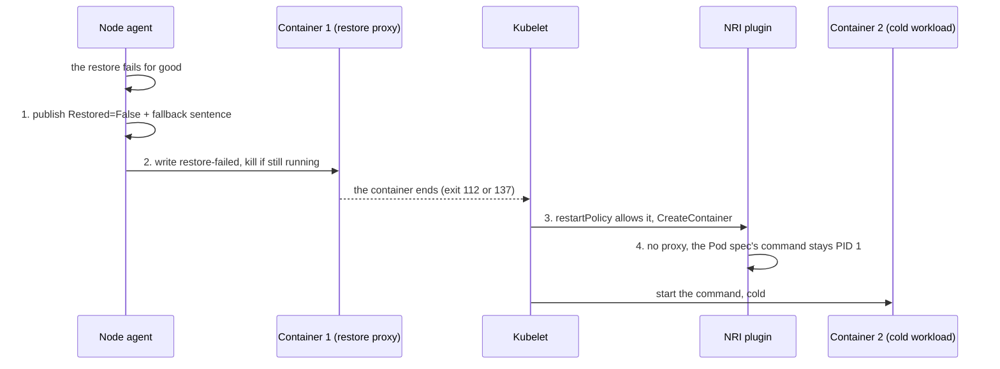

<!--
SPDX-FileCopyrightText: Copyright (c) 2026 NVIDIA CORPORATION & AFFILIATES. All rights reserved.
SPDX-License-Identifier: Apache-2.0
-->

# SNEP-322: Cold-start fallback when a restore fails

<!-- toc -->
- [Summary](#summary)
- [Motivation](#motivation)
  - [Goals](#goals)
  - [Non-Goals](#non-goals)
- [Proposal](#proposal)
  - [User Stories](#user-stories)
  - [Limitations, Risks, and Mitigations](#limitations-risks-and-mitigations)
- [Design Details](#design-details)
  - [What fallback does](#what-fallback-does)
  - [Restart policy](#restart-policy)
  - [Probes](#probes)
  - [API](#api)
  - [Security](#security)
  - [Monitoring](#monitoring)
  - [Dependencies](#dependencies)
  - [Test Plan](#test-plan)
  - [Graduation Criteria](#graduation-criteria)
- [Open Questions](#open-questions)
  - [Should a missing snapshot fall back?](#should-a-missing-snapshot-fall-back)
  - [What happens when a restored workload exits?](#what-happens-when-a-restored-workload-exits)
- [Alternatives](#alternatives)
- [Appendix](#appendix)
<!-- /toc -->

## Summary

When a restore fails permanently, the Pod starts its workload from scratch (a
cold start) instead of staying failed, in the same Pod, running as its Pod spec
describes. A cold start is slower than a restore, but the Pod ends up serving
rather than waiting for someone to replace it. The Pod still reports that its
restore failed. A Pod opts in with an annotation; fallback is off otherwise.

## Motivation

A restore is an optimisation: the Pod's own command could start the same
workload, only slower. Today, when a restore fails, nothing takes over. The
agent publishes `nvidia.com/Restored=False`, the container ends, and a Pod that
should have been serving in seconds is not serving at all. A restore can fail
for reasons nobody in the request path controls: the checkpoint is damaged or
gone, the node refuses it as incompatible, or CRIU, the CUDA restore, or
PageBroker fails on this node only. The caller must notice and recreate the Pod
while the GPU sits idle. A cold start does not depend on the checkpoint, so it
can work when the restore cannot.

This proposal is about what happens after a restore has failed for good. It is
separate from restore retry (#247), which makes transient failures succeed on
another attempt. When retry exists, fallback runs after the retries are exhausted.

### Goals

1. A restore that failed for good ends with the Pod running exactly as its Pod
   spec describes (image, command, arguments, environment, mounts, probes),
   with no action from the caller after it opts in.
2. The Pod behaves as if started without Snapshot, except for the record of the
   failed restore: the `Restored=False` condition, an event, and the restart count.
3. A restore that succeeds, or is still in progress, behaves as it does today.
4. Fallback is a per-Pod policy, off by default, with no new CRD field or controller.

### Non-Goals

1. **Retrying a failed restore** (#247). Fallback acts on the final outcome.
2. **Nodes without the restore proxy.** On those, a Pod cannot fall back and says so.

## Proposal

A Pod chooses a policy with the annotation `nvidia.com/restore-fallback-to-cold-start`:
`Always`, `Once`, or `Never` (the default). With `Always` or `Once`, a restore
that has failed for good (`Restored=False` with reason `RestoreFailed`, or
`RestoreIncompatible` when the node refused the checkpoint) now ends like this:

1. The **node agent** publishes `Restored=False` with the failure message
   extended by `Falling back to the container command.`
2. The agent writes the `trigger-cold-start` file in the container's control
   directory, then kills the destination container. The kill is the only thing
   that ends the container.
3. The **kubelet** restarts the container, if the Pod's `restartPolicy` allows.
4. The **NRI plugin**, when the kubelet creates that container, finds the
   trigger and does not install the restore proxy. The command from the Pod spec
   stays PID 1.

There is no anoter restore attempt, and the new container is not a restore
destination. From here on it is an ordinary container: `restartPolicy` decides
what happens when it ends (see [Restart policy](#restart-policy)).

### User Stories

#### Story 1: the checkpoint on this node is damaged or gone

After a node is replaced, a `PodSnapshot` still reads `Ready` but the files
behind it are gone. Without fallback, every replica scheduled onto the broken
storage stays failed until a person finds out. With `Always`, each replica loads
the model from scratch and joins the service late, but joins it.

#### Story 2: the Pod lands on a node the checkpoint does not fit

A snapshot taken on one GPU generation is scheduled onto a node of another. The
compatibility check refuses the restore (`RestoreIncompatible`). The Pod falls
back to a cold start on the GPU it was given, which is correct on any node.

#### Story 3: the cold-started workload crashes

A replica falls back, starts cold, and later crashes (an out-of-memory kill, for
example). With `Always` the kubelet restarts it cold again, with the usual
back-off, so the service recovers without anyone stepping in.

#### Story 4: a team suspects the capture is bad

The team wants the Pod to serve once from a cold start, so it can capture again,
without hiding the problem behind endless cold starts. It sets `Once`. If the cold
container ends, the next restart is refused and the Pod shows `CrashLoopBackOff`.
A team that wants failed restores to stay failed leaves the annotation unset.

### Limitations, Risks, and Mitigations

- **The Pod must be restartable** (`restartPolicy` `OnFailure` or `Always`). With
  `Never` no cold start can follow, and the agent warns about it (see
  [Restart policy](#restart-policy)).
- **Probes must suit both starts.** See [Probes](#probes).
- **A workload that crashes on every start loops** with `Always`, bounded by the
  kubelet's restart back-off. `Once` avoids this.
- **Partial restores.** The container is killed before the cold start, so its
  processes and GPU memory are released first (the [test plan](#test-plan) checks).

## Design Details

### What fallback does

A restore Pod has a destination container, the one the agent restores into.
After a failed restore with fallback opt-in, the agent stops that container
and nothing else; sidecars are left alone.

**When fallback applies.** All four must hold:

- The annotation is `Always` or `Once`.
- The restore failed for good: `RestoreFailed` or `RestoreIncompatible`. A `Ready`
  snapshot whose artifact is gone is a `RestoreFailed` like any other.
- `restartPolicy` is `OnFailure` or `Always`.
- The node has the restore proxy.

Otherwise the restore ends as today, and the condition message says why.

**What the agent does.** Three steps, in this order:

1. **Publish the terminal condition.** It sets `nvidia.com/Restored` to `False`
   with the original reason. This is the Pod's final restore outcome, reached
   after any retries (#247), and the agent never restores into the Pod again.
   Fallback only extends the condition's **message**, which keeps the failure
   text and ends with the fallback sentence; the Pod event carries the same
   message. It is a server-side apply on the status subresource, so conditions
   owned by the kubelet are untouched.
2. **Write the trigger.** The file `trigger-cold-start` goes into the container's
   control directory (mounted at `/snapshot-control`), with the policy as its
   content. The proxy does not watch it, so writing it ends nothing. It must exist
   before the kill, or the restarted container would get the proxy and wait for a
   restore that never comes. If the write fails, the agent ends the restore as it
   does today (`restore-failed`, then the kill), so the Pod fails instead of hanging.
3. **Kill the destination container.** The agent sends SIGKILL to its PID 1. The
   container ends with exit 137, so it counts as a failure for `OnFailure`.

**What changes from today.** Today a failed restore the agent writes `restore-failed`,
kills PID 1, and only then publishes the condition. `restore-failed` makes the
proxy exit by itself (exit 112), which could end the container before the agent's
kill does. For fallback the condition comes first and `restore-failed` is not
written, so the agent's kill is the only thing that ends the container and cannot
land on a cold container the kubelet already started.

**Starting the command.** When the kubelet creates the container (after its
normal back-off), the NRI plugin looks for the trigger in the control directory.
If it is there, the plugin installs no restore proxy, so the Pod spec's command
stays PID 1. The trigger's content decides what happens next:

- **`Always`:** the trigger stays, so every container created after the failure
  starts cold.
- **`Once`:** the plugin replaces the trigger with `cold-start-used`, so only this
  container starts cold. The next restart finds no trigger and gets the proxy,
  which refuses to run when it finds `cold-start-used` (exit 112, as it already
  does for `restore-complete` and `restore-failed`), and the Pod shows
  `CrashLoopBackOff`.

**Not restoring again.** The new container is created in the same Pod, which the
agent still watches. It does not restore into it, because the Pod already has the
terminal `Restored=False` condition and the agent does no restore work on such a
Pod. The condition lives on the Pod, so this also holds after an agent restart.
Fallback relies on this existing rule and does not change it.

**If the agent restarts midway.** The agent can crash after publishing the
condition and before the kill. The Pod then says `Restored=False` with the
fallback sentence while the original container still runs with the proxy waiting,
and the rule above would leave it that way. So when the agent sees a Pod with the
terminal condition and the trigger, it also kills the destination container if it
is still the original one (for example by its restart count), and never the cold
workload. This needs the agent to resume interrupted work, which #247 also needs,
so it may land after the first change (P1).

### Restart policy

Fallback needs the kubelet to restart the container, so the Pod's
`restartPolicy` and the annotation together decide what happens after a restore
has failed for good, and again when the cold container later ends:

| `restartPolicy` \ annotation | `Never` (default) | `Once` | `Always` |
| --- | --- | --- | --- |
| `Always` | Restart; the proxy refuses (exit 112): `CrashLoopBackOff`. | Cold start. When it ends, the restart is refused: `CrashLoopBackOff`. | Cold start. When it ends, it restarts cold again, with back-off. |
| `OnFailure` | Same as above. | Cold start. Ends with an error: restart refused, `CrashLoopBackOff`. Ends with 0: `Succeeded`. | Cold start. Ends with an error: restarts cold. Ends with 0: `Succeeded`. |
| `Never` | Pod `Failed`. | No fallback, Pod `Failed`; reported when the restore starts. | Same as `Once`. |

- **The `Never` column is today's behaviour.** The restart goes to the proxy,
  which refuses to run (exit 112), so the Pod loops or fails with nothing serving.
- **Which failures fall back at once.** `RestoreIncompatible` does, since retry
  cannot help. `RestoreFailed` does after the retries are used up (#247).
- **`Once` versus `Always`.** `Always` is for availability: every restart is a
  cold start. `Once` allows one cold start, then refuses the restart (exit 112),
  so a bad capture does not hide behind endless cold starts.
- **A restore that succeeded is not affected by the annotation.** If the restored
  workload later exits, the restart goes to the proxy and is refused today; the
  direction is to restore again (see
  [the open question](#what-happens-when-a-restored-workload-exits)).
- **`Once` or `Always` with `restartPolicy: Never` makes no sense.** The kubelet
  never restarts the container, so no cold start can follow. It is a
  misconfiguration, not an error: the Pod is not rejected and the restore runs as
  usual. The agent reports it when the restore starts, before anything fails, with
  a warning log and a Warning event on the Pod. The failure message repeats it if
  the restore then fails. The NRI plugin does not report it; it only logs.

### Probes

Fallback changes no probe. The Pod's probes apply to a restore and to a cold
start alike, so any probe the user provides must suit both. The one to watch is
the startup probe, whose failure limit must cover the longer of the two (normally
the cold start).

The probe added by `Options.EnableStartupGate` (`cat
/snapshot-control/restore-complete`) must not be used with fallback: a
cold-started container never produces that file, so the kubelet would kill it.

### API

No CRD, status field, or condition type is added. One annotation is new:
**`nvidia.com/restore-fallback-to-cold-start`**, on the restore Pod, with one of:

- `Never` (the default, also when absent): a failed restore stays failed.
- `Always`: every container created after the failure starts cold, so the Pod
  recovers from restarts without anyone stepping in.
- `Once`: only the first container after the failure starts cold. Use it when a
  bad capture is suspected and the team wants to capture again.

An unrecognised value is logged and treated as `Never`, because the agent cannot
reject the Pod.

### Security

The annotation starts the command in the Pod's own spec, with the security
context, mounts, and service account that spec grants, so it gives the Pod
nothing new. The agent ends the container resolved from the Pod's UID and writes
one file into that Pod's own control directory, as it already does for a failed
restore today; no path comes from anything the creator controls beyond the Pod's
identity. The trigger only affects the Pod whose directory holds it, and a
fallback Pod never reads the checkpoint. Repeated cold starts are bounded by the
kubelet's back-off, the restart policy, and `Once`.

### Monitoring

- **Condition.** `Restored=False` with the original reason and a message ending
  `Falling back to the container command.`, or saying why fallback cannot happen.
- **Events.** On the Pod, like the other restore events (reasons follow
  `docs/development/naming.md`):
  - A Warning when fallback is chosen, naming the cause.
  - A Warning when fallback is wanted but cannot happen (`Once` or `Always` with
    `restartPolicy: Never`, or a node without the proxy). The agent emits it when
    the restore starts, so it shows before any failure.
  - A Normal event each time a container is created without the restore proxy,
    emitted where `RestoreDestinations` returns no destinations.
- **Logs.** The agent logs each step, and logs the "wanted but cannot happen" case
  as a warning too. The NRI plugin logs that the command stays.
- **Metrics.** A counter of fallbacks by reason, following #665.

### Dependencies

The restore proxy, which needs containerd 2.2 or newer with NRI v0.10 or newer
(see `docs/reference/restore-pod-contract.md`), and the NRI socket mounted in the
agent DaemonSet (charts newer than 0.2.0 do). The proxy changes by one line: it
also exits 112 when it finds `cold-start-used`. PR #174 changes which containers
are restore destinations; it must be reconciled so a Pod that fell back is never
one. Retry (#247) is not a dependency.

### Test Plan

Tracking: #322 (design), #689 (implementation), #244 (feature).

**Unit.**

- The annotation: `Always`, `Once`, `Never`, absent, and an unrecognised value.
- The controller, per outcome, restart policy, and annotation value: the
  condition is published, then the trigger written, then the container killed; no
  `restore-failed` is written for a Pod that falls back; if the trigger cannot be
  written the restore ends as today; and a Pod that cannot fall back (including
  `restartPolicy: Never`) is reported when the restore starts.
- After a fallback, reconciling the Pod again (also after an agent restart)
  starts no restore, and the cold-start event is emitted, but not for a restored
  Pod. After an agent restart between the condition and the kill, the original
  container is still killed, and the cold one never is.
- The NRI plugin: with the trigger it installs no proxy (`Always`: every later
  container; `Once`: the first, then it writes `cold-start-used`); without it, it
  installs the proxy. The proxy exits 112 when it finds `cold-start-used`.

**End to end, on a GPU node**, extending the PoC, one scenario per cell of the
[restart policy table](#restart-policy):

- Failed restores: a truncated image, a missing `manifest.yaml`, and an
  incompatible checkpoint end with the Pod Ready running the container command,
  with `Restored=False` and the fallback sentence. With `restartPolicy: Never`, or
  the `Never` policy, the Pod stays failed.
- Cold workload ends: with `Always`, it restarts cold (or ends the Pod as
  `Succeeded`, per `restartPolicy`). With `Once`, the restart is refused (exit
  112, `CrashLoopBackOff`).
- A healthy restore is unaffected, and a cold start after a failure that left GPU
  memory in use succeeds.

### Graduation Criteria

**Alpha.** The behaviour described here, with unit and end-to-end coverage and
updated documentation. **Beta.** The open questions are decided, fallback is
coordinated with retry (#247) and PR #174, and metrics exist. **GA.** Field
evidence of production use.

## Open Questions

### Should a missing snapshot fall back?

A restore Pod whose `PodSnapshot` does not exist, or is not `Ready`, today fails
container creation and the kubelet retries with back-off. The wait is deliberate:
a Pod may be created before its snapshot is `Ready`.

- **A: fall back after the retry budget (proposed).** #247 absorbs the race, but
  it has no design yet, and the decision moves out of the NRI plugin.
- **B: leave it waiting.** Race-free, but a snapshot never taken leaves the Pod
  waiting forever.
- **C: fall back at once.** A Pod created moments before its snapshot is `Ready`
  would cold start when a restore would have worked seconds later.

A `Ready` snapshot whose artifact is gone is a failed restore (#674), not part of
this question.

### What happens when a restored workload exits?

This mostly belongs to restore retry (#247) and PR #174, so this proposal only
states the direction. The restore worked, then the workload exits in a Pod whose
`restartPolicy` would restart it. Today the new container goes to the proxy,
which refuses (exit 112), and the Pod is `CrashLoopBackOff`.

The direction is to **restore again**, since the first restore was good. If that
restore fails for good, fallback applies by the policy, like any failed restore.

What is left for #247 is whether this restore counts as a retry attempt. A bad
snapshot that keeps crashing its workload would loop restore, exit, restore with
nothing saying why, so some limit is needed. Alpha changes nothing here: the
proxy still refuses the restart, as today.

## Alternatives

**Recreate the Pod instead of falling back in place** (#244's recommendation).
The new Pod would be clean rather than restore-shaped. In place is chosen
because Pods are created by users or orchestrators, not Snapshot, which provides
primitives, not orchestration: replacing a Pod it did not create needs
permissions it lacks, and whatever owns the Pod will also replace it. Recreating
also gives up the node, GPU, and name, and waits for scheduling and image pull
again.

**Run the command from the proxy, in the same container.** The proxy would exec
the command on failure, with no restart, so `restartPolicy: Never` Pods could fall
back. Not chosen: a restore changes its container (rootfs diff applied,
`/dev/shm` unmounted, `/proc/sys` remounted), so a failure after that leaves a
container that is not clean for a cold start, and the proxy would take on running
the command, in a component whose value is that it is small.

**Reuse `restore-failed` as the trigger.** It makes the proxy exit by itself,
which would add a second way for the container to end. A separate trigger keeps
the agent's kill the only one.

**A cluster-wide switch** is left out so behaviour is explicit per Pod, and can be
added later. **Default on** would change every restartable Pod on upgrade.

## Appendix

- #244: the feature request. #247: restore retry. #665: metrics.
- SNEP-394: the capture-side retry. PR #174: restore of restarted containers.
- `docs/reference/restore-pod-contract.md`: the restore Pod contract, including
  the restore proxy and its exit codes (112, 113).
