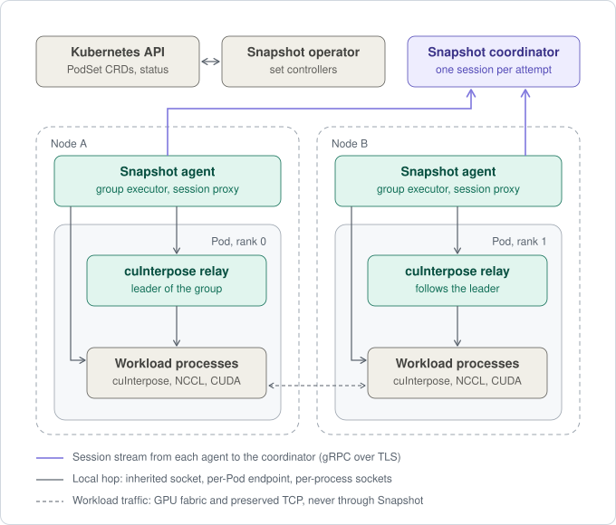
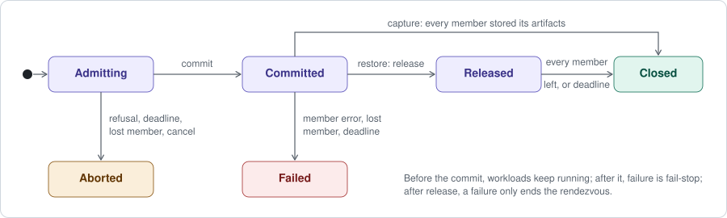
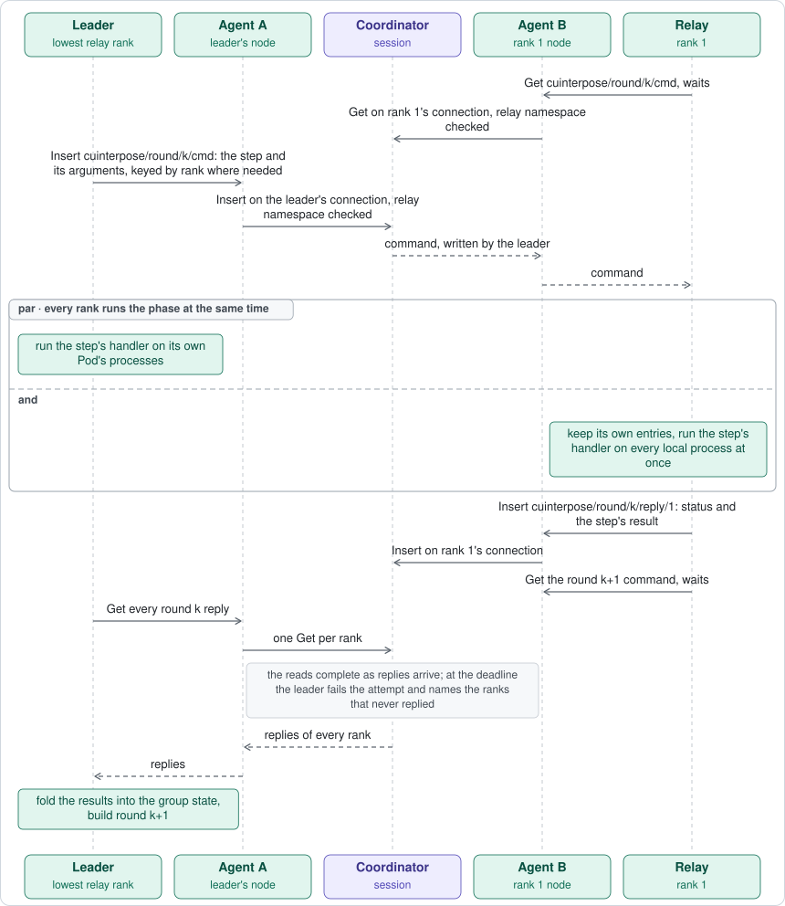
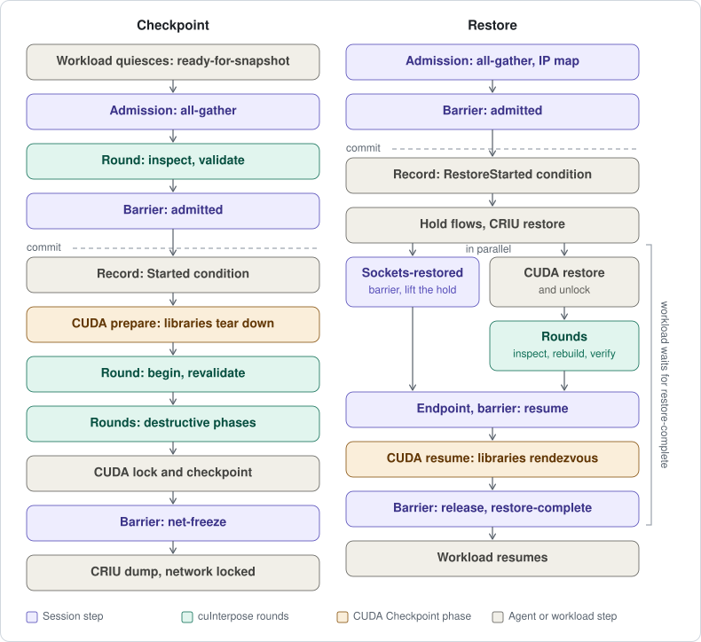
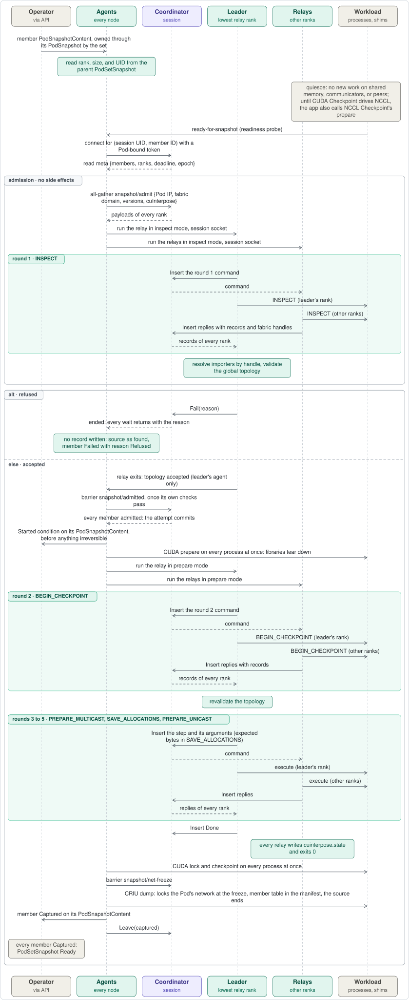
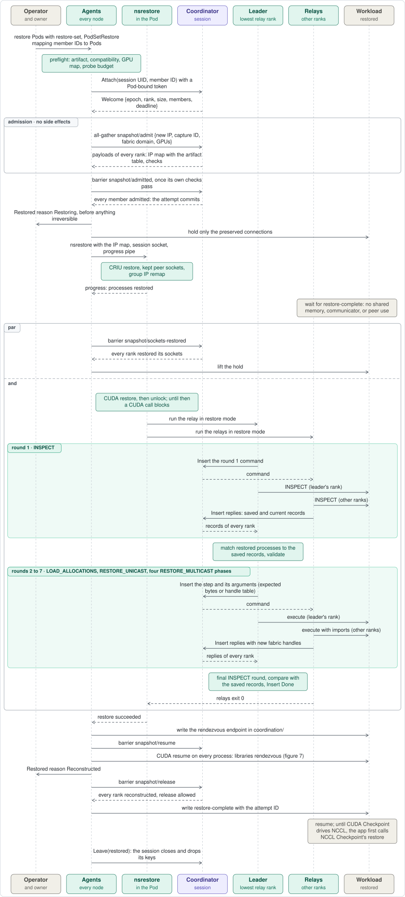
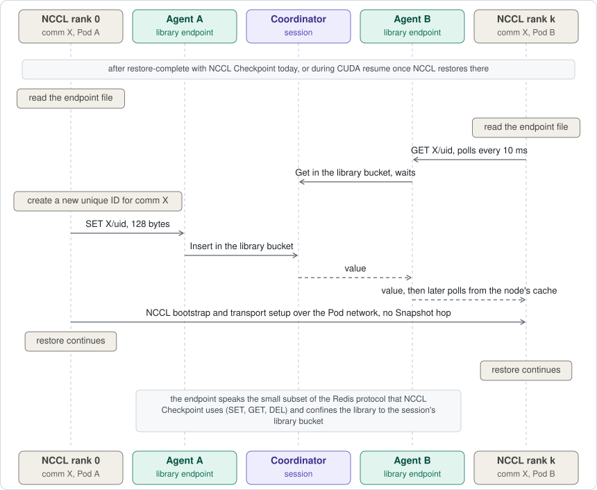
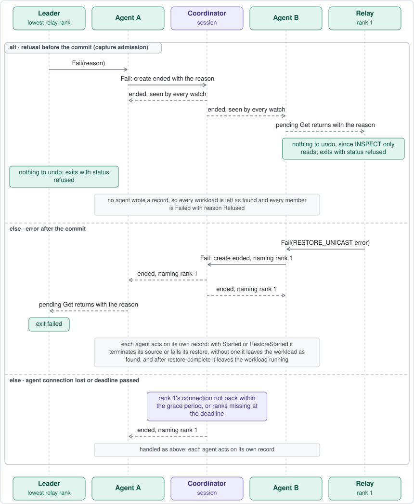

<!--
SPDX-FileCopyrightText: Copyright (c) 2026 NVIDIA CORPORATION & AFFILIATES. All rights reserved.
SPDX-License-Identifier: Apache-2.0
-->

# SNEP-324: Coordinated multi-Pod snapshot and restore

<!-- toc -->
- [Summary](#summary)
- [Motivation](#motivation)
  - [Goals](#goals)
  - [Non-Goals](#non-goals)
- [Proposal](#proposal)
  - [User Stories](#user-stories)
    - [Story 1: Scaling out a multi-node inference worker](#story-1-scaling-out-a-multi-node-inference-worker)
    - [Story 2: A communication library that restores itself](#story-2-a-communication-library-that-restores-itself)
  - [Limitations, Risks, and Mitigations](#limitations-risks-and-mitigations)
- [Design Details](#design-details)
  - [Architecture](#architecture)
  - [The coordination session](#the-coordination-session)
  - [Communication paths](#communication-paths)
  - [Phases at a glance](#phases-at-a-glance)
  - [Group checkpoint](#group-checkpoint)
  - [Group restore](#group-restore)
  - [cuInterpose across nodes](#cuinterpose-across-nodes)
  - [Communication libraries](#communication-libraries)
  - [Cross-Pod TCP connections](#cross-pod-tcp-connections)
  - [Failure handling and recovery](#failure-handling-and-recovery)
  - [Deadlines](#deadlines)
  - [API](#api)
  - [Security](#security)
  - [Configuration](#configuration)
  - [Performance and Scalability](#performance-and-scalability)
  - [Monitoring](#monitoring)
  - [Dependencies](#dependencies)
  - [Test Plan](#test-plan)
  - [Graduation Criteria](#graduation-criteria)
- [Implementation History](#implementation-history)
- [Alternatives](#alternatives)
- [Appendix](#appendix)
  - [A. Open questions](#a-open-questions)
  - [B. Changes from the prototype](#b-changes-from-the-prototype)
  - [C. Diagram sources](#c-diagram-sources)
  - [D. API definitions](#d-api-definitions)
<!-- /toc -->

## Summary

Distributed inference and training workloads often run as a set of Pods whose
processes depend on one another: they hold communicators that span the Pods,
keep long-lived control-plane connections between them, and, on GPU fabrics
that span nodes, may even share GPU memory across nodes. Because Snapshot
checkpoints and restores each Pod in isolation, none of this cross-Pod state
survives today. This SNEP introduces `PodSetSnapshot` and `PodSetRestore`, which
let a user checkpoint such a set as one unit and restore it on the same or
different nodes, with members that keep their identity and rank, an admission
step that refuses unsafe attempts before anything irreversible happens, and a
single outcome for the whole set. A short-lived coordination session, hosted by
a new Snapshot coordinator and reachable only through each node's agent,
synchronizes the members of every attempt and serves as the restore-time
rendezvous for cuInterpose and for communication libraries such as NCCL, so that
workloads neither deploy a rendezvous server nor handle secrets, while a single
Pod continues to behave exactly as it does today.

## Motivation

Snapshot's pipeline is per Pod by design: an agent quiesces one container,
checkpoints its CUDA state, dumps it with CRIU, and later restores it into a
placeholder Pod without knowing that any other Pod exists. Workloads that span
several Pods, such as tensor- or pipeline-parallel inference engines,
disaggregated serving with multi-node workers, and distributed training jobs,
break that assumption because part of their state lives between the Pods rather
than inside any one of them. Their communicators, NCCL being the common case,
are bound to peer addresses that change when Pods move; their control planes,
typically MPI or a custom RPC layer launched across Pods, depend on TCP
connections that Snapshot restores as closed; and, where the GPU fabric lets
processes on different nodes import one another's memory, the shared
allocations and multicast teams escape
[SNEP-295](https://github.com/ai-dynamo/snapshot/issues/295)'s cuInterpose,
whose coordinator only sees the processes of one Pod. Even where each Pod could
be handled on its own, a snapshot in which one member succeeded and another
failed cannot be restored, so the set also needs a single outcome.

All of these gaps reduce to one missing capability, namely a place where the
members of a checkpoint or restore attempt can find each other, exchange small
amounts of metadata, and move through phases together, and that capability is
currently being built three times. The multi-node cuInterpose prototype
embedded a coordination "brain" in rank 0's coordinator, NCCL Checkpoint expects
an operator to start Redis and publish its address in a file before restore,
and CUDA Checkpoint is adding a restore-time rendezvous interface for
communication libraries while leaving the server to the platform. Snapshot
already decides when every Pod is quiesced, dumped, restored, and released,
which makes it the natural host for that rendezvous on Kubernetes; providing it
once replaces three servers, with three lifecycles and three security models,
by a single session that follows the attempt it serves.

### Goals

- Capture a set of Pods and restore it on the same or different nodes as one
  unit, with members that keep their identity and rank from checkpoint to
  restore and one outcome per attempt.
- Refuse an attempt before any irreversible step whenever the set cannot be
  captured or restored safely, so that a refusal leaves every workload running.
- Provide one coordination session per attempt that Snapshot's agents,
  cuInterpose, NCCL Checkpoint, and CUDA Checkpoint's communication-library
  interface all share, without a coordination listener on the Pod network and
  without secrets inside Pods.
- Preserve GPU memory that processes share across Pods, through cuInterpose,
  wherever the platform supports cross-node sharing, without moving allocation
  bytes between nodes, while letting members that share no GPU memory, such as
  CPU-only control-plane Pods, take part in the same set.
- Preserve TCP connections between members of the set across relocation.
- Tolerate agent restarts without ever replaying CRIU into a restored container.
- Keep single-Pod checkpoint and restore, and the existing resources, unchanged.

### Non-Goals

- Creating, scheduling, or placing Pods. Snapshot provides primitives rather
  than orchestration, so the workload owner, for example the Dynamo operator
  with Grove, places the Pods, and Snapshot only verifies that the placement can
  work.
- Rolling back after the point of no return, retrying a failed member in place,
  or changing the size of a set between checkpoint and restore.
- Keeping an attempt alive across a coordinator failure, which this SNEP treats
  as a failure of that attempt.
- Assigning ranks or identities to library processes, which remains the
  libraries' concern, and judging application health, which remains the owner's.
- Moving shared GPU memory between fabric domains, and preserving connections
  to peers outside the set, which are reset as they are today.

## Proposal

A workload owner checkpoints a multi-Pod workload by listing its Pods in a
`PodSetSnapshot`, giving each one a member ID, and restores it by creating
restore Pods, as it already does for a single Pod, together with a
`PodSetRestore` that maps each member ID to one of them. Snapshot does the rest:
the operator expands the set into per-member work that reuses the existing
per-Pod pipeline, the agents carry that work out in lockstep, and the set
resource reports progress per member and one outcome for the attempt.

Every attempt moves through the same stages, and those stages define what a user
can rely on. During admission, Snapshot only observes and validates: it waits
until every member is ready, checks that the members can be captured or restored
together, and, if anything is wrong, ends the attempt with a `Refused` or
`DeadlineExceeded` reason while every workload keeps running. Admission ends
with a commit, recorded as `committedAt`, which marks the point of no return;
from then on the members proceed in lockstep, and a failure in any of them
terminates all of them, because shared state cannot be left half-prepared. A
capture ends when every member's artifacts are stored, whereas a restore ends
with a release in which every workload resumes at about the same time, with
shared GPU memory back at its original addresses, communicators rebuilt by their
libraries, and connections between members intact on their new IP addresses.
Release means that Snapshot handed the workload back, not that the application
is healthy, so owners keep gating traffic on their own readiness checks.

The boundaries are equally explicit. Snapshot's workload contract does not
change, since a workload still reports `ready-for-snapshot` once quiescent and
stays parked until `restore-complete`, although for a set that second rule
becomes load-bearing: it is what keeps a restored member from acting before its
peers are reconstructed, so a workload that cannot honor it is not supported.
The owner must not delete or replace a source until its member is captured, and
set restore Pods must carry the existing restore startup probe. Placement stays
with the owner, but Snapshot refuses a restore that cannot work, for example one
whose members share GPU memory across nodes but were placed in different fabric
domains, because such a restore would otherwise fail only after its destructive
steps. A refused restore leaves its Pods untouched, so a new attempt can reuse
them, whereas a restore that failed after its commit needs fresh Pods for every
member. Finally, a plain `PodSnapshot` or a single restore Pod never contacts the
coordinator, so existing users are unaffected.

### User Stories

#### Story 1: Scaling out a multi-node inference worker

A platform team serves a model with TensorRT-LLM at tensor parallelism 8 across
two Pods with four GPUs each, on nodes connected by a multi-node NVLink fabric.
To scale out without repeating model loading and warm-up, the Dynamo operator
checkpoints a warmed-up pair of workers once with a `PodSetSnapshot`, and for
every new replica it creates two restore Pods on other nodes of the same fabric
together with a `PodSetRestore`. The restored workers resume with their shared
GPU buffers at the same virtual addresses, NCCL rebuilds its communicators
through the session, and the MPI connections between the two Pods continue on
the new IPs, so the replica serves its first request without initialization.

#### Story 2: A communication library that restores itself

A communication-library maintainer adds checkpoint support by registering with
CUDA Checkpoint and, during restore, publishing new connection identifiers
through its rendezvous interface. On Kubernetes the library needs no deployment
change and no knowledge of Snapshot, because the agents drive CUDA Checkpoint's
phases in the right order and the coordinator serves the rendezvous for each
restore, whereas on other platforms the same code runs against whatever
rendezvous server those platforms provide.

### Limitations, Risks, and Mitigations

| Risk or limitation | Mitigation or decision |
| --- | --- |
| Every restore keeps the original set size and GPU count per member, and a set whose members share GPU memory across nodes must restore within one fabric domain. | The owner places the Pods, and admission verifies these constraints before CRIU runs, so a misplaced restore is refused without side effects. |
| Capture is not atomic: each source ends at its own dump, and a failure after the commit terminates every member. Release is not atomic either, since a member can fail before its release while its peers are already released. | Admission catches every condition that can be checked without side effects, the commit time is recorded, and member results report partial outcomes truthfully, so the owner can retire the set and retry with a new attempt. |
| Snapshot does not freeze restored processes until release, because CUDA and cuInterpose need them running. | Release relies on the existing workload contract, under which the application stays parked until `restore-complete`; this SNEP states it as a requirement and leaves an enforced hold to future work. |
| Holds that protect preserved connections pause their traffic while keepalive, retransmission, and user timeouts keep running, so a long dump or a slow peer can break them ([snapshot#577](https://github.com/ai-dynamo/snapshot/issues/577)). | Holds are taken as late and lifted as early as possible, and qualification measures the whole interruption, including staggered dumps, to document the supported limits. |
| The coordinator is a single point of failure for attempts in flight. | Failure is fail-stop and reported as `CoordinatorLost`, and a standby replica serves new attempts; replicating sessions is deferred until operational evidence justifies it. |
| The agent sits on every coordination path, and an agent can restart in the middle of a restore. | The agent records its intent before CRIU starts and treats `restore-complete` as proof of release, so a restarted agent never replays CRIU and never kills a released workload. |
| Importing GPU memory shared from another node after a native CUDA restore depends on a driver fix, and cuInterpose currently infers the kind of an imported FABRIC handle from its opaque contents. | Cross-node sharing in alpha requires a driver with the fix, and a public query for the handle kind is a beta prerequisite. |
| CUDA Checkpoint's communication-library interface is not released yet. | NCCL Checkpoint works today through a compatibility endpoint, which the CUDA integration replaces once it is available. |
| A restore Pod may already have spent part of its 30-minute startup probe waiting for its peers. | Admission refuses with `GateBudgetTooShort` unless every restore Pod's remaining probe time covers the remaining deadline. |

## Design Details

### Architecture



*Figure 1. Components and communication paths.*

The architecture separates three kinds of state because their lifetimes and
failure modes differ. Durable intent and outcome live in the Kubernetes API,
where the operator owns the set resources and each agent reports on the members
it hosts, so status survives any process restart. Coordination state lives only
for one attempt and only in the coordinator's memory: a session holds the keys,
counters, and barriers through which members synchronize, and it disappears with
the attempt, which keeps fabric handles and bootstrap identifiers out of etcd and
gives every restore a fresh rendezvous store. Node-local mechanics remain with
the agent, which already sequences CUDA checkpointing and CRIU and now also
relays every exchange between a Pod and its session.

That relaying is the decision with the widest consequences. The cuInterpose
relay receives its session on a socket inherited from the agent, and libraries
inside the workload reach the session through a per-Pod endpoint served by the
agent, so no process in a Pod opens a coordination connection across the Pod
network. As a result, no secret is delivered to a Pod or captured in a CRIU
image, no NetworkPolicy must admit coordination traffic in workload namespaces,
and the hold that protects preserved TCP connections during restore cannot block
coordination; moreover, because the agent stamps each request with the identity
of the Pod it came from, the coordinator authorizes requests by node and Pod
rather than by a shared token.

Within a session, the coordinator offers only generic operations, whose
semantics deliberately match CUDA Checkpoint's rendezvous interface, and it
leaves domain logic with the clients that understand it: cuInterpose's global
validation and handle table run in rank 0's relay, NCCL publishes communicator
identifiers under its own keys, and the agents build their phase barriers on the
same operations. Consequently, the coordinator stays small, and new participants
integrate without changing it.

| Component | Runs as | Responsibility |
| --- | --- | --- |
| Set controllers | Snapshot operator | Validate sets, pin identities, create member `PodSnapshot`s, enforce the deadline, and aggregate member results into one outcome. |
| Snapshot coordinator | Deployment with one active replica and a standby | Host one in-memory session per attempt, authorize every request, enforce the deadline, and fail every member when one fails. |
| Group executor | Snapshot agent | Run each member's capture or restore as session phases around the existing CUDA and CRIU steps, and record its intent before destructive work. |
| Session proxy | Snapshot agent | Hold one stream per hosted member, serve the relay's socket and the Pod's endpoint, and stamp member identity on every request. |
| cuInterpose relay | Short-lived process in each Pod that uses cuInterpose | Fan commands out to the Pod's processes as in SNEP-295 and, in rank 0, also lead the group. |
| Communication libraries | Inside workload processes | Tear down and rebuild their own connections, using the session for rendezvous. |

### The coordination session

A session corresponds to exactly one attempt, that is, one capture of a
`PodSetSnapshot` or one `PodSetRestore`, and it is identified by that resource's
UID, because each resource is exactly one attempt. The coordinator creates the session when the
first agent attaches and reads members, ranks, and the deadline from the
resource through a read-only watch, so sessions need no creation API and the
resource remains the single source of truth; when the attempt ends, the session
and all of its keys are discarded.

| Operation | Semantics |
| --- | --- |
| `Insert(key, value)` | Stores a value only if the key is absent. Values are opaque bytes, limited to 64 KiB in library namespaces and to 32 MiB in Snapshot's own namespaces. |
| `Get(key, wait)` | Returns the value as soon as it exists; otherwise returns `NOT_YET` when `wait` expires, `NOT_FOUND` at once when `wait` is zero, or `ABORTED` when the session fails. |
| `Unset`, `Incr`, `Decr`, `CAS` | Linearizable updates on byte or 64-bit integer values, where `Incr` and `Decr` create an absent key at zero. |
| `BarrierCreate(name, n)`, `BarrierPost`, `BarrierWait` | Named counters whose expected count the creator supplies; posting or waiting before creation is valid. |
| `Attach`, `Commit`, `Fail`, `Leave` | Session control, reserved for Snapshot's agents and relays, together with events that announce commit, release, abort, and failure. |

Two properties of these operations shape the rest of the design. Reads block on
the server rather than polling, so a waiting `Get` completes the moment its key
is inserted, and when the session fails, every pending read and barrier
completes with `ABORTED`, which means no member waits out its own timeout after
a peer has already failed. Requests also carry identifiers and may complete out
of order, so a blocked read never stalls other requests on the same stream, and
the agent can coalesce identical reads from the processes of one Pod into a
single upstream request.

Keys live in per-client namespaces that the coordinator enforces from the role
that the agent stamps on each request. Agents use `snapshot/`, relays use
`cuinterpose/`, and each CUDA Checkpoint client uses
`cuda/<library>/<version>/`, which is the isolation that CUDA's interface
promises its clients, whereas workload processes can never read or write
Snapshot's or cuInterpose's keys. Every member takes part in the agents'
barriers, including members that run no relay, and an agent that hosts several
members of the same set attaches once per member and drives them concurrently,
because handling them one after the other would deadlock the first barrier.



*Figure 2. Lifecycle of a coordination session.*

The commit is the hinge of this lifecycle. Before it, a failure aborts the
attempt and leaves workloads running, whereas after it a failure is fail-stop.
A capture commits just before its first destructive step, and a restore commits
when admission completes, just before the first CRIU restore. For a restore,
passing the release barrier moves the session to `Released`, after which a
failure no longer affects running workloads and only ends the rendezvous, and
the session closes once every member has left or its deadline expires.

### Communication paths

Every path in the system is either local to a node or runs between an agent and
the coordinator; members never address one another through the coordinator,
and no participant ever needs to send a message to one specific rank.

| Path | Transport | Identity |
| --- | --- | --- |
| Operator, agents, and coordinator to the API server | Kubernetes API, read-only for the coordinator | RBAC |
| Agent to coordinator | One gRPC stream per session and hosted member, over TLS | Pod-bound ServiceAccount token checked with TokenReview; the member Pod must run on the agent's node |
| Agent to cuInterpose relay | Socket pair inherited through `nsenter` or `nsrestore` | Implicit, because the agent created it |
| Workload processes to agent | Per-Pod endpoint: a Unix socket in the control volume, or a loopback listener inside the Pod's network namespace | Implicit, because the endpoint belongs to one Pod |
| Relay to shims | Per-process Unix sockets from SNEP-295 | File permissions |
| Workload to workload | GPU fabric, preserved TCP connections, and new library connections | Not involved |

Every exchange that crosses Pods is one of six patterns, and each pattern is
built from the session operations rather than added to them:

| Pattern | Used by | Built from |
| --- | --- | --- |
| Broadcast | The cuInterpose leader sends each round's command to every relay | One `Insert`, read with a waiting `Get` by every relay |
| Gather to one rank | Relays return records, results, and new fabric handles to the leader | One key per rank, read by the leader |
| All-gather | Agents exchange new Pod IPs, capture IDs, fabric domains, and versions at admission | One key per rank, read by every agent after a barrier |
| Barrier | Agents synchronize `prepare`, `net-freeze`, `sockets-restored`, `resume`, and `release` | A named counter whose expected count is the number of members |
| Publish by key | The owner of a communicator or listening endpoint gives its peers a new identifier | `Insert` by the owner, waiting `Get` by each peer |
| Session event | The coordinator announces commit, release, abort, and failure to every agent | Pushed on each agent's stream |

A cuInterpose round combines the first two patterns, and because every phase of
cuInterpose is one such round, Figure 3 is the unit from which the checkpoint
and restore flows below are assembled. The leader inserts one command that every
relay reads, every rank executes it at the same time, and each relay inserts one
reply that the leader collects; the leader therefore never addresses a single
rank, since the command carries the expected values for every rank and each
relay keeps its own.



*Figure 3. One cuInterpose round: a broadcast followed by a gather.*

The loopback listener exists for clients that can only speak TCP, which today
means NCCL Checkpoint's Redis client. The agent creates it by moving one thread
into the Pod's network namespace, binding `127.0.0.1` on a port that the kernel
chooses, and moving the thread back; the socket then belongs to the Pod's
namespace while its file descriptor stays in the agent, so it is reachable only
from inside that Pod. The agent opens the listener after CRIU restore, when it
can no longer take a port that a restored process needs, and closes it, together
with every connection it accepted, when the session closes.

### Phases at a glance



*Figure 4. Phases of a group checkpoint and a group restore.*

Figure 4 shows how the session steps, the cuInterpose rounds, and CUDA
Checkpoint's phases interleave with the steps Snapshot already performs, where
each attempt commits, and where a restore runs the `sockets-restored` barrier in
parallel with CUDA restore and the cuInterpose rounds. Figures 5 and 6 expand
both columns into complete sequences, in which every shaded band labeled "round"
is one instance of Figure 3, drawn with the same messages so that each round can
be traced from the leader's command to the replies it collects.

### Group checkpoint

Capture starts once the operator has created a member `PodSnapshot` for every
Pod in the set, each owned by the set and labeled with its member ID, so that
the agent receiving the member's `PodSnapshotContent` follows the owner
reference to the `PodSetSnapshot` and reads the member's rank, the set's size,
and the set's UID, which names the session, without any change to the existing
resources. Each agent
waits until its workload reports `ready-for-snapshot`, attaches to the session,
and contributes its Pod IP, its fabric domain when the Pod shares GPU memory
across nodes, and its component versions to the admission exchange, while the
relays run a first round that inspects every process and gathers the records to
rank 0 for a global validation. Admission therefore changes nothing in any
workload, and a mismatch, an invalid sharing topology, or a member that never
becomes ready aborts the attempt with every source still running.

After admission, the agents pass a `prepare` barrier and, where CUDA Checkpoint
supports it, invoke its prepare phase on every CUDA process of every Pod at
once, so that communication libraries tear down their connections while CUDA is
still usable and while their peers do the same; invoking it one process at a
time would deadlock libraries whose teardown is collective. A second round then
moves the shims into their checkpointing phase, the leader revalidates a
topology that now contains only application-owned shared memory and commits the
attempt, and three more rounds run the destructive cuInterpose phases. Finally,
every agent locks and checkpoints CUDA, holds the Pod's preserved connections,
passes a `net-freeze` barrier, and only then runs CRIU, because each source ends
with its own dump and the freeze is what lets dumps finish at different times
without one member's disappearance resetting another member's sockets. Every
artifact records the capture ID, which is the `PodSetSnapshot`'s UID, its own member ID, and the ordered table of all
members with their Pod UIDs, containers, and Pod IPs, which is what a restore
later uses to check that all members come from the same capture and to build
the IP map.



*Figure 5. Group checkpoint. Each shaded band is a round as in Figure 3.*

The operator marks the `PodSetSnapshot` Ready only when every member is
Captured, and otherwise records which member failed and why. Since every source
ends at its own dump, a failure after the commit leaves no source running, which
the recorded commit time makes explicit to the owner. Ready also describes
availability rather than history: if a member's content later disappears, the
operator withdraws Ready with `ArtifactUnavailable` and refuses new restores,
without ever recapturing.

### Group restore

Restore starts from Pods that the owner has already placed. Each restore Pod
carries `nvidia.com/restore-set`, which tells the NRI plugin and the agent to
take the container mapping from the `PodSetRestore` and to wait for the set
rather than restore the Pod on its own, and a Pod can be the target of only one
unfinished attempt. Admission again comes first and again changes nothing: each
agent resolves its member's artifact, runs the existing compatibility checks,
verifies that the restore Pod's remaining startup-probe time covers the
remaining deadline, and contributes its new Pod IP, the capture ID from its
artifact, its fabric domain, and its GPU count. Every agent therefore ends
admission holding the complete IP map, built from the member table in its own
artifact and the new IPs, together with the assurance that all members restore
the same capture onto a placement that can work. Admission also pins each
target's Pod UID, container, and IP, so that a change after that point fails
the member with `PodIPChanged` instead of restoring with a stale map.

Once the session commits, each agent records the `Restoring` reason on its
restore Pod before anything destructive happens, holds the preserved connections
in its Pod, and restores the processes with CRIU using the group IP map. As
soon as every member has restored its sockets, the `sockets-restored` barrier
lifts the holds, which keeps that window short and leaves the Pod network open
for the connections that libraries create later; this is safe because the
restored workload stays parked until `restore-complete`, so kernel traffic
resumes while application traffic does not. In parallel, `nsrestore` restores
and unlocks CUDA and runs the relays, whose rounds first match the restored
processes to the saved records and then rebuild shared memory in lockstep,
carrying the table of old and new fabric handles from one round to the next.
Only then do the agents write the rendezvous endpoint, pass a `resume` barrier,
and invoke CUDA Checkpoint's resume phase on every process, so that libraries
reconnect on top of memory that is already back at its original addresses.

A final `release` barrier guarantees that no workload resumes before every
member has been reconstructed, after which each agent writes `restore-complete`
with the `PodSetRestore`'s UID as an `attempt` key next to the existing `pid`
key. That file is both the
release point and the proof of release that a restarted agent checks first, and
since each agent writes its own, a member can still fail before its release
while its peers are already released, in which case the set reports both
results as they are.



*Figure 6. Group restore up to release. Each shaded band is a round as in Figure 3.*

### cuInterpose across nodes

SNEP-295 preserves CUDA memory shared between the processes of one Pod, and
this SNEP extends it across Pods while keeping its per-process machinery and its
fail-stop semantics. Where the GPU fabric supports cross-node sharing, the shim
now admits FABRIC allocations and multicast objects, and their handles stay real
at runtime: an export returns the driver's own handle and an import goes to the
driver, so Snapshot never sits on the application's import path, while the shim
records every handle so that the handle itself becomes the key that joins an
importer to its creator on another node. Each shared allocation is still saved
once, on its creator's node, and no allocation bytes therefore cross nodes.

Every Pod that uses cuInterpose keeps a short-lived relay that fans each command
out to its processes over their per-process sockets, and rank 0's relay also
acts as the leader. The leader gathers every Pod's records, makes process
identities unique by prefixing them with the rank, resolves importers to
creators through the recorded handles, validates multicast teams whose devices
span Pods, and then drives each phase as a round of Figure 3, in which the
command carries the operation, the expected carrier bytes for every rank, and
the current handle table, and each reply carries the new handles that the
relay's creators exported. Members without cuInterpose run no relay, and since
admission tells the leader which ranks run one, its gathers wait only for those.
A Pod that is not part of a set keeps today's behavior and never opens a
session.

The barrier between adding every device of a multicast team and binding memory
on any of them must be global, because the driver waits for the whole team
before a bind or a mapping completes, and the round deadline doubles as the
watchdog for a team that never forms. cuInterpose deliberately does not register
as a CUDA Checkpoint client: CUDA does not order callbacks across clients, so
nothing would guarantee that cuInterpose rebuilds memory before NCCL uses it,
CUDA's store does not exist during checkpoint when cuInterpose needs lockstep
teardown, and topology records exceed its value limit. Running between CUDA's
phases, under the agent's control, provides that ordering instead.

### Communication libraries

Communication libraries need much less than cuInterpose: during restore, the
owner of each communicator or listening endpoint publishes a fresh identifier
under a key derived from its old one, and every peer reads it. The session
supports that pattern through two integrations, one available today and one that
will replace it.



*Figure 7. Library rendezvous through the session, shown for NCCL.*

[NCCL Checkpoint](https://github.com/NVIDIA/nccl/tree/master/contrib/nccl_checkpoint)
reads `<host>:<port>[/<prefix>]` from the file named by
`NCCL_CHECKPOINT_KVS_PATH` and then uses a small subset of the Redis protocol,
in which rank 0 of every communicator sets a 128-byte identifier while the other
ranks poll until it appears; the application calls NCCL's prepare before
reporting `ready-for-snapshot` and NCCL's restore after `restore-complete`.
Because the variable is captured in the CRIU image, Snapshot requires it to point
into the Pod's control volume, rejects other paths during admission, and records
the path in the artifact. At restore, the agent writes that file with the
address of its loopback listener and a per-attempt prefix, translates `SET` into
`Insert` and `GET` into a lookup in a per-node cache that one blocking upstream
read per key fills, and keeps the session open after release until every member
reports that it has resumed or NCCL's own timeout elapses. The file must stay in
the Pod rather than on a volume shared between Pods, since each Pod's endpoint
differs.

CUDA Checkpoint is adding a prepare phase before lock and a resume phase after
unlock, during which registered libraries tear down and rebuild their
connections, together with a restore-time rendezvous interface whose per-library
namespaces, write-once keys, atomics, and named barriers the session operations
mirror. Snapshot integrates by driving both phases from the agents at the
barriers of Figures 5 and 6 and by serving the rendezvous through the same
per-Pod endpoint, with each restore attempt providing the fresh store that CUDA
requires for every restore. Once NCCL Checkpoint moves onto this interface,
applications no longer call NCCL's prepare and restore, the compatibility
endpoint and the post-release window become unnecessary, and libraries are
rebuilt before the workload resumes.

### Cross-Pod TCP connections

Connections between members of a set must survive relocation, because control
planes such as MPI cache their peers' addresses and cannot reconnect, yet today
they come back closed for three independent reasons. The restore-image rewriter
disconnects every established socket whose peer lives in another image, the
address remap rewrites only the Pod's own IP, and once CRIU releases a socket
from repair mode, the kernel may send probes or data that a peer Pod, whose
sockets do not exist yet, answers with a reset.

The set closes all three gaps with information that admission already provides.
The agent passes CRIU's address-rewrite hook the mapping from every member's old
IP to its new one, together with the peers whose connections must be kept
exactly as dumped rather than disconnected. Before CRIU runs, the agent drops,
inside the Pod's network namespace, only the packets of those preserved
connections, and it lifts that hold at the `sockets-restored` barrier, by which
time every peer socket exists; new connections, including library bootstrap
traffic, are never affected. At capture, the `net-freeze` barrier applies the
same narrow hold before any member is dumped.

Holding traffic does not stop the kernel's TCP timers, so keepalive,
retransmission, and user timeouts keep running while a peer is dumped or
restored, and a long interruption can still break a preserved connection
([snapshot#577](https://github.com/ai-dynamo/snapshot/issues/577)). Taking each
hold as late and lifting it as early as possible shortens that window but does
not remove it, which is why qualification measures the whole interruption,
including staggered dumps, and documents the supported limits. Connections
through Service virtual IPs and to peers outside the set are still reset, and
the mechanism is limited to IPv4 and to the 256 address mappings that the CRIU
plugin holds, which is also why a set has at most 256 members.

### Failure handling and recovery

The commit decides whether a failure is harmless. Before it, nothing
irreversible has happened, so relays return the shims to their active phase and
agents leave sources running or restore Pods untouched; after it, a failure is
fail-stop as in SNEP-295, so the coordinator completes every pending operation
with `ABORTED`, every relay and CUDA phase exits with an error, and every agent
terminates its source or fails its restore.

| Event | Before commit | After commit | After release |
| --- | --- | --- | --- |
| Validation refusal, placement mismatch, or short probe budget | Abort with `Refused` or `GateBudgetTooShort`; workloads keep running | Not applicable | Not applicable |
| Member error during a phase, including a Pod IP or container change | Abort | Every member fails with `MemberFailed` or `PodIPChanged` | The rendezvous ends; workloads keep running |
| Agent stream lost or coordinator restart | Abort | Every member fails with `MemberFailed` or `CoordinatorLost` | The rendezvous ends |
| Deadline expires | Abort with `DeadlineExceeded` | Every member fails with `DeadlineExceeded` | The session closes |
| Set resource deleted | Abort with `Cancelled` | A finalizer waits for the attempt to end | The session closes |



*Figure 8. How a failure reaches every member before and after the commit.*

One case needs care. At capture, CUDA's prepare phase tears down library
connections before the commit, so an abort after that point must resume the
libraries with a fresh rendezvous before the workloads continue; this requires
CUDA Checkpoint to allow a resume without a restore, and until it does, an abort
after prepare is treated as a failure.

Restore is not idempotent, so an agent that restarts during a restore relies on
two durable facts rather than on its memory. It first looks for
`restore-complete` with the attempt's ID: if the file exists, the member was
released and stays Released, whatever happens to the attempt afterwards. If it
does not exist, the `Restoring` reason, written before CRIU started, means that
CRIU may already have run, so the agent never starts it again and fails the
member, which fails the attempt; only a member without that reason can still
start its first restore within the same attempt. Helpers left by the crashed
agent, such as `nsrestore` or a relay, lose their inherited sockets and stop at
their next step, and failing the member terminates whatever they restored.
During capture, a restart before the commit aborts the attempt and a restart
after it fails the member, as an agent restart does today.

### Deadlines

Each set resource carries a single `deadlineSeconds`, counted from its creation,
which bounds the whole attempt; the coordinator fails the session and the
operator fails the resource when it expires, while finished captures and
released members are unaffected.

| Bound | Value | Enforced by |
| --- | --- | --- |
| Attempt deadline | `spec.deadlineSeconds` from creation | The coordinator and the operator, with reason `DeadlineExceeded` |
| Phase timeout | The operation's own timeout plus a margin, never beyond the attempt deadline | Each barrier and each cuInterpose round |
| Startup-probe budget | Each restore Pod's remaining probe time must cover the remaining deadline | Restore admission, with reason `GateBudgetTooShort` |
| Post-release rendezvous | NCCL Checkpoint's own timeout, 300 seconds by default | Only libraries that restore after release |

### API

This SNEP adds two namespaced kinds to `nvidia.com/v1alpha1`, generated from Go
types as usual, and changes no existing resource schema.

```yaml
apiVersion: nvidia.com/v1alpha1
kind: PodSetSnapshot
metadata:
  name: llm-tp8
  namespace: serving
spec:                                   # immutable
  deadlineSeconds: 1800
  members:                              # list order is the rank; 1 to 256 members
  - id: worker-0
    source:                             # PodSnapshotSource, unchanged; the UID is required here
      podRef: {name: llm-worker-0, uid: <uid>, containers: [main]}
  - id: worker-1
    source:
      podRef: {name: llm-worker-1, uid: <uid>, containers: [main]}
status:                                 # the resource UID names the coordination session
  committedAt: "2026-10-16T18:02:11Z"   # absent while every source is untouched
  members:                              # keyed by id
  - {id: worker-0, rank: 0, nodeName: node-a, podSnapshot: {name: llm-tp8-worker-0, uid: <uid>}, phase: Captured}
  - {id: worker-1, rank: 1, nodeName: node-b, podSnapshot: {name: llm-tp8-worker-1, uid: <uid>}, phase: Captured}
  conditions: []                        # Admitted, Committed, Ready, Failed
---
apiVersion: nvidia.com/v1alpha1
kind: PodSetRestore
metadata:
  name: llm-tp8-r1
  namespace: serving
spec:                                   # immutable
  snapshotRef: {name: llm-tp8, uid: <uid>}
  deadlineSeconds: 1500
  targets:                              # one per member id
  - id: worker-0
    podRef: {name: llm-worker-0-r1}     # the UID is optional and pinned at admission
    containerMapping: {source: main, destination: main}
  - id: worker-1
    podRef: {name: llm-worker-1-r1, uid: <uid>}
    containerMapping: {source: main, destination: main}
status:
  committedAt: "2026-10-16T18:20:40Z"
  members:                              # keyed by id; bindings are pinned at admission
  - {id: worker-0, pod: {name: llm-worker-0-r1, uid: <uid>}, nodeName: node-c, sourcePodIP: 10.1.4.7, targetPodIP: 10.1.9.2, phase: Released}
  - {id: worker-1, pod: {name: llm-worker-1-r1, uid: <uid>}, nodeName: node-d, sourcePodIP: 10.1.6.3, targetPodIP: 10.1.2.8, phase: Released}
  conditions: []                        # Admitted, Committed, Released, Ready, Failed
```

The specs follow the shape of the existing resources. A member's `source` is the
same `PodSnapshotSource` that a standalone capture uses, and its `id` is a stable
name that links capture to restore, whereas its rank is simply its position in
the list. Lists are keyed by `id`, which keeps status updates mergeable, and
every reference that matters carries a UID, so name reuse cannot redirect an
attempt; a restore target may omit its UID, in which case admission pins it. A
single deadline bounds each attempt, and the limit of 256 members is the
capacity of the address-remap plugin rather than a qualified scale.

The `PodSetSnapshot` controller creates one owned `PodSnapshot` per member, so
artifacts, storage, and cleanup reuse the per-Pod pipeline, and deleting the set
deletes its members. A `PodSetSnapshot` can be restored many times, and each
`PodSetRestore` is one attempt with its own session, which is also the
per-restore epoch that CUDA Checkpoint expects. Agents keep reporting where they
report today, on each member's `PodSnapshotContent` and on each restore Pod's
`nvidia.com/Restored` condition, and the operator alone aggregates those results
into the set's status. Member phases progress through `Pending`, `Admitted`, and
`Captured` during capture, and through `Pending`, `Admitted`, `Restoring`,
`Reconstructed`, and `Released` during restore, with `Failed` and a reason
otherwise; a restore is Ready only when every member is Released.

| Resource or contract | Change | Purpose |
| --- | --- | --- |
| `PodSnapshot` and `PodSnapshotContent` | No schema change; set-owned children carry an owner reference and a member-ID label, and cannot be restored on their own | The agent reads group parameters from the parent set |
| Artifact manifest | Adds an optional `podSet` section with the capture ID, the member's own ID, and the ordered member table of Pod UIDs, containers, and Pod IPs, plus each process's rendezvous file path | Restore admission checks that all members come from one capture and builds the IP map from the artifacts |
| Restore Pod contract | New annotation `nvidia.com/restore-set: <PodSetRestore>`, used instead of `restore-from` and `restore-container-map`; set targets must carry the restore startup probe, and the NRI plugin never runs the original command while the set context is missing | One source of truth, and no race with standalone restore |
| `restore-complete` file | Adds an `attempt` key holding the `PodSetRestore` UID next to `pid`, keeping the existing format | Lets a restarted agent prove release for this attempt |
| `nvidia.com/Restored` condition | New reasons `SetPending`, `Admitted`, `Restoring`, and `Reconstructed` | Restart safety and status aggregation |
| Control volume | Reserves `coordination/` for rendezvous endpoints | Gives every Pod a private and stable endpoint path |
| `SnapshotJob` and single-Pod restore | Unchanged | Not applicable |

[Appendix D](#d-api-definitions) gives the complete Go types with their
validation rules, the artifact metadata, and the Pod-contract constants. The
coordinator's gRPC API, the framing between agents and relays, and the
endpoint protocol for CUDA Checkpoint are internal and versioned, so a version
mismatch fails admission rather than surfacing later. The operator needs full
access to the new kinds, the agents need read access to them, and the
coordinator needs read access to them and to Pods, plus permission to create
TokenReviews.

### Security

No credential ever reaches a workload. Each agent authenticates to the
coordinator with an audience-scoped, Pod-bound ServiceAccount token over TLS,
the coordinator verifies it with a TokenReview, and the agent may then act only
for members whose Pods run on its own node. Inside a node, the per-Pod endpoint
is reachable only from that Pod, so the endpoint itself identifies the caller,
and the coordinator restricts workload processes to the library namespaces of
their own session, which prevents them from forging cuInterpose commands or
Snapshot barriers.

The data that crosses the session is small but sensitive, since fabric handles,
communicator identifiers, and topology records could help an attacker reach
another workload's memory or connections. It therefore exists only in the
coordinator's memory for the lifetime of one session and is never written to
etcd, to logs, or to checkpoint images; in addition, using a fabric handle still
requires access to the same fabric domain, which the platform grants per
workload.

The agent's privileges do not grow in kind, because it already enters workload
namespaces, although it now also creates a loopback listener and narrow packet
rules there, both of which it removes on every exit path. The coordinator needs
no write access to the API. As for abuse, a compromised workload can at worst
fail its own set's attempt, and a flood of requests can delay an attempt into a
timeout but cannot corrupt another session. Pods that use the host network are
refused unless their libraries use the Unix-socket endpoint, because their
loopback interface is shared with the node.

### Configuration

Multi-Pod support is gated behind a `MultiPodSnapshot` feature gate, which is
alpha and disabled by default. The Helm chart gains a coordinator Deployment
with TLS, resource, and replica settings, while the agent gains a switch for the
NCCL Checkpoint compatibility endpoint. A plain `PodSnapshot` needs no
configuration change.

### Performance and Scalability

Coordination is cheap relative to the data that capture and restore move. A
capture adds five cuInterpose rounds and three barriers, and a restore eight
rounds and four barriers, each costing a few in-cluster round trips. The largest
payloads are cuInterpose's topology records, which reach at most 32 MiB per
member and are gathered only to rank 0, whereas handle tables grow by about 128
bytes per recreated handle and NCCL identifiers take 128 bytes per communicator.
Blocking reads and per-node coalescing keep library traffic to about one
upstream request per key per node, which comfortably supports at least 100
concurrent library clients per session with per-operation latency well under 100
milliseconds. Because sessions are independent, one coordinator replica serves
many concurrent attempts and can later be sharded by attempt; alpha qualifies
sets of 2 to 16 Pods, and larger sets are measured before beta.

### Monitoring

`PodSetSnapshot` and `PodSetRestore` report `Admitted`, `Committed`,
`Released`, `Ready`, and `Failed` conditions, with reasons that distinguish
`Refused`, `DeadlineExceeded`, `GateBudgetTooShort`, `PodIPChanged`,
`ArtifactUnavailable`, `MemberFailed`, `CoordinatorLost`, and `Cancelled`, while
each member's phase shows how far it progressed. The operator emits events at
every transition, agents log each phase with its attempt, member, and duration,
and the coordinator exports metrics for active sessions, operation latency,
barrier wait time, and failures by reason.

### Dependencies

- [SNEP-295](https://github.com/ai-dynamo/snapshot/issues/295), cuInterpose,
  which this SNEP extends across Pods.
- For GPU memory shared across nodes, a CUDA driver in which FABRIC handles
  exported on another node can be imported after a native CUDA restore, whose
  fix is in progress, and fabric-domain access for restore Pods, for example
  through an IMEX channel granted by a ComputeDomain.
- A CRIU build with the inet-socket update hook, which is currently available
  only on CRIU's development branch, so the agent must pin the commit it builds.
- NCCL 2.31 or newer for NCCL Checkpoint and, later, CUDA Checkpoint's
  communication-library interface.
- Optionally, [SNEP-411](https://github.com/ai-dynamo/snapshot/issues/411)
  application contracts, for signals beyond control-volume files.

### Test Plan

Unit tests cover the coordinator's operations against the semantics in the
session table, including blocking reads, atomics, barriers posted before their
creation, abort fan-out, namespace isolation, and authorization by node; the set
controllers' validation, identity pinning, aggregation, artifact withdrawal, and
cancellation; the agents' phase sequencing, including concurrent members on one
node, members without cuInterpose, and a restart at every phase, in particular
during CRIU and between `restore-complete` and the status update; and
cuInterpose's validation of multi-rank topologies with teams that span Pods,
importers resolved by handle, missing ranks, and duplicated creators.

Integration tests extend the existing end-to-end suite on CPU-only nodes. A
two-Pod set with TCP and ZeroMQ connections is captured and restored onto
swapped nodes, the same set without the group IP map serves as a negative
control, a refusal during admission and a short probe budget must leave both
Pods running, and a failure injected after the commit must terminate both. The
same harness delays one member's dump and restore to measure how long preserved
connections survive the hold. A multi-process fake of a CUDA Checkpoint client
exercises the rendezvous endpoint, and NCCL Checkpoint's Redis client exercises
the compatibility endpoint.

End-to-end tests run on GPU nodes, including a multi-node NVLink system for
cross-node sharing. They restore, in place and relocated, a two-node set that
uses shared GPU memory and a multicast team spanning both nodes; they restore
TensorRT-LLM at tensor parallelism 8 across two Pods, using NCCL Checkpoint and
MPI, onto other nodes and require identical outputs for fixed prompts; and they
kill a member during a destructive phase to confirm that every member fails.

### Graduation Criteria

**Alpha** requires two-Pod capture and restore, both in place and relocated,
for NCCL Checkpoint, in-set TCP connections, and GPU memory shared across nodes
including multicast, with admission refusals and fail-stop behavior tested;
evidence that a restarted agent never replays CRIU and never kills a released
member; measured limits for how long preserved connections survive a hold; and
an unchanged result for the existing single-Pod suite.

**Beta** requires integration with CUDA Checkpoint's communication-library
interface, with the NCCL compatibility endpoint deprecated; a released driver
with the cross-node import fix and a public way to identify FABRIC handle
kinds; scale measured beyond 16 Pods; decisions on IPv6, on the coordinator's
availability model, and on an enforced execution hold, informed by operational
evidence; and an API review that settles the open questions in
[Appendix A](#a-open-questions).

**GA** is not planned by this SNEP.

## Implementation History

- 2026-09: Tracking issue #324 and the first draft of this SNEP.
- 2026-09-30: Prototypes of multi-node cuInterpose and of cross-Pod TCP
  preservation ran on GB300 NVL72 hardware, including relocated restores.
- 2026-10-16: This revision replaces the first draft with a shared coordination
  session aligned with NCCL Checkpoint and CUDA Checkpoint, and keeps the first
  draft's API shape.

## Alternatives

| Alternative | Why it was not chosen |
| --- | --- |
| Coordination inside rank 0's cuInterpose coordinator, as prototyped | It exits before libraries restore, listens on the Pod network behind a shared secret, collides with the TCP hold, and serves only cuInterpose. |
| Coordination inside the operator | It saves a component, but operator upgrades and leader changes would fail restores in flight and data-plane traffic would cross the control plane; building the coordinator as a library keeps this option open. |
| Coordination hosted by an elected agent | It ties every attempt to one node's health and requires agent-to-agent TLS on the host network as well as an election. |
| Redis or etcd as the store | It adds a stateful service to secure and operate, still leaves membership and failure handling to Snapshot, and stores fabric handles where any client of the store can read them. |
| Pods connect to the coordinator directly | It requires credentials inside Pods and possibly inside CRIU images, NetworkPolicy changes in every workload namespace, and exemptions from the TCP hold. |
| A Session custom resource | Writing every operation through etcd would be slow and would persist fabric handles and bootstrap identifiers. |
| cuInterpose as a CUDA Checkpoint client | CUDA does not order callbacks across clients and offers no store during checkpoint, whereas cuInterpose must rebuild memory before libraries run and exchange records larger than CUDA's value limit. |
| Every member validates all cuInterpose records, with no leader | It treats every rank alike, but every member then receives every other member's records, up to 32 MiB each, and every coordinator must reach the same verdict; a single validator in rank 0 is simpler to reason about and already proven by the prototype. |
| Agents write member reports into the set's status | It gives one place to read, but it adds a status with many writers, whereas agents already report on `PodSnapshotContent` and the restore Pod and the operator can aggregate those. |
| An "Unknown" member outcome for uncertain release | The attempt ID in `restore-complete` makes release provable, so uncertainty no longer needs its own outcome. |
| Peer IP annotations on restore Pods, as prototyped | They require the owner to know old Pod IPs and add API polling to the critical path, whereas the member table in every artifact provides the same mapping at no cost. |

## Appendix

### A. Open questions

1. **CUDA Checkpoint.** The integration needs a documented backend protocol or
   plugin interface for the rendezvous, an endpoint passed to the resume phase
   by the orchestrator, preferably as a Unix socket, a distinct status that
   unblocks reads and barriers when an attempt aborts, a resume that is allowed
   without a restore, and per-library results from the prepare and resume
   phases.
2. **NCCL Checkpoint.** Until NCCL moves onto CUDA Checkpoint, would it accept a
   Unix-socket endpoint, and does every key receive exactly one `SET` per
   restore?
3. **Execution hold.** Should a later version enforce the hold before release
   instead of relying on the workload contract, and how, given that CUDA and
   cuInterpose need the restored processes running?
4. **Source lifetime.** What must survive of a source that has finished its dump
   while its peers are still capturing, beyond the owner not deleting it?
5. **Naming.** Should the kinds be called `PodSet` or `PodGroup`?
6. **Cross-namespace restore.** Would restoring a set into another namespace
   justify a cluster-scoped, set-level content resource?
7. **Availability.** Which evidence would justify replicating sessions instead
   of failing attempts when the coordinator restarts?

### B. Changes from the prototype

The prototype validated the shim and coordinator mechanics on hardware, and this
SNEP keeps them while changing how members find each other. The brain moves out
of rank 0's coordinator into the coordinator service, leaving rank 0's relay
with only cuInterpose's leader logic, and its commands become pure broadcasts
because they now carry the expected bytes for every rank. Group parameters come
from the resources instead of Pod annotations, which removes the shared secret,
and the per-Pod inspection becomes a group admission, without which every
multi-node workload would be refused. Finally, the TCP hold drops only preserved
connections and lifts at `sockets-restored`, which removes the prototype's
conflict between the hold and its own coordination traffic.

### C. Diagram sources

The figures in `diagrams/` are generated by `diagrams/generate.py`, in which
every sequence diagram is a list of steps, so a change to a flow is an edit to
that list followed by `python3 diagrams/generate.py`.

### D. API definitions

The Go definitions below cover every new public type. They reuse
`PodSnapshotSource` unchanged, so a set member is described exactly like a
standalone capture, and their validation markers express the structural,
immutability, and write-once rules that the API server enforces without a
webhook. Cross-object and live checks, such as whether a target Pod exists or
whether its startup probe has enough time left, stay with the controllers and
agents. The operator is the only writer of both status blocks.

```go
package v1alpha1

import (
	metav1 "k8s.io/apimachinery/pkg/apis/meta/v1"
	"k8s.io/apimachinery/pkg/types"
)

// Condition types. Released applies to PodSetRestore only.
const (
	PodSetConditionAdmitted  = "Admitted"
	PodSetConditionCommitted = "Committed"
	PodSetConditionReleased  = "Released"
	PodSetConditionReady     = "Ready"
	PodSetConditionFailed    = "Failed"
)

// Reasons used on conditions and on member results.
const (
	PodSetReasonRefused             = "Refused"
	PodSetReasonDeadlineExceeded    = "DeadlineExceeded"
	PodSetReasonGateBudgetTooShort  = "GateBudgetTooShort"
	PodSetReasonPodIPChanged        = "PodIPChanged"
	PodSetReasonTargetInUse         = "TargetInUse"
	PodSetReasonArtifactUnavailable = "ArtifactUnavailable"
	PodSetReasonMemberFailed        = "MemberFailed"
	PodSetReasonCoordinatorLost     = "CoordinatorLost"
	PodSetReasonCancelled           = "Cancelled"
)

// ObjectIdentity names an exact object, in the operation's namespace or at
// cluster scope.
type ObjectIdentity struct {
	// +kubebuilder:validation:MinLength=1
	// +kubebuilder:validation:MaxLength=253
	Name string `json:"name"`
	// +kubebuilder:validation:MinLength=1
	// +kubebuilder:validation:MaxLength=128
	UID types.UID `json:"uid"`
}

// TargetPodReference names a restore Pod that may not exist yet. Admission
// pins its UID when the caller omits it.
type TargetPodReference struct {
	// +kubebuilder:validation:MinLength=1
	// +kubebuilder:validation:MaxLength=253
	Name string `json:"name"`
	// +optional
	// +kubebuilder:validation:MinLength=1
	// +kubebuilder:validation:MaxLength=128
	UID types.UID `json:"uid,omitempty"`
}

// ---------------------------------------------------------------- capture

type PodSetSnapshotMember struct {
	// ID names the member from capture to restore. Its position in the list
	// is its rank.
	// +kubebuilder:validation:MinLength=1
	// +kubebuilder:validation:MaxLength=63
	// +kubebuilder:validation:Pattern=`^[a-z0-9]([-a-z0-9]*[a-z0-9])?$`
	ID string `json:"id"`
	// Source is the standalone capture source; a set source must name its UID.
	// +kubebuilder:validation:XValidation:rule="has(self.podRef.uid) && size(self.podRef.uid) > 0",message="set sources require a Pod UID"
	Source PodSnapshotSource `json:"source"`
}

// +kubebuilder:validation:XValidation:rule="self.members.all(m, self.members.filter(n, n.id == m.id).size() == 1)",message="member IDs must be unique"
// +kubebuilder:validation:XValidation:rule="self.members.all(m, self.members.filter(n, n.source.podRef.name == m.source.podRef.name).size() == 1)",message="source Pods must be distinct"
type PodSetSnapshotSpec struct {
	// DeadlineSeconds bounds the capture, counted from creation.
	// +kubebuilder:validation:Minimum=1
	DeadlineSeconds int64 `json:"deadlineSeconds"`
	// Members in rank order. 256 is the capacity of the address-remap plugin.
	// +kubebuilder:validation:MinItems=1
	// +kubebuilder:validation:MaxItems=256
	// +listType=atomic
	Members []PodSetSnapshotMember `json:"members"`
}

// +kubebuilder:validation:Enum=Pending;Admitted;Captured;Failed
type CapturePhase string

const (
	CapturePending  CapturePhase = "Pending"
	CaptureAdmitted CapturePhase = "Admitted"
	CaptureCaptured CapturePhase = "Captured"
	CaptureFailed   CapturePhase = "Failed"
)

// +kubebuilder:validation:XValidation:rule="!has(oldSelf.podSnapshot) || (has(self.podSnapshot) && self.podSnapshot == oldSelf.podSnapshot)",message="podSnapshot is immutable"
// +kubebuilder:validation:XValidation:rule="!has(oldSelf.content) || (has(self.content) && self.content == oldSelf.content)",message="content is immutable"
// +kubebuilder:validation:XValidation:rule="!(oldSelf.phase in ['Captured', 'Failed']) || self.phase == oldSelf.phase",message="final phases are immutable"
type PodSetSnapshotMemberStatus struct {
	// +kubebuilder:validation:MinLength=1
	// +kubebuilder:validation:MaxLength=63
	ID string `json:"id"`
	// +kubebuilder:validation:Minimum=0
	Rank int32 `json:"rank"`
	// +optional
	NodeName string `json:"nodeName,omitempty"`
	// PodSnapshot is the child that the set owns for this member.
	// +optional
	PodSnapshot *ObjectIdentity `json:"podSnapshot,omitempty"`
	// Content is the member's PodSnapshotContent, pinned once captured.
	// +optional
	Content *ObjectIdentity `json:"content,omitempty"`
	// +kubebuilder:default=Pending
	Phase CapturePhase `json:"phase"`
	// +optional
	Reason string `json:"reason,omitempty"`
	// +optional
	Message string `json:"message,omitempty"`
}

// +kubebuilder:validation:XValidation:rule="!has(oldSelf.committedAt) || (has(self.committedAt) && self.committedAt == oldSelf.committedAt)",message="committedAt is write-once"
type PodSetSnapshotStatus struct {
	// CommittedAt is set when the capture crosses its point of no return.
	// +optional
	CommittedAt *metav1.Time `json:"committedAt,omitempty"`
	// +optional
	// +kubebuilder:validation:MaxItems=256
	// +kubebuilder:validation:XValidation:rule="oldSelf.all(o, self.exists(n, n.id == o.id))",message="member entries cannot be removed"
	// +listType=map
	// +listMapKey=id
	Members []PodSetSnapshotMemberStatus `json:"members,omitempty"`
	// +optional
	// +listType=map
	// +listMapKey=type
	Conditions []metav1.Condition `json:"conditions,omitempty"`
}

// +genclient
// +kubebuilder:object:root=true
// +kubebuilder:subresource:status
// +kubebuilder:resource:scope=Namespaced,shortName=podsetsnap
// +kubebuilder:printcolumn:name="Ready",type=string,JSONPath=`.status.conditions[?(@.type=="Ready")].status`
// +kubebuilder:printcolumn:name="Committed",type=date,JSONPath=`.status.committedAt`
// +kubebuilder:printcolumn:name="Age",type=date,JSONPath=`.metadata.creationTimestamp`
// +kubebuilder:validation:XValidation:rule="!has(self.status) || !has(self.status.members) || self.status.members.all(m, self.spec.members.exists(s, s.id == m.id))",message="status must refer to declared members"
type PodSetSnapshot struct {
	metav1.TypeMeta   `json:",inline"`
	metav1.ObjectMeta `json:"metadata,omitempty"`
	// +kubebuilder:validation:XValidation:rule="self == oldSelf",message="spec is immutable"
	Spec PodSetSnapshotSpec `json:"spec"`
	// +optional
	Status PodSetSnapshotStatus `json:"status,omitempty"`
}

// +kubebuilder:object:root=true
type PodSetSnapshotList struct {
	metav1.TypeMeta `json:",inline"`
	metav1.ListMeta `json:"metadata,omitempty"`
	Items           []PodSetSnapshot `json:"items"`
}

// ---------------------------------------------------------------- restore

type ContainerMapping struct {
	// Source is the container captured for this member.
	// +kubebuilder:validation:MinLength=1
	// +kubebuilder:validation:MaxLength=63
	Source string `json:"source"`
	// Destination is the restore Pod's container that receives the processes.
	// +kubebuilder:validation:MinLength=1
	// +kubebuilder:validation:MaxLength=63
	Destination string `json:"destination"`
}

type PodSetRestoreTarget struct {
	// ID must match exactly one member of the referenced PodSetSnapshot.
	// +kubebuilder:validation:MinLength=1
	// +kubebuilder:validation:MaxLength=63
	// +kubebuilder:validation:Pattern=`^[a-z0-9]([-a-z0-9]*[a-z0-9])?$`
	ID               string             `json:"id"`
	PodRef           TargetPodReference `json:"podRef"`
	ContainerMapping ContainerMapping   `json:"containerMapping"`
}

// +kubebuilder:validation:XValidation:rule="self.targets.all(t, self.targets.filter(n, n.podRef.name == t.podRef.name).size() == 1)",message="target Pods must be distinct"
type PodSetRestoreSpec struct {
	SnapshotRef ObjectIdentity `json:"snapshotRef"`
	// DeadlineSeconds bounds the restore, counted from creation. Admission
	// refuses targets whose startup probe cannot cover what remains of it.
	// +kubebuilder:validation:Minimum=1
	DeadlineSeconds int64 `json:"deadlineSeconds"`
	// +kubebuilder:validation:MinItems=1
	// +kubebuilder:validation:MaxItems=256
	// +listType=map
	// +listMapKey=id
	Targets []PodSetRestoreTarget `json:"targets"`
}

// +kubebuilder:validation:Enum=Pending;Admitted;Restoring;Reconstructed;Released;Failed
type RestorePhase string

const (
	RestorePending       RestorePhase = "Pending"
	RestoreAdmitted      RestorePhase = "Admitted"
	RestoreRestoring     RestorePhase = "Restoring"
	RestoreReconstructed RestorePhase = "Reconstructed"
	RestoreReleased      RestorePhase = "Released"
	RestoreFailed        RestorePhase = "Failed"
)

// +kubebuilder:validation:XValidation:rule="!has(oldSelf.pod) || (has(self.pod) && self.pod == oldSelf.pod)",message="target Pod is immutable"
// +kubebuilder:validation:XValidation:rule="!has(oldSelf.nodeName) || (has(self.nodeName) && self.nodeName == oldSelf.nodeName)",message="target node is immutable"
// +kubebuilder:validation:XValidation:rule="!has(oldSelf.containerID) || (has(self.containerID) && self.containerID == oldSelf.containerID)",message="admitted container is immutable"
// +kubebuilder:validation:XValidation:rule="!has(oldSelf.targetPodIP) || (has(self.targetPodIP) && self.targetPodIP == oldSelf.targetPodIP)",message="target Pod IP is immutable"
// +kubebuilder:validation:XValidation:rule="!(oldSelf.phase in ['Released', 'Failed']) || self.phase == oldSelf.phase",message="final phases are immutable"
type PodSetRestoreMemberStatus struct {
	// +kubebuilder:validation:MinLength=1
	// +kubebuilder:validation:MaxLength=63
	ID string `json:"id"`
	// Pod, NodeName, ContainerID, and TargetPodIP are pinned at admission.
	// +optional
	Pod *ObjectIdentity `json:"pod,omitempty"`
	// +optional
	NodeName string `json:"nodeName,omitempty"`
	// +optional
	// +kubebuilder:validation:MaxLength=1024
	ContainerID string `json:"containerID,omitempty"`
	// SourcePodIP comes from the member table in the artifact.
	// +optional
	// +kubebuilder:validation:Format=ipv4
	SourcePodIP string `json:"sourcePodIP,omitempty"`
	// +optional
	// +kubebuilder:validation:Format=ipv4
	TargetPodIP string `json:"targetPodIP,omitempty"`
	// +kubebuilder:default=Pending
	Phase RestorePhase `json:"phase"`
	// +optional
	Reason string `json:"reason,omitempty"`
	// +optional
	Message string `json:"message,omitempty"`
}

// +kubebuilder:validation:XValidation:rule="!has(oldSelf.committedAt) || (has(self.committedAt) && self.committedAt == oldSelf.committedAt)",message="committedAt is write-once"
type PodSetRestoreStatus struct {
	// CommittedAt is set when admission completes, just before the first
	// CRIU restore.
	// +optional
	CommittedAt *metav1.Time `json:"committedAt,omitempty"`
	// +optional
	// +kubebuilder:validation:MaxItems=256
	// +kubebuilder:validation:XValidation:rule="oldSelf.all(o, self.exists(n, n.id == o.id))",message="member entries cannot be removed"
	// +listType=map
	// +listMapKey=id
	Members []PodSetRestoreMemberStatus `json:"members,omitempty"`
	// +optional
	// +listType=map
	// +listMapKey=type
	Conditions []metav1.Condition `json:"conditions,omitempty"`
}

// +genclient
// +kubebuilder:object:root=true
// +kubebuilder:subresource:status
// +kubebuilder:resource:scope=Namespaced,shortName=podsetrestore
// +kubebuilder:printcolumn:name="Ready",type=string,JSONPath=`.status.conditions[?(@.type=="Ready")].status`
// +kubebuilder:printcolumn:name="Committed",type=date,JSONPath=`.status.committedAt`
// +kubebuilder:printcolumn:name="Age",type=date,JSONPath=`.metadata.creationTimestamp`
// +kubebuilder:validation:XValidation:rule="!has(self.status) || !has(self.status.members) || self.status.members.all(m, self.spec.targets.exists(t, t.id == m.id))",message="status must refer to declared targets"
type PodSetRestore struct {
	metav1.TypeMeta   `json:",inline"`
	metav1.ObjectMeta `json:"metadata,omitempty"`
	// +kubebuilder:validation:XValidation:rule="self == oldSelf",message="spec is immutable"
	Spec PodSetRestoreSpec `json:"spec"`
	// +optional
	Status PodSetRestoreStatus `json:"status,omitempty"`
}

// +kubebuilder:object:root=true
type PodSetRestoreList struct {
	metav1.TypeMeta `json:",inline"`
	metav1.ListMeta `json:"metadata,omitempty"`
	Items           []PodSetRestore `json:"items"`
}
```

Each artifact's manifest gains an optional section, identical across the
members of one capture except for `MemberID`, and standalone artifacts omit
it.

```go
package types

// CheckpointManifest gains:
//
//	PodSet *PodSetManifest `yaml:"podSet,omitempty"`

const PodSetManifestVersion = 1

type PodSetManifest struct {
	Version int `yaml:"version"`
	// CaptureUID is the PodSetSnapshot's UID; every member must restore the same one.
	CaptureUID string `yaml:"captureUID"`
	// MemberID identifies this artifact's own member.
	MemberID string `yaml:"memberID"`
	// Members is the ordered member table, so its index is the rank.
	Members []PodSetManifestMember `yaml:"members"`
	// RendezvousFiles are the endpoint files that this member's processes read
	// at restore, such as NCCL_CHECKPOINT_KVS_PATH, all inside the control volume.
	RendezvousFiles []string `yaml:"rendezvousFiles,omitempty"`
}

type PodSetManifestMember struct {
	ID            string `yaml:"id"`
	PodUID        string `yaml:"podUID"`
	ContainerName string `yaml:"containerName"`
	PodIP         string `yaml:"podIP"`
}
```

Finally, the Pod contract gains a few constants and one key in the
`restore-complete` file, whose existing format and readers stay unchanged.

```go
package podcontract

const (
	// RestoreSetAnnotation marks a restore Pod as a target of a PodSetRestore.
	// On set targets it replaces the restore-from and restore-container-map
	// annotations, and it requires the restore startup probe.
	RestoreSetAnnotation = "nvidia.com/restore-set"

	// Labels on the PodSnapshots that a PodSetSnapshot owns.
	PodSetLabel       = "nvidia.com/podset"
	PodSetMemberLabel = "nvidia.com/podset-member"

	// Reasons of the nvidia.com/Restored condition on a set restore Pod.
	RestoredReasonSetPending    = "SetPending"    // waiting for the PodSetRestore
	RestoredReasonAdmitted      = "Admitted"      // admitted, nothing destructive yet
	RestoredReasonRestoring     = "Restoring"     // written before CRIU starts; never replay
	RestoredReasonReconstructed = "Reconstructed" // rebuilt, waiting for release

	// CoordinationDir is reserved in the control volume for rendezvous endpoints.
	CoordinationDir = "coordination"
)

// restore-complete on a set restore Pod:
//
//	pid=4242
//	attempt=<PodSetRestore UID>
```
