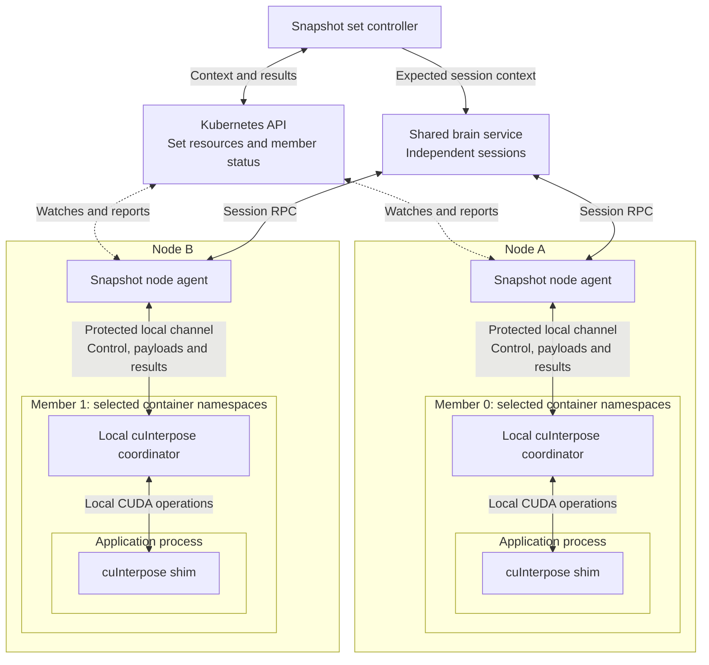
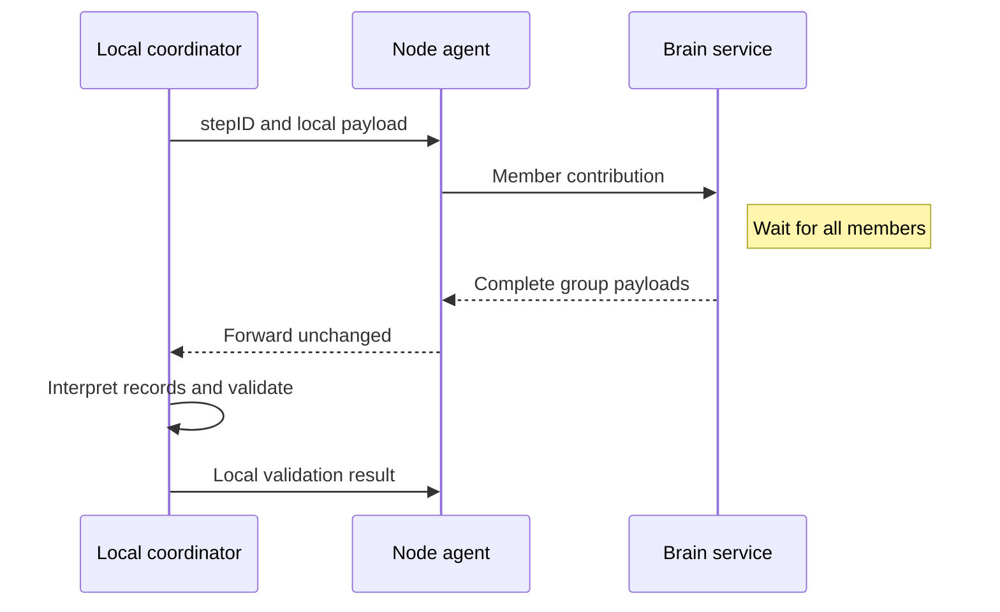
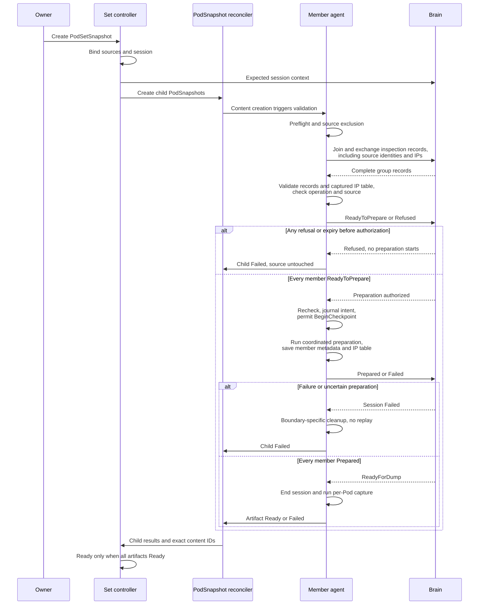
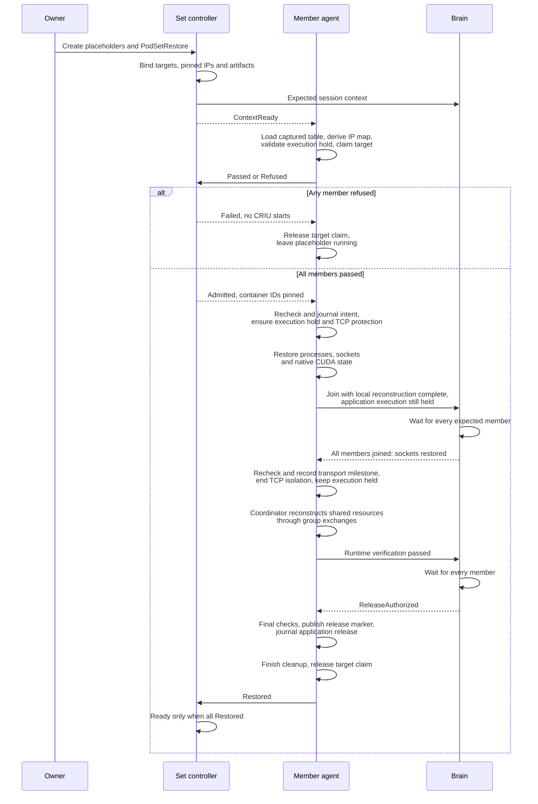

<!--
SPDX-FileCopyrightText: Copyright (c) 2026 NVIDIA CORPORATION & AFFILIATES. All rights reserved.
SPDX-License-Identifier: Apache-2.0
-->

# SNEP-324: Coordinated Multi-Pod Checkpoint and Restore

Tracking issue: [snapshot#324](https://github.com/ai-dynamo/snapshot/issues/324)

Status: Draft

<!-- toc -->
- [Summary](#summary)
- [Motivation](#motivation)
  - [Goals](#goals)
  - [Non-Goals](#non-goals)
- [Proposal](#proposal)
  - [User Stories](#user-stories)
  - [Limitations, Risks, and Mitigations](#limitations-risks-and-mitigations)
- [Design Details](#design-details)
  - [Architecture](#architecture)
    - [Components and Communication](#components-and-communication)
    - [Data and Storage](#data-and-storage)
    - [Captured Group Metadata](#captured-group-metadata)
    - [Runtime Session](#runtime-session)
    - [Runtime Extension Contract](#runtime-extension-contract)
  - [API](#api)
    - [Resource Definitions](#resource-definitions)
    - [Validation and Binding](#validation-and-binding)
    - [Conditions and Outcomes](#conditions-and-outcomes)
    - [Examples](#examples)
    - [Per-Pod API Reuse](#per-pod-api-reuse)
    - [Checkpoint Availability](#checkpoint-availability)
  - [Checkpoint Flow](#checkpoint-flow)
  - [Restore Flow](#restore-flow)
  - [Startup Gate and Deadline](#startup-gate-and-deadline)
  - [Network Identity and Release](#network-identity-and-release)
  - [TCP Timer Safety](#tcp-timer-safety)
  - [Journal and Restart Recovery](#journal-and-restart-recovery)
  - [Failure, Cancellation, and Cleanup](#failure-cancellation-and-cleanup)
  - [Workload Ownership and Source Lifetime](#workload-ownership-and-source-lifetime)
  - [Security](#security)
  - [Configuration](#configuration)
  - [Performance and Scalability](#performance-and-scalability)
  - [Monitoring](#monitoring)
  - [Dependencies](#dependencies)
  - [Test Plan](#test-plan)
    - [Unit and Controller Tests](#unit-and-controller-tests)
    - [Runtime Contract Tests](#runtime-contract-tests)
    - [Agent and Failure Tests](#agent-and-failure-tests)
    - [End-to-End Qualification](#end-to-end-qualification)
  - [Graduation Criteria](#graduation-criteria)
<!-- /toc -->

## Summary

Add a Kubernetes API to checkpoint and restore cooperating Pods as a set,
including across nodes. Each checkpoint is reusable; each restore names a target
Pod for every member. Snapshot checks all members before starting destructive
work and reports both the set result and each member's result. Checkpoint and
restore are not atomic and do not support rollback.

## Motivation

A distributed inference replica can span several Pods. Restoring it requires more
than restoring each process separately:

- Every member needs all peers' replacement IPs, not just its own.
- No member can send application traffic to its peers until every peer has rebuilt
  its sockets. Sending too early can reset a connection that is still being restored.
- Shared GPU resources need ordered reconstruction and handle exchange between
  processes, including processes on different nodes.

The workload owner needs one operation to coordinate these steps, confirm a
complete checkpoint, and see which members were released if restore fails.

### Goals

- Publish a reusable checkpoint only when every member succeeds.
- Restore into named target Pods, including on different nodes and IPs, while
  preserving established TCP connections and supported shared GPU resources.
- Check every member before destructive work and enforce an operation deadline.
- Report partial results accurately and recover safely from controller and agent
  restarts without replaying destructive work.
- Reuse per-Pod execution without changing standalone APIs. Keep group
  coordination independent of CUDA and support members without shims.
- Leave Pod creation, placement, and application readiness to the workload owner.

### Non-Goals

- Discovering members, creating or placing Pods, or changing membership, ranks,
  or logical topology during restore.
- Atomic checkpoint or restore, rollback, or keeping the source workload running
  after destructive capture begins.
- Transparent session failover or automatic workload recovery after failure.
- Declaring application health, serving readiness, or in-flight request safety.
- Cross-namespace or cross-cluster restore, artifact retention after set deletion,
  or a hierarchy of sets.
- Supporting an engine, transport, or GPU topology without qualification.

## Proposal

Snapshot adds two namespaced resources:

- `PodSetSnapshot` identifies the source Pods and containers. It creates one
  `PodSnapshot` per member and becomes Ready only when all member artifacts are
  ready. Its member list and completed artifact references are immutable.
- `PodSetRestore` identifies a ready set checkpoint and one target Pod and
  container per member. Each object is one restore attempt. The same checkpoint
  can be used for multiple attempts.

The workload owner creates the target Pods with Snapshot's inert placeholder
contract. A placeholder keeps the destination container running but does not
start the application. All placeholders must be able to start without waiting
for another member's application readiness.

Restored application execution must also remain held independently of TCP
isolation. Once every member's sockets are restored, TCP traffic may resume
while runtime reconstruction continues. This is not application release;
Snapshot publishes the release marker only after reconstruction and verification
succeed. This execution-hold capability must be implemented and qualified for
every supported workload, including members without shims.

Capture is destructive. A successful member capture ends its source process.
If another member fails, Snapshot does not undo the completed capture. During
restore, Snapshot holds members until all required reconstruction succeeds,
then authorizes release. Release is asynchronous: an attempt can fail after
some members have been released. Those members remain reported as Restored.

`Restored` means that reconstruction completed and Snapshot released the member.
It does not mean that the application is healthy or that the Pod is Ready. The
workload owner handles those checks and any workload-level recovery.

### User Stories

- Restore one distributed inference replica into replacement Pods, then register
  it for traffic after Snapshot succeeds and application readiness passes.
- Checkpoint a distributed prefill or decode replica without including unrelated
  replicas. Connections outside the set retain standalone restore semantics.
- After a partial restore, inspect member results, retire the attempt's Pods,
  and retry with fresh targets and the same checkpoint.

### Limitations, Risks, and Mitigations

| Risk | Handling |
| --- | --- |
| Partial capture or release | No rollback. Publish only complete checkpoints; preserve released outcomes and tear down unreleased restore work on observed failure. |
| Agent crashes during release | Use durable release evidence to finish cleanup, never to kill or replay a released workload. Cleanup may wait for agent recovery. |
| Brain loses an active session | Fail affected operations without replay. A shared service restart can affect several sessions. Completed artifacts and released workloads remain valid. |
| A target disappears after admission | Report `Unknown` if its result cannot be established. Later evidence may settle the member, but cannot reopen the failed attempt. |
| Waiting or stale execution context | Enforce deadlines, remaining startup-gate time, and exact Pod/container/IP bindings before execution. |
| Kernel TCP timers expire while traffic is interrupted | Qualify timer safety across the complete capture and restore windows; document supported constraints. Application quiescing alone is insufficient. |
| Checkpoint artifact is lost | Mark the set unavailable and refuse new restores; do not recapture or substitute an artifact. |
| Source restarts while a peer is still dumping | Qualify the required source-lifetime constraints before claiming support. See [Workload Ownership and Source Lifetime](#workload-ownership-and-source-lifetime). |
| Unsupported engine, transport, or topology | Qualify each supported combination; the API alone does not make a runtime checkpoint-safe. |

## Design Details

### Architecture

#### Components and Communication

Snapshot separates Kubernetes orchestration, group coordination, and local
execution. The **brain** coordinates the group; **node agents** control work on
their nodes. For workloads using cuInterpose, an agent starts a temporary
**local coordinator** that drives the application's **shims**.

A **member** is a Pod and its selected container. Its ID is stable; its **rank**
is its position in the checkpoint's member list, not a leader designation.

| Component | Where it runs | Responsibility |
| --- | --- | --- |
| Workload owner | Usually a workload controller | Create and place Pods; request operations; handle application readiness and recovery. |
| Set controller | Snapshot operator | Bind members and artifacts, supply expected session context, admit restores, and aggregate results. |
| Brain | Shared service outside workload members | Authenticate agents, exchange opaque messages, and enforce group barriers, deadlines, and session failure. |
| Node agent | One per node | Represent each local member; check, journal, and execute local work; own helpers, TCP connection protection, release, and cleanup. |
| Local coordinator | Temporary process inside the selected container's namespaces | Drive shims; order CUDA steps; interpret exchanged records and handles; validate resource relationships. |
| Application shim | Library inside each participating process | Track and prepare or reconstruct that process's CUDA resources. |

Only agents connect to the brain. Each local coordinator communicates with its
agent over a protected local channel; it is a process, not a sidecar container.
The brain does not interpret CUDA payloads or choose CUDA phase order.

The diagram shows two members on different nodes. Controller-agent communication
uses Kubernetes resources. The controller supplies session context to the brain;
the delivery mechanism and agent-brain RPC format are implementation choices.



#### Data and Storage

Kubernetes stores operation bindings and results; artifacts store captured state;
node journals store execution and recovery evidence. The brain holds live session
state only, not checkpoint files or a durable execution log.

| Data | Produced by | Stored in | Used by |
| --- | --- | --- | --- |
| Membership and target names | Caller; controller validates | `PodSetSnapshot.spec.members` and `PodSetRestore.spec.targets`, matched by member ID | Controller, agents, and local coordinators |
| Expected session context | Controller | Operation bindings, supplied to the brain | Brain checking participation |
| Coordination endpoint | Controller | Write-once `status.session.endpoint` | Agents |
| Coordination credentials | Deployment authentication mechanism | Protected service/agent configuration | Brain and agents, not coordinators or shims |
| Captured member identities and source IPs | Agents exchange and validate them during capture | Common ordered table in every member artifact's `manifest.yaml` | Agents deriving the complete restore IP map |
| Target identities and IPs | Controller | Pinned Pod UID, node, container, and `targetPodIP` in restore status | Admission, identity checks, and IP-map construction |
| Member checkpoint artifact | Agent via per-Pod capture | Artifact storage and `PodSnapshotContent`; exact content name and UID in set member status | Restoring agents |
| Member runtime records | Local coordinator, where needed | Member artifact | Coordinators validating and rebuilding shared resources |
| Runtime records and fresh GPU handles | Local coordinators | Transient session payloads and coordinator memory | Coordinators validating group resources |
| Old-to-new GPU-handle map | Local coordinators | Coordinator memory for this restore | Shims rebuilding shared resources |
| Current step, contributions, and session result | Brain | Active session memory | Group coordination |
| Release marker | Agent | `restore-complete` in placeholder control volume: restored PID, attempt UID, admitted container ID | Execution-release gate, PID readers, recovery |
| Restore report and outcome | Agent owns `report`; controller owns `outcome` | `PodSetRestore.status.members[]` | Controller and workload owner |
| Execution hold and TCP protection recovery context | Agent | Node journal, identifying only this attempt's resources | Execution and restart recovery |

The **IP map** repairs TCP sockets. Each agent derives the same complete map by
matching the artifact's captured member table with the restore's pinned targets
by member ID. Source IPs are not duplicated in the set APIs. The **GPU-handle map**
reconnects shared CUDA resources; local coordinators build it anew during each
restore. The brain interprets neither map.

Coordinators validate the complete GPU resource graph. Allocation identities must
remain stable, with the original creator distinct from the holder selected to
save or export an allocation. CPU/GPU dumps use artifact storage, not the brain.

#### Captured Group Metadata

Each set artifact's existing `CheckpointManifest` gains an optional `PodSet`
field with YAML key `podSet` and type `*CapturedPodSetManifest`. Standalone
artifacts omit it. Set restore requires it; existing per-Pod manifests alone
contain only their own source IP and are not sufficient for a complete set map.

The new artifact types are:

```go
package types

const CapturedPodSetVersion = 1

type CapturedPodSetManifest struct {
	Version    int                    `yaml:"version"`
	CaptureUID string                 `yaml:"captureUID"`
	MemberID   string                 `yaml:"memberID"`
	Members    []CapturedPodSetMember `yaml:"members"`
}

type CapturedPodSetMember struct {
	ID            string `yaml:"id"`
	PodUID        string `yaml:"podUID"`
	ContainerName string `yaml:"containerName"`
	PodIP         string `yaml:"podIP"`
}
```

`Version` identifies the metadata format. `CaptureUID` is the capture operation's
UID. `MemberID` identifies the member whose state is saved in this artifact.

**Capture.** During inspection, agents exchange each member's source Pod UID,
container name and IP through the brain. They validate the complete list in
`PodSetSnapshot.spec.members` order, which preserves ranks. Every artifact saves
the same list, format version and capture UID. The list stays fixed after
inspection. If a source IP changes before execution, the agent refuses capture.

**Restore.** Each agent reads the saved source IPs from its assigned artifact
and matches member IDs to the target IPs pinned in `PodSetRestore` status.
For example:

| Member | Saved source IP | Target IP for this restore |
| --- | --- | --- |
| worker-a | `10.0.0.1` | `10.1.0.8` |
| worker-b | `10.0.0.2` | `10.1.0.9` |

This gives every agent the complete old-to-new IP map for CRIU. No agent needs
to read another member's artifact or contact the original Pods. Saved source
IPs are never refreshed from live Pods.

**Validation.** Before CRIU, each agent checks that:

- The metadata format is supported and `CaptureUID` matches the requested
  `PodSetSnapshot` UID.
- The ordered member list, source Pod UIDs and container names match that
  checkpoint's sources.
- The artifact's `MemberID` and content identity match the assigned member and
  its recorded content reference.
- Every member ID and source IP is present and unique, and all source IPs are
  valid IPv4 addresses.
- Its own member's source IP matches the manifest's existing `k8s.podIP`.

The agent refuses restore if metadata is missing or any check fails.

#### Runtime Session

One operation has one session, identified by its `PodSetSnapshot` or
`PodSetRestore` UID. A restore never reuses the capture session.

The brain is a long-running service, deployed separately or alongside the
operator. It can host concurrent, isolated sessions. Each session has one owner,
even if the service has several replicas; load balancing alone does not preserve
that ownership. Packaging and routing are implementation choices.

The controller supplies the expected operation mode, membership, Pod UIDs,
containers, nodes, and absolute deadline. The brain authenticates agents and
checks participation against that context. Agents cannot create sessions or
change their membership, bindings, or deadline. Context delivery, authentication,
and credential management are implementation choices; [Security](#security)
defines their required guarantees.

A **step** is one group exchange or synchronization within an operation. Its
`stepID` lets the brain match contributions without interpreting their contents.

Messages identify the session, member, and step. Duplicate, stale, foreign, or
out-of-order messages cannot satisfy a barrier. Runtime coordinators agree on
step IDs and protocol versions; a conflicting step or failed member fails the
session. Only an agent can send its member's `ReadyToPrepare` vote.

**Example: exchanging runtime records between members.** During capture
inspection, each coordinator shares its resource records through its agent. The
brain waits for all members and returns the collected records for local
validation. The diagram shows one member's path, repeated for other members
with coordinators—not the full checkpoint or restore flow.



Every member takes part in group safety and completion barriers. A member without
shims uses its agent's normal per-Pod path, with no cuInterpose coordinator or
CUDA records to exchange. Several members on one node still contribute separately.

Initial connections may retry until the operation deadline. Once a member has
joined, loss of its participation, the owner, or live step state fails the
session. There is no transparent failover or mutating-step replay. A new
process at the same endpoint is not a continuation of the lost session.

Capture coordination ends at `ReadyForDump`; per-Pod dumps and artifact
publication follow. A restore agent joins only after local CRIU/native CUDA
restore succeeds and normal application execution remains held. Once every
expected member joins, the brain announces that all members' sockets are restored.
Agents may then end TCP isolation without releasing application execution.
Runtime reconstruction and verification still precede `ReleaseAuthorized`.
Agent-brain connections are outside the workload's checkpoint images.

Session success is not proof of an artifact or local release. Those results come
from per-Pod status and agent evidence. Completed checkpoints and released
workloads do not depend on the session staying alive.

#### Runtime Extension Contract

The local runtime receives ordered membership, local processes with shims,
protocol and artifact versions, and saved records for restore. Coordinators must
reject mixed checkpoints, changed ranks, unsupported handles, and incompatible
topology. Agents validate artifact and execution identity independently.

The contract has four safety rules:

1. **Inspect before voting ready.** The agent validates group metadata and, where
   needed, its coordinator completes read-only runtime inspection. The agent then
   checks current operation state, deadline, source identity and IP before sending
   one `ReadyToPrepare` vote. Inspection does not pause applications or drain GPU
   work; workload pause and synchronization prerequisites still apply.
2. **Every member ready before preparation.** The brain authorizes preparation
   only after every agent votes `ReadyToPrepare`. Each agent then rechecks local
   state and journals intent before permitting `BeginCheckpoint`, which freezes
   registries and crosses the cuInterpose destructive boundary. Coordinators
   revalidate the frozen records before further preparation. Each agent reports
   `Prepared` only after its required preparation and metadata succeed; the brain
   sends `ReadyForDump` only after every member reports `Prepared`.
3. **Separate TCP readiness from application release.** The all-members-joined
   milestone permits TCP unblocking, not application execution. Normal workload
   execution must remain held independently until every member finishes runtime
   reconstruction and group validation. Only the agent publishes the release
   marker after final authorization and local checks. Local CUDA success or TCP
   unblocking alone is insufficient.
4. **Bound execution; never replay mutation.** Joins, exchanges, and local work
   share the operation's absolute deadline. Local timeouts cannot renew it.
   Same-node members must be able to progress concurrently. Interrupted mutating
   work is not retried, and no failure path promises rollback.

Session messages identify the session, member, and step. Failures include a
reason and distinguish preparation that never began from preparation that began
or is uncertain. Agents journal that evidence; a lost reply is not safe refusal.
These message names describe behavior, not additional Kubernetes phases.

| Message | Sent by | Meaning |
| --- | --- | --- |
| `ReadyToPrepare` | Agent | Required inspection and current agent checks passed. Preparation has not started. |
| `Prepared` | Agent | Required preparation and member metadata succeeded. This is not artifact readiness. |
| `Refused` during capture | Agent | No local preparation began. Before group authorization all sources are untouched; afterward peers may already be preparing. |
| `ReadyForDump` | Brain | Every member reported `Prepared`. Continue per-Pod capture. |
| All members joined during restore | Brain | Every member completed local reconstruction and its execution hold is active. Agents may end TCP isolation; application release is still forbidden. |
| `ReleaseAuthorized` | Brain | All required reconstruction and verification succeeded. The agent may release after final checks; this is not proof of release. |
| Failed or uncertain preparation | Agent | Use unsafe-source handling. Do not classify a lost preparation reply as safe refusal. |

The local channel must keep runtime payloads separate from agent authority: a
forwarded payload cannot forge `ReadyToPrepare` or an execution grant.

### API

The two resources use `nvidia.com/v1alpha1` and are namespaced. All source Pods,
target Pods, child `PodSnapshot`s, and the referenced `PodSetSnapshot` belong to
the operation's namespace. A `PodSnapshotContent` remains a cluster-scoped artifact
for **one member**; it does not represent the whole set.

V1 supports one source container and one destination container per member, and
IPv4. Each member must refer to a distinct Pod. Member IDs are unique and stable.
Their order in `PodSetSnapshot.spec.members` defines ranks and does not change
across restores. The order of `PodSetRestore.spec.targets` does not define ranks.

The 256-member limit comes from the
[TCP-remapping plugin](https://github.com/ai-dynamo/snapshot/blob/fc349012c44e6e6a3afa82685112d746cd6c28a9/agent/plugins/inet-remap/snapshot_inet_remap.c#L16)
capacity: a fully relocated set needs one IP mapping per member. Larger sets
require increasing that capacity and revalidating the CRD schemas.

The structs below define every new public type. `PodSnapshotSource`, reused from
the [per-Pod API](https://github.com/ai-dynamo/snapshot/blob/main/api/v1alpha1/podsnapshot_types.go),
contains `podRef.name`, optional `podRef.uid`, and a one-element
`podRef.containers` list. Standalone `PodSnapshot` keeps that optional UID. Set
capture requires a source UID so the request identifies an exact source Pod.

#### Resource Definitions

```go
package v1alpha1

import (
	metav1 "k8s.io/apimachinery/pkg/apis/meta/v1"
	"k8s.io/apimachinery/pkg/types"
)

const (
	PodSetConditionContextReady = "ContextReady"
	PodSetConditionAdmitted     = "Admitted"
	PodSetConditionReady        = "Ready"
	PodSetConditionFailed       = "Failed"
)

// ObjectIdentity identifies an exact object. Its namespace is implicit.
type ObjectIdentity struct {
	// +kubebuilder:validation:MinLength=1
	// +kubebuilder:validation:MaxLength=253
	Name string `json:"name"`
	// +kubebuilder:validation:Type=string
	// +kubebuilder:validation:MinLength=1
	// +kubebuilder:validation:MaxLength=128
	UID types.UID `json:"uid"`
}

// TargetPodReference allows a target to be named before it is created.
type TargetPodReference struct {
	// +kubebuilder:validation:MinLength=1
	// +kubebuilder:validation:MaxLength=253
	Name string `json:"name"`
	// +optional
	// +kubebuilder:validation:Type=string
	// +kubebuilder:validation:MinLength=1
	// +kubebuilder:validation:MaxLength=128
	UID types.UID `json:"uid,omitempty"`
}

// RuntimeSession identifies the coordination service for this operation.
// The parent object's UID identifies the session; credentials are not API data.
type RuntimeSession struct {
	// Endpoint is the address agents use. Workload callers treat it as opaque.
	// +kubebuilder:validation:MinLength=1
	Endpoint string `json:"endpoint"`
}

// +kubebuilder:validation:Enum=Pending;Capturing;Captured;Failed
type CapturePhase string

const (
	CapturePending   CapturePhase = "Pending"
	CaptureCapturing CapturePhase = "Capturing"
	CaptureCaptured  CapturePhase = "Captured"
	CaptureFailed    CapturePhase = "Failed"
)

type PodSetSnapshotMember struct {
	// +kubebuilder:validation:MinLength=1
	// +kubebuilder:validation:MaxLength=63
	// +kubebuilder:validation:Pattern=`^[a-z0-9]([-a-z0-9]*[a-z0-9])?$`
	ID string `json:"id"`
	// Reuses the source shape of PodSnapshot. A set source must have a UID.
	// +kubebuilder:validation:XValidation:rule="has(self.podRef.uid) && size(self.podRef.uid) > 0",message="set sources require a Pod UID"
	Source PodSnapshotSource `json:"source"`
}

// +kubebuilder:validation:XValidation:rule="self.members.all(m, self.members.filter(n, n.id == m.id).size() == 1)",message="member IDs must be unique"
type PodSetSnapshotSpec struct {
	// Seconds from this object's creation. Required; there is no infinite wait.
	// +kubebuilder:validation:Minimum=1
	DeadlineSeconds int64 `json:"deadlineSeconds"`
	// Order is rank. Do not treat this list as an unordered map.
	// +kubebuilder:validation:MinItems=1
	// +kubebuilder:validation:MaxItems=256
	// +listType=atomic
	Members []PodSetSnapshotMember `json:"members"`
}

// +kubebuilder:validation:XValidation:rule="!has(oldSelf.podSnapshot) || (has(self.podSnapshot) && self.podSnapshot == oldSelf.podSnapshot)",message="child snapshot identity is immutable"
// +kubebuilder:validation:XValidation:rule="!has(oldSelf.content) || (has(self.content) && self.content == oldSelf.content)",message="content identity is immutable"
// +kubebuilder:validation:XValidation:rule="!has(oldSelf.nodeName) || (has(self.nodeName) && self.nodeName == oldSelf.nodeName)",message="source node is immutable"
type PodSetSnapshotMemberStatus struct {
	// +kubebuilder:validation:MinLength=1
	// +kubebuilder:validation:MaxLength=63
	ID string `json:"id"`
	// +optional
	// +kubebuilder:validation:MinLength=1
	// +kubebuilder:validation:MaxLength=253
	NodeName string `json:"nodeName,omitempty"`
	// +optional
	PodSnapshot *ObjectIdentity `json:"podSnapshot,omitempty"`
	// Content is immutable once the completed set is published.
	// +optional
	Content *ObjectIdentity `json:"content,omitempty"`
	// Derived from the child PodSnapshot's conditions.
	// +kubebuilder:default=Pending
	Phase CapturePhase `json:"phase"`
	// +optional
	Reason string `json:"reason,omitempty"`
	// +optional
	Message string `json:"message,omitempty"`
}

// +kubebuilder:validation:XValidation:rule="!has(oldSelf.session) || (has(self.session) && self.session == oldSelf.session)",message="runtime session is immutable"
type PodSetSnapshotStatus struct {
	// +optional
	Session *RuntimeSession `json:"session,omitempty"`
	// Controller-owned; child PodSnapshot status is the agent's capture report.
	// +optional
	// +kubebuilder:validation:MinItems=1
	// +kubebuilder:validation:MaxItems=256
	// +kubebuilder:validation:XValidation:rule="oldSelf.all(o, self.exists(n, n.id == o.id))",message="member status entries cannot be removed"
	// +listType=map
	// +listMapKey=id
	Members []PodSetSnapshotMemberStatus `json:"members,omitempty"`
	// +optional
	// +listType=map
	// +listMapKey=type
	Conditions []metav1.Condition `json:"conditions,omitempty"`
}

// +genclient
// +kubebuilder:object:root=true
// +kubebuilder:subresource:status
// +kubebuilder:resource:scope=Namespaced
// +kubebuilder:validation:XValidation:rule="!has(oldSelf.status) || !has(oldSelf.status.members) || (has(self.status) && has(self.status.members))",message="member status cannot be cleared"
// +kubebuilder:validation:XValidation:rule="!has(oldSelf.status) || !has(oldSelf.status.session) || (has(self.status) && has(self.status.session))",message="runtime session cannot be cleared"
// +kubebuilder:validation:XValidation:rule="!has(self.status) || !has(self.status.members) || self.status.members.all(m, self.spec.members.exists(s, s.id == m.id))",message="status must refer to declared members"
type PodSetSnapshot struct {
	metav1.TypeMeta   `json:",inline"`
	metav1.ObjectMeta `json:"metadata,omitempty"`
	// +kubebuilder:validation:XValidation:rule="self == oldSelf",message="spec is immutable"
	Spec PodSetSnapshotSpec `json:"spec"`
	// +optional
	Status PodSetSnapshotStatus `json:"status,omitempty"`
}

// +kubebuilder:object:root=true
type PodSetSnapshotList struct {
	metav1.TypeMeta `json:",inline"`
	metav1.ListMeta `json:"metadata,omitempty"`
	Items           []PodSetSnapshot `json:"items"`
}

type ContainerMapping struct {
	// Name of the container captured for this member.
	// +kubebuilder:validation:MinLength=1
	// +kubebuilder:validation:MaxLength=63
	// +kubebuilder:validation:Pattern=`^[a-z0-9]([-a-z0-9]*[a-z0-9])?$`
	Source string `json:"source"`
	// Name of the placeholder container to receive the restored processes.
	// +kubebuilder:validation:MinLength=1
	// +kubebuilder:validation:MaxLength=63
	// +kubebuilder:validation:Pattern=`^[a-z0-9]([-a-z0-9]*[a-z0-9])?$`
	Destination string `json:"destination"`
}

type PodSetRestoreTarget struct {
	// Must match exactly one member ID in the referenced checkpoint.
	// +kubebuilder:validation:MinLength=1
	// +kubebuilder:validation:MaxLength=63
	// +kubebuilder:validation:Pattern=`^[a-z0-9]([-a-z0-9]*[a-z0-9])?$`
	ID               string             `json:"id"`
	PodRef           TargetPodReference `json:"podRef"`
	ContainerMapping ContainerMapping   `json:"containerMapping"`
}

// +kubebuilder:validation:XValidation:rule="self.targets.all(t, self.targets.filter(n, n.podRef.name == t.podRef.name).size() == 1)",message="target Pods must be distinct"
type PodSetRestoreSpec struct {
	SnapshotRef ObjectIdentity `json:"snapshotRef"`
	// +kubebuilder:validation:Minimum=1
	DeadlineSeconds int64 `json:"deadlineSeconds"`
	// +kubebuilder:validation:MinItems=1
	// +kubebuilder:validation:MaxItems=256
	// +listType=map
	// +listMapKey=id
	Targets []PodSetRestoreTarget `json:"targets"`
}

// +kubebuilder:validation:Enum=Pending;Restored;Failed;Cancelled;Unknown
type RestoreOutcome string

const (
	RestorePending   RestoreOutcome = "Pending"
	RestoreRestored  RestoreOutcome = "Restored"
	RestoreFailed    RestoreOutcome = "Failed"
	RestoreCancelled RestoreOutcome = "Cancelled"
	RestoreUnknown   RestoreOutcome = "Unknown"
)

// +kubebuilder:validation:Enum=Passed;Refused
type PreflightResult string

const (
	PreflightPassed  PreflightResult = "Passed"
	PreflightRefused PreflightResult = "Refused"
)

// +kubebuilder:validation:Enum=Restoring;Restored;Failed;Cancelled;Unknown
type RestoreReportPhase string

const (
	RestoreReportRestoring RestoreReportPhase = "Restoring"
	RestoreReportRestored  RestoreReportPhase = "Restored"
	RestoreReportFailed    RestoreReportPhase = "Failed"
	RestoreReportCancelled RestoreReportPhase = "Cancelled"
	RestoreReportUnknown   RestoreReportPhase = "Unknown"
)

// RestoreMemberReport is the node agent's report for this member.
type RestoreMemberReport struct {
	// +kubebuilder:validation:MinLength=1
	// +kubebuilder:validation:MaxLength=1024
	ContainerID string `json:"containerID"`
	// +optional
	Preflight PreflightResult `json:"preflight,omitempty"`
	// +optional
	Phase RestoreReportPhase `json:"phase,omitempty"`
	// +optional
	Reason string `json:"reason,omitempty"`
	// +optional
	Message    string      `json:"message,omitempty"`
	ObservedAt metav1.Time `json:"observedAt"`
}

// +kubebuilder:validation:XValidation:rule="!has(oldSelf.pod) || (has(self.pod) && self.pod == oldSelf.pod)",message="target Pod identity is immutable"
// +kubebuilder:validation:XValidation:rule="!has(oldSelf.content) || (has(self.content) && self.content == oldSelf.content)",message="content identity is immutable"
// +kubebuilder:validation:XValidation:rule="!has(oldSelf.admittedContainerID) || (has(self.admittedContainerID) && self.admittedContainerID == oldSelf.admittedContainerID)",message="admitted container ID is immutable"
// +kubebuilder:validation:XValidation:rule="!has(oldSelf.nodeName) || (has(self.nodeName) && self.nodeName == oldSelf.nodeName)",message="target node is immutable"
// +kubebuilder:validation:XValidation:rule="!has(oldSelf.targetPodIP) || (has(self.targetPodIP) && self.targetPodIP == oldSelf.targetPodIP)",message="target Pod IP is immutable"
// +kubebuilder:validation:XValidation:rule="!(oldSelf.outcome in ['Restored', 'Failed', 'Cancelled']) || self.outcome == oldSelf.outcome",message="final member outcomes are immutable"
// +kubebuilder:validation:XValidation:rule="oldSelf.outcome != 'Unknown' || self.outcome in ['Unknown', 'Restored', 'Failed', 'Cancelled']",message="Unknown can only remain Unknown or become final"
type PodSetRestoreMemberStatus struct {
	// +kubebuilder:validation:MinLength=1
	// +kubebuilder:validation:MaxLength=63
	ID string `json:"id"`
	// Everything except Report is controller-owned.
	// +optional
	Pod *ObjectIdentity `json:"pod,omitempty"`
	// +optional
	// +kubebuilder:validation:MinLength=1
	// +kubebuilder:validation:MaxLength=253
	NodeName string `json:"nodeName,omitempty"`
	// +optional
	Content *ObjectIdentity `json:"content,omitempty"`
	// +optional
	// +kubebuilder:validation:Format=ipv4
	// +kubebuilder:validation:MaxLength=15
	TargetPodIP string `json:"targetPodIP,omitempty"`
	// Pinned when Admitted=True, and never replaced with a later container ID.
	// +optional
	// +kubebuilder:validation:MinLength=1
	// +kubebuilder:validation:MaxLength=1024
	AdmittedContainerID string `json:"admittedContainerID,omitempty"`
	// +kubebuilder:default=Pending
	Outcome RestoreOutcome `json:"outcome"`
	// +optional
	Reason string `json:"reason,omitempty"`
	// +optional
	Message string `json:"message,omitempty"`
	// +optional
	Report *RestoreMemberReport `json:"report,omitempty"`
}

// +kubebuilder:validation:XValidation:rule="!has(oldSelf.session) || (has(self.session) && self.session == oldSelf.session)",message="runtime session is immutable"
type PodSetRestoreStatus struct {
	// +optional
	Session *RuntimeSession `json:"session,omitempty"`
	// +optional
	// +kubebuilder:validation:MinItems=1
	// +kubebuilder:validation:MaxItems=256
	// +kubebuilder:validation:XValidation:rule="oldSelf.all(o, self.exists(n, n.id == o.id))",message="member status entries cannot be removed"
	// +listType=map
	// +listMapKey=id
	Members []PodSetRestoreMemberStatus `json:"members,omitempty"`
	// +optional
	// +listType=map
	// +listMapKey=type
	Conditions []metav1.Condition `json:"conditions,omitempty"`
}

// +genclient
// +kubebuilder:object:root=true
// +kubebuilder:subresource:status
// +kubebuilder:resource:scope=Namespaced
// +kubebuilder:validation:XValidation:rule="!has(oldSelf.status) || !has(oldSelf.status.members) || (has(self.status) && has(self.status.members))",message="member status cannot be cleared"
// +kubebuilder:validation:XValidation:rule="!has(oldSelf.status) || !has(oldSelf.status.session) || (has(self.status) && has(self.status.session))",message="runtime session cannot be cleared"
// +kubebuilder:validation:XValidation:rule="!has(self.status) || !has(self.status.members) || self.status.members.all(m, self.spec.targets.exists(t, t.id == m.id))",message="status must refer to declared members"
type PodSetRestore struct {
	metav1.TypeMeta   `json:",inline"`
	metav1.ObjectMeta `json:"metadata,omitempty"`
	// +kubebuilder:validation:XValidation:rule="self == oldSelf",message="spec is immutable"
	Spec PodSetRestoreSpec `json:"spec"`
	// +optional
	Status PodSetRestoreStatus `json:"status,omitempty"`
}

// +kubebuilder:object:root=true
type PodSetRestoreList struct {
	metav1.TypeMeta `json:",inline"`
	metav1.ListMeta `json:"metadata,omitempty"`
	Items           []PodSetRestore `json:"items"`
}
```

#### Validation and Binding

Validation runs when the API request is accepted and again before execution.

- **The API server** validates nonempty names, cardinality, unique member IDs and
  distinct target Pod names. CEL rules keep specs immutable, make recorded
  identities write-once, preserve status member entries, and prevent final
  outcomes from changing. A schema-invalid request is rejected immediately.
- **The controller** rejects repeated source Pod names and checks facts that
  require other objects: source UIDs and running containers, checkpoint and
  artifact identities, exact target membership, and source-to-destination
  container mappings. It checks these before creating capture work or publishing
  restore context. An invalid operation is recorded as Failed with a specific
  reason; an unresolved target can wait until its deadline.
- **The agents** check live containers, sandboxes, artifacts, and runtime
  compatibility on their nodes. They repeat identity checks at the execution
  boundaries described in the flows below.

CRD schema and CEL handle structural validation without an admission webhook.
Live execution checks still belong in controllers and agents: Pod and artifact
state can change after API acceptance, and targets may not exist yet. API
acceptance never authorizes destructive work.

For a target with a supplied UID, the controller verifies that UID. Otherwise it
records the named Pod's UID when it first binds. A missing target that has never
been bound is a waiting state. A missing bound UID is never replaced by a
same-named Pod. Callers that reuse names should provide UIDs.

The controller also checks for a target already bound by another unfinished
restore and refuses it with `TargetInUse`. This check improves early feedback;
the agent's exclusive target claim for the Pod UID prevents races between attempts.

Recorded bindings and sessions are write-once. Clearing status or removing and
re-adding a member cannot bypass that rule. The controller initializes every
member entry before agents report.

The controller owns bindings, outcomes, and conditions; agents own member
`report`s. Writers use partial apply documents, such as generated apply
configurations, not fully serialized status structs. Each agent update contains
only `id` and `report`; controller updates neither include nor remove reports.
Each member report has its own SSA field manager, so one same-node member's
update cannot remove another's report.

Before Admitted, the controller accepts Passed only for the live destination
container ID and the bound Pod, node, and IP. It pins every accepted container ID
as `admittedContainerID` in the same status update that sets Admitted. A concurrent
change requires revalidation before admission is published.
Execution reports are checked against the pinned ID. A later application restart
does not undo a completed restore.

#### Conditions and Outcomes

| Resource | Condition | Meaning when True |
| --- | --- | --- |
| `PodSetSnapshot` | `Ready` | Capture completed for every member and the exact child and content objects are available for restore. |
| `PodSetSnapshot` | `Failed` | Capture failed, or a published checkpoint lost a required child or artifact. |
| `PodSetRestore` | `ContextReady` | All target UIDs, nodes and IPs are bound; artifact identities and the runtime descriptor are available. Agents can load their artifacts and derive the complete map during preflight. |
| `PodSetRestore` | `Admitted` | Every member passed preflight for that context and its pinned container incarnation. |
| `PodSetRestore` | `Ready` | Every member is `Restored` and the attempt has not already failed. |
| `PodSetRestore` | `Failed` | The attempt cannot complete successfully. Member reports and cleanup can still arrive. |

Waiting or executing is not failure. Failed is permanent for both resources:
retry requires a new operation. A successful `PodSetRestore` remains Ready.
`PodSetSnapshot` Ready describes checkpoint availability and can become False if
a required child or artifact is lost. That also sets Failed=True with reason
`ArtifactUnavailable`; the checkpoint is not recaptured, rebound, or reopened.

ContextReady and Admitted record completed restore milestones. Neither authorizes
work after failure, deletion, or deadline. Conditions use `observedGeneration`,
stable reasons, and a useful message.

Restore member outcomes are:

| Outcome | Meaning |
| --- | --- |
| `Pending` | No final result is known; the member can be waiting or executing. |
| `Restored` | The release marker was published. This result is final. |
| `Failed` | The member failed without being released. This result is final. |
| `Cancelled` | The member stopped without being released because the operation was deleted. This result is final while the operation exists. |
| `Unknown` | The target disappeared after admission and release cannot be proved or disproved. Later evidence can settle the result. |

Disappearance before admission produces `Failed` with reason `TargetGone`.
Disappearance after admission without a final result produces `Unknown` with
reason `TargetGone`. Disappearance after a final result changes nothing. An
`Unknown` member fails the attempt, but later evidence can still update the member
without changing the attempt back to Ready.

An agent must check release evidence before reporting a negative final result.

#### Examples

The source shape is the same as a `PodSnapshot` source:

```yaml
apiVersion: nvidia.com/v1alpha1
kind: PodSetSnapshot
metadata:
  name: replica-checkpoint
  namespace: inference
spec:
  deadlineSeconds: 1800
  members:
    - id: rank-0
      source:
        podRef:
          name: replica-0
          uid: "11111111-1111-4111-8111-111111111111"
          containers: [engine]
    - id: rank-1
      source:
        podRef:
          name: replica-1
          uid: "22222222-2222-4222-8222-222222222222"
          containers: [engine]
```

Once the checkpoint is Ready, the owner prepares two target Pods and creates an
attempt. This example omits the first target UID so it can be bound by name:

```yaml
apiVersion: nvidia.com/v1alpha1
kind: PodSetRestore
metadata:
  name: replica-restore-1
  namespace: inference
spec:
  snapshotRef:
    name: replica-checkpoint
    uid: "33333333-3333-4333-8333-333333333333"
  deadlineSeconds: 1500
  targets:
    - id: rank-0
      podRef:
        name: replacement-0
      containerMapping:
        source: engine
        destination: engine
    - id: rank-1
      podRef:
        name: replacement-1
        uid: "44444444-4444-4444-8444-444444444444"
      containerMapping:
        source: engine
        destination: engine
```

Target Pods carry `nvidia.com/restore-set: replica-restore-1` and Snapshot's
canonical placeholder contract in set-restore mode. They do not carry
the standalone `nvidia.com/restore-from` or `restore-container-map` annotations.
The annotation makes the agent wait for set admission; it does not authorize
restore. The target list, bound Pod UID, and admitted container ID provide that
authority. Pods and the attempt may be created in either order. Agents check
the canonical startup gate and refuse conflicting standalone annotations.

#### Per-Pod API Reuse

Capture keeps the per-Pod activation path: a `PodSnapshot` reconciler creates a
`PodSnapshotContent`, and the node agent's content watch queues capture work.
For set capture, the set controller creates one child `PodSnapshot` per member,
owned by `PodSetSnapshot`, using the same source shape.

The agent then chooses the capture path:

- **Standalone:** run the per-Pod validation and checkpoint executor without a
  set session.
- **Set-owned:** resolve the child from the content's snapshot reference, verify
  its owner and member identity, and require its UID to match the parent's
  recorded child UID. The agent resolves the parent's session context, joins the
  brain directly, and participates in group admission before destructive capture.

If a binding or session has not yet been published, set-owned work waits; it
never falls back to standalone capture. A failed or deleting parent stops new
work. Creating all children is therefore a trigger to begin validation and group
admission, not authorization for independent destructive captures.

Child `PodSnapshot` conditions are the capture reporting channel. The set
controller mirrors Pending, Capturing, Captured, or Failed in member status and
records the bound content's exact name and UID. A set-owned `PodSnapshot` cannot
be restored through the standalone annotation: restoring a rank without the set
context is refused.

Restore calls the per-Pod executor directly after set admission. It needs no
per-member restore CRD. The member report in `PodSetRestore.status` and the
agent's journal record its progress and result. The agent also writes the existing
Pod condition `nvidia.com/Restored`, preserving its meaning.

#### Checkpoint Availability

The controller watches the recorded child snapshots and contents. If one is
missing, deleting, replaced, or failed, it withdraws Ready and sets Failed with
reason `ArtifactUnavailable`. References and Captured results remain intact;
Snapshot never recaptures or adopts replacements to repair the set.

No child-protection finalizer blocks deletion. Before each restore, the controller
revalidates exact objects and readiness; agents also check artifact data. Ready
is an observation, not a storage or retention guarantee. Loss during an unfinished
restore fails that attempt, preserving released results.

### Checkpoint Flow

Capture has two gates: every member must be ready before preparation, and every
member must be prepared before dumping. Inspection and preparation may each
require several runtime exchanges; these are not two fixed RPC round trips.
The Agent lane represents each member's agent and its local runtime work.



1. **Activate.** The controller validates source identities, records nodes,
   supplies session context, and creates child snapshots. Each content's creation
   triggers its agent. Missing set context waits; it never selects standalone
   capture.
2. **Inspect and vote ready.** Agents validate the live source and local
   prerequisites, retain per-source exclusion, and join. They exchange source
   identities/IPs and any runtime inspection records. Every agent validates and
   pins the common captured member table. Where shims exist, coordinators also
   validate group resources without changing application state. After inspection,
   each agent rechecks operation state, deadline, source identity and IP, then
   sends `ReadyToPrepare`. The vote covers both inspection and agent checks.
   Refusal before all-member authorization leaves every source untouched.
3. **Prepare.** After authorization, each agent repeats its handoff checks and
   journals execution intent before allowing `BeginCheckpoint`. Coordinators
   revalidate frozen records and run ordered preparation. Agents save member
   metadata, including the common captured table, before reporting `Prepared`.
   Observed failure or identity change stops new work, but peers may already be
   preparing. Timer safety must cover the group capture window described in
   [TCP Timer Safety](#tcp-timer-safety).
4. **Dump and publish.** After every member reports `Prepared`, the brain sends
   `ReadyForDump`. Agents run per-Pod capture; shimless members recheck identity
   before their native CUDA or CPU capture boundary. Each completed manifest
   includes its validated group metadata. The set becomes Ready only when every
   artifact succeeds and every content name and UID is recorded.

Capture requires no node capacity-slot pool. It retains per-source exclusion and
durable execution intent. Members on the same node must be able to progress
concurrently rather than block one another at a group barrier.

A `ReadyToPrepare` vote is not execution evidence. A lost `BeginCheckpoint`
reply or interrupted preparation cannot prove safe refusal. If preparation began
or cannot be excluded, use existing unsafe-source handling, including
`CheckpointNeedsSourceKill` where applicable. There is no rollback or guarantee
of a working source deployment.

Dump authorization and per-Pod capture are asynchronous; preparation can succeed
while a dump fails. A source disappearing before its capture completes fails the
member. Disappearance after completion does not invalidate its artifact.

### Restore Flow

The controller admits the whole target set before CRIU. During restore, two
milestones have different meanings: all sockets restored permits TCP traffic;
complete runtime verification permits application release. Neither Pod readiness
nor a placeholder alone provides the required execution hold.



1. **Bind.** The controller verifies the checkpoint UID, availability and exact
   artifacts; binds target UIDs, nodes and IPs; and checks competing attempts.
   It supplies session context and sets ContextReady. It does not construct or
   store the source-to-target IP map.
2. **Preflight and admit.** Each agent reads its assigned artifact's captured
   table, validates it against the checkpoint and local manifest, and derives
   the complete IP map from pinned target bindings. It checks the live target,
   compatibility, startup-gate budget, target reuse, and an execution hold that
   is independent of TCP isolation. Unsupported configurations refuse before
   CRIU. An exclusive, durable target claim prevents competing attempts from
   using the same Pod UID. The controller validates every Passed report, pins
   container IDs, and sets Admitted in one update.
3. **Reconstruct locally.** The agent rechecks admission, deadline, operation and
   execution identity. It journals intent and ensures TCP protection and the
   execution hold before restored workload execution can proceed. CRIU receives
   the complete map. After process/socket and native CUDA restore succeeds, the
   agent joins the session while normal application execution remains held.
4. **Enable TCP communication.** The brain waits for every expected member's
   authenticated join. Each join certifies completed local reconstruction and
   the independent execution hold. The brain then notifies agents that all
   members' sockets are restored. After local state checks, agents record this
   milestone and end TCP isolation. They do not publish `restore-complete` or
   report Restored. This uses session membership, not another CRD or API phase.
5. **Complete runtime work.** Agents start local coordinators where needed.
   Coordinators exchange saved records, derive fresh GPU handles, rebuild shared
   resources, and verify the graph. The brain exchanges bytes and enforces
   barriers. Shimless members also report completion through their agents.
   Normal application execution remains held throughout.
6. **Release.** Only after every member succeeds does the brain return
   `ReleaseAuthorized`. The agent makes final deadline, operation and identity
   checks, atomically publishes the PID-bearing marker, journals release, finishes
   cleanup, and releases its target claim. It reports Restored and writes the
   existing Pod Restored condition. TCP unblocking is not release evidence.

A container or IP change before application release fails the member. A later
application restart does not undo a completed restore. Observed failure stops
unreleased work, even if TCP was already unblocked; cleanup re-establishes any
required isolation before teardown. Already released members are never killed
by Snapshot. There is no atomic release or rollback.

Once restore execution intent is durable, that target cannot be reused. Retry
requires a new attempt and fresh Pod UIDs and network namespaces. A target that
was only claimed or refused during preflight remains reusable after cleanup.

### Startup Gate and Deadline

Every operation ends at `metadata.creationTimestamp + spec.deadlineSeconds`.
Waiting, preflight, session joins, and execution all use that deadline; no local
timeout or container restart extends it. Expiry fails unfinished work with
`DeadlineExceeded`, but does not stop necessary cleanup or expire a completed
checkpoint.

Set restore uses the existing canonical placeholder gate, which waits for
`restore-complete` for about 30 minutes. Preflight checks that the operation's
deadline fits within **each container's remaining gate time**, with a conservative
probe-timing margin. Otherwise it refuses with `GateBudgetTooShort` before
Passed. This adds no configurable gate duration and changes no standalone
behavior. A pre-release restart fails the attempt rather than renewing its budget.

### Network Identity and Release

Every restore agent derives the full IPv4 map from its artifact's captured member
table and the restore's pinned targets. Match by member ID, with exactly one
source and target per member and unique addresses on each side. The map must fit
the plugin's 256-entry capacity, and `criu.tcpEstablished` must be true. CRIU remaps
both ends of established connections within the set; external connections retain
standalone behavior. Workload annotations do not supply the map.

Pod UID alone does not guarantee a stable IP. Capture agents pin observed source
IPs in the common captured table and their local operation state. Restore agents
use pinned target IPs from status. They recheck live sandbox identity before
execution, TCP unblocking, and application release. Mismatch fails with
`PodIPChanged`; neither source tables nor target bindings are regenerated.
Cleanup uses recorded identities, never replacement containers or sandboxes.

**TCP connection protection.** Before restoring sockets, agents protect them from
traffic to peers whose matching sockets do not yet exist. Otherwise an
early-restored socket's kernel traffic can provoke a reset.
[CRIU documents this isolation requirement](https://www.criu.org/TCP_connection).

A restore agent joins only after its local sockets and native CUDA state are
restored and its application execution hold is active. Once every expected
member joins, the brain notifies agents that TCP communication may resume.
Agents recheck local state and end isolation; they do not wait for GPU resource
reconstruction or publish application release at this point. Earlier unblocking
shortens the interruption but does not solve timer failures during local restore
or skew between members.

The brain authorizes this transport milestone; agents enforce protection and
cleanup. Reuse existing Snapshot/CRIU networking mechanisms where possible.
The mechanism is an implementation choice, not a new API or required firewall
design. It must preserve unrelated policy and allow agent-brain coordination.
Recovery context must identify only this attempt's protection resources and
support cleanup or re-isolation without API access or a surviving in-memory map.

**Independent execution hold.** Normal application work must remain held after
TCP unblocking until final release. Runtime control and reconstruction work may
proceed, and the kernel may exchange TCP packets. Pod readiness and the
placeholder's startup probe are not process-pause mechanisms. The implementation
must establish and qualify this hold for every supported workload, including
shimless members; existing marker consumers are not assumed to provide it
universally. Agent or helper loss must not implicitly release application work.
Unsupported execution-hold configurations refuse during preflight.

**Application release.** The release point remains atomic publication of
`restore-complete` after `ReleaseAuthorized` and final agent checks. Preserve the
`key=value` format and `pid` field, adding the attempt UID and admitted container
ID. Existence-based gates and PID readers remain compatible; recovery checks
identity fields. Readers must never see a partial marker.

TCP readiness or unblocking is not application release. A failure in between
still abandons an unreleased restore. Agents maintain or re-establish required
isolation before tearing down the recorded execution and retain it until the
original target sandbox is removed. Released members are never killed or
replayed. All protection changes remain attempt-scoped and recoverable.

### TCP Timer Safety

[Snapshot issue #577](https://github.com/ai-dynamo/snapshot/issues/577) reports
connections dying during a single Pod's multi-process dump: traffic is blocked
while some sockets still have active kernel timers. Pausing application work
does not pause those timers. A successful dump can therefore contain a connection
that already failed.

A set extends this exposure across Pods. If A becomes unreachable while B's
sockets are still active, B can time out before its capture starts. Timer safety
must cover the interval from the first member's network interruption through
the last member's safe capture, not just each Pod's local dump. A per-Pod fix
must be integrated and qualified for that full interval.

Restore also has a vulnerable interval before all matching sockets exist.
Allowing TCP traffic at all-members-joined removes the additional wait for
runtime reconstruction, but not local restoration time or completion skew.

Timer-safe capture and restore are shared runtime dependencies, not new
Kubernetes resources. Qualification must exercise keepalive, retransmission,
and user-timeout behavior over those intervals and document supported
configuration constraints. Known unsupported configurations cannot be claimed
as supported merely because application quiescing or group barriers work.
The SNEP does not choose a kernel/CRIU fix or require blanket timer disabling;
the implementation must demonstrate the required behavior or qualify explicit
workload restrictions.

### Journal and Restart Recovery

Each agent keeps a durable journal outside workload mounts, keyed by Pod UID and
attempt UID. It survives agent restarts on the same node, not loss of the node
or journal storage. Entries identify the operation, member, execution container,
sandbox, execution-hold and TCP-protection recovery context, and cleanup state.
Capture also retains its pinned source identity and captured table.

The journal distinguishes facts with different recovery consequences:

| Fact | Meaning |
| --- | --- |
| Restore target claimed | Durable before Passed; excludes competing attempts, not a capacity slot. No execution yet, so the target remains reusable after cleanup. |
| `ReadyToPrepare`, if recorded | Not execution intent. An unused vote never justifies killing a source. |
| Execution intended | Durable before destructive local work. For cuInterpose capture, after group authorization and before `BeginCheckpoint`. Uncertain work cannot be replayed. |
| Local restore complete | Sockets/native state restored, but application execution remains held. |
| TCP readiness and unblocking | Separate from application release. Record transport authorization and protection changes; uncertain state must be treated as potentially unblocked. |
| Application release proved | Matching marker or durable release record; independent of cleanup/reporting. |
| Capture complete | Preserve the artifact result; never recapture. |

A matching release marker **or** a durable journal release record proves
application release. Recovery journals marker evidence before cleanup. A later
container may clear the marker without changing the old restore's result.
Failure, deletion, expiry, and loss of the Pod never override release evidence.
TCP readiness or unblocking never supplies that proof.

Recovery checks release evidence first:

| Record or observation | Recovery action |
| --- | --- |
| Marker or journal proves application release | Never kill or replay. Finish attempt-owned cleanup, release the target claim, and report Restored when possible. Record cleanup separately. |
| Target claim only; live attempt | Rebuild the claim and resume preflight/admission waiting after live revalidation. A stale Passed report is insufficient. |
| Target claim only; failed, deleted, or expired attempt | Release the claim; the target remains reusable. |
| Restore intent; no release; target exists | Never rerun CRIU. Stop helpers, maintain the execution hold, and maintain or re-establish TCP isolation before tearing down recorded execution. Fail the member and release its claim. |
| TCP unblocked or uncertain; no application release | Still unreleased. Apply the preceding teardown rule; never report Restored from this transport milestone. |
| Restore intent; no release; target gone | Finish owned cleanup, release the claim, and report Unknown/TargetGone rather than guessing Failed. |
| Orphan restore; no release | Tear down recorded unreleased execution with required isolation, then release its claim. |
| Capture without execution intent | Stop helpers, discard the old readiness vote, and leave the source untouched. |
| Capture intent; no completed artifact | Never rerun preparation or dump. Fail the child and apply unsafe-source handling. |
| Capture complete | Preserve its result and finish local cleanup. |

Old helpers must be stopped before recovery acts on interrupted work. The journal
must permit maintaining the hold, re-isolating unreleased work, and cleaning up
owned resources without the operation object, API access, or an in-memory IP map.
It must never target replacement containers or sandboxes. If the API is
unavailable, local cleanup proceeds and reporting retries later without touching
a released workload. Cleanup completion is distinct from release evidence.
Execution-intent records still prevent target reuse after a claim is released.

The controller resumes from recorded API bindings, admission, and child identities.
Re-delivering identical session context must not reset a live session or recreate
lost execution state. If coordination is still needed, session loss fails the
operation with `SessionLost`. Once coordination finishes, remaining per-Pod dumps,
artifact publication, and released cleanup do not need the session.

A brain restart loses group state, not agent evidence. Agents fail affected
sessions and use the capture or restore failure rules. They never rejoin a
replacement session to replay mutating work. Application release evidence still
takes precedence over session loss.

### Failure, Cancellation, and Cleanup

Agents watch for failure, deletion, and expiry, and recheck them before
destructive handoffs and release. Observed cancellation stops new work and
in-progress helpers. The controller closes the session; agents report failure
to the brain when reachable. The brain completes no barrier after observing
cancellation or failure. Its own deadline and member-loss detection still apply
when the API is unavailable.

Cancellation cannot retract delivered commands, undo destructive work, or
override release evidence. Deletion is the V1 cancellation request. Both set
resources have bounded controller finalizers; journals retain cleanup evidence
after the objects disappear.

| Restore stage at cancellation | Action |
| --- | --- |
| Before CRIU | Release target claims, leave placeholders running, report Cancelled. |
| During reconstruction, including after TCP unblocking or final authorization but before the marker | Stop helpers/session participation, maintain the execution hold, and maintain or re-establish TCP isolation before teardown. Release the target claim and report Cancelled; do not publish release. |
| Marker or journal proves release | Finish cleanup; retain Restored. Never kill or replay. |

| Capture stage at cancellation | Action |
| --- | --- |
| Before group preparation authorization | Stop helpers; mark child Failed/Cancelled. Every source is untouched. |
| After authorization, with proof local preparation never began | Refuse locally and leave this source untouched. Peers may already be preparing. Mark child Failed/Cancelled. |
| After `BeginCheckpoint`, native CUDA checkpoint, or dump begins; or boundary uncertain | Apply unsafe-source handling; mark child Failed/Cancelled. No rollback. |

A crash without evidence that capture stayed non-destructive is not safe refusal.

For restore deletion, the controller waits for members to stop or complete.
For checkpoint deletion, it first blocks new restores, waits for referencing
non-terminal attempts, and stops capture. It then deletes children through their
existing content/artifact cleanup path. No invalid namespaced owner reference
is added to cluster-scoped content.

Both finalizers use a bounded grace period. Expiry emits `CleanupIncomplete`
with the remaining members and allows deletion; node journals still own local
cleanup. Finalizer removal does not prove an unreachable node stopped.
There is no Retain policy or restore from surviving content after set deletion.

A missing bound source fails with `SourceGone`. Unbound or unschedulable targets
remain visibly waiting until bound or the operation deadline expires.

### Workload Ownership and Source Lifetime

The owner supplies membership, container mappings, resource/topology constraints,
and independently startable target placeholders. Snapshot does not create or
schedule Pods, manage application readiness, or recover the workload.

As with per-Pod capture, the owner must not deliberately delete, replace, or evict
a member during its own capture, until its child snapshot is terminal. Snapshot
does not suppress kubelet restarts or other authorized controllers.

**Open qualification question:** what source-lifetime and timer constraints are
needed while peers finish capture? Keeping a Pod object alone does not preserve
its network namespace or protect a peer's active TCP timers. Qualification must
combine #577's timer-safety work with container restart, Pod deletion, and sandbox
replacement during capture skew. Results must establish required runtime or
owner constraints before normal restart behavior is supported. This SNEP does
not choose a fencing mechanism without that evidence.

### Security

**Workload authority.** Restrict set creation to callers authorized to checkpoint
and restore workloads in that namespace. References stay in the namespace;
exact UIDs prevent name reuse from changing bindings. Controllers need access
to set/per-Pod resources, Pods, and Events. Agents need assigned context,
existing per-Pod permissions, and `podsetrestores/status` updates.

**Session authority.** Only the controller supplies expected session context.
The brain authenticates agents and checks each requested member against that
context, accepting messages only for the active session and step. Missing or
mismatched authorization fails closed. Context delivery, authentication, and
credential management are implementation choices. Connections must authenticate
endpoints and protect credentials and payloads in transit.

Credentials stay out of helpers, shims, operation status, annotations, artifacts,
arguments, and logs. Runtime payloads and exported handles may contain secrets
or grant resource access; opaque bytes must not be logged.

**Local authority.** The protected agent-coordinator channel must prevent workload
processes from impersonating either endpoint or forging execution grants.
Workload-writable control files cannot provide that authority. Sharing container
namespaces is not a security boundary from the application. Journals stay outside
workload mounts. The release marker is workload-visible; safe coordination
against malicious marker tampering is not claimed.

**Trust limits.** Controllers validate report identities, but this is not proof
of which node wrote them. V1 retains trusted privileged agents, which may share
a service account. It does not provide per-node authorization or containment
of a compromised agent.

**Isolation.** Brain sessions isolate identities, routing, payloads, and deadlines.
Capacity and message-size limits reject excess work before destructive execution.
Agent-brain reachability must respect unrelated network policy; network access
is not authentication. TCP protection cleanup affects only the recorded attempt's
resources, never unrelated policy or replacement targets. Artifacts retain the
existing storage security model.

### Configuration

Operators configure the brain endpoint, authentication, transport protection,
capacity limits, and cleanup grace period. Deployment and upgrade documentation
must explain session ownership and that restarting an owner fails its active
sessions. Standalone operations remain usable without the brain.

This feature adds no node capacity-slot pool. Restore target claims provide
exclusivity, not throttling. Capture retains per-source exclusion. Any future
concurrency policy must allow same-set members to progress without deadlock.

### Performance and Scalability

Capture creates one set object plus a child snapshot/content per member.
Restore creates one attempt, with no per-member restore CRD. Runtime steps use
session connections, not Kubernetes status updates.

Agents may multiplex members but must let all admitted local members progress
concurrently; serial execution can deadlock group barriers. Complete runtime
metadata exchanges add fan-out and local processing, while CPU/GPU dumps stay
on the artifact path.

Measure admission/join and step latency, metadata volume, brain CPU/memory,
concurrent-session capacity, API updates, end-to-end duration, and cleanup cost
as membership grows. One session must not starve others. The API's size limit
does not imply qualification of every workload at that scale.

### Monitoring

Set conditions and member entries are the primary progress interface. Waiting
reasons distinguish missing targets, scheduling, placeholder startup, and
preflight. Stable failure reasons include `SourceGone`, `TargetGone`,
`PodIPChanged`, `ArtifactUnavailable`, `RestoreIncompatible`, `TargetInUse`,
`TargetReused`, `GateBudgetTooShort`, `GroupRefused`, `MemberFailed`,
`SessionUnavailable`, `SessionLost`, `DeadlineExceeded`, and `Cancelled`.

Emit Events for refusal, failure, expiry, and incomplete cleanup. Logs identify
the operation, attempt UID, member, Pod UID, and stage, never credentials or
runtime payloads. Metrics cover success/failure, refusal, admission waits,
sessions, step duration, and recovery/cleanup failures. Attempt UIDs belong in
logs and status, not metric labels.

### Dependencies

This design reuses per-Pod capture/restore, the canonical placeholder, CRIU TCP
remapping, and local cuInterpose support.
[SNEP-295](https://github.com/ai-dynamo/snapshot/issues/295) covers the local CUDA
foundation, not the group protocol.

Implementation must add the [Runtime Extension Contract](#runtime-extension-contract),
controller-provided session context, authenticated agent-brain transport, the
protected local runtime channel, and agent integration for journals, TCP
connection protection, independent execution holds, and release.
Local coordinators retain CUDA protocol and resource validation; a generic byte
transport alone does not provide those capabilities.

Captured group metadata and the two distinct restore milestones must be
implemented across these components. Timer safety depends on #577 and its
set-wide integration. Independent execution holds, including for shimless
members, are required capabilities to implement and qualify, not behavior
assumed from a startup probe or marker file alone.

Initial cross-node NVLink support requires FABRIC resource reconstruction,
ComputeDomain/clique compatibility, and release of conflicting source channel
claims for in-place restore. Other transports and topologies need qualification.

### Test Plan

Tests must exercise the set API, not only executors. Implementation and
qualification are tracked by
[snapshot#324](https://github.com/ai-dynamo/snapshot/issues/324).

#### Unit and Controller Tests

- **Schema and identity:** test generated schemas/CEL against an API server.
  Cover unique IDs/Pods, source UIDs, optional target UIDs, one-container mappings,
  the size limit, immutable specs/bindings/sessions, and final outcomes. Reject
  clearing status, including a session with no member entries, or removing and
  re-adding entries. Source IPs are absent from both set statuses; target IPs remain
  write-once restore bindings.
- **Captured metadata and maps:** round-trip the versioned artifact types.
  Every capture artifact has the same capture UID and ordered member/IP table,
  with its own local member ID. Reject missing metadata, unsupported versions,
  changed membership/ranks, invalid or duplicate IPs, and local IP/identity
  inconsistencies. Derive the complete map from only the assigned artifact and
  pinned targets, without reading live source Pods or peer artifacts.
- **Per-Pod reuse:** content creation triggers set validation; missing context
  waits without standalone fallback. Reject standalone restore of set children.
- **Admission:** verify ContextReady/Admitted ordering, live-ID checks, stale
  reports, changed containers, and competing attempts. Exclusive target claims
  prevent execution when controller binding checks race. Unsupported independent
  execution holds refuse before CRIU.
- **Status ownership:** update two same-node members without losing either
  report. Agent apply payloads contain only `id` and `report`; controller updates
  preserve reports. Test the actual generated/partial apply payloads.
- **Results:** waiting is not failure; deadlines end waiting. TargetGone is
  Failed before admission and Unknown after admission without evidence. Final
  outcomes survive restart/deletion; late evidence can settle Unknown without
  reopening a failed attempt.
- **Availability and deletion:** remove or replace a child/content under a Ready
  set. Retain exact references/Captured results, withdraw availability, fail
  unfinished restores, and refuse new ones despite stale cached conditions.
  Never adopt replacements or recapture. Test ordered deletion, active restores,
  bounded finalizers, and cleanup Events.
- **Controller recovery:** retain bindings, endpoint, and admission without
  resetting sessions or execution. Capture deadlines do not expire completed
  checkpoints.

#### Runtime Contract Tests

- **Authentication and membership:** only controller-provided context authorizes
  joins. Reject unauthorized, foreign, stale, duplicate, or out-of-order messages,
  altered context, and attempts to create a session through agent participation.
  Identical PIDs across members remain distinct.
- **Generic transport:** run brain tests without CUDA libraries. Forward
  arbitrary payloads unchanged. Test no-shim members without CUDA helpers and
  several same-node members with separate contributions.
- **Runtime validation:** coordinators reject mixed checkpoints, changed ranks or
  membership, incompatible versions/topology, and unsupported handles. Test
  stable allocation identity and creator versus selected holder.
- **Capture readiness:** each agent sends `ReadyToPrepare` only after required
  group inspection, captured-table validation, and its own current checks pass.
  Inspection leaves registries unchanged. Delay, refuse, or expire any vote,
  including no-shim members: no preparation starts before all votes. Reject stale
  votes; require durable intent after authorization and before dispatch.
  Revalidate frozen records. No `ReadyForDump` precedes every member's `Prepared`
  report and saved metadata.
- **Restore milestones:** a join certifies completed local reconstruction and
  an active independent execution hold. Do not authorize TCP unblocking until
  every expected member joins. TCP readiness, unblocking, and local CUDA success
  cannot publish the release marker or satisfy final runtime verification.
- **Execution holds:** after TCP unblocking, kernel packets and reconstruction
  work can proceed while normal application work remains held. Include shimless
  members. Agent/helper failure never implicitly releases the workload.
- **Local authority:** workload files, endpoints, helpers, and forwarded payloads
  cannot forge agent votes or execution grants. Local-channel loss fails the
  member rather than allowing independent continuation.
- **Barriers and loss:** delay required members, including those on the same node
  and those without shims. Required validation and completion barriers cannot pass.
  Lost `BeginCheckpoint` replies are uncertain preparation, never safe refusal.
  A lost established member or owner fails the session without replay; the same
  endpoint becoming reachable does not resume it. All work uses one deadline.
- **Shared service:** isolate concurrent sessions, steps, and payloads even with
  reused member IDs. Keep a session on one owner across service replicas.
  Malformed or excess traffic cannot corrupt other sessions; capacity and
  message-size rejection must be bounded and precede destructive work.
- **Marker compatibility:** existing PID parser, restore proxy, and
  existence-based readers accept additional `key=value` fields while preserving
  `pid`.

#### Agent and Failure Tests

| Scenario | Required result |
| --- | --- |
| One member fails inspection or its agent checks | Do not send ReadyToPrepare; every source stays untouched before authorization. Include each member role and several members behind one agent. |
| One restore preflight refuses | No CRIU starts; placeholders remain running. |
| Fresh versus partly spent startup gate | Enforce remaining budget on both sides of the boundary; reject noncanonical gates and standalone annotations before admission. |
| Pod IP changes without UID change | Refuse during preflight, before execution, before TCP unblocking, and before release. Never rebuild the captured table/map or clean up a replacement sandbox. |
| Identity change, deletion, failure, or expiry after inspection | Before authorization, every source stays untouched. After authorization, stop new local work and apply boundary-specific handling to peers already preparing or uncertain. |
| Agent crashes after ReadyToPrepare, or authorization before intent | Stop old helpers; sources without execution intent remain untouched. An unused vote never causes source termination. |
| A member is slow or fails during preparation | No ReadyForDump until every member reports Prepared. Apply boundary-specific handling on failure; never publish a partial set checkpoint. |
| Agent crashes after intent or loses a preparation reply | Do not replay. Treat uncertain capture conservatively. |
| Agent crashes during restore | Test before/during CRIU, while held, after authorization, after marker, and after journaled release before cleanup. Only proven release prevents teardown. |
| Agent crashes after TCP readiness or unblocking, before the marker | Still unreleased, never Restored. Maintain the execution hold, use journaled context to re-isolate if needed, and tear down without replay. Repeat with API loss and a failed/deleted attempt. |
| Marker published before journaled release | Recover its identity proof durably, finish cleanup, and never kill/replay. Verify atomic publication, preserved PID, and that local executor success cannot publish early. |
| Journal proves release but marker is gone | Repeat with later container restart, unreadable marker, API loss, failed/deleted set, and missing Pod. Retain Restored and clean up only the recorded attempt's TCP protection resources. |
| Crash after Passed before Admitted | Rebuild the target claim, revalidate, or release it if the attempt cannot continue. |
| Brain owner or established agent lost | Fail affected sessions without replacement/replay. Cover runtime steps and partial release authorization. Preserve released outcomes, tear down only unreleased restore work, and retain completed checkpoints. |
| Failed observed during CRIU or after authorization before marker | Stop work and do not release. |
| Delete/expire at each capture and restore boundary | Stop helpers; apply the cancellation tables, preserve required TCP protection and journal evidence, and bound API cleanup. |
| Reused target, Pod name, or namespace | Reject executed targets even after a claim is released; allow claim-only/refused targets after cleanup. Never adopt recreated identities. |
| Same-node members and competing target claims | All same-set members can progress through barriers. Overlapping restore attempts cannot claim the same target. No capture capacity-slot reservation is required. |
| Delayed initial brain availability | Retry only within the deadline; established-session loss must not become a fresh join after any component restarts. |
| TCP protection during restore and agent restart | Protection precedes socket reconstruction. End it at all-members-joined while keeping execution held; on failure re-isolate before teardown. Recovery needs no API or in-memory map and never affects another attempt or replacement target. |
| Brain communication during TCP protection | Agent-brain communication remains available. Preserve unrelated network policy and keep credentials out of helpers/volumes. |
| Standalone regression | Existing per-Pod checkpoint, restore, Pod condition, and marker consumers keep their behavior. |

#### End-to-End Qualification

1. **CPU TCP:** restore on original and swapped nodes, force and verify IP
   permutation, and check preserved cross-Pod connections. Include disabled peer
   remapping as a negative control. Deliberately delay B's socket reconstruction
   while A's sockets are restored, with queued data or kernel probes exercising
   early traffic. Verify that connections survive; use disabled protection as a
   controlled negative case to demonstrate the hazard. After all members join,
   delay final release and verify TCP probes receive replies while normal
   application work stays held. Validate existing CRIU hooks against this split
   before choosing additional enforcement. Repeat each case at least three times.
2. **MPI:** run ping-pong after in-place and relocated restore.
3. **GPU plus application TCP:** in the **same workload**, reconstruct cross-node
   FABRIC resources and preserve checkpointed TCP connections. Verify target
   NVLink/ComputeDomain/clique compatibility, source-claim release for in-place
   restore, GPU results, and fresh work after release. Permit TCP after all local
   restores, deliberately prolong shared-resource reconstruction, and verify the
   execution hold and TCP health independently.
4. **Inference engines:** qualify distributed TensorRT-LLM, then vLLM and SGLang
   combinations before claiming support. Record engine version, topology,
   transport, and workload.
5. **Source lifetime:** delay B's dump after A finishes, then separately restart
   A's container, delete its Pod, and replace its sandbox. Inspect B's saved
   sockets and restored behavior to establish any required lifecycle/isolation
   constraint.
6. **TCP timers:** reproduce #577 in a multi-process Pod, then across Pods with
   staggered dump and restore. Exercise keepalive, retransmission, and user
   timeouts. Verify the selected runtime fix or documented restrictions over
   the full set-wide windows, including before B's dump begins. Do not qualify
   failing configurations or assume early TCP unblocking solves restore skew.

### Graduation Criteria

**Alpha:** APIs, set controllers, agents, shared brain, and local runtime bridge
pass the CPU, contract, and fault tests. Cross-node GPU reconstruction and
preserved TCP pass together, plus at least one real inference workload.
Captured metadata/map derivation, actual execution holds for shimmed and shimless
members, and recovery after early TCP unblocking pass. Timer-safety and
source-lifetime results define the supported operating constraints.

**Beta readiness:** API/status ownership is stable in operational use. Repeated
multi-node tests cover restarts/upgrades, session loss, partial release,
scheduling delays, concurrent-session isolation, capacity limits, and cleanup.
Supported combinations and upgrade behavior are documented; remaining
source-lifetime restrictions are enforced or explicitly required of the owner.

No release date or automatic expansion to other engines or transports is implied.
