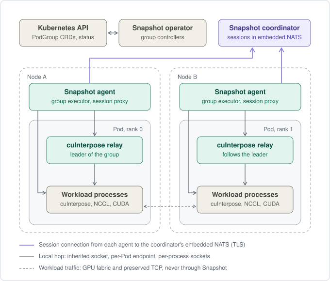
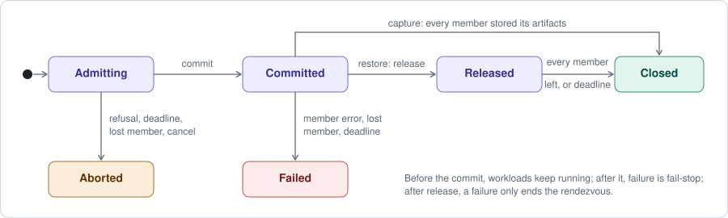
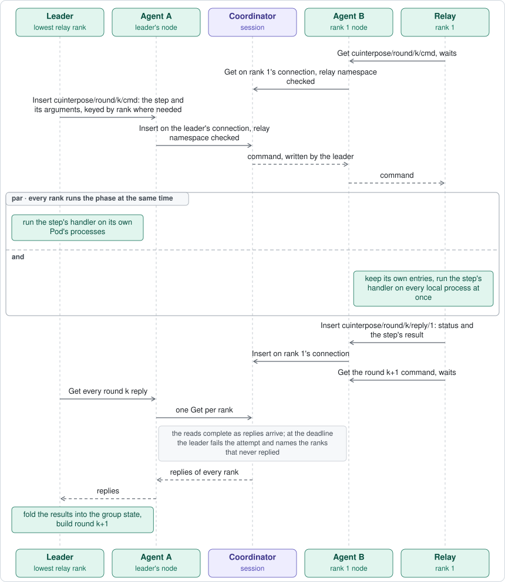
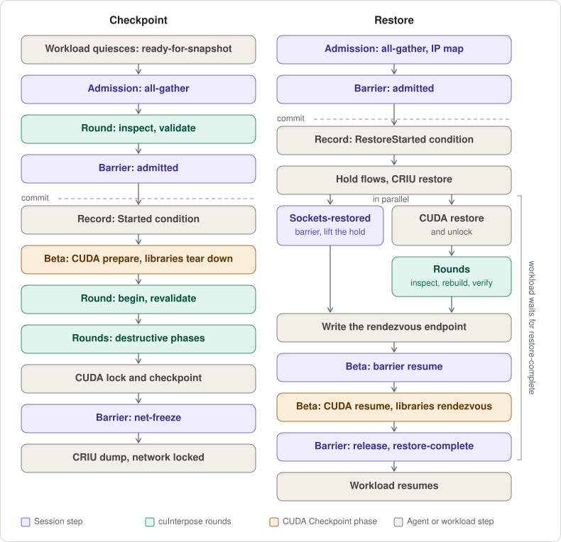
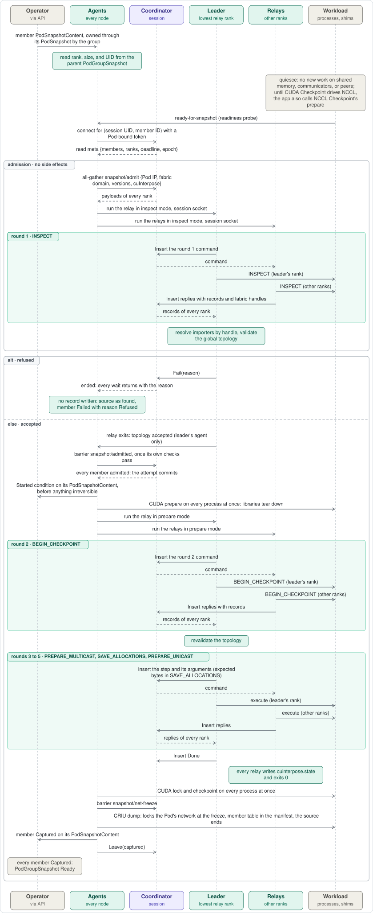
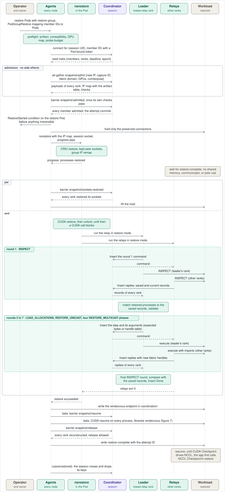
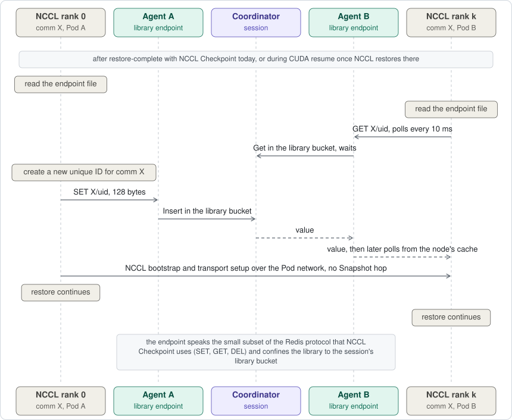
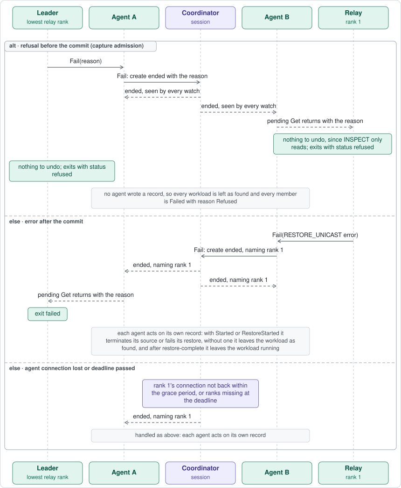

<!--
SPDX-FileCopyrightText: Copyright (c) 2026 NVIDIA CORPORATION & AFFILIATES. All rights reserved.
SPDX-License-Identifier: Apache-2.0
-->

# SNEP-324: Coordinated multi-Pod snapshot and restore

<!-- toc -->
- [Summary](#summary)
- [Motivation](#motivation)
  - [Goals](#goals)
  - [Non-Goals](#non-goals)
- [Proposal](#proposal)
  - [User Stories](#user-stories)
    - [Story 1: Scaling out a multi-node inference worker](#story-1-scaling-out-a-multi-node-inference-worker)
    - [Story 2: A communication library that restores itself](#story-2-a-communication-library-that-restores-itself)
  - [Limitations, Risks, and Mitigations](#limitations-risks-and-mitigations)
- [Design Details](#design-details)
  - [Architecture](#architecture)
  - [The coordination session](#the-coordination-session)
  - [Communication paths](#communication-paths)
  - [Phases at a glance](#phases-at-a-glance)
  - [Workload contract](#workload-contract)
  - [Group checkpoint](#group-checkpoint)
  - [Group restore](#group-restore)
  - [cuInterpose across nodes](#cuinterpose-across-nodes)
  - [Communication libraries](#communication-libraries)
  - [Cross-Pod TCP connections](#cross-pod-tcp-connections)
  - [Failure handling and recovery](#failure-handling-and-recovery)
  - [Session semantics](#session-semantics)
  - [Deadlines](#deadlines)
  - [API](#api)
  - [Security](#security)
  - [Configuration](#configuration)
  - [Performance and Scalability](#performance-and-scalability)
  - [Monitoring](#monitoring)
  - [Dependencies](#dependencies)
  - [Test Plan](#test-plan)
  - [Graduation Criteria](#graduation-criteria)
- [Implementation History](#implementation-history)
- [Alternatives](#alternatives)
- [Appendix](#appendix)
  - [A. Open questions](#a-open-questions)
  - [B. Changes from the prototype](#b-changes-from-the-prototype)
  - [C. Diagram sources](#c-diagram-sources)
  - [D. API definitions](#d-api-definitions)
<!-- /toc -->

## Summary

Distributed inference and training workloads often run as a group of Pods whose
processes depend on one another: they hold communicators that span the Pods,
keep long-lived control-plane connections between them, and, on GPU fabrics
that span nodes, may even share GPU memory across nodes. Because Snapshot
checkpoints and restores each Pod in isolation, none of this cross-Pod state
survives today. This SNEP introduces `PodGroupSnapshot` and `PodGroupRestore`, which
let a user checkpoint such a group as one unit and restore it on the same or
different nodes, with members that keep their identity and rank, an admission
step that refuses unsafe attempts before anything irreversible happens, and a
single outcome for the whole group. A short-lived coordination session, hosted by
a new Snapshot coordinator and reachable only through each node's agent,
synchronizes the members of every attempt and serves as the restore-time
rendezvous for cuInterpose and for communication libraries such as NCCL, so that
workloads neither deploy a rendezvous server nor handle secrets, while a single
Pod continues to behave exactly as it does today.

## Motivation

Snapshot's pipeline is per Pod by design: an agent quiesces one container,
checkpoints its CUDA state, dumps it with CRIU, and later restores it into a
placeholder Pod without knowing that any other Pod exists. Workloads that span
several Pods, such as tensor- or pipeline-parallel inference engines,
disaggregated serving with multi-node workers, and distributed training jobs,
break that assumption because part of their state lives between the Pods rather
than inside any one of them. Their communicators, NCCL being the common case,
are bound to peer addresses that change when Pods move; their control planes,
typically MPI or a custom RPC layer launched across Pods, depend on TCP
connections that Snapshot restores as closed; and, where the GPU fabric lets
processes on different nodes import one another's memory, the shared
allocations and multicast teams escape
[SNEP-295](https://github.com/ai-dynamo/snapshot/issues/295)'s cuInterpose,
whose coordinator only sees the processes of one Pod. Even where each Pod could
be handled on its own, a snapshot in which one member succeeded and another
failed cannot be restored, so the group also needs a single outcome.

All of these gaps reduce to one missing capability, namely a place where the
members of a checkpoint or restore attempt can find each other, exchange small
amounts of metadata, and move through phases together, and that capability is
currently being built twice. The multi-node cuInterpose prototype embedded a
coordination "brain" in rank 0's coordinator, and NCCL Checkpoint expects an
operator to start Redis and publish its address in a file before restore.
Snapshot already decides when every Pod is quiesced, dumped, restored, and
released, which makes it the natural host for that rendezvous on Kubernetes;
providing it once replaces two servers, with two lifecycles and two security
models, by a single session that follows the attempt it serves.

### Goals

- Capture a group of Pods and restore it on the same or different nodes as one
  unit, with members that keep their identity and rank from checkpoint to
  restore and one outcome per attempt.
- Refuse an attempt before any irreversible step whenever the group cannot be
  captured or restored safely, so that a refusal leaves every workload as
  Snapshot found it.
- Provide one coordination session per attempt that Snapshot's agents,
  cuInterpose, and communication libraries such as NCCL Checkpoint all share,
  without a coordination listener on the Pod network and without secrets inside
  Pods.
- Preserve GPU memory that processes share across Pods, through cuInterpose,
  wherever the platform supports cross-node sharing, without moving allocation
  bytes between nodes, while letting members that share no GPU memory, such as
  CPU-only control-plane Pods, take part in the same group.
- Preserve TCP connections between members of the group across relocation.
- Tolerate agent restarts without ever replaying CRIU into a restored container.
- Configure each member as a standalone `PodSnapshot` is configured, so that
  members with different parts in the workload keep their own signals.
- Keep single-Pod checkpoint and restore, and the existing resources, unchanged.

### Non-Goals

- Creating, scheduling, or placing Pods. Snapshot provides primitives rather
  than orchestration, so the workload owner, typically the workload's own
  operator together with a gang scheduler, places the Pods, and Snapshot only
  verifies that the placement can work.
- Rolling back after the point of no return, retrying a failed member in place,
  or changing the size of a group between checkpoint and restore.
- Keeping an attempt alive across a coordinator restart in alpha, which this
  SNEP treats as a failure of that attempt, although its protocol lets a later
  version do so without changing any client.
- Assigning ranks or identities to library processes, which remains the
  libraries' concern, and judging application health, which remains the owner's.
- Moving shared GPU memory between fabric domains, and preserving connections
  to peers outside the group, which are reset as they are today.

## Proposal

A workload owner checkpoints a multi-Pod workload by listing its Pods in a
`PodGroupSnapshot`, giving each one a member ID and, if it needs them, the
settings of its `PodSnapshot`, and restores it by creating
restore Pods, as it already does for a single Pod, together with a
`PodGroupRestore` that maps each member ID to one of them. Snapshot does the rest:
the operator expands the group into per-member work that reuses the existing
per-Pod pipeline, the agents carry that work out in lockstep, and the group
resource reports progress per member and one outcome for the attempt.

Every attempt moves through the same stages, and those stages define what a user
can rely on. During admission, Snapshot only observes and validates: it waits
until every member is ready, checks that the members can be captured or restored
together, and, if anything is wrong, ends the attempt with a `Refused` or
`DeadlineExceeded` reason while leaving every workload as it found it. The
attempt commits when the last member passes admission; from then on the
members proceed in lockstep, each member records durably that it has crossed
its point of no return before its first irreversible step, and a failure in any
member fails every member that has crossed it, because shared state cannot be
left half-prepared. A
capture ends when every member's artifacts are stored, whereas a restore ends
with a release in which every workload resumes at about the same time, with
shared GPU memory back at its original addresses, communicators rebuilt by their
libraries, and connections between members intact on their new IP addresses.
Release means that Snapshot handed the workload back, not that the application
is healthy, so owners keep gating traffic on their own readiness checks.

The boundaries are equally explicit. Snapshot's workload contract does not
change, since a workload still reports `ready-for-snapshot` once quiescent and
stays parked until `restore-complete`, although for a group that second rule
becomes load-bearing: it is what keeps a restored member from acting before its
peers are reconstructed, so a workload that cannot honor it is not supported,
and [Workload contract](#workload-contract) defines which threads it covers.
The owner must not delete or replace a source until the group's capture has
ended, Ready or Failed, and group restore Pods must carry the existing restore startup probe and arrive held by Snapshot's scheduling gate. Placement stays
with the owner, but Snapshot refuses a restore that cannot work, for example one
whose members share GPU memory across nodes but were placed in different fabric
domains, because such a restore would otherwise fail only after its destructive
steps. A restore refused before it claims its Pods leaves them gated, so a new
attempt can name them, whereas a claimed Pod serves only its attempt, and the
owner replaces it if that attempt fails. Finally, a plain `PodSnapshot` or a single restore Pod never contacts the
coordinator, so existing users are unaffected.

### User Stories

#### Story 1: Scaling out a multi-node inference worker

A platform team serves a model with an inference engine at tensor parallelism 8
across two Pods with four GPUs each, on nodes connected by a multi-node NVLink
fabric. To scale out without repeating model loading and warm-up, the serving
platform's operator checkpoints a warmed-up pair of workers once with a `PodGroupSnapshot`, and for
every new replica its workload manager creates two restore Pods, from the template
that every replica shares, on other nodes of the same fabric, after which the
operator creates a `PodGroupRestore` that names them. The restored workers resume with their shared
GPU buffers at the same virtual addresses, NCCL rebuilds its communicators
through the session, and the MPI connections between the two Pods continue on
the new IPs, so the replica serves its first request without initialization.

#### Story 2: A communication library that restores itself

A communication-library maintainer adds checkpoint support by publishing new
connection identifiers during restore through a key-value store that speaks a
small subset of the Redis protocol, as NCCL Checkpoint does. On Kubernetes the
library needs no deployment change and no knowledge of Snapshot, because the
agent serves that store inside each Pod and the coordinator holds it for each
restore, whereas on other platforms the same code runs against any
Redis-compatible server.

### Limitations, Risks, and Mitigations

| Risk or limitation | Mitigation or decision |
| --- | --- |
| Every restore keeps the original group size and GPU count per member, and a group whose members share GPU memory across nodes must restore within one fabric domain. | The owner places the Pods, and admission verifies these constraints before CRIU runs, so a misplaced restore is refused without side effects. |
| Capture is not atomic: each source ends at its own dump, and a failure after the commit terminates every member that has started. Release is not atomic either, since a member can fail before its release while its peers are already released. | Admission catches every condition that can be checked without side effects, every member records when it started, and member results report partial outcomes truthfully, so the owner can retire the group and retry with a new attempt. |
| Snapshot does not freeze restored processes until release, because CUDA, cuInterpose, and library threads do the reconstruction inside them, so an application thread that runs early could observe a half-rebuilt state. | Release relies on the existing workload contract, which this SNEP extends to every thread that could touch shared memory, communicators, or preserved connections; workloads launched through a wrapper that gates on the contract's signals satisfy it, and an enforced hold is left to future work. |
| Between CRIU restore and CUDA unlock, a thread that calls CUDA blocks on the lock, which is not a recommended use of CUDA Checkpoint, and a failure in that window could leave such a thread stuck. | The locked window involves no coordination and lasts as long as for a single Pod, failing a restore terminates every restored process, and qualification measures both restore windows and injects failures into each. |
| CRIU's network lock at capture and the agent's hold at restore pause the traffic of preserved connections while keepalive, retransmission, and user timeouts keep running, so a long dump or a slow peer can break them ([snapshot#577](https://github.com/ai-dynamo/snapshot/issues/577)). | Holds are taken as late and lifted as early as possible, and qualification measures the whole interruption, including staggered dumps, to document the supported limits. |
| At capture, CRIU's network lock covers a member's IP traffic only from the moment CRIU freezes it, and never covers RDMA, shared volumes, or external services, while dumps finish at different times. | Members must stop such traffic before reporting `ready-for-snapshot`, as the workload contract requires, and libraries tear down RDMA transports before the dump, which for NCCL means the application calling NCCL Checkpoint's prepare until CUDA's prepare phase does it. |
| Sessions live only in the coordinator's memory, so an attempt in flight ends if the agent that hosts its session restarts. | Each session lives in the agent on the node of the attempt's rank-0 member, which the attempt depends on anyway, since a restarted agent fails its own member; losing it is fail-stop and reported as `CoordinatorLost`, sessions on other nodes are unaffected, and a broken connection that reconnects does not fail an attempt. Every session pattern is safe to repeat, so replicating sessions later changes only the coordinator. |
| Sessions hosted on the same node share the coordinator's memory, so a compromised workload can fill it with records forged through its relay and make concurrent attempts fail until its own attempt ends at its deadline. A compromised agent can also add messages to another attempt's buckets, which count against that attempt's limits, because JetStream does not bound a consumer's deliveries by its creator's permissions ([nats-server#8274](https://github.com/nats-io/nats-server/issues/8274)). | Sessions stay isolated otherwise: no client can read another session or change its keys, since a delivered message keeps its original subject, libraries are bounded per session, each bucket bounds how many watches its members open, and the cap protects the coordinator itself. A byte limit per session would reserve that memory whether a session uses it or not, so alpha shares it, and beta revisits both limitations together, for example with one NATS account per attempt, once cuInterpose's largest records are measured. |
| The agent sits on every coordination path, and an agent can restart in the middle of a restore. | The agent records its intent before CRIU starts and treats `restore-complete` as proof of release, so a restarted agent never replays CRIU and never kills a released workload. |
| Importing GPU memory shared from another node after a native CUDA restore depends on a driver fix, and cuInterpose currently infers the kind of an imported FABRIC handle from its opaque contents. | Cross-node sharing in alpha requires a driver with the fix, and a public query for the handle kind is a beta prerequisite. |
| CUDA Checkpoint's prepare and resume phases are not released yet. | Until they are, the application calls NCCL Checkpoint's prepare and restore itself, and NCCL restores after release through the library endpoint. |
| A restore Pod may already have spent part of its 30-minute startup probe waiting for its peers. | Admission refuses with `GateBudgetTooShort` unless every restore Pod's remaining probe time covers the remaining deadline. |

## Design Details

### Architecture



*Figure 1. Components and communication paths.*

The architecture separates three kinds of state because their lifetimes and
failure modes differ. Durable intent and outcome live in the Kubernetes API,
where the operator owns the group resources and each agent reports on the members
it hosts, so status survives any process restart. Coordination state lives only
for one attempt and only in the coordinator's memory: a session is a small group
of in-memory key-value buckets in a NATS server that the coordinator embeds,
through which members synchronize, and it disappears with the attempt, which
keeps fabric handles and bootstrap identifiers out of etcd and gives every
restore a fresh rendezvous store. Node-local mechanics remain with
the agent, which already sequences CUDA checkpointing and CRIU and now also
relays every exchange between a Pod and its session.

That relaying is the decision with the widest consequences. The cuInterpose
relay receives its session on a socket inherited from the agent, and libraries
inside the workload reach the session through a per-Pod endpoint served by the
agent, so no process in a Pod opens a coordination connection across the Pod
network. As a result, no secret is delivered to a Pod or captured in a CRIU
image, no NetworkPolicy must admit coordination traffic in workload namespaces,
and the hold that protects preserved TCP connections during restore cannot block
coordination; moreover, because the agent authenticates to the coordinator with
the identity of its node and of the Pod it acts for, the coordinator scopes each
connection to one member of one attempt rather than trusting a shared token.

Within a session, the coordinator offers only a handful of generic patterns, and
it leaves domain logic with the clients that understand it: cuInterpose's global
validation and handle table run in the leader's relay, NCCL publishes
communicator identifiers under its own keys, and the agents build their phase
barriers on the same patterns. The coordinator does not implement a storage or
wire protocol of its own: it embeds a NATS server with JetStream, keeps each
session in key-value buckets there, and adds only what a store lacks, namely
authentication, membership, the deadline, and failure. Consequently, the
coordinator stays small, and new participants integrate without changing it.

| Component | Runs as | Responsibility |
| --- | --- | --- |
| Group controllers | Snapshot operator | Validate groups, pin identities, create member `PodSnapshot`s, enforce the deadline, and aggregate member results into one outcome. |
| Snapshot coordinator | Snapshot agent; the agent on the node of an attempt's rank-0 member serves its session | Embed a NATS server with in-memory JetStream, create two buckets per attempt, authenticate every connection and scope it to its attempt, enforce the deadline and the grace period, and fail every member when one fails. |
| Group executor | Snapshot agent | Run each member's capture or restore as session phases around the existing CUDA and CRIU steps, and record its intent before destructive work. |
| Session proxy | Snapshot agent | Hold one NATS connection per hosted member, serve the relay's socket and the Pod's endpoint, and confine each to its namespace. |
| cuInterpose relay | Short-lived process in each Pod that uses cuInterpose | Fan commands out to the Pod's processes as in SNEP-295 and, in the lowest rank that runs one, also lead the group. |
| Communication libraries | Inside workload processes | Tear down and rebuild their own connections, using the session for rendezvous. |

### The coordination session

A session corresponds to exactly one attempt, that is, one capture of a
`PodGroupSnapshot` or one `PodGroupRestore`, and it is identified by that resource's
UID, because each resource is exactly one attempt. The coordinator is a logical
component that Snapshot runs in every agent: an attempt's session lives in the
agent on the node of its rank-0 member, which the group's status records, so
every member finds it there and no election is needed. That agent follows the
group resources through a read-only watch and creates the session of every
unfinished attempt whose rank-0 member runs on its node, so sessions need no
creation API and the resource remains the single source of truth. The coordinator removes a session and all of its
keys once its resource is deleted, or once the resource is final and the
session has ended or its deadline has passed, so a session whose end cannot be
recorded, for instance at the memory cap, is still removed. Once a
resource's deletion has started, the coordinator fails its session with
`Cancelled` unless every member has already arrived at the `admitted` barrier.
Members decide on their own that a barrier is complete, so a member that saw it
complete just before can still start, which its `startedAt` records.

A session is two key-value buckets in the coordinator's embedded NATS server,
both held in memory. One serves Snapshot's own components, the agents and
relays, and holds a `meta` key with the members, their ranks, the deadline, and
an epoch, which every agent reads when it connects; the other holds library
keys, such as NCCL Checkpoint's communicator identifiers. Each bucket limits the
size of a value, and the library bucket also limits its number of keys, so
libraries cannot exhaust what Snapshot's own keys need. Neither bucket reserves
memory: one cap bounds the memory of all sessions, which they share. Members
coordinate through six patterns, each built from standard NATS key-value
operations, which [Session semantics](#session-semantics) defines precisely.

| Pattern | Purpose | Used by |
| --- | --- | --- |
| `Insert` | Publish a value once under a key | Agents, relays, libraries |
| `Get` | Read a value, optionally waiting until it is published | Agents, relays, libraries |
| `Delete` | Remove a key | Agents, relays, libraries |
| `Barrier` | Wait until every member has reached the same step | Agents |
| `Leave` | Report that a member's agent is done | Agents |
| `Fail` | End the attempt with a reason, which ends every wait | Agents, relays |

Three properties of these patterns shape the rest of the design. Waits are
pushed rather than polled, so a waiting `Get` completes the moment its key is
inserted and a barrier the moment the last member arrives, and when the session
fails, every pending wait returns with the reason, which means no member waits
out its own timeout after a peer has already failed. Every pattern is safe to
repeat, so a client whose connection breaks simply sends again what it had not
seen answered, with no request identifiers and nothing recorded on the server.
And the agent can coalesce reads: it serves identical reads of keys that are
written once, such as NCCL's identifiers, from the processes of one Pod through
a single upstream read.

Keys live in per-client namespaces: agents use the `snapshot` namespace, relays
the `cuinterpose` namespace, and libraries the library bucket, so workload processes can
never read or write Snapshot's or cuInterpose's keys. The agent enforces these
namespaces for the relay and the libraries whose traffic it carries, since it is
the only component that knows which local client sent a request, while the
coordinator confines every connection to its own attempt's buckets
([Security](#security)). Every member takes part in the agents' barriers,
including members that run no relay, and an agent that hosts several members of
the same group connects once per member and drives them concurrently, because
handling them one after the other would deadlock the first barrier.



*Figure 2. The session's two outcomes, and the member records that decide what a failure does.*

The commit is the hinge of an attempt, although it is neither an operation nor
a session state. An attempt commits when its `admitted` barrier completes, that
is, when the last member passes admission, so capture and restore commit at the
same point and the coordinator never needs to know which steps are
destructive. Before its member's first irreversible step, each agent records
durably that the member has crossed its point of no return, as a `Started`
condition on the member's `PodSnapshotContent` at capture and as the
`nvidia.com/RestoreStarted` condition on the restore Pod at restore, both written
once and never removed, and an agent that cannot write it fails
the attempt instead of proceeding. That record, never the session, decides
what a failure does to the member: a member without it is left as
Snapshot found it, a member with it fails, and a member already released keeps
running. The session itself therefore has only two outcomes, closing once every
member has left, or failing, in which case every pending read and barrier
returns with the reason.

### Communication paths

Every path in the system is either local to a node or runs between an agent and
the coordinator; members never address one another through the coordinator,
and no participant ever needs to send a message to one specific rank.

| Path | Transport | Identity |
| --- | --- | --- |
| Operator, agents, and coordinator to the API server | Kubernetes API, read-only for the coordinator | RBAC |
| Agent to coordinator | One NATS connection per session and hosted member, over TLS, to the server that the coordinator embeds, in the agent hosting the session | Pod-bound ServiceAccount token checked with TokenReview when the connection opens; the member's Pod must run on the agent's node, and the connection may reach only its attempt's buckets |
| Agent to cuInterpose relay | Socket pair inherited through `nsenter` or `nsrestore` | Implicit, because the agent created it |
| Workload processes to agent | Per-Pod endpoint: a Unix socket in the control volume, or a loopback listener inside the Pod's network namespace | Implicit, because the endpoint belongs to one Pod |
| Relay to shims | Per-process Unix sockets from SNEP-295 | File permissions |
| Workload to workload | GPU fabric, preserved TCP connections, and new library connections | Not involved |

Every exchange that crosses Pods is one of six kinds, each built from the
session's patterns rather than added to them:

| Exchange | Used by | Built from |
| --- | --- | --- |
| Broadcast | The cuInterpose leader sends each round's command to every relay | One `Insert`, read with a waiting `Get` by every relay |
| Gather to one rank | Relays return records, results, and new fabric handles to the leader | One key per rank, read by the leader |
| All-gather | Agents exchange new Pod IPs, capture IDs, fabric domains, versions, and whether each member runs a relay at admission | One key per rank, read by every agent with a waiting `Get` |
| Phase synchronization | Agents synchronize `admitted`, `net-freeze`, `sockets-restored`, and `release`, and `resume` once CUDA Checkpoint's resume phase is released | One `Barrier` per phase |
| Publish by key | The owner of a communicator or listening endpoint gives its peers a new identifier | `Insert` by the owner, waiting `Get` by each peer |
| Failure | Any agent or relay, or the coordinator, ends the attempt | `Fail`, which ends every member's pending wait |

A cuInterpose round combines the first two exchanges, and because every phase of
cuInterpose is one such round, Figure 3 is the unit from which the checkpoint
and restore flows below are assembled. The leader inserts one command, naming a
step and its arguments, that every relay reads; every rank executes it at the
same time; and each relay inserts one reply that the leader collects. The leader
therefore never addresses a single rank, because any value meant for one rank
travels inside the shared arguments, keyed by rank, and each relay keeps its
own.



*Figure 3. One cuInterpose round: a broadcast followed by a gather.*

The loopback listener exists for clients that can only speak TCP, which today
means NCCL Checkpoint's Redis client. The agent creates it by moving one thread
into the Pod's network namespace, binding `127.0.0.1` on a port that the kernel
chooses, and moving the thread back; the socket then belongs to the Pod's
namespace while its file descriptor stays in the agent, so it is reachable only
from inside that Pod. The agent opens the listener after CRIU restore, when it
can no longer take a port that a restored process needs, and closes it, together
with every connection it accepted, when the session closes.

### Phases at a glance



*Figure 4. Phases of a group checkpoint and a group restore.*

Figure 4 shows how the session steps, the cuInterpose rounds, and CUDA
Checkpoint's phases interleave with the steps Snapshot already performs, where
each attempt commits, and where a restore runs the `sockets-restored` barrier in
parallel with CUDA restore and the cuInterpose rounds. Figures 5 and 6 expand
both columns into complete sequences, in which every shaded band labeled "round"
is one instance of Figure 3, drawn with the same messages but without the agent
hop that Figure 3 details, so that each round can be traced from the leader's
command to the replies it collects.

### Workload contract

Snapshot and the workload hand control to each other at exactly two points, and
a group depends on every member honoring both, because the work between them is
collective. The handshake is the one that single-Pod Snapshot already uses, so a
group asks for no new application signal; what it changes is how much of the
restore happens while the workload waits, and therefore how strictly waiting
must be read.

| Signal | Written by | What it promises for a group |
| --- | --- | --- |
| `ready-for-snapshot` | The workload, through its readiness probe | The member has drained its GPU work and starts no new work on memory shared across Pods, on communicators, or on connections to peers. Until CUDA Checkpoint's library interface drives NCCL, the application must also have called NCCL Checkpoint's prepare itself. Capture admission waits for this signal from every member. |
| `restore-complete` | The agent, after the `release` barrier | Every member is reconstructed: shared GPU memory is back at its original addresses, preserved connections are open on the new IPs, and libraries that restore in CUDA's resume phase have reconnected. The file names the attempt. |

A member's settings ([API](#api)) can also carry either signal through
[SNEP-411](https://github.com/ai-dynamo/snapshot/issues/411)'s application
contracts: a `checkpointReadinessProbe` reports what
`ready-for-snapshot` reports, and a `lifecycle.postRestore` notification
follows `restore-complete`. Both keep their place relative to the barriers, so
each promise above holds whichever signals a member uses, and the members of
one group may use different ones.

Between CRIU restore and `restore-complete`, a restored member passes through two
windows that differ in what its threads may do.

| Window | CUDA | What Snapshot does | What the workload may do |
| --- | --- | --- | --- |
| From CRIU restore to CUDA unlock | Locked, so a CUDA call blocks until the unlock | Restores and unlocks CUDA inside the Pod without any coordination, exactly as for a single Pod | Nothing; a thread that calls CUDA simply blocks |
| From CUDA unlock to release | Usable | Rebuilds shared memory through the cuInterpose rounds, lifts the TCP hold, and, once CUDA Checkpoint releases it, runs CUDA's resume phase, in which libraries reconnect | Wait: no access to memory shared across Pods, no use of a communicator, and no traffic on a preserved connection |

The second window is the one that a group lengthens, since it now spans cross-node
rounds and the barriers after them, and it is also the one in which a running
thread could observe a half-rebuilt state, such as an imported allocation that
does not yet map its creator's memory or a communicator whose peers are still
reconnecting.
Waiting therefore applies to every thread that could touch such state,
including background threads such as communicator watchdogs and progress
threads, and not only to the application's main loop. A library that Snapshot
does not drive yet, such as NCCL until CUDA Checkpoint's library interface
ships, restores only when the application calls it, so the application calls
NCCL Checkpoint's restore after release and before it uses any communicator.
Snapshot cannot verify any of this from outside
the process, so the SNEP makes it a requirement of group membership: integrations
that launch the workload through a wrapper gating on both signals, as some
serving platforms already do, satisfy it without application changes, an
application can receive both signals directly through SNEP-411's contracts,
and an enforced hold remains open in [Appendix A](#a-open-questions). Figures 5 and 6 show both signals and the
waiting period on the workload's lifeline.

### Group checkpoint

Capture starts once the operator has created a member `PodSnapshot` for every
Pod in the group, each owned by the group and labeled with its member ID, so that
the agent receiving the member's `PodSnapshotContent` follows the owner
reference to the `PodGroupSnapshot` and reads the member's rank, the group's size,
and the group's UID, which names the session, without any change to the existing
resources. Each agent
waits until its member is safe to capture, which the member's settings define
as for any `PodSnapshot`: `ready-for-snapshot` by default, or the member's own
`checkpointReadinessProbe`. It then connects to the session and contributes its Pod IP, its fabric domain when the Pod shares GPU memory
across nodes, its component versions, and whether the Pod has opted into
cuInterpose as SNEP-295 defines, to the admission exchange, while the
relays run a first round that inspects every process and gathers the records to
the leader for a global validation. Every agent then posts to the `admitted`
barrier once its own checks pass, and the agent of the leader's Pod posts only
after the leader has accepted the topology, so the barrier completes, and the
attempt commits, only when every member and the leader have accepted. Admission
therefore changes nothing in any workload, and a mismatch, an invalid sharing
topology, or a member that never becomes ready ends the attempt as `Refused`
with every source as Snapshot found it.

Once the attempt commits, each agent sets the `Started` condition on its
member's `PodSnapshotContent`, which is the object it already reconciles and the
only one whose status it may write, so the record needs no new permission and
the operator copies it to the group as it already copies Ready and Failed to the
`PodSnapshot`. Each agent then, where CUDA Checkpoint supports it, invokes its
prepare phase on every CUDA process of every Pod at once, so that communication
libraries tear down their connections while CUDA is still usable and while their
peers do the same; invoking it one process at a time would deadlock libraries
whose teardown is collective. A second round then moves the shims into their
checkpointing phase, the leader revalidates a topology that now contains only
application-owned shared memory, and three more rounds run the destructive
cuInterpose phases. Finally,
every agent locks and checkpoints CUDA, passes a `net-freeze` barrier, and only
then runs CRIU, which drops all traffic in the Pod's network namespace as soon
as it freezes the processes and keeps it dropped after the source ends. The
barrier guarantees that no member's network is frozen while a peer still has a
step that needs it; after the barrier, each member locks and dumps at its own
pace, and dumps that finish at different times reset no other member's sockets,
as [Cross-Pod TCP connections](#cross-pod-tcp-connections) explains. Every
artifact records the capture ID, which is the `PodGroupSnapshot`'s UID, its own member ID, and the ordered table of all
members with their Pod UIDs, containers, and Pod IPs, which is what a restore
later uses to check that all members come from the same capture and to build
the IP map.



*Figure 5. Group checkpoint. Each shaded band is a round as in Figure 3, with every relay message passing through its agent.*

The operator marks the `PodGroupSnapshot` Ready only when every member is
Checkpointed, and otherwise records which member failed and why, together with each
member's `startedAt`, copied from its `Started` condition. A member with that
time has lost its source, since every source that started ends at its own dump
or is terminated by the failure, whereas a member without it was never touched
by Snapshot, and the group reports `Refused` only when no member started. Ready also describes
availability rather than history: if a member's content later disappears, the
operator withdraws Ready with `ArtifactUnavailable` and refuses new restores,
without ever recapturing.

### Group restore

Restore starts from Pods that the owner has already created, typically from one
Pod template that every replica of a group shares, and every target arrives held
by Snapshot's scheduling gate, `nvidia.com/restore-group`. The owner sets the
gate when it creates the Pod, through the Pod template or a Pod-creation
webhook, as `podcontract.BuildGroupTarget` does, and an owner that
decides not to restore a Pod simply creates it without the gate. A gated Pod is
never scheduled, so no node, GPU, sandbox, or container exists for it, and the
gate proves that nothing has run in it. The rest of the Pod's spec is complete
at creation, since a gate makes no other field mutable: the destination
container carries the restore startup probe and the control volume, and no init
container may wait for the Pod's peers, because a peer restores only once every
member is pinned, which needs every destination container to exist. For the same
reason, a workload manager that waits for one Pod to be Ready before creating
the next, such as a StatefulSet with `OrderedReady`, cannot create group
targets. The owner then creates the `PodGroupRestore`, which names each target
Pod by name and, optionally, UID, together with the target's container mapping,
so the request is complete in one object.

The operator, not the owner, claims each target for the attempt, and a claimed
Pod serves only that attempt. Admission again comes first, and the workload
again does not run before it passes. On every reconcile, the operator first
classifies each target Pod: gated and unbound, it is unclaimed; bound to this
attempt, no longer gated, and carrying the map this attempt projects, it is
claimed, and the attempt continues; bound to another attempt, it fails with
`TargetInUse`; in any other state, the Pod was not created as a group target or
was changed by something other than Snapshot, and the target is refused with
`Refused`. The operator refuses the restore with `Refused` if its
`PodGroupSnapshot` is missing, has another UID, or is being deleted, and with
`ArtifactUnavailable` if it is not Ready, so a restore never waits for its
snapshot. It waits, with `TargetPodPending`, until every target Pod exists, and
refuses a target with `Refused` if the Pod has another UID than the one named,
if the mapping does not name a container prepared as a destination, or if its
source is not the member's captured container. No check of an earlier restore's
traces is needed: a gate cannot be added to an existing Pod, so a gated Pod has
never run. Only once every target passes does it claim them, each with one
patch conditional on the Pod's `resourceVersion` that writes the attempt's UID
into `nvidia.com/restore-group-uid`, projects the mapping into
`nvidia.com/restore-container-map` as exactly one pair, and removes the gate, so
no Pod takes a node while a peer is missing or refused; a patch, unlike an
update, keeps the fields of the Pod that the operator's API version does not
know. A conflict alone proves
nothing, because the kubelet and other controllers also write the Pod, so after
a conflict the operator reads the Pod again from the API server and applies the
same rules, and a crash between two claims leaves Pods that the next reconcile
finds claimed or still gated. Only Snapshot removes its gate; a gang
scheduler's gate is independent of it, and a gang waits until every gate of
every Pod in it is gone.

Once the Pod is scheduled and its sandbox created, its binding and its map are
already there, so the NRI plugin acts on the sandbox's creation-time annotations
alone, without any API read: it makes the restore proxy the destination
container's PID 1, and the Pod waits, with `nvidia.com/Restored` reporting
`GroupPending`. On a node without the NRI plugin, a group target follows the
standalone rule: its destination's own command must be inert, and the agent
restores without the proxy; the same rule keeps a target safe on a node whose
agent predates groups, where the operator holds the attempt with
`AgentNotReady` before pinning. The operator waits, with `TargetPodUnscheduled`
while a target has no node, so a shortage of capacity is visible, and with
`TargetPodPending` until every target has an address and a destination
container ID, refuses a target whose address is not IPv4, and then records every
member as Admitted in one update, pinning the target's Pod UID, container IDs,
and Pod IP from the Pod's own status. A claim alone starts nothing, since agents
act only on these pins, so a crash between claiming and pinning only finds the
claims already made. Nothing follows a later edit of the Pod: the agent restores
only into the container that the NRI plugin prepared, and an agent whose Pod or
prepared container no longer matches what was pinned fails the member with
`PodIPChanged` instead of restoring with a stale map. A refusal before a Pod is
claimed leaves it gated, so the owner can name it in a new `PodGroupRestore`,
whereas a claimed Pod is never claimed again, and the owner replaces it if its
attempt fails.

The agents' admission waits for the operator's, which pins nothing until it
passes. Each agent then resolves its member's artifact, runs the existing
compatibility checks, verifies that the restore Pod's remaining startup-probe
time covers the remaining deadline, and contributes its new Pod IP, the capture
ID from its artifact, its fabric domain, its GPU count, and whether its artifact
holds cuInterpose state. Every agent therefore ends admission holding the
complete IP map, built from the member table in its own artifact and the new
IPs, together with the assurance that all members restore the same capture onto
a placement that can work.

Each agent then posts to the `admitted` barrier once its own checks pass. When
the barrier completes, the attempt commits, and each agent records the
`nvidia.com/RestoreStarted` condition on its restore Pod before anything
irreversible happens, holds the preserved connections
in its Pod, and restores the processes with CRIU using the group IP map. As
soon as every member has restored its sockets, the `sockets-restored` barrier
lifts the holds, which keeps that window short and leaves the Pod network open
for the connections that libraries create later; this is safe because the
restored workload stays parked until `restore-complete`, so kernel traffic
resumes while application traffic does not. In parallel, `nsrestore` restores
and unlocks CUDA and runs the relays, whose rounds first match the restored
processes to the saved records and then rebuild shared memory in lockstep,
carrying the table of old and new fabric handles from one round to the next.
Only then do the agents write the rendezvous endpoint.

Once CUDA Checkpoint's resume phase is released, the agents also pass a
`resume` barrier and invoke that phase on every process, so that libraries
reconnect on top of memory that is already back at its original addresses. The
barrier is what makes that safe: a member that runs no relay takes part in no
round, and even when every member runs one, a member that finishes the last
round does not know whether its peers have finished theirs, so without it a
library could reconnect to a peer that is still rebuilding. Until then nothing
runs between the rounds and release, so alpha has no `resume` barrier, and the
`release` barrier alone orders the members.

A final `release` barrier guarantees that no workload resumes before every
member has been reconstructed, after which each agent writes `restore-complete`
with the `PodGroupRestore`'s UID as an `attempt` key next to the existing `pid`
key. That file is both the
release point and the proof of release that a restarted agent checks first, and
since each agent writes its own, a member can still fail before its release
while its peers are already released, in which case the group reports both
results as they are. A member whose settings define a `lifecycle.postRestore`
notification then receives it as a single Pod does: its agent retries it until
the deadline, and the member becomes Released only once it succeeds. The
notification needs no session, so once `restore-complete` exists the attempt's
outcome no longer affects the member, and only its own notification can still
fail it.



*Figure 6. Group restore up to release. Each shaded band is a round as in Figure 3, with every relay message passing through its agent.*

### cuInterpose across nodes

SNEP-295 preserves CUDA memory shared between the processes of one Pod, and
this SNEP extends it across Pods while keeping its per-process machinery and its
fail-stop semantics. Where the GPU fabric supports cross-node sharing, the shim
now admits FABRIC allocations and multicast objects, and their handles stay real
at runtime: an export returns the driver's own handle and an import goes to the
driver, so Snapshot never sits on the application's import path, while the shim
records every handle so that the handle itself becomes the key that joins an
importer to its creator on another node. Each shared allocation is still saved
once, on its creator's node, and no allocation bytes therefore cross nodes.

Every Pod that uses cuInterpose keeps a short-lived relay that fans each command
out to its processes over their per-process sockets, and the relay of the
lowest rank that runs one also acts as the leader, which is rank 0 unless that
member uses no cuInterpose. The leader gathers every Pod's records, makes process
identities unique by prefixing them with the rank, resolves importers to
creators through the recorded handles, and validates multicast teams whose
devices span Pods. It keeps the result as the group state, together with the
expected carrier bytes of each process, which is the amount of shared memory
that process must copy to or from its host carrier, and, during restore, the
handle table, which maps every old fabric handle to the one its creator exported
after re-creating the memory. Members without cuInterpose run no relay, and
since every agent learns from the admission exchange which ranks run one, they
all agree on the leader without an election: an agent that starts a relay
passes it its own rank, the leader's rank, and the ranks that run a relay, so
the leader knows itself and its gathers wait only for those ranks. Ranks are
fixed and a restore takes the flag from the capture's artifacts, so the same
member leads at capture and at restore, and when no member uses cuInterpose,
there are no relays and no rounds, and the `admitted` barrier waits for no
leader's verdict. A Pod that is not part of a group keeps today's behavior and
never opens a session.

Each phase then runs as a round of Figure 3 through one generic envelope: the
command names the step and carries arguments that the leader derives from the
group state, and each reply carries a status and a step-specific result that the
leader folds back into it. Relays never see the plan, because they only dispatch
each command to the local handler that its step names, so a capture and a
restore are simply two lists of steps, and a new phase costs one row in the
table below and one handler in the shim.

| Step | Arguments | Result |
| --- | --- | --- |
| `INSPECT`, `BEGIN_CHECKPOINT` | None | Records describing allocations, fabric handles, and multicast teams |
| `SAVE_ALLOCATIONS`, `LOAD_ALLOCATIONS` | Expected carrier bytes, so each relay checks that its shims copied every shared allocation in full | Bytes copied and, at restore, the new handles of re-created allocations |
| `RESTORE_MULTICAST_CREATORS` | None | The new handles of re-created multicast objects |
| `RESTORE_UNICAST`, `RESTORE_MULTICAST_IMPORTERS`, `RESTORE_MULTICAST_DEVICES`, `RESTORE_MULTICAST_BINDINGS` | The handle table, so each importer finds the new handle from the old one it recorded | Status only |
| `PREPARE_MULTICAST`, `PREPARE_UNICAST` | None | Status only |

Only three step boundaries need the whole group to finish before the next step
starts: after `LOAD_ALLOCATIONS` and after `RESTORE_MULTICAST_CREATORS`, because
importers need the new handles, and after `RESTORE_MULTICAST_DEVICES`, because
the driver waits for the whole multicast team before a bind or a mapping
completes. The other boundaries are kept for uniformity and easier debugging,
since a round costs well under a millisecond, and the round deadline doubles as
the watchdog for a multicast team that never forms.

cuInterpose deliberately does not register as a CUDA Checkpoint client: CUDA
does not order callbacks across clients, so nothing would guarantee that
cuInterpose rebuilds memory before NCCL uses it. Running between CUDA's phases,
under the agent's control, provides that ordering instead.

### Communication libraries

Communication libraries need much less than cuInterpose: during restore, the
owner of each communicator or listening endpoint publishes a fresh identifier
under a key derived from its old one, and every peer reads it. The session
supports that exchange through the agent's library endpoint, which speaks the
small subset of the Redis protocol that NCCL Checkpoint already uses.



*Figure 7. Library rendezvous through the session, shown for NCCL.*

[NCCL Checkpoint](https://github.com/NVIDIA/nccl/tree/master/contrib/nccl_checkpoint)
reads `<host>:<port>[/<prefix>]` from the file named by
`NCCL_CHECKPOINT_KVS_PATH` and then uses a small subset of the Redis protocol,
in which rank 0 of every communicator sets a 128-byte identifier while the other
ranks poll until it appears; the application calls NCCL's prepare before
reporting `ready-for-snapshot` and NCCL's restore after `restore-complete`.
Because the variable is captured in the CRIU image, Snapshot requires it to point
into the Pod's control volume, rejects other paths during admission, and records
the path in the artifact. At restore, the agent writes that file with the
address of its loopback listener and a per-attempt prefix, translates `SET`,
`GET`, and `DEL` into `Insert`, `Get`, and `Delete` in the session's library
bucket, answers repeated `GET`s from a per-node cache that one waiting upstream
read per key fills, and keeps the session open after release until every member
reports that it has resumed or NCCL's own timeout elapses. The file must stay in
the Pod rather than on a volume shared between Pods, since each Pod's endpoint
differs.

CUDA Checkpoint is adding a prepare phase before lock and a resume phase after
unlock, during which registered libraries tear down and rebuild their
connections. Snapshot integrates by driving both phases from the agents at the
barriers of Figures 5 and 6, and a library that rebuilds its connections during
the resume phase rendezvous through the same per-Pod endpoint. Once NCCL
Checkpoint restores in that phase, applications no longer call NCCL's prepare
and restore, the post-release window becomes unnecessary, and libraries are
rebuilt before the workload resumes.

### Cross-Pod TCP connections

Connections between members of a group must survive relocation, because control
planes such as MPI cache their peers' addresses and cannot reconnect, yet today
they come back closed for three independent reasons. The restore-image rewriter
disconnects every established socket whose peer lives in another image, the
address remap rewrites only the Pod's own IP, and once CRIU releases a socket
from repair mode, the kernel may send probes or data that a peer Pod, whose
sockets do not exist yet, answers with a reset.

The group closes all three gaps with information that admission already provides.
The agent passes CRIU's address-rewrite hook the mapping from every member's old
IP to its new one, together with the peers whose connections must be kept
exactly as dumped rather than disconnected. Before CRIU runs, the agent drops,
inside the Pod's network namespace, only the packets of those preserved
connections, and it lifts that hold at the `sockets-restored` barrier, by which
time every peer socket exists; new connections, including library bootstrap
traffic, are never affected.

At capture, the agent takes no hold of its own. Because the agent dumps with
the Pod's network namespace marked as external, CRIU treats it as the dumped
processes' own namespace, drops all incoming and outgoing traffic in it as soon
as it freezes them, and never lifts that lock after a dump that ends them, so a
dumped member cannot reset its peers while its Pod exists. The `net-freeze`
barrier right before CRIU guarantees that no member's network is frozen while
any member still has a step that needs its peers, such as CUDA's prepare phase
or a cuInterpose round, so preserved connections stay live until every member is
ready to dump. It does not order one member's lock against another member's
dump, and it need not: after the barrier, each member's CRIU locks and dumps at
its own pace, and because a dumped member's lock stays in place while its Pod
exists, its peers' packets are dropped rather than answered with a reset,
whichever member finishes first. The one case the lock cannot cover is a source
Pod that is deleted, and whose IP a new Pod reuses and then resets a peer that
has not dumped yet, which owners rule out by keeping sources until the group's
capture has ended.

CRIU's lock covers all of a member's IP traffic from its freeze onwards, but
nothing before it, and nothing outside the kernel's IP stack. Every such channel
must already be quiet when a member reports `ready-for-snapshot`: RDMA
transports cannot be dumped and are torn down by their libraries before the
dump, and files on shared volumes or calls to external services reflect
whatever the application did before it quiesced. The lock therefore protects what the
[workload contract](#workload-contract) cannot, namely kernel traffic on
connections that the application has stopped using, without replacing that
contract.

Neither CRIU's lock nor the agent's hold stops the kernel's TCP timers, so keepalive,
retransmission, and user timeouts keep running while a peer is dumped or
restored, and a long interruption can still break a preserved connection
([snapshot#577](https://github.com/ai-dynamo/snapshot/issues/577)). Taking each
hold as late and lifting it as early as possible shortens that window but does
not remove it, which is why qualification measures the whole interruption,
including staggered dumps, and documents the supported limits. Connections
through Service virtual IPs and to peers outside the group are still reset, and
the mechanism is limited to IPv4 and to the 256 address mappings that the CRIU
plugin holds, which is also why a group has at most 256 members.

### Failure handling and recovery

Every failure takes the same path: the session ends with a reason, every
pending wait returns with it, every relay and CUDA phase exits with an error,
and each agent then acts on its own member's record. A
member without a record is left as Snapshot found it, which before the commit
holds for every member, since INSPECT only reads and nothing else has run, so
the attempt ends as `Refused`. A member with a record fails, fail-stop as in
SNEP-295, so its agent terminates its source or fails its restore, and a member
whose `restore-complete` exists keeps running. Failing a restore terminates the
member's restored processes, including threads blocked on the CUDA lock or
waiting for `restore-complete`, so no process outlives a failed attempt in
either window of the [workload contract](#workload-contract).

| Event | Member without a record | Member with a record | Released member |
| --- | --- | --- | --- |
| Validation refusal, placement mismatch, or short probe budget | Left as found; the attempt ends with `Refused` or `GateBudgetTooShort` | Not applicable, since refusals precede the commit | Not applicable |
| Member error during a phase, including a Pod IP or container change | Left as found | Fails with `MemberFailed` or `PodIPChanged` | Keeps running; the rendezvous ends |
| Agent connection broken while the agent and the coordinator keep running | The agent reconnects within a grace period, resumes its waits, and sends again what it had not seen answered, and the attempt continues | Same | Same |
| Agent connection not restored within the grace period, agent restart, or coordinator restart | Left as found | Fails with `MemberFailed` or `CoordinatorLost` | Keeps running; the rendezvous ends |
| Deadline expires | Left as found; the attempt ends with `DeadlineExceeded` | Fails with `DeadlineExceeded` | Keeps running; the session closes |
| Group resource deleted | If no member has a record, the attempt ends with `Cancelled` | Otherwise a finalizer waits for the attempt to end | The session closes |



*Figure 8. How a failure reaches every member, and what each member's record decides.*

Placing the commit before CUDA's prepare phase keeps every step that Snapshot
takes reversible until then, and if CUDA Checkpoint later allows a resume
without a restore, the commit can move after that phase without any API change.
The application's own steps are another matter: with NCCL Checkpoint today, a
member tears its communicators down before it reports `ready-for-snapshot`, so a
refused capture leaves its source untouched by Snapshot but possibly unable to
communicate, which the `Refused` message states.

Restore is not idempotent, so an agent that restarts during a restore relies on
two durable facts rather than on its memory. It first looks for
`restore-complete` with the attempt's ID: if the file exists, the member was
released and keeps running, whatever happens to the attempt afterwards, and the
agent at most finishes its `lifecycle.postRestore` notification. If it
does not exist, the record decides: a restore Pod with the
`nvidia.com/RestoreStarted` condition may already have been through CRIU, so the
agent never starts it again and fails the member, which fails the attempt. The
condition is a record of its own rather than a reason of
`nvidia.com/Restored`, because later reasons overwrite earlier ones and a fast
failure could otherwise erase the only proof that CRIU started; the agent writes
it once, under a field manager of its own, and never removes it, so no later
status update can drop it. Helpers left by the crashed
agent, such as `nsrestore` or a relay, lose their inherited sockets and stop at
their next step, and failing the member terminates whatever they restored.
During capture, a restarted agent that finds the `Started` condition fails the
member, as an agent restart does today. In every other case, a restarted agent
never rejoins an attempt in flight, at capture or at restore: it cannot tell
whether a barrier released before it crashed, and the relay it had started is
gone. It leaves its member as Snapshot found it, and the member's grace period
fails the attempt with `MemberFailed`, after which the owner retries with a new
attempt.

The coordinator, by contrast, keeps sessions only in memory. In alpha its
embedded server holds every bucket in memory, without replicas, so restarting
the agent that hosts a session loses it. When the coordinator creates
a session, it writes an epoch, drawn at random, into the session's `meta` key,
and every agent presents the epoch it read whenever it reconnects. If the
coordinator has recreated the session since, it fails the session with
`CoordinatorLost` before admitting the agent, and an agent that finds no
session at all reports `CoordinatorLost` as well. The owner then retries with a
new attempt, which for a restore means fresh Pods. For this to be prompt, the coordinator opens its client listener only after it has
recreated the session of every unfinished attempt it hosts; otherwise an agent that
reconnects early would find no session and fail nothing, members that had not
connected yet would join the recreated session, and the attempt would wait for
its deadline. The design does not depend on this choice, however, because every
session pattern is safe to repeat: keeping attempts alive across a restart
needs only replicated buckets, which JetStream provides by clustering the
embedded servers of several agents, and no client changes. That
costs replicas and their placement, and it helps only when a takeover completes
well within the hold, probe, and library timeouts that keep running meanwhile,
so this SNEP leaves the choice to operational evidence
([Appendix A](#a-open-questions)).

### Session semantics

Only agents connect to the coordinator: each speaks the standard NATS protocol
to the server that the coordinator embeds, through Snapshot's session client,
and the relay and libraries reach the session through their agent. What
Snapshot defines is the semantics of the six session patterns, the session's
lifetime, and what a failure means; the session client implements them, and
the coordinator relies on nothing else.

- `Insert(key, value)` stores the value if the key is absent, and every reader
  sees it at once. If the key already holds the same value, it succeeds; if it
  holds a different value, it is refused. A value larger than its bucket's
  maximum is refused.
- `Get(key, wait)` returns the value if the key exists. Otherwise, with no wait,
  it reports at once that the key is absent, and with a wait, it returns the
  value as soon as it is inserted or reports that it is still absent when the
  wait expires. In every case it returns as soon as the session ends, with how
  the session ended.
- `Delete(key)` removes the key whether or not it exists, and a later `Insert`
  of that key starts afresh.
- `Barrier(name)` records that the caller's member has arrived, then returns
  once every member listed in `meta` has arrived; only agents use it. It needs
  no count and no creation, a member that arrives again changes nothing, and a
  barrier that has released stays released, so a later arrival returns at once.
  Cancelling the wait does not undo the arrival, and the barrier returns early,
  with how the session ended, if it ends first.
- `Leave` records that the member's agent is done, and the session closes once
  every member has left. Leaving twice changes nothing, and a member that has
  left keeps its connection until the session ends, because its relay and its
  libraries may still use it.
- `Fail(reason)` ends the session with the reason if it has not ended yet, and
  every pending wait returns with that reason; otherwise it changes nothing and
  reports how the session ended. The coordinator fails a session itself when
  its deadline passes, with `DeadlineExceeded`, and when a member's connection
  stays lost beyond the grace period, with `MemberFailed`.

A session ends exactly once: it closes when every member has left, or it fails
with the first reason it receives. Each agent holds one connection per hosted
member, and a broken connection reconnects within the grace period and sends
again whatever it had not seen answered, which is safe for every pattern. The
grace period starts when the coordinator sees the connection close, which the
keepalive settings of both sides bound well within the grace period, and a
restarted agent does not reconnect to an attempt in flight, so its member's
grace period fails the attempt.

The guarantees assume crash-stop failures, trusted agents, and one serving
coordinator per attempt. For safety, a key keeps the first value inserted under
it until it is deleted, a barrier counts each member once, and a session ends
once, after which every client that is still connected learns how. For
progress, every wait ends at its phase timeout, when the session ends, or at the
attempt deadline, which an agent that cannot reach the coordinator enforces on
its own, a few seconds late to allow for clock skew. A lost member fails the
attempt one grace period after its connection is seen closing. Nothing orders operations by clock, although
deadline accuracy depends on timing assumptions: the deadline counts from the
creation time that the API server records, measured against the clock of the
node that hosts the session.

Alpha assumes one serving coordinator per attempt, which its rank-0 member's
node determines without an election. Epoch checks detect a recreated session;
they do not fence an earlier instance. The contract extends by version and by
namespace: bucket names and the key layout carry a version, agents advertise
the group protocol versions they support, which the group controllers check before
creating any member work and which, since every agent also runs the coordinator,
cover the session protocol as well, and a new kind of participant receives a
namespace of its own.

### Deadlines

Each group resource carries a single `deadlineSeconds`, counted from its creation,
which bounds the whole attempt; the coordinator fails the session and the
operator fails the resource when it expires, while finished captures and
released members are unaffected.

| Bound | Value | Enforced by |
| --- | --- | --- |
| Attempt deadline | `spec.deadlineSeconds` from creation, at most a day | The coordinator and the operator, with reason `DeadlineExceeded` |
| Phase timeout | The operation's own timeout plus a margin, never beyond the attempt deadline | Each barrier and each cuInterpose round |
| Startup-probe budget | Each restore Pod's remaining probe time must cover the remaining deadline | Restore admission, with reason `GateBudgetTooShort` |
| Post-release rendezvous | NCCL Checkpoint's own timeout, 300 seconds by default | Only libraries that restore after release |

### API

This SNEP adds two namespaced kinds to `nvidia.com/v1alpha1`, generated from Go
types as usual, and changes no existing resource schema.

```yaml
apiVersion: nvidia.com/v1alpha1
kind: PodGroupSnapshot
metadata:
  name: llm-tp8
  namespace: serving
spec:                                   # immutable
  deadlineSeconds: 1800
  members:                              # list order is the rank; 1 to 256 members
  - id: worker-0
    source:                             # PodSnapshotSource, unchanged; the UID is required here
      podRef: {name: llm-worker-0, uid: <uid>, containers: [main]}
    podSnapshotTemplate:                # optional settings for this member's PodSnapshot
      containers:                       # SNEP-411's ContainerSnapshotConfig
      - name: main
        checkpointReadinessProbe: {httpGet: {path: /ready, port: 8000}}
        lifecycle: {postRestore: {httpPost: {path: /resume, port: 8000}}}
  - id: worker-1                        # no template: default settings
    source:
      podRef: {name: llm-worker-1, uid: <uid>, containers: [main]}
status:                                 # the resource UID names the coordination session
  members:                              # keyed by id; startedAt is absent while the source is untouched
  - {id: worker-0, rank: 0, nodeName: node-a, podSnapshot: {name: llm-tp8-worker-0, uid: <uid>}, startedAt: "2026-10-16T18:02:11Z", phase: Checkpointed}
  - {id: worker-1, rank: 1, nodeName: node-b, podSnapshot: {name: llm-tp8-worker-1, uid: <uid>}, startedAt: "2026-10-16T18:02:11Z", phase: Checkpointed}
  conditions: []                        # Admitted, Ready, Failed
---
apiVersion: nvidia.com/v1alpha1
kind: PodGroupRestore
metadata:
  name: llm-tp8-r1
  namespace: serving
spec:                                   # immutable
  snapshotRef: {name: llm-tp8, uid: <uid>}
  deadlineSeconds: 1500
  targets:                              # one per member id
  - id: worker-0
    podRef: {name: llm-worker-0-r1}     # the UID is optional and pinned at admission
    containerMappings: [{source: main, destination: server}]  # one entry; defaults to the same name
  - id: worker-1
    podRef: {name: llm-worker-1-r1, uid: <uid>}
status:
  members:                              # keyed by id; bindings are pinned at admission
  - {id: worker-0, pod: {name: llm-worker-0-r1, uid: <uid>}, nodeName: node-c, targetPodIP: 10.1.9.2, startedAt: "2026-10-16T18:20:40Z", phase: Released}
  - {id: worker-1, pod: {name: llm-worker-1-r1, uid: <uid>}, nodeName: node-d, targetPodIP: 10.1.2.8, startedAt: "2026-10-16T18:20:40Z", phase: Released}
  conditions: []                        # Admitted, Released, Ready, Failed
---
apiVersion: v1
kind: Pod                               # a target, created by the owner
metadata:
  name: llm-worker-0-r1
  namespace: serving
  annotations:                          # both written by the operator when it claims the Pod
    nvidia.com/restore-group-uid: <uid>            # the PodGroupRestore's UID
    nvidia.com/restore-container-map: main=server  # the target's mapping; one pair
spec:
  schedulingGates:                      # set at creation; removed by the operator with the annotations
  - name: nvidia.com/restore-group
```

The specs follow the shape of the existing resources. A member's `source` is the
same `PodSnapshotSource` that a standalone capture uses, and its `id` is a stable
name that links capture to restore, whereas its rank is simply its position in
the list. That list is ordered and atomic, so the spec's immutability covers
its order and no update can change a rank. Every other list is keyed by `id`,
which keeps status updates mergeable, and a restore target takes the rank of
the snapshot member with the same `id`, so the order of targets carries no
meaning. Every reference that matters carries a UID, so name reuse cannot
redirect an attempt; a restore target may omit its UID, in which case admission
pins it. Every field that names containers is a list capped at one entry, as
`PodReference.Containers` already is, so supporting several containers per
member later only relaxes validation, whereas multi-container capture itself
depends on runtime support and stays out of scope; a target's
`containerMappings` holds one entry, defaults to the container of the same name,
and is the only source of the mapping, which the operator projects onto the Pod
as the `restore-container-map` that a standalone restore already uses. A
single deadline bounds each attempt, and the limit of 256 members is the
capacity of the address-remap plugin rather than a qualified scale.

The `PodGroupSnapshot` controller creates one owned `PodSnapshot` per member, so
artifacts, storage, and cleanup reuse the per-Pod pipeline, and deleting the group
deletes its members, but not under a restore that reads them: a finalizer keeps
the `PodGroupSnapshot` and its members while any unfinished `PodGroupRestore`
references its UID, and once its deletion has started, new restores of it are
refused. The same finalizer keeps each group resource, of either kind, while its
own attempt runs, so a group deleted after its commit goes only once its
attempt has ended. A `PodGroupSnapshot` can be restored many times, and each
`PodGroupRestore` is one attempt with its own session, so every restore starts
from an empty rendezvous store. Agents keep reporting where they
report today, on each member's `PodSnapshotContent` and on each restore Pod's
`nvidia.com/Restored` condition, which keeps its public reasons so that
`ClassifyRestoreOutcome` reads a group restore exactly like a single one, and the
operator alone aggregates those results into the group's status. Because those
public reasons cannot carry a reason of the group, a restore member that fails
for one, the session's reason or one of the agent's group checks such as
`PodIPChanged` or `GateBudgetTooShort`, also sets the Pod condition
`nvidia.com/GroupRestoreFailed` to True with that reason, in the same status
update as `nvidia.com/Restored`. `Restored` remains the only signal that the
member failed; `GroupRestoreFailed` only says why, and a member that fails on
its own sets `Restored` alone, exactly as a single restore does. A claimed Pod
serves only the attempt that its binding names, so its conditions need no
identity of their own: the operator reads them from the Pod whose UID it pinned.
Every agent write to a target Pod, the one that records `RestoreStarted`
included, is fenced: the agent checks the Pod's UID against the member's pin,
and makes the write a conditional update of the Pod's `status`
subresource on the `resourceVersion` it read, checking again after a conflict,
so no write lands on a Pod that was replaced. Member phases
progress through `Pending`, `Admitted`, `Checkpointing`, and `Checkpointed`
during capture, and through `Pending`, `Admitted`, `Restoring`, and `Released` during
restore, with `Failed` and a reason otherwise. `Admitted` names three different
things: a member phase, which means that the operator created the member's work;
the group's condition, which turns True on the first `startedAt`; and the agents'
`admitted` barrier, whose completion is the commit. A restore is `Released` once its
`release` barrier completes, after which the attempt's outcome no longer
affects a released member, and `Ready` only when every member is Released,
including any `postRestore` notification. Each member's write-once `startedAt` is the
`lastTransitionTime` of its agent's record, the `Started` condition at capture or
the `nvidia.com/RestoreStarted` condition at restore, both of which are set once
and never removed, so the operator cannot miss them however fast a member fails
afterwards. It tells the owner which workloads Snapshot changed.

The operator derives the group's status from these records alone, by fixed
rules. It refuses a group, or keeps it waiting, before it creates any member
work, and from then on it fails a group itself only at the deadline, or when
the group is deleted before any member started, both of which the coordinator
observes as well; every other failure comes from a member. An agent reports a
failure on its own member's record: a member that fails on its own reports its
own reason, whereas a member that fails because the session ended reports the
session's reason, which is one of the group's. `Admitted` turns True on the
first `startedAt`, since agents record their start only after the `admitted`
barrier, and `Failed` keeps the first reason it receives:

- `MemberFailed`, or the session's `CoordinatorLost`, `DeadlineExceeded`, or
  `Cancelled`, or a restore member's `PodIPChanged`, as soon as a member has
  failed and some member has started;
- `Refused`, or a restore member's `GateBudgetTooShort` or `PodIPChanged`, only
  once every member has reported its end and none has started, so these reasons
  always mean that no workload was changed;
- `DeadlineExceeded` at the deadline, and `Cancelled` when the group is deleted
  before any member started;
- `MemberFailed` when every member has ended in any other way, for instance
  after a member's `PodSnapshot` or pinned restore Pod was deleted
  (`PodSnapshotDeleted` or `TargetPodDeleted`), which may hide its start.

Members need not be configured alike. Each member may carry a
`podSnapshotTemplate` with the settings that its `PodSnapshot` receives: labels
and annotations, and SNEP-411's container settings, which say when the member is
safe to capture and how its application learns that it may resume. A head that
serves HTTP and workers that only use control-volume files can thus each keep
their own signals, and a member without a template gets the defaults of a
`PodSnapshot` without settings. Capture copies the container settings into the
member's `PodSnapshotContent`, as for any `PodSnapshot`, so every restore uses
them and a `PodGroupRestore` carries none. The controller sets everything else
on the member's `PodSnapshot`: its name, owner reference, and group labels, and
its source from the member. The template is therefore a type of its own rather
than SnapshotJob's `PodSnapshotTemplate`, which also names the target
containers, and a test fails whenever SNEP-411's settings
gain a field, so that a new one, such as a hook before capture, reaches groups
only once its place relative to the barriers is defined. Settings never change
a member's rank or its part in the protocol, so cuInterpose's leader still
follows rank, and settings shared by several members, such as named roles,
remain a compatible addition.

| Resource or contract | Change | Purpose |
| --- | --- | --- |
| `PodSnapshot` and `PodSnapshotContent` | No schema change; group-owned children carry an owner reference and a member-ID label, take their settings from the member's template, and cannot be restored on their own, and the agent sets a new `Started` condition on a member's `PodSnapshotContent` before its first irreversible step | The agent reads group parameters from the parent group, each member keeps its own settings, and the operator learns which sources Snapshot changed |
| Artifact manifest | Adds an optional `podGroup` section with the capture ID, the member's own ID, and the ordered member table of Pod UIDs, containers, and Pod IPs, plus each process's rendezvous file path | Restore admission checks that all members come from one capture and builds the IP map from the artifacts |
| Restore Pod contract | New scheduling gate `nvidia.com/restore-group`, set by the owner at creation, through `podcontract.BuildGroupTarget`, with the restore startup probe and the control volume; new annotation `nvidia.com/restore-group-uid: <PodGroupRestore UID>`, written only by the operator, together with the target's single-pair `nvidia.com/restore-container-map`, in the same conditional patch that removes the gate; on a node without the NRI plugin, the destination's own command must be inert, as for a standalone restore | One template for every replica, no node held before the request is complete, an NRI plugin that decides without an API read, the `PodGroupRestore` as the only source of the mapping, and one attempt per Pod, never inherited through a reused name |
| `restore-complete` file | Adds an `attempt` key holding the `PodGroupRestore` UID next to `pid`, keeping the existing format | Lets a restarted agent prove release for this attempt |
| Restore Pod conditions | New condition `nvidia.com/RestoreStarted`, set to True before the agent first changes the Pod, under a field manager of its own, and never removed or relabelled; new condition `nvidia.com/GroupRestoreFailed`, set to True with the group's reason when a member fails for one, in the same update as `nvidia.com/Restored`; `nvidia.com/Restored` keeps its public reasons and gains only `GroupPending`, an agent-internal wait reason like today's `SnapshotPending` | Restart safety, an exact `startedAt`, and the group's reasons with `ClassifyRestoreOutcome` unchanged |
| Control volume | Reserves `coordination/` for rendezvous endpoints | Gives every Pod a private and stable endpoint path |
| Agent DaemonSet | The chart annotates the agent's Pod template with the group protocol versions it supports | Group controllers create member work only on nodes whose agent Pod is Ready and group-capable |
| `SnapshotJob` and single-Pod restore | Unchanged | Not applicable |

[Appendix D](#d-api-definitions) gives the complete Go types with their
validation rules, the artifact metadata, and the Pod-contract constants. The
session's bucket names and key layout and the framing between agents and relays
are internal and versioned, so a version mismatch fails admission rather than
surfacing later. The operator needs full
access to the new kinds, read access to the agent Pods, and `patch` on Pods,
which it uses only to claim a target, conditionally on its `resourceVersion`:
to write its binding and its map and remove its gate. The agents need
read access to the new kinds and, for the coordinator they run, read access to
Pods and permission to create TokenReviews.

### Security

No credential ever reaches a workload. Each agent connects to the coordinator's
embedded NATS server over TLS, presenting an audience-scoped, Pod-bound
ServiceAccount token together with the attempt and member it acts for. The
coordinator authenticates every connection in-process: the server's
client-authentication hook calls the coordinator, which verifies the token with
a TokenReview, checks that the member's Pod runs on the agent's node, and only
then admits the connection, with permissions limited to that attempt's buckets
and to the JetStream API operations that reading, watching, and writing them
require. A connection therefore cannot reach another attempt's keys or the
server's system events. The coordinator's own connection, which creates and
removes buckets and listens for disconnections, is made inside its process with
a credential generated at startup that never leaves its memory, and no signing
keys are issued or stored.

Within a member's connection, the agent confines each local client to its
namespace: the cuInterpose relay reaches only the `cuinterpose` namespace, and workload
processes only the library bucket, because the agent is the component that
knows which local client sent each request. The design relies on trusted agents
for this, as it already does for running CRIU and entering workload namespaces;
a compromised agent could act for the members on its own node, but not for
members elsewhere or for other attempts. Inside a node, the per-Pod endpoint is
reachable only from that Pod, so the endpoint itself identifies the caller, and
workload processes can never forge cuInterpose commands or Snapshot barriers.

The data that crosses the session is small but sensitive, since fabric handles,
communicator identifiers, and topology records could help an attacker reach
another workload's memory or connections. It therefore exists only in the
coordinator's memory for the lifetime of one session, because JetStream keeps
the buckets' contents in memory only, and it is never written to disk, to etcd,
to logs, or to checkpoint images; in addition, using a fabric handle still
requires access to the same fabric domain, which the platform grants per
workload.

The agent's privileges do not grow in kind, because it already enters workload
namespaces, although it now also creates a loopback listener and narrow packet
rules there, both of which it removes on every exit path. The coordinator needs
no write access to the API. The operator gains one write on workload Pods, the
claim of a restore target, which writes its binding and its map and removes
Snapshot's gate in one patch conditional on the Pod's `resourceVersion`, and
only for Pods that a `PodGroupRestore` names and that carry the gate; the chart
grants it as `patch` on Pods. As for abuse, a compromised workload cannot read or
corrupt another session. Its libraries' keys are confined to the library bucket,
whose number of keys and value size are small, and the server caps the memory of
all sessions together and disconnects a client that stops reading, so a flood
cannot exhaust the coordinator. Sessions do share that memory, however, so
records forged through the workload's relay can make concurrent attempts fail
until its own attempt ends ([Limitations, Risks, and
Mitigations](#limitations-risks-and-mitigations)). Pods that use the host
network are refused unless their libraries use the Unix-socket endpoint, because
their loopback interface is shared with the node.

### Configuration

Multi-Pod support is enabled the way Snapshot enables its other features: by
installing the `PodGroupSnapshot` and `PodGroupRestore` CRDs and setting one chart
value, off by default in alpha, that turns on the group controllers and the
coordinator in every agent. The chart gains the coordinator's TLS and resource
settings, together with the limits of its embedded NATS server, namely total
memory, maximum message size, the value limits of each session's buckets, and
the key limit of its library bucket, while the agent gains a switch for the
library endpoint. No NATS deployment is needed, since the server runs inside the
coordinator, and a plain `PodSnapshot` needs no configuration change.

Groups also need agents that understand them, because an older agent would treat
a member's `PodSnapshotContent` as an ordinary capture and dump its source
before group admission. Alpha therefore requires an upgraded agent on every
node that a group uses, and enforces it. The chart annotates the agent DaemonSet's
Pod template with the group protocol versions it supports, so every agent Pod
created from it carries them, and before creating a member's work, or pinning
a restore target, the group controllers check that the agent Pod on that member's
node is Ready and lists a compatible version. Otherwise they keep the attempt
pending, with a condition that names the node, until that agent is upgraded or
the deadline expires. The check is scoped to the nodes a group uses, so an
unavailable agent elsewhere, or a routine agent rollout, holds no other group.
Downgrading the agents to a version without groups requires turning groups off
first.

### Performance and Scalability

Coordination is cheap relative to the data that capture and restore move. A
capture adds five cuInterpose rounds and three barriers, and a restore eight
rounds and four barriers, five once CUDA Checkpoint's resume phase adds `resume`,
each costing a few in-cluster round trips. The session
carries only metadata, never allocation bytes, which stay on their creator's
node. The largest payloads are cuInterpose's records, which consist mostly of
64-byte fabric handles, so with the thousand or so shared allocations of a
typical workload a member's records stay well under a MiB, far below the 32 MiB
cap on Snapshot's values, and they are gathered only to the leader; the handle table
grows by 128 bytes per recreated handle, one old and one new, and NCCL
identifiers take 128 bytes per communicator.
Pushed waits and per-node coalescing keep library traffic to about one upstream
request per key per node, which comfortably supports at least 100
concurrent library clients per session with per-operation latency well under 100
milliseconds. Because sessions are independent and each lives on its rank-0
member's node, concurrent attempts spread across the nodes; alpha qualifies
groups of 2 to 16 Pods, and larger groups are measured before beta.

### Monitoring

`PodGroupSnapshot` and `PodGroupRestore` report `Admitted`, `Released`, `Ready`,
and `Failed` conditions, with reasons that distinguish `Refused`,
`DeadlineExceeded`, `GateBudgetTooShort`, `PodIPChanged`,
`TargetInUse`, `ArtifactUnavailable`, `MemberFailed`, `CoordinatorLost`, and
`Cancelled`. Until the attempt commits, the reason of `Admitted` says what it
waits for, such as `TargetPodUnscheduled` while a claimed target finds no node,
and each member's phase and `startedAt` show how far it progressed and whether
Snapshot changed its workload. The operator emits events at
every transition, agents log each phase with its attempt, member, and duration
and export the duration of both restore windows, and the coordinator exports metrics for active sessions, barrier wait time,
and failures by reason, together with its embedded server's connection, memory,
and slow-consumer statistics.

### Dependencies

- [SNEP-295](https://github.com/ai-dynamo/snapshot/issues/295), cuInterpose,
  which this SNEP extends across Pods.
- For GPU memory shared across nodes, a CUDA driver in which FABRIC handles
  exported on another node can be imported after a native CUDA restore, whose
  fix is in progress, and fabric-domain access for restore Pods, for example
  through an IMEX channel granted by a ComputeDomain.
- A CRIU build with the inet-socket update hook, which is currently available
  only on CRIU's development branch, so the agent must pin the commit it builds.
- NCCL 2.31 or newer for NCCL Checkpoint, and later a release that restores in
  CUDA Checkpoint's resume phase.
- The NATS server, with JetStream, embedded in the coordinator as a Go library,
  so no separate deployment is needed.
- [SNEP-411](https://github.com/ai-dynamo/snapshot/issues/411)'s container
  settings, which a member's template passes on to its `PodSnapshot`; groups
  accept them exactly when a standalone `PodSnapshot` does, and members use the
  control-volume signals meanwhile.

### Test Plan

Unit tests cover the session patterns against
[Session semantics](#session-semantics), including waiting reads, members that
arrive at a barrier twice or cancel their wait, abort fan-out, reconnection with
resumed waits and resent patterns, namespace isolation, authentication by node,
and permissions that refuse another attempt's buckets; the group
controllers' validation, including member templates that set a reserved label
or name a container outside their source, the copy of each member's settings
to its `PodSnapshot`, a check that fails when SNEP-411's settings gain a field,
identity pinning, the operator's claim of targets, including every state of its
claim table, a conflict caused by a kubelet status write, a crash between two
claims, two restores that name the same Pod, a refusal that leaves every target
gated, and a gang whose Pods lose their gates at different times, aggregation,
including a restore that fails before the operator ever sees it in progress,
artifact withdrawal, cancellation, and the finalizer that keeps a
snapshot while a restore reads it; the agents' phase sequencing, including concurrent members on one
node, members without cuInterpose, a failed write of the member's record, and a
restart at every phase, in particular during CRIU, between reconstruction and
release, and between `restore-complete` and the status update; the agents'
fenced report writes against a real API server on the oldest and the newest
supported Kubernetes, including a conflicting write, a same-name recreation
while a write is outstanding, and the kubelet's conditions, which every write
keeps; a group target on a node without the NRI plugin; and cuInterpose's validation
of multi-rank topologies with teams that span Pods, importers resolved by
handle, missing ranks, duplicated creators, and a leader other than rank 0.

Integration tests extend the existing end-to-end suite on CPU-only nodes. A
two-Pod group with TCP and ZeroMQ connections is captured and restored onto
swapped nodes, the same group without the group IP map serves as a negative
control, a member whose node runs an older or unready agent must keep the group
pending without creating member work, a refusal during admission must leave
both Pods gated, a short probe budget must leave them with no `startedAt`, and a failure injected after the commit
must terminate every member that started,
whereas a dropped agent connection that reconnects must not fail the attempt and a
coordinator restart must fail it with `CoordinatorLost`. Members with different
settings, one using SNEP-411's HTTP probe and notification and the other the
control-volume files, must each be captured only after their own signal and
notified only after `release`. The
same harness delays one member's dump and restore to measure how long preserved
connections survive the hold. NCCL Checkpoint's Redis client exercises the
library endpoint.

End-to-end tests run on GPU nodes, including a multi-node NVLink system for
cross-node sharing. They restore, in place and relocated, a two-node group that
uses shared GPU memory and a multicast team spanning both nodes; they restore
TensorRT-LLM at tensor parallelism 8 across two Pods, using NCCL Checkpoint and
MPI, onto other nodes and require identical outputs for fixed prompts; and they
kill a member during a destructive phase to confirm that every member fails.
The same runs measure, for every member, the time from CRIU restore to CUDA
unlock and from CUDA unlock to release, with a background thread that calls
CUDA throughout, and inject a failure into each window to confirm that no
process is left blocked.

### Graduation Criteria

**Alpha** requires two-Pod capture and restore, both in place and relocated,
for NCCL Checkpoint, in-group TCP connections, and GPU memory shared across nodes
including multicast, with admission refusals and fail-stop behavior tested;
evidence that a restarted agent never replays CRIU and never kills a released
member; measured limits for how long preserved connections survive a hold;
measured durations of both restore windows, with fail-stop verified in each;
and an unchanged result for the existing single-Pod suite.

**Beta** requires integration with CUDA Checkpoint's prepare and resume phases,
including the `resume` barrier that orders the resume phase across members;
a released driver with the cross-node import fix and a public way to identify
FABRIC handle kinds; scale measured beyond 16 Pods; decisions on IPv6, on the
coordinator's availability model, on isolating sessions' memory and limits, and
on an enforced execution hold, informed by operational evidence; and an API
review that settles the open questions in [Appendix A](#a-open-questions).

**GA** is not planned by this SNEP.

## Implementation History

- 2026-09: Tracking issue #324 and the first draft of this SNEP.
- 2026-09-30: Prototypes of multi-node cuInterpose and of cross-Pod TCP
  preservation ran on GB300 NVL72 hardware, including relocated restores.
- 2026-10-16: This revision replaces the first draft with a shared coordination
  session aligned with NCCL Checkpoint and CUDA Checkpoint, and keeps the first
  draft's API shape.
- 2026-10-20: Design review revisions: the workload contract, a resumable
  coordinator protocol, an attempt that commits through the `admitted` barrier
  with per-member points of no return, restore binding rules, and upgrade
  safety.

## Alternatives

| Alternative | Why it was not chosen |
| --- | --- |
| Coordination inside rank 0's cuInterpose coordinator, as prototyped | It exits before libraries restore, listens on the Pod network behind a shared secret, collides with the TCP hold, and serves only cuInterpose. |
| Coordination inside the operator | It saves a component, but operator upgrades and leader changes would fail restores in flight and data-plane traffic would cross the control plane; building the coordinator as a library keeps this option open. |
| The CRIU project's [criu-coordinator](https://github.com/checkpoint-restore/criu-coordinator) | It synchronizes CRIU's dump and restore hooks across processes, containers, or Pods through a server that every participant reaches over TCP, which matches the `net-freeze` and dump barriers, but it sees only CRIU's steps, not CUDA's phases, cuInterpose's rounds, or library rendezvous, and it would add a second coordination server; the session's barriers provide the same synchronization at points the agents already control, while its hook points remain a useful reference. |
| A coordinator Deployment, with one replica elected through a Lease and a standby | It adds a component and an election that every attempt depends on, and a takeover still loses the sessions in flight; running the coordinator in every agent, with each session on its rank-0 member's node, ties an attempt only to a node it already depends on and spreads sessions across nodes. |
| A separately deployed Redis, etcd, or NATS | It adds a stateful service to secure and operate, still leaves membership and failure handling to Snapshot, and stores fabric handles where any client of the store can read them; embedding NATS in the coordinator keeps the store off the shelf without another deployment. |
| A purpose-built protocol and in-memory store | It would let Snapshot shape every message, but it reimplements what JetStream already provides, namely transport, waits, flow control, and memory limits, at several times the code to maintain. |
| Pods connect to the coordinator directly | It requires credentials inside Pods and possibly inside CRIU images, NetworkPolicy changes in every workload namespace, and exemptions from the TCP hold. |
| A Session custom resource, or Secrets that persist each session from alpha | It would let an attempt survive a coordinator restart, but every operation would become an API write, fabric handles and bootstrap identifiers would sit in etcd, and a takeover helps only if it beats the hold, probe, and library timeouts; because every session pattern is safe to repeat, replicating sessions stays open as a change to the coordinator alone. |
| cuInterpose as a CUDA Checkpoint client | CUDA does not order callbacks across clients, whereas cuInterpose must rebuild memory before libraries run, and it needs lockstep rounds at checkpoint as well as at restore. |
| Every member validates all cuInterpose records, with no leader | It treats every rank alike, but every member then receives every other member's records, up to 32 MiB each, and every coordinator must reach the same verdict; a single validator in the leader is simpler to reason about and already proven by the prototype. |
| A commit operation, a committed session state, and a group-wide `committedAt` | They duplicate the per-member records that restart safety and truthful reporting need anyway, require a component to call the commit, which a group without cuInterpose lacks, and report one time for members that cross their point of no return at different moments; the `admitted` barrier and the per-member records give the same guarantee with one mechanism. |
| Agents write member reports into the group's status | It gives one place to read, but it adds a status with many writers, whereas agents already report on `PodSnapshotContent` and the restore Pod and the operator can aggregate those. |
| An "Unknown" member outcome for uncertain release | The attempt ID in `restore-complete` makes release provable, so uncertainty no longer needs its own outcome. |
| Peer IP annotations on restore Pods, as prototyped | They require the owner to know old Pod IPs and add API polling to the critical path, whereas the member table in every artifact provides the same mapping at no cost. |
| The owner binds restore Pods, naming the `PodGroupRestore` at creation or adding its UID once it exists | A per-replica name cannot come from a template that every replica shares, and owner-written bindings give no single lock that two attempts cannot both take; the operator's claim, which binds a Pod in the same conditional update that releases it, gives both. |
| Restore Pods that start at once, marked at creation for the NRI plugin to hold, as in this SNEP's previous revision | Each Pod takes its node and GPUs, and pulls its image, before its request may exist, and the mapping has to be fixed on the Pod at creation, which splits the request between the Pod and the `PodGroupRestore`; the gate holds no node until the request is complete and keeps the mapping in the `PodGroupRestore`. |
| Reusing a restore Pod across attempts | It needs a takeover of finished attempts' bindings and an identity on every report to tell attempts apart; with single-use Pods, the binding names the only attempt, and an owner replaces a failed Pod as it would after any other failure. |

## Appendix

### A. Open questions

1. **CUDA Checkpoint.** The integration needs a resume that is allowed without a
   restore, which would let the commit move after the prepare phase, and
   per-library results from the prepare and resume phases.
2. **NCCL Checkpoint.** Would it accept a Unix-socket endpoint, and does every
   key receive exactly one `SET` per restore?
3. **Execution hold.** Members can already signal both transitions of the
   [workload contract](#workload-contract) through SNEP-411's application
   contracts, but nothing enforces the wait between them. Should a later
   version enforce the hold before release, given that CUDA, cuInterpose, and library threads need
   the restored processes running?
4. **Source lifetime.** Beyond the owner keeping every source until the group's
   capture has ended, must anything else of a source that has finished its dump
   survive while its peers are still capturing?
5. **Cross-namespace restore.** Would restoring a group into another namespace
   justify a cluster-scoped, group-level content resource?
6. **Availability.** Which evidence, such as the observed rate of
   `CoordinatorLost` and the measured takeover time against the hold and probe
   budgets, would justify keeping attempts alive across a coordinator restart,
   by clustering several agents' embedded servers with replicated buckets?

### B. Changes from the prototype

The prototype validated the shim and coordinator mechanics on hardware, and this
SNEP keeps them while changing how members find each other. The brain moves out
of rank 0's Pod into the coordinator, which the agent on rank 0's node runs, leaving rank 0's relay
with only cuInterpose's leader logic, and its commands become a generic, pure
broadcast of a step and its arguments. Group parameters come from the resources
instead of Pod annotations, which removes the shared secret, and the per-Pod
inspection becomes a group admission, without which every multi-node workload
would be refused. Finally, the TCP hold applies only at restore, drops only preserved
connections, and lifts at `sockets-restored`, which removes the prototype's
conflict between the hold and its own coordination traffic, while capture
relies on CRIU's own network lock.

### C. Diagram sources

The figures in `diagrams/` are generated by `diagrams/generate.py`, in which
every sequence diagram is a list of steps, so a change to a flow is an edit to
that list followed by `python3 diagrams/generate.py`.

### D. API definitions

The Go definitions below cover every new public type. They reuse
`PodSnapshotSource`, SNEP-411's `ContainerSnapshotConfig`, and SnapshotJob's
`PodSnapshotTemplateMetadata` unchanged, so a group member is described and
configured exactly like a standalone capture, and their validation markers express the structural,
immutability, and write-once rules that the API server enforces without a
webhook. Cross-object and live checks, such as whether a target Pod exists or
whether its startup probe has enough time left, stay with the controllers and
agents. The operator is the only writer of both status blocks.

```go
package v1alpha1

import (
	metav1 "k8s.io/apimachinery/pkg/apis/meta/v1"
	"k8s.io/apimachinery/pkg/types"
)

// Condition types. Released applies to PodGroupRestore only: it is True once
// the release barrier completes, after which the attempt's outcome no longer
// affects a released member. Ready is True once every member is Checkpointed,
// or every member is Released.
const (
	PodGroupConditionAdmitted = "Admitted"
	PodGroupConditionReleased = "Released"
	PodGroupConditionReady    = "Ready"
	PodGroupConditionFailed   = "Failed"
)

// PodSnapshotConditionStarted is set by the agent on a group member's
// PodSnapshotContent before the member's first irreversible step and is never
// removed; it sits next to the existing Ready and Failed condition types.
const PodSnapshotConditionStarted = "Started"

// Reasons used on conditions and on member results. TargetInUse means that the
// target is already claimed by another PodGroupRestore. TargetPodDeleted fails
// a restore member whose pinned Pod is gone or was replaced; like a deleted
// member PodSnapshot, it may hide the member's start.
const (
	PodGroupReasonRefused             = "Refused"
	PodGroupReasonDeadlineExceeded    = "DeadlineExceeded"
	PodGroupReasonGateBudgetTooShort  = "GateBudgetTooShort"
	PodGroupReasonPodIPChanged        = "PodIPChanged"
	PodGroupReasonTargetInUse         = "TargetInUse"
	PodGroupReasonTargetPodDeleted    = "TargetPodDeleted"
	PodGroupReasonArtifactUnavailable = "ArtifactUnavailable"
	PodGroupReasonMemberFailed        = "MemberFailed"
	PodGroupReasonCoordinatorLost     = "CoordinatorLost"
	PodGroupReasonCancelled           = "Cancelled"
)

// Reasons on the Admitted condition while the attempt has not committed: the
// operator waits for a source Pod to be scheduled, for a target Pod to exist,
// for a claimed target Pod to be scheduled, then to have an address and a
// destination container, for the agent on a member's node, or for the members
// of an earlier group of the same name to be deleted, then for the members to
// pass admission. Committed marks the first startedAt.
const (
	PodGroupReasonSourcePodUnscheduled = "SourcePodUnscheduled"
	PodGroupReasonTargetPodPending     = "TargetPodPending"
	PodGroupReasonTargetPodUnscheduled = "TargetPodUnscheduled"
	PodGroupReasonAgentNotReady        = "AgentNotReady"
	PodGroupReasonPreviousGroupCleanup = "PreviousGroupCleanup"
	PodGroupReasonAdmitting            = "Admitting"
	PodGroupReasonCommitted            = "Committed"
)

// Control-plane keys, next to the existing ones in constants.go.
const (
	// PodGroupLabel holds the PodGroupSnapshot's name, and PodGroupMemberLabel
	// the member ID, on each PodSnapshot that a PodGroupSnapshot owns.
	PodGroupLabel       = "nvidia.com/snapshot-podgroup"
	PodGroupMemberLabel = "nvidia.com/snapshot-podgroup-member"

	// PodGroupProtocolsAnnotation on the agent DaemonSet's Pod template, and so
	// on every agent Pod created from it, lists the group protocol versions that
	// the agent supports, comma-separated, for example "v1" or "v1,v2".
	PodGroupProtocolsAnnotation = "nvidia.com/snapshot-podgroup-protocols"

	// PodGroupInUseFinalizer keeps a group resource, of either kind, while its
	// own attempt runs, and a PodGroupSnapshot, with the snapshots of its
	// members, also while any unfinished PodGroupRestore references its UID.
	PodGroupInUseFinalizer = "nvidia.com/snapshot-podgroup-in-use"
)

// ObjectIdentity names an exact object, in the operation's namespace or at
// cluster scope.
type ObjectIdentity struct {
	// +kubebuilder:validation:MinLength=1
	// +kubebuilder:validation:MaxLength=253
	Name string `json:"name"`
	// +kubebuilder:validation:MinLength=1
	// +kubebuilder:validation:MaxLength=128
	UID types.UID `json:"uid"`
}

// TargetPodReference names a restore Pod that may not exist yet. Admission
// pins its UID when the caller omits it.
type TargetPodReference struct {
	// +kubebuilder:validation:MinLength=1
	// +kubebuilder:validation:MaxLength=253
	Name string `json:"name"`
	// +optional
	// +kubebuilder:validation:MinLength=1
	// +kubebuilder:validation:MaxLength=128
	UID types.UID `json:"uid,omitempty"`
}

// ---------------------------------------------------------------- capture

// PodGroupMemberTemplate holds the settings that a member's PodSnapshot
// receives, and only those whose meaning in a group is defined. The
// controller sets the rest: the PodSnapshot's name, owner reference, and group
// labels, and spec.source from the member.
// +kubebuilder:validation:XValidation:rule="!has(self.metadata) || !has(self.metadata.labels) || !('nvidia.com/snapshot-podgroup' in self.metadata.labels)",message="metadata.labels must not set controller-owned label nvidia.com/snapshot-podgroup"
// +kubebuilder:validation:XValidation:rule="!has(self.metadata) || !has(self.metadata.labels) || !('nvidia.com/snapshot-podgroup-member' in self.metadata.labels)",message="metadata.labels must not set controller-owned label nvidia.com/snapshot-podgroup-member"
type PodGroupMemberTemplate struct {
	// Metadata holds labels and annotations copied to the member's PodSnapshot.
	// +optional
	Metadata *PodSnapshotTemplateMetadata `json:"metadata,omitempty"`
	// Containers is copied to the member's PodSnapshot: SNEP-411's settings
	// for the checkpointed containers, matched by name to the member's
	// source.podRef.containers.
	// +optional
	// +listType=map
	// +listMapKey=name
	// +kubebuilder:validation:MaxItems=1
	Containers []ContainerSnapshotConfig `json:"containers,omitempty"`
}

// +kubebuilder:validation:XValidation:rule="!has(self.podSnapshotTemplate) || !has(self.podSnapshotTemplate.containers) || self.podSnapshotTemplate.containers.all(c, c.name in self.source.podRef.containers)",message="podSnapshotTemplate.containers must name containers in source.podRef.containers"
type PodGroupSnapshotMember struct {
	// ID names the member from capture to restore. Its position in the list
	// is its rank.
	// +kubebuilder:validation:MinLength=1
	// +kubebuilder:validation:MaxLength=63
	// +kubebuilder:validation:Pattern=`^[a-z0-9]([-a-z0-9]*[a-z0-9])?$`
	ID string `json:"id"`
	// Source is the standalone capture source; a group source must name its UID.
	// +kubebuilder:validation:XValidation:rule="has(self.podRef.uid) && size(self.podRef.uid) > 0",message="group sources require a Pod UID"
	Source PodSnapshotSource `json:"source"`
	// PodSnapshotTemplate holds the settings that this member's PodSnapshot
	// receives; omitted, it gets default settings. Settings never change the
	// member's rank or its part in the protocol.
	// +optional
	PodSnapshotTemplate *PodGroupMemberTemplate `json:"podSnapshotTemplate,omitempty"`
}

// The controller checks that members name distinct Pods: a CEL rule that
// compares 256 Pod names exceeds the API server's cost budget.
// +kubebuilder:validation:XValidation:rule="self.members.all(m, self.members.exists_one(n, n.id == m.id))",message="member IDs must be unique"
type PodGroupSnapshotSpec struct {
	// DeadlineSeconds bounds the capture, counted from creation, to at most
	// a day.
	// +kubebuilder:validation:Minimum=1
	// +kubebuilder:validation:Maximum=86400
	DeadlineSeconds int64 `json:"deadlineSeconds"`
	// Members in rank order: list order is the rank. The list is atomic, so
	// CEL compares it in order and the spec's immutability rule also refuses
	// a reorder; the rule above keeps member IDs unique. 256 is the capacity
	// of the address-remap plugin.
	// +kubebuilder:validation:MinItems=1
	// +kubebuilder:validation:MaxItems=256
	// +listType=atomic
	Members []PodGroupSnapshotMember `json:"members"`
}

// +kubebuilder:validation:Enum=Pending;Admitted;Checkpointing;Checkpointed;Failed
type CheckpointPhase string

const (
	CheckpointPhasePending       CheckpointPhase = "Pending"
	CheckpointPhaseAdmitted      CheckpointPhase = "Admitted"
	CheckpointPhaseCheckpointing CheckpointPhase = "Checkpointing"
	CheckpointPhaseCheckpointed  CheckpointPhase = "Checkpointed"
	CheckpointPhaseFailed        CheckpointPhase = "Failed"
)

// +kubebuilder:validation:XValidation:rule="!has(oldSelf.podSnapshot) || (has(self.podSnapshot) && self.podSnapshot == oldSelf.podSnapshot)",message="podSnapshot is immutable"
// +kubebuilder:validation:XValidation:rule="!has(oldSelf.content) || (has(self.content) && self.content == oldSelf.content)",message="content is immutable"
// +kubebuilder:validation:XValidation:rule="!has(oldSelf.startedAt) || (has(self.startedAt) && self.startedAt == oldSelf.startedAt)",message="startedAt is write-once"
// +kubebuilder:validation:XValidation:rule="!(oldSelf.phase in ['Checkpointed', 'Failed']) || self.phase == oldSelf.phase",message="final phases are immutable"
type PodGroupSnapshotMemberStatus struct {
	// +kubebuilder:validation:MinLength=1
	// +kubebuilder:validation:MaxLength=63
	ID string `json:"id"`
	// +kubebuilder:validation:Minimum=0
	Rank int32 `json:"rank"`
	// +optional
	// +kubebuilder:validation:MaxLength=253
	NodeName string `json:"nodeName,omitempty"`
	// PodSnapshot is the child that the group owns for this member.
	// +optional
	PodSnapshot *ObjectIdentity `json:"podSnapshot,omitempty"`
	// Content is the member's PodSnapshotContent, pinned once checkpointed.
	// +optional
	Content *ObjectIdentity `json:"content,omitempty"`
	// StartedAt is copied from the Started condition that the agent sets
	// before the member's first irreversible step. Absent means Snapshot
	// never changed this source.
	// +optional
	StartedAt *metav1.Time `json:"startedAt,omitempty"`
	// +optional
	// +kubebuilder:default=Pending
	Phase CheckpointPhase `json:"phase,omitempty"`
	// +optional
	// +kubebuilder:validation:MaxLength=1024
	Reason string `json:"reason,omitempty"`
	// Message is at most 1024 characters, so the messages of 256 members fit
	// in one object; the group's conditions hold longer explanations.
	// +optional
	// +kubebuilder:validation:MaxLength=1024
	Message string `json:"message,omitempty"`
}

type PodGroupSnapshotStatus struct {
	// +optional
	// +kubebuilder:validation:MaxItems=256
	// +kubebuilder:validation:XValidation:rule="oldSelf.all(o, self.exists(n, n.id == o.id))",message="member entries cannot be removed"
	// +listType=map
	// +listMapKey=id
	Members []PodGroupSnapshotMemberStatus `json:"members,omitempty"`
	// +optional
	// +listType=map
	// +listMapKey=type
	Conditions []metav1.Condition `json:"conditions,omitempty"`
}

// +genclient
// +kubebuilder:object:root=true
// +kubebuilder:subresource:status
// +kubebuilder:resource:scope=Namespaced,shortName=podgroupsnap
// +kubebuilder:printcolumn:name="Ready",type=string,JSONPath=`.status.conditions[?(@.type=="Ready")].status`
// +kubebuilder:printcolumn:name="Reason",type=string,JSONPath=`.status.conditions[?(@.type=="Failed")].reason`
// +kubebuilder:printcolumn:name="Age",type=date,JSONPath=`.metadata.creationTimestamp`
// +kubebuilder:validation:XValidation:rule="size(self.metadata.name) <= 63",message="metadata.name must be no more than 63 characters because member PodSnapshots carry it as a label value"
// +kubebuilder:validation:XValidation:rule="!has(self.status) || !has(self.status.members) || self.status.members.all(m, m.rank < size(self.spec.members) && self.spec.members[m.rank].id == m.id)",message="status.members rank must be the member's position in spec.members"
type PodGroupSnapshot struct {
	metav1.TypeMeta   `json:",inline"`
	metav1.ObjectMeta `json:"metadata,omitempty"`
	// +kubebuilder:validation:XValidation:rule="self == oldSelf",message="spec is immutable"
	Spec PodGroupSnapshotSpec `json:"spec"`
	// +optional
	Status PodGroupSnapshotStatus `json:"status,omitempty"`
}

// +kubebuilder:object:root=true
type PodGroupSnapshotList struct {
	metav1.TypeMeta `json:",inline"`
	metav1.ListMeta `json:"metadata,omitempty"`
	Items           []PodGroupSnapshot `json:"items"`
}

// ---------------------------------------------------------------- restore

type ContainerMapping struct {
	// Source is the container captured for this member.
	// +kubebuilder:validation:MinLength=1
	// +kubebuilder:validation:MaxLength=63
	Source string `json:"source"`
	// Destination is the restore Pod's container that receives the processes.
	// +kubebuilder:validation:MinLength=1
	// +kubebuilder:validation:MaxLength=63
	Destination string `json:"destination"`
}

// PodGroupRestoreTarget names the restore Pod of one member and where its
// processes go. The operator projects the mapping onto the Pod, as its
// restore-container-map annotation, when it claims the Pod.
type PodGroupRestoreTarget struct {
	// ID must match exactly one member of the referenced PodGroupSnapshot.
	// +kubebuilder:validation:MinLength=1
	// +kubebuilder:validation:MaxLength=63
	// +kubebuilder:validation:Pattern=`^[a-z0-9]([-a-z0-9]*[a-z0-9])?$`
	ID     string             `json:"id"`
	PodRef TargetPodReference `json:"podRef"`
	// ContainerMappings maps the captured container to the restore Pod's
	// container that receives its processes. Omitted, the captured container
	// restores into the container of the same name. Capped at one entry, like
	// PodReference.Containers, so more containers per member are additive.
	// +optional
	// +kubebuilder:validation:MinItems=1
	// +kubebuilder:validation:MaxItems=1
	// +listType=map
	// +listMapKey=source
	ContainerMappings []ContainerMapping `json:"containerMappings,omitempty"`
}

// The controller checks that targets name distinct Pods, for the same reason
// as for members.
type PodGroupRestoreSpec struct {
	SnapshotRef ObjectIdentity `json:"snapshotRef"`
	// DeadlineSeconds bounds the restore, counted from creation, to at most
	// a day. Admission refuses targets whose startup probe cannot cover what
	// remains of it.
	// +kubebuilder:validation:Minimum=1
	// +kubebuilder:validation:Maximum=86400
	DeadlineSeconds int64 `json:"deadlineSeconds"`
	// Targets are keyed by ID and their order carries no meaning: each takes
	// the rank of the snapshot member with the same ID.
	// +kubebuilder:validation:MinItems=1
	// +kubebuilder:validation:MaxItems=256
	// +listType=map
	// +listMapKey=id
	Targets []PodGroupRestoreTarget `json:"targets"`
}

// +kubebuilder:validation:Enum=Pending;Admitted;Restoring;Released;Failed
type RestorePhase string

const (
	RestorePhasePending   RestorePhase = "Pending"
	RestorePhaseAdmitted  RestorePhase = "Admitted"
	RestorePhaseRestoring RestorePhase = "Restoring"
	RestorePhaseReleased  RestorePhase = "Released"
	RestorePhaseFailed    RestorePhase = "Failed"
)

// +kubebuilder:validation:XValidation:rule="!has(oldSelf.pod) || (has(self.pod) && self.pod == oldSelf.pod)",message="target Pod is immutable"
// +kubebuilder:validation:XValidation:rule="!has(oldSelf.nodeName) || (has(self.nodeName) && self.nodeName == oldSelf.nodeName)",message="target node is immutable"
// +kubebuilder:validation:XValidation:rule="!has(oldSelf.containers) || (has(self.containers) && self.containers == oldSelf.containers)",message="admitted containers are immutable"
// +kubebuilder:validation:XValidation:rule="!has(oldSelf.targetPodIP) || (has(self.targetPodIP) && self.targetPodIP == oldSelf.targetPodIP)",message="target Pod IP is immutable"
// +kubebuilder:validation:XValidation:rule="!has(oldSelf.startedAt) || (has(self.startedAt) && self.startedAt == oldSelf.startedAt)",message="startedAt is write-once"
// +kubebuilder:validation:XValidation:rule="!(oldSelf.phase in ['Released', 'Failed']) || self.phase == oldSelf.phase",message="final phases are immutable"
type PodGroupRestoreMemberStatus struct {
	// +kubebuilder:validation:MinLength=1
	// +kubebuilder:validation:MaxLength=63
	ID string `json:"id"`
	// Pod, NodeName, Containers, and TargetPodIP are pinned by the operator
	// from the Pod's status when it records the member Admitted.
	// +optional
	Pod *ObjectIdentity `json:"pod,omitempty"`
	// +optional
	// +kubebuilder:validation:MaxLength=253
	NodeName string `json:"nodeName,omitempty"`
	// Containers are the restore Pod's destination containers, with the ID
	// each had at admission. Capped at one entry, like the mappings.
	// +optional
	// +kubebuilder:validation:MaxItems=1
	// +listType=map
	// +listMapKey=name
	Containers []PodGroupRestoreContainerStatus `json:"containers,omitempty"`
	// +optional
	// +kubebuilder:validation:Format=ipv4
	TargetPodIP string `json:"targetPodIP,omitempty"`
	// StartedAt is the lastTransitionTime of the restore Pod's
	// nvidia.com/RestoreStarted condition, which the agent sets before the
	// member's first irreversible step. Absent means Snapshot never changed
	// this restore Pod.
	// +optional
	StartedAt *metav1.Time `json:"startedAt,omitempty"`
	// +optional
	// +kubebuilder:default=Pending
	Phase RestorePhase `json:"phase,omitempty"`
	// +optional
	// +kubebuilder:validation:MaxLength=1024
	Reason string `json:"reason,omitempty"`
	// Message is at most 1024 characters, so the messages of 256 members fit
	// in one object; the group's conditions hold longer explanations.
	// +optional
	// +kubebuilder:validation:MaxLength=1024
	Message string `json:"message,omitempty"`
}

// PodGroupRestoreContainerStatus pins one destination container of a restore Pod.
type PodGroupRestoreContainerStatus struct {
	// +kubebuilder:validation:MinLength=1
	// +kubebuilder:validation:MaxLength=63
	Name string `json:"name"`
	// +kubebuilder:validation:MinLength=1
	// +kubebuilder:validation:MaxLength=1024
	ContainerID string `json:"containerID"`
}

type PodGroupRestoreStatus struct {
	// +optional
	// +kubebuilder:validation:MaxItems=256
	// +kubebuilder:validation:XValidation:rule="oldSelf.all(o, self.exists(n, n.id == o.id))",message="member entries cannot be removed"
	// +listType=map
	// +listMapKey=id
	Members []PodGroupRestoreMemberStatus `json:"members,omitempty"`
	// +optional
	// +listType=map
	// +listMapKey=type
	Conditions []metav1.Condition `json:"conditions,omitempty"`
}

// +genclient
// +kubebuilder:object:root=true
// +kubebuilder:subresource:status
// +kubebuilder:resource:scope=Namespaced,shortName=podgrouprestore
// +kubebuilder:printcolumn:name="Ready",type=string,JSONPath=`.status.conditions[?(@.type=="Ready")].status`
// +kubebuilder:printcolumn:name="Reason",type=string,JSONPath=`.status.conditions[?(@.type=="Failed")].reason`
// +kubebuilder:printcolumn:name="Age",type=date,JSONPath=`.metadata.creationTimestamp`
// +kubebuilder:validation:XValidation:rule="!has(self.status) || !has(self.status.members) || self.status.members.all(m, self.spec.targets.exists(t, t.id == m.id))",message="status must refer to declared targets"
type PodGroupRestore struct {
	metav1.TypeMeta   `json:",inline"`
	metav1.ObjectMeta `json:"metadata,omitempty"`
	// +kubebuilder:validation:XValidation:rule="self == oldSelf",message="spec is immutable"
	Spec PodGroupRestoreSpec `json:"spec"`
	// +optional
	Status PodGroupRestoreStatus `json:"status,omitempty"`
}

// +kubebuilder:object:root=true
type PodGroupRestoreList struct {
	metav1.TypeMeta `json:",inline"`
	metav1.ListMeta `json:"metadata,omitempty"`
	Items           []PodGroupRestore `json:"items"`
}
```

Each artifact's manifest gains an optional section, identical across the
members of one capture except for `MemberID`, and standalone artifacts omit
it.

```go
package types

// CheckpointManifest gains:
//
//	PodGroup *PodGroupManifest `yaml:"podGroup,omitempty"`

const PodGroupManifestVersion = 1

type PodGroupManifest struct {
	Version int `yaml:"version"`
	// CaptureUID is the PodGroupSnapshot's UID; every member must restore the same one.
	CaptureUID string `yaml:"captureUID"`
	// MemberID identifies this artifact's own member.
	MemberID string `yaml:"memberID"`
	// Members is the ordered member table, so its index is the rank.
	Members []PodGroupManifestMember `yaml:"members"`
	// RendezvousFiles are the endpoint files that this member's processes read
	// at restore, such as NCCL_CHECKPOINT_KVS_PATH, all inside the control volume.
	RendezvousFiles []string `yaml:"rendezvousFiles,omitempty"`
}

type PodGroupManifestMember struct {
	ID     string `yaml:"id"`
	PodUID string `yaml:"podUID"`
	// Containers are the member's captured containers: one today, as in
	// PodReference.Containers.
	Containers []string `yaml:"containers"`
	PodIP      string   `yaml:"podIP"`
}
```

Finally, the Pod contract gains a few constants and one key in the
`restore-complete` file, whose existing format and readers stay unchanged.

```go
package podcontract

const (
	// RestoreGroupSchedulingGate holds a group restore Pod until the operator
	// claims it. The owner sets it when it creates the Pod, through
	// BuildGroupTarget, typically in a template that every replica shares or a
	// Pod-creation webhook. Only the operator removes it, in the same patch
	// that writes RestoreGroupUIDAnnotation and RestoreContainerMapAnnotation,
	// so a gated Pod has never run, and a Pod created without it is never a
	// group target.
	RestoreGroupSchedulingGate = "nvidia.com/restore-group"

	// RestoreGroupUIDAnnotation holds the UID of the PodGroupRestore that
	// claimed the Pod. Only the operator writes it, together with the target's
	// single-pair RestoreContainerMapAnnotation, in the patch conditional on
	// the Pod's resourceVersion that removes RestoreGroupSchedulingGate, so
	// both are on the Pod before its sandbox exists and the NRI plugin reads
	// them without an API call. A Pod is claimed once and never rebound, so
	// the binding names the only attempt that may act or report on the Pod.
	RestoreGroupUIDAnnotation = "nvidia.com/restore-group-uid"

	// RestoreStartedCondition is set to True on a group restore Pod before the
	// agent first changes it, under a field manager of its own, and never
	// removed; from then on the agent never replays CRIU into the Pod. Its
	// lastTransitionTime is the member's startedAt.
	RestoreStartedCondition = "nvidia.com/RestoreStarted"

	// GroupRestoreFailedCondition is set to True on a group restore Pod whose
	// member fails for a reason of the group: the session's reason, or one of
	// the agent's group checks such as PodIPChanged or GateBudgetTooShort. The
	// agent sets it in the same status update as nvidia.com/Restored, which
	// stays the only signal that the member failed. A member that fails on its
	// own leaves it unset.
	GroupRestoreFailedCondition = "nvidia.com/GroupRestoreFailed"

	// CoordinationDir is reserved in the control volume for rendezvous endpoints.
	CoordinationDir = "coordination"

)

// restore-complete on a group restore Pod:
//
//	pid=4242
//	attempt=<PodGroupRestore UID>
```
