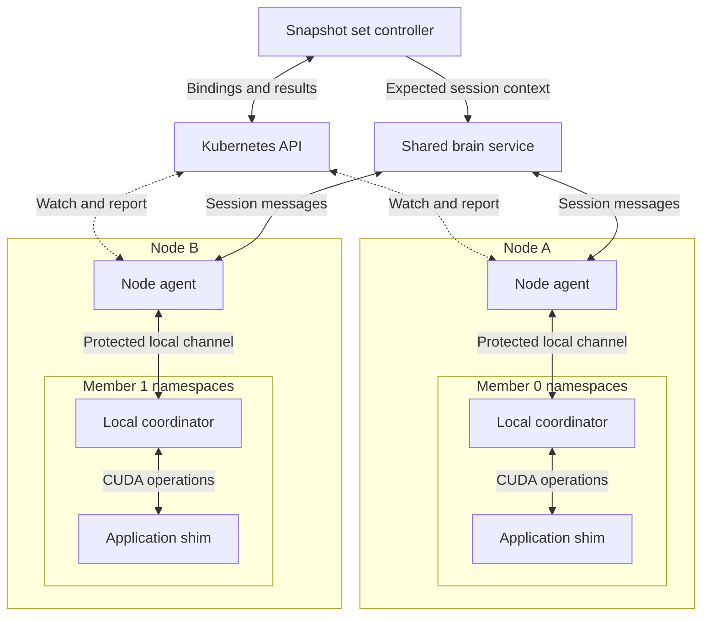
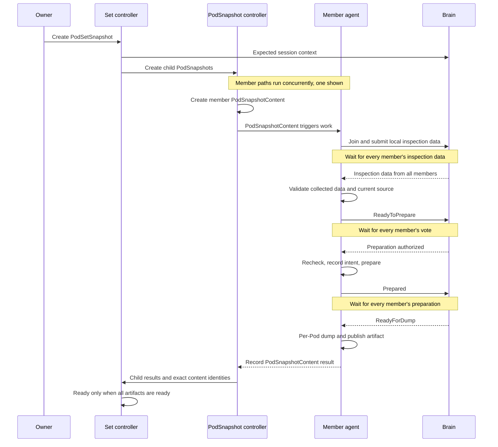
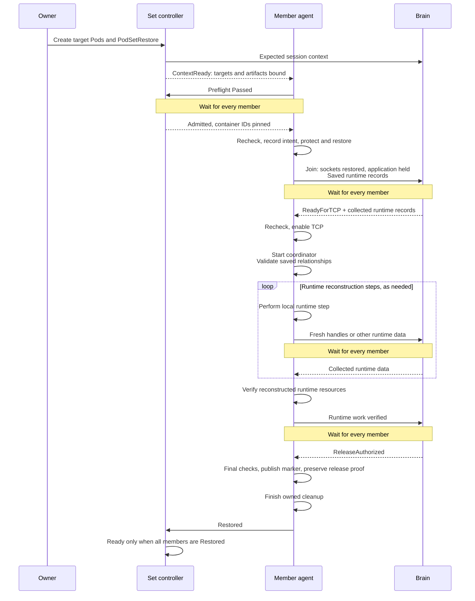
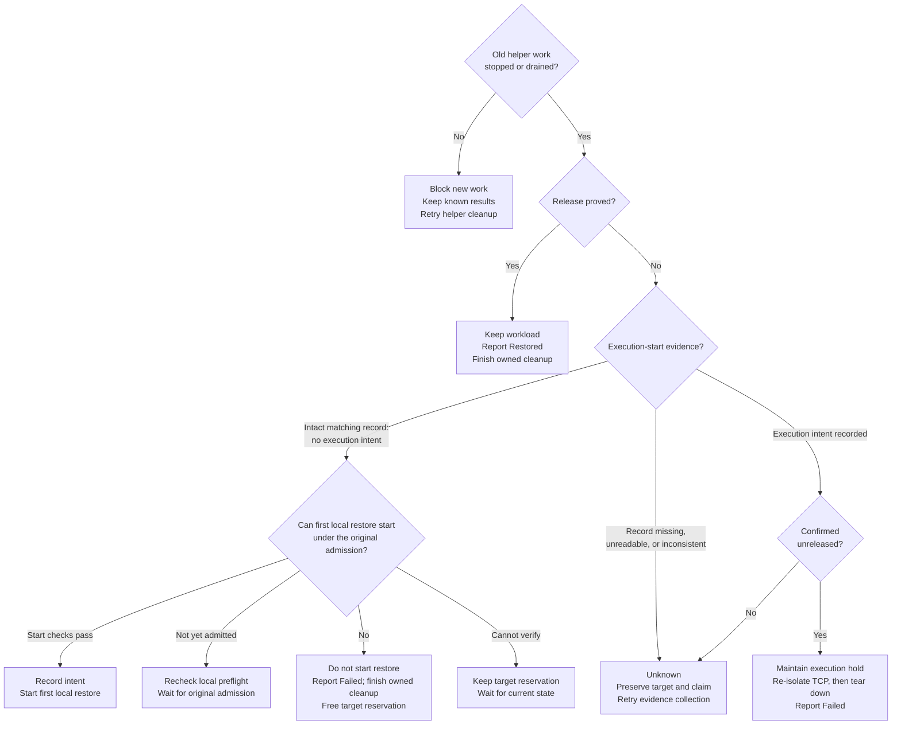
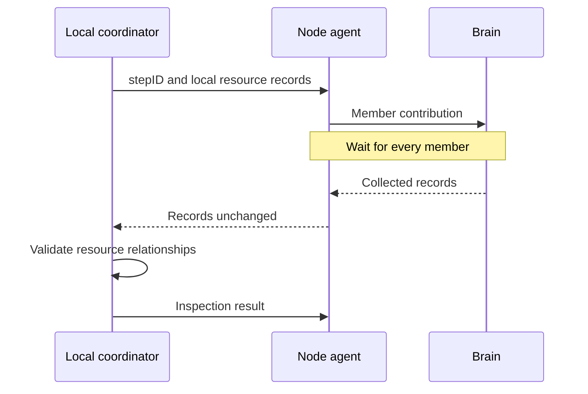

<!--
SPDX-FileCopyrightText: Copyright (c) 2026 NVIDIA CORPORATION & AFFILIATES. All rights reserved.
SPDX-License-Identifier: Apache-2.0
-->

# SNEP-324: Coordinated Multi-Pod Checkpoint and Restore

Tracking issue: [snapshot#324](https://github.com/ai-dynamo/snapshot/issues/324)

Status: Draft

<!-- toc -->
- [Summary](#summary)
- [Motivation](#motivation)
  - [Goals](#goals)
  - [Non-Goals](#non-goals)
- [Proposal](#proposal)
  - [User Stories](#user-stories)
  - [Limitations, Risks, and Mitigations](#limitations-risks-and-mitigations)
- [Design Details](#design-details)
  - [Architecture](#architecture)
  - [API](#api)
    - [Examples](#examples)
  - [Checkpoint Flow](#checkpoint-flow)
  - [Restore Flow](#restore-flow)
  - [Failure and Recovery](#failure-and-recovery)
    - [Operation Conditions](#operation-conditions)
    - [Checkpoint Member Results and Availability](#checkpoint-member-results-and-availability)
    - [Restore Member Outcomes](#restore-member-outcomes)
    - [Agent Restart Recovery](#agent-restart-recovery)
      - [Shared Recovery Rules](#shared-recovery-rules)
      - [Capture Recovery](#capture-recovery)
      - [Restore Recovery](#restore-recovery)
      - [Retrying a Restore](#retrying-a-restore)
    - [Failure and Cancellation](#failure-and-cancellation)
    - [Controller Recovery and Deletion](#controller-recovery-and-deletion)
  - [Restore Pod Contract](#restore-pod-contract)
  - [Validation and Binding](#validation-and-binding)
  - [Captured Metadata and Storage](#captured-metadata-and-storage)
    - [Captured Member Table](#captured-member-table)
  - [Runtime Session and Extension Contract](#runtime-session-and-extension-contract)
    - [Session](#session)
    - [Runtime Responsibilities](#runtime-responsibilities)
    - [Coordination Milestones](#coordination-milestones)
  - [Network Identity and Application Release](#network-identity-and-application-release)
    - [Preserving Member Connections](#preserving-member-connections)
    - [TCP Protection and Execution Hold](#tcp-protection-and-execution-hold)
    - [Release Evidence](#release-evidence)
    - [Timer Safety and Source Lifetime](#timer-safety-and-source-lifetime)
  - [Security](#security)
  - [Configuration](#configuration)
  - [Performance and Scalability](#performance-and-scalability)
  - [Monitoring](#monitoring)
  - [Dependencies and Qualification Gates](#dependencies-and-qualification-gates)
  - [Test Plan](#test-plan)
    - [API and Controller Tests](#api-and-controller-tests)
    - [Artifact and Per-Pod Integration Tests](#artifact-and-per-pod-integration-tests)
    - [Runtime Contract Tests](#runtime-contract-tests)
    - [Crash and Cancellation Tests](#crash-and-cancellation-tests)
    - [End-to-End Qualification](#end-to-end-qualification)
  - [Graduation Criteria](#graduation-criteria)
- [Appendix: API Definitions](#appendix-api-definitions)
  - [Public Kubernetes Types](#public-kubernetes-types)
  - [Artifact Metadata Types](#artifact-metadata-types)
<!-- /toc -->

## Summary

Add Kubernetes resources to checkpoint and restore a group of cooperating Pods,
including across nodes. A checkpoint is reusable; each restore attempt names a
target Pod for every member. Snapshot checks all members before destructive work,
coordinates reconstruction, and reports the group result and each member's
result. Operations are not atomic and do not support rollback.

## Motivation

A distributed inference replica can span several Pods. Restoring each Pod
independently is not enough: established TCP connections need the new addresses
of both endpoints, and shared GPU resources need coordinated reconstruction.
An early-restored member must not send traffic to a peer whose sockets do not
yet exist.

The workload owner needs one operation to capture a complete replica, restore
it into replacement Pods, and see what succeeded if the operation fails.

### Goals

- Publish a reusable checkpoint only when every member artifact is ready.
- Restore onto compatible nodes and new IPs while preserving established
  connections within the group and supported shared GPU resources.
- Check all members before destructive work; enforce one operation deadline.
- Preserve accurate member results after partial failure or component restart,
  without replaying destructive work.
- Reuse per-Pod execution and leave standalone APIs unchanged.
- Keep group coordination independent of CUDA and support members without shims.
- Leave Pod creation, placement, application readiness, and workload recovery to
  the workload owner.

### Non-Goals

- Discovering members, scheduling Pods, or changing membership, ranks, or logical
  topology on restore.
- Atomic capture or release, rollback, or keeping sources running after destructive
  capture starts.
- Transparent session failover, resuming interrupted execution, partial-member
  restore retries, or automatic workload recovery.
- Declaring application health or protecting in-flight requests.
- Cross-namespace or cross-cluster restore, retained artifacts after checkpoint
  deletion, or a hierarchy of groups.
- Claiming support for an engine, transport, or GPU topology without qualification.

## Proposal

Snapshot adds two namespaced resources:

- **PodSetSnapshot** describes the source Pods and selected containers. Snapshot
  creates one child PodSnapshot per member. The set becomes Ready only when all
  artifacts are ready.
- **PodSetRestore** references that checkpoint and names a target Pod and container
  for each member. Each object is one attempt; multiple attempts may use the same
  checkpoint.

The workload owner creates the target Pods using Snapshot's restore Pod contract.
Their selected containers run inert restore proxies, not the application command.
Every target must be able to start without waiting for another member's
application readiness.

Restore has two separate milestones. First, every member's sockets are restored,
so TCP communication can resume. Then shared runtime resources are rebuilt and
verified, so application execution can be released. Application work stays held
between these milestones, independently of Pod readiness and TCP isolation.

Capture is destructive: a completed member capture ends its source process.
A sibling's failure cannot undo it. Release is also asynchronous: an attempt may
fail after some members have been released. Those members stay reported as
Restored; Snapshot tears down only members known to be unreleased.

Restored means Snapshot completed reconstruction and released the member.
It does not mean the application is healthy or the Pod is Ready.

Once any member may have started restoration, retry requires a new PodSetRestore
and fresh target Pods for every member. The owner retires the partial replica
and supplies the replacements. The new attempt uses the same checkpoint but a
new complete IP map; the failed attempt's bindings never change. A refusal
before any member starts execution does not by itself make the targets unusable.

### User Stories

- Restore a distributed inference replica into replacement Pods, then register
  it for traffic after Snapshot and application readiness checks succeed.
- Capture one distributed prefill or decode replica without including unrelated
  replicas. Connections outside the group keep standalone restore behavior.
- Inspect a failed attempt's member results, retire its Pods, and retry the
  whole group with fresh targets and the same checkpoint.

### Limitations, Risks, and Mitigations

| Risk | Handling |
| --- | --- |
| Partial capture or release | No rollback. Publish only complete checkpoints and preserve released member results. |
| Agent crashes during release | Recover from durable release evidence. If evidence cannot be read, report uncertainty rather than kill a possibly released workload. |
| Execution helpers survive an agent crash | Cancel and drain old helper work; confirm it can no longer act before cleanup or new execution. Never terminate a released application as helper cleanup. |
| Brain loses an active session | Fail affected operations without replay. Completed artifacts and released workloads remain valid. |
| Stale or missing execution context | Pin exact identities, enforce deadlines, and recheck live state at execution boundaries. |
| TCP timers expire during interruption | Qualify the full capture and restore windows. Application quiescing and earlier TCP unblocking do not solve all timer failures. |
| Artifact is lost | Withdraw checkpoint availability. Do not recapture or substitute an artifact. |
| Source restarts while a peer is dumping | Establish source-lifetime constraints through qualification; do not assume a surviving Pod object is sufficient. |
| Unsupported workload or topology | Refuse unsupported configurations and qualify each claimed combination. |

## Design Details

### Architecture

Snapshot separates Kubernetes control, group coordination, and local execution.
A **member** is a Pod and its selected container. Its stable ID matches capture
to restore. Its **rank** is its position in the checkpoint member list, not a
leader designation.

| Component | Location | Responsibility |
| --- | --- | --- |
| Workload owner | Workload controller or caller | Create and place Pods; request operations; manage application readiness and recovery. |
| Set controller | Snapshot operator | Bind members and artifacts, supply session context, admit restores, and aggregate results. |
| Brain | Shared service outside workload Pods | Authenticate agents, exchange opaque payloads, and enforce membership, barriers, deadlines, and session failure. |
| Node agent | One per node | Represent local members; validate and execute work; own release, local recovery, and cleanup. |
| Local coordinator | Temporary process inside the selected container's namespaces | Drive cuInterpose shims, order CUDA work, and validate exchanged runtime records. |
| Application shim | Library in an application process | Track, prepare, and reconstruct that process's CUDA resources. |

Only agents connect to the brain. Local coordinators communicate with their
agents over protected local channels; they are not sidecars. The brain does not
interpret CUDA records or choose CUDA phase order. Members without shims use
their agents without a CUDA coordinator.

The diagram shows two members on different nodes. Member boxes enclose the
selected container's namespaces. Agents watch and report through Kubernetes.
The controller supplies expected session context to the brain; the
transport and delivery mechanism are implementation choices.



Agent-brain connections belong to Snapshot, not to application processes, and are
not part of the checkpoint images.

### API

Both resources use nvidia.com/v1alpha1. Sources, targets, child PodSnapshots,
and the referenced PodSetSnapshot belong to the operation's namespace.
PodSnapshotContent stays cluster-scoped and represents one member artifact.

V1 supports one selected container per Pod, one destination per member, and IPv4.
Member IDs and Pods are distinct. The checkpoint's member order defines ranks;
target-list order does not. Specs and recorded bindings are immutable.

Complete public types and validation markers are in [Appendix: API Definitions](#appendix-api-definitions).
PodSnapshotSource is reused unchanged. Standalone source UIDs remain optional;
set capture requires them. Target UIDs are optional and are pinned on binding.

The current TCP-remapping plugin holds
[256 IP pairs](https://github.com/ai-dynamo/snapshot/blob/fc349012c44e6e6a3afa82685112d746cd6c28a9/agent/plugins/inet-remap/snapshot_inet_remap.c#L16).
That sets the API's current 256-member maximum, not a qualified workload size.
Supporting larger groups requires increasing the plugin capacity and revalidating
the schemas.

PodSetSnapshot and PodSetRestore are the working names in this draft. Review
still needs to settle PodSet versus PodGroup; this proposal adds no hierarchy.

#### Examples

Capture identifies exact source Pods:

```yaml
apiVersion: nvidia.com/v1alpha1
kind: PodSetSnapshot
metadata:
  name: replica-checkpoint
  namespace: inference
spec:
  deadlineSeconds: 1800
  members:
    - id: rank-0
      source:
        podRef:
          name: replica-0
          uid: "11111111-1111-4111-8111-111111111111"
          containers: [engine]
    - id: rank-1
      source:
        podRef:
          name: replica-1
          uid: "22222222-2222-4222-8222-222222222222"
          containers: [engine]
```

Once it is Ready, a restore attempt maps each member to a target. The first target
below is bound by name; the second requires the supplied UID:

```yaml
apiVersion: nvidia.com/v1alpha1
kind: PodSetRestore
metadata:
  name: replica-restore-1
  namespace: inference
spec:
  snapshotRef:
    name: replica-checkpoint
    uid: "33333333-3333-4333-8333-333333333333"
  deadlineSeconds: 1500
  targets:
    - id: rank-0
      podRef:
        name: replacement-0
      containerMapping:
        source: engine
        destination: engine
    - id: rank-1
      podRef:
        name: replacement-1
        uid: "44444444-4444-4444-8444-444444444444"
      containerMapping:
        source: engine
        destination: engine
```

Targets carry `nvidia.com/restore-set: replica-restore-1`, not the standalone
`restore-from` or `restore-container-map` annotations. The set target list supplies
the container mappings. The annotation requests set-mode handling; only the bound
Pod UID, admitted container ID, and admitted attempt authorize restore.
The [Restore Pod Contract](#restore-pod-contract) defines startup behavior.

Capture reuses child `PodSnapshot` and `PodSnapshotContent` resources and reports
through the child's conditions. Agents verify each child's exact identity and
member binding against its parent before execution. A set-owned child cannot be
restored through the standalone annotation. Set restore calls the per-Pod executor
after admission; it adds no per-member restore CRD. Its reporting channel is the
member report in `PodSetRestore.status`.

### Checkpoint Flow

**Prerequisite:** every member must satisfy Snapshot's existing
[workload checkpoint-readiness contract](https://github.com/ai-dynamo/snapshot/blob/0b6d7d98e48aa6a4a852af548d76852ccf1b4cd8/docs/reference/workload-contract.md#L62).
Application work must already be quiesced and GPU work synchronized as required
by the runtime. Inspection and group barriers do not make a busy application
safe to capture.

Members first exchange inspection data through the brain. It waits for every
member's contribution before returning the combined data for validation.
The execution gates then require every member to vote ready before preparation,
and every member to be prepared before dumping.

The diagram shows one member's success path; member paths run concurrently.
Controller-agent arrows represent Kubernetes writes and watches, not direct
messages. Failure handling is defined in
[Failure and Recovery](#failure-and-recovery).



1. **Activate.** The controller validates sources, records their nodes, supplies
   session context, and creates one owned child PodSnapshot per member. The
   PodSnapshot controller creates each PodSnapshotContent; its creation triggers
   the node agent. Members proceed concurrently. A set-owned child waits for its
   recorded binding and session; it never falls back to standalone capture.
2. **Inspect and vote.** Agents validate live sources and prerequisites and retain
   per-source exclusion. Where shims exist, local coordinators inspect runtime
   resources without changing application state. Each agent joins the session
   and submits its source identity, IP, and runtime inspection records. Every
   member contributes, even if it has no runtime records.

   The brain waits for every member's contribution, then returns the collected
   data to each agent without interpreting CUDA records. Agents validate and pin
   the common captured-member table; local coordinators validate runtime resource
   relationships. Each agent then checks operation state, deadline, source
   identity, and IP before sending ReadyToPrepare. Collecting all data does not
   authorize preparation: every member must first validate it and vote ready.
   Any refusal before group authorization leaves every source untouched.
3. **Prepare.** The brain authorizes preparation after every vote. Each agent
   repeats its local checks and records intent before permitting destructive
   work. For cuInterpose, that boundary is BeginCheckpoint; the coordinator
   freezes registries, revalidates the frozen records, and prepares resources.
   Agents save required metadata before reporting Prepared. Members without a
   runtime preparation phase report Prepared after validating and saving their
   metadata; they do not start native capture yet.
4. **Dump and publish.** After every Prepared report, the brain sends ReadyForDump
   and capture coordination ends. Agents execute per-Pod dumps and artifact
   publication. A member that has not yet crossed its destructive boundary
   rechecks local state and records intent before native CUDA or CPU capture.
   The controller records exact content names and UIDs and sets Ready only after
   every artifact succeeds.

Group authorization is not atomic execution. A late local refusal can occur
after peers have started preparation. A lost preparation reply is uncertain,
not proof that the source is safe. Apply the capture failure rules; there is no
guarantee of a working source deployment after capture starts.

### Restore Flow

The controller admits every member before CRIU. Restore then separates socket
readiness from application release. The diagram shows the success path, repeated
for every member; it does not imply simultaneous execution.

Controller–agent arrows represent status updates and watches through the
Kubernetes API, not direct messages. Agents publish preflight reports; the
controller publishes admission; agents observe admission before restoring.



1. **Bind.** The controller validates the checkpoint UID, availability, and exact
   artifacts; binds target UIDs, nodes, and IPs; supplies session context; and
   sets ContextReady. Missing targets may wait until the deadline.
2. **Preflight and admit.** Each agent validates its assigned artifact and derives
   the complete IP map. It checks the live destination, compatibility, remaining
   startup-gate budget, target reuse, and an independent application execution
   hold. It durably claims the target before reporting Passed. The controller
   accepts only current reports and pins all admitted container IDs in the same
   status update that sets Admitted. Any refusal prevents all CRIU starts.
3. **Reconstruct locally.** Immediately before starting, the per-Pod executor
   verifies that the target Pod, container, sandbox, and IP still match the
   admitted context, the attempt and original session remain active, and the
   deadline has not expired. A mismatch or terminal operation state fails the
   member without starting its restore. If current state cannot be verified,
   wait without starting, within the deadline. These are execution checks, not
   another group preflight round. If valid, the agent records intent and
   establishes the execution hold and TCP protection. It restores processes,
   sockets, and native CUDA state using the complete map and group-aware socket
   handling. It joins the brain only after local restore succeeds and normal
   application execution is held. The join includes the member's saved runtime
   records from its artifact, or an empty contribution if it has none.
4. **Enable TCP and share records.** After every member joins, the brain sends
   ReadyForTCP and distributes the collected saved records unchanged. They may
   share a response, but record delivery must not hold up TCP authorization.
   Agents recheck local state and end TCP isolation. ReadyForTCP does not wait
   for runtime validation or reconstruction. Kernel TCP traffic may proceed;
   application execution stays held.

   **Collected runtime records** are the saved CUDA metadata from all members:
   allocation identities, sizes and device placement; memory mappings and access
   rights; export/import relationships; and multicast membership and bindings.
   For example, A exported allocation X as handle H, while B imported H as its
   local allocation Y. Together, these records describe which resources must be
   shared after restore. This exchange carries metadata, not GPU-memory contents.

5. **Rebuild runtime resources.** Agents start coordinators where needed.
   Coordinators validate the collected saved records, then reconstruct shared
   resources through a sequence of runtime steps. Each iteration of the diagram's
   loop is a different step, not a retry. For cuInterpose, **collected runtime
   data** means the following:

   | Runtime step | Data exchanged through agents and the brain |
   | --- | --- |
   | Reload shared allocations | Captured-handle to new-handle mappings. Peers use the replacement handles to import rebuilt allocations. |
   | Restore unicast mappings | Completion results only; this step produces no new handles. All members must finish before the next step. |
   | Recreate multicast resources | Captured-handle to new-handle mappings for multicast resources, needed before peers can import them. |
   | Import multicast resources, add devices, and restore bindings | Completion results for each of these three separate steps; they produce no new handles. Each step waits for every member. |
   | Inspect reconstructed resources | Fresh records describing the restored allocations, mappings and sharing relationships. Coordinators compare them with the saved records, accounting for replacement handles. |

   The brain waits for every member's contribution before completing each
   exchange. Coordinators interpret the data; the brain forwards it unchanged.
   Members without local runtime data contribute an empty payload and still
   report completion. Each agent reports Runtime work verified only after its
   required reconstruction and validation succeed.

6. **Release.** When all members succeed, the brain returns ReleaseAuthorized.
   Each agent makes final local checks, atomically publishes restore-complete,
   preserves release proof, finishes owned cleanup, and releases the target claim.
   It reports Restored and writes the existing nvidia.com/Restored Pod condition.

TCP unblocking is not release. An observed failure stops unreleased work even
after ReadyForTCP or ReleaseAuthorized. A container or IP change before release
fails the member; an application restart after Restored does not undo that result.
On failure or recovery, if release can neither be established nor ruled out,
report Unknown rather than infer failure.

### Failure and Recovery

#### Operation Conditions

Conditions describe the overall operation. Member results describe what happened
to each member. Conditions are not mutually exclusive: ContextReady and Admitted
remain recorded milestones even if a restore later fails.

| Resource | Condition | Meaning when True |
| --- | --- | --- |
| PodSetSnapshot | Ready | Every member artifact and its exact child/content objects are available for restore. |
| PodSetSnapshot | Failed | Capture failed or a published checkpoint lost a required artifact or object. |
| PodSetRestore | ContextReady | Target UIDs, nodes, IPs, artifact references, and session endpoint are bound. |
| PodSetRestore | Admitted | Every member passed preflight for that context and its pinned container ID. |
| PodSetRestore | Ready | Every member is Restored and the attempt has not failed. |
| PodSetRestore | Failed | The attempt cannot succeed; member reports and cleanup may still arrive. |

Once an operation's Failed condition is True, retry requires a new operation object.
A successful restore stays Ready. Completed milestones do not authorize work
after failure, deletion, or expiry. Conditions include observedGeneration, a
stable reason, and a useful message.

#### Checkpoint Member Results and Availability

For capture, `status.members[].phase` reports each child's progress and result,
derived from the child PodSnapshot's conditions:

| Phase | Meaning |
| --- | --- |
| Pending | Waiting to begin capture. |
| Capturing | Capture is in progress. |
| Captured | This member's artifact was successfully produced. |
| Failed | This member did not complete capture successfully. |

If a member's capture is cancelled before completion, it reports Failed with
reason Cancelled. Members already Captured keep that result, including when a
sibling fails. The set becomes Ready only when every member succeeds.

A checkpoint's Ready condition describes current availability, not capture
history. If a recorded child or content is missing, deleting, replaced, or failed,
withdraw Ready and set Failed/ArtifactUnavailable. Keep exact references and
Captured member results; never adopt replacements or recapture. Revalidate objects
before each restore and artifact data on each agent. Ready is not a
storage-retention guarantee.

#### Restore Member Outcomes

For restore, `status.members[].outcome` answers whether the member was released,
rather than describing its execution progress:

| Outcome | Meaning |
| --- | --- |
| Pending | Waiting or executing; no final result is known. |
| Restored | The release marker was published. Final. |
| Failed | The member did not complete restore and is known not to have been released. Final. |
| Unknown | Release cannot currently be established or ruled out. Later evidence may settle it. |

Cancellation reports Failed with reason Cancelled only when the member is known
not to have been released. Members already Restored keep that result. If release
is uncertain, cancellation does not resolve Unknown.

A target disappearing before admission is Failed/TargetGone. After admission,
disappearance without a final result is Unknown/TargetGone. If execution started
and the marker is unreadable without other release proof, report
Unknown/ReleaseEvidenceUnavailable. Either Unknown case fails the attempt, but
later evidence can settle the member without reopening it. Known final outcomes
never change.

#### Agent Restart Recovery

After an agent restarts, recovery preserves completed results and cleans up
interrupted work. It never repeats destructive work that may have started.
A restore member that provably never began may still start under the same valid
attempt. Capture checks for a committed artifact; restore checks whether the
application was released or local execution can safely begin for the first time.

##### Shared Recovery Rules

Both paths keep a small durable local record containing:

- The operation UID and exact Pod UID, container, and sandbox being acted on.
- Whether destructive work may have started. Save this **execution intent**
  before starting that work or allowing a helper to start it.
- The information needed to stop owned helpers and remove temporary resources.
  Save cleanup information before creating those resources.

The record is private to Snapshot and survives an agent restart on the same
node, not loss of the node or its storage. It is not a step-by-step journal and
need not copy runtime exchanges or coordination notifications. Its storage
format is an implementation choice.

An intact record matching the exact operation and member, with no execution
intent, proves no local destructive work started. It says nothing about other
members. A missing, corrupt, or unreadable record does not prove that work never
started.

CRIU, local coordinators, and other execution helpers are separate processes.
Restarting the agent does not prove they stopped. The shared per-Pod executor
must cancel their work on agent loss and let the replacement confirm that it
has stopped or drained.
Until old helper work can no longer act, block new execution and cleanup that
could race with it. Helper cancellation must neither kill a released application
nor release an application that is still held. If stopping or draining cannot
be confirmed, retain ownership, preserve known results, and report
CleanupIncomplete.

Cleanup is repeatable and acts only on the recorded resources, never a
replacement container or sandbox. The saved information must support safe local
cleanup without API access or an in-memory IP map. Reporting results can wait
for API recovery; safe cleanup need not.

##### Capture Recovery

After stopping or draining old helpers, the agent checks whether its member's
artifact was committed. If not, execution intent determines whether the source
may already have been changed:

| Evidence | Recovery action |
| --- | --- |
| Committed artifact | Preserve it, report Captured, and finish cleanup. Do not capture again. |
| No committed artifact; intact matching record has no execution intent | Discard the old readiness vote and leave the source untouched. |
| No committed artifact; execution may have started or cannot be ruled out | Fail the child and apply existing unsafe-source handling. Do not repeat preparation or dump. |

##### Restore Recovery

Restore needs two additional facts in its local record:

- **Target ownership.** Before reporting that a member passed restore preflight
  (`report.preflight: Passed`), the agent durably reserves its target Pod for
  this attempt. This claim prevents competing attempts from using it; it does
  not mean restoration started.
- **Application release.** After publishing restore-complete, the agent saves
  that release locally. A matching marker found during recovery is also saved
  before cleanup. This preserves the result if the marker later disappears.

The agent uses a matching restore-complete marker, its saved release record, or
an already recorded Restored result as proof of release. Each must identify the
attempt and admitted container. Coordination notifications such as ReadyForTCP
or ReleaseAuthorized are not proof that the application was released.

After an agent restart, the following flow selects recovery actions, not new API
states. Stopping helpers does not mean stopping the application:



**Local restore never started.** This branch requires an intact matching recovery
record with no execution intent and old helpers that can no longer act. Recover
the target reservation, then check the original attempt, bindings, session, and
deadline:

- **Not yet admitted:** repeat local preflight checks and wait for admission.
- **Already admitted:** verify that the target still matches its admitted Pod,
  container, sandbox, and IP; the attempt and original session remain active;
  and the deadline has not expired. If valid, durably record execution intent
  and start this member's first restore. Do not reset admission or require
  other members to pass preflight again.
- **Target no longer matches, or the attempt/session has failed, been deleted,
  or expired:** do not start. Report Failed, finish owned cleanup, and release
  the reservation.
- **Current state cannot be verified:** retain the reservation and wait without
  starting execution.

These are the normal per-Pod checks before execution, not a second full
preflight. If they find an invalid context after admission, the attempt fails;
peers may already be restoring and follow normal failure handling. Admission
remains recorded, and completed Restored results are preserved.

Starting an untouched member within an active attempt is not a retry: it keeps
the same bindings, IP map, and session. The member joins the restore session for
the first time after local restore succeeds. It cannot join a replacement for a
failed session. New attempts follow [Retrying a Restore](#retrying-a-restore).

**Release proved.** Keep Restored and finish owned cleanup only. Failure, expiry,
deletion, or later container/Pod loss does not undo this result. Never kill or
replay the released workload. Release and cleanup completion are separate facts.

**Confirmed not released.** Once old helpers have stopped, a missing marker in
the verified original container and intact control volume proves non-release
only if no earlier release is known. Report Failed. Maintain the application
execution hold and maintain or re-establish TCP isolation before teardown;
uncertain TCP state is treated as potentially unblocked. Release the claim
after cleanup, but retain execution intent while the Pod exists to prevent reuse.

**Release unknown.** An unreadable marker is not a missing marker. Without other
release proof, report Unknown/ReleaseEvidenceUnavailable. Retain the target,
claim, and recovery record; retry observation. Do not kill, replay, release again,
or change protection based on that uncertainty. These rules also apply after
cancellation or deletion of the attempt.

The same Unknown outcome applies when the execution record cannot be verified
and no independent release proof exists. Do not treat that uncertainty as
permission to execute again, tear down the workload, or reuse the target.

If the Pod is gone after admission and no final result or release proof exists,
report Unknown/TargetGone. Finish safe helper/resource cleanup and free the
claim. Known final outcomes never change.

##### Retrying a Restore

A failed attempt cannot be restarted; retry always requires a new PodSetRestore.
The target Pod rules apply to the whole group:

1. **No member could have started restoration**, for example because preflight
   refused the group. Untouched placeholders may be reused after the old claims
   are released and every member passes preflight again, including the remaining
   startup-gate budget.
2. **Any member started, or execution cannot be ruled out.** Retry requires fresh
   Pod UIDs and network namespaces for every member, not just the failed one.
   The workload owner retires the partial replica and creates the replacement
   group. Snapshot does not replace Pods or rebind members inside an attempt.

The new attempt reuses the checkpoint and derives a new complete IP map. It does
not update the failed attempt's map or mix its restored members into a new
session. Members already restored stay reported as Restored even when the owner
retires them; this is not Snapshot rollback. Agents reject previously executed
targets as TargetReused.

#### Failure and Cancellation

Agents observe failure, deletion, and expiry and recheck them before destructive
work, TCP unblocking, and release. They stop new work and interrupt helpers when
cancellation is observed. The controller closes the session; agents notify the
brain when reachable. The brain completes no barrier after observing failure or
cancellation. Its deadline and member-loss detection still apply without API
access.

Deletion is the V1 cancellation request. It cannot retract delivered commands or
undo destructive work. A member known to be unreleased reports Failed with
reason Cancelled. Completed results and uncertain release follow the recovery
rules above.

| Restore state | Failure or cancellation handling |
| --- | --- |
| Before execution | Release the claim; leave the placeholder running. Report Failed with reason Cancelled on deletion, or the failure reason otherwise. |
| Execution started, confirmed unreleased | Stop helpers, maintain the execution hold, and re-isolate TCP before teardown. Do not publish release. |
| Release proved | Preserve Restored and finish cleanup. |
| Release unknown because evidence is inaccessible | Preserve the target and evidence; retry observation under the recovery rules. |

| Capture state | Failure or cancellation handling |
| --- | --- |
| Before preparation authorization | Stop helpers and fail the child. Every source is untouched. |
| Authorized, with proof local destructive work never began | Leave this source untouched. Peers may already be preparing. |
| BeginCheckpoint, native CUDA checkpoint, or dump began; or boundary uncertain | Apply existing unsafe-source handling, including CheckpointNeedsSourceKill where applicable. No rollback. |

A preparation refusal means no local destructive preparation began. A lost reply
or crash does not establish that fact. A source disappearing before its capture
completes fails the member; disappearance after completion does not invalidate
its artifact.

#### Controller Recovery and Deletion

The controller resumes from recorded bindings, child/content identities, session
endpoint, and admission. Re-delivering identical session context must not reset
a live session. Loss of needed session state fails the operation with SessionLost;
agents do not join a replacement to replay work. Per-Pod dumps after ReadyForDump,
artifact publication, and released cleanup no longer need the brain.

Both resources use bounded controller finalizers. Restore deletion waits for
members to stop or complete. Checkpoint deletion first blocks new restores,
waits for referencing non-terminal attempts, stops capture, and deletes children
through the existing content/artifact cleanup path. No namespaced owner reference
is added to cluster-scoped content.

Grace-period expiry emits CleanupIncomplete and allows deletion. Local recovery
records retain unresolved cleanup obligations, including unknown release evidence.
Finalizer removal does not prove an unreachable node has stopped. No
child-protection finalizer prevents deletion of a child or content. There is no
Retain policy or restore from surviving content after set deletion.

### Restore Pod Contract

Group restore Pods follow the existing
[single-Pod restore contract](https://github.com/ai-dynamo/snapshot/blob/0b6d7d98e48aa6a4a852af548d76852ccf1b4cd8/docs/reference/restore-pod-contract.md).
The restore proxy, control volume, and restart behavior stay the same.

The Pod builder, validator, and NRI (Node Resource Interface) startup plugin must
support these group-specific rules:

- **Select the destination through the attempt.** Use `nvidia.com/restore-set`
  to find the PodSetRestore. Resolve the destination container from its target
  list and verify the Pod identity. Reject conflicting standalone restore
  annotations.
- **Wait for missing context.** If the attempt or destination cannot yet be
  resolved, wait or refuse container creation for retry. The original application
  command must never run as a fallback.
- **Require the existing startup gate.** The restore-complete startup probe is
  optional for standalone restores but required for group restores. Agents check
  it and its remaining time budget before preflight passes; see
  [Validation and Binding](#validation-and-binding).

Pods and the attempt may be created in either order, but the selected container
cannot start until its group context is available. The controller must bind
targets without waiting for application readiness.

The proxy and startup gate do not keep the restored application paused. Group
restore needs a separate hold until release, as described in
[TCP Protection and Execution Hold](#tcp-protection-and-execution-hold).

### Validation and Binding

Validation has three owners:

| Owner | Checks |
| --- | --- |
| API server | Required fields, cardinality, unique IDs and distinct target names; immutable specs, write-once bindings/sessions, retained status entries, and final outcomes. |
| Controller | Distinct source Pods, live source identities, checkpoint and artifact identities, exact target membership, mappings, and target binding. |
| Agent | Live local containers/sandboxes, artifact metadata, runtime compatibility, startup budget, claims, and execution safety. |

Schema and CEL cover structural rules without an admission webhook. Cross-object
and live execution checks remain necessary even with API acceptance: targets
may not exist yet, and runtime state may change.

The controller initializes all status member entries before agents report.
If a target UID is supplied, it must match. Otherwise the controller pins the UID
on first binding. An unbound missing or unschedulable target waits visibly;
a missing bound UID is never replaced with a same-named Pod. A missing bound
source fails with SourceGone. Invalid requests fail with a specific reason.

The controller rejects overlap with another unfinished restore as TargetInUse.
The agent's durable, exclusive Pod-UID claim resolves races between attempts.
A claim alone does not spend a target. Once execution intent is durable, the
agent rejects that target as TargetReused, even after its claim is released.
An interrupted group is retried with a complete new target group, as defined in
[Retrying a Restore](#retrying-a-restore); there is no individual-member retry.

Agents own only their member reports; the controller owns bindings, outcomes,
and conditions. Writers use partial apply documents, such as generated apply
configurations, not fully serialized status structs. An agent's member entry
contains only id and report, under a separate SSA field manager for that member.
Controller updates preserve reports.

Before admission, Passed must match the live destination container ID and pinned
Pod, node, and IP. The controller pins accepted IDs as admittedContainerID when
setting Admitted, revalidating concurrent changes. Execution reports are matched
against that pinned ID, not a later application container.

All work shares metadata.creationTimestamp + spec.deadlineSeconds. Expiry fails
unfinished work with DeadlineExceeded; it does not expire a completed checkpoint
or stop necessary cleanup. Neither local timeouts nor container restarts extend
the deadline.

Set targets use the canonical restore-complete startup probe with roughly
30 minutes of allowance. Agents require the operation deadline to fit within
every container's remaining gate time, with a conservative probe margin.
Otherwise preflight refuses with GateBudgetTooShort. A pre-release restart fails
the attempt rather than renewing its budget. Standalone gate behavior is unchanged.

### Captured Metadata and Storage

Kubernetes stores bindings and results. Artifacts store captured process and
runtime state. Agents retain only local ownership, execution-start and release
evidence, and cleanup information. The brain keeps live coordination state,
not artifacts or a durable execution log.

| Data | Written by | Stored in | Used by |
| --- | --- | --- | --- |
| Sources and targets | Caller, validated by controller | Set specs, matched by member ID | Controller and agents |
| Nodes, exact object identities, target IPs, endpoint | Controller | Write-once status bindings | Controller, agents, and session authorization |
| Expected session context | Controller | Supplied to brain from the operation bindings | Brain checking membership |
| Credentials | Deployment authentication mechanism | Protected service/agent configuration | Brain and agents only |
| Member artifact | Agent through per-Pod capture | Artifact storage and PodSnapshotContent; exact content identity in set status | Restoring agent |
| Source identities and IPs | Agents during capture inspection | Common ordered table in every artifact manifest | Agents deriving the complete IP map |
| Saved runtime records | Coordinator where needed | Member artifact | Coordinators reconstructing shared resources |
| Exchanged records and fresh handles | Coordinators | Transient session payloads and local memory | Local runtime validation and reconstruction |
| GPU-handle map | Coordinators | Local memory for that restore | Shims |
| Current step and contributions | Brain | Active session memory | Barriers and payload exchange |
| Release marker | Agent | restore-complete in target control volume: PID, attempt UID, admitted container ID | Execution gate, PID readers, recovery |
| Member report and outcome | Agent / controller | PodSetRestore.status.members | Controller and workload owner |
| Execution identity, intent, and cleanup information; restore also records target ownership and release proof | Agent | Small durable local record inaccessible to the workload | Restart recovery |

#### Captured Member Table

Each set artifact adds an optional `PodSet` field to `CheckpointManifest`, with
YAML key `podSet` and type `*CapturedPodSetManifest`. Standalone artifacts omit it.
The [complete artifact types](#artifact-metadata-types) are in the appendix.

During capture inspection, agents exchange each source Pod UID, container name,
and IP through the brain. Each validates the full table in checkpoint member
order. All artifacts save that same ordered table, format version, and capture
UID; MemberID identifies the artifact's own member. The local source IP must
match the existing manifest k8s.podIP. An observed IP change refuses capture
rather than rewriting the pinned table.

On restore, each agent reads its assigned artifact and matches the table to
target IPs in restore status by member ID:

| Member | Saved source IP | Bound target IP |
| --- | --- | --- |
| rank-0 | 10.0.0.1 | 10.1.0.8 |
| rank-1 | 10.0.0.2 | 10.1.0.9 |

Every agent can derive the complete map without reading peers' artifacts or
contacting source Pods. Saved IPs are immutable.

Before CRIU, reject missing metadata, unsupported versions, a capture UID that
does not match the checkpoint, changed member order/UIDs/container names, or
an artifact whose local member/content identity is wrong. Member IDs and source
IPs must be complete and unique, source IPs must be IPv4, and the artifact's local
IP must match k8s.podIP.

### Runtime Session and Extension Contract

#### Session

One operation has one session, identified by its PodSetSnapshot or PodSetRestore
UID. Restore never reuses the capture session. The long-running brain service
can host concurrent sessions. Each active session has one owning process;
replication or load balancing must not turn owner loss into transparent failover.

The controller supplies the mode, expected members, Pod UIDs, containers, nodes,
and absolute deadline. The brain authenticates agents and checks participation
against this context. Agents cannot create sessions or alter bindings, membership,
or deadlines. Hosting, transport, and authentication mechanisms are implementation
choices subject to [Security](#security).

A step is one exchange or synchronization within an operation. Messages carry
session, member, and step IDs; the brain uses them to match contributions without
interpreting CUDA payloads. Duplicate contributions never count twice. Stale,
foreign, conflicting, or out-of-order contributions cannot complete a barrier.
Agents and local runtimes agree on protocol versions and step IDs.
Each data exchange returns the collected payloads only after every member has
contributed, including an empty payload when a member has no runtime data.

This example is one capture-inspection exchange, not the full operation:



Every member joins group safety and completion barriers, including members
without shims. Those agents report completion directly when no local runtime
work is needed. Same-node members contribute separately and must progress
concurrently; serial execution must not deadlock a barrier.

Initial connections may retry until the deadline. Once joined, loss of an
established member connection, the owning brain process, or required step state
fails the session. Reaching the same endpoint again does not resume it.
Successful coordination alone proves neither artifact publication nor release.

#### Runtime Responsibilities

The agent supplies its coordinator with ordered membership, local shim processes,
protocol/artifact versions, and the collected saved runtime records for restore.
Coordinators validate the complete resource graph and reject mixed checkpoints,
changed ranks, unsupported handles, and incompatible topology. Allocation identities remain
stable; the original creator is distinct from the holder selected to save or
export an allocation. The GPU-handle map is rebuilt locally during restore;
the brain interprets neither it nor the CRIU IP map.

Inspection is read-only. After all ReadyToPrepare votes, the agent repeats its
live checks and makes intent durable before granting local execution permission.
A coordinator cannot authorize itself. For cuInterpose, permission precedes
BeginCheckpoint and frozen-record validation. A refusal before that boundary is
proof of no local preparation only when explicitly confirmed; a lost reply is
not safe refusal.

The local channel separates runtime payloads from agent authority. Forwarded
bytes cannot forge votes or execution grants. Interrupted mutating work is
never replayed, and all helper work uses the operation deadline and the shared
executor's [shared recovery rules](#shared-recovery-rules).

#### Coordination Milestones

These labels define behavior, not wire formats, extra RPC round trips, or
Kubernetes phases. In particular, ReadyForTCP may be the successful response
to the restore join barrier, alongside the collected saved runtime records.

| Event | Sender | Meaning |
| --- | --- | --- |
| ReadyToPrepare | Agent | Inspection, group metadata validation, and current agent checks passed; preparation has not started. |
| Preparation authorized | Brain | All members voted ready; each agent may make its final local checks and grant preparation. |
| Prepared | Agent | Required preparation and saved metadata succeeded; this does not mean an artifact is ready. |
| Refused | Agent | No local destructive preparation began. Before authorization all sources are untouched; afterward peers may already be preparing. |
| ReadyForDump | Brain | Every member reported Prepared; continue per-Pod capture. |
| ReadyForTCP | Brain | All members restored local sockets/native state and hold application execution; TCP may be unblocked after local checks. |
| Runtime work verified | Agent | Required local runtime reconstruction and group-resource validation succeeded. |
| ReleaseAuthorized | Brain | Every member verified; the agent may release after final checks. Not proof of release. |
| Failed or uncertain preparation | Agent | Apply unsafe-source handling; do not classify uncertainty as refusal. |

### Network Identity and Application Release

#### Preserving Member Connections

Each agent derives a full IPv4 source-to-target map with one unique address on
each side per member. The map must fit the plugin's capacity and
criu.tcpEstablished must be true. Agents pass the map to CRIU; workload annotations
do not supply it.

**Set-aware socket handling is required.** Restore-image preparation must preserve
established connections between declared members, including their matching ports,
even when the reciprocal endpoint is in another artifact. It must not classify
such a socket as external solely because the peer is absent from the local image.
External connections retain standalone disconnect/clone behavior. The IP map
alone cannot repair a socket that image preparation has already disconnected.

Pod UID does not guarantee a stable sandbox IP. Before execution, TCP unblocking,
and application release, agents recheck the recorded container/sandbox and pinned
IP. Mismatch fails with PodIPChanged. Never regenerate source tables or target
bindings, and never clean up a replacement container or sandbox.

#### TCP Protection and Execution Hold

Before restoring sockets, protect them from traffic to peers whose matching
sockets do not yet exist; otherwise kernel traffic can provoke a reset.
[CRIU documents this requirement](https://www.criu.org/TCP_connection).

ReadyForTCP permits agents to end that isolation after local checks. Protection
must preserve unrelated policy and allow agent-brain communication. Reuse existing
Snapshot/CRIU mechanisms where possible; this SNEP does not prescribe firewall
rules. Recovery context must support cleanup or re-isolation without API access
or an in-memory map.

The application execution hold is separate. It must remain effective while TCP
and runtime reconstruction proceed, until the release marker is published.
Neither Pod readiness nor a startup probe pauses restored processes.
Agent/helper loss must not implicitly release work. Implement and qualify this
hold for all supported workloads, including members without shims; refuse
unsupported configurations at preflight.

#### Release Evidence

After ReleaseAuthorized and final checks, the agent atomically publishes
restore-complete, preserving its key=value format and pid field while adding
attempt UID and admitted container ID. Existing existence-based gates and PID
readers must remain compatible; recovery validates the identity fields.

The marker is the application release point. It must never be partly visible.
The agent then preserves release proof independently of the marker's lifetime.
ReadyForTCP and TCP unblocking are not evidence of application release.
Recovery and cancellation follow the evidence-first rules in
[Failure and Recovery](#failure-and-recovery).

#### Timer Safety and Source Lifetime

Network isolation can trigger kernel keepalive, retransmission, and user timeouts
while applications are paused. [snapshot#577](https://github.com/ai-dynamo/snapshot/issues/577)
shows this during a single Pod's dump; a group adds capture and restore skew.

Qualification must cover the whole interruption: before and during every member's
dump, while peers finish, and during local restores until every matching socket
exists and TCP can resume. Earlier unblocking shortens the restore interruption;
it does not solve timer failures during reconstruction skew.

As with standalone capture, the owner must not deliberately delete, replace, or
evict a source during that member's capture, until its child is terminal.
Snapshot does not suppress kubelet restarts or other authorized controllers.

What must survive after one member finishes while peers still capture remains
a qualification question. A surviving Pod object alone does not preserve its
sandbox or protect peers' TCP timers. Test restarts, deletion, and sandbox
replacement to establish the required runtime or owner constraints. This SNEP
does not choose a fencing mechanism without that evidence.

### Security

**Workload authority.** Restrict creation to callers authorized to capture and
restore workloads in that namespace. Exact UIDs prevent name reuse from changing
bindings. Controllers need set/per-Pod resources, Pods, and Events. Agents need
their assigned context, existing execution permissions, and restore-status writes.

**Session authority.** Only controller-supplied context authorizes a session.
The brain authenticates agents and checks each member against that context,
accepting messages only for the active session and step. Missing or mismatched
authorization fails closed. Connections authenticate endpoints and protect
credentials and payloads in transit.

Credentials stay out of coordinators, shims, status, annotations, artifacts,
arguments, and logs. Opaque runtime records and GPU handles may grant access to
resources and must not be logged.

**Local authority.** The agent-coordinator channel must prevent workload processes
from impersonating either endpoint or forging execution permission. Workload-writable
control files cannot supply authority. Sharing namespaces is not a security
boundary. Durable recovery records are inaccessible to the workload. The release
marker remains workload-visible; this design does not claim safety against
malicious marker tampering.

**Trust limits.** The controller validates report identities, not which node wrote
them. V1 trusts privileged agents, which may share a service account; it does not
provide per-node authorization or contain a compromised agent.

**Isolation.** Sessions isolate identity, routing, payloads, and deadlines. Bound
capacity and payload size before destructive work. Coordination reachability must
respect unrelated network policy; reachability is not authentication. TCP cleanup
affects only recorded attempt resources, never unrelated policy or replacement
targets. Artifact storage retains its existing security model.

### Configuration

Operators configure the brain endpoint, authentication and transport protection,
service capacity, and cleanup grace period. Deployment and upgrade documentation
must explain session ownership and the effect of an owner restart. Standalone
operations remain usable without the brain.

This feature adds no node capacity-slot pool. Capture retains per-source
exclusion; restore claims provide target exclusivity, not throttling. Any later
concurrency policy must allow same-group members to progress.

### Performance and Scalability

Capture creates a set object plus a snapshot/content pair per member. Restore
creates one attempt, without per-member restore CRDs. Runtime exchanges use
session connections, not Kubernetes status writes; dumps use artifact storage.

Measure admission, joins and step latency, metadata volume, brain resource use,
concurrent-session capacity, API updates, operation duration, and cleanup cost.
One session must not starve others. API capacity does not establish qualification
at that scale.

### Monitoring

Conditions and member entries are the progress interface. Waiting reasons
distinguish missing targets, scheduling, placeholder startup, and preflight.
Failure reasons include SourceGone, TargetGone, PodIPChanged, ArtifactUnavailable,
RestoreIncompatible, TargetInUse, TargetReused, GateBudgetTooShort, GroupRefused,
MemberFailed, SessionUnavailable, SessionLost, DeadlineExceeded, Cancelled, and
ReleaseEvidenceUnavailable.

Emit Events for refusal, failure, expiry, unknown release evidence, and incomplete
cleanup. Logs identify operation UID, member, Pod UID, and stage, never credentials
or payloads. Metrics cover results, admission waits, sessions, step duration, and
recovery/cleanup failures. Keep attempt UIDs out of metric labels.

### Dependencies and Qualification Gates

The Kubernetes API does not by itself provide runtime safety. Implementation must
deliver the following capabilities:

| Capability | Required work or evidence |
| --- | --- |
| Per-Pod integration | Set-owned capture detection; set-mode Pod-contract validation and restore-proxy interception; direct set restore through the per-Pod executor. |
| Generic coordination | Controller-supplied context, authenticated agent-brain transport, fixed membership, deadlines, barriers, and session loss handling. |
| Local runtime extension | Protected agent-coordinator channel; read-only inspection, preparation, shared-resource reconstruction, and local validation. |
| Shared executor lifecycle and recovery | Cancel and drain helpers after agent loss; retain execution and cleanup evidence. Restore also needs exclusive target ownership and durable release proof. Reuse artifacts and member results; never replay interrupted set execution. |
| Preserved TCP | Complete artifact-derived map; group-aware socket-image handling; protection until ReadyForTCP and safe failure cleanup. |
| Execution hold | A qualified hold independent of TCP isolation for both shimmed and shimless members. |
| Timer safety and source lifetime | Set-wide integration of #577 work and tests establishing source restart/deletion constraints. |
| Cross-node NVLink | FABRIC reconstruction, ComputeDomain/clique compatibility, and release of conflicting source channel claims for in-place restore. |

[SNEP-295](https://github.com/ai-dynamo/snapshot/issues/295) supplies the local CUDA
foundation, not the cross-Pod contract. CUDA protocol/resource validation stays
in local coordinators; generic payload transport does not replace it. Other
transports, topologies, and engines require their own qualification.

### Test Plan

Tests must drive the set API, not only local executors. Tracking:
[snapshot#324](https://github.com/ai-dynamo/snapshot/issues/324).

#### API and Controller Tests

- Generate schemas and exercise CEL against an API server. Cover required source
  UIDs, optional target UIDs, distinct IDs/Pods, one-container mappings, size
  limits, immutable specs/bindings/sessions, retained member entries, and outcome
  finality. Reject clearing status or removing and re-adding entries.
- Verify partial SSA payloads: agent entries contain only id and report;
  same-node members do not erase each other's reports, and controller writes
  preserve them.
- Test ContextReady/Admitted ordering, stale reports, changed live container IDs,
  competing target claims, missing targets, and deadlines. Unsupported execution
  holds refuse before any CRIU starts.
- Delete or replace children/contents under a Ready checkpoint. Withdraw
  availability without losing exact references or recapturing; refuse new
  restores and fail unfinished ones despite stale cached conditions.
- Test controller restart, identical context redelivery, referencing restores
  during checkpoint deletion, bounded finalizers, and CleanupIncomplete.
  Completed checkpoints do not expire with the capture deadline.
- Test TargetGone before/after admission, Unknown from unreadable release evidence,
  late evidence settling Unknown, and final results surviving restarts and loss.
- Validate cancellation as Failed with reason Cancelled. Reject Cancelled as a
  restore outcome or report phase. Cancellation never overrides Restored or
  resolves Unknown without release evidence.
- Reject replacing one target inside a bound attempt. Retry an interrupted group
  with a new attempt and a complete new set of Pod UIDs; keep the original
  bindings and member results unchanged.

#### Artifact and Per-Pod Integration Tests

- Round-trip complete versioned artifact metadata. Every artifact has the same
  capture UID and ordered member table, with its own MemberID. Reject missing or
  inconsistent metadata, changed ranks, unsupported versions, wrong local/content
  identity, invalid or duplicate IPs, and local IP mismatch.
- Derive the complete map from only the assigned artifact and pinned targets;
  do not read source Pods or peer artifacts. Source IPs remain absent from set
  status; target IPs are write-once.
- Verify content creation triggers set validation, missing context waits, and
  no standalone capture or restore can bypass set handling.
- Exercise set-mode Pod building, validation, and runtime interception with
  Pods created before and after the attempt. The original selected-container
  command never runs, including when context is missing or conflicting.
- Test socket-image handling with reciprocal endpoints in different member
  artifacts: preserve their established state and matching ports. Include external
  peers and standalone clone restores as regression cases.
- Existing PID parsers, restore proxies, and existence-based marker readers
  accept the new identity fields without changing their behavior.

#### Runtime Contract Tests

- Run the brain without CUDA libraries; exchange arbitrary payloads unchanged.
  Reject unauthorized context, wrong session/member/step, conflicting protocol,
  stale messages, and duplicate counting. Isolate concurrent sessions and bound
  payload/capacity rejection before execution.
- Include shimless and same-node members in safety/completion barriers. Runtime
  resource validation rejects mixed checkpoints, changed ranks, unsupported
  handles/topology, and incorrect creator/holder identities. Same PIDs in different
  members remain distinct.
- Refuse an unready workload without preparation. Inspection must not pause or
  drain it, alter registries, or substitute for checkpoint readiness.
- Delay, refuse, or expire any ReadyToPrepare vote: no preparation starts before
  all votes. After authorization require final agent checks, durable intent, and
  local permission before BeginCheckpoint. Revalidate frozen records; a lost
  reply is uncertain, not refused. ReadyForDump requires every Prepared report
  and saved metadata.
- Withhold one member's inspection data: the brain cannot return a complete
  collection, and members cannot vote ReadyToPrepare. Once all contributions
  arrive, each member validates the collected data before voting. Include
  members without runtime records and members on the same node.
- Withhold ReadyForTCP after one member restores: isolation remains. After it is
  delivered, kernel TCP traffic may proceed but application work remains held,
  including without shims and after agent/helper loss. Runtime verification and
  ReleaseAuthorized remain necessary.
- Include saved runtime records in restore joins, with empty contributions where
  needed. Withhold one join: neither ReadyForTCP nor the complete record set is
  returned. Once all join, distribute records unchanged; record delivery and
  runtime validation or reconstruction must not delay TCP authorization.
  Withhold a later runtime-step contribution: its complete data set cannot be
  returned and application release remains blocked.
- Exercise allocation and multicast replacement-handle exchanges, completion-only
  steps, and the final inspection exchange. Peers must use the replacement handles;
  coordinators must reject a reconstructed resource graph that differs from the
  checkpoint. A completion-only step cannot advance until every member succeeds.
- Workload files, endpoints, and forwarded bytes cannot forge votes or grants.
  Local-channel loss fails the member. Established member/owner loss fails the
  session without replay; reconnecting to the same endpoint does not resume it.

#### Crash and Cancellation Tests

| Scenario | Required result |
| --- | --- |
| Refusal before capture authorization | Every source remains untouched; include every member role and same-node groups. |
| Refusal or identity/IP change after authorization | Stop local new work; apply boundary-specific handling to peers already preparing. Never rewrite pinned context. |
| Crash after readiness vote or authorization, before intent | No source termination based on the vote alone. |
| Crash during preparation or lost BeginCheckpoint reply | No replay; use unsafe-source handling if execution cannot be excluded. |
| Agent process crash or agent-container restart during CRIU or GPU work | Cancel/drain old helper work and confirm it cannot act before cleanup or new execution. Test surviving helpers, unavailable stop confirmation, and a race with completion. Never terminate a released application as helper cleanup. |
| Artifact committed, crash before reporting capture success | Recover the committed artifact and report Captured; do not dump again. |
| Execution record missing, corrupt, unreadable, or inconsistent | Never infer that work did not start. Preserve independent success/release proof; otherwise restore remains Unknown without replay, teardown, or target reuse. Capture follows unsafe-source handling if destructive work cannot be excluded. |
| Any restore preflight refusal or insufficient gate budget | No CRIU starts; placeholders remain. Test fresh and partly spent gates and conflicting annotations. |
| Crash after Passed, before Admitted | Recover the target reservation and repeat local preflight if not yet admitted. If admission was committed meanwhile, verify the admitted identity, active attempt/session, and deadline before first execution; do not reset group admission. |
| Agent restarts with no local execution intent while peers are already restoring | If the original attempt, bindings, session, and deadline remain valid, start this member's first restore under existing admission. Keep the same IP map and join the original session only after local restore. |
| Admitted target identity changes before first local execution | Do not start this member. Fail the attempt without resetting admission or requiring new preflight votes. Peers follow normal partial-failure handling; preserve completed Restored results. |
| Same restart after attempt/session failure, deletion, or expiry | Do not start restoration. Finish owned cleanup and free the reservation. If current state cannot be verified, retain the reservation and wait. |
| Crash during local restore or after TCP unblocking, confirmed unreleased | Maintain hold; re-isolate before teardown without API access or a surviving IP map. Never infer release from ReadyForTCP. |
| Marker published, crash before release is otherwise recorded | Recover the matching marker, preserve Restored, and finish cleanup. |
| Execution intent recorded, marker unreadable, no other release proof | Report Unknown; do not kill, replay, release again, or alter target protection. Retry observation, including after attempt failure/deletion. |
| Evidence becomes readable after Unknown | Settle the member from evidence; never reopen the failed attempt. Test both proved release and confirmed non-release. |
| Durable release proof exists, marker missing/unreadable | Preserve Restored despite API loss, failed/deleted attempt, target loss, or later container restart. Cleanup only recorded resources. |
| Brain owner loss or established member-connection loss | Fail affected live sessions without replay. Preserve completed artifacts and proved release, and respect unknown release evidence. |
| Failure/deletion/expiry at every boundary | Stop new work; follow evidence-first cleanup and bounded finalizers. Commands already delivered are not retractable. |
| Capture or restore cancelled before successful completion | Report Failed with reason Cancelled where non-completion is established. Preserve Captured/Restored results; unknown release remains Unknown. |
| Reused Pod/container/sandbox or competing attempt | Reject spent targets. Reuse untouched placeholders only after cleanup and only if no group member may have executed. Never adopt or clean up replacements. |
| Retry after partial restore or partial release | Use the same checkpoint with a new attempt and fresh targets for every member. Derive a complete new IP map; never reuse restored peers or mutate the old bindings. Owner retirement leaves old Restored results unchanged. |
| Delayed initial brain availability | Retry within the absolute deadline; never renew it or transparently rejoin a lost session. |
| TCP protection and agent restart | Preserve unrelated policy and agent-brain reachability; cleanup/re-isolation uses only attempt-owned resources. |

#### End-to-End Qualification

1. **CPU TCP.** Restore on original and swapped nodes with changed/permuted IPs.
   Delay one member's socket reconstruction and exercise queued data and kernel
   probes. Verify preserved cross-Pod connections; use disabled remapping and
   disabled protection as controlled negative cases. After ReadyForTCP, delay
   final release: probes receive replies while application work stays held.
   Validate existing CRIU hooks before choosing additional enforcement. Repeat
   each case at least three times.
2. **MPI.** Run ping-pong after in-place and relocated restore.
3. **GPU plus application TCP.** In the same workload, reconstruct cross-node
   FABRIC resources and preserve TCP. Verify topology/ComputeDomain/clique
   compatibility, in-place source-claim release, GPU results, and fresh work
   after release. Prolong runtime reconstruction after ReadyForTCP to test the
   execution hold separately from TCP health.
4. **Inference engines.** Qualify distributed TensorRT-LLM, vLLM, and SGLang
   combinations before claiming support; record engine versions, topology,
   transport, and workload.
5. **Source lifetime.** Delay B's dump after A finishes, then separately restart
   A, delete its Pod, and replace its sandbox. Inspect B's saved sockets and
   restored behavior to establish lifecycle/isolation constraints.
6. **TCP timers.** Reproduce #577 in a multi-process Pod and across Pods with
   staggered dump/restore. Exercise keepalive, retransmission, and user timeouts
   over the full interruption, including before a peer's dump begins. Qualify
   the runtime fix or documented restrictions; earlier unblocking is not enough.

### Graduation Criteria

**Alpha:** the set APIs, controllers, agents, brain, and local runtime extension
pass CPU, contract, and fault tests. Cross-node GPU reconstruction and preserved
TCP pass together, plus at least one inference workload. Set-mode startup,
group-aware socket handling, artifact-derived maps, actual execution holds
with and without shims, helper-loss cleanup, full-group retries, and evidence-first
recovery pass. Timer and source-lifetime results establish supported operating
constraints.

**Beta readiness:** API/status ownership is stable in use. Repeated multi-node
tests cover restarts/upgrades, partial release, session loss, scheduling delays,
concurrent-session isolation, capacity limits, and cleanup. Supported combinations,
upgrade behavior, and remaining owner constraints are documented and enforced
where applicable.

No release timing or automatic support for additional engines/transports is implied.

## Appendix: API Definitions

### Public Kubernetes Types

The following Go definitions include every new public type. They reuse
[PodSnapshotSource](https://github.com/ai-dynamo/snapshot/blob/0b6d7d98e48aa6a4a852af548d76852ccf1b4cd8/api/v1alpha1/podsnapshot_types.go)
and leave its standalone semantics unchanged. Validation markers express the
structural and write-once rules; live checks are described in
[Validation and Binding](#validation-and-binding).

```go
package v1alpha1

import (
	metav1 "k8s.io/apimachinery/pkg/apis/meta/v1"
	"k8s.io/apimachinery/pkg/types"
)

const (
	PodSetConditionContextReady = "ContextReady"
	PodSetConditionAdmitted     = "Admitted"
	PodSetConditionReady        = "Ready"
	PodSetConditionFailed       = "Failed"
)

// ObjectIdentity identifies an exact object. Its namespace is implicit.
type ObjectIdentity struct {
	// +kubebuilder:validation:MinLength=1
	// +kubebuilder:validation:MaxLength=253
	Name string `json:"name"`
	// +kubebuilder:validation:Type=string
	// +kubebuilder:validation:MinLength=1
	// +kubebuilder:validation:MaxLength=128
	UID types.UID `json:"uid"`
}

// TargetPodReference allows a target to be named before it is created.
type TargetPodReference struct {
	// +kubebuilder:validation:MinLength=1
	// +kubebuilder:validation:MaxLength=253
	Name string `json:"name"`
	// +optional
	// +kubebuilder:validation:Type=string
	// +kubebuilder:validation:MinLength=1
	// +kubebuilder:validation:MaxLength=128
	UID types.UID `json:"uid,omitempty"`
}

// RuntimeSession identifies the coordination service for this operation.
// The parent object's UID identifies the session; credentials are not API data.
type RuntimeSession struct {
	// Endpoint is the address agents use. Workload callers treat it as opaque.
	// +kubebuilder:validation:MinLength=1
	Endpoint string `json:"endpoint"`
}

// +kubebuilder:validation:Enum=Pending;Capturing;Captured;Failed
type CapturePhase string

const (
	CapturePending   CapturePhase = "Pending"
	CaptureCapturing CapturePhase = "Capturing"
	CaptureCaptured  CapturePhase = "Captured"
	CaptureFailed    CapturePhase = "Failed"
)

type PodSetSnapshotMember struct {
	// +kubebuilder:validation:MinLength=1
	// +kubebuilder:validation:MaxLength=63
	// +kubebuilder:validation:Pattern=`^[a-z0-9]([-a-z0-9]*[a-z0-9])?$`
	ID string `json:"id"`
	// Reuses the source shape of PodSnapshot. A set source must have a UID.
	// +kubebuilder:validation:XValidation:rule="has(self.podRef.uid) && size(self.podRef.uid) > 0",message="set sources require a Pod UID"
	Source PodSnapshotSource `json:"source"`
}

// +kubebuilder:validation:XValidation:rule="self.members.all(m, self.members.filter(n, n.id == m.id).size() == 1)",message="member IDs must be unique"
type PodSetSnapshotSpec struct {
	// Seconds from this object's creation. Required; there is no infinite wait.
	// +kubebuilder:validation:Minimum=1
	DeadlineSeconds int64 `json:"deadlineSeconds"`
	// Order is rank. Do not treat this list as an unordered map.
	// +kubebuilder:validation:MinItems=1
	// +kubebuilder:validation:MaxItems=256
	// +listType=atomic
	Members []PodSetSnapshotMember `json:"members"`
}

// +kubebuilder:validation:XValidation:rule="!has(oldSelf.podSnapshot) || (has(self.podSnapshot) && self.podSnapshot == oldSelf.podSnapshot)",message="child snapshot identity is immutable"
// +kubebuilder:validation:XValidation:rule="!has(oldSelf.content) || (has(self.content) && self.content == oldSelf.content)",message="content identity is immutable"
// +kubebuilder:validation:XValidation:rule="!has(oldSelf.nodeName) || (has(self.nodeName) && self.nodeName == oldSelf.nodeName)",message="source node is immutable"
type PodSetSnapshotMemberStatus struct {
	// +kubebuilder:validation:MinLength=1
	// +kubebuilder:validation:MaxLength=63
	ID string `json:"id"`
	// +optional
	// +kubebuilder:validation:MinLength=1
	// +kubebuilder:validation:MaxLength=253
	NodeName string `json:"nodeName,omitempty"`
	// +optional
	PodSnapshot *ObjectIdentity `json:"podSnapshot,omitempty"`
	// Content is immutable once the completed set is published.
	// +optional
	Content *ObjectIdentity `json:"content,omitempty"`
	// Derived from the child PodSnapshot's conditions.
	// +kubebuilder:default=Pending
	Phase CapturePhase `json:"phase"`
	// +optional
	Reason string `json:"reason,omitempty"`
	// +optional
	Message string `json:"message,omitempty"`
}

// +kubebuilder:validation:XValidation:rule="!has(oldSelf.session) || (has(self.session) && self.session == oldSelf.session)",message="runtime session is immutable"
type PodSetSnapshotStatus struct {
	// +optional
	Session *RuntimeSession `json:"session,omitempty"`
	// Controller-owned; child PodSnapshot status is the agent's capture report.
	// +optional
	// +kubebuilder:validation:MinItems=1
	// +kubebuilder:validation:MaxItems=256
	// +kubebuilder:validation:XValidation:rule="oldSelf.all(o, self.exists(n, n.id == o.id))",message="member status entries cannot be removed"
	// +listType=map
	// +listMapKey=id
	Members []PodSetSnapshotMemberStatus `json:"members,omitempty"`
	// +optional
	// +listType=map
	// +listMapKey=type
	Conditions []metav1.Condition `json:"conditions,omitempty"`
}

// +genclient
// +kubebuilder:object:root=true
// +kubebuilder:subresource:status
// +kubebuilder:resource:scope=Namespaced
// +kubebuilder:validation:XValidation:rule="!has(oldSelf.status) || !has(oldSelf.status.members) || (has(self.status) && has(self.status.members))",message="member status cannot be cleared"
// +kubebuilder:validation:XValidation:rule="!has(oldSelf.status) || !has(oldSelf.status.session) || (has(self.status) && has(self.status.session))",message="runtime session cannot be cleared"
// +kubebuilder:validation:XValidation:rule="!has(self.status) || !has(self.status.members) || self.status.members.all(m, self.spec.members.exists(s, s.id == m.id))",message="status must refer to declared members"
type PodSetSnapshot struct {
	metav1.TypeMeta   `json:",inline"`
	metav1.ObjectMeta `json:"metadata,omitempty"`
	// +kubebuilder:validation:XValidation:rule="self == oldSelf",message="spec is immutable"
	Spec PodSetSnapshotSpec `json:"spec"`
	// +optional
	Status PodSetSnapshotStatus `json:"status,omitempty"`
}

// +kubebuilder:object:root=true
type PodSetSnapshotList struct {
	metav1.TypeMeta `json:",inline"`
	metav1.ListMeta `json:"metadata,omitempty"`
	Items           []PodSetSnapshot `json:"items"`
}

type ContainerMapping struct {
	// Name of the container captured for this member.
	// +kubebuilder:validation:MinLength=1
	// +kubebuilder:validation:MaxLength=63
	// +kubebuilder:validation:Pattern=`^[a-z0-9]([-a-z0-9]*[a-z0-9])?$`
	Source string `json:"source"`
	// Name of the placeholder container to receive the restored processes.
	// +kubebuilder:validation:MinLength=1
	// +kubebuilder:validation:MaxLength=63
	// +kubebuilder:validation:Pattern=`^[a-z0-9]([-a-z0-9]*[a-z0-9])?$`
	Destination string `json:"destination"`
}

type PodSetRestoreTarget struct {
	// Must match exactly one member ID in the referenced checkpoint.
	// +kubebuilder:validation:MinLength=1
	// +kubebuilder:validation:MaxLength=63
	// +kubebuilder:validation:Pattern=`^[a-z0-9]([-a-z0-9]*[a-z0-9])?$`
	ID               string             `json:"id"`
	PodRef           TargetPodReference `json:"podRef"`
	ContainerMapping ContainerMapping   `json:"containerMapping"`
}

// +kubebuilder:validation:XValidation:rule="self.targets.all(t, self.targets.filter(n, n.podRef.name == t.podRef.name).size() == 1)",message="target Pods must be distinct"
type PodSetRestoreSpec struct {
	SnapshotRef ObjectIdentity `json:"snapshotRef"`
	// +kubebuilder:validation:Minimum=1
	DeadlineSeconds int64 `json:"deadlineSeconds"`
	// +kubebuilder:validation:MinItems=1
	// +kubebuilder:validation:MaxItems=256
	// +listType=map
	// +listMapKey=id
	Targets []PodSetRestoreTarget `json:"targets"`
}

// Cancellation is reported as Failed with reason Cancelled.
// +kubebuilder:validation:Enum=Pending;Restored;Failed;Unknown
type RestoreOutcome string

const (
	RestorePending  RestoreOutcome = "Pending"
	RestoreRestored RestoreOutcome = "Restored"
	RestoreFailed   RestoreOutcome = "Failed"
	RestoreUnknown  RestoreOutcome = "Unknown"
)

// +kubebuilder:validation:Enum=Passed;Refused
type PreflightResult string

const (
	PreflightPassed  PreflightResult = "Passed"
	PreflightRefused PreflightResult = "Refused"
)

// +kubebuilder:validation:Enum=Restoring;Restored;Failed;Unknown
type RestoreReportPhase string

const (
	RestoreReportRestoring RestoreReportPhase = "Restoring"
	RestoreReportRestored  RestoreReportPhase = "Restored"
	RestoreReportFailed    RestoreReportPhase = "Failed"
	RestoreReportUnknown   RestoreReportPhase = "Unknown"
)

// RestoreMemberReport is the node agent's report for this member.
type RestoreMemberReport struct {
	// +kubebuilder:validation:MinLength=1
	// +kubebuilder:validation:MaxLength=1024
	ContainerID string `json:"containerID"`
	// +optional
	Preflight PreflightResult `json:"preflight,omitempty"`
	// +optional
	Phase RestoreReportPhase `json:"phase,omitempty"`
	// +optional
	Reason string `json:"reason,omitempty"`
	// +optional
	Message    string      `json:"message,omitempty"`
	ObservedAt metav1.Time `json:"observedAt"`
}

// +kubebuilder:validation:XValidation:rule="!has(oldSelf.pod) || (has(self.pod) && self.pod == oldSelf.pod)",message="target Pod identity is immutable"
// +kubebuilder:validation:XValidation:rule="!has(oldSelf.content) || (has(self.content) && self.content == oldSelf.content)",message="content identity is immutable"
// +kubebuilder:validation:XValidation:rule="!has(oldSelf.admittedContainerID) || (has(self.admittedContainerID) && self.admittedContainerID == oldSelf.admittedContainerID)",message="admitted container ID is immutable"
// +kubebuilder:validation:XValidation:rule="!has(oldSelf.nodeName) || (has(self.nodeName) && self.nodeName == oldSelf.nodeName)",message="target node is immutable"
// +kubebuilder:validation:XValidation:rule="!has(oldSelf.targetPodIP) || (has(self.targetPodIP) && self.targetPodIP == oldSelf.targetPodIP)",message="target Pod IP is immutable"
// +kubebuilder:validation:XValidation:rule="!(oldSelf.outcome in ['Restored', 'Failed']) || self.outcome == oldSelf.outcome",message="final member outcomes are immutable"
// +kubebuilder:validation:XValidation:rule="oldSelf.outcome != 'Unknown' || self.outcome in ['Unknown', 'Restored', 'Failed']",message="Unknown can only remain Unknown or become final"
type PodSetRestoreMemberStatus struct {
	// +kubebuilder:validation:MinLength=1
	// +kubebuilder:validation:MaxLength=63
	ID string `json:"id"`
	// Everything except Report is controller-owned.
	// +optional
	Pod *ObjectIdentity `json:"pod,omitempty"`
	// +optional
	// +kubebuilder:validation:MinLength=1
	// +kubebuilder:validation:MaxLength=253
	NodeName string `json:"nodeName,omitempty"`
	// +optional
	Content *ObjectIdentity `json:"content,omitempty"`
	// +optional
	// +kubebuilder:validation:Format=ipv4
	// +kubebuilder:validation:MaxLength=15
	TargetPodIP string `json:"targetPodIP,omitempty"`
	// Pinned when Admitted=True, and never replaced with a later container ID.
	// +optional
	// +kubebuilder:validation:MinLength=1
	// +kubebuilder:validation:MaxLength=1024
	AdmittedContainerID string `json:"admittedContainerID,omitempty"`
	// +kubebuilder:default=Pending
	Outcome RestoreOutcome `json:"outcome"`
	// +optional
	Reason string `json:"reason,omitempty"`
	// +optional
	Message string `json:"message,omitempty"`
	// +optional
	Report *RestoreMemberReport `json:"report,omitempty"`
}

// +kubebuilder:validation:XValidation:rule="!has(oldSelf.session) || (has(self.session) && self.session == oldSelf.session)",message="runtime session is immutable"
type PodSetRestoreStatus struct {
	// +optional
	Session *RuntimeSession `json:"session,omitempty"`
	// +optional
	// +kubebuilder:validation:MinItems=1
	// +kubebuilder:validation:MaxItems=256
	// +kubebuilder:validation:XValidation:rule="oldSelf.all(o, self.exists(n, n.id == o.id))",message="member status entries cannot be removed"
	// +listType=map
	// +listMapKey=id
	Members []PodSetRestoreMemberStatus `json:"members,omitempty"`
	// +optional
	// +listType=map
	// +listMapKey=type
	Conditions []metav1.Condition `json:"conditions,omitempty"`
}

// +genclient
// +kubebuilder:object:root=true
// +kubebuilder:subresource:status
// +kubebuilder:resource:scope=Namespaced
// +kubebuilder:validation:XValidation:rule="!has(oldSelf.status) || !has(oldSelf.status.members) || (has(self.status) && has(self.status.members))",message="member status cannot be cleared"
// +kubebuilder:validation:XValidation:rule="!has(oldSelf.status) || !has(oldSelf.status.session) || (has(self.status) && has(self.status.session))",message="runtime session cannot be cleared"
// +kubebuilder:validation:XValidation:rule="!has(self.status) || !has(self.status.members) || self.status.members.all(m, self.spec.targets.exists(t, t.id == m.id))",message="status must refer to declared members"
type PodSetRestore struct {
	metav1.TypeMeta   `json:",inline"`
	metav1.ObjectMeta `json:"metadata,omitempty"`
	// +kubebuilder:validation:XValidation:rule="self == oldSelf",message="spec is immutable"
	Spec PodSetRestoreSpec `json:"spec"`
	// +optional
	Status PodSetRestoreStatus `json:"status,omitempty"`
}

// +kubebuilder:object:root=true
type PodSetRestoreList struct {
	metav1.TypeMeta `json:",inline"`
	metav1.ListMeta `json:"metadata,omitempty"`
	Items           []PodSetRestore `json:"items"`
}
```

### Artifact Metadata Types

`CheckpointManifest` gains an optional field named `PodSet` with type
`*CapturedPodSetManifest` and YAML key `podSet`. Standalone artifacts omit it.

```go
package types

const CapturedPodSetVersion = 1

type CapturedPodSetManifest struct {
	Version    int                    `yaml:"version"`
	CaptureUID string                 `yaml:"captureUID"`
	MemberID   string                 `yaml:"memberID"`
	Members    []CapturedPodSetMember `yaml:"members"`
}

type CapturedPodSetMember struct {
	ID            string `yaml:"id"`
	PodUID        string `yaml:"podUID"`
	ContainerName string `yaml:"containerName"`
	PodIP         string `yaml:"podIP"`
}
```
