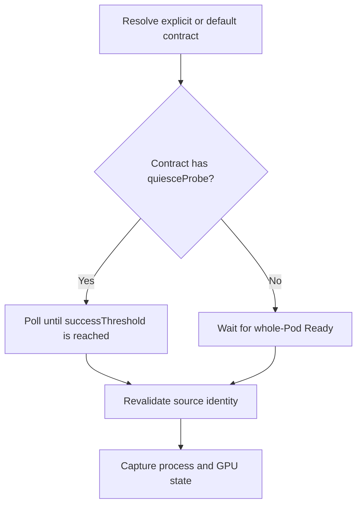
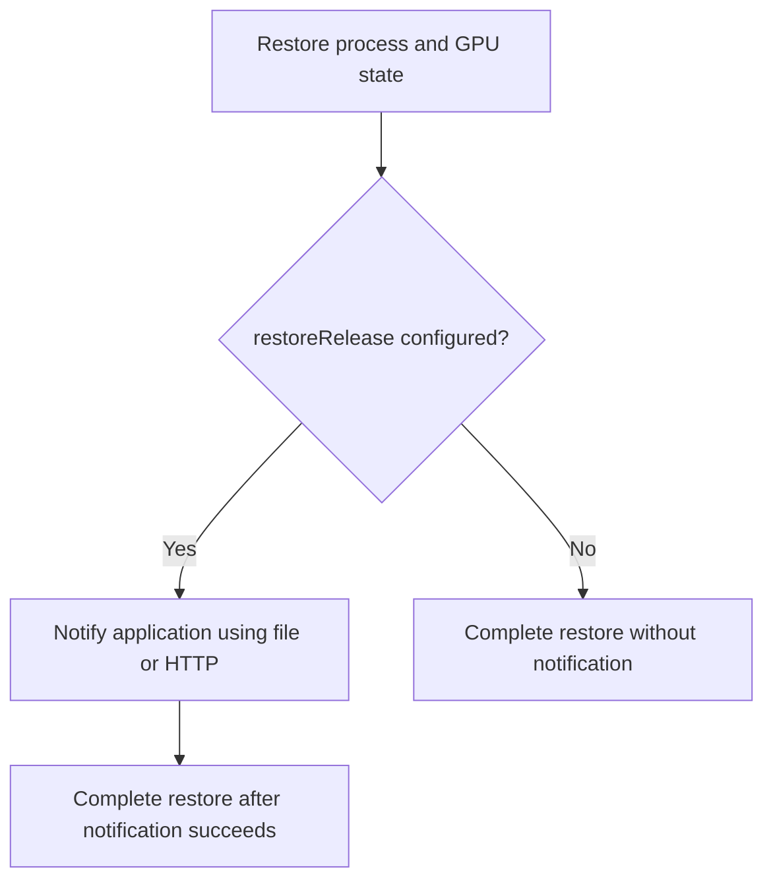

<!--
SPDX-FileCopyrightText: Copyright (c) 2026 NVIDIA CORPORATION & AFFILIATES. All rights reserved.
SPDX-License-Identifier: Apache-2.0
-->

# SNEP-411: Application contracts for checkpoint and restore

Tracking issue: [#411](https://github.com/ai-dynamo/snapshot/issues/411)

<!-- toc -->
- [Summary](#summary)
- [Motivation](#motivation)
  - [Goals](#goals)
  - [Non-Goals](#non-goals)
- [Proposal](#proposal)
  - [Defaults and user probes](#defaults-and-user-probes)
  - [Limitations, Risks, and Mitigations](#limitations-risks-and-mitigations)
    - [Backward compatibility and migration](#backward-compatibility-and-migration)
- [Design Details](#design-details)
  - [API](#api)
    - [Application contract binding](#application-contract-binding)
    - [SnapshotJob](#snapshotjob)
    - [ClusterApplicationContract](#clusterapplicationcontract)
    - [Checkpoint metadata](#checkpoint-metadata)
  - [Capture and restore execution](#capture-and-restore-execution)
  - [Security](#security)
    - [RBAC](#rbac)
    - [Transport isolation](#transport-isolation)
  - [Configuration](#configuration)
  - [Monitoring](#monitoring)
  - [Test Plan](#test-plan)
- [Appendix](#appendix)
  - [References](#references)
<!-- /toc -->

## Summary

Application contracts define how Snapshot checks capture readiness and notifies
an application after restore. Administrators install contracts; users select them
in PodSnapshot or SnapshotJob.

## Motivation

Before capture, the application must tell Snapshot it is safe to checkpoint.
After restore, Snapshot must tell the application it may recover connections
and other resources before serving requests.

Today, this exchange uses files on a shared control volume. This proposal adds
HTTP support. Contracts let users select an engine integration without repeating
file paths, endpoints, and timing settings.

### Goals

- Configure both PodSnapshot and SnapshotJob through the same contract API.
- Record per-container contract names for resolution at capture and restore.
- Provide the existing file integration as an installed, configurable default contract.

### Non-Goals

- Requesting application preparation, draining, or quiescence.
- Continuing the source application after capture.
- Defining application serving-readiness checks or engine recovery steps.
- Running arbitrary commands or general-purpose hook sequences.

## Proposal

A `ClusterApplicationContract` defines two optional actions: `quiesceProbe` checks
capture readiness; `restoreRelease` notifies the application after process and
GPU restoration. The application owns capture safety, recovery, and serving
readiness. Users select a contract by name for each captured container.

### Defaults and user probes

Containers without a binding use the administrator-configured default contract,
initially `snapshot-files`. A missing contract blocks the operation; it never
causes fallback to another contract.

An empty contract is valid. An omitted `quiesceProbe` waits for the whole Pod's
`Ready` condition, including sidecars and readiness gates. An omitted
`restoreRelease` sends no application notification.

Preserve user-defined readiness, startup, and liveness probes on source and
destination containers. When a probe is not configured, retain Snapshot's
existing default probe logic.

### Limitations, Risks, and Mitigations

Capture is limited to one container per PodSnapshot. An HTTP control endpoint
must work before release, including after restore at a new Pod IP.

| Risk | Required handling |
| --- | --- |
| Premature capture readiness | The application stays safe until capture; integration tests verify recovery and inference. |
| Recreated contract name | Administrators validate compatibility or publish a new name. |
| Lost release response | Applications handle duplicate delivery; deadline expiry can terminate an already released application. |
| Custom probes during recovery | Workload owners configure probes to tolerate recovery. |
| Shared HTTP endpoint | Containers in a Pod share its IP. If they use the same port and path, release requests carry no container identity. The application must coordinate which restored containers may resume. |
| Unprotected HTTP listener | The deployment restricts endpoint access. |

#### Backward compatibility and migration

Artifacts without contract metadata retain legacy release behavior regardless of
the cluster default. Two capture changes may require workload updates:

- User probes are preserved. Workloads that relied on Snapshot replacing or
  removing them must adjust their probes.
- The default file contract checks `ready-for-snapshot` directly, independently
  of Pod readiness. Workloads that need Pod readiness instead must select a
  contract without `quiesceProbe`.

Upgrade participating agents before enabling contracts: older agents ignore the
new fields.

## Design Details

### API

All resources use `nvidia.com/v1alpha1`. Existing structs below show only the
added fields.

#### Application contract binding

PodSnapshot selects contracts through `spec.applicationContract.containers`, a
list keyed by source container name:

```go
// +kubebuilder:validation:XValidation:rule="!has(self.applicationContract) || self.applicationContract.containers.all(c, c.name in self.source.podRef.containers)",message="bindings must name selected source containers"
type PodSnapshotSpec struct {
	// +optional
	ApplicationContract *ApplicationContractBinding `json:"applicationContract,omitempty"`
}

type ApplicationContractBinding struct {
	// +kubebuilder:validation:Required
	// +kubebuilder:validation:MaxItems=1
	// +listType=map
	// +listMapKey=name
	Containers []ContainerApplicationContractBinding `json:"containers"`
}

type ContainerApplicationContractBinding struct {
	// +kubebuilder:validation:Required
	// +kubebuilder:validation:MaxLength=63
	// +kubebuilder:validation:Pattern=`^[a-z0-9]([-a-z0-9]*[a-z0-9])?$`
	Name string `json:"name"`
	// +kubebuilder:validation:Required
	ContractRef ApplicationContractReference `json:"contractRef"`
}

type ApplicationContractReference struct {
	// +kubebuilder:validation:Required
	// +kubebuilder:validation:MaxLength=253
	// +kubebuilder:validation:Pattern=`^[a-z0-9]([-a-z0-9]*[a-z0-9])?(\.[a-z0-9]([-a-z0-9]*[a-z0-9])?)*$`
	Name string `json:"name"`
}
```

Each `name` must match a container in `spec.source.podRef.containers`.
`contractRef.name` must be a nonempty Kubernetes resource name. Bindings are
immutable with the existing PodSnapshot or SnapshotJob spec validation.

```yaml
apiVersion: nvidia.com/v1alpha1
kind: PodSnapshot
metadata:
  name: model-snapshot
spec:
  source:
    podRef:
      name: model-source
      containers: [main]
  applicationContract:
    containers:
      - name: main
        contractRef:
          name: cooperative-http-v1
```

#### SnapshotJob

Add `applicationContract` to `SnapshotJob.spec.podSnapshotTemplate`. The controller
copies it into the generated PodSnapshot. Each entry must name a target container.

```go
// +kubebuilder:validation:XValidation:rule="!has(self.applicationContract) || self.applicationContract.containers.all(c, c.name in self.targetContainers)",message="bindings must name target containers"
type PodSnapshotTemplate struct {
	// +optional
	ApplicationContract *ApplicationContractBinding `json:"applicationContract,omitempty"`
}
```

```yaml
spec:
  podSnapshotTemplate:
    targetContainers: [main]
    applicationContract:
      containers:
        - name: main
          contractRef:
            name: cooperative-http-v1
```

#### ClusterApplicationContract

ClusterApplicationContract is cluster-scoped with an immutable spec. Administrators
can publish a new name or delete and recreate an existing one. Contracts are
referenced by name, including in saved checkpoints.

```go
// +kubebuilder:validation:XValidation:rule="self == oldSelf",message="spec is immutable"
// +kubebuilder:validation:XValidation:rule="!(has(self.quiesceProbe) && has(self.quiesceProbe.file) && has(self.restoreRelease) && has(self.restoreRelease.file)) || self.quiesceProbe.file.path != self.restoreRelease.file.path",message="probe and release file paths must differ"
type ClusterApplicationContractSpec struct {
	// +optional
	QuiesceProbe *QuiesceProbe `json:"quiesceProbe,omitempty"`
	// +optional
	RestoreRelease *RestoreRelease `json:"restoreRelease,omitempty"`
}

// +kubebuilder:validation:XValidation:rule="has(self.file) != has(self.httpGet)",message="select exactly one of file or httpGet"
type QuiesceProbe struct {
	QuiesceProbeHandler `json:",inline"`

	// +optional
	// +kubebuilder:default=0
	// +kubebuilder:validation:Minimum=0
	InitialDelaySeconds int32 `json:"initialDelaySeconds,omitempty"`
	// +optional
	// +kubebuilder:default=1
	// +kubebuilder:validation:Minimum=1
	PeriodSeconds int32 `json:"periodSeconds,omitempty"`
	// +optional
	// +kubebuilder:default=1
	// +kubebuilder:validation:Minimum=1
	TimeoutSeconds int32 `json:"timeoutSeconds,omitempty"`
	// +optional
	// +kubebuilder:default=1
	// +kubebuilder:validation:Minimum=1
	SuccessThreshold int32 `json:"successThreshold,omitempty"`
}

type QuiesceProbeHandler struct {
	// +optional
	File *ControlFileAction `json:"file,omitempty"`
	// +optional
	HTTPGet *LifecycleHTTPAction `json:"httpGet,omitempty"`
}

// +kubebuilder:validation:XValidation:rule="has(self.file) != has(self.httpPost)",message="select exactly one of file or httpPost"
type RestoreRelease struct {
	RestoreReleaseHandler `json:",inline"`

	// +optional
	// +kubebuilder:default=1
	// +kubebuilder:validation:Minimum=1
	PeriodSeconds int32 `json:"periodSeconds,omitempty"`
	// +optional
	// +kubebuilder:default=1
	// +kubebuilder:validation:Minimum=1
	TimeoutSeconds int32 `json:"timeoutSeconds,omitempty"`
}

type RestoreReleaseHandler struct {
	// +optional
	File *ControlFileAction `json:"file,omitempty"`
	// +optional
	HTTPPost *LifecycleHTTPAction `json:"httpPost,omitempty"`
}

type ControlFileAction struct {
	// +kubebuilder:validation:Required
	// +kubebuilder:validation:MaxLength=4096
	// +kubebuilder:validation:XValidation:rule="self.startsWith('/') && self.split('/').all(p, p != '.' && p != '..')",message="path must be absolute without dot components"
	Path string `json:"path"`
}

type LifecycleHTTPAction struct {
	// +kubebuilder:validation:Required
	// +kubebuilder:validation:MaxLength=4096
	// +kubebuilder:validation:XValidation:rule="self.startsWith('/') && !self.startsWith('//') && !self.contains('?') && !self.contains('#')",message="path must start with / and have no authority, query, or fragment"
	Path string `json:"path"`
	// +kubebuilder:validation:Required
	// +kubebuilder:validation:Minimum=1
	// +kubebuilder:validation:Maximum=65535
	Port int32 `json:"port"`
}
```

When present, `quiesceProbe` requires exactly one of `file` or `httpGet`, and
`restoreRelease` requires exactly one of `file` or `httpPost`.

Defaults are `initialDelaySeconds: 0`, `periodSeconds: 1`,
`timeoutSeconds: 1`, and `successThreshold: 1`. The initial delay is nonnegative;
other values must be positive. Period and timeout defaults apply to both actions.
`timeoutSeconds` bounds one call, not the total operation.

There is no `failureThreshold`: a failed check resets the success count and keeps
waiting without restarting the container. Reset the count when the source container
restarts or is replaced; measure initial delay from that container's start time.

File and HTTP paths are limited to 4096 characters.
File paths must be absolute within the selected container's filesystem; they
do not depend on `SNAPSHOT_CONTROL_DIR`. Reject `.` and `..` path components.
Probe and release paths must differ. Snapshot's internal control files remain
reserved; the default contract's readiness and release markers are allowed.
The agent enforces reserved paths and filesystem isolation at runtime.
The application must provide the release file's parent directory.

HTTP paths must begin with `/` and contain no authority, query, or fragment.
Ports range from 1 through 65535. Only HTTP is supported, and the agent derives
the host from the target Pod IP. Host overrides, custom headers, and request
bodies are not part of this API.

**Transport behavior**

| Action | Success condition |
| --- | --- |
| File probe | The marker exists as a regular file. |
| HTTP probe | GET returns `200`. |
| File release | The agent atomically publishes the marker at the configured path in the restored container. |
| HTTP release | POST with an empty body returns `200` or `204`, acknowledging acceptance. Recovery may continue asynchronously. |

GET and POST response bodies are ignored; no attempt ID is sent. All unsuccessful
HTTP release requests, including connection failures, are retried until the
restore deadline. Shared HTTP endpoints receive no container identifier and must
coordinate the required releases.

Example HTTP contract (illustrative endpoints):

```yaml
apiVersion: nvidia.com/v1alpha1
kind: ClusterApplicationContract
metadata:
  name: cooperative-http-v1
spec:
  quiesceProbe:
    httpGet:
      path: /snapshot/quiesced
      port: 9001
    timeoutSeconds: 2
  restoreRelease:
    httpPost:
      path: /snapshot/restored
      port: 9001
    timeoutSeconds: 2
```

#### Checkpoint metadata

Add optional `applicationContract` to `PodSnapshotContentSpec` and checkpoint metadata.
Before capture, the operator fills missing bindings with the configured default
and saves all selected names in the immutable content spec. The agent includes
these bindings in the checkpoint; contract definitions are not stored there.
Changing the default affects only captures whose bindings are not yet saved.

Restore maps source bindings to destination containers. Destination Pods do not
select contracts, and restore does not consult the cluster default.

### Capture and restore execution

**Capture**



The agent saves the resolved definition for capture retries and restarts. The
application must clear stale readiness markers before initialization and remain
safe after reporting capture readiness.

**Restore and release**



New restore attempts use current definitions; active attempts keep saved definitions
across retries and restarts, even if the contract is deleted or recreated. Release
must be idempotent because delivery may repeat. Success acknowledges the
notification, not serving readiness; application recovery may continue asynchronously.

**Deadlines.** SnapshotJob's `activeDeadlineSeconds` bounds its source lifecycle.
A direct PodSnapshot waits for capture readiness, request deletion, or source
termination.

The restore timeout covers runtime restoration and release. Its absolute deadline
survives retries and restarts. If release completion is not recorded in time,
fail and clean up, even if the application received a notification whose response
was lost.

### Security

#### RBAC

Kubernetes RBAC controls who can manage contracts and create snapshot requests.
Selecting a contract invokes actions on a Pod without changing its spec.
Authorization must therefore cover the target Pod as well as the request.

#### Transport isolation

HTTP calls use the target Pod IP without redirects or environment proxies.
HTTP actions do not support host-network Pods. Deployments must restrict listener
access; containers in the same Pod share its network.

Resolve file paths in the target container, never the host root. Reject symlinks
and traversal, and account for writes through shared mounts when authorizing
access. Protect agent-owned metadata; exclude response bodies and application
memory from logs and Events.

**Open question:** should HTTP authentication be supported initially, and how
should capture and restore obtain credentials? The API has no credential fields.

### Configuration

Snapshot installs this contract using the existing control-volume paths:

```yaml
apiVersion: nvidia.com/v1alpha1
kind: ClusterApplicationContract
metadata:
  name: snapshot-files
spec:
  quiesceProbe:
    file:
      path: /snapshot-control/ready-for-snapshot
  restoreRelease:
    file:
      path: /snapshot-control/restore-complete
```

This Helm setting selects the cluster default for PodSnapshot and SnapshotJob:

```yaml
operator:
  defaultApplicationContract: snapshot-files
```

To change it, install another ClusterApplicationContract, set its name here, and apply
with `helm upgrade`. Empty values are invalid. Omit a container's binding to use
this default; an explicit `contractRef` takes precedence.

### Monitoring

Report waiting for quiescence and release failures in snapshot and restore
status. Add Events for missing contracts, invalid configuration, and release failures.
Log routine unsuccessful probe polls only at debug level.

### Test Plan

- **API:** validate optional actions, empty contracts, exclusive handlers, timing
  defaults, immutable specs, unique container names, and target membership.
  Check binding propagation from SnapshotJob through checkpoint metadata.
- **Capture:** test success thresholds, source restarts, cancellation, deadlines,
  and Pod readiness fallback. Verify user probe preservation and existing default
  probe behavior when probes are omitted, alongside direct file checks.
- **Contracts:** test installation, default changes, explicit precedence, and
  persisted bindings. Missing contracts block new attempts; recreation unblocks
  them. Active attempts keep their definitions across deletion and agent restart.
  Old artifacts retain legacy release behavior regardless of the default.
- **Recovery:** inject failures around runtime restore, release, persistence,
  and startup-marker publication. Verify the original deadline, release retries,
  repair after recorded success, and no repeated CRIU restore. Cover concurrent
  agents, omitted release, and legacy marker recovery.
- **Transports:** test status codes, ignored bodies, retries, redirect/proxy and
  host-network rejection, absolute file paths outside the control directory,
  symlink/traversal rejection, and stale markers. Verify target-container path
  resolution, shared-mount effects, and shared-HTTP coordination.
- **Integrations:** validate file and HTTP with inference after restore. Cover new Pod IPs, release before serving, asynchronous
  recovery, and custom probes. Advertise only validated combinations and document
  supported engine versions, topologies, and required application settings.

## Appendix

### References

- [Workload contract](../../reference/workload-contract.md)
- [Restore Pod contract](../../reference/restore-pod-contract.md)
- [Kubernetes probes](https://kubernetes.io/docs/concepts/workloads/pods/probes/)
- [Kubernetes lifecycle hooks](https://kubernetes.io/docs/concepts/containers/container-lifecycle-hooks/)
