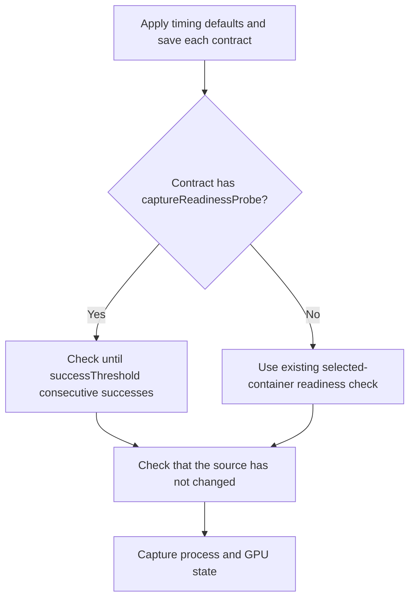
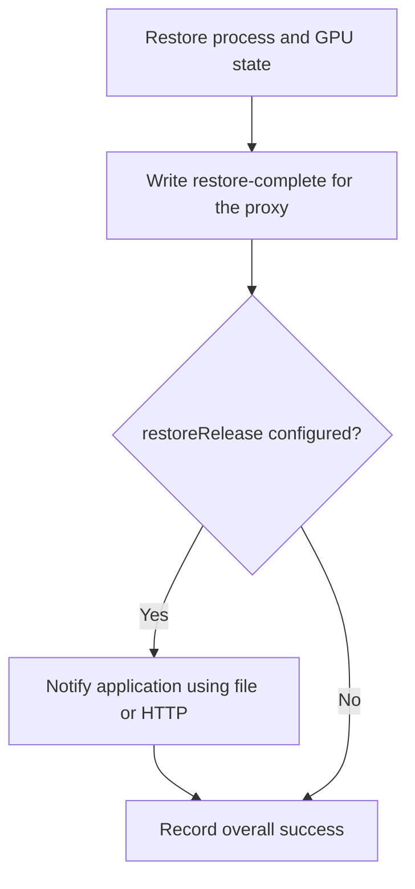

<!--
SPDX-FileCopyrightText: Copyright (c) 2026 NVIDIA CORPORATION & AFFILIATES. All rights reserved.
SPDX-License-Identifier: Apache-2.0
-->

# SNEP-411: Application contracts for checkpoint and restore

Tracking issue: [#411](https://github.com/ai-dynamo/snapshot/issues/411)

<!-- toc -->
- [Summary](#summary)
- [Motivation](#motivation)
  - [Goals](#goals)
  - [Non-Goals](#non-goals)
- [Proposal](#proposal)
  - [Limitations, Risks, and Mitigations](#limitations-risks-and-mitigations)
- [Design Details](#design-details)
  - [API](#api)
    - [Per-container configuration](#per-container-configuration)
    - [SnapshotJob](#snapshotjob)
    - [Application contract](#application-contract)
    - [Checkpoint metadata](#checkpoint-metadata)
  - [Capture and restore execution](#capture-and-restore-execution)
  - [Security](#security)
    - [RBAC](#rbac)
    - [Transport isolation](#transport-isolation)
  - [Monitoring](#monitoring)
  - [Test Plan](#test-plan)
- [Alternatives](#alternatives)
- [Appendix](#appendix)
  - [References](#references)
<!-- /toc -->

## Summary

Application contracts define how Snapshot checks capture readiness and notifies
an application after restore. Users configure each captured container in
PodSnapshot or SnapshotJob. Snapshot saves that configuration with the checkpoint
and uses it for every restore.

## Motivation

Before capture, the application must tell Snapshot it is safe to checkpoint.
After restore, Snapshot must tell the application it may recover connections
and other resources before serving requests.

Today, this exchange uses files on a shared control volume. This proposal adds
HTTP support and per-container configuration for file paths, endpoints, and
timing settings.

### Goals

- Configure both PodSnapshot and SnapshotJob through the same contract API.
- Preserve each captured container’s contract with its checkpoint for all restores.

### Non-Goals

- Asking the application to stop accepting requests or prepare for capture.
- Continuing the source application after capture.
- Defining application serving-readiness checks or engine recovery steps.
- Running arbitrary commands or general-purpose hook sequences.

## Proposal

Each container can define an `applicationContract` directly in its settings:

- `captureReadinessProbe` checks whether the application is safe to capture.
- `restoreRelease` tells the application it may resume after Snapshot restores
  its process and GPU state.

Both actions are optional. The application decides when it is safe to capture,
how to recover after restore, and when it is ready to serve requests.

The agent waits for `captureReadinessProbe` to succeed before capturing the
container. Success means the application is safe to capture. If the probe is
omitted, the agent waits for the selected container to be ready. `restoreRelease`
adds an application notification after process and GPU restoration.

### Limitations, Risks, and Mitigations

Snapshot currently captures one container per PodSnapshot. The API allows
settings for multiple containers so it can support them later.

The HTTP endpoint must be reachable by the agent at the destination Pod IP,
before application release. A listener bound only to the source Pod's IP may
not work after restore. The deployment must allow the agent's traffic through
any applicable network restrictions.

| Risk | Consequence and handling |
| --- | --- |
| Application reports ready too early | The checkpoint may be unusable. The application must stay safe to capture after reporting readiness; integration tests must verify restore and inference. |
| Incorrect saved contract | Restore may fail. Fix the settings and capture again; existing checkpoints keep their saved settings. |
| Lost release response | Snapshot may retry an accepted notification, or fail the restore and clean up at the deadline. Applications must handle repeated notifications safely. |
| Same-Pod port conflict | Restored copies cannot bind the same address and port in a shared network namespace. This Pod constraint applies regardless of release transport; this SNEP does not add conflict detection. |
| Shared HTTP endpoint | Requests carry no container identity. The application must coordinate which restored containers may resume. |
| Unprotected HTTP listener | Other callers could release the application. The deployment must restrict endpoint access. |

Upgrade participating agents before enabling contracts: older agents ignore the
new fields.

## Design Details

### API

All resources use `nvidia.com/v1alpha1`. Existing structs below show only the
added fields.

#### Per-container configuration

`spec.source.podRef.containers` selects which containers to capture.
`PodSnapshot.spec.containers` is a separate list of settings, matched by container name.

```go
// +kubebuilder:validation:XValidation:rule="!has(self.containers) || self.containers.all(c, c.name in self.source.podRef.containers)",message="settings must name selected source containers"
type PodSnapshotSpec struct {
	// +optional
	// +listType=map
	// +listMapKey=name
	Containers []ContainerSnapshotConfig `json:"containers,omitempty"`
}

type ContainerSnapshotConfig struct {
	// +kubebuilder:validation:Required
	// +kubebuilder:validation:MaxLength=63
	// +kubebuilder:validation:Pattern=`^[a-z0-9]([-a-z0-9]*[a-z0-9])?$`
	Name string `json:"name"`
	// +optional
	ApplicationContract *ApplicationContract `json:"applicationContract,omitempty"`
}
```

Each `name` must match a selected source container. The existing spec validation
prevents changing these settings after creation. The HTTP paths below are examples.

```yaml
apiVersion: nvidia.com/v1alpha1
kind: PodSnapshot
metadata:
  name: model-snapshot
spec:
  source:
    podRef:
      name: model-source
      containers: [main]
  containers:
    - name: main
      applicationContract:
        captureReadinessProbe:
          httpGet:
            path: /checkpoint/status
            port: 8000
        restoreRelease:
          httpPost:
            path: /checkpoint/resume
            port: 8000
```

#### SnapshotJob

Add `containers` to `SnapshotJob.spec.podSnapshotTemplate`. The controller copies
these settings into the generated PodSnapshot. Each entry must name a target container.

```go
// +kubebuilder:validation:XValidation:rule="!has(self.containers) || self.containers.all(c, c.name in self.targetContainers)",message="settings must name target containers"
type PodSnapshotTemplate struct {
	// +optional
	// +listType=map
	// +listMapKey=name
	Containers []ContainerSnapshotConfig `json:"containers,omitempty"`
}
```

```yaml
spec:
  podSnapshotTemplate:
    targetContainers: [main]
    containers:
      - name: main
        applicationContract:
          restoreRelease:
            httpPost:
              path: /checkpoint/resume
              port: 8000
```

#### Application contract

Each container defines its contract using the following types.

```go
// +kubebuilder:validation:XValidation:rule="!(has(self.captureReadinessProbe) && has(self.captureReadinessProbe.file) && has(self.restoreRelease) && has(self.restoreRelease.file)) || self.captureReadinessProbe.file.path != self.restoreRelease.file.path",message="probe and release file paths must differ"
type ApplicationContract struct {
	// +optional
	CaptureReadinessProbe *CaptureReadinessProbe `json:"captureReadinessProbe,omitempty"`
	// +optional
	RestoreRelease *RestoreRelease `json:"restoreRelease,omitempty"`
}

// +kubebuilder:validation:XValidation:rule="has(self.file) != has(self.httpGet)",message="select exactly one of file or httpGet"
type CaptureReadinessProbe struct {
	CaptureReadinessProbeHandler `json:",inline"`

	// +optional
	// +kubebuilder:default=0
	// +kubebuilder:validation:Minimum=0
	InitialDelaySeconds int32 `json:"initialDelaySeconds,omitempty"`
	// +optional
	// +kubebuilder:default=1
	// +kubebuilder:validation:Minimum=1
	PeriodSeconds int32 `json:"periodSeconds,omitempty"`
	// +optional
	// +kubebuilder:default=1
	// +kubebuilder:validation:Minimum=1
	TimeoutSeconds int32 `json:"timeoutSeconds,omitempty"`
	// +optional
	// +kubebuilder:default=1
	// +kubebuilder:validation:Minimum=1
	SuccessThreshold int32 `json:"successThreshold,omitempty"`
}

type CaptureReadinessProbeHandler struct {
	// +optional
	File *ControlFileAction `json:"file,omitempty"`
	// +optional
	HTTPGet *LifecycleHTTPAction `json:"httpGet,omitempty"`
}

// +kubebuilder:validation:XValidation:rule="has(self.file) != has(self.httpPost)",message="select exactly one of file or httpPost"
type RestoreRelease struct {
	RestoreReleaseHandler `json:",inline"`

	// +optional
	// +kubebuilder:default=1
	// +kubebuilder:validation:Minimum=1
	PeriodSeconds int32 `json:"periodSeconds,omitempty"`
	// +optional
	// +kubebuilder:default=1
	// +kubebuilder:validation:Minimum=1
	TimeoutSeconds int32 `json:"timeoutSeconds,omitempty"`
}

type RestoreReleaseHandler struct {
	// +optional
	File *ControlFileAction `json:"file,omitempty"`
	// +optional
	HTTPPost *LifecycleHTTPAction `json:"httpPost,omitempty"`
}

type ControlFileAction struct {
	// +kubebuilder:validation:Required
	// +kubebuilder:validation:MaxLength=4096
	// +kubebuilder:validation:XValidation:rule="self.startsWith('/') && self.split('/').all(p, p != '.' && p != '..')",message="path must be absolute without dot components"
	Path string `json:"path"`
}

type LifecycleHTTPAction struct {
	// +kubebuilder:validation:Required
	// +kubebuilder:validation:MaxLength=4096
	// +kubebuilder:validation:XValidation:rule="self.startsWith('/') && !self.startsWith('//') && !self.contains('?') && !self.contains('#')",message="path must start with / and have no authority, query, or fragment"
	Path string `json:"path"`
	// +kubebuilder:validation:Required
	// +kubebuilder:validation:Minimum=1
	// +kubebuilder:validation:Maximum=65535
	Port int32 `json:"port"`
}
```

When present, `captureReadinessProbe` requires exactly one of `file` or `httpGet`, and
`restoreRelease` requires exactly one of `file` or `httpPost`.

`captureReadinessProbe` defaults to `initialDelaySeconds: 0`, `periodSeconds: 1`,
`timeoutSeconds: 1`, and `successThreshold: 1`. `restoreRelease` defaults to
`periodSeconds: 1` and `timeoutSeconds: 1`.

The initial delay can be zero; other values must be positive. For both actions,
`periodSeconds` sets the interval between attempts and `timeoutSeconds` limits
each attempt. The probe requires `successThreshold` consecutive successes.

There is no `failureThreshold`. After a failed check, reset the success count
and keep waiting without restarting the container. Also reset the count if the
source container restarts or is replaced. Count the initial delay from that
container's start time.

File and HTTP paths are limited to 4096 characters.
File paths must be absolute within the selected container's filesystem; they
do not depend on `SNAPSHOT_CONTROL_DIR`. Reject `.` and `..` path components.
Probe and release paths must differ. Snapshot's internal control files remain
reserved and cannot be used as custom release paths.
The agent enforces reserved paths and filesystem isolation at runtime.
The application must provide the release file's parent directory. The agent
creates a marker only if absent, without overwriting an existing file, and makes
new markers readable by the user running the application. An existing regular file counts as
success; symlinks and other file types are rejected.

HTTP paths must begin with `/` and cannot include a host, query string, or
fragment. Ports range from 1 through 65535. Only HTTP is supported; the agent
sends requests to the target Pod IP. Host overrides, custom headers, and request
bodies are not part of this API.

**Transport behavior**

| Action | Success condition |
| --- | --- |
| File probe | The marker exists as a regular file. |
| HTTP probe | GET returns `200`. |
| File release | The marker exists as a regular file after the agent creates it or finds it. |
| HTTP release | POST with an empty body returns `200` or `204`. This means the application accepted the notification; recovery may still be running. |

GET and POST response bodies are ignored; no attempt ID is sent. All unsuccessful
HTTP release requests, including `404` and connection failures, are retried until the
restore deadline. Shared HTTP endpoints receive no container identifier and must
coordinate the required releases.

#### Checkpoint metadata

Add `containers` to `PodSnapshotContent.spec`. Before capture, apply timing
defaults to configured actions. Save the resulting settings for
every selected container in the content spec, where they cannot be changed.
The agent also saves these settings in the checkpoint metadata.

```go
type PodSnapshotContentSpec struct {
	// +optional
	// +listType=map
	// +listMapKey=name
	Containers []ContainerSnapshotConfig `json:"containers,omitempty"`
}
```

When importing a checkpoint, keep its saved contract settings.

During restore, match each source container's saved settings to its destination
container. Each restored copy uses those settings with its own Pod IP and
container filesystem. Restore reads the contract from the checkpoint, not from
the destination Pod or the original PodSnapshot.

### Capture and restore execution

**Capture**



Capture retries and restarts use the saved configuration. The application must
remove old readiness markers before initialization and stay safe to capture
after reporting readiness.

**Restore and release**

The existing file protocol remains: `restore-complete` hands the restored PID
to the restore proxy, and `restore-failed` reports failure. Applications that
already wait on these files continue to do so. The configured application release
is a separate step; overall success is recorded after it succeeds.



Track application release completion separately from the internal marker so
retries never repeat process restoration. All restore attempts use the
checkpoint's saved settings. The application must handle repeated release notifications without repeating their effects
(idempotence). A successful response means the notification was accepted.
The application may still need time to recover before it can serve requests.

**Deadlines.** SnapshotJob's `activeDeadlineSeconds` limits its source lifecycle.
A direct PodSnapshot waits for capture readiness, request deletion, or source
termination.

The restore timeout covers both restoring the process and sending the release
notification. Retries and restarts do not extend the deadline. If Snapshot has
not recorded successful release by then, it fails the restore and cleans up.
This also applies when the application received the notification but its response
was lost.

### Security

#### RBAC

Kubernetes RBAC controls who can create snapshot requests. A contract can read
or write files and call HTTP endpoints in the target Pod without changing its
spec. Permission checks must cover access to that Pod as well as the request.

#### Transport isolation

HTTP calls go directly to the target Pod IP. They do not follow redirects or
use proxies configured through environment variables.
HTTP actions do not support host-network Pods. Deployments must restrict listener
access; containers in the same Pod share its network.

Resolve file paths inside the target container, never from the host root.
Reject symlinks and paths that escape the container. Permission checks must
account for writes to mounts shared with other workloads. Protect the agent's
metadata, and keep response bodies and application memory out of logs and Events.

**Open question:** should HTTP authentication be supported initially, and how
should capture and restore obtain credentials? The API has no credential fields.

### Monitoring

Report waiting for capture readiness and release failures in snapshot and restore
status. Add Events for invalid configuration and release failures.
Log routine unsuccessful probe polls only at debug level.

### Test Plan

- **API:** validate optional actions, empty contracts, exclusive handlers, timing
  defaults, rejection of spec changes, unique names, and names that match selected containers.
  Check that each container’s settings reach the checkpoint from SnapshotJob.
- **Capture:** test success thresholds, source restarts, cancellation, deadlines,
  and the existing capture check when the probe is omitted. Verify that startup,
  readiness, and liveness probe handling remains unchanged.
- **Contracts:** verify saved settings cannot be changed. Imported content and
  repeated restores must use those settings even after the original request is
  deleted. Check per-container mapping and reuse across restored copies.
- **Recovery:** inject failures around runtime restore, release, persistence,
  and writing the startup marker. Verify that retries keep the original deadline,
  repair state after recorded success, and do not repeat CRIU restore. Cover concurrent
  agents and internal marker recovery.
- **Transports:** test status codes, ignored bodies, retries, redirect/proxy and
  host-network rejection, absolute file paths outside the control directory,
  symlink/traversal rejection, readable markers, no overwrites, and stale markers. Verify target-container path
  resolution, shared-mount effects, and shared-HTTP coordination.
- **Integrations:** validate file and HTTP with inference after restore. Cover
  new Pod IPs, release before serving, recovery that continues after release,
  and custom probes. Advertise only validated combinations and document
  supported engine versions, topologies, and required application settings.

## Alternatives

A shared contract CRD would let deployments reuse settings, but adds a resource
to manage and look up. Start with contracts defined directly in container settings.
Later, an `applicationContractRef` field could let users reference a shared
contract instead. Users could set at most one of the two fields; Snapshot would
not merge them.

## Appendix

### References

- [Workload contract](../../reference/workload-contract.md)
- [Restore Pod contract](../../reference/restore-pod-contract.md)
- [Kubernetes probes](https://kubernetes.io/docs/concepts/workloads/pods/probes/)
- [Kubernetes lifecycle hooks](https://kubernetes.io/docs/concepts/containers/container-lifecycle-hooks/)
