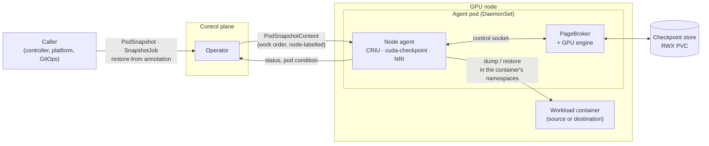
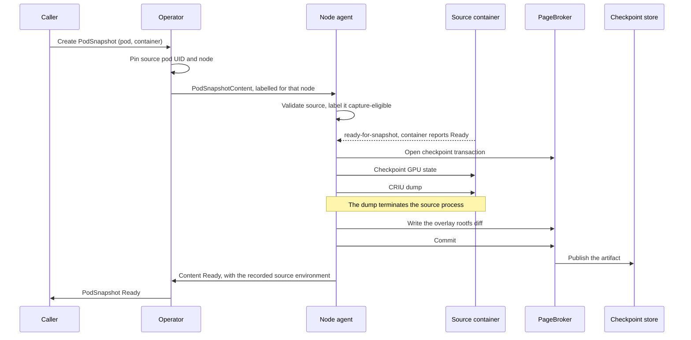
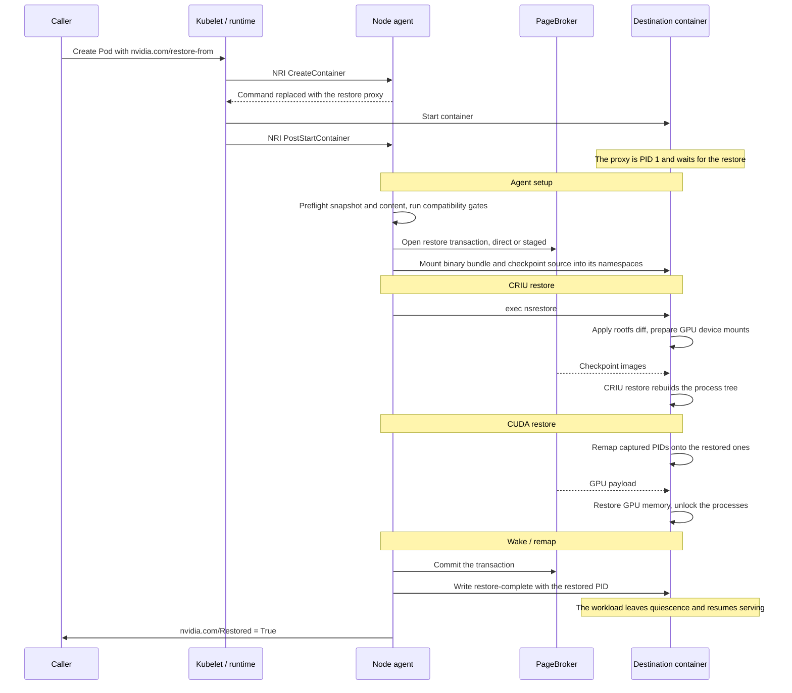

<!--
SPDX-FileCopyrightText: Copyright (c) 2026 NVIDIA CORPORATION & AFFILIATES. All rights reserved.
SPDX-License-Identifier: Apache-2.0
-->

# Architecture

Snapshot checkpoints a fully initialized GPU pod and restores it on another
compatible node. This page is the map of how that happens: which components
exist, which Kubernetes resources drive them, and what the checkpoint and
restore paths do. It is for integrators building a control loop on top of
Snapshot, and for contributors who need to place a change.

To *use* Snapshot, start with the [usage guides](../../guides/README.md); for
field-level detail, see the [API reference](../api.md).

## Components

Snapshot installs as one Helm release: a control-plane Deployment and a
privileged DaemonSet on GPU nodes. Nothing runs in the workload's own pod except
the restore proxy, which Snapshot injects.

| Component | Runs as | Responsibility |
|---|---|---|
| **Operator** (`manager`) | Deployment, one per cluster | Reconciles the CRDs. Turns a `PodSnapshot` into a node-addressed work order, mirrors results back, cascades deletes, and runs the in-process maintenance queue that removes artifacts from storage. |
| **CRD installer** | Init container of the operator | Applies the bundled CRDs on every rollout (`crdUpgrade.enabled`). |
| **Node agent** | DaemonSet, privileged, GPU nodes | The node-local control loop. Watches this node's work orders and restore pods, and executes CRIU and CUDA checkpoint/restore against containers on the node. |
| **PageBroker** | Container in the agent pod, privileged | Owns the movement of checkpoint data between the node and the checkpoint store, including the GPU engine that reads and writes GPU payloads. |
| **Restore proxy** | PID 1 of each restore destination container | Injected by the agent's NRI plugin at container creation. Waits for the restore, then follows the restored process and exits with its status. |
| **`nsrestore`** | Short-lived helper, exec'd by the agent | Performs the restore from *inside* the destination container's namespaces. |
| **`snapshotctl`** | CLI | Lower-level checkpoint and restore from a pod manifest, without the CRDs. See [CLI](../cli.md). |

The agent and the operator never call each other directly. Every handoff is a
Kubernetes object: the operator writes work orders, the agent writes their
results, and both watch what the other wrote.

## Resources

All three custom resources are in `nvidia.com/v1alpha1`, and every `spec` is
immutable after creation.

| Resource | Scope | Created by | Role |
|---|---|---|---|
| `PodSnapshot` | Namespaced | Caller | The request and the handle. Names the source pod and the single container to capture; later, the thing a restore points at. |
| `PodSnapshotContent` | Cluster | Operator | The work order *and* the artifact of record. Pins the source pod UID and its node, and carries the store binding. |
| `SnapshotJob` | Namespaced | Caller | Runs a pod from a template and captures it once ready, producing a `PodSnapshot`. A self-contained checkpoint job. |

`PodSnapshotContent` is cluster-scoped because the artifact outlives the
namespace that requested it, and because its `nvidia.com/snapshot-node` label is
what lets each node agent select only its own work. A `PodSnapshot` records the
binding in `status.boundSnapshotContentName`; both objects share one `Ready` /
`Failed` condition vocabulary, and the operator mirrors the content's terminal
result onto the snapshot.

Restore has no resource of its own. A pod requests one with the
`nvidia.com/restore-from` annotation naming a `PodSnapshot` in its namespace,
plus the rest of the [Restore Pod contract](../restore-pod-contract.md). The
agent reports progress on the `nvidia.com/Restored` pod condition.

## Checkpoint flow

From a ready pod to a stored artifact:

1. **Request.** The caller creates a `PodSnapshot` naming a running pod and one
   container. (A `SnapshotJob` instead runs the pod itself and creates the
   `PodSnapshot` once the pod is Ready.)
2. **Bind.** The operator reads the source pod, pins its UID and node name, and
   creates the bound `PodSnapshotContent` — labelled for that node. An
   unscheduled pod is requeued; a same-named replacement fails the snapshot
   rather than capturing the wrong process.
3. **Claim.** The agent on that node picks the work order off its capture queue,
   validates the source, and labels the pod capture-eligible so its status
   changes reach the queue.
4. **Quiesce.** The agent waits for the target container to report Ready. That
   readiness probe gates on `ready-for-snapshot`, which the workload writes only
   once no GPU work is in flight — see the
   [workload contract](../workload-contract.md).
5. **Capture**, in this order, into a PageBroker transaction:
   GPU state first (PageBroker's GPU engine, or `cuda-checkpoint`), then the
   CRIU dump, then the overlay rootfs diff. The dump always terminates the
   source process; there is no resume-after-capture mode.
6. **Commit.** PageBroker publishes the artifact into the store atomically. The
   agent writes `Ready` on the content, along with what the capture ran on
   (kernel, image digest, driver, GPU models), and the operator mirrors `Ready`
   onto the `PodSnapshot`.

A failure at any step writes `Failed` with a reason, and the agent kills the
CUDA-locked source process rather than leaving it hung. The artifact is never
half-published: a failed transaction is aborted.

## Restore flow

The same four stages the [benchmarks](../../development/benchmarks.md) break
restore time into:

1. **Agent setup** — the agent's restore queue picks up a pod on its node
   carrying `restore-from`. It preflights the `PodSnapshot`, the bound content
   and the artifact, runs the [compatibility gates](#compatibility-gates),
   resolves the destination container's PID, and mounts the agent's binary
   bundle and the checkpoint source into that container's mount namespace. The
   destination container is already alive and idle: the agent's NRI plugin made
   the restore proxy its PID 1 at creation time, and the proxy is waiting. The
   plugin also reports the container's ID to the restore queue the moment it
   starts, so the restore does not wait for kubelet to publish the container in
   the pod status.
2. **CRIU restore** — the agent execs `nsrestore` inside the destination's
   namespaces. It applies the rootfs diff, prepares the GPU device mounts, and
   runs the CRIU restore that reads the checkpoint images and rebuilds the
   process tree. This is a bulk read from the checkpoint store and is the
   largest stage for every model measured.
3. **CUDA restore** — checkpoint-time PIDs are remapped onto the restored ones,
   then GPU memory is restored and the processes unlocked, through PageBroker's
   GPU engine or `cuda-checkpoint` depending on how the artifact was captured.
4. **Wake / remap** — temporary mounts are released, the PageBroker transaction
   is committed, and the restored process is validated. The agent then writes
   `restore-complete` into the control volume, which is what the restored
   workload is blocked on; it leaves quiescence and resumes serving. The agent
   sets `nvidia.com/Restored=True`, and the proxy follows the restored process
   from there, forwarding signals and exiting with its code.

A pod gets exactly one restore. On failure the agent writes `restore-failed`,
kills the destination container, and reports the reason on the pod condition;
restoring again means creating a new pod.

### Compatibility gates

A checkpoint only runs on a node that resembles the one it was captured on, so
the agent compares the artifact's manifest against the target before it commits
to a restore — at **preflight** (manifest and pod only) and again at **inspect**
(once the node's GPUs and the container's mounts are readable). Checks cover CPU
architecture, kernel version, image digest, CPU and memory limits, mounts, GPU
model and count, and driver version. A mismatch refuses the restore with the
check name, instead of failing unattributably somewhere inside CRIU.
`nvidia.com/snapshot-skip-compat-check` bypasses them; it is a debugging escape
hatch.

## Storage

Every checkpoint lives in one store shared by all node agents: by default a
single `ReadWriteMany` PVC, mounted at `/checkpoints` in the agent and in
PageBroker, or an S3-compatible bucket with `storage.type: s3`. Workload pods
never mount the PVC.

An artifact is addressed by the `PodSnapshotContent` UID and the captured
container name, so a deleted-and-recreated content object can never adopt a
stale artifact. Content bound to a store also carries a backend-neutral
`storage.storeID`, which is what lets a second backend be added without
changing how callers address a checkpoint — see
[SNEP-237: S3-compatible object storage](../../proposals/237-s3-storage/README.md).

PageBroker adds a memory-backed staging volume shared with the agent. By default
CRIU dumps into staging and PageBroker publishes to the PVC on success, while
restore reads the artifact directly (`pageBroker.restoreMode: direct`). Because
staging is RAM, its cap and the agent's memory limit have to be sized together —
see [Storage](../../operations/storage.md).

Artifact lifetime follows the API object. Deleting a `PodSnapshot` cascades to
its `PodSnapshotContent`, whose cleanup finalizer hands the artifact to the
operator's maintenance queue; a periodic scan catches anything the event path
missed.

## Failures and retries

Terminal states are sticky and specific. A `Failed` condition names its cause
(`SourcePodNotFound`, `StalePodReference`, `ContentConflict`,
`ContainerNotResolved`, a compatibility check name) and is never re-evaluated.
`Ready` deliberately is not terminal on a `PodSnapshot`: it mirrors the content,
and keeps mirroring it.

The system is built so that an interruption is recoverable rather than
ambiguous:

- Capture and restore are both workqueue-driven, so a restarted agent replays
  the work order instead of losing it. A capture that committed before the
  agent died is recognized from the published artifact and promoted to `Ready`.
- Because the dump kills the source pod, a dead source is not by itself a
  failure. The operator waits out a five-minute grace window and checks for a
  committed artifact before it attributes the pod's death to the capture.
- A restore that already completed is detected from its sentinel rather than
  replayed through CRIU.

What is *not* yet automatic is retrying a failed capture: today the capture ends
and the caller must request a new one, paying the full model load again.
[SNEP-394](../../proposals/394-capture-retry/README.md) proposes retrying in
place against the still-running workload.

## Security boundaries

The node agent and PageBroker are privileged, run in the host PID namespace, and
mount the container runtime's socket and state: entering another container's
namespaces and driving CRIU requires it. That is the main boundary to be aware
of when deciding where to install Snapshot — the namespace running the agent is
as trusted as the node.

Workloads stay unprivileged, and never mount checkpoint storage; the agent
mediates every read and write. Checkpointed containers need a seccomp profile
blocking `io_uring`, which CRIU cannot checkpoint, and the chart ships one.
Checkpoint artifacts contain the workload's complete memory — protect the store
accordingly. See [Security](../../operations/security.md).

## Multi-GPU

Workloads that share CUDA memory between processes need more than native CUDA
checkpointing: the sharing relationships and the addresses themselves have to
survive. CuInterpose, the opt-in component that provides this, is described in
[Multi-GPU support](multi-gpu.md).

## Where this lives in the tree

| Path | What |
|---|---|
| `api/v1alpha1` | CRD types; CRDs are generated from here. |
| `api/podcontract` | The pod-side protocol: annotations, control volume, sentinels. |
| `api/compat` | The restore compatibility checks. |
| `operator/internal/controller` | `PodSnapshot`, `PodSnapshotContent` and `SnapshotJob` reconcilers. |
| `operator/internal/maintenance` | Artifact cleanup queue and backends. |
| `agent/internal/controller` | The node-local control loop: capture and restore queues. |
| `agent/internal/executor` | The checkpoint and restore workflows, including `nsrestore`. |
| `agent/internal/criu`, `agent/internal/cuda` | CRIU and CUDA primitives. |
| `agent/internal/nri`, `agent/internal/restoreproxy` | Proxy injection and the proxy itself. |
| `agent/internal/pagebroker` | The PageBroker control protocol client. |

## See also

- [API reference](../api.md) — fields, conditions, annotations, Helm values.
- [Workload contract](../workload-contract.md) — what a workload must do to be captured and restored.
- [Restore Pod contract](../restore-pod-contract.md) — the pod shape a restore requires.
- [Storage](../../operations/storage.md) and [Security](../../operations/security.md).
- [Benchmarks](../../development/benchmarks.md) — where restore time actually goes.
