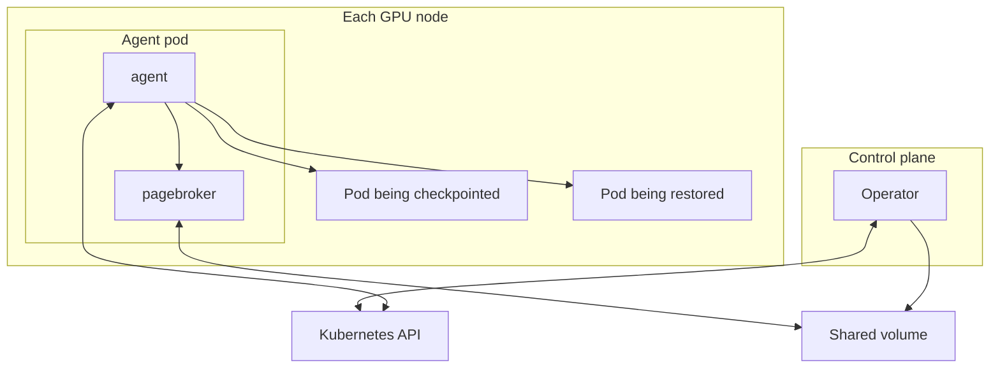
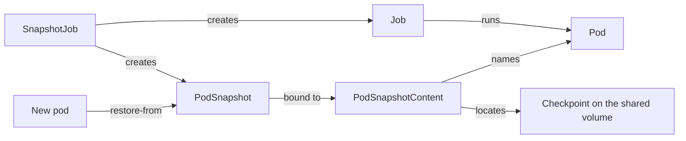

<!--
SPDX-FileCopyrightText: Copyright (c) 2026 NVIDIA CORPORATION & AFFILIATES. All rights reserved.
SPDX-License-Identifier: Apache-2.0
-->

# Architecture

<!-- toc -->
- [The idea](#the-idea)
- [The pieces](#the-pieces)
- [The resources](#the-resources)
- [How the workload takes part](#how-the-workload-takes-part)
- [What happens in a checkpoint](#what-happens-in-a-checkpoint)
- [What happens in a restore](#what-happens-in-a-restore)
- [Where multi-GPU differs](#where-multi-gpu-differs)
- [When things fail](#when-things-fail)
- [Privilege and trust](#privilege-and-trust)
- [Where to go next](#where-to-go-next)
- [Vocabulary](#vocabulary)
<!-- /toc -->

This section explains how Snapshot works inside.
It is written for contributors, and for people who integrate Snapshot into a scheduler, controller, or serving platform.
It assumes you know Kubernetes and Linux and have never seen Snapshot.
To use Snapshot rather than change it, start with the [usage guides](../../guides/README.md) and the [API reference](../api.md).

Read this page first.
It introduces the pieces and the vocabulary that every later page uses.

## The idea

Snapshot checkpoints one container of a running GPU pod and later restores that checkpoint into a new pod, on the same node or a compatible one.
The restored process continues from the instruction it was stopped at.
It does not start again from its entrypoint, so the minutes an inference server spends loading weights and warming up are paid once and then skipped.

A checkpoint has to capture four things: the process tree with its memory and open files, the files the container wrote to its root filesystem, the state of every CUDA process on the GPU, and enough information about the machine to tell whether another node can run it.
Two existing tools do most of that work.
[CRIU](https://criu.org/), the Linux checkpoint and restore tool, handles the processes.
The CUDA driver's checkpoint API handles the GPU state: it locks a CUDA process, moves its device memory off the GPU, and later moves it back.

Snapshot's own code decides when a capture is safe, runs those two tools in the right order inside the right namespaces, stores the result where another node can reach it, decides whether a destination can run it, and exposes all of this as Kubernetes resources.

## The pieces

Snapshot installs as one Helm release per cluster.
It runs two workloads and shares one volume between them.

The **operator** is a Deployment with one active replica.
It watches Snapshot's custom resources, decides which node must perform each checkpoint, publishes results back to the resources, and deletes checkpoints from storage when their resources are deleted.
It never touches a workload process.

The **agent** is a privileged DaemonSet on every GPU node.
It performs every checkpoint and every restore on its node, using CRIU and the CUDA checkpoint API against processes it does not own.
That is why it needs the host's PID, IPC, and network namespaces.
Workloads need no privileges of their own.

**PageBroker** is a second container in the agent pod.
It is the process that writes checkpoints to the shared volume and reads them back.
It publishes each checkpoint atomically, so a half-written one is never visible.
When the GPU driver supports it, PageBroker also moves GPU memory straight between the device and storage without passing through the process's host memory.

The **shared volume** is one `ReadWriteMany` PersistentVolumeClaim, mounted at `/checkpoints` by every agent, every PageBroker, and the operator.
Every checkpoint lives on it.
Workload pods never mount it.

The operator and the agent never communicate directly.
The operator writes what it wants into a custom resource, the agent on the chosen node reads it, does the work, and writes the outcome into the same resource's status.
Restore does not involve the operator at all.
A pod asks for a restore through an annotation, and the agent on its node performs and reports it.

## The resources

Snapshot's API is three custom resources in the `nvidia.com` group and one pod annotation.
The [API reference](../api.md) lists every field.

A **`PodSnapshot`** is the request to checkpoint one container of a named pod, and later the thing a restore refers to.
It is namespaced, like the pod.

A **`PodSnapshotContent`** is the cluster-scoped record of one checkpoint.
The operator creates it when it accepts a `PodSnapshot`, naming the pod, the container, and the node that must perform the capture.
The agent on that node selects it by a label carrying the node name, and the checkpoint's location on the shared volume is derived from this object's UID.
Callers never create one.
The split between a namespaced request and a cluster-scoped record follows the pattern of PersistentVolumeClaim and PersistentVolume.

A **`SnapshotJob`** runs a pod from a template, waits until it is ready, checkpoints it into a `PodSnapshot`, and tears it down.
It is for callers that cannot track a running pod themselves.

The **`nvidia.com/restore-from`** annotation on a new pod names the `PodSnapshot` to restore into it.

Every `spec` is immutable after creation.
A `PodSnapshot` ends `Ready` or `Failed`, and `Failed` is permanent.

## How the workload takes part

Checkpointing a process at an arbitrary instant produces a checkpoint of whatever it was doing, which for an inference server is rarely what you want.
So the workload cooperates, through a directory called the **control directory**.
It is a per-pod `emptyDir` volume named `snapshot-control`, mounted at `/snapshot-control`, that the workload and the agent both see.
They communicate by creating files in it, called **sentinels**.

Before a checkpoint, the workload finishes in-flight requests and writes `ready-for-snapshot`.
The pod's readiness probe checks for that file, so the pod reports Ready exactly when it is safe to capture, and the agent waits for Ready.
After a restore, the agent writes `restore-complete`, and the workload, which has been waiting for it, resumes.
The [workload contract](../workload-contract.md) specifies this in full.

## What happens in a checkpoint

1. A caller creates a `PodSnapshot` naming a running pod and one of its containers.
2. The operator reads the pod's node and creates a `PodSnapshotContent` labelled with it.
3. The agent on that node sees the `PodSnapshotContent` and waits until the target container reports Ready.
4. The agent inspects the container, asks PageBroker for a directory to write into, locks and checkpoints every CUDA process, dumps the process tree with CRIU, and archives the files the container changed.
5. PageBroker renames the finished directory into its final place on the shared volume. The checkpoint exists from this moment.
6. The agent writes `Ready` on the `PodSnapshotContent`, and the operator copies it to the `PodSnapshot`.

The dump always terminates the process it dumped.
A successful checkpoint therefore leaves the source container dead, and the resource reaches `Ready` while the pod reports a failed container.
The [checkpoint flow](checkpoint.md) page follows each step.

## What happens in a restore

1. A caller creates a pod with the `nvidia.com/restore-from` annotation, the control directory, and a seccomp profile that CRIU needs.
2. As the container runtime creates the destination container, the agent swaps its command for a small program called the **restore proxy**. The proxy becomes PID 1 of the container and waits.
3. The agent sees the pod, checks that the `PodSnapshot` is `Ready`, and checks that this node can run the checkpoint.
4. The agent bind mounts its own tools and the checkpoint into the container, then runs the rest of the restore inside the container's namespaces.
5. Inside, it replays the changed files onto the container's root filesystem, restores the process tree with CRIU, and restores and unlocks the GPU state.
6. The agent writes `restore-complete`. The proxy begins forwarding signals to the restored process and will exit with its exit code, so the container's lifecycle becomes the workload's. The workload resumes.

The [restore flow](restore.md) page follows each step.

## Where multi-GPU differs

Everything above applies to a single-GPU workload without additions.
Each CUDA process owns its device memory, and the driver's checkpoint API handles it.

A model served across several GPUs runs one process per GPU, and those processes share CUDA memory with each other.
The driver's checkpoint API cannot recreate that sharing on restore.
Snapshot adds a library, loaded into each CUDA process, that records how memory is shared, and a coordinator the agent runs at capture and restore to take the sharing apart and put it back together.
That component is called CuInterpose, and [Multi-GPU support](multi-gpu.md) describes it.

The flow is otherwise unchanged.
The source pod opts in with an annotation, the agent runs the coordinator at two extra points during capture and one during restore, and the checkpoint carries one extra file.
Each flow page marks those points.

## When things fail

A checkpoint that fails is final.
The agent writes `Failed` with a reason, and nothing retries.
If the failure came before the agent touched the GPU or the process, the workload keeps running.
If it came after, the agent kills the source container, because a CUDA process that has been locked for checkpointing cannot be resumed.
The [capture retry proposal](../../proposals/394-capture-retry/README.md) describes how in-place retry would work.

A pod gets one restore.
If it fails, the agent records the failure in the control directory and kills the container.
The pod's `nvidia.com/Restored` condition and its events say why.
One case is treated differently: a restore that this node cannot run, for example because the GPU model differs, leaves the container running, since restarting it would only reach the same refusal.

## Privilege and trust

The agent and PageBroker are privileged because CRIU and the CUDA checkpoint API operate on other processes.
Nothing else is.
A workload needs only a seccomp profile that blocks `io_uring`, which CRIU cannot checkpoint.

What the agent puts into a workload container is tightly bounded.
Every directory it mounts in goes through a small C helper whose allowed sources and destinations are compiled in, and the checkpoint is mounted read-only and `noexec`.
CRIU, its plugins, and `tar` always come from the agent's own image, never from the checkpoint or the workload image.
[Security](../../operations/security.md) describes what a cluster must allow.

## Where to go next

| Page | Read it when |
| --- | --- |
| [Control plane](control-plane.md) | You are integrating Snapshot, or changing how `PodSnapshot`, `PodSnapshotContent`, or `SnapshotJob` behave. |
| [Node agent](node-agent.md) | You are changing the agent, or want to know exactly what runs on a node and what it does to it. |
| [Checkpoint flow](checkpoint.md) | You are changing how a checkpoint is taken, or debugging one that failed. |
| [Restore flow](restore.md) | You are writing restore pods, changing restore, or debugging a restore. |
| [Storage and artifacts](storage.md) | You are changing what a checkpoint contains, where it lives, or how compatibility is decided. |
| [Multi-GPU support](multi-gpu.md) | You are working on workloads that share memory across GPUs. |

For a new inference framework, no architecture change is needed.
See [Extending Snapshot](../../../CONTRIBUTING.md#extending-snapshot).

## Vocabulary

These terms are Snapshot's own.
Each is defined where it first appears above, and collected here for reference.

- **Artifact.** One checkpoint as stored on the shared volume: CRIU images, GPU memory, the root filesystem changes, and a manifest describing them.
- **Control directory.** The `snapshot-control` volume through which a workload and the agent exchange sentinel files.
- **Sentinel.** A file whose existence is the message, such as `ready-for-snapshot` or `restore-complete`.
- **Restore proxy.** The program the agent installs as PID 1 of a container being restored into.
- **Bundle.** The directory of tools the agent mounts into a container being restored into.
- **PageBroker transaction.** PageBroker's unit of work: a directory it hands out for writing or reading, and later publishes, releases, or discards.
- **CustomStorage.** A CUDA driver feature that streams GPU memory to an external engine instead of into the process's own host memory.
- **Source pod, destination container.** The pod a checkpoint is taken from, and the container a checkpoint is restored into.
