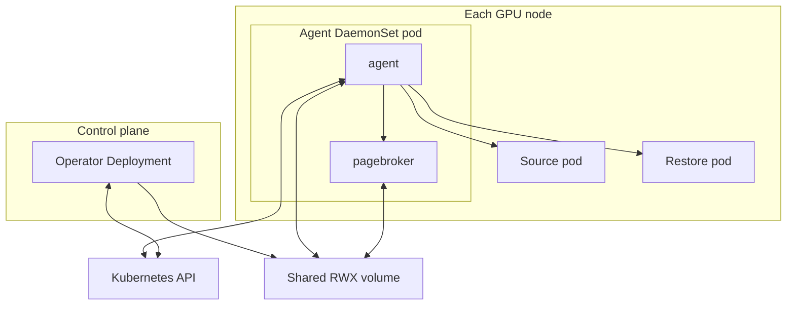
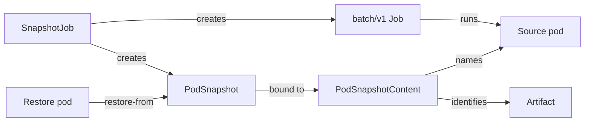

<!--
SPDX-FileCopyrightText: Copyright (c) 2026 NVIDIA CORPORATION & AFFILIATES. All rights reserved.
SPDX-License-Identifier: Apache-2.0
-->

# Architecture

<!-- toc -->
- [How to read this section](#how-to-read-this-section)
- [What Snapshot does](#what-snapshot-does)
- [Components](#components)
- [Resources](#resources)
- [Checkpoint, in brief](#checkpoint-in-brief)
- [Restore, in brief](#restore-in-brief)
- [Storage, in brief](#storage-in-brief)
- [Failure behavior](#failure-behavior)
- [Where multi-GPU diverges](#where-multi-gpu-diverges)
- [Security boundaries](#security-boundaries)
- [Where to look](#where-to-look)
<!-- /toc -->

This section is for contributors and for the people who integrate Snapshot into a scheduler, controller, or platform.
It explains how Snapshot works inside.
To use Snapshot, start with the [usage guides](../../guides/README.md) and the [API reference](../api.md) instead.

This page is the overview.
Each later page covers one part of the system in depth:

| Page | What it covers |
| --- | --- |
| [Control plane](control-plane.md) | The operator: how `PodSnapshot`, `PodSnapshotContent`, and `SnapshotJob` are reconciled, and artifact cleanup. |
| [Node agent](node-agent.md) | The agent pod on every GPU node: its processes, helper binaries, the PageBroker sidecar, and its footprint on the host. |
| [Checkpoint flow](checkpoint.md) | From a ready source pod to a committed artifact. |
| [Restore flow](restore.md) | From a pod with the `nvidia.com/restore-from` annotation to a running, restored process. |
| [Storage and artifacts](storage.md) | The artifact layout, the manifest, the compatibility checks, and how artifacts are published and deleted. |
| [Multi-GPU support](multi-gpu.md) | CuInterpose, the component that checkpoints and restores CUDA memory shared between processes. |

## How to read this section

Read this page first.
It introduces the components, the resources, and the two flows, and it is enough to reason about where a change belongs.

Then pick a path:

- **Integrating Snapshot** into a controller or platform: [Control plane](control-plane.md) for the resource lifecycle, then the [restore flow](restore.md) for what your restore pods must look like and how their outcome is reported.
- **Changing the agent**: [Node agent](node-agent.md) for the processes and binaries, then the [checkpoint flow](checkpoint.md) and [restore flow](restore.md), which follow one operation through them.
- **Changing what is stored** or how compatibility is decided: [Storage and artifacts](storage.md).
- **Working on multi-GPU workloads**: everything above applies unchanged, then [Multi-GPU support](multi-gpu.md). The section [Where multi-GPU diverges](#where-multi-gpu-diverges) says where the two paths part.

## What Snapshot does

Snapshot checkpoints one container of a running GPU pod and restores that checkpoint into a new pod later, on the same node or a compatible one.
A checkpoint holds the process tree, its CPU memory and open files, the changes the container made to its root filesystem, and the GPU state of every CUDA process in the container.
A restored process continues from the instruction it was stopped at.
It does not run its entrypoint again.

Two existing tools do most of the heavy lifting:

- [CRIU](https://criu.org/) dumps and restores the process tree and everything on the CPU side.
- The CUDA driver's checkpoint API, called through `cuda-checkpoint-helper` or through PageBroker, locks each CUDA process, moves its device state to host memory, and later moves it back.

Snapshot's own code sequences those two, decides what is safe to capture and restore, and exposes the whole thing as Kubernetes resources.

## Components

Snapshot installs as one Helm release per cluster with two workloads.

| Component | Runs where | Responsibility |
| --- | --- | --- |
| Operator | One Deployment, leader elected | Turns a `PodSnapshot` into a `PodSnapshotContent` work order for one node, mirrors the result back, runs `SnapshotJob`, and deletes artifacts when their content is deleted. Installs the CRDs from an init container. |
| Agent | Privileged DaemonSet container on every GPU node | Performs every checkpoint and restore on its node. Watches the `PodSnapshotContent` objects labelled with its node name and the restore pods scheduled to it. Registers an NRI plugin with the container runtime. |
| PageBroker | Sidecar container in the agent pod | Owns the movement of checkpoint data between the node and the shared volume. Publishes a checkpoint atomically and pins or stages an artifact for restore. When the driver supports it, moves GPU memory directly between device and storage. |
| Shared volume | One `ReadWriteMany` PersistentVolumeClaim | Holds every artifact. Mounted at `/checkpoints` by every agent, every PageBroker, and the operator. Workload pods never mount it. |

The operator and the agent never talk to each other directly.
Capture requests flow down as `PodSnapshotContent` spec and labels.
Results flow up as `PodSnapshotContent` status.
Restore involves the agent alone.
It is driven by pod annotations and reported on a pod condition.

Three Go modules make up the code: `api/` holds the CRD types and the contracts both sides share, `operator/` holds the control plane, and `agent/` holds the node agent, its helper binaries, and PageBroker.
The [node agent](node-agent.md) page lists what is in the agent image.

## Resources

Snapshot's API is three custom resources and one pod annotation.
The [API reference](../api.md) lists every field.

| Resource | Created by | Role |
| --- | --- | --- |
| `PodSnapshot` | The caller, or a `SnapshotJob` | A namespaced request to checkpoint one container of a named pod. Also the handle a restore pod names. |
| `PodSnapshotContent` | The operator only | A cluster-scoped work order for one node agent, and the record of the resulting artifact. The artifact's path on the shared volume is derived from this object's UID. |
| `SnapshotJob` | The caller | Runs a pod from a template, waits until it is ready, checkpoints it, and tears it down. |
| `nvidia.com/restore-from` | The caller, on a new pod | Names the `PodSnapshot` to restore into that pod. The node agent does the rest. |

Every `spec` is immutable after creation.
A `PodSnapshot` ends `Ready` or `Failed`, and `Failed` is terminal.
A restore pod carries the `nvidia.com/Restored` condition, written by the agent.

## Checkpoint, in brief

1. The caller creates a `PodSnapshot` naming a running pod and one of its containers.
2. The operator reads the pod's node and creates a `PodSnapshotContent` labelled with that node name.
3. The agent on that node waits until the target container reports Ready, which the [workload contract](../workload-contract.md) ties to the `ready-for-snapshot` sentinel.
4. The agent inspects the container, opens a PageBroker transaction, locks and checkpoints every CUDA process, dumps the process tree with CRIU, and archives the container's root filesystem changes.
5. PageBroker renames the finished directory into place on the shared volume. This rename is the commit point.
6. The agent writes `Ready` on the `PodSnapshotContent`, and the operator mirrors it to the `PodSnapshot`.

The dump always terminates the source process.
A successful capture leaves the source container dead, which is why the resource reaches `Ready` while the source pod reports a failure.
The [checkpoint flow](checkpoint.md) page covers each step.

## Restore, in brief

1. The caller creates a pod with the `nvidia.com/restore-from` annotation, the `snapshot-control` volume, and the seccomp profile the [restore pod contract](../restore-pod-contract.md) requires.
2. When the container runtime creates the destination container, the agent's NRI plugin replaces its command with the restore proxy, which becomes PID 1 and waits.
3. The agent sees the pod, checks that the `PodSnapshot` is `Ready`, and runs the compatibility checks that need only the manifest and the pod spec.
4. The agent bind mounts its tool bundle and the artifact into the container, then runs `nsrestore` inside the container's namespaces.
5. `nsrestore` replays the root filesystem diff, restores the process tree with CRIU, restores and unlocks GPU state, and reports the restored PID.
6. The agent writes `restore-complete` into the control directory. The proxy starts following the restored process, and the workload resumes.

The [benchmarks](../../development/benchmarks.md) report restore in four stages: agent setup, CRIU restore, CUDA restore, and wake and remap.
The [restore flow](restore.md) page maps those stages to the code.

## Storage, in brief

Every artifact lives at a path derived from the `PodSnapshotContent` UID and the container name, so a recreated object can never adopt a stale checkpoint.
The agent writes CRIU images and GPU memory into a PageBroker transaction directory, and PageBroker publishes the result with an atomic rename.
A `manifest.yaml` written before the dump records what the checkpoint was taken on.
Restore reads the manifest to decide whether the destination can run the checkpoint.

The operator deletes an artifact when its `PodSnapshotContent` is deleted, and a periodic sweep removes directories that no longer belong to any content.
The shared volume is the only storage backend today.
The [S3 proposal](../../proposals/237-s3-storage/README.md) describes how object storage fits the same transaction model.
See [Storage and artifacts](storage.md).

## Failure behavior

A capture that fails is final.
The agent writes `Failed` on the `PodSnapshotContent` with a reason, and nothing retries it.
If the failure happened after the GPU lock or the CRIU dump started, the agent kills the source container, because a CUDA-locked process cannot be resumed.
If the failure happened before that point, the source keeps running.
The [capture retry proposal](../../proposals/394-capture-retry/README.md) describes how in-place retry would work.

A pod gets one restore.
A restore that fails writes `restore-failed` into the control directory and kills the container, and the pod condition reports why.
A restore refused by the compatibility checks leaves the container running, because restarting it would reach the same refusal.
The reasons are listed under [Restore flow](restore.md#outcomes-and-reporting).

## Where multi-GPU diverges

A single-GPU checkpoint needs nothing beyond the flows above.
The CUDA driver's checkpoint API handles each process's own device state, and CRIU handles the rest.

Workloads that spread one model across several GPUs share CUDA memory between processes, and the native checkpoint API cannot reconstruct that sharing.
[CuInterpose](multi-gpu.md) adds a shim library inside each CUDA process and a coordinator that the agent runs at capture and restore.
Everything else stays the same.
The pages above mark each point where the multi-GPU path hooks in:

| Where | What differs |
| --- | --- |
| Source pod | The `nvidia.com/snapshot-multi-gpu: enabled` annotation. A `SnapshotJob` then installs the libraries with an init container and prefixes the command with the launcher. See [Control plane](control-plane.md#shaping-the-source-pod). |
| Capture | The agent hashes the libraries, runs the coordinator to inspect and then prepare shared memory before the first GPU lock, and records both in the manifest. See [Checkpoint flow](checkpoint.md#multi-gpu-hooks). |
| Artifact | A `cuinterpose` section in the manifest and a `cuinterpose.state` file. See [Storage and artifacts](storage.md#artifact-layout). |
| Restore | The bundle's libraries must hash to the same values, they are mounted into the container, and the coordinator rebuilds the sharing after GPU state is back. See [Restore flow](restore.md#multi-gpu-hooks). |

## Security boundaries

The agent runs privileged with the host PID, IPC, and network namespaces, because CRIU and the CUDA checkpoint API operate on processes the agent does not own.
PageBroker runs privileged as root for the same reason.
Workloads need no privileges beyond a seccomp profile that blocks `io_uring`, which CRIU cannot checkpoint.

Every directory the agent mounts into a workload container goes through a small C helper with a compiled-in list of allowed sources and destinations.
The checkpoint mount is read-only and `noexec`.
CRIU, its plugins, and `tar` always come from the agent's own bundle, never from the checkpoint or the workload image.
[Security](../../operations/security.md) covers what an operator must allow.

## Where to look

| Question | Start at |
| --- | --- |
| Why did my `PodSnapshot` fail? | [Control plane](control-plane.md#failure-reasons) and [Checkpoint flow](checkpoint.md#failure-reasons) |
| Why was my restore refused? | [Storage and artifacts](storage.md#compatibility-checks) |
| What does the agent do to my node? | [Node agent](node-agent.md#host-footprint) |
| What is in an artifact directory? | [Storage and artifacts](storage.md#artifact-layout) |
| How do I checkpoint a multi-GPU workload? | [Multi-GPU support](multi-gpu.md) |
| How do I add a framework? | [CONTRIBUTING.md](../../../CONTRIBUTING.md#extending-snapshot) |
