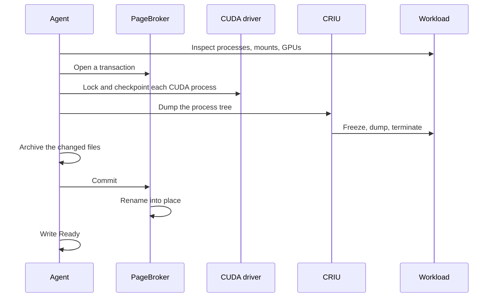

<!--
SPDX-FileCopyrightText: Copyright (c) 2026 NVIDIA CORPORATION & AFFILIATES. All rights reserved.
SPDX-License-Identifier: Apache-2.0
-->

# Checkpoint flow

<!-- toc -->
- [Waiting for the right moment](#waiting-for-the-right-moment)
- [Inspect](#inspect)
  - [What CRIU does with each mount](#what-criu-does-with-each-mount)
- [Opening a transaction](#opening-a-transaction)
- [Suspending the GPU](#suspending-the-gpu)
- [Dumping](#dumping)
- [Archiving the changed files](#archiving-the-changed-files)
- [Publishing](#publishing)
- [When it fails](#when-it-fails)
- [Where multi-GPU differs](#where-multi-gpu-differs)
- [Reference: checks and failure reasons](#reference-checks-and-failure-reasons)
- [Invariants](#invariants)
<!-- /toc -->

This page follows one checkpoint from the moment a `PodSnapshotContent` reaches a node to the moment the checkpoint is published and reported `Ready`.
The [control plane](control-plane.md) page covers how the `PodSnapshotContent` gets there, and the [node agent](node-agent.md) page describes the processes that appear below.
To checkpoint a workload, follow [Checkpoint a replica](../../guides/checkpoint.md) instead.

On the node, a checkpoint has four parts, in this order:

1. **Inspect.** Look at the container and decide whether it can be captured. Nothing is changed.
2. **Suspend the GPU.** Lock every CUDA process and move its device memory off the GPU.
3. **Dump.** Have CRIU write the process tree to disk, which terminates it, then archive the files the container changed.
4. **Publish.** Rename the finished directory into place and report `Ready`.

A failure in the first part leaves the workload running.
A failure in any later part kills it, because a CUDA process that has been locked cannot be resumed.

When the driver supports CustomStorage, PageBroker calls the CUDA driver in the agent's place.

## Waiting for the right moment

The agent on the node learns about the `PodSnapshotContent` through an informer filtered to its node name.
Before it does anything, it has to be sure the capture is wanted, possible, and timely.

It re-reads the `PodSnapshotContent` bypassing its cache and checks that it is for this node, is not being deleted, and has no final condition.
It checks that the object names exactly one container, and it computes where the checkpoint will live on the shared volume.
It reads the source pod and checks that the pod's UID is the one recorded in the `PodSnapshotContent`, so that a replacement pod with the same name is never captured in place of the original.

Then it checks whether the checkpoint already exists.
The dump kills the source, and the agent writes `Ready` only afterwards, so an agent that restarted in between would find a dead pod and a finished checkpoint.
The checkpoint directory exists only once PageBroker has renamed it into place, so its presence, together with a manifest naming this `PodSnapshotContent` and container, is proof that the capture succeeded.
In that case the agent writes `Ready` and stops.
This check deliberately comes before any check that would fail the capture because the pod is gone.

Next it confirms that the pod is alive and intact.
If any container in the pod has exited with a non-zero code, the capture fails and the agent kills the remaining containers.
If the pod is being deleted or has reached a final phase, the capture fails.
If the source opted into [multi-GPU](multi-gpu.md), the annotation and the launcher on the container's command are validated now, before anything irreversible happens.

When several `PodSnapshotContent` objects name the same pod, only the oldest one still in progress acts on it.
The others wait.
This matters because the failure paths above kill containers.

Finally the agent labels the pod `nvidia.com/snapshot-capture-eligible=true`, so that its pod informer begins delivering that pod's status changes, and waits for the target container to be Ready.
The agent never reads `ready-for-snapshot` itself.
The [workload contract](../workload-contract.md) has the workload write that sentinel once it is quiesced, and the pod's readiness probe turns the file into the Ready condition.
The agent therefore needs to know nothing about the workload.

When the container is Ready, the agent resolves it to a host PID through the container runtime and starts the capture, with a deadline of `checkpointTimeoutSeconds`.

## Inspect

The capture begins by collecting everything the later steps need, without changing anything.
This happens in `inspectContainer` in `agent/internal/executor/checkpoint.go`.

From the container runtime it takes the container's init PID, its OCI spec, and its image ID.
The image ID is recorded so that restore can refuse a destination built from a different image.

From `/host/proc/<pid>` it reads the container's cgroup, which CRIU will freeze, and its mount table, which is classified as described below.
It reads the container's overlay upper directory, the layer that holds every file the container has changed since it started.
A container whose root filesystem is not an overlay cannot be captured, because there would be no way to find those files.
It reads the network namespace, which CRIU will be told to treat as external, and the pipes behind file descriptors 0 to 2, so that restore can reconnect the process's output to the new container's log.

It walks the process tree and asks `cuda-checkpoint-helper` about each process to find the ones that hold a CUDA context.
A CUDA process inside a further nested PID namespace is not supported.
If there are CUDA processes, it discovers which GPUs the container can see and records them in CUDA's own order, which may differ from the order Kubernetes allocated them in.
Discovery tries the container's `NVIDIA_VISIBLE_DEVICES`, then Dynamic Resource Allocation (DRA) claims, then the kubelet's PodResources API, then `nvidia-smi` run inside the container.
A GPU container with no CUDA process is captured as a CPU-only checkpoint.

### What CRIU does with each mount

CRIU must be told what to do with every mount in the container, and the policy is decided here.
A mount can be **dumped**, meaning its contents go into the checkpoint, or **externalized**, meaning CRIU records that it was there and expects the restore side to provide it at the same path, or **skipped**.

Submounts of `/proc`, `/sys`, and `/run` that the OCI spec did not ask for are skipped.
They are virtual or created by the runtime, and a fresh container will have its own.
`/dev/shm` is dumped, so that its contents survive.
Files the OCI spec masks are externalized to `/dev/null`, since the runtime masks them again.
Everything else is externalized to itself: the runtime recreates the OCI mounts in the destination container, and CRIU binds from there.

The list of externalized mounts is recorded in the checkpoint's manifest.
At restore it becomes a compatibility check: a volume the source had must also exist in the destination.

## Opening a transaction

Nothing is written to the shared volume directly.
The agent asks PageBroker for a **transaction**, a directory PageBroker hands out and later either publishes with a rename or deletes.
If anything below fails, a deferred abort deletes it.

Where that directory lives depends on how GPU memory will travel:

- When there are no CUDA processes, or the driver lacks CustomStorage, the directory is on the memory-backed volume the agent and PageBroker share. CRIU writes the dump there, and PageBroker copies it to the shared volume on commit. The agent's memory limit therefore bounds the largest checkpoint a node can take, since the kernel charges those pages to the process that writes them.
- When CUDA processes exist and the driver supports CustomStorage, the directory is a temporary one on the shared volume, next to the final location. GPU memory is too large to stage in RAM, so it is written straight to the volume.

Two more checks run once the transaction is open, both still non-destructive.
If the source uses [multi-GPU](multi-gpu.md), the CuInterpose libraries in every CUDA process are hashed and the coordinator is run in inspect mode.
Without CustomStorage, a CUDA capture needs the `cuda-checkpoint-job` file that the driver's launch-job wrapper creates in the control directory, and a capture of more than one GPU without that file and without a CuInterpose coordinator is refused.

Then the agent writes `manifest.yaml` into the transaction directory: everything about the source that a restore will need, from CRIU options to GPU UUIDs.
It is written before the dump so that it is complete no matter how the dump ends.
[Storage and artifacts](storage.md#the-manifest) lists its contents.

## Suspending the GPU

CRIU cannot see device memory, so GPU state has to be brought to the CPU side before CRIU runs.
This is the first destructive step.
From here on, any failure causes the agent to kill the source container.

With a CuInterpose coordinator, the coordinator's prepare step runs first.
It unmaps the memory the processes share and writes `cuinterpose.state`.

Then, with CustomStorage, the agent sends PageBroker one request naming every CUDA process.
PageBroker locks each process, checkpoints it, and streams its device memory into `gpu/<pid>/` files in the transaction directory.

Without CustomStorage, the agent runs `cuda-checkpoint-helper` to lock every CUDA process, then to checkpoint every CUDA process.
The driver copies each process's device memory into that process's host memory, where CRIU will find it.
If a `cuda-checkpoint-job` file is in use, it is copied into the checkpoint again after the last process is checkpointed, because the driver rewrites it during the operation.

## Dumping

The agent runs CRIU as a child process, with the transaction directory as CRIU's image directory, and tells it to dump the container's init process and everything under it.
CRIU freezes the tree through its cgroup, writes every process's memory, registers, file descriptors, sockets, and namespaces to image files, and then kills the tree.
There is no mode that leaves the source running.
A CUDA process that has been checkpointed cannot resume, and the control plane treats the source's death as the normal outcome of a checkpoint.

The options the agent sets are the ones a contributor is likely to ask about:

| Option | Value | Why |
| --- | --- | --- |
| `root` | `/host/proc/<pid>/root` | Paths resolve inside the container's mount namespace. |
| `external` | the network namespace | Never dumped. Restore inherits the destination pod's namespace. |
| `ext_mnt`, `skip_mnt` | from the mount policy above | |
| `freeze_cgroup` | the container's cgroup | Freeze the whole tree in one step. |
| `manage_cgroups` | `soft` | At restore, CRIU places the tree under the destination container's cgroup. |
| `tcp_established` | on by default | Keep established connections. Restore rewrites their addresses. |
| `ghost_limit` | 512 MiB by default | A file that was deleted while a process still had it open is saved inside the image, up to this size. |
| Plugin directory | Snapshot's own | So that CRIU's bundled CUDA plugin is never loaded. |

CRIU writes `dump.log` next to the images.
On failure the agent logs the tail of it, which matters because the transaction, log included, is deleted when it aborts.

## Archiving the changed files

CRIU restores an open file by reopening its path.
Every file the container created or modified therefore has to exist in the destination container before CRIU runs there.
The destination starts from the same image, which restore enforces by comparing image digests, so only the container's own changes need to travel.

The agent archives the overlay upper directory into `rootfs-diff.tar`.
It leaves out the paths in `config.overlay.exclusions`, the destinations of bind mounts, and `trusted.*` extended attributes, because overlay's opaque-directory markers would hide base image content when replayed.
Before archiving, it decodes CRIU's own image files to find every regular file the dumped processes hold open or mapped, and adds those to the archive even when an exclusion matches them.
A file CRIU will try to reopen must be there.
Files the container deleted from its image are recorded in `deleted-files.json`.

A failure to find CRIU's referenced files, or a referenced file missing from the archive, fails the checkpoint.
Any other problem with the archive is logged and the checkpoint proceeds without that part.

## Publishing

The agent asks PageBroker to commit.
For a transaction on the memory-backed volume, PageBroker copies it to the shared volume next to the final location, then renames it into place.
For a transaction already on the shared volume, it renames directly.
If an older checkpoint exists at the destination, it is moved aside first and removed afterwards.
The rename is the commit point: before it the destination path does not exist, and after it the checkpoint is complete.

The agent confirms the directory exists, then patches the `PodSnapshotContent` with `Ready=True`, reason `Captured`, and a `status.source` block describing the machine the checkpoint was taken on, projected from the manifest.
The patch uses optimistic locking.
If a `Failed` condition got there first, it wins.

The agent logs a timing summary with the phases `gpu_device_map`, `cuda_checkpoint`, `criu_dump`, `overlay_capture`, and `remove_old_version_and_switch`, the last being the commit.

## When it fails

A failure is final.
The agent writes `Failed` with a reason, and nothing retries.
A new capture needs a new `PodSnapshot`.
The [capture retry proposal](../../proposals/394-capture-retry/README.md) describes in-place retry, which is not implemented.

What happens to the source depends on how far the capture got:

| Failure point | Source process | Transaction |
| --- | --- | --- |
| Any check before the first GPU lock, including inspect, the transaction, the CuInterpose inspect, and the manifest | Keeps running | Aborted |
| CuInterpose prepare, GPU lock or checkpoint, CRIU dump, archiving | Killed | Aborted |
| Commit | Already dead from the dump | Aborted |
| Directory missing after commit | Killed | Treated as failure |

The kill is a `SIGKILL` of the container's init process.
When it is a container exit rather than the dump that ends the capture, the agent also emits a `CheckpointFailed` warning event on the pod.

The capture deadline is a Go context.
The CRIU dump and the `tar` invocation do not take one, so a hung dump runs until CRIU gives up, and the deadline then fails the commit that follows.

## Where multi-GPU differs

A CuInterpose capture adds these steps and nothing else:

- The annotation and launcher are validated before the capture starts.
- The libraries are hashed and the coordinator inspects shared memory after the transaction opens.
- The coordinator prepares shared memory before the first GPU lock, writing `cuinterpose.state`.
- The coordinator's sockets under `/tmp` are left out of the root filesystem archive.
- A coordinator satisfies the multi-GPU rule that otherwise requires a `cuda-checkpoint-job` file.

[Multi-GPU support](multi-gpu.md#capture) explains what inspect and prepare do.

## Reference: checks and failure reasons

Each reason the agent can write on a `PodSnapshotContent`, and the check that produces it.
The operator copies the reason onto the `PodSnapshot`.

| Reason | Produced when |
| --- | --- |
| `MissingContentUID`, `InvalidTargetContainer`, `InvalidDestination` | The `PodSnapshotContent` has no UID, does not name exactly one container, or its checkpoint path is invalid. |
| `SourcePodNotFound` | The pod does not exist and no checkpoint exists either. |
| `StalePodReference` | The pod's UID is not the one recorded in the `PodSnapshotContent`. |
| `CheckpointContainerFailed` | A container in the pod exited with a non-zero code before the capture. |
| `SourcePodGone` | The pod is being deleted, or reached `Succeeded` or `Failed`, before the capture. |
| `CuInterposeMisconfigured` | The multi-GPU annotation is invalid or the launcher is not on the container's command. |
| `ContainerNotResolved` | The container runtime could not resolve the container to a process. |
| `CheckpointFailed` | Anything in the capture itself. The message carries the error. |

## Invariants

- Nothing destructive happens until every check that can run without side effects has passed.
- The source is never resumed. Any failure after the first GPU lock kills it.
- GPU state is brought to the CPU side before CRIU runs, by the helper or by PageBroker, and CRIU's own CUDA plugin is never loaded.
- The manifest is written before the dump, and the checkpoint directory exists only after the commit rename. Its presence proves success.
- Only the oldest in-progress `PodSnapshotContent` for a pod may act on it.
- `Failed` is permanent, written under optimistic locking, and never retried.
- GPUs are recorded in CUDA's order with their UUIDs and device paths, so that restore can map them onto other GPUs.
- A value about the host that cannot be read is recorded as unknown, never treated as a failure.
