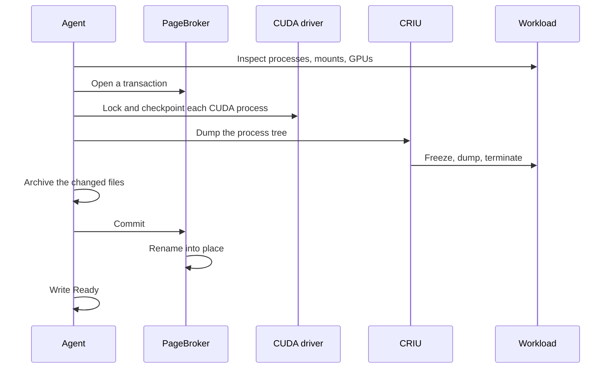
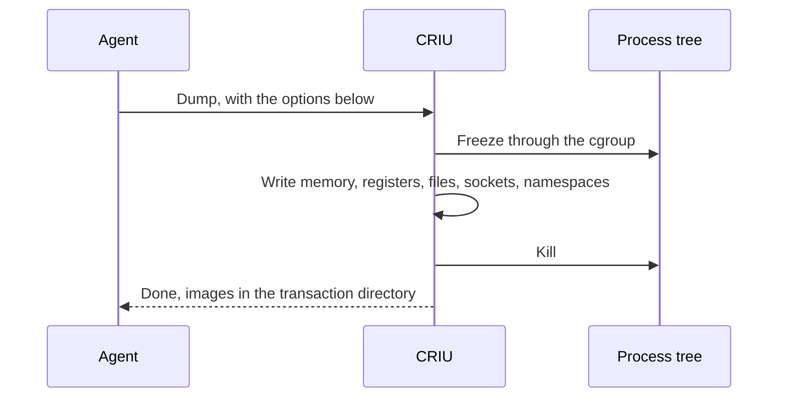

<!--
SPDX-FileCopyrightText: Copyright (c) 2026 NVIDIA CORPORATION & AFFILIATES. All rights reserved.
SPDX-License-Identifier: Apache-2.0
-->

# Checkpoint flow

<!-- toc -->
- [Before the capture starts](#before-the-capture-starts)
- [Inspect](#inspect)
  - [What CRIU does with each mount](#what-criu-does-with-each-mount)
- [Opening a transaction](#opening-a-transaction)
- [Suspending the GPU](#suspending-the-gpu)
- [Dumping](#dumping)
- [Archiving the changed files](#archiving-the-changed-files)
- [Publishing](#publishing)
- [When it fails](#when-it-fails)
- [Where multi-GPU differs](#where-multi-gpu-differs)
- [Reference: checks and failure reasons](#reference-checks-and-failure-reasons)
- [Invariants](#invariants)
<!-- /toc -->

This page follows one checkpoint from the moment a `PodSnapshotContent` reaches a node to the moment the checkpoint is published and reported `Ready`.
The [control plane](control-plane.md) page covers how the `PodSnapshotContent` gets there, and the [node agent](node-agent.md) page describes the processes that appear below.
To checkpoint a workload, follow [Checkpoint a replica](../../guides/checkpoint.md) instead.

On the node, a checkpoint has four parts, in this order:

1. **Inspect.** Look at the container and decide whether it can be captured. Nothing is changed.
2. **Suspend the GPU.** Lock every CUDA process and move its device memory off the GPU.
3. **Dump.** Have CRIU write the process tree to disk, which terminates it, then archive the files the container changed.
4. **Publish.** Rename the finished directory into place and report `Ready`.

A failure in the first part leaves the workload running.
A failure in any later part kills it, because a CUDA process that has been locked cannot be resumed.

When the driver supports CustomStorage, PageBroker calls the CUDA driver in the agent's place.

## Before the capture starts

The agent learns about the `PodSnapshotContent` through an informer filtered to its node name.
Before doing anything irreversible, it checks, in this order:

1. The `PodSnapshotContent`, re-read bypassing the cache, is for this node, is not being deleted, and has no final condition. Otherwise ignore it.
2. It names exactly one container, and the checkpoint's path on the shared volume is valid.
3. The source pod exists, and its UID is the one recorded in the `PodSnapshotContent`. The UID check keeps a same-named replacement pod from being captured in place of the original.
4. **The checkpoint does not already exist.** If it does, with a manifest naming this `PodSnapshotContent` and container, write `Ready` and stop. The dump kills the source and the agent writes `Ready` afterwards, so an agent that restarted in between finds a dead pod and a finished checkpoint. The directory exists only once PageBroker has renamed it into place, so its presence proves success. This check deliberately precedes any check that would fail the capture because the pod is gone.
5. This is the oldest in-progress `PodSnapshotContent` for the pod. Others wait, because the failure paths below kill containers.
6. No container in the pod has exited with a non-zero code. Otherwise fail, and kill the remaining containers.
7. The pod is not being deleted and has not reached a final phase.
8. If the source opted into [multi-GPU](multi-gpu.md), the annotation and the launcher on the container's command are valid.
9. Label the pod `nvidia.com/snapshot-capture-eligible=true`, so that the pod informer begins delivering its status changes.
10. The target container is Ready. Otherwise wait.
11. The container resolves to a host PID through the container runtime.

The agent never reads `ready-for-snapshot` itself.
The [workload contract](../workload-contract.md) has the workload write that sentinel once it is quiesced, and the pod's readiness probe turns the file into the Ready condition.
The agent therefore needs to know nothing about the workload.

The capture then runs with a deadline of `checkpointTimeoutSeconds`.

## Inspect

The capture begins by collecting everything the later steps need, without changing anything, in `inspectContainer` in `agent/internal/executor/checkpoint.go`:

- From the container runtime: the container's init PID, OCI spec, and image ID. The image ID lets restore refuse a destination built from a different image.
- From `/host/proc/<pid>`: the container's cgroup, which CRIU will freeze, and its mount table, classified as described below.
- The container's overlay upper directory, the layer holding every file the container changed since it started. A container whose root is not an overlay cannot be captured.
- The network namespace, which CRIU will treat as external, and the pipes behind file descriptors 0 to 2, so that restore can reconnect the process's output to the new container's log.
- The process tree, and which processes hold a CUDA context, by asking `cuda-checkpoint-helper` about each one. A CUDA process inside a further nested PID namespace is not supported.
- If there are CUDA processes: the GPUs the container can see, in CUDA's own order, which may differ from the order Kubernetes allocated them in. Discovery tries the container's `NVIDIA_VISIBLE_DEVICES`, then Dynamic Resource Allocation (DRA) claims, then the kubelet's PodResources API, then `nvidia-smi` inside the container. A GPU container with no CUDA process is captured as CPU-only.

### What CRIU does with each mount

CRIU must be told what to do with every mount in the container.
A mount can be **dumped**, so its contents go into the checkpoint, or **externalized**, so CRIU records that it was there and expects the restore side to provide it at the same path, or **skipped**.

| Mount | Policy | Why |
| --- | --- | --- |
| Submounts of `/proc`, `/sys`, `/run` not in the OCI spec | Skip | Virtual, or created by the runtime. A fresh container has its own. |
| `/dev/shm` | Dump | So that its contents survive. |
| Files the OCI spec masks | Externalize to `/dev/null` | The runtime masks them again. |
| Everything else | Externalize to itself | The runtime recreates the OCI mounts in the destination, and CRIU binds from there. |

The externalized mounts are recorded in the manifest.
At restore they become a compatibility check: a volume the source had must exist in the destination.

## Opening a transaction

Nothing is written to the shared volume directly.
The agent asks PageBroker for a **transaction**, a directory PageBroker hands out and later either publishes with a rename or deletes.
If anything below fails, a deferred abort deletes it.

Where the directory lives depends on how GPU memory will travel:

- **No CUDA processes, or no CustomStorage:** on the memory-backed volume the agent and PageBroker share. CRIU dumps there, and PageBroker copies the result to the shared volume on commit. The agent's memory limit therefore bounds the largest checkpoint a node can take, since the kernel charges those pages to the writing process.
- **CUDA processes with CustomStorage:** a temporary directory on the shared volume, next to the final location. GPU memory is too large to stage in memory.

Once the transaction is open, three more steps run, still without touching the workload:

1. For [multi-GPU](multi-gpu.md) sources, hash the CuInterpose libraries in every CUDA process and run the coordinator in inspect mode.
2. Without CustomStorage, copy the `cuda-checkpoint-job` file from the control directory into the transaction. A capture of more than one GPU without that file and without a CuInterpose coordinator is refused.
3. Write `manifest.yaml` into the transaction directory: everything about the source that a restore will need. It is written before the dump so that it is complete no matter how the dump ends. [Storage and artifacts](storage.md#the-manifest) lists its contents.

## Suspending the GPU

CRIU cannot see device memory, so GPU state is brought to the CPU side before CRIU runs.
This is the first destructive step: from here on, any failure makes the agent kill the source container.

1. With a CuInterpose coordinator, run its prepare step. It unmaps the memory the processes share and writes `cuinterpose.state`.
2. Then, one of:
   - **With CustomStorage:** send PageBroker one request naming every CUDA process. PageBroker locks each, checkpoints it, and streams its device memory into `gpu/<pid>/` files in the transaction directory.
   - **Without CustomStorage:** run `cuda-checkpoint-helper` to lock every CUDA process, then to checkpoint every one. The driver copies each process's device memory into that process's host memory, where CRIU will find it. If a `cuda-checkpoint-job` file is in use, copy it into the transaction again afterwards, because the driver rewrites it during the operation.

## Dumping

The agent runs CRIU as a child process with the transaction directory as its image directory, and asks it to dump the container's init process and everything under it.

There is no mode that leaves the source running.
A CUDA process that has been checkpointed cannot resume, and the control plane treats the source's death as the normal outcome.

The options a contributor is most likely to ask about:

| Option | Value | Why |
| --- | --- | --- |
| `root` | `/host/proc/<pid>/root` | Paths resolve inside the container's mount namespace. |
| `external` | the network namespace | Never dumped. Restore inherits the destination pod's namespace. |
| `ext_mnt`, `skip_mnt` | from the mount policy above | |
| `freeze_cgroup` | the container's cgroup | Freeze the whole tree in one step. |
| `manage_cgroups` | `soft` | At restore, CRIU places the tree under the destination container's cgroup. |
| `tcp_established` | on by default | Keep established connections. Restore rewrites their addresses. |
| `ghost_limit` | 512 MiB by default | A file deleted while a process still had it open is saved in the image, up to this size. |
| Plugin directory | Snapshot's own | So that CRIU's bundled CUDA plugin is never loaded. |

CRIU writes `dump.log` next to the images.
On failure the agent logs the tail of it, which matters because the transaction, log included, is deleted when it aborts.

## Archiving the changed files

CRIU restores an open file by reopening its path, so every file the container created or modified must exist in the destination before CRIU runs there.
The destination starts from the same image, which restore enforces by comparing digests, so only the container's own changes travel.

1. Decode CRIU's image files to find every regular file the dumped processes hold open or mapped.
2. Archive the overlay upper directory into `rootfs-diff.tar`, leaving out the paths in `config.overlay.exclusions`, the destinations of bind mounts, and `trusted.*` extended attributes. Overlay's opaque-directory markers would otherwise hide base image content when replayed.
3. Add the files from step 1 to the archive even when an exclusion matched them. A file CRIU will reopen must be there.
4. Record files the container deleted from its image in `deleted-files.json`.

A failure in step 1, or a file from step 1 missing from the archive, fails the checkpoint.
Any other problem is logged and the checkpoint proceeds without that part.

## Publishing

1. The agent asks PageBroker to commit.
2. For a transaction on the memory-backed volume, PageBroker copies it to the shared volume next to the final location. For one already on the shared volume, nothing is copied.
3. If an older checkpoint exists at the destination, PageBroker moves it aside.
4. PageBroker renames the new directory into place. This is the commit point: before it the destination path does not exist, after it the checkpoint is complete.
5. PageBroker removes the older checkpoint, if any.
6. The agent confirms the directory exists.
7. The agent patches the `PodSnapshotContent` with `Ready=True`, reason `Captured`, and a `status.source` block describing the source machine, projected from the manifest. The patch uses optimistic locking, and a `Failed` condition that got there first wins.

The agent logs a timing summary with the phases `gpu_device_map`, `cuda_checkpoint`, `criu_dump`, `overlay_capture`, and `remove_old_version_and_switch`, the last being the commit.

## When it fails

A failure is final.
The agent writes `Failed` with a reason, and nothing retries.
A new capture needs a new `PodSnapshot`.
The [capture retry proposal](../../proposals/394-capture-retry/README.md) describes in-place retry, which is not implemented.

| Failure point | Source process | Transaction |
| --- | --- | --- |
| Anything before the first GPU lock | Keeps running | Aborted |
| CuInterpose prepare, GPU lock or checkpoint, CRIU dump, archiving | Killed | Aborted |
| Commit | Already dead from the dump | Aborted |
| Directory missing after commit | Killed | Treated as failure |

The kill is a `SIGKILL` of the container's init process.
When a container exit rather than the dump ends the capture, the agent also emits a `CheckpointFailed` warning event on the pod.

The capture deadline is a Go context.
The CRIU dump and the `tar` invocation do not take one, so a hung dump runs until CRIU gives up, and the deadline then fails the commit that follows.

## Where multi-GPU differs

A CuInterpose capture adds these steps and nothing else:

- The annotation and launcher are validated before the capture starts.
- The libraries are hashed and the coordinator inspects shared memory after the transaction opens.
- The coordinator prepares shared memory before the first GPU lock, writing `cuinterpose.state`.
- The coordinator's sockets under `/tmp` are left out of the archive.
- A coordinator satisfies the multi-GPU rule that otherwise requires a `cuda-checkpoint-job` file.

[Multi-GPU support](multi-gpu.md#capture) explains what inspect and prepare do.

## Reference: checks and failure reasons

Each reason the agent can write on a `PodSnapshotContent`, and the check that produces it.
The operator copies the reason onto the `PodSnapshot`.

| Reason | Produced when |
| --- | --- |
| `MissingContentUID`, `InvalidTargetContainer`, `InvalidDestination` | The `PodSnapshotContent` has no UID, does not name exactly one container, or its checkpoint path is invalid. |
| `SourcePodNotFound` | The pod does not exist and no checkpoint exists either. |
| `StalePodReference` | The pod's UID is not the one recorded in the `PodSnapshotContent`. |
| `CheckpointContainerFailed` | A container in the pod exited with a non-zero code before the capture. |
| `SourcePodGone` | The pod is being deleted, or reached `Succeeded` or `Failed`, before the capture. |
| `CuInterposeMisconfigured` | The multi-GPU annotation is invalid or the launcher is not on the container's command. |
| `ContainerNotResolved` | The container runtime could not resolve the container to a process. |
| `CheckpointFailed` | Anything in the capture itself. The message carries the error. |

## Invariants

- Nothing destructive happens until every check that can run without side effects has passed.
- The source is never resumed. Any failure after the first GPU lock kills it.
- GPU state is brought to the CPU side before CRIU runs, by the helper or by PageBroker, and CRIU's own CUDA plugin is never loaded.
- The manifest is written before the dump, and the checkpoint directory exists only after the commit rename. Its presence proves success.
- Only the oldest in-progress `PodSnapshotContent` for a pod may act on it.
- `Failed` is permanent, written under optimistic locking, and never retried.
- GPUs are recorded in CUDA's order with their UUIDs and device paths, so that restore can map them onto other GPUs.
- A value about the host that cannot be read is recorded as unknown, never treated as a failure.
