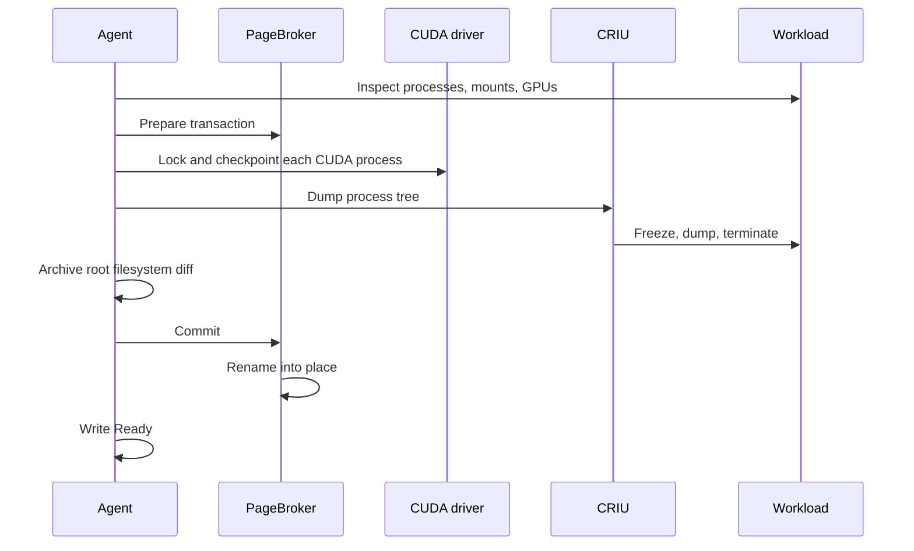

<!--
SPDX-FileCopyrightText: Copyright (c) 2026 NVIDIA CORPORATION & AFFILIATES. All rights reserved.
SPDX-License-Identifier: Apache-2.0
-->

# Checkpoint flow

<!-- toc -->
- [From PodSnapshot to work order](#from-podsnapshot-to-work-order)
- [Preconditions on the node](#preconditions-on-the-node)
- [Inspect](#inspect)
  - [Mount policy](#mount-policy)
- [Transaction](#transaction)
- [Suspend](#suspend)
- [Dump](#dump)
- [Root filesystem diff](#root-filesystem-diff)
- [Publish](#publish)
- [Failure behavior](#failure-behavior)
- [Failure reasons](#failure-reasons)
- [Multi-GPU hooks](#multi-gpu-hooks)
- [Invariants](#invariants)
<!-- /toc -->

This page is for contributors.
It follows one checkpoint from a `PodSnapshot` to a committed artifact and a `Ready` condition.
The [control plane](control-plane.md) page covers how the work order reaches the node, and the [node agent](node-agent.md) page describes the processes involved.
To checkpoint a workload, follow [Checkpoint a replica](../../guides/checkpoint.md) instead.

A checkpoint has four parts, performed on the node in this order:

1. **Inspect** the container and decide whether it can be captured. Nothing is changed.
2. **Suspend** GPU state. Every CUDA process is locked and its device memory is moved off the GPU.
3. **Dump** the process tree with CRIU, which terminates it, then archive the container's root filesystem changes.
4. **Publish** the result with an atomic rename, and report `Ready`.

Anything that fails in the first part leaves the workload running.
Anything that fails later kills it.

With CustomStorage, PageBroker calls the CUDA driver in the agent's place.

## From PodSnapshot to work order

The operator reads the source pod's `spec.nodeName`, creates a `PodSnapshotContent` labelled with it, and records the binding on the `PodSnapshot`.
The agent on that node sees the content through a label-filtered informer and queues it.
[Control plane](control-plane.md#binding) covers the binding rules.

## Preconditions on the node

`reconcileCapture` in `agent/internal/controller/podsnapshotcontent.go` runs every time the content or its source pod changes, and on a ten second resync.
It checks, in order:

| Check | On failure |
| --- | --- |
| The content is for this node, is not deleting, and has no terminal condition | Ignore |
| The content has a UID and exactly one target container, and the artifact path resolves | `Failed` with `MissingContentUID`, `InvalidTargetContainer`, or `InvalidDestination` |
| The source pod exists | `Failed` with `SourcePodNotFound`, unless the artifact is already present, which means `Ready` |
| The pod UID matches `spec.source.podRef.uid` | `Failed` with `StalePodReference` |
| **The artifact is already present** with a matching manifest | `Ready` |
| This content is the oldest non-terminal content for the pod | Wait |
| No container in the pod has exited with a non-zero code | `Failed` with `CheckpointContainerFailed`, and the remaining containers are killed |
| The pod is not deleting, `Succeeded`, or `Failed` | `Failed` with `SourcePodGone` |
| The `nvidia.com/snapshot-multi-gpu` annotation, if present, is valid and the launcher prefix is in place | `Failed` with `CuInterposeMisconfigured` |
| The target container is Ready | Wait |
| The container resolves to a host PID through the runtime | `Failed` with `ContainerNotResolved` |

The artifact check comes before the liveness checks on purpose.
The dump kills the source, so a dead pod with a committed artifact is a success whose `Ready` write has not happened yet, for example because the agent restarted in between.
The artifact directory exists only after PageBroker's atomic rename, which is what makes its presence a safe commit marker.

The agent never reads `ready-for-snapshot` itself.
The [workload contract](../workload-contract.md) has the workload write that sentinel once it is quiesced, and the source pod's readiness probe gates on the file.
The agent waits for the container's `Ready` status, which closes the loop without the agent having to know anything about the workload.

Before it waits for readiness, the agent labels the pod `nvidia.com/snapshot-capture-eligible=true`.
Its source pod informer selects on that label, so from then on the pod's own status changes wake the capture instead of the ten second resync.
Once the container is Ready and resolved, the agent calls the executor with a context bounded by `checkpointTimeoutSeconds`.

## Inspect

`inspectContainer` in `agent/internal/executor/checkpoint.go` collects everything the later steps need, without changing anything:

- The container's host PID and OCI spec, from the runtime.
- Its image ID, for the compatibility checks at restore. An unreadable image ID is recorded as unknown.
- Its cgroup v2 path, so CRIU can freeze it.
- Its overlay upper directory, parsed from the `/` mount's superblock options. A container whose root is not an overlay cannot be captured.
- Its mount table, classified against the OCI spec into the CRIU mount policy below.
- Its network namespace, which CRIU is told to treat as external, and the pipes behind file descriptors 0 to 2, so restore can reconnect the process's output to the new container's log.
- Its process tree, walked through `/proc/<pid>/task/*/children`.
- Which of those processes are CUDA processes, by asking `cuda-checkpoint-helper --get-restore-tid` about each one. A CUDA process inside a further nested PID namespace is not supported.
- If there are CUDA processes, the GPUs the container can see, in CUDA ordinal order, and the `/dev/nvidiaN` path for each UUID. A GPU container with no CUDA process is captured as CPU-only.

GPU discovery tries the OCI environment's `NVIDIA_VISIBLE_DEVICES`, then Dynamic Resource Allocation claims, then the kubelet PodResources API, then `nvidia-smi` inside the container.
A container that references resource claims fails closed if the claims cannot be resolved.

### Mount policy

CRIU must know what to do with every mount in the container.
`BuildMountPolicy` in `agent/internal/runtime/mounts.go` decides:

| Mount | Policy | Reason |
| --- | --- | --- |
| Submounts of `/proc`, `/sys`, `/run` not in the OCI spec | Skip | Virtual, or created by the runtime, and absent in a fresh container |
| `/dev/shm` | Native | Dumped by CRIU, so its contents survive |
| OCI masked files that exist | External, mapped to `/dev/null` | The runtime masks them again on restore |
| Everything else | External, mapped to itself | The runtime recreates OCI mounts in the destination, and CRIU binds from there |

The keys of the external mount map are recorded in the manifest and become the `mount` compatibility check at restore: a volume the source had must also exist in the destination.

## Transaction

A PageBroker transaction is a directory that PageBroker hands out and later either publishes or deletes.
The executor opens one before anything destructive happens, and a deferred abort discards it if the function returns an error.

| Capture kind | Request | Where CRIU writes |
| --- | --- | --- |
| No CUDA processes, or the driver lacks CustomStorage | `prepare_staged_checkpoint` | A directory on the staging volume, a memory-backed `emptyDir` shared by the agent and PageBroker containers |
| CUDA processes with CustomStorage | `prepare_direct_checkpoint` | A temporary directory beside the destination on the shared volume |

Whether CustomStorage is used was decided once at agent startup from PageBroker's capabilities.
In the staged case the agent's memory limit bounds the largest checkpoint, because the kernel charges the staging pages to the writer.
[Storage](../../operations/storage.md#pagebroker-staging) covers sizing.

After the transaction is open, two more non-destructive checks run.
If the source opted into [multi-GPU](multi-gpu.md), the CuInterpose libraries are hashed in every CUDA process and the coordinator runs `--inspect`.
Without CustomStorage, a CUDA capture stages the `cuda-checkpoint-job` file from the control directory, and a capture of more than one GPU without that file and without a CuInterpose coordinator is refused.

Then the agent builds the CRIU dump options and writes `manifest.yaml` into the transaction directory.
The manifest is written before the dump so that it is complete whatever happens next.
[Storage and artifacts](storage.md#the-manifest) lists its contents.

## Suspend

GPU state must be quiesced before CRIU runs, because CRIU cannot see device memory.
`captureGPU` runs:

1. With a CuInterpose coordinator, `cuinterpose-coordinator --prepare`, which unmaps shared memory and writes `cuinterpose.state`.
2. **CustomStorage:** one `checkpoint_gpu` request to PageBroker with a pidfd for every CUDA process. PageBroker locks each process, checkpoints it, and streams its device memory into `gpu/<pid>/` files in the transaction directory.
3. **Otherwise:** `cuda-checkpoint-helper --action lock` for every CUDA process, then `--action checkpoint` for every CUDA process. Device memory is copied into the process's host memory, where CRIU will dump it. If a job file is in use, it is copied into the artifact again after the last checkpoint, because the driver rewrites it during the operation.

From this point on, any error is wrapped so that the controller kills the source container.
A locked CUDA process cannot be resumed.

## Dump

`criu.ExecuteDump` runs CRIU in service worker mode as a child of the agent, with the transaction directory as its image directory.
The important options:

| Option | Value | Why |
| --- | --- | --- |
| `leave_running` | always false | The dump terminates the source. There is no mode that resumes it. |
| `root` | `/host/proc/<pid>/root` | Paths resolve in the container's mount namespace. |
| `external` | the network namespace | Always externalized. Restore inherits the destination pod's namespace. |
| `ext_mnt`, `skip_mnt` | from the mount policy | See above. |
| `freeze_cgroup` | the container's cgroup | Freeze the whole tree at once. |
| `manage_cgroups` | `soft` by default | At restore, CRIU places the tree under the destination container's cgroup root. |
| `tcp_established` | on by default | Keep established connections. Restore rewrites their addresses. |
| `ghost_limit` | 512 MiB by default | Deleted-but-open files up to this size are stored in the image. |
| Plugin directory | the dedicated Snapshot directory | CRIU's own CUDA plugin must not load. |

CRIU writes `dump.log` next to the images.
On failure the agent logs the tail of it, which matters because the transaction directory, log included, is deleted when the transaction aborts.

CRIU freezes the tree, dumps it, and kills it.
The container exits, the pod reports a failed container, and the `SnapshotJob` reconciler treats that exit as the expected outcome.

## Root filesystem diff

CRIU restores file descriptors by reopening paths, so files the source created or modified must exist in the destination.
The destination starts from the same image, which the `image-digest` check enforces, so only the container's own writes need to travel.

`captureOverlay` archives the overlay upper directory into `rootfs-diff.tar`, excluding `config.overlay.exclusions` and the destinations of bind mounts, and leaving out `trusted.*` extended attributes because overlay opaque markers would hide base image content when replayed.
Before archiving, the agent decodes CRIU's own images to find every regular file the dumped processes hold open or mapped.
Those files are appended to the archive even when an exclusion matches them, since CRIU will fail to reopen them otherwise.
Whiteout entries in the upper directory are recorded in `deleted-files.json`.

A failure to read CRIU's referenced files, or a referenced file missing from the archive, fails the checkpoint.
Other diff problems are logged and the checkpoint proceeds without that part of the diff.

## Publish

`commit` asks PageBroker to publish.
For a staged capture it copies the staging directory to a sibling of the destination and renames it into place.
For a direct capture it renames the temporary directory into place.
If a previous artifact exists at the destination it is moved aside first and removed afterwards.
The rename is the commit point: before it, the destination path does not exist, and after it, the artifact is complete.

Back in the controller, `executorCheckpoint` verifies that the artifact directory exists, then `markCheckpointReady` patches the content's status with `Ready=True`, reason `Captured`, and the `status.source` block projected from the manifest.
The patch uses an optimistic lock and retries a handful of conflicts.
If a `Failed` condition arrived first it wins.
A content that reaches `Ready` emits no event.

The agent logs a timing summary with these phases: `gpu_device_map`, `cuda_checkpoint`, `criu_dump`, `overlay_capture`, and `remove_old_version_and_switch`, which is the publish step.

## Failure behavior

Failure is terminal.
`Failed` is written with a reason, the queue forgets the key, and nothing retries.
A new capture needs a new `PodSnapshot`.

What happens to the source depends on where the failure occurred:

| Failure point | Source process | Transaction |
| --- | --- | --- |
| Preconditions, inspect, transaction prepare, CuInterpose inspect, job file, manifest | Keeps running | Aborted |
| CuInterpose prepare, GPU lock or checkpoint, CRIU dump, diff | Killed with `SIGKILL` | Aborted |
| Commit | Killed, since the dump already terminated it | Aborted |
| Artifact missing after commit | Killed | Already committed, treated as failure |

The kill is a `SIGKILL` of the container's init PID.
When a container exit, not the dump, ends the capture, the agent emits a `CheckpointFailed` warning event on the pod and writes `CheckpointContainerFailed` on the content.

Only operations that take a context observe `checkpointTimeoutSeconds`.
The CRIU dump and the `tar` invocation do not, so a hung dump runs until CRIU gives up, and the timeout then fails the commit that follows.

The [capture retry proposal](../../proposals/394-capture-retry/README.md) describes in-place retry, which would repeat only the part that failed.
It is not implemented.

## Failure reasons

Reasons the agent writes on the `PodSnapshotContent`, which the operator mirrors onto the `PodSnapshot`:

| Reason | Meaning |
| --- | --- |
| `MissingContentUID`, `InvalidTargetContainer`, `InvalidDestination` | The work order itself is malformed. |
| `SourcePodNotFound` | The pod is gone and no artifact exists. |
| `StalePodReference` | The pod is a different incarnation from the one the content names. |
| `CheckpointContainerFailed` | A container in the pod exited with a non-zero code before the capture. |
| `SourcePodGone` | The pod was deleted or reached a terminal phase before the capture. |
| `CuInterposeMisconfigured` | The multi-GPU annotation or launcher is wrong. |
| `ContainerNotResolved` | The runtime could not resolve the container to a process. |
| `CheckpointFailed` | Anything in the executor. The message carries the error. |

## Multi-GPU hooks

Where a CuInterpose capture differs from a single-GPU one:

- The precondition check validates the `nvidia.com/snapshot-multi-gpu` annotation and the launcher prefix.
- Inspect hashes the libraries and runs the coordinator's `--inspect`.
- The job file rule accepts a coordinator in place of a `cuda-checkpoint-job` file.
- `--prepare` runs before the first GPU lock and writes `cuinterpose.state`.
- The coordinator sockets under `/tmp` are excluded from the root filesystem diff.

[Multi-GPU support](multi-gpu.md#capture) explains what the coordinator does in those phases.

## Invariants

- Non-destructive steps precede destructive ones. Inspect, prepare, CuInterpose inspect, and the job file check all run before the first GPU lock.
- The source is never resumed. `leave_running` is always false, and any failure after the first destructive step kills the source.
- GPU state is quiesced before CRIU, by the helper or by PageBroker, and CRIU's own CUDA plugin is never loaded.
- The manifest is written before the dump, and the artifact directory exists only after the commit rename.
- Only the oldest non-terminal content may act on a pod, because the failure paths kill containers.
- `Failed` is sticky, written under an optimistic lock, and never retried.
- GPUs are recorded in CUDA ordinal order with their UUIDs and device paths, so restore can map them.
- Host values that cannot be read are recorded as unknown, never as a failure.
