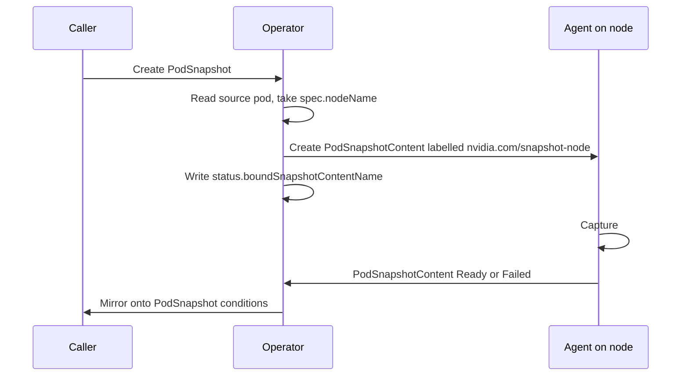
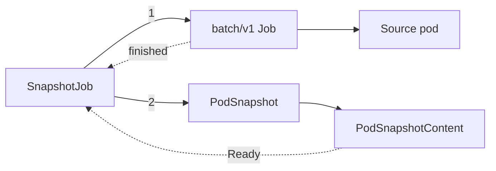

<!--
SPDX-FileCopyrightText: Copyright (c) 2026 NVIDIA CORPORATION & AFFILIATES. All rights reserved.
SPDX-License-Identifier: Apache-2.0
-->

# Control plane

<!-- toc -->
- [Process and configuration](#process-and-configuration)
- [PodSnapshot and PodSnapshotContent](#podsnapshot-and-podsnapshotcontent)
  - [Binding](#binding)
  - [Mirroring](#mirroring)
  - [Deletion](#deletion)
- [SnapshotJob](#snapshotjob)
  - [Shaping the source pod](#shaping-the-source-pod)
  - [Creating the PodSnapshot](#creating-the-podsnapshot)
  - [Completion](#completion)
- [Artifact cleanup](#artifact-cleanup)
- [CRD installation](#crd-installation)
- [snapshotctl](#snapshotctl)
- [Failure reasons](#failure-reasons)
- [Shared contracts in the api module](#shared-contracts-in-the-api-module)
- [Invariants](#invariants)
<!-- /toc -->

This page is for contributors.
It describes the operator in the `operator/` module and the parts of the `api/` module it depends on.
The [overview](README.md) places the operator among the other components.

The operator is a single controller-runtime manager.
It owns the Kubernetes side of a checkpoint: it decides which node captures what, publishes the result, runs the `SnapshotJob` workflow, and deletes artifacts.
It never touches CRIU, CUDA, or a workload process.
It also plays no part in restore, which the [node agent](node-agent.md) handles from pod annotations alone.

## Process and configuration

The manager binary is `operator/cmd/manager`.
It starts these components on one manager with leader election, so a second replica stands by without acting:

| Component | Source | Watches |
| --- | --- | --- |
| `PodSnapshotReconciler` | `operator/internal/controller/podsnapshot_reconciler.go` | `PodSnapshot`, `PodSnapshotContent`, and pods |
| `SnapshotJobReconciler` | `operator/internal/controller/snapshotjob_reconciler.go` | `SnapshotJob`, Jobs, and `PodSnapshot` |
| Artifact cleanup controller | `operator/internal/controller/snapshotcontent_reconciler.go` | `PodSnapshotContent` |
| Maintenance queue | `operator/internal/maintenance` | A timer and the controller above |

The operator has no admission webhooks.
Validation lives in the CRD schemas as CEL rules, and the reconcilers re-check the same rules defensively.

All configuration arrives as flags, rendered by the Helm chart into the Deployment:

| Flag | Purpose |
| --- | --- |
| `--snapshot-storage-config` | The resolved storage identity file, `storage.yaml`, which the chart also mounts into PageBroker. The operator derives the store ID from it. |
| `--snapshot-storage-base-path` | Where the shared volume is mounted in the operator pod, `/checkpoints`. |
| `--artifact-cleanup-*` | Sweep interval, batch size, worker count, list attempts, and per-task timeout for maintenance. |
| `--cuinterpose-image` and `--cuinterpose-image-pull-policy` | The image whose CuInterpose payload a `SnapshotJob` installs into a multi-GPU source pod. The chart passes the agent image. |

The manager runs as root with all capabilities dropped.
Root is needed only so maintenance can delete CRIU image files that the privileged agent wrote.

## PodSnapshot and PodSnapshotContent

`PodSnapshotContent` is the work order.
It is cluster scoped, named after the `PodSnapshot` UID, and labelled with the node that must perform the capture.
The agent on that node selects it by label, and the operator never writes its status.

### Binding

The reconciler adds the `nvidia.com/podsnapshotcontent-cleanup` finalizer, then reads the source pod from its cache.

- A pod with no `spec.nodeName` is not yet schedulable work. The reconcile returns an error and retries with backoff until the pod lands.
- A missing pod fails the `PodSnapshot` with reason `SourcePodNotFound`.
- If the `PodSnapshot` pins `podRef.uid` and the live pod's UID differs, the reason is `StalePodReference`. The pin exists so that a same-named replacement pod is never captured in place of the one the caller meant.

The content is built with the pod's node name in both `spec.source.nodeName` and the `nvidia.com/snapshot-node` label, the live pod UID in `spec.source.podRef.uid`, a back reference to the `PodSnapshot` including its UID, and the artifact cleanup finalizer.
Its name is `podsnapshotcontent-<PodSnapshot UID>`.
The UID-derived name follows the convention Kubernetes uses for a cluster-scoped object bound to a namespaced one, and it makes a retried create reach the same object instead of a duplicate.

The create is unconditional.
If the object already exists, which happens when the operator crashed between the create and the status write, the reconciler adopts it only when its back reference names this `PodSnapshot` with a matching, non-empty UID.
Anything else is `ContentConflict`.
Binding is the single status write of `boundSnapshotContentName`.

### Mirroring

Once bound, the reconciler copies the content's `Ready` or `Failed` condition onto the `PodSnapshot`, reason and message included.
Success reasons therefore come from the agent.
`Ready` is not treated as terminal, so the `PodSnapshot` keeps following the content.
`Failed` is terminal and sticky.

While the content is still pending, the reconciler watches the source pod.
A pod that is gone or terminal while the content is pending is suspicious but not conclusive, because a successful dump kills the source before the agent writes `Ready`.
The reconciler therefore re-reads the pod and then the content through an uncached client, in that order, since the agent persists `Ready` before the source dies.
If the content is still pending it classifies the pod:

| Pod state | `PodSnapshot` reason |
| --- | --- |
| UID differs from the pinned one | `StalePodReference` |
| Phase `Succeeded` | `SourceCompletedWithoutCapture` |
| Phase `Failed`, or being deleted | `SourcePodGone`, after a five minute grace |

The five minute grace, counted from the newest container finish time, is the backstop for an agent that never publishes a result.
It is the only time-based failure the operator applies to a capture.

### Deletion

Deleting a `PodSnapshot` deletes the bound content, polls until it is gone, and only then removes the `PodSnapshot` finalizer.
The content carries the artifact cleanup finalizer, so the chain is: delete `PodSnapshot`, delete content, maintenance deletes the artifact, content disappears, `PodSnapshot` disappears.
A `PodSnapshot` whose artifact cannot be deleted therefore stays in `Terminating`.

## SnapshotJob

`SnapshotJob` wraps the whole capture in one declarative object for callers that cannot track a running pod themselves.
Its reconciler is in `operator/internal/controller/snapshotjob_*.go`.

Each condition has one source of truth.
`Captured` comes only from the `PodSnapshot`.
Workload completion and failure come only from the Job.
The source pod is read for identity and for helper container exit codes, never to infer a capture result.
Every reconcile derives the complete status from those observations and patches it once.

### Shaping the source pod

The reconciler builds a Job from `spec.podTemplate` through `operator/internal/protocol`, the package that holds the operator's pod mutators.
The names it uses, such as the volume, mount path, environment variables, and sentinel files, come from `api/podcontract`, so the operator and the agent share one vocabulary.
The Job gets:

- `restartPolicy: Never` and `backoffLimit: 0`, so the pod is never recreated.
- The pod-level seccomp profile `profiles/block-iouring.json`.
- Sidecar injection disabled for Linkerd and Istio.
- On the target container: the `snapshot-control` `emptyDir` mounted with `subPath` equal to the container name, `SNAPSHOT_CONTROL_DIR` and its deprecated alias, and a readiness probe that runs `cat /snapshot-control/ready-for-snapshot` every second. Any liveness or startup probe on the target is removed.
- `activeDeadlineSeconds` from the spec, default one hour.

When the template carries `nvidia.com/snapshot-multi-gpu: enabled`, the reconciler also prepends the CuInterpose launcher to the target command and adds an init container that copies the CuInterpose libraries from the configured image into an `emptyDir`.
[Multi-GPU support](multi-gpu.md#kubernetes-opt-in) describes that shape.

The reconciler records the Job UID before it creates anything else.
If the Job later disappears or is replaced, the `SnapshotJob` fails with `JobDeleted` or `JobNameConflict`.
A `SnapshotJob` never runs its workload twice.

### Creating the PodSnapshot

As soon as the Job controls exactly one pod, the reconciler creates a `PodSnapshot` named after the `SnapshotJob`, with the pod's name and UID pinned.
It does not wait for the pod to be scheduled or ready.
The `PodSnapshot` reconciler waits for a node, and the agent waits for container readiness, so the gating happens downstream.

The `PodSnapshot` has no owner reference to the `SnapshotJob`.
The artifact is meant to outlive the job that produced it, so deleting a `SnapshotJob` leaves the `PodSnapshot` in place.
The `nvidia.com/snapshot-job` and `nvidia.com/snapshot-job-uid` labels record the relationship instead.

### Completion

Completion is a two-stage gate.
A `Ready` `PodSnapshot` sets `Captured=True`.
The reconciler then waits for the Job to finish before it sets `Completed=True` and deletes the Job.

The dump kills the target container, so after every successful capture the Job reports `Failed`.
The reconciler treats that as success once it has confirmed that every helper container in the template exited with code zero.
Native sidecars, init containers with `restartPolicy: Always`, only need to have stopped.
Helpers that are still running are left alone, since deleting the Job would kill them mid-work.

A `SnapshotJob` fails on a failed capture, on `DeadlineExceeded`, or on a Job that failed before any `PodSnapshot` existed.
A pending capture is never failed on the Job's word alone.
The five minute grace in the `PodSnapshot` reconciler bounds that wait.
A failed `SnapshotJob` keeps its Job for debugging.

## Artifact cleanup

Cleanup runs inside the operator as a rate-limited work queue with a bounded worker pool, in `operator/internal/maintenance`.
There are no per-task Jobs.
The queue is leader elected along with the rest of the manager.

Two things produce work:

- **Content deletion.** The cleanup controller adds the `nvidia.com/podsnapshotcontent-artifact-cleanup` finalizer to any content that lacks it, and enqueues a `delete-content` item when a content with the finalizer starts deleting.
- **A periodic sweep**, at startup and every scan interval. It also re-enqueues every deleting content that still carries the finalizer, which is how a dropped or repeatedly failed delete recovers.

A `delete-content` item removes the artifact root for that content UID and then removes the finalizer.
It is idempotent: a content that is gone, not deleting, or already cleaned is a no-op.
A content whose `spec.storage` names a different store than the operator's is refused, so a missing artifact on some other volume never counts as a completed cleanup.

A sweep enumerates artifact roots first, then lists every `PodSnapshotContent` through an uncached, paged, consistent list.
Enumerating first means a content created between the two steps is never mistaken for an orphan.
A root whose directory name is not the UID of any existing content is an orphan, and at most one batch of orphans is removed per sweep.

The backend interface has `Delete` and `Candidates`.
The PVC backend works on `<basePath>/artifacts/<contentUID>` through the same `agent/pkg/artifact` package the agent writes with, so the two cannot disagree about the layout.
It refuses to delete anything that is a symlink or not a directory, and it skips unsafe entries rather than removing them.
An S3 backend exists in the tree for the [S3 proposal](../../proposals/237-s3-storage/README.md), but the manager has no flags to configure it yet.

## CRD installation

The three CRDs are generated by `controller-gen` from the Go types in `api/v1alpha1` and embedded into the `api` module.
A copy is mirrored into `charts/snapshot/crds` so Helm installs them on a fresh release, and `make verify-crds` fails when the two drift.

Helm never upgrades CRDs.
The operator Deployment therefore runs `crd-installer` as an init container.
It server-side applies every embedded CRD with a fixed field manager and forced ownership, then waits for each to report `Established`.
Any failure stops the pod, on purpose: an operator running against outdated definitions is worse than one that has not started.
Because the installer and the manager come from the same image, a rollout converges the cluster on the definitions the running binary expects.

There is no conversion webhook and only one API version, `v1alpha1`.

## snapshotctl

`operator/cmd/snapshotctl` is a manual and debugging CLI with two commands.
`checkpoint` builds a source Job through the same `protocol.NewSourceJob` the `SnapshotJob` reconciler uses, creates a `PodSnapshot` for its pod, and waits for `Ready`.
`restore` builds a restore pod through `podcontract.Build` and creates it.
It bypasses `SnapshotJob`, so it gets none of its completion gating, and it is not part of any image or release.
The [CLI reference](../cli.md) documents its use.

## Failure reasons

Reasons the operator itself originates on a `PodSnapshot`:

| Reason | Meaning |
| --- | --- |
| `SourcePodNotFound` | The named pod does not exist in the namespace. |
| `StalePodReference` | The pinned pod UID does not match the live pod. |
| `ContentConflict` | A `PodSnapshotContent` with the expected name exists but does not point back at this `PodSnapshot`. |
| `SourcePodGone` | The source pod failed or was deleted while the capture was pending, and the grace period passed. |
| `SourceCompletedWithoutCapture` | The source pod exited successfully before any capture. |

Every other reason is mirrored from the agent.
Those are listed under [Checkpoint flow](checkpoint.md#failure-reasons).
`SnapshotJob` folds `ContentConflict`, `SourcePodNotFound`, and `StalePodReference` into `PodSnapshotFailed`, and every agent reason into `CaptureFailed`.

## Shared contracts in the api module

The `api` module is what external integrators and both binaries import.

| Package | Contents | Who uses it |
| --- | --- | --- |
| `api/v1alpha1` | The CRD types, conditions, reasons, and the embedded CRD manifests. | Operator, agent, integrators |
| `api/podcontract` | The restore pod builder and validator, the control volume and sentinel names, the restore annotations, and the `nvidia.com/Restored` condition classifier. | Operator, agent, integrators |
| `api/compat` | The compatibility rules a restore target must pass. | Agent only, but the check names are published on pod events, so they live here |
| `api/storage` | The store identity hash, the artifact identity triple, and the process-local lock maintenance takes per artifact. | Operator |

`podcontract.Build` is the intended entry point for a controller that restores pods.
It is a pure transformation that returns a deep copy, rejects conflicting annotations and mounts instead of overwriting them, and is idempotent.
`podcontract.ClassifyRestoreOutcome` turns the `nvidia.com/Restored` condition into `Pending`, `Succeeded`, `Failed`, `PartiallySucceeded`, or `Unknown` without importing the CRD types.

## Invariants

- Every spec is immutable, enforced by CEL.
- A `PodSnapshotContent` is one-to-one with a `PodSnapshot` incarnation. Its name is derived from the `PodSnapshot` UID, and adoption requires a matching back reference UID.
- The capture node is fixed when the content is created, from the live pod's `spec.nodeName`. The operator does no scheduling.
- Irreversible decisions use uncached reads. Pending capture failure re-reads the pod and then the content. `SnapshotJob` confirms absence and helper state the same way.
- `Failed` is sticky on every resource. `Ready` on a `PodSnapshot` keeps mirroring.
- Artifacts outlive their producers. Nothing owns a `PodSnapshot` from above, and cleanup is tied to the content finalizer rather than to any controller's lifetime.
- The operator and the agent communicate only through the Kubernetes API. Spec and labels flow down, status flows up.
