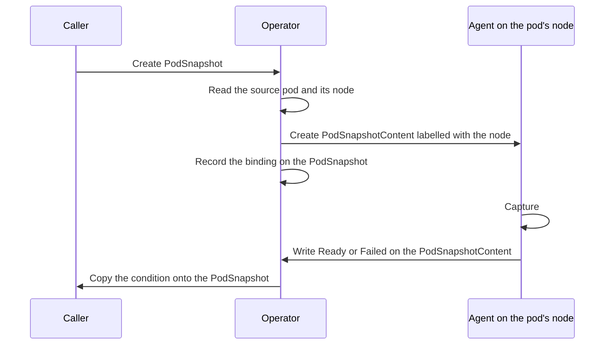
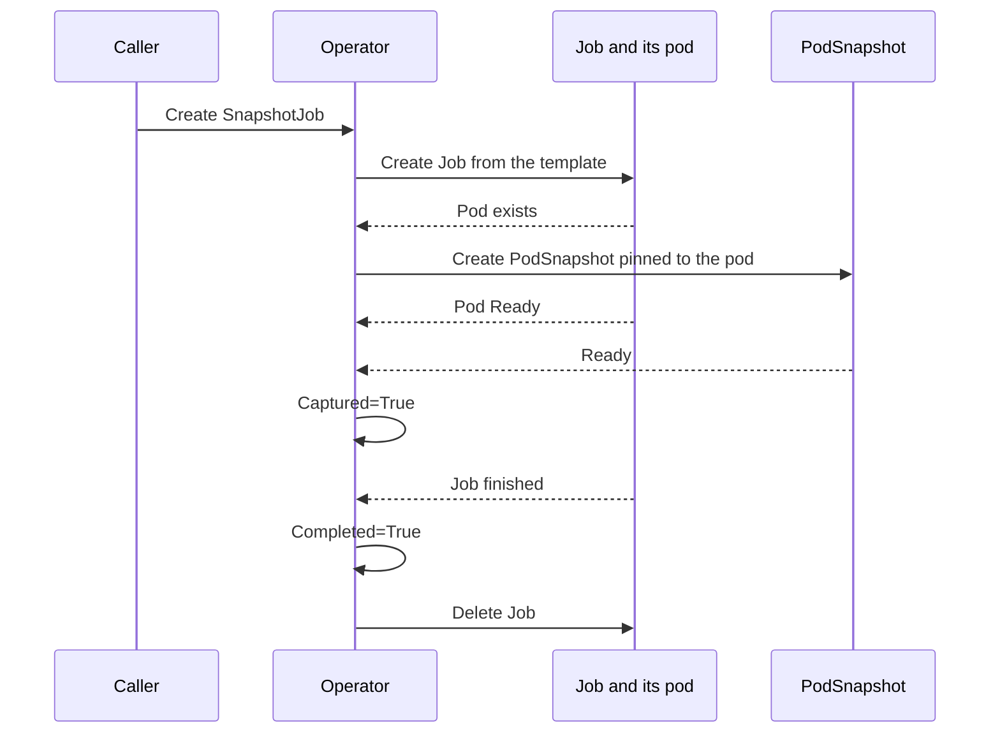

<!--
SPDX-FileCopyrightText: Copyright (c) 2026 NVIDIA CORPORATION & AFFILIATES. All rights reserved.
SPDX-License-Identifier: Apache-2.0
-->

# Control plane

<!-- toc -->
- [A checkpoint, from the operator's side](#a-checkpoint-from-the-operators-side)
  - [Accepting a PodSnapshot](#accepting-a-podsnapshot)
  - [Following the content](#following-the-content)
  - [Deleting a PodSnapshot](#deleting-a-podsnapshot)
- [SnapshotJob](#snapshotjob)
  - [What the operator adds to the pod](#what-the-operator-adds-to-the-pod)
  - [How it tracks progress](#how-it-tracks-progress)
  - [How it finishes](#how-it-finishes)
- [Deleting checkpoints](#deleting-checkpoints)
- [Installing the CRDs](#installing-the-crds)
- [The code](#the-code)
  - [The shared api module](#the-shared-api-module)
  - [snapshotctl](#snapshotctl)
- [Reference: failure reasons](#reference-failure-reasons)
- [Invariants](#invariants)
<!-- /toc -->

This page describes the operator, the control plane half of Snapshot.
The [overview](README.md) introduces the pieces and the resources this page assumes.

The operator owns everything about a checkpoint that happens in the Kubernetes API and nothing that happens on a node.
It accepts a `PodSnapshot`, works out which node must perform the capture, tells the agent there by creating a `PodSnapshotContent`, copies the agent's result back onto the `PodSnapshot`, runs the `SnapshotJob` workflow, and deletes a checkpoint's files when its `PodSnapshotContent` is deleted.
It never runs CRIU, never calls CUDA, and never touches a workload process.
It also takes no part in a restore, which the [node agent](node-agent.md) drives from a pod annotation alone.

## A checkpoint, from the operator's side

The operator turns a namespaced request into a cluster-scoped instruction for one node, then waits for the answer.

### Accepting a PodSnapshot

1. Add a finalizer to the `PodSnapshot`.
2. Read the pod it names.
   - Pod missing: fail with `SourcePodNotFound`.
   - Pod not yet scheduled: retry later. The operator cannot choose a node before the scheduler has.
   - `spec.source.podRef.uid` set and different from the live pod's UID: fail with `StalePodReference`. The pin lets a caller say "this exact pod", so a same-named replacement is never captured by mistake.
3. Create the `PodSnapshotContent` with:
   - the name `podsnapshotcontent-<PodSnapshot UID>`, so that a retry after a crash finds the object it already created,
   - the pod's `spec.nodeName`, both in the spec and in the label `nvidia.com/snapshot-node`, which is how the right agent finds it,
   - the live pod's UID,
   - a reference back to the `PodSnapshot`, including its UID,
   - the finalizer that will keep the content alive until its files are deleted.
4. If the object already exists, adopt it only when its back reference names this `PodSnapshot` with the same UID. Anything else is `ContentConflict`.
5. Write the content's name into `status.boundSnapshotContentName`. The `PodSnapshot` is now **bound**: its state is whatever the content says.

### Following the content

Once bound, the operator copies the content's `Ready` or `Failed` condition, with reason and message, onto the `PodSnapshot`.
Success reasons therefore come from the agent.
`Ready` is not treated as final, so the `PodSnapshot` keeps following.
`Failed` is final.

While the content is still pending, the operator also watches the source pod, because the agent reports nothing if it never runs.
A pod that has disappeared or finished is a strong hint but not proof: a successful dump kills the source, and the agent writes `Ready` only after that.
So when the source pod looks gone:

1. Re-read the pod, bypassing the cache.
2. Re-read the content, bypassing the cache. If it is now `Ready` or `Failed`, mirror it and stop.
3. Otherwise classify the pod:
   - UID differs from the pinned one: `StalePodReference`.
   - Phase `Succeeded`: `SourceCompletedWithoutCapture`.
   - Phase `Failed`, or being deleted: `SourcePodGone`, but only once five minutes have passed since the pod stopped. The grace covers the gap between the dump killing the source and the agent writing `Ready`, and it is the backstop for an agent that never reports.

### Deleting a PodSnapshot

1. The caller deletes the `PodSnapshot`.
2. The operator deletes the bound `PodSnapshotContent` and waits until it is gone.
3. The cleanup queue, described below, deletes the checkpoint's files and removes the content's finalizer.
4. The content disappears.
5. The operator removes the `PodSnapshot` finalizer, and it disappears.

A `PodSnapshot` whose files cannot be deleted stays in `Terminating`.

## SnapshotJob

A `PodSnapshot` needs a pod that already exists and is ready.
Callers that drive pods themselves, such as a serving platform, can provide that.
Callers that cannot, such as a pipeline that submits work and walks away, use a `SnapshotJob`.

### What the operator adds to the pod

The template is wrapped in a `batch/v1` Job with the additions the [workload contract](../workload-contract.md) requires:

- `restartPolicy: Never` and `backoffLimit: 0`, so the pod runs exactly once.
- Sidecar injection by Linkerd and Istio disabled.
- The `block-iouring` seccomp profile on the pod.
- On the target container: the control directory, the `SNAPSHOT_CONTROL_DIR` environment variable, and a readiness probe that checks for `ready-for-snapshot` every second.
- Any liveness or startup probe on the target removed.
- `activeDeadlineSeconds` from the spec, one hour by default.

With `nvidia.com/snapshot-multi-gpu: enabled` on the template, the operator also adds an init container that copies the CuInterpose libraries from the agent image into a volume, and prefixes the target command with the CuInterpose launcher.
[Multi-GPU support](multi-gpu.md#kubernetes-opt-in) explains why.

### How it tracks progress

Each condition has exactly one source of truth:

- `Captured` comes from the `PodSnapshot` and nothing else.
- Workload completion and failure come from the Job and nothing else.
- The source pod is read only for its identity and to check helper containers, never to infer whether a capture happened.

Every reconcile derives the whole status from those observations and writes it once.
In order:

1. Record the Job's UID before creating anything else.
2. Once the Job controls exactly one pod, create a `PodSnapshot` named after the `SnapshotJob`, pinning that pod's name and UID. The pod need not be scheduled or ready yet. The `PodSnapshot` logic waits for a node, and the agent waits for container readiness.
3. When the `PodSnapshot` is `Ready`, set `Captured=True`.
4. When the Job finishes, decide the outcome as described next.

The `PodSnapshot` has no owner reference to the `SnapshotJob`, because the checkpoint is meant to outlive the job that produced it.
Deleting a `SnapshotJob` leaves the `PodSnapshot` and its files in place.
The labels `nvidia.com/snapshot-job` and `nvidia.com/snapshot-job-uid` record which `SnapshotJob` made it.

### How it finishes

The dump kills the target container, so after every successful checkpoint the Job reports `Failed`.
The operator reads the Job's outcome as follows:

- Job `Failed` after `Captured=True`, and every other regular container in the template exited with code zero: success. Set `Completed=True` and delete the Job. Native sidecars, which are init containers with `restartPolicy: Always`, only need to have stopped.
- Helper containers still running: wait. Deleting the Job would kill them mid-work.
- The capture failed, the Job exceeded `activeDeadlineSeconds`, or the Job failed before any `PodSnapshot` existed: set `Failed=True` and keep the Job so its pod can be inspected.
- Job failed while the capture is still pending: wait. The `PodSnapshot` logic above resolves it within the grace period.

A `SnapshotJob` is strictly one-shot.
If its Job or `PodSnapshot` disappears or is replaced, it fails with `JobDeleted`, `JobNameConflict`, `PodSnapshotDeleted`, or `PodSnapshotNameConflict` rather than starting over.

## Deleting checkpoints

Checkpoint files are deleted by the operator, not by the agent.
The work runs inside the operator process as a rate-limited work queue with a fixed number of workers, only on the leader.

Work arrives from two sources:

- A `PodSnapshotContent` carrying the cleanup finalizer begins deleting.
- A timer fires a sweep.

A cleanup item for one content:

1. Stops if the content is gone, not deleting, or already without the finalizer.
2. Refuses if the content says it belongs to a different store than the operator is configured with, so that a missing directory on some other volume never counts as deleted.
3. Removes the directory named after the content's UID.
4. Removes the finalizer.

A sweep:

1. Lists the directories on the volume.
2. Lists every `PodSnapshotContent`, bypassing the cache. Listing directories first means a checkpoint written in between can never look like an orphan.
3. Removes directories whose names are not live content UIDs, a bounded number per sweep.
4. Re-queues every deleting content that still has the finalizer, which is how a cleanup that was dropped or kept failing eventually completes.

Anything that is a symlink or not a directory is refused rather than removed.
The operator computes paths through the same `agent/pkg/artifact` package as the agent, so the two cannot disagree about where a checkpoint lives.

## Installing the CRDs

Helm installs CRDs on a fresh release and never upgrades them.
The operator closes that gap with an init container:

1. The three CRDs are generated from the Go types in `api/v1alpha1` by `controller-gen` and embedded in the `api` module. A copy is mirrored into `charts/snapshot/crds`, and `make verify-crds` fails when the two drift.
2. The operator Deployment runs a `crd-installer` init container from the same image as the manager.
3. The installer server-side applies every embedded CRD and waits for each to report `Established`.
4. If anything fails, the pod does not start. An operator running against outdated definitions is worse than one that has not started.

Because the installer and the manager ship together, a rollout converges the cluster on the definitions the running binary expects.
There is only one API version, `v1alpha1`, and no conversion webhook.

## The code

The operator is a single controller-runtime manager in `operator/cmd/manager`.
It runs with leader election, so a second replica stands by without acting.
It registers:

| Component | Source | Watches |
| --- | --- | --- |
| `PodSnapshotReconciler` | `operator/internal/controller/podsnapshot_reconciler.go` | `PodSnapshot`, `PodSnapshotContent`, pods |
| `SnapshotJobReconciler` | `operator/internal/controller/snapshotjob_*.go` | `SnapshotJob`, Jobs, `PodSnapshot` |
| Cleanup controller and queue | `operator/internal/controller/snapshotcontent_reconciler.go`, `operator/internal/maintenance` | `PodSnapshotContent`, a timer |

There are no admission webhooks.
Validation lives in the CRD schemas as CEL rules, and the reconcilers re-check the same rules in case an object predates them.

The pod mutations described under `SnapshotJob` live in `operator/internal/protocol`.
The names they use, such as the volume, the environment variable, and the sentinel files, come from `api/podcontract`, so the operator and the agent share one definition of the contract.

Configuration arrives as flags, rendered by the Helm chart:

| Flag | Purpose |
| --- | --- |
| `--snapshot-storage-config` | The `storage.yaml` the chart renders to identify the checkpoint store. PageBroker reads the same file. |
| `--snapshot-storage-base-path` | Where the shared volume is mounted in the operator pod, `/checkpoints`. |
| `--artifact-cleanup-*` | Sweep interval, batch size, worker count, list attempts, and per-item timeout. |
| `--cuinterpose-image`, `--cuinterpose-image-pull-policy` | The image a `SnapshotJob` copies the CuInterpose libraries from. The chart passes the agent image. |

The manager runs as root with every capability dropped.
Root is needed only because the files it deletes were written by the privileged agent.

### The shared api module

`api/` is what both binaries and external integrators import.

- `api/v1alpha1` holds the CRD types, their conditions and reasons, and the embedded CRD manifests.
- `api/podcontract` holds the contract between Snapshot and a pod: the control directory and sentinel names, the restore annotations, the builder and validator for restore pods, and the classifier for the `nvidia.com/Restored` condition.
- `api/compat` holds the rules that decide whether a node can run a checkpoint. Only the agent evaluates them, but their names are published on pod events and integrators match on them.
- `api/storage` holds the identity of a checkpoint store and the per-checkpoint lock the cleanup workers take.

`podcontract.Build` is the entry point for a controller that creates restore pods.
It returns a modified deep copy, rejects conflicting annotations and mounts instead of overwriting them, and is idempotent.
`podcontract.ClassifyRestoreOutcome` turns the condition into `Pending`, `Succeeded`, `Failed`, `PartiallySucceeded`, or `Unknown` without importing the CRD types.

### snapshotctl

`operator/cmd/snapshotctl` is a command line tool for trying Snapshot by hand.
`checkpoint` builds a source Job with the same code the `SnapshotJob` reconciler uses, creates a `PodSnapshot` for its pod, and waits.
`restore` builds a restore pod with `podcontract.Build` and creates it.
It is not part of any image or release, and it bypasses `SnapshotJob`, so it gets none of its completion checks.
The [CLI reference](../cli.md) documents it.

## Reference: failure reasons

Reasons the operator itself writes on a `PodSnapshot`:

| Reason | Meaning |
| --- | --- |
| `SourcePodNotFound` | The named pod does not exist in the namespace. |
| `StalePodReference` | The pinned pod UID does not match the live pod. |
| `ContentConflict` | A `PodSnapshotContent` with the expected name exists but does not point back at this `PodSnapshot`. |
| `SourcePodGone` | The source pod failed or was deleted while the capture was pending, and the grace period passed. |
| `SourceCompletedWithoutCapture` | The source pod exited successfully before any capture. |

Every other reason is copied from the agent.
They are listed under [Checkpoint flow](checkpoint.md#reference-checks-and-failure-reasons).
On a `SnapshotJob`, the first three above become `PodSnapshotFailed` and every agent reason becomes `CaptureFailed`.

## Invariants

- Every spec is immutable, enforced by CEL rules in the CRDs.
- A `PodSnapshotContent` belongs to exactly one `PodSnapshot` incarnation. Its name derives from the `PodSnapshot` UID, and adopting an existing one requires a matching back reference UID.
- The capture node is fixed when the content is created, from the live pod's `spec.nodeName`. The operator does no scheduling.
- Irreversible decisions use reads that bypass the cache.
- `Failed` is permanent on every resource. `Ready` on a `PodSnapshot` keeps following the content.
- Checkpoints outlive their producers. Nothing owns a `PodSnapshot` from above, and deletion of files is tied to the content's finalizer, not to any controller's lifetime.
- The operator and the agent communicate only through the Kubernetes API. Spec and labels flow down, status flows up.
