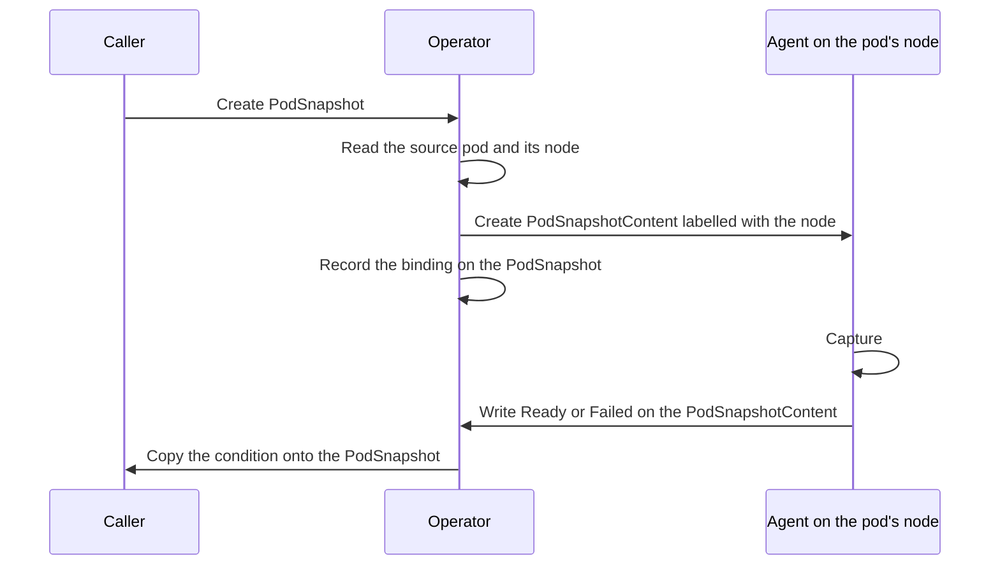
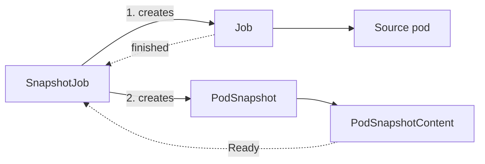

<!--
SPDX-FileCopyrightText: Copyright (c) 2026 NVIDIA CORPORATION & AFFILIATES. All rights reserved.
SPDX-License-Identifier: Apache-2.0
-->

# Control plane

<!-- toc -->
- [A checkpoint, from the operator's side](#a-checkpoint-from-the-operators-side)
  - [Accepting a PodSnapshot](#accepting-a-podsnapshot)
  - [Waiting and mirroring](#waiting-and-mirroring)
  - [Deleting](#deleting)
- [SnapshotJob](#snapshotjob)
  - [What it adds to the pod](#what-it-adds-to-the-pod)
  - [How it tracks progress](#how-it-tracks-progress)
  - [How it finishes](#how-it-finishes)
- [Deleting checkpoints](#deleting-checkpoints)
- [Installing the CRDs](#installing-the-crds)
- [The code](#the-code)
  - [The shared api module](#the-shared-api-module)
  - [snapshotctl](#snapshotctl)
- [Reference: failure reasons](#reference-failure-reasons)
- [Invariants](#invariants)
<!-- /toc -->

This page describes the operator, the control plane half of Snapshot.
The [overview](README.md) introduces the pieces and the resources this page assumes.

The operator owns everything about a checkpoint that happens in the Kubernetes API and nothing that happens on a node.
It accepts a `PodSnapshot`, works out which node must perform the capture, tells the agent there by creating a `PodSnapshotContent`, copies the agent's result back onto the `PodSnapshot`, runs the `SnapshotJob` workflow, and deletes a checkpoint's files when its `PodSnapshotContent` is deleted.
It never runs CRIU, never calls CUDA, and never touches a workload process.
It also takes no part in a restore, which the [node agent](node-agent.md) drives from a pod annotation alone.

## A checkpoint, from the operator's side

The operator's job in a checkpoint is to turn a namespaced request into a cluster-scoped instruction for one node, then wait for the answer.

### Accepting a PodSnapshot

When a `PodSnapshot` appears, the operator adds a finalizer to it and reads the pod it names.
Three things can stop it here.
If the pod does not exist, the `PodSnapshot` fails with `SourcePodNotFound`.
If the pod has not been scheduled yet, the operator waits and retries, since it cannot pick a node before the scheduler has.
If the `PodSnapshot` pins a pod UID in `spec.source.podRef.uid` and the live pod has a different UID, it fails with `StalePodReference`.
The UID pin lets a caller say "this exact pod", so that a replacement pod with the same name is never captured by mistake.

Otherwise the operator creates the `PodSnapshotContent`.
It names it `podsnapshotcontent-<PodSnapshot UID>`, following the convention a dynamically provisioned PersistentVolume uses, so that a retry after a crash finds the object it already created instead of making a second one.
It copies the pod's `spec.nodeName` into the content's spec and into the label `nvidia.com/snapshot-node`, which is how the right agent finds it.
It records the live pod's UID, a reference back to the `PodSnapshot` including its UID, and a finalizer that will later keep the content alive until its files are deleted.

The create is unconditional.
If the object already exists, which happens when the operator crashed after creating it but before recording it, the operator adopts it only if its back reference names this `PodSnapshot` with the same UID.
Any other existing object is a `ContentConflict`.
Finally the operator writes the content's name into `status.boundSnapshotContentName`.
From then on the `PodSnapshot` is **bound**, and its state is whatever the content says.

### Waiting and mirroring

A bound `PodSnapshot` follows its content.
When the content reports `Ready` or `Failed`, the operator copies the condition, reason, and message onto the `PodSnapshot`.
Success reasons therefore come from the agent.
`Ready` is not treated as final, so the `PodSnapshot` keeps following, but `Failed` is final and never changes.

While the content is still pending, the operator also watches the source pod, because the agent reports nothing if it never gets to run.
A source pod that has disappeared or finished is a strong hint that no capture is coming, but not proof: a successful dump kills the source, and the agent writes `Ready` only after that.
So the operator first re-reads the pod and then the content, both bypassing its cache.
Only if the content is still pending does it draw a conclusion from the pod:

- A pod with a different UID than the one pinned means `StalePodReference`.
- A pod that exited successfully means `SourceCompletedWithoutCapture`.
- A pod that failed or is being deleted means `SourcePodGone`, but only after a five minute grace period counted from when it stopped. That grace covers the gap between the dump killing the source and the agent writing `Ready`, and it is the backstop for an agent that never reports at all.

### Deleting

Deleting a `PodSnapshot` deletes its content, waits until the content is gone, and only then drops the `PodSnapshot` finalizer.
The content in turn waits for its files to be deleted from the shared volume, described under [Deleting checkpoints](#deleting-checkpoints).
The full chain is: delete the `PodSnapshot`, the operator deletes the content, maintenance deletes the files, the content disappears, the `PodSnapshot` disappears.
A `PodSnapshot` whose files cannot be deleted stays in `Terminating`.

## SnapshotJob

A `PodSnapshot` needs a pod that already exists and is ready.
Callers that drive pods themselves, such as a serving platform, can provide that.
Callers that cannot, such as a pipeline that submits work and walks away, use a `SnapshotJob`.
It takes a pod template and does the whole thing: run the pod, wait until it is ready, checkpoint it, and clean up.

### What it adds to the pod

The operator wraps the template in a `batch/v1` Job and adds what the [workload contract](../workload-contract.md) requires but a caller might omit.
The Job gets `restartPolicy: Never` and `backoffLimit: 0`, so the pod runs exactly once.
Sidecar injection by Linkerd and Istio is disabled, since an injected sidecar would not know the contract.
The pod gets the `block-iouring` seccomp profile that CRIU needs.
The target container gets the control directory, the `SNAPSHOT_CONTROL_DIR` environment variable, and a readiness probe that checks for `ready-for-snapshot` every second.
Any liveness or startup probe on the target is removed.

When the template carries `nvidia.com/snapshot-multi-gpu: enabled`, the operator also adds an init container that copies the CuInterpose libraries from the agent image into a volume, and prefixes the target command with the CuInterpose launcher.
[Multi-GPU support](multi-gpu.md#kubernetes-opt-in) explains why.

### How it tracks progress

Each `SnapshotJob` condition has exactly one source of truth.
`Captured` comes from the `PodSnapshot` and nothing else.
Completion and failure of the workload come from the Job and nothing else.
The operator reads the source pod only to learn its identity and to check helper containers, never to infer whether a capture happened.
Every reconcile derives the whole status from those observations and writes it once.

The operator records the Job's UID before creating anything else.
Once the Job controls exactly one pod, the operator creates a `PodSnapshot` named after the `SnapshotJob`, pinning that pod's name and UID.
It does not wait for the pod to be scheduled or ready.
The operator's `PodSnapshot` logic waits for a node, and the agent waits for container readiness, so nothing is lost by creating it early.

The `PodSnapshot` has no owner reference to the `SnapshotJob`.
The checkpoint is meant to outlive the job that produced it, so deleting a `SnapshotJob` leaves the `PodSnapshot` and its files in place.
The labels `nvidia.com/snapshot-job` and `nvidia.com/snapshot-job-uid` record which `SnapshotJob` made it.

### How it finishes

Completion has two stages.
A `Ready` `PodSnapshot` sets `Captured=True`.
The operator then waits for the Job to finish before setting `Completed=True` and deleting the Job.

The dump kills the target container, so after every successful checkpoint the Job reports `Failed`.
The operator treats that as the expected outcome, provided every other regular container in the template exited with code zero.
Native sidecars, which are init containers with `restartPolicy: Always`, only need to have stopped.
Helpers still running are left alone, since deleting the Job would kill them mid-work.

A `SnapshotJob` fails when the capture fails, when the Job exceeds `activeDeadlineSeconds`, or when the Job fails before any `PodSnapshot` exists.
A pending capture is never failed on the Job's evidence alone, because of the same race as above.
A failed `SnapshotJob` keeps its Job so that its pod can be inspected.
A `SnapshotJob` is strictly one-shot: if its Job or `PodSnapshot` disappears or is replaced, it fails rather than starting over.

## Deleting checkpoints

Checkpoint files are deleted by the operator, not by the agent.
The work runs inside the operator process as a rate-limited work queue with a fixed number of workers, and only on the leader.

Two things produce work.
When a `PodSnapshotContent` carrying the cleanup finalizer begins deleting, a cleanup item for it is queued.
And on a timer, a sweep runs that looks for files no `PodSnapshotContent` refers to any more.

A cleanup item removes the directory named after the content's UID and then removes the finalizer.
It is safe to repeat: a content that is gone, not deleting, or already cleaned is a no-op.
If the content says it belongs to a different store than the one the operator is configured with, the item is refused, so that a missing directory on some other volume is never mistaken for a completed deletion.

A sweep lists the directories on the volume first, and only then lists every `PodSnapshotContent`, so a checkpoint written between the two steps can never look like an orphan.
Any directory whose name is not a live content UID is removed, a bounded number per sweep.
The sweep also re-queues any deleting content that still has the finalizer, which is how a cleanup that was dropped or kept failing eventually completes.

Deletion is deliberately conservative.
Anything that is a symlink or not a directory is refused rather than removed.
The operator uses the same `agent/pkg/artifact` package as the agent to compute paths, so the two cannot disagree about where a checkpoint lives.

## Installing the CRDs

The three CRDs are generated from the Go types in `api/v1alpha1` by `controller-gen` and embedded in the `api` module.
A copy is mirrored into `charts/snapshot/crds` so that Helm installs them on a fresh release, and `make verify-crds` fails when the two drift.

Helm never upgrades CRDs it has already installed.
The operator Deployment therefore runs a `crd-installer` init container, built from the same image as the manager.
It server-side applies every embedded CRD and waits for each to report `Established`.
If anything fails, the pod does not start, on purpose: an operator running against outdated definitions is worse than one that has not started.
Because the installer and the manager ship together, a rollout converges the cluster on the definitions the running binary expects.
There is only one API version, `v1alpha1`, and no conversion webhook.

## The code

The operator is a single controller-runtime manager in `operator/cmd/manager`.
It runs with leader election, so a second replica stands by without acting.
It registers:

| Component | Source | Watches |
| --- | --- | --- |
| `PodSnapshotReconciler` | `operator/internal/controller/podsnapshot_reconciler.go` | `PodSnapshot`, `PodSnapshotContent`, pods |
| `SnapshotJobReconciler` | `operator/internal/controller/snapshotjob_*.go` | `SnapshotJob`, Jobs, `PodSnapshot` |
| Cleanup controller and queue | `operator/internal/controller/snapshotcontent_reconciler.go`, `operator/internal/maintenance` | `PodSnapshotContent`, a timer |

There are no admission webhooks.
Validation lives in the CRD schemas as CEL rules, and the reconcilers re-check the same rules in case an object predates them.

The pod mutations described under `SnapshotJob` live in `operator/internal/protocol`.
The names they use, such as the volume, the environment variable, and the sentinel files, come from `api/podcontract`, so the operator and the agent share one definition of the contract.

Configuration arrives as flags, rendered by the Helm chart:

| Flag | Purpose |
| --- | --- |
| `--snapshot-storage-config` | The `storage.yaml` the chart renders to identify the checkpoint store. PageBroker reads the same file. |
| `--snapshot-storage-base-path` | Where the shared volume is mounted in the operator pod, `/checkpoints`. |
| `--artifact-cleanup-*` | Sweep interval, batch size, worker count, list attempts, and per-item timeout. |
| `--cuinterpose-image`, `--cuinterpose-image-pull-policy` | The image a `SnapshotJob` copies the CuInterpose libraries from. The chart passes the agent image. |

The manager runs as root with every capability dropped.
Root is needed only because the files it deletes were written by the privileged agent.

### The shared api module

`api/` is what both binaries and external integrators import.

`api/v1alpha1` holds the CRD types, their conditions and reasons, and the embedded CRD manifests.

`api/podcontract` holds the contract between Snapshot and a pod: the control directory and sentinel names, the restore annotations, the builder and validator for restore pods, and the classifier for the `nvidia.com/Restored` condition.
`podcontract.Build` is the entry point for a controller that creates restore pods.
It returns a modified deep copy, rejects conflicting annotations and mounts instead of overwriting them, and is idempotent.
`podcontract.ClassifyRestoreOutcome` turns the condition into `Pending`, `Succeeded`, `Failed`, `PartiallySucceeded`, or `Unknown` without importing the CRD types.

`api/compat` holds the rules that decide whether a node can run a checkpoint.
Only the agent evaluates them, but they live here because their names are published on pod events and integrators match on them.

`api/storage` holds the identity of a checkpoint store and the per-checkpoint lock the cleanup workers take.

### snapshotctl

`operator/cmd/snapshotctl` is a command line tool for trying Snapshot by hand.
`checkpoint` builds a source Job with the same code the `SnapshotJob` reconciler uses, creates a `PodSnapshot` for its pod, and waits.
`restore` builds a restore pod with `podcontract.Build` and creates it.
It is not part of any image or release, and it bypasses `SnapshotJob`, so it gets none of its completion checks.
The [CLI reference](../cli.md) documents it.

## Reference: failure reasons

Reasons the operator itself writes on a `PodSnapshot`:

| Reason | Meaning |
| --- | --- |
| `SourcePodNotFound` | The named pod does not exist in the namespace. |
| `StalePodReference` | The pinned pod UID does not match the live pod. |
| `ContentConflict` | A `PodSnapshotContent` with the expected name exists but does not point back at this `PodSnapshot`. |
| `SourcePodGone` | The source pod failed or was deleted while the capture was pending, and the grace period passed. |
| `SourceCompletedWithoutCapture` | The source pod exited successfully before any capture. |

Every other reason is copied from the agent.
They are listed under [Checkpoint flow](checkpoint.md#reference-checks-and-failure-reasons).
On a `SnapshotJob`, the first three above become `PodSnapshotFailed` and every agent reason becomes `CaptureFailed`.

## Invariants

- Every spec is immutable, enforced by CEL rules in the CRDs.
- A `PodSnapshotContent` belongs to exactly one `PodSnapshot` incarnation. Its name derives from the `PodSnapshot` UID, and adopting an existing one requires a matching back reference UID.
- The capture node is fixed when the content is created, from the live pod's `spec.nodeName`. The operator does no scheduling.
- Irreversible decisions use reads that bypass the cache. Failing a pending capture re-reads the pod and then the content, and `SnapshotJob` confirms absence the same way.
- `Failed` is permanent on every resource. `Ready` on a `PodSnapshot` keeps following the content.
- Checkpoints outlive their producers. Nothing owns a `PodSnapshot` from above, and deletion of files is tied to the content's finalizer, not to any controller's lifetime.
- The operator and the agent communicate only through the Kubernetes API. Spec and labels flow down, status flows up.
