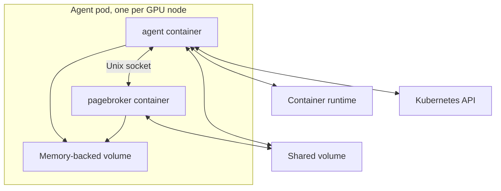
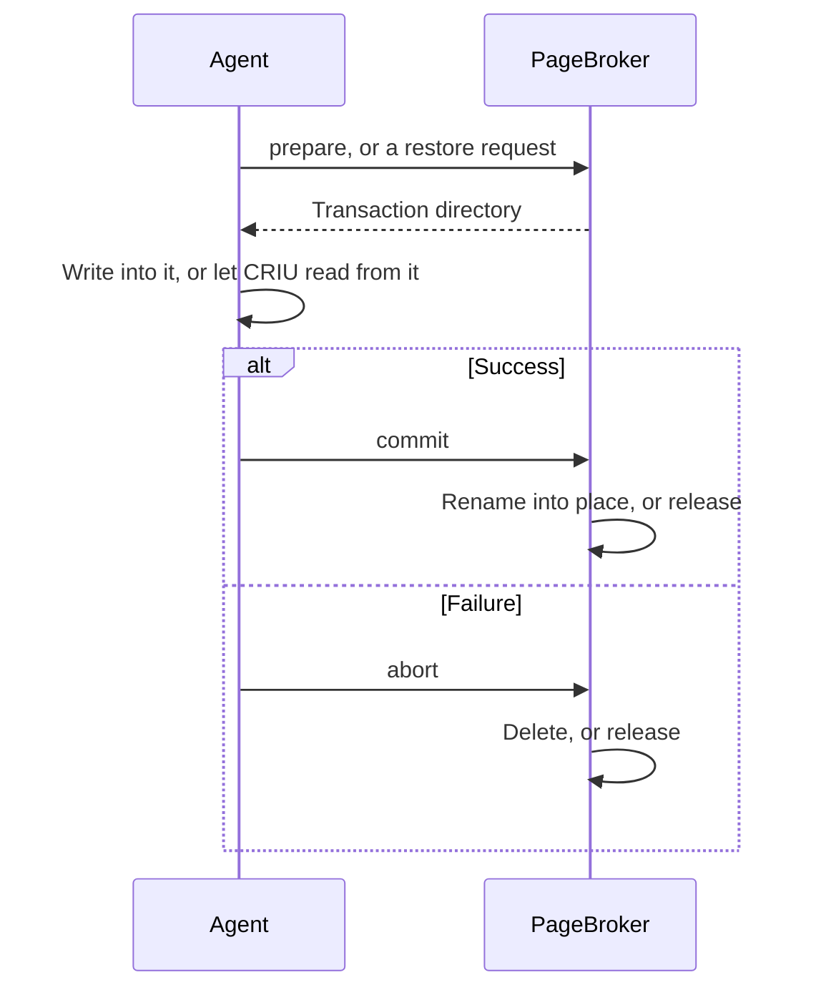

<!--
SPDX-FileCopyrightText: Copyright (c) 2026 NVIDIA CORPORATION & AFFILIATES. All rights reserved.
SPDX-License-Identifier: Apache-2.0
-->

# Node agent

<!-- toc -->
- [The agent pod](#the-agent-pod)
- [How the agent receives work](#how-the-agent-receives-work)
- [How the agent does the work](#how-the-agent-does-the-work)
  - [What is in the image](#what-is-in-the-image)
- [PageBroker](#pagebroker)
- [Talking to the container runtime](#talking-to-the-container-runtime)
- [The restore proxy](#the-restore-proxy)
- [What the agent needs from the node](#what-the-agent-needs-from-the-node)
- [Configuration](#configuration)
- [Code map](#code-map)
<!-- /toc -->

This page describes the agent pod that runs on every GPU node: what it does, what runs inside it, what it brings into workload containers, and what it does to the node.
The [overview](README.md) introduces the pieces this page assumes.
The [checkpoint flow](checkpoint.md) and [restore flow](restore.md) pages follow one operation through what is described here.

The agent is the only part of Snapshot that touches a workload process.
It is a privileged DaemonSet with the host's PID, IPC, and network namespaces, because CRIU and the CUDA checkpoint API operate on processes the agent does not own.
Everything that needs privilege is concentrated here so that workloads need none.

## The agent pod

The pod has one init container and two long-running containers:

- **deploy-seccomp**, the init container, copies the `block-iouring.json` seccomp profile into the kubelet's seccomp directory on the host, so that workload pods can reference it.
- **agent** runs the Go program that does the work. It watches the Kubernetes API for checkpoints assigned to this node and for pods on this node that ask to be restored, and carries each one out.
- **pagebroker** runs PageBroker, a C++ daemon that owns the movement of checkpoint data. The agent never writes a checkpoint to its final location itself. It asks PageBroker for a directory, writes into it, and asks PageBroker to publish it. On restore, PageBroker holds the checkpoint open or copies it into memory while CRIU reads it. When the GPU driver supports CustomStorage, PageBroker is also the process that calls the CUDA checkpoint API and streams GPU memory between the device and the volume.

The two main containers share the checkpoint volume at `/checkpoints` and a memory-backed `emptyDir` at `/pagebroker`.
The second holds PageBroker's socket and its staging area, where CRIU writes a dump before PageBroker publishes it.
The two containers speak a private protocol, so the chart requires them to run at the same image tag.

## How the agent receives work

The agent is a controller built directly on client-go informers, not on controller-runtime.
It runs three informers, each filtered to its own node:

- `PodSnapshotContent` objects labelled `nvidia.com/snapshot-node=<this node>`. Each is a checkpoint this agent must take.
- Pods on this node labelled `nvidia.com/snapshot-capture-eligible=true`. The agent puts that label on a source pod once it has validated the matching `PodSnapshotContent`, so that the pod becoming Ready wakes the capture without waiting for a periodic resync.
- Every pod on this node. Those carrying `nvidia.com/restore-from` are restores.

Captures and restores go onto two work queues keyed by object name:

- Each dequeued item runs in its own goroutine, so several captures and restores can run on one node at once. There is no node-wide limit.
- The queue guarantees that one object is handled by one goroutine at a time. With exactly one agent per node, that is the only lock needed.

The agent writes to the Kubernetes API in three places only: the status of a `PodSnapshotContent`, the `nvidia.com/Restored` condition and a finalizer on restore pods, and the eligibility label on source pods.
It never modifies a `PodSnapshotContent` spec or a `PodSnapshot`.

## How the agent does the work

The capture and restore sequences live in `agent/internal/executor` as two long, straight-line functions with deferred cleanup, so that the order of operations can be read top to bottom.
The flow pages walk through them.

Capture runs entirely in the agent container.
CRIU is a child of the agent and reaches into the source container through `/host/proc/<pid>/root`.

Restore cannot work that way.
CRIU must create the restored processes inside the destination container's namespaces, with the container's root filesystem, so that they land where the kubelet expects them.
So the agent:

1. Bind mounts a directory of tools, the **bundle**, read-only into the destination container, because the workload image contains none of them.
2. Runs a separate program, `nsrestore`, inside the container's mount, UTS, IPC, network, and PID namespaces with `nsenter`.
3. Lets `nsrestore` replay the changed files, run CRIU, and restore GPU state, then reads its result.

### What is in the image

| Program | Runs in | Purpose |
| --- | --- | --- |
| `snapshot-agent` | Agent container | The controller and executors described above. |
| `criu` | Agent container at capture, destination container at restore | CRIU, built from source at a pinned upstream commit. Snapshot ships one CRIU plugin of its own, `snapshot_inet_remap.so`, which rewrites IP addresses on restore. |
| `cuda-checkpoint-helper` | Agent container at capture, destination container at restore | A small C program that calls the CUDA driver's checkpoint API: lock, checkpoint, restore, unlock, and two queries. Used when the driver does not support CustomStorage. |
| `ns-bind-mount` | Agent container | The only way the agent mounts anything into another container. Its allowed sources, destinations, and mount flags are compiled in. |
| `nsrestore` | Destination container | The in-container half of a restore. Statically linked. |
| `snapshot-restore-proxy` | Destination container, as PID 1 | Waits for the restore, then forwards signals to the restored process and exits with its exit code. Statically linked. |
| `tar`, `ip` | Destination container | `tar` unpacks the changed files. CRIU runs `ip` to restore addresses and routes. |
| `cuinterpose-coordinator`, `cuinterpose-launch`, `libcuinterpose*.so` | Source and destination containers | The [multi-GPU](multi-gpu.md) components. |

The bundle holds everything in the last four rows except the launcher, plus the shared libraries those programs need.
It carries no glibc, since a program exec'd directly runs under the image's own loader, except that `tar` ships with a matched loader and glibc so that it works in images whose glibc is older than the agent's.

## PageBroker

PageBroker exists to make publication atomic and to keep GPU memory off the slow path.

Every capture and every restore runs inside a **PageBroker transaction**:

For a capture, PageBroker publishes by renaming the transaction directory into its final place.
Before the rename nothing exists at the final path, and after it the checkpoint is complete.
For a restore, the transaction holds the checkpoint directory open, or copies it into memory, for as long as CRIU reads it.
A transaction that is neither committed nor aborted expires and is cleaned up.

**CustomStorage** is a CUDA driver feature that lets an external engine receive a process's GPU memory during checkpoint, instead of the driver copying it into the process's own host memory.
The two paths differ as follows:

- **Without CustomStorage**, the driver copies GPU memory into the process's host memory. It becomes part of the image CRIU dumps and restores, so it is written and read twice, and `cuda-checkpoint-helper` makes the driver calls.
- **With CustomStorage**, PageBroker makes the driver calls and streams GPU memory between the device and the volume directly, through pinned host buffers it allocates at startup.

PageBroker reports whether the node's driver supports CustomStorage when the agent starts, and the agent uses that answer for the rest of its life.
Each checkpoint records which path produced it, and restore follows the record.

The protocol between the agent and PageBroker is length-prefixed protobuf over a Unix stream socket, with file descriptors passed through `SCM_RIGHTS`.
It is not gRPC.
The schema is `agent/pagebroker/v1/pagebroker.proto`, and the requests are:

| Capture | Restore |
| --- | --- |
| `prepare_staged_checkpoint` opens a transaction directory on the memory-backed volume. Used when GPU memory goes through CRIU. | `direct_restore` holds the checkpoint directory open. CRIU reads it from the volume. The default. |
| `prepare_direct_checkpoint` opens a transaction directory next to the final location on the volume. Used with CustomStorage, where GPU payloads are too large for memory. | `staged_restore` copies the CRIU images into memory first. Selected by `pageBroker.restoreMode: staged`. |
| `checkpoint_gpu` locks and checkpoints each CUDA process and streams its memory into the transaction directory. | `restore_gpu` streams the memory back onto the GPUs and unlocks the processes. |
| `commit` publishes. `abort` discards. | `commit` releases. `abort` releases and, for GPU work, waits for it to drain. |

## Talking to the container runtime

The agent needs two things from the container runtime: to resolve a container to its init process and OCI spec, and to be called when a container is created.

For the first, `agent/internal/runtime` speaks to containerd through its native client, or to CRI-O through the CRI with its verbose status, which carries the PID and the spec.
Everything else the agent learns about a container, such as its mount table, cgroup, process tree, and overlay upper directory, it reads from `/host/proc/<pid>`, so it is the same for both runtimes.

For the second, the agent registers a plugin with the runtime's **Node Resource Interface** (NRI), which lets a plugin adjust a container as the runtime creates it.
Snapshot's plugin handles one hook, container creation, and only for pods carrying `nvidia.com/restore-from`:

1. Determine whether this container is a restore destination.
2. Copy the restore proxy into the container's control directory on the host.
3. Replace the container's command with the proxy.

It changes nothing else and never edits the Pod object.
Changing a container's command requires NRI 0.10, which ships with containerd 2.2.
On an older runtime the plugin refuses to register, and the agent restores without the proxy.
[Nodes without the restore proxy](restore.md#nodes-without-the-restore-proxy) describes the difference.

## The restore proxy

A container's PID 1 has to be something, and in a restore it cannot be the workload's own command, which would start the workload from scratch.
The restore proxy fills that role:

1. On start, if `restore-complete` or `restore-failed` already exists in the control directory, exit with code 112. An `emptyDir` survives a container restart, so this is how a pod gets exactly one restore.
2. Otherwise wait for one of those files.
3. On `restore-failed`, exit 112.
4. On `restore-complete`, read the restored process's PID from it.
5. Forward termination and user signals to that process, and reap orphaned children.
6. When the process exits, exit with its code, or 128 plus the signal that ended it. Exit 113 if the process could not be followed.

The proxy leaves file descriptors 0, 1, and 2 untouched.
CRIU reconnects the restored process's original standard streams to whatever PID 1 holds on those descriptors, which is how the workload's output keeps reaching the container log.

## What the agent needs from the node

The agent container mounts these host paths:

| Host path | Why |
| --- | --- |
| The container runtime's socket directory | To resolve containers and to stop them. |
| `/proc`, at `/host/proc` | To reach every process on the node and, through `/host/proc/<pid>/root`, every container's filesystem. |
| `/sys/fs/cgroup`, writable | CRIU freezes a container through its cgroup when dumping, and places restored processes into the destination's cgroup. |
| `/var/run/nri` | The NRI socket. Mounted as a directory rather than a socket so the pod still starts on nodes without NRI. |
| `/sys/kernel/security`, read-only | CRIU records a process's AppArmor or SELinux label only when this filesystem is visible, and restore into a labelled container needs the recorded label. |
| The runtime's storage directory, read-only, at its host path | To read a container's overlay upper directory, which holds the files the container changed. |
| `/var/lib/kubelet/pods` and `/var/lib/kubelet/pod-resources` | To find a pod's volumes on the host, and to ask the kubelet which GPUs it gave a container. |

In return, this is everything the agent does outside its own pod:

- Writes `/var/lib/kubelet/seccomp/profiles/block-iouring.json` on every start. Uninstalling does not remove it.
- Creates `/var/run/nri` if missing and registers a plugin that the runtime then calls for every container created on the node.
- Writes the restore proxy and the `restore-complete` and `restore-failed` sentinels into pod `emptyDir` volumes under the kubelet's pod directory, atomically and without following symlinks.
- Bind mounts the bundle, the checkpoint, PageBroker staging, and the CuInterpose libraries into destination containers, through `ns-bind-mount` with its compiled-in table. The checkpoint is read-only and `noexec`.
- Freezes, dumps, and terminates the processes it checkpoints, and kills a container whose capture or restore failed part way.
- Writes checkpoints to the shared volume as root.

The agent never modifies a workload image, a Pod object's spec, or the runtime's configuration.

## Configuration

The agent reads `/etc/snapshot/config.yaml`, rendered from the chart's `config.*` values.
The [API reference](../api.md#configuration) lists every value.
These change behavior rather than tune it:

| Setting | Effect |
| --- | --- |
| `pageBroker.restoreMode` | `direct` lets CRIU read the checkpoint from the volume. `staged` copies it to memory first. |
| `checkpoint.checkpointTimeoutSeconds` | Bounds a capture. A running CRIU dump is not interrupted by it. |
| `restore.skipCompatCheck` | Turns off the checks that refuse a checkpoint this node cannot run, for every restore on the node. The per-pod form is the `nvidia.com/snapshot-skip-compat-check` annotation. |
| `criu.tcpEstablished` | Keeps established TCP connections in the checkpoint. Restore then waits for the destination pod's IP and rewrites the addresses in every socket. |
| `criu.libDir` | The directory CRIU loads plugins from. It must stay Snapshot's own directory, because CRIU's default directory contains CRIU's CUDA plugin, which would conflict with how Snapshot handles GPU state. |
| `overlay.exclusions` | Paths left out of the archive of changed files. A file the dumped processes hold open is kept regardless. |

## Code map

| Package | Holds |
| --- | --- |
| `agent/cmd/agent` | Startup: load configuration, wait for PageBroker, register the NRI plugin, run the controller. |
| `agent/internal/controller` | The informers, the two queues, the capture preconditions, the restore preflight, and all status writes. |
| `agent/internal/executor` | The capture sequence, the restore sequence, and the in-container restore sequence. |
| `agent/internal/runtime` | The containerd and CRI-O adapters, and everything read from `/host/proc`. |
| `agent/internal/criu` | CRIU dump and restore options, the `files.img` rewrite, and the IP address remap. |
| `agent/internal/cuda` | GPU discovery, the device map, and the calls to `cuda-checkpoint-helper` and the CuInterpose coordinator. |
| `agent/internal/nsmount` | The Go side of `ns-bind-mount`. |
| `agent/internal/nri` | The NRI plugin. |
| `agent/internal/restoreproxy` | The restore proxy. |
| `agent/internal/pagebroker` | The PageBroker client. |
| `agent/pagebroker` | PageBroker itself, in C++. |
| `agent/cmd/cuinterpose` | CuInterpose, in Rust and C. |
