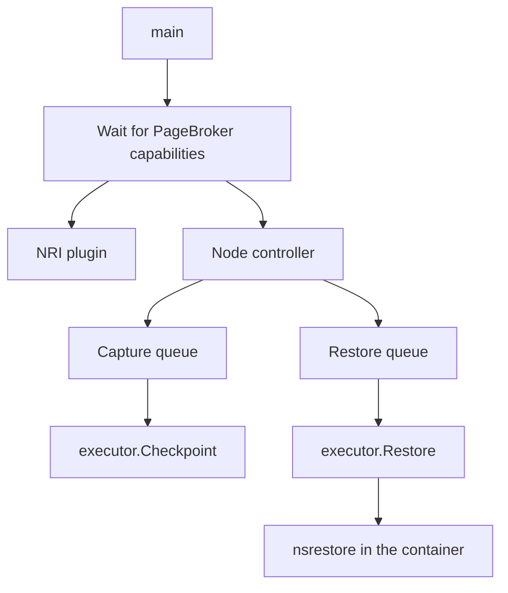

<!--
SPDX-FileCopyrightText: Copyright (c) 2026 NVIDIA CORPORATION & AFFILIATES. All rights reserved.
SPDX-License-Identifier: Apache-2.0
-->

# Node agent

<!-- toc -->
- [The agent pod](#the-agent-pod)
- [Binaries in the agent image](#binaries-in-the-agent-image)
- [Processes inside the agent container](#processes-inside-the-agent-container)
  - [Node controller](#node-controller)
  - [Executor](#executor)
  - [Runtime adapters](#runtime-adapters)
  - [CUDA package](#cuda-package)
  - [CRIU package](#criu-package)
- [NRI plugin](#nri-plugin)
- [Restore proxy](#restore-proxy)
- [PageBroker](#pagebroker)
- [Configuration](#configuration)
- [Host footprint](#host-footprint)
<!-- /toc -->

This page is for contributors.
It describes the agent pod that runs on every GPU node: the processes in it, the binaries it ships, and what it does to the node.
The [checkpoint flow](checkpoint.md) and [restore flow](restore.md) pages follow a single operation through this machinery.

The agent is the only component that touches a workload process.
Everything that needs privilege is in this pod, so workloads need none.

## The agent pod

The Helm chart deploys the agent as a DaemonSet on nodes labelled `nvidia.com/gpu.present=true`, with `hostPID`, `hostIPC`, and `hostNetwork`.
It has an init container and two long-running containers.

| Container | Image | Privilege | Role |
| --- | --- | --- | --- |
| `deploy-seccomp` (init) | busybox | none | Copies the `block-iouring.json` seccomp profile into the kubelet's seccomp directory on the host. |
| `agent` | `snapshot/agent` | privileged | The Go agent. Watches work, runs CRIU and the CUDA checkpoint helper, and registers the Node Resource Interface (NRI) plugin that restore depends on. |
| `pagebroker` | `snapshot/pagebroker` | privileged, root | The C++ data mover. Publishes and stages artifacts and, when supported, moves GPU memory. |

The two containers share two volumes: the checkpoint PVC at `/checkpoints`, and a memory-backed `emptyDir` at `/pagebroker` that holds PageBroker's control socket and its staging area.
The agent and PageBroker speak a private protocol over that socket, so the chart refuses to render them at different image tags.

The agent container mounts these host paths:

| Mount | Why |
| --- | --- |
| The container runtime socket directory | To resolve a container ID to its init PID and OCI spec, and to stop containers. |
| `/proc` at `/host/proc` | To reach any process on the node, including its root filesystem through `/host/proc/<pid>/root`. |
| `/sys/fs/cgroup`, read-write | CRIU freezes the container through its cgroup at dump time and places restored tasks at restore time. |
| `/var/run/nri` | The NRI socket, so the agent can register as a plugin. A directory rather than a socket mount, so the pod starts on nodes without NRI. |
| `/sys/kernel/security`, read-only | CRIU records AppArmor and SELinux labels at dump time only when securityfs is visible. |
| The runtime storage directory, read-only, at the same path as on the host | To read a container's overlay upper directory for the root filesystem diff. |
| `/var/lib/kubelet/pods`, read-only, and `/var/lib/kubelet/pod-resources` | To locate a pod's volumes on the host, and to read which GPUs the kubelet allocated to a container. |

## Binaries in the agent image

The image carries the agent and a set of helpers.
Some run in the agent container.
Others are copied or bind mounted into workload containers, where they must run without anything the workload image provides.

| Binary | Language | Where it runs | Purpose |
| --- | --- | --- | --- |
| `snapshot-agent` | Go | Agent container | The controller and executor. |
| `criu` and its plugins | C | Agent container at dump, restore container at restore | Built from source at a pinned upstream ref. Snapshot's `snapshot_inet_remap.so` plugin lives in a dedicated plugin directory so CRIU never loads its own CUDA plugin. |
| `cuda-checkpoint-helper` | C | Agent container at capture, restore container at restore | A thin wrapper over the CUDA driver checkpoint API: lock, checkpoint, restore, unlock, and two state queries. It does not call `cuInit`. |
| `ns-bind-mount` | C | Agent container | The only way the agent places a directory into another container's mount namespace. Sources, destinations, and mount flags are compiled in. |
| `nsrestore` | Go, static | Restore container | Runs the in-namespace half of a restore: root filesystem replay, CRIU restore, CUDA restore. |
| `snapshot-restore-proxy` | Go, static | Restore container, as PID 1 | Waits for the restore, then follows the restored process so the container's lifecycle is the workload's. |
| `cuinterpose-coordinator`, `cuinterpose-launch`, `libcuinterpose*.so` | Rust and C | Source and restore containers | The [multi-GPU](multi-gpu.md) components. |
| `tar`, `ip` | C | Restore container | CRIU forks `ip` to restore addresses and routes. `tar` extracts the root filesystem diff. |

The last four rows are assembled into `/snapshot-binaries`, the **injection bundle**.
At restore the agent bind mounts the bundle read-only at `/tmp/snapshot-binaries` in the destination container and points `PATH`, `LD_LIBRARY_PATH`, and CRIU's plugin directory at it.
The bundle carries the shared library closure of its binaries, except glibc.
`tar` is the exception: it runs under a loader and glibc that ship in the bundle as a matched pair, so it works inside images whose glibc is older than the agent's.
A CI job extracts a diff inside an older image to keep that true.

## Processes inside the agent container

`agent/cmd/agent` starts one process that runs several things concurrently.

Startup order matters:

1. Load `/etc/snapshot/config.yaml`, rendered from the chart's `config.*` values, and validate it. `storage.basePath` must be `/checkpoints`, because the C mount helper enforces the same path.
2. Read the host kernel version from `/host/proc`. If it cannot be read, captures taken on this node simply do not record it.
3. Wait up to five minutes for PageBroker to answer a `capabilities` request. Whether the driver supports CustomStorage is decided here, once, for the lifetime of the process.
4. Register the NRI plugin. If registration fails, the agent logs that it is restoring without the restore proxy and continues. See [Nodes without the restore proxy](restore.md#nodes-without-the-restore-proxy).
5. Run the node controller.

If the controller or the plugin stops early, the agent exits and the DaemonSet restarts it.
The agent exposes no HTTP endpoints and has no probes.

### Node controller

`agent/internal/controller` is a hand-rolled controller on client-go informers rather than controller-runtime.
It runs three informers, each filtered to this node:

| Informer | Filter | Feeds |
| --- | --- | --- |
| `PodSnapshotContent` | Label `nvidia.com/snapshot-node=<node>` | Capture queue |
| Source pods | `spec.nodeName=<node>` and label `nvidia.com/snapshot-capture-eligible=true` | Capture queue, through an index from pod to content |
| Restore pods | `spec.nodeName=<node>` | Restore queue, for pods with `nvidia.com/restore-from` or the restore finalizer |

Both queues are rate-limited work queues keyed by object name.
Every dequeued key runs in its own goroutine, so captures and restores on one node proceed in parallel.
There is no node-wide cap.
The queue's per-key exclusion is the only lock, which is enough because there is exactly one agent per node and the operation runs inline while the key is held.

The agent reads objects through an uncached client when a decision is irreversible, and it never mutates a `PodSnapshotContent` spec.
Its RBAC allows status patches on contents, status patches and the finalizer on pods, and reads of `PodSnapshot`, resource claims, and resource slices.

### Executor

`agent/internal/executor` holds the two long sequences, `Checkpoint` and `Restore`, and the in-namespace `RestoreInNamespace` that `nsrestore` runs.
They are written as straight-line functions with deferred cleanup, so the order of operations is visible in one place.
The flow pages follow them step by step.

### Runtime adapters

`agent/internal/runtime` is the agent's view of the container runtime.
The `Runtime` interface resolves a container ID to its init PID and OCI spec, looks up a container by pod and name, reads its image ID and pod UID, and stops it.

| Runtime | How the PID and spec are obtained |
| --- | --- |
| containerd | The native containerd client in the `k8s.io` namespace, plus the CRI service on the same socket. |
| CRI-O | CRI only. The verbose `ContainerStatus` reply carries the PID and runtime spec in its `info` field. |

The rest of the package is runtime independent and works through `/host/proc/<pid>`: the container's mount table, cgroup, network namespace inode, process tree, overlay upper directory, and the sentinel files in its control directory.
`CommandInNamespaces` runs an agent binary inside a container by `nsenter` into its mount, UTS, IPC, network, and PID namespaces with its root, passing the binary as an inherited file descriptor so it can exec after the root changes.
It deliberately leaves the cgroup namespace alone, which CRIU needs.

### CUDA package

`agent/internal/cuda` drives `cuda-checkpoint-helper` and discovers GPUs.
Discovery reads `NVIDIA_VISIBLE_DEVICES` from the OCI spec, then tries Dynamic Resource Allocation claims, then the kubelet's PodResources API, then `nvidia-smi` inside the container.
It returns GPUs in the container's CUDA ordinal order, because a DRA allocation can list them in a different order from the one CUDA numbers them in.
The same package verifies the CuInterpose libraries and runs the coordinator described under [multi-GPU](multi-gpu.md).

### CRIU package

`agent/internal/criu` builds dump and restore options for go-criu, which runs CRIU in its service worker mode as a child of the calling process.
Dump options are the chart's `config.criu.*` values plus the mount policy the runtime package computed.
Restore options come from the settings recorded in the checkpoint manifest, not from the live config, so a checkpoint restores the way it was dumped.
The package also rewrites `files.img` before restore and implements the inet-remap plumbing.

## NRI plugin

`agent/internal/nri` registers with the runtime's Node Resource Interface as plugin `snapshot` at index 50 and handles one hook, `CreateContainer`.
For a container in a pod carrying `nvidia.com/restore-from`, it resolves which containers are restore destinations, copies the restore proxy into that container's `snapshot-control` directory on the host, and replaces the container's arguments with the proxy path.
It changes nothing else, and it never edits the Pod object.
An error fails container creation so the kubelet retries, because running the image's own command would cold-start the workload in a container the agent is about to restore into.

NRI 0.10 is required, which means containerd 2.2 or newer.
The plugin refuses older runtimes, since they would silently drop the argument change.
`daemonset.nriHostNamespace` restricts the plugin to pods in one host namespace, for clusters that share nodes between installations such as vCluster tenants.

## Restore proxy

The proxy is PID 1 of every restore destination container.
On start it exits with code 112 if `restore-complete` or `restore-failed` already exists, because an `emptyDir` survives a container restart and a pod gets one restore.
Otherwise it waits on the control directory with inotify and a slow poll.
When `restore-complete` appears it reads the restored PID from it, forwards `SIGTERM`, `SIGINT`, `SIGHUP`, `SIGQUIT`, `SIGUSR1`, and `SIGUSR2` to that process, reaps orphans, and exits with the workload's exit code or 128 plus the signal that ended it.
Code 113 means it could not follow the restored process.

The proxy never touches file descriptors 0, 1, and 2.
CRIU wires the restored process's original stdio pipes to the descriptors it finds on PID 1, so the workload's output keeps reaching the container log.

## PageBroker

PageBroker is a C++ daemon in `agent/pagebroker`.
It owns every byte that moves between the node and the shared volume, and it is the only process that calls the CUDA checkpoint API in CustomStorage mode.
The agent is its only client.

The protocol is length-prefixed protobuf over a Unix stream socket, with file descriptors passed through `SCM_RIGHTS`.
It is not gRPC.
The schema is `agent/pagebroker/v1/pagebroker.proto`.
Every operation is a transaction with a `prepare` or `*_restore` request, optional data requests, and a `commit` or `abort`.
Commit and abort are idempotent, and a transaction that is never finished expires.

| Capture | Restore |
| --- | --- |
| `prepare_staged_checkpoint` creates a directory on the memory-backed staging volume. CRIU dumps into it. | `direct_restore` pins the artifact directory. CRIU reads it through a read-only bind mount. The default. |
| `prepare_direct_checkpoint` creates a temporary directory beside the destination on the volume. Used for GPU captures with CustomStorage. | `staged_restore` copies the CPU images into staging first. Selected by `pageBroker.restoreMode: staged`. |
| `checkpoint_gpu` locks the processes, checkpoints them with CustomStorage, and streams device memory into `gpu/` files. | `restore_gpu` streams the `gpu/` files back with `O_DIRECT` through a pinned transfer ring, then unlocks. |
| `commit` renames the finished directory into place. This is the publication point. | `commit` releases the pin or the staging directory. |

CustomStorage is the CUDA driver feature that hands GPU memory to an external storage engine instead of copying it into the process's host memory.
PageBroker reports whether the node's driver supports it in its `capabilities` reply.
When it does, GPU memory never passes through the agent or CRIU.
When it does not, `cuda-checkpoint-helper` is used and GPU memory lands in the process image CRIU dumps.
Which mode a checkpoint used is recorded in its manifest, and restore follows that record.

PageBroker preallocates a pinned host memory ring per visible GPU at startup, sized by `pageBroker.transferBufferCount` and `pageBroker.transferChunkBytes`.
[Storage](../../operations/storage.md) covers sizing.

## Configuration

The agent reads `config.yaml` from the chart's ConfigMap.
The [API reference](../api.md#configuration) lists every value.
The ones that change behavior rather than tune it:

| Setting | Effect |
| --- | --- |
| `pageBroker.restoreMode` | `direct` reads CPU images from the volume. `staged` copies them to memory first. |
| `checkpoint.checkpointTimeoutSeconds` | Bounds the context passed to a capture. It does not interrupt a running CRIU dump. |
| `restore.restoreTimeoutSeconds` | Bounds a restore. |
| `restore.skipCompatCheck` | Turns the compatibility gates off for every restore on the node. The per-pod equivalent is the `nvidia.com/snapshot-skip-compat-check` annotation. |
| `criu.tcpEstablished` | Preserves established TCP connections. When set, restore waits for the destination pod to have an IP and rewrites socket addresses through the inet-remap plugin. |
| `criu.libDir` | Must stay a dedicated directory. Pointing it at CRIU's global plugin directory would load CRIU's own CUDA plugin, which conflicts with how Snapshot handles GPU state. |
| `overlay.exclusions` | Paths left out of the root filesystem diff. Files the dumped processes hold open are archived regardless. |

## Host footprint

Operators and security reviewers ask what the agent does outside its own pod.
The complete list:

- **Writes** `/var/lib/kubelet/seccomp/profiles/block-iouring.json` on every start. Uninstall does not remove it.
- **Creates** `/var/run/nri` if it is missing and registers a plugin on the runtime's NRI socket. The runtime then calls the plugin for every container created on the node.
- **Writes into pod `emptyDir` volumes** under the kubelet's pod directory: the restore proxy binary and the `restore-complete` and `restore-failed` sentinels. Writes use `openat2` with symlink resolution disabled and are atomic renames.
- **Bind mounts** the injection bundle, the artifact, PageBroker staging, and the CuInterpose libraries into restore containers, through the C helper with its fixed table. The artifact mount is read-only and `noexec`.
- **Freezes and kills** workload processes: CRIU freezes through the cgroup, the dump terminates the process tree, and a failed restore or capture kills the container.
- **Reads** the runtime's overlay storage, `/proc` of every process, and the kubelet's pod volumes.
- **Writes artifacts** on the shared volume as root, which is why the operator's cleanup also runs as root.

The agent never modifies a workload image, a Pod object's spec, or the runtime's configuration.
