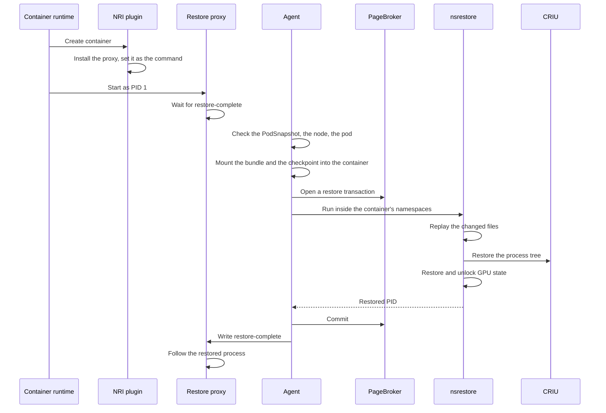

<!--
SPDX-FileCopyrightText: Copyright (c) 2026 NVIDIA CORPORATION & AFFILIATES. All rights reserved.
SPDX-License-Identifier: Apache-2.0
-->

# Restore flow

<!-- toc -->
- [The destination pod](#the-destination-pod)
- [Container creation](#container-creation)
  - [Nodes without the restore proxy](#nodes-without-the-restore-proxy)
- [Checking that the restore can proceed](#checking-that-the-restore-can-proceed)
- [Inspecting the destination](#inspecting-the-destination)
- [Bringing in the tools and the checkpoint](#bringing-in-the-tools-and-the-checkpoint)
- [Inside the container](#inside-the-container)
  - [How CRIU is run](#how-criu-is-run)
- [Restoring GPU state](#restoring-gpu-state)
- [Completing](#completing)
- [Reporting the outcome](#reporting-the-outcome)
- [The four stages in the benchmarks](#the-four-stages-in-the-benchmarks)
- [Where multi-GPU differs](#where-multi-gpu-differs)
- [Invariants](#invariants)
<!-- /toc -->

This page follows one restore from a pod carrying `nvidia.com/restore-from` to a running, restored process and a final `nvidia.com/Restored` condition.
The [node agent](node-agent.md) page describes the processes that appear below.
To restore a workload, follow [Restore a replica](../../guides/restore.md) and the [restore pod contract](../restore-pod-contract.md) instead.

The operator plays no part in a restore.
Two parts of the agent do:

- The **NRI plugin** acts when the container runtime creates the destination container, before anything runs in it. It makes the restore proxy the container's PID 1.
- The **controller** acts once the pod is running. It checks that the restore is possible, performs it, and reports the outcome.

## The destination pod

A restore pod is an ordinary pod plus what the [restore pod contract](../restore-pod-contract.md) requires:

- The `nvidia.com/restore-from` annotation naming the `PodSnapshot`.
- The control directory, mounted with `subPath` equal to the container name, and the `SNAPSHOT_CONTROL_DIR` environment variable.
- The `block-iouring` seccomp profile.
- Optionally, a startup probe that waits for `restore-complete`.

`podcontract.Build` in `api/podcontract` produces that pod from a plain one, and `podcontract.Validate` checks the minimum of it.
The destination container keeps the source's command in its spec.
That command never runs.
The `nvidia.com/restore-container-map` annotation can send one captured container into several destination containers of the same pod.
Each destination is restored on its own, and the pod's condition combines the results.

## Container creation

When the kubelet asks the runtime to create a container in a pod carrying `nvidia.com/restore-from`, the runtime calls the agent's NRI plugin:

1. Determine whether this container is a destination. Without a container map, that means reading the `PodSnapshot` for the captured container's name, so the `PodSnapshot` must exist by then, though it need not be `Ready`.
2. Copy the restore proxy into the container's control directory on the host.
3. Replace the container's OCI arguments with the proxy's path. Nothing else changes. Mounts, environment, and the seccomp profile come from the pod spec.
4. On any error, fail the container's creation so the kubelet retries. Falling back to the image's own command would start the workload from scratch in a container the agent is about to restore into.

The container starts with the proxy as PID 1.
If the control directory already contains `restore-complete` or `restore-failed`, the proxy exits immediately with code 112.
That is how a pod gets exactly one restore even when its container restarts.
Otherwise the proxy waits.

### Nodes without the restore proxy

Changing a container's command through NRI needs NRI 0.10, which ships with containerd 2.2.
On an older runtime, or one with NRI disabled, the plugin cannot register when the agent starts.
The agent logs that it is restoring without the proxy and skips the PID 1 check described below.
The container's own command then stays PID 1, and the restored process runs beside it.
The [restore pod contract](../restore-pod-contract.md#nodes-without-the-restore-proxy) lists the consequences: the container needs an inert command, the workload's exit code is lost, and signals do not reach it.

## Checking that the restore can proceed

The agent's informer delivers every pod on its node that carries the annotation.
Before touching the pod, the agent checks, reading each object directly from the API server rather than its cache:

1. The `PodSnapshot` exists, is not deleting, is `Ready`, and is bound to a `PodSnapshotContent`. Otherwise `SnapshotPending`.
2. That content exists, points back at this `PodSnapshot` with the same UID, and is `Ready`. Otherwise `ContentPending`.
3. The pod passes `podcontract.Validate`, and the content names exactly one container. Otherwise `RestoreFailed`.
4. The checkpoint directory exists on the shared volume. Otherwise `ArtifactPending`.
5. The **preflight compatibility gate** passes. A compatibility gate is a set of rules comparing what the checkpoint's manifest recorded about the source with what the destination offers. This first gate uses only the manifest and the pod spec: CPU architecture, kernel version, and CPU and memory limits. [Storage and artifacts](storage.md#compatibility-checks) lists every rule and why it exists. A failed gate is a **refusal**, reported as `RestoreIncompatible`, and final unless the pod later gains the `nvidia.com/snapshot-skip-compat-check` annotation.
6. If the checkpoint kept established TCP connections, the pod has an IP address, because restore must rewrite the addresses in those sockets. Otherwise `PodIPPending`.

For each `Pending` outcome the agent writes `Restored=False` with that reason, emits an event, and tries again later.
A pod that already carries a final `Restored` condition, for example because the agent restarted, is left alone.

When everything passes:

1. Add the `snapshot/restore-protection` finalizer to the pod.
2. Write `Restored=False` with reason `RestoreInProgress`.
3. For each destination container, find its container ID in the pod status, polling the runtime briefly if the status has not caught up, emit a `RestoreRequested` event, and run the restore below with a deadline of `restoreTimeoutSeconds`.

## Inspecting the destination

The restore proper begins in `Restore` in `agent/internal/executor/restore.go`:

1. Read the manifest and check that it names this `PodSnapshotContent` and container.
2. If the manifest records CuInterpose libraries, check that the copies in the agent's bundle hash to the same values.
3. If it records a CustomStorage capture, check that PageBroker on this node supports CustomStorage.
4. Through the container runtime, resolve the destination container's PID and OCI spec.
5. Check that PID 1 is the restore proxy, unless the node runs without it.
6. Read the container's image ID, cgroup, and AppArmor or SELinux label.
7. Discover the container's GPUs the same way capture did, in CUDA's order.
8. Build the **device map** from the source GPUs in the manifest to the destination GPUs: a GPU with the same UUID on both sides maps to itself, and the rest pair up by position. Note any GPU whose `/dev/nvidiaN` path differs, since CRIU will try to reopen the source path.
9. Run the **inspect compatibility gate**: image digest, the mounts the source had, GPU model, GPU count, and driver version. The GPU count is compared even when the gates are turned off, because a per-GPU piece of device state has nowhere to go otherwise.

A refusal at either gate leaves the container running.
No CRIU work was attempted, retrying on this node cannot change the answer, and killing the container would only restart it into the same refusal.

## Bringing in the tools and the checkpoint

The workload image contains nothing Snapshot needs, so the agent mounts it in through `ns-bind-mount`, a C helper whose allowed sources, destinations, and flags are compiled in.
For each mount, the helper clones the source, applies the flags, enters the container's mount namespace, and attaches the clone there.

| Source in the agent | Destination in the container | Flags |
| --- | --- | --- |
| The bundle, `/snapshot-binaries` | `/tmp/snapshot-binaries` | read-only, `nosuid`, `nodev` |
| The CuInterpose libraries | `/tmp/snapshot-cuda` | the same, only for CuInterpose checkpoints |
| The checkpoint directory | `/tmp/checkpoint` | read-only, `nosuid`, `nodev`, `noexec` |
| PageBroker's staging directory | `/tmp/pagebroker` | the same, only in staged mode |

The agent then opens a PageBroker transaction for the restore:

- In the default `direct` mode, PageBroker holds the checkpoint directory open while CRIU reads it from the volume.
- In `staged` mode, PageBroker first copies the CRIU images, but not the GPU payload, into its memory-backed staging directory, and CRIU reads from there.
- For a CustomStorage checkpoint, the transaction also hands the agent a socket that `nsrestore` will use to reach PageBroker from inside the container.

## Inside the container

Everything from here to the GPU unlock happens inside the destination container's namespaces.
The agent runs its `nsrestore` program there by entering the container's mount, UTS, IPC, network, and PID namespaces and its root filesystem.
The program is passed as an open file descriptor so that it can execute after the root changes, and the mount namespace is held open through another descriptor so that it survives even if the proxy exits.
Inside, `PATH` and `LD_LIBRARY_PATH` point at the bundle, and `nsrestore` reports its result as JSON on stdout.

`RestoreInNamespace` in `agent/internal/executor/nsrestore.go` runs these steps in order:

1. **Replay the changed files.** Unpack `rootfs-diff.tar` over `/` with the bundle's `tar`, skipping any file that already exists so that nothing from the image is overwritten, then remove the paths in `deleted-files.json`. The container's root is the runtime's own overlay of the same image, so after this step every file the processes expect is in place. No new filesystem is mounted.
2. **Place the CUDA job file**, if the checkpoint has one, at `/snapshot-control/cuda-checkpoint-job`.
3. **Alias GPU device paths.** Where the destination GPU has a different `/dev/nvidiaN` path, bind mount the destination device over the source path, so that CRIU reopens the right device.
4. **Unmount `/dev/shm`**, so that CRIU recreates it with the checkpointed contents.
5. **Remount `/proc/sys` writable** for the duration of the CRIU restore.
6. **Open the helper programs now.** Open `cuda-checkpoint-helper` and the CuInterpose coordinator as file descriptors, because the mount namespace CRIU builds for the restored tree will not contain the bundle.
7. **Remove stale state.** Remove old sentinels from the control directory, and any `/run/criu.kdat` the archive carried over from the source node, so that CRIU probes this kernel's features itself.
8. **Make securityfs visible** if the destination has an AppArmor label and it is not, and hide it again just before CRIU creates the first process.
9. **Run CRIU.** CRIU rebuilds the process tree and reports the root process's PID as seen inside the container.
10. **Match PIDs.** Match the CUDA processes recorded in the manifest to the restored processes.
11. **Restore native GPU paths** inside each restored process's mount namespace, undoing step 3.
12. **Restore GPU state.** Described below.
13. **Run the CuInterpose coordinator**, if the checkpoint has one, to rebuild the shared memory.

### How CRIU is run

Restore uses the CRIU settings recorded in the manifest, so that a checkpoint is restored the way it was dumped.
On top of those, a few options only make sense on the destination:

| Option | Value | Why |
| --- | --- | --- |
| `root` | `/` | `nsrestore` already runs inside the container's root. |
| `ext_mnt` | every externalized mount, mapped to itself | The runtime recreated the OCI mounts in the destination. |
| Inherited network namespace | the destination's | The restored sockets land in the new pod's namespace. |
| Inherited file descriptors 0 to 2 | the proxy's | The restored process's standard streams reach the container log. |
| `cgroup_root` | the destination's cgroup | Restored processes are accounted where the kubelet expects. |
| `lsm_profile` | the destination's label | The AppArmor or SELinux label comes from the destination, never from the checkpoint. |
| `network_lock` | skip | The destination namespace is fresh, so there is nothing to unlock, and skipping avoids a dependency on `iptables-restore`. |
| Plugin directory, binary, configuration | from the bundle, generated fresh | Nothing executable or configurable comes from the checkpoint. |

Before CRIU starts, the agent rewrites one image file, `files.img`, and attaches the rewritten copy over the original.
A checkpoint may be restored into several pods on the same node, or into several containers of one pod, and some identifiers would collide:

- Bound abstract Unix socket names get a suffix unique to the destination.
- An established TCP connection whose both ends are in the checkpoint gets a fresh client port.
- An established connection to a peer outside the checkpoint is restored closed, since the remote end cannot follow a cloned connection.

When the checkpoint kept established connections and the destination pod has a different IP address, the agent also writes a one-line mapping file, and Snapshot's `snapshot_inet_remap.so` CRIU plugin rewrites the source and destination address of every IPv4 socket CRIU restores.

If the destination has an AppArmor or SELinux label and the checkpoint's process images do not record one, the restore is refused with a message to take the checkpoint again.
Labels are recorded only when securityfs was visible to the agent at dump time.

## Restoring GPU state

Which path runs is decided by the checkpoint, not by the destination:

- **Checkpoint taken without CustomStorage.** The device memory is inside the process memory CRIU has just restored. `nsrestore` runs `cuda-checkpoint-helper` to restore each CUDA process, passing the device map, and then to unlock each one. The driver copies the memory back onto the GPU.
- **Checkpoint taken with CustomStorage.** The device memory is in the `gpu/` files of the checkpoint. `nsrestore` sends PageBroker one request naming every restored CUDA process. PageBroker streams the files back onto the GPUs, reading from the original checkpoint on the volume even in staged mode, and unlocks the processes.

In both cases the device map tells the driver which destination GPU receives each source GPU's state.
CRIU's own cleanup is postponed until after the unlock, to keep the time during which CUDA is locked as short as possible.

## Completing

Back in the agent, after `nsrestore` returns:

1. Remove the checkpoint mount and commit the PageBroker transaction, which releases the directory. Remove the bundle mount. Keep the CuInterpose mount, because the restored processes load from it later.
2. Check that the restored process is alive and not a zombie.
3. Write `restore-complete`, containing `pid=<restored PID>`, atomically into the control directory, with symlink resolution disabled so that nothing inside the container can redirect the write.

The proxy sees the file, reads the PID, logs the restored process's command line, and starts forwarding signals to it.
If the pod has the startup gate, its probe now succeeds and the kubelet starts running the workload's own readiness probe.
The workload, which has been waiting for `restore-complete` as the [workload contract](../workload-contract.md) requires, resumes.

The agent logs a timing summary with the phases `pagebroker_stage`, `pagebroker_mount`, `pagebroker_commit`, `gpu_device_map`, `overlay_capture`, `criu_prepare`, `criu_restore`, and `cuda_restore`.

## Reporting the outcome

Each destination's restore ends in success, a refusal, or an error.
The agent combines them into the pod's `nvidia.com/Restored` condition and one event:

| Destinations | Condition | Reason |
| --- | --- | --- |
| All succeeded | `True` | `RestoreSucceeded` |
| Some succeeded | `False` | `RestorePartiallySucceeded` |
| Only refusals | `False` | `RestoreIncompatible` |
| Any error | `False` | `RestoreFailed` |
| Any still pending | `False` | `RestoreInProgress`, and the agent tries again |

The condition is written with server-side apply under Snapshot's own field manager, so the agent owns that one condition and nothing else in the pod's status.
A final outcome removes the finalizer.
`podcontract.ClassifyRestoreOutcome` turns the condition into a small enum for integrators.
A reason that only means "waiting for something", such as `SnapshotPending`, classifies as `Unknown` on purpose, so that an integrator applies its own policy to it.

On an error:

1. The agent writes `restore-failed` into the control directory.
2. The agent kills the container. For a CustomStorage restore, this waits until PageBroker has finished or drained its GPU work.
3. The proxy, if still running, exits 112.
4. With `restartPolicy: Never` the pod ends there. With any other policy the container restarts, the proxy finds the sentinel and exits 112 again, and the pod goes into `CrashLoopBackOff`. That is why restore pods are expected to use `Never`.

The events the agent emits on the pod:

| Event | Type | When |
| --- | --- | --- |
| `SnapshotPending`, `ContentPending`, `ArtifactPending`, `PodIPPending` | Normal | A dependency is not ready yet. |
| `RestoreCompatibilityUnchecked` | Warning | The manifest could not be read, so the gates did not run. |
| `RestoreRequested` | Normal | A destination's restore started. |
| `RestoreWorkerFailed` | Warning | A destination's restore failed. The message carries the error. |
| `RestoreCleanupFailed` | Warning | The restore succeeded but a cleanup step did not. |
| `RestoreSucceeded`, `RestorePartiallySucceeded`, `RestoreIncompatible`, `RestoreFailed` | Normal or Warning | The final outcome, with the same text as the condition. |
| `RestoreAlreadyCompleted`, `RestoreAlreadyPartiallySucceeded`, `RestoreAlreadyFailed` | Normal or Warning | The pod was already final when the agent saw it. |
| `RestoreStatusUpdateFailed`, `RestoreFinalizerUpdateFailed` | Warning | The agent could not write to the pod. |

A refusal's message begins `Refused restore; this node cannot run the checkpoint:` and lists one `<check>: source <value>, target <value>` entry per failed rule.

## The four stages in the benchmarks

The [benchmarks](../../development/benchmarks.md) report restore time in four stages:

| Stage | Sections above |
| --- | --- |
| Agent setup | Checking that the restore can proceed, inspecting the destination, bringing in the tools and the checkpoint |
| CRIU restore | Inside the container, up to and including step 9 |
| CUDA restore | Restoring GPU state |
| Wake and remap | The address rewrite, the device map, and completing |

## Where multi-GPU differs

A CuInterpose restore adds these steps and nothing else:

- The libraries in the bundle must hash to the values in the manifest before anything else happens.
- The libraries are mounted at `/tmp/snapshot-cuda` and left mounted after success.
- The coordinator is opened before CRIU, like the helper.
- The coordinator runs after the GPU unlock and before `restore-complete` is written.

[Multi-GPU support](multi-gpu.md#restore) explains what the coordinator rebuilds.

## Invariants

- A pod gets one restore. The sentinels persist in the `emptyDir`, the proxy never deletes them, and a final condition is never acted on again. The one exception is a refusal reopened by the skip annotation.
- The Pod object is never changed by the NRI plugin. Only the container's OCI arguments change, and a plugin error fails creation rather than falling back to the image's command.
- Wherever the runtime can provide the proxy, it is required. A container whose PID 1 is not the proxy fails the restore.
- Everything mounted into the container comes from a compiled-in list, and the checkpoint is mounted `noexec`.
- Nothing executable or configurable comes from the checkpoint. CRIU, its plugins, `tar`, and CRIU's configuration all come from the agent.
- CRIU runs with the settings recorded at dump time, plus only the destination-specific options listed above.
- Both compatibility gates raise the same refusal, word it the same way, and treat an unknown value as a pass.
- The cgroup, the security label, the GPUs, and the device map are all taken from the destination container as it was created.
- CUDA stays locked until both CRIU and the GPU restore have finished.
- The agent owns exactly one condition on the pod, written by one goroutine per pass.
