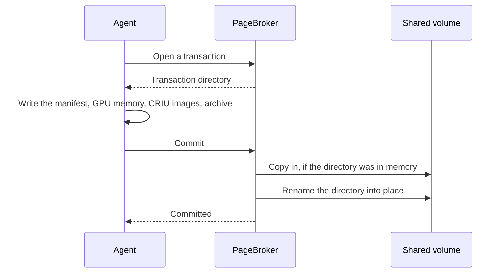

<!--
SPDX-FileCopyrightText: Copyright (c) 2026 NVIDIA CORPORATION & AFFILIATES. All rights reserved.
SPDX-License-Identifier: Apache-2.0
-->

# Storage and artifacts

<!-- toc -->
- [Where an artifact lives](#where-an-artifact-lives)
- [The manifest](#the-manifest)
- [How an artifact is published](#how-an-artifact-is-published)
- [How an artifact is read](#how-an-artifact-is-read)
- [Compatibility checks](#compatibility-checks)
- [How an artifact is deleted](#how-an-artifact-is-deleted)
- [Identifying the store, and object storage](#identifying-the-store-and-object-storage)
<!-- /toc -->

This page describes what a checkpoint is once it is on disk: how it is laid out, what it records about its origin, how it is published and read, how a destination is judged able to run it, and how it is deleted.
The [overview](README.md) introduces the pieces this page assumes.
To size and configure the checkpoint volume, see [Storage](../../operations/storage.md) instead.

A stored checkpoint is called an **artifact**.
It is a directory on the shared volume containing CRIU's image files, the GPU memory when CustomStorage was used, an archive of the files the container changed, and a manifest that describes the machine the checkpoint was taken on.
Every agent, every PageBroker, and the operator mount the volume at `/checkpoints`.
Workload pods never do.

## Where an artifact lives

```
/checkpoints/artifacts/<PodSnapshotContent UID>/containers/<container name>/
```

The UID, not the name, chooses the path.
A `PodSnapshotContent` that is deleted and recreated gets a new UID, and therefore a fresh, empty path, so it can never pick up a stale checkpoint.
Both the agent and the operator compute this path through `agent/pkg/artifact`, which also validates every path element, so the two sides cannot disagree.

The mount point itself is fixed.
`ns-bind-mount`, the helper that mounts an artifact into a destination container, has `/checkpoints` compiled in as the only allowed source, and the agent refuses any other `storage.basePath`.

A published artifact contains:

| File | Written by | Present |
| --- | --- | --- |
| `manifest.yaml` | The agent, before the dump | Always |
| `criu.conf` | The agent | Always in practice. It carries the CRIU options that cannot be passed any other way. |
| `dump.log` and the CRIU image files | CRIU | Always |
| `rootfs-diff.tar` | The agent, after the dump | Unless archiving failed in a way that is not fatal |
| `deleted-files.json` | The agent | When the container deleted files from its image |
| `cuda-checkpoint-job` | The agent, copied from the control directory | For GPU checkpoints taken without CustomStorage whose workload ran under `cuda-checkpoint --launch-job` |
| `cuinterpose.state` | The CuInterpose coordinator | For [multi-GPU](multi-gpu.md) checkpoints |
| `gpu/<pid>/manifest.txt` and `gpu/<pid>/device-NNNN.bin` | PageBroker | For GPU checkpoints taken with CustomStorage |

While a capture is in flight, sibling directories can appear next to the final one:

- `<name>.pagebroker-tx-<id>`, a transaction being written directly on the volume.
- `<name>.pagebroker-partial`, a transaction being copied in from memory.
- `<name>.pagebroker-previous`, an older artifact being replaced.

None of them survives a committed or aborted transaction.

## The manifest

`manifest.yaml` is the artifact's description of itself.
The agent writes it before the dump, so that it is complete no matter how the dump ends, and restore reads it before touching anything.
It is defined in `agent/internal/types/manifest.go`.

| Section | Records | Used for |
| --- | --- | --- |
| `artifact` | The `PodSnapshotContent` UID and container name | Confirming a directory belongs to the object being handled |
| `criuDump` | The CRIU options in force at dump time, and the mounts CRIU externalized | Restoring with the same options. The externalized mounts feed the `mount` compatibility check |
| `k8s` | The source container ID and PID, node, pod name and namespace, pod IP, the pipes behind its standard streams, image, image ID, and CPU and memory limits | Compatibility checks, the IP rewrite, reconnecting the standard streams, and the `status.source` block |
| `overlay` | How the archive of changed files was taken | Informational |
| `cudaRestore` | Whether CustomStorage was used, the CUDA process IDs, the source GPUs in CUDA's order with their UUIDs and models, the driver version, and each GPU's `/dev/nvidiaN` path | GPU restore, the device map, and the GPU compatibility checks |
| `host` | Kernel version and CPU architecture | Compatibility checks |
| `cuinterpose` | The hash of each CuInterpose library and the processes that used them | [Multi-GPU](multi-gpu.md) restore |

A value the agent could not read at capture is left out rather than written empty, so that it reads as unknown.
Fields are added over time and older artifacts stay readable.

When a capture succeeds, the agent copies part of the manifest onto `PodSnapshotContent.status.source`: the node, kernel, architecture, image and digest, resource limits, driver version, and GPU models.
That block is for people and tooling to read.
Restore compares the manifest, never the status, and both are produced by the same function so they cannot disagree.

## How an artifact is published

The agent never writes to the final path.
Every capture runs inside a **PageBroker transaction**: a directory PageBroker hands out, which it later publishes or deletes.



- For a checkpoint whose GPU memory travels through CRIU, the transaction directory is on the memory-backed volume shared by the agent and PageBroker, and commit copies it to the shared volume beside the final location before renaming.
- For a CustomStorage checkpoint, the GPU memory is too large to stage in memory, so the transaction directory is created directly on the shared volume beside the final location, and commit is a plain rename.

The rename is the commit point.
Before it, nothing exists at the final path.
After it, the artifact is complete.
This is why the agent can treat the presence of the directory, with a manifest naming the right object, as proof that a capture succeeded, which it needs when it restarts between the commit and writing `Ready`.

An aborted transaction is deleted, `dump.log` included, so a failed capture leaves nothing on the volume.
A transaction that is neither committed nor aborted expires after about two hours.

Because the memory-backed path charges its pages to the process writing them, the agent container's memory limit bounds the largest CPU-side checkpoint a node can take.
CustomStorage GPU payloads go straight to the volume and are not bounded that way.

## How an artifact is read

A restore also runs inside a transaction, so that PageBroker knows which artifacts are in use.

- **`direct` mode, the default.** PageBroker holds the artifact directory open. CRIU reads it from the volume through a read-only bind mount at `/tmp/checkpoint` in the destination container.
- **`staged` mode.** PageBroker first copies the artifact, except its `gpu/` directory, into its memory-backed staging area. CRIU reads from a bind mount of that.

GPU memory written by CustomStorage is always read from the original artifact, in either mode, directly into the GPU with `O_DIRECT`.
The volume's read bandwidth therefore bounds a large GPU restore, and the [benchmarks](../../development/benchmarks.md) show CRIU's read of the CPU images as the largest stage even without it.

## Compatibility checks

A checkpoint is tied to the machine it came from.
Rather than let an unsuitable restore fail somewhere inside CRIU with an error nobody can attribute, Snapshot compares what the manifest recorded with what the destination offers, and refuses up front with a reason.
The rules live in `api/compat`.
Only the agent evaluates them, but they live in the `api` module because their names appear on pod events and integrators match on them.

The rules run at two points, because different information is available at each:

- The **preflight** gate runs before the agent starts a restore, when only the manifest and the pod spec can be read.
- The **inspect** gate runs once the destination container exists, when its image, mounts, and GPUs can be read.

| Check | Gate | Rule | Why |
| --- | --- | --- | --- |
| `cpu-arch` | preflight | Must match | CRIU cannot restore one architecture's registers on another. |
| `kernel-version` | preflight | Must match | Restores have broken on a kernel upgrade alone. |
| `kernel-minimum` | preflight | At least 5.13 | glibc's use of `rseq` needs it, and newer glibc crashes below it. |
| `memory-limit` | preflight | At least the source's | Restore faults the whole address space back in, so less memory is an OOM kill part way through. |
| `cpu-limit` | preflight | At least the source's | Less CPU restores fine and then runs slower forever, with nothing to say why. |
| `image-digest` | inspect | Must match | The archive of changed files assumes the same image contents. The image reference is not compared, only its digest. |
| `mount` | inspect | Every mount the source externalized must exist | CRIU binds those paths from the destination. |
| `gpu-model` | inspect | Same models in the same quantities | Device state is built for one GPU architecture. |
| `gpu-count` | inspect | Must match | Each GPU's state has to land on a GPU. |
| `driver-version` | inspect | Must match, down to the build | Restores have failed between two patch builds of one driver. |
| `driver-minimum` | inspect | At least 580 | The oldest driver with CUDA checkpoint support. |

Two rules apply to every row:

- A value missing on either side is unknown, and an unknown value never refuses, because a checkpoint taken before a field was recorded must stay restorable.
- Both gates produce the same refusal, reported as `RestoreIncompatible` with one `<check>: source <value>, target <value>` entry per failed rule.

The `nvidia.com/snapshot-skip-compat-check` pod annotation, or `restore.skipCompatCheck` in the agent's configuration, turns the gates off.
That is for debugging: a restore that should have been refused then fails somewhere inside CRIU instead.
The GPU count is compared even then.

## How an artifact is deleted

Artifacts are deleted by the operator, never by the agent.
[Control plane](control-plane.md#deleting-checkpoints) describes the queue that does it.
The rules that keep deletion safe:

- A `PodSnapshotContent` carries a cleanup finalizer from creation, so that its artifact is removed before the object can disappear. A `PodSnapshot` deletion waits for that.
- Deletion removes `/checkpoints/artifacts/<uid>` and refuses anything that is a symlink or not a directory.
- A periodic sweep lists the directories first and then lists every `PodSnapshotContent`, so that an artifact written in between is never mistaken for an orphan. A directory whose name is not a live UID is removed, a bounded number per sweep.
- Every step can be repeated safely, and work that was dropped is found again by the next sweep.

The lock in `api/storage/coordination` only keeps two cleanup workers in the same operator from deleting the same artifact at once.
It does not coordinate with the agent.
That safety comes from the UID-based layout, the finalizer, and the order of the sweep.

Claims the chart creates carry `helm.sh/resource-policy: keep`, so uninstalling Snapshot keeps every artifact.

## Identifying the store, and object storage

Today the only store is the shared volume.
The chart renders a `storage.yaml` naming the claim and the path inside it, and the operator hashes those fields into a **store ID** of the form `store-v1-<sha256>`.
A `PodSnapshotContent` can carry that ID in `spec.storage.storeID`.
When it does, cleanup refuses to act on a content bound to a different store, so that a directory missing from the wrong volume is never counted as deleted.
The operator does not set the field on the contents it creates today.

The field exists for the [S3 proposal](../../proposals/237-s3-storage/README.md), which extends the model above rather than replacing it:

- PageBroker gains an S3 backend behind the same transaction interface.
- Publishing becomes an upload with an index object written last, and a `PodSnapshotContent` becomes `Ready` only when PageBroker confirms publication.
- The operator's cleanup gains an S3 backend that lists and deletes under the same `artifacts/<uid>/` key layout.
- Restore copies the whole artifact to the node first, since CRIU cannot read object storage.

Parts of that design are already in the tree: the `spec.storage` and `status.storage` fields, the store ID, the S3 cleanup backend, and the artifact-addressed PageBroker requests.
None of it is reachable from a running configuration, and the chart rejects any `storage.type` other than `pvc`.
