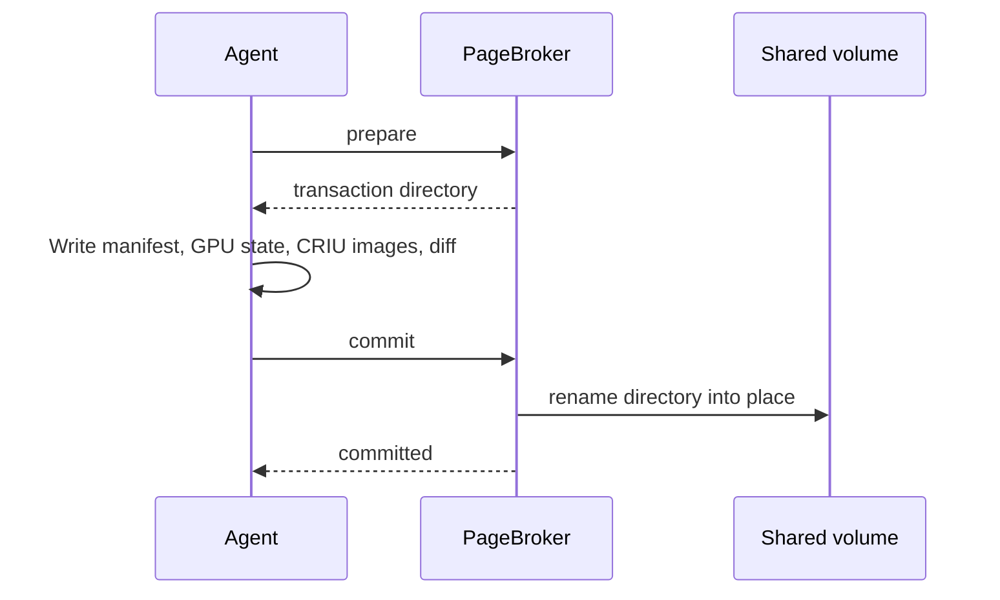

<!--
SPDX-FileCopyrightText: Copyright (c) 2026 NVIDIA CORPORATION & AFFILIATES. All rights reserved.
SPDX-License-Identifier: Apache-2.0
-->

# Storage and artifacts

<!-- toc -->
- [The store](#the-store)
- [Artifact layout](#artifact-layout)
- [The manifest](#the-manifest)
- [Publishing](#publishing)
- [Reading at restore](#reading-at-restore)
- [Compatibility checks](#compatibility-checks)
- [Cleanup](#cleanup)
- [Object storage](#object-storage)
<!-- /toc -->

This page is for contributors.
It describes what a checkpoint artifact is, how it is identified, published, checked, and deleted, and where object storage fits.
To size and configure the checkpoint volume, see [Storage](../../operations/storage.md) instead.

## The store

Today the store is one `ReadWriteMany` PersistentVolumeClaim per installation, mounted at `/checkpoints` in every agent, every PageBroker, and the operator.
Workload pods never mount it.
Agents on different nodes write and read it concurrently, which is why it must be RWX.

The mount path is fixed.
`ns-bind-mount`, the C helper that places the artifact into a restore container, has `/checkpoints` compiled in as the only allowed source root, and the agent's configuration validation rejects any other `storage.basePath`.

The chart also renders a `storage.yaml` that names the claim and the path inside it.
The operator hashes those fields into a **store ID** of the form `store-v1-<sha256>`.
A `PodSnapshotContent` can carry that ID in `spec.storage.storeID`, and maintenance refuses to clean up a content bound to a different store, so a missing directory on some other volume is never mistaken for a completed deletion.
The operator does not set `spec.storage` on the contents it creates today.
The field exists for the object storage work described at the end of this page.

## Artifact layout

Every artifact lives at a path derived from two immutable identifiers:

```
/checkpoints/artifacts/<PodSnapshotContent UID>/containers/<container name>/
```

The UID, not the name, owns the path.
A content that is deleted and recreated gets a new UID and therefore a new, empty path, so it can never adopt a stale checkpoint.
`agent/pkg/artifact` validates every path element against a small character set and checks containment, and the operator's cleanup imports the same package so the two sides cannot disagree about the layout.

A committed artifact directory contains:

| File | Written by | Present when |
| --- | --- | --- |
| `manifest.yaml` | The agent, before the dump | Always |
| `criu.conf` | The agent | When CRIU options that cannot travel over its RPC are set, which the chart always does |
| `dump.log` and the CRIU images (`pstree.img`, `core-*.img`, `files.img`, `mountpoints-*.img`, page files, and so on) | CRIU | Always |
| `rootfs-diff.tar` | The agent, after the dump | Normally. Absent if the diff failed in a non-fatal way |
| `deleted-files.json` | The agent | Only if the container deleted files from its image |
| `cuda-checkpoint-job` | The agent, copied from the workload's control directory | Native GPU captures launched under `cuda-checkpoint --launch-job` |
| `cuinterpose.state` | The CuInterpose coordinator | [Multi-GPU](multi-gpu.md) captures |
| `gpu/<pid>/manifest.txt` and `gpu/<pid>/device-NNNN.bin` | PageBroker | CustomStorage GPU captures |

Beside a destination, a contributor may see transient siblings while a capture is in flight: `<name>.pagebroker-tx-<txn>` for a direct capture, `<name>.pagebroker-partial` while a staged capture is being copied in, and `<name>.pagebroker-previous` while an older artifact is being replaced.
They never survive a committed or aborted transaction.

## The manifest

`manifest.yaml` is the artifact's self-description.
`agent/internal/types/manifest.go` defines it.
The agent writes it before CRIU runs, so it is complete regardless of how the dump ends, and restore reads it before touching anything.

| Section | Contents | Read by |
| --- | --- | --- |
| `artifact` | `contentUID` and `containerName` | The agent, to confirm a directory belongs to the content it is handling |
| `createdAt` | Timestamp | Nothing. Informational |
| `criuDump` | The CRIU settings in force at dump time, and the external mount map | Restore, which dumps and restores with the same settings. The map's keys feed the `mount` compatibility check |
| `k8s` | Source container ID, PID, node, pod name and namespace, pod IP, stdio descriptor targets, image, image ID, CPU and memory limits | The compatibility checks, the inet-remap plugin, stdio re-wiring, and `status.source` |
| `overlay` | The exclusions, upper directory, and bind mount destinations used for the diff | Informational after capture |
| `cudaRestore` | Whether CustomStorage was used, the CUDA PIDs, the source GPU UUIDs and models in ordinal order, the driver version, the UUID to `/dev/nvidiaN` map, and `NVIDIA_VISIBLE_DEVICES` | GPU restore, the device map, and the GPU compatibility checks |
| `host` | Kernel version and CPU architecture | The preflight compatibility checks |
| `cuinterpose` | SHA-256 of each CuInterpose library and the PIDs that participated | [Multi-GPU](multi-gpu.md) restore |

A value the agent could not read at capture is left out rather than written empty, so it reads as unknown.
Fields are added over time and older artifacts stay readable: for example `sourceGpus` carries GPU models next to the older `sourceGpuUuids`, and a manifest without it still restores.

On a successful capture the agent projects the manifest onto `PodSnapshotContent.status.source`: node name, architecture, and kernel, image and image digest, CPU and memory limits, driver version, and one entry per GPU model.
That block is informational.
Restore compares the manifest, never the status.
Both views are produced from the same `CompatEnvironment` function so they cannot drift apart.

## Publishing

No agent code writes to the final artifact path.
Every capture runs inside a PageBroker transaction, and PageBroker alone publishes.



| Capture | Transaction directory | Commit |
| --- | --- | --- |
| Staged, the default for CPU-only and for native GPU captures | On the memory-backed `/pagebroker/staging` volume shared by the two containers | Copy to a sibling of the destination on the volume, then rename into place |
| Direct, used for CustomStorage GPU captures | A temporary directory beside the destination on the volume | Rename into place |

The rename is the commit point.
Before it, nothing exists at the destination path.
After it, the artifact is complete.
This is what lets the agent treat the presence of the directory, together with a manifest naming the right content and container, as proof that a capture succeeded, which matters when the agent restarts between the commit and the `Ready` write.

An aborted transaction deletes its directory, `dump.log` included.
A failed capture therefore leaves nothing on the volume.
Transactions that are neither committed nor aborted expire after about two hours.

The staged path is bounded by memory.
The kernel charges staging pages to the container that writes them, which is the agent during a dump, so `daemonset.resources.limits.memory` bounds the largest CPU image a node can capture.
Direct GPU captures write device memory straight to the volume and are not bounded that way.

## Reading at restore

Restore also runs inside a transaction, so PageBroker knows which artifacts are in use.

| `pageBroker.restoreMode` | What PageBroker does | What CRIU reads |
| --- | --- | --- |
| `direct`, the default | Opens and holds the artifact directory | The volume, through a read-only bind mount at `/tmp/checkpoint` |
| `staged` | Copies the artifact, except `gpu/`, into `/pagebroker/staging/restore/<txn>` | Memory, through a bind mount at `/tmp/pagebroker` |

GPU payloads written by CustomStorage are always read from the original artifact with `O_DIRECT`, whichever mode is set.
The read bandwidth of the volume therefore bounds a large GPU restore, and the [benchmarks](../../development/benchmarks.md) show CRIU's bulk read as the largest stage for CPU images too.

## Compatibility checks

A checkpoint is tied to the machine it was taken on.
`api/compat` compares what the manifest recorded with what the destination offers, so an incompatible restore is refused up front with a reason, instead of failing deep inside CRIU with an error nobody can attribute.
The node agent is the only caller, but the package lives in `api` because the check names are published verbatim on pod events and conditions, and integrators branch on them.

The rules run at two gates, because they see different state:

| Check | Gate | Rule | Why |
| --- | --- | --- | --- |
| `cpu-arch` | preflight | Equal | CRIU cannot restore one architecture's register file on another |
| `kernel-version` | preflight | Equal | Restores have broken on a kernel upgrade alone |
| `kernel-minimum` | preflight | At least 5.13 | glibc's `rseq` use needs it, and newer glibc crashes below it |
| `memory-limit` | preflight | At least the source | Restore faults the whole address space in, so less memory is an OOM kill mid-restore |
| `cpu-limit` | preflight | At least the source | Less CPU restores fine and runs slower forever, with nothing to say so |
| `image-digest` | inspect | Equal | The root filesystem diff assumes the same image contents. The reference is not compared, only the digest |
| `mount` | inspect | Every externalized source mount exists | CRIU binds those paths from the destination |
| `gpu-model` | inspect | Same multiset of product names | Device state is built for one architecture |
| `gpu-count` | inspect | Equal | Each GPU's state has a rank that must land somewhere |
| `driver-version` | inspect | Equal, to the build | Restores have failed between two patch builds of one driver |
| `driver-minimum` | inspect | At least 580 | The oldest driver with CUDA checkpoint support |

The **preflight** gate runs before the agent claims the restore, when only the manifest and the pod spec are readable.
The **inspect** gate runs once the destination container exists, when its GPUs, image, and mounts can be read.

Two rules apply to the whole table.
A value missing on either side is unknown, and unknown never refuses, because a checkpoint taken before a field existed must stay restorable.
Both gates raise the same `IncompatibleError`, which the controller reports as `RestoreIncompatible` with one `<check>: source <value>, target <value>` entry per failed rule.

The `nvidia.com/snapshot-skip-compat-check` pod annotation, or `restore.skipCompatCheck` in the agent configuration, turns the gates off.
That is a debugging escape hatch: a restore that should have been refused then fails somewhere inside CRIU instead.
The GPU count is compared even then.

## Cleanup

Artifacts are deleted by the operator, never by the agent.
[Control plane](control-plane.md#artifact-cleanup) describes the queue.
The storage-side rules are:

- A content carries the `nvidia.com/podsnapshotcontent-artifact-cleanup` finalizer from creation, so its artifact is removed before the object disappears, and a `PodSnapshot` deletion waits for that.
- Deletion removes `/checkpoints/artifacts/<uid>` and refuses anything that is a symlink or not a directory.
- A periodic sweep enumerates the directories under `artifacts/` and then lists every content with a consistent, uncached list. A directory whose name is not a live content UID is an orphan and is removed, a bounded batch per sweep.
- Deletion is idempotent and dropped work is rediscovered by the next sweep.

The process-local lock in `api/storage/coordination` keeps two maintenance workers in one operator from deleting the same artifact at once.
It provides no exclusion against the agent.
That safety comes from the UID-keyed layout, the finalizer, and the sweep ordering above.

Chart-created claims carry `helm.sh/resource-policy: keep`, so uninstalling Snapshot keeps every artifact.

## Object storage

The [S3 proposal](../../proposals/237-s3-storage/README.md) extends this model rather than replacing it.
PageBroker gains an S3 backend behind the same transaction interface, publication becomes an upload followed by an index object written last, and a content becomes `Ready` only after PageBroker confirms publication.
The operator's maintenance workers gain an S3 backend that lists and deletes under the same `artifacts/<uid>/` key layout.
Restore stages the complete bundle before CRIU runs, since CRIU cannot read object storage directly.

Pieces of that design are already in the tree: `spec.storage` and `status.storage` on `PodSnapshotContent`, the store ID hash, the artifact identity triple, the S3 maintenance backend, and the artifact-addressed PageBroker requests.
None of it is wired to a running configuration, and the chart rejects any `storage.type` other than `pvc`.
